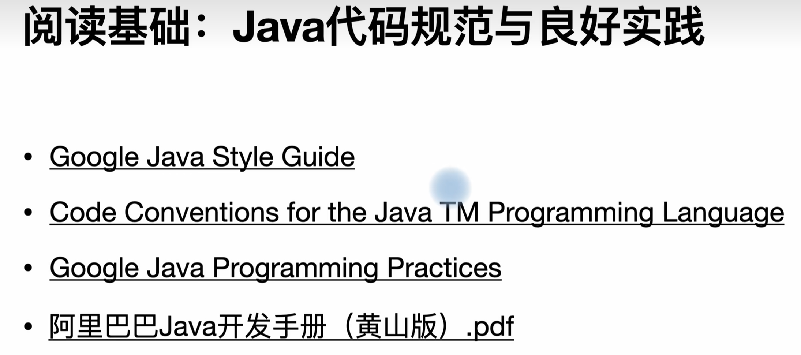
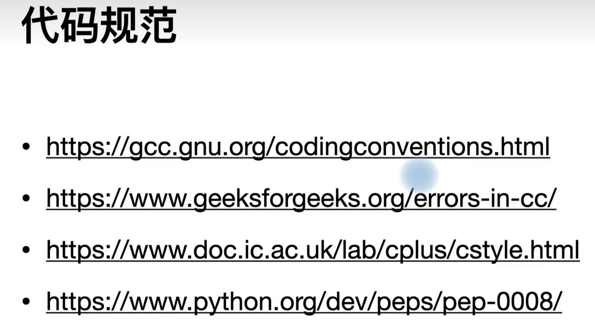

# 编程风格




[Google 开源项目风格指南](https://zh-google-styleguide.readthedocs.io/en/latest/)

## 先让代码容易看懂

名字：`count` 比 `a` 好懂，`student_count` 比 `count` 更清楚。循环下标 `i` / `j` 就不用硬取长名字。

一个函数做一件事。比如读文件、解析数据、输出结果分开，出错时比较容易知道卡在哪一步。

注释写“为什么这样做”，不用把代码翻译一遍：

```c
// 长度包含最后的 '\0'，所以多申请一个字符
char *copy = malloc(strlen(text) + 1);
```

## 少套一层

```c
int find_index(const int arr[], int size, int value) {
    if (arr == NULL || size <= 0) return -1;

    for (int i = 0; i < size; ++i) {
        if (arr[i] == value) return i;
    }
    return -1;
}
```

先处理不满足条件的情况，后面写正常流程；不用整个函数都缩在 `if (arr != NULL)` 里面。

格式不用自己发明：项目有现成规则就跟着项目，编辑器配好格式化工具。最重要的是同一个项目保持一致。
