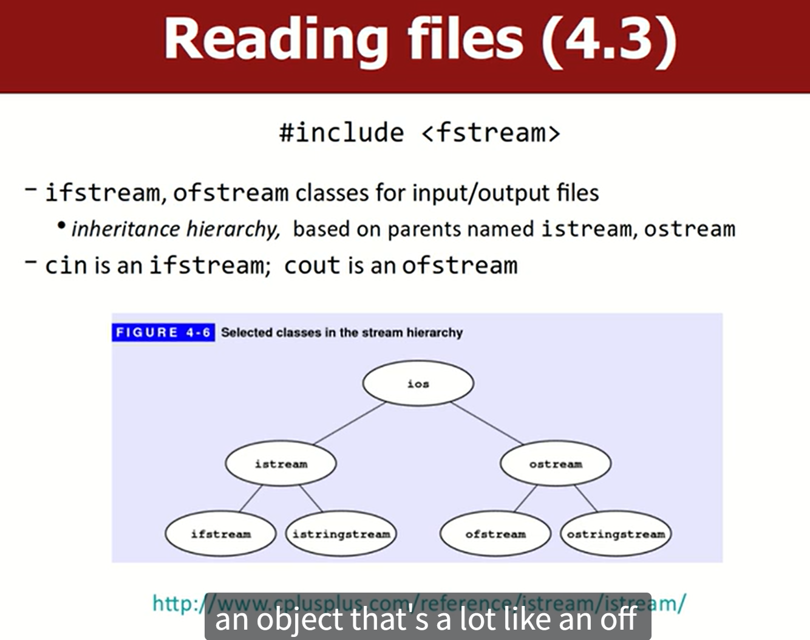
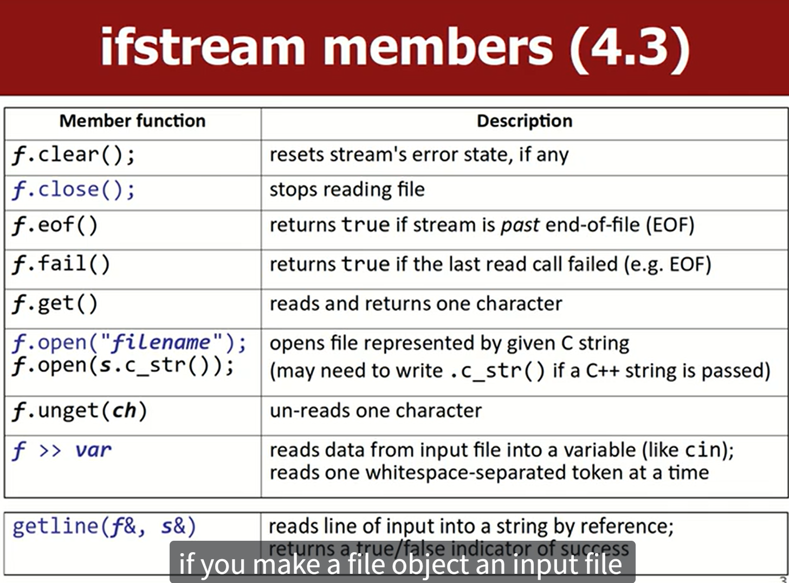
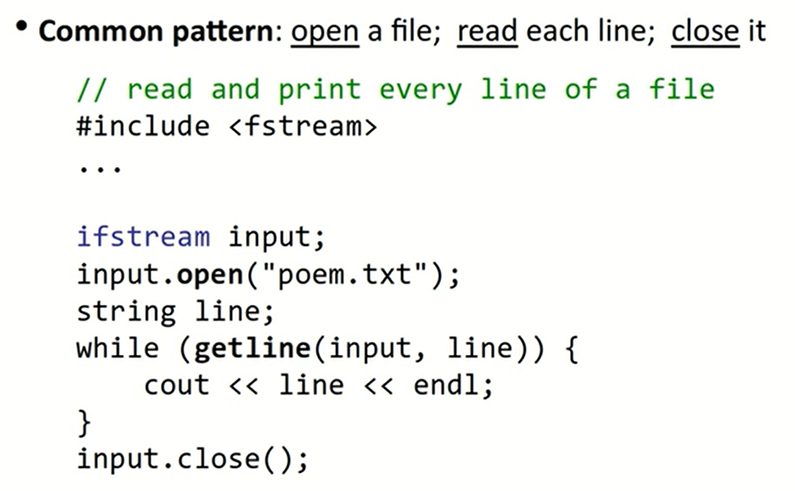
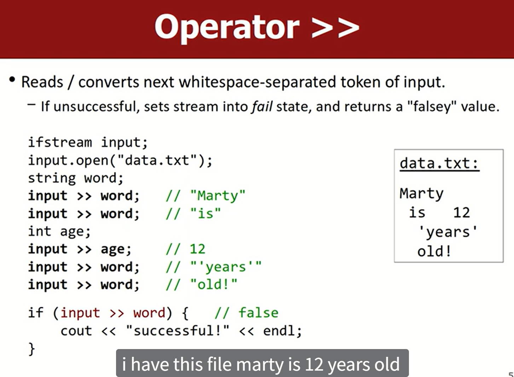
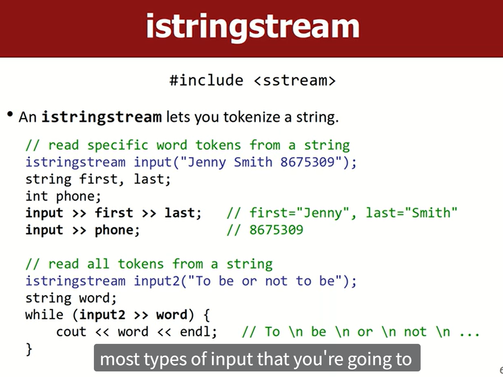
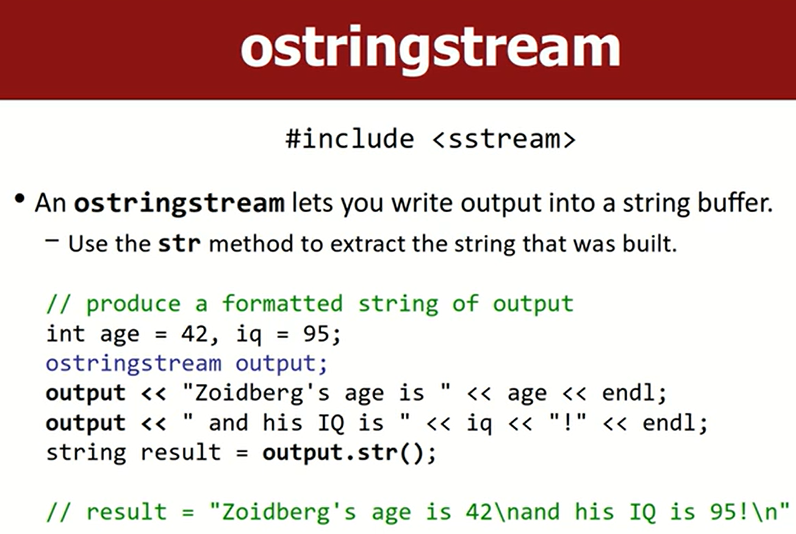

## Reading Files

`#include <fstream>`



- `std::cin` 的类型是 `std::istream`，表示标准输入流。
- `std::cout` 的类型是 `std::ostream`，表示标准输出流。
- `std::ifstream` / `std::ofstream` 用来读 / 写文件，分别继承输入 / 输出流的接口，所以也能用 `>>` / `<<`。

### ifstream member functions

```cpp
ifstream f;
```



例子：




`istringstream` 和 `ostringstream` 可以将字符串切分。即将输入/输出流重定向到字符串上（说人话就是将输入/输出写入字符串），再从字符串中读取/写入。




适合把不同类型拼成一段文本，或者从文本里逐项读数据；不能一概说它比直接拼字符串快。
