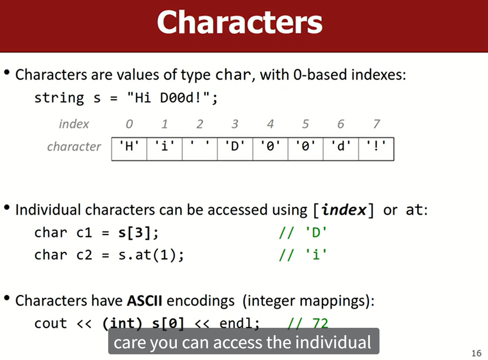
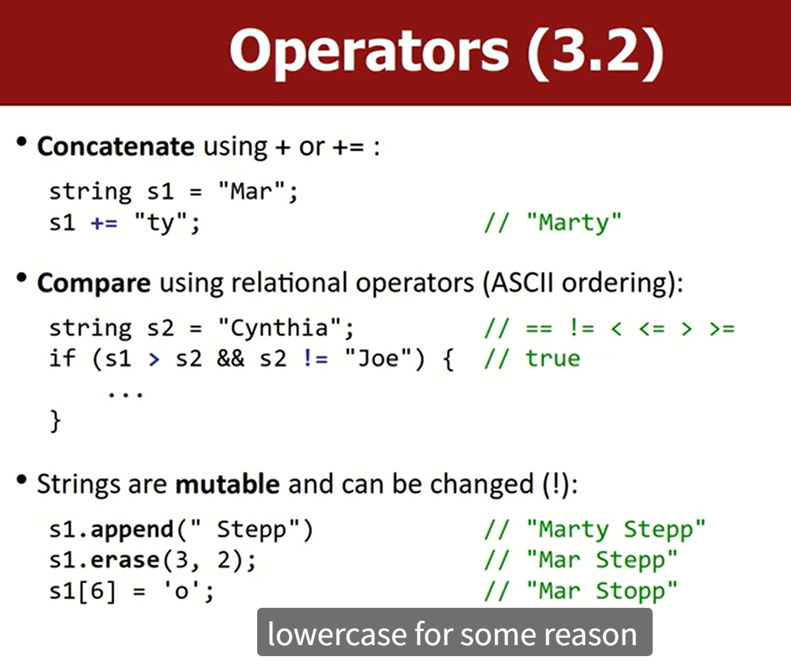
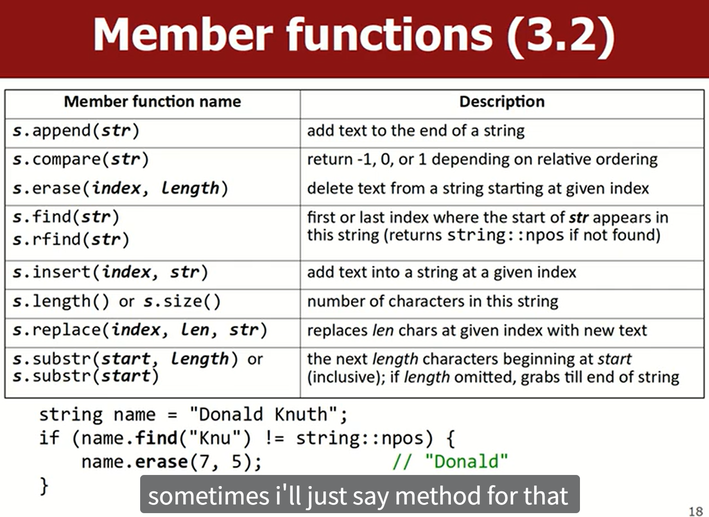
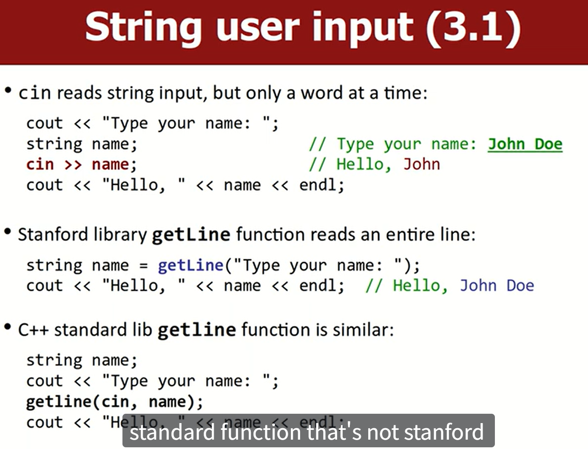
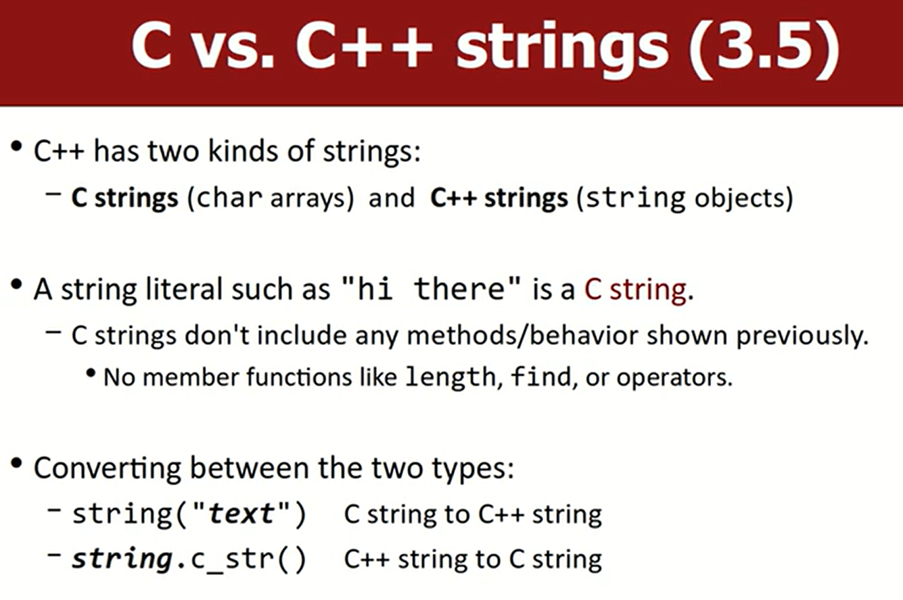
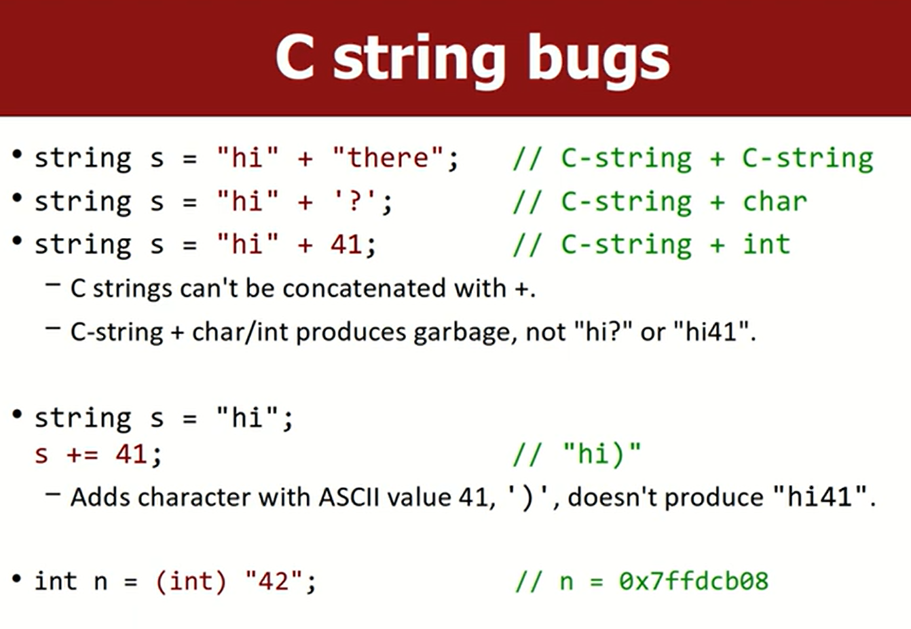
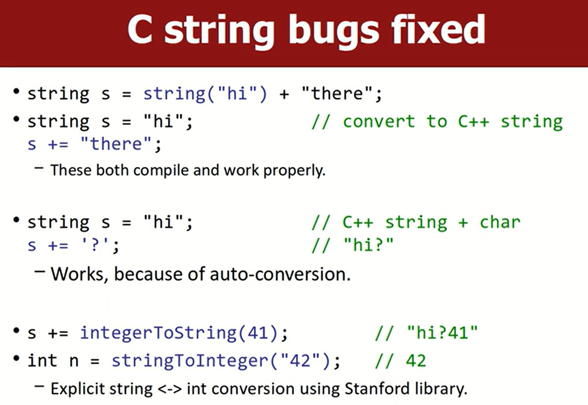

`#include <string>`
 

## Operators

`std::string` 可以直接改字符，也能增删。C 里的 `char s[] = "hello"` 同样可以改字符，只是数组长度固定；不能改的是字符串字面量，比如让 `const char *p` 指向的 `"hello"`。

## Member Functions

`find` 和 `rfind` 如果没有找到，返回 `std::string::npos`，不是负值。

- `r` 代表 reverse，从后往前找。
- `find` 返回子串第一次出现的位置，`rfind` 返回子串最后一次出现的位置（也是第一个字符的 index）。

## Input

`cin` & `cout`，是一个对象，用于接收 / 给予标准输入输出流中的东西，`cout`返回值还是 `cout`，所以可以连续输出。`>>` & `<<`，给谁就指向谁

## Two Kinds of Strings

- `"hello"` 是 C 语言 string
- `string s = "hello";` 是 cpp 的 string，即将 C 语言字符串转换成 cpp string 对象

`int n = (int)42;`：n 存的是整数 42，不是地址。`&n` 才是 n 的地址；指针变量才用来存地址。

拼接时，运算符两边至少一边是 `std::string` 才能用这套 `+` 重载。`std::string("a") + "b"` 可以，`"a" + "b"` 不行；也不能指望后面才出现的 string 把前面已经出错的加法救回来。