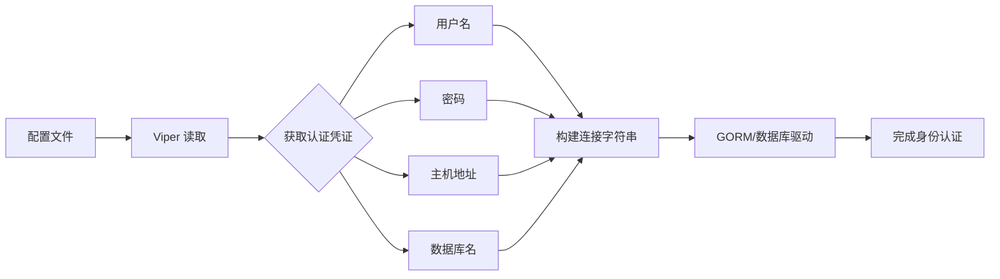

# GORM

## viper

Viper 通过读取配置文件来实现数据库连接中的身份认证部分，流程如下。


Viper 负责把配置读出来，真正连数据库的是驱动 / GORM。读到了用户名密码，不等于已经连接成功。

## 先把表和结构体对应上

GORM 是 ORM：用 Go 的结构体表示一行数据，用方法去生成 SQL。

先拿 SQLite 试，不用另外启动数据库服务：

```shell
go get gorm.io/gorm gorm.io/driver/sqlite
```

```go
package main

import (
    "log"

    "gorm.io/driver/sqlite"
    "gorm.io/gorm"
)

type User struct {
    ID   uint `gorm:"primaryKey"`
    Name string
    Age  int
}

func main() {
    db, err := gorm.Open(sqlite.Open("notes.db"), &gorm.Config{})
    if err != nil {
        log.Fatal(err)
    }
    if err := db.AutoMigrate(&User{}); err != nil {
        log.Fatal(err)
    }

    user := User{Name: "Alice", Age: 20}
    if err := db.Create(&user).Error; err != nil {
        log.Fatal(err)
    }

    var found User
    if err := db.First(&found, user.ID).Error; err != nil {
        log.Fatal(err)
    }
    log.Println(found.ID, found.Name)

    if err := db.Model(&found).Update("age", 21).Error; err != nil {
        log.Fatal(err)
    }
    if err := db.Delete(&found).Error; err != nil {
        log.Fatal(err)
    }
}
```

- `AutoMigrate`：按结构体创建表 / 补字段，入门时方便。正式项目的表结构变更要单独管理，别以为它会自动处理所有迁移。
- `Create` 传指针：插入后生成的 ID 会写回 user。
- `First`：找一条；`Find`：找多条，接收结果通常用切片。
- 读写之后看 `.Error`；没找到一条记录时，`First` 会返回 `gorm.ErrRecordNotFound`。

## 条件别拼字符串

```go
var users []User
result := db.Where("age >= ? AND name = ?", 18, "Alice").Find(&users)
if result.Error != nil {
    log.Fatal(result.Error)
}
```

`?` 是占位符，值交给驱动处理。不要把用户输入直接接到 SQL 后面。

容易踩的点：`Updates(User{Age: 0})` 默认可能跳过零值；确实要改成 0，用 `Updates(map[string]interface{}{"age": 0})`，或显式 `Select` 要更新的字段。

[GORM 文档](https://gorm.io/zh_CN/docs/)
