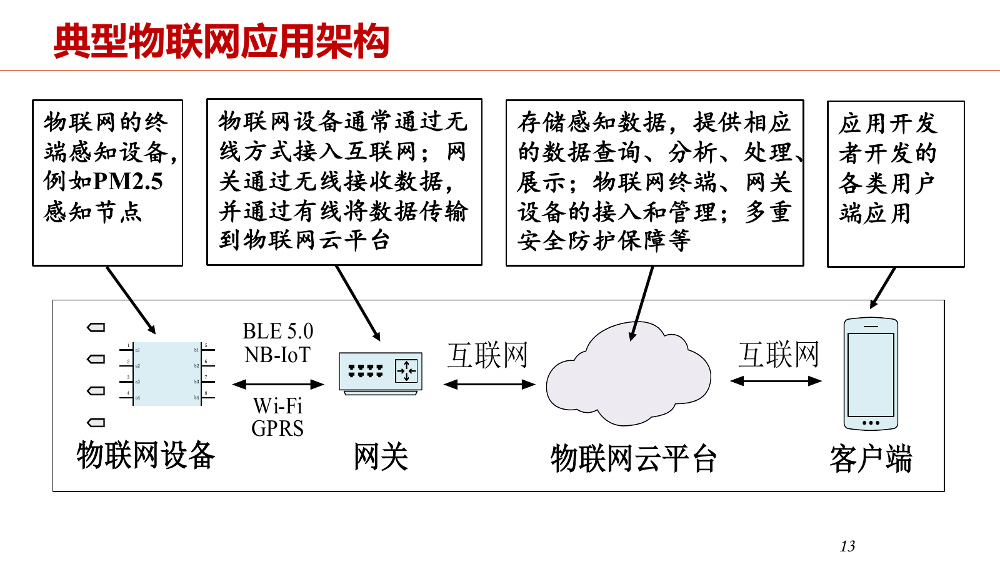
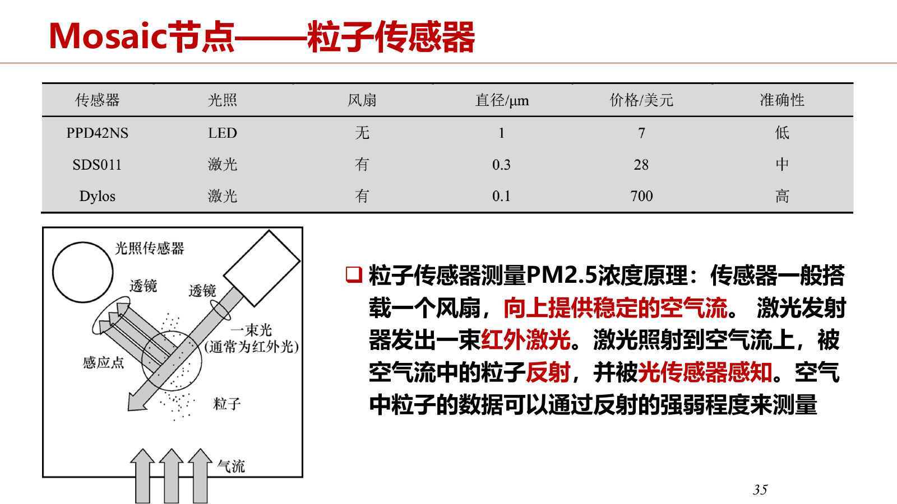
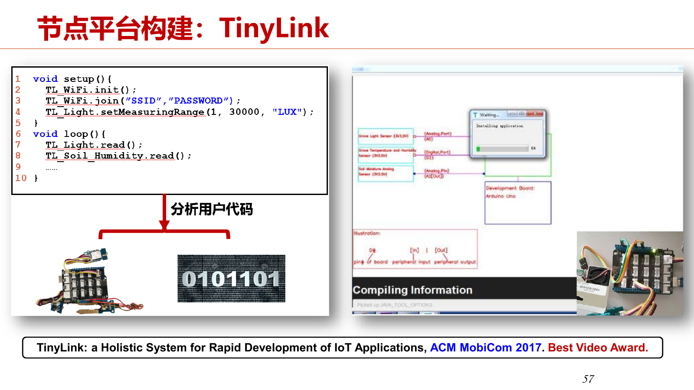

# 第1章 物联网概述

本章按“定义与趋势—应用架构与挑战—典型应用—学术研究与前沿”组织。项目数据与技术结论结合具体应用条件理解。

本章高亮并加粗的内容配有重点标记与详细讲解；标记含义见[课程目录](index.md#review-guide)。

## 1.1 物联网的定义和发展趋势

### 1.1.1 定义：连接物理世界与数字世界

**知识点**

物联网由物理设备及其嵌入的电子器件、软件、传感器等组成网络，设备具备**感知、计算、连接**三种基本能力，能够把物理世界的信息带入数字世界，并通过执行器反过来控制物理世界。智慧家居、共享单车、智慧城市和智慧工业是典型场景；工业应用对实时性和可靠性通常提出更高要求。（PPT：PDF第7页）

共享单车体现了设备、用户端和云端的协作：车锁联网，手机交互，云端管理位置、轨迹及锁状态。蓝牙直连与经云平台下发指令是两条不同链路，后者通常延迟更大。

**老师讲解**

> 今天的概述主要讨论四个问题：物联网的定义和发展趋势、应用架构与挑战、典型应用，以及相关学术研究与前沿。  
>
> 物联网由物理设备，以及嵌入其中的电子器件、软件和传感器等构成。  
> 它依附于具体的实体，例如扫地机器人、饮水机、空调。设备具有感知、计算和通信能力，能够连接成网络。  
> 这些能力使物理世界更直接地融入数字世界，因此物联网可以看作物理世界和信息世界之间的桥梁。  
>
> 现在大家对物联网已经不陌生。智慧家居里，米家 App 可以管理各种设备；智慧城市里有大量摄像头和传感器；智慧工厂里有 AGV 小车、巡检设备等。  
> 工业场景通常更复杂，对实时性和可靠性的要求也更高。  
>
> 共享单车是一个很直观的物联网应用。  
> 车上有智能车锁，锁内包含能联网的嵌入式设备；手机负责与用户交互；云端负责车辆管理、位置和轨迹数据、开锁状态等。  
> 手机开锁有两种常见方式：通过蓝牙直接连接车锁，或者通过云平台下发开锁指令。  
> 经过云端的方式延迟通常更大，因为不是直接连接。用户看到的操作可能差不多，但底层链路不同。  

### 1.1.2 起源、连接规模与三个发展阶段

**知识点**

PPT 列出 1995 年“物物互联”、2005 年 ITU 物联网愿景、2009 年“智慧地球”和“感知中国”等发展节点。课堂将后续发展概括为三阶段。（PPT：PDF第8—10页）

| 阶段 | 时间划分（课堂概括） | 主要关注点 |
| --- | --- | --- |
| 物联网 1.0 | 2010—2015 | RFID、无线传感器网络，感知/计算/通信一体的小型节点 |
| 物联网 2.0 | 2015—2020 | 工业界参与，操作系统、物联网云平台、NB-IoT 生态 |
| 物联网 3.0 | 2020 年至今 | AIoT，端侧 AI、边缘 AI、云边协同 |

PPT 引用 IoT Analytics 的历史统计：2020 年物联网连接数约 117 亿，首次超过非物联网连接数；并给出当时对 2025 年约 309 亿的预测。**这属于课件引用的统计和预测，老师也明确提醒需要更新，不能当作当前已核验数据。**

**老师讲解**

> 1995 年，比尔·盖茨在《未来之路》中提出了物物互联的基本思想。  
> 2005 年，国际电信联盟 ITU 指出，无处不在的物联网通信时代即将到来。  
> 2009 年，IBM 提出“智慧地球”；同年，中国提出“感知中国”。  
> 近年来，人工智能进一步赋能物联网，形成 AIoT。这个概念在大模型出现之前就已经存在，AI 与物联网结合有广阔的前景。  
>
> ITU 当年的报告描绘了许多场景，例如衣服告诉洗衣机颜色和水温要求，公文包提醒主人忘带了什么东西。今天，其中不少愿景已经可以实现。  
> 这里引用的统计显示，2020 年物联网连接数首次超过非物联网连接数，达到约 117 亿；非物联网连接主要包括 PC 和手机。  
> 未来物联网连接数可能达到三百多亿，而非物联网连接相对稳定。老师也提醒，这组预测数据需要更新。  
>
> 我个人把物联网的发展概括成三个阶段。  
> 第一阶段是 2010—2015 年，物联网 1.0，研究对象主要是 RFID 和传感器网络。  
> 此前虽然已经有愿景，但缺少相应设备，还没有大规模研究和产业化。后来出现集成计算、通信、感知能力的小型节点，研究者据此开展了大量工作。  
>
> 第二阶段是 2015—2020 年，物联网 2.0，工业界参与显著增加。  
> 例如阿里巴巴进军物联网，微软投资建设生态，运营商推动 NB-IoT，华为推出 LiteOS，腾讯发布 TencentOS Tiny，阿里也有 AliOS Things。  
> 那段时间杭州有不少物联网云平台，竞争之后留下来的企业少了很多，涂鸦是其中一家上市企业。  
>
> 第三阶段是 2020 年以后，物联网 3.0，重点是与 AI 结合。  
> 端侧 AI、边缘 AI，以及云边协同，都有比较好的发展前景。  

### 1.1.3 研究方向与论文查阅渠道

**知识点**

研究涉及新型低功耗硬件、端侧基础软件、感知、无线网络、端侧 AI/云端协同 AI 和创新应用。感知负责获取物理信息；操作系统等基础软件管理资源并支撑应用；端、边、云可按任务复杂度协作。（PPT：PDF第11页）

相关期刊包括 TMC、TOSN、TIOT、IoTJ 和《物联网学报》；会议包括 MobiCom、MobiSys、SenSys、INFOCOM、IMWUT/UbiComp。可按研究侧重点查阅，课堂列举的会议时间和评级不作为当前信息。

**老师讲解**

> 物联网研究包括新型低功耗硬件、端侧基础软件、感知技术、低功耗无线网络，以及创新应用。  
> 基础软件中最有代表性的是操作系统。感知始终很重要，因为物联网首先要获取物理世界的信息。  
> 近年来端侧 AI 和云边协同系统的研究很多。能在端侧完成最好，端侧能力不足时可以让边缘和云协同，复杂任务则往往需要云端参与。  
>
> 想了解最新进展，可以查看相关期刊和会议，也可以借助 AI 工具辅助阅读。  
> 课堂提到的期刊包括 IEEE Transactions on Mobile Computing、ACM Transactions on Sensor Networks、ACM Transactions on Internet of Things、IEEE Internet of Things Journal，以及国内《物联网学报》。  
> 会议方面提到 ACM SIGMOBILE 领域的 MobiCom、MobiSys、SenSys；偏网络可看 INFOCOM，偏感知和应用可看 UbiComp。  
> [会议评级、举办时间等按课堂表述理解，不作为当前信息核验结果。]  

## 1.2 物联网的应用架构及挑战

### 1.2.1 设备、网关、云平台与客户端

**知识点**

典型应用由四部分组成。（PPT：PDF第13页）

| 部分 | 核心作用 | 例子/关系 |
| --- | --- | --- |
| 物联网设备 | 感知、计算、通信，也可驱动执行器 | PM2.5 节点、智能车锁 |
| 网关 | 接入设备并连接互联网；能力较强时可执行边缘计算 | BLE、Zigbee 等设备接入网关，再连接云 |
| 物联网云平台 | 数据存储、查询、处理、展示，设备接入与管理，安全防护 | 时序数据、设备状态与业务服务 |
| 客户端 | 与用户交互，查询数据、控制设备 | 手机 App、Web 页面 |

“端—管—云”强调设备、通信和云服务；“端—边—云”强调计算位置。广义边缘包括云外的设备；狭义端侧指具体设备，边缘侧常指网关等更强节点。用户近距离可直连设备，远程控制通常经云端。

图：典型物联网应用中设备、网关、云平台和客户端的连接关系（本章 PPT，PDF第13页）。

**老师讲解**

> 一个典型物联网应用可以分成四个部分：设备、网关、云平台和客户端。  
> 设备通常是具有联网能力的嵌入式节点，可以通过蓝牙、Zigbee 等低功耗无线协议连接网关，也可以连接手机。  
> 网关再连接互联网和云平台。客户端可以是手机 App，也可以是网页。  
> 设备近的时候，客户端可以直接连接；距离远的时候，比如在外面用米家 App 控制家里的设备，就需要经过云平台。  
>
> 教材按这个架构介绍关键技术：端侧硬件、操作系统、推理引擎，无线协议，以及云平台。  
> 我们虽然不做硬件设计，也需要知道硬件的特点。  
>
> “端侧”和“边缘侧”有时区分，有时不区分。  
> 广义上，云之外都可以看作边缘，物联网设备也包括在内。狭义讨论时，端侧通常指具体设备，边缘侧常指网关等计算能力更强的节点。  
> AI 可以在设备上运行，也可以放在网关上运行。  
>
> 一般互联网技术在其他课程里已经涉及，这里主要关注物联网云平台的特殊需求。  
> 平台要管理设备、支持业务，并处理带时间戳的时序数据，例如怎样存储、查询和分析传感器数据。  
> 课堂提到 Apache IoTDB、TDengine 等时序数据库。  

### 1.2.2 各层常见硬件、操作系统与软件

**知识点**

开发板提供计算与接口，往往还需连接传感器；资源较强的板子可运行 Linux，资源较弱的板子需轻量物联网操作系统。端侧常见 Contiki、RIOT、Zephyr、RT-Thread；PPT 还列出 HarmonyOS。网关侧可用 OpenWrt、EdgeX、KubeEdge，云平台可用 ThingsBoard、IoTSharp。（PPT：PDF第14页）

物联网平台常集成 MQTT、时序数据库和可视化组件。例如 InfluxDB 存储传感数据，Grafana 展示数据。普通传输网关负责转发，智能网关还需计算与存储能力。操作系统、硬件和云平台将在后续章节展开。

**老师讲解**

> 常见的物联网硬件可以分成几类。  
> 一类是开发板，例如功能比较接近个人 PC 的树莓派，功能弱一些的 Arduino，以及用于 AI 的硬件。  
> 另一类是各种传感器。  
> 开发板本身通常没有所需的感知能力，需要把它与传感器连接、组装起来。  
>
> 这些端侧开发板运行的操作系统，与传统的 Windows、Linux 不完全一样。  
> 能力强的树莓派可以装 Linux，能力弱的板子可能装不了，需要物联网专用操作系统。  
> 这里列出的系统包括 Contiki、RIOT、Zephyr 和 RT-Thread，其中标红的系统会在实验中涉及。  
> RIOT 是欧洲开发的轻量级操作系统，Zephyr 是 Linux 基金会下面专门面向物联网的操作系统。  
> RT-Thread 是中国人开发的，早些年装机量比鸿蒙还多，做得还是挺好的。  
>
> 网关设备可以狭义地理解为路由器。  
> 智慧家居设备一般连接到网关上，但现在买到的很多网关只有传输能力，负责把设备连上网。  
> 边缘计算要求计算能力下沉，因此功能更强的网关还需要具有计算能力。  
> 贵一点的路由器可能有 USB 接口，也能做一些计算。  
> 我最近买了两个路由器，可以尝试刷成 OpenWrt。  
> OpenWrt 类似一个开放的 Linux 操作系统，保留网关转发功能，同时可以安装很多库，甚至安装容器。  
> 边缘侧系统与端侧系统有所不同，因为边缘设备的能力更强。  
> 这里还列出了一些可以装在边缘设备上的开源系统。[系统名识别不清。]  
>
> 几年前讲云平台，基本上都是亚马逊、阿里云、微软 Azure 这些大厂的平台。  
> 注册账号、付费后，它们会把应用开发的很多环节准备好。  
> 以前做实验如果使用 Azure，国内连接有时不太好，还需要注册，构建完整应用比较不方便。  
> 最近有很多开源软件，例如 ThingsBoard、IoTSharp，可以装在普通 PC 上。  
> 这些平台集成了 MQTT 接入、InfluxDB 等时序数据库，以及 Grafana 等可视化软件。  
> 传感器数据接入、存储后，直接调用平台提供的函数，就可以快速构建物联网应用。  

### 1.2.3 挑战一：开发链长；机遇：低代码与 AI Coding

**知识点**

完整应用需要嵌入式开发、云平台开发和用户端开发，涉及不同技术与人员，开发链长。低代码和基于自然语言的 AI 开发可降低构建成本、提高效能。（PPT：PDF第15页）

课堂强调低代码内涵的变化：早期主要是图形化拖拽与接口配置，如今还包括 AI Coding。PPT 所引“到 2024 年 75% 应用在低代码平台开发”是当时的预测，并非本章对现实比例的确认。

**老师讲解**

> 教材里提出的物联网应用开发挑战与机遇，放到今天，有些需要稍作调整。  
> 第一个挑战是开发链长。  
> 完整应用涉及端、管、云，包括嵌入式开发、云平台开发和用户端开发，用户端主要是前端开发。  
> 这些环节涉及不同技术，需要不同类型的开发人员协作完成。  
> IoT Analytics 是国际上专门研究物联网的咨询机构，每年会发布有关趋势与挑战的报告。  
> 它在 2022 年的报告里指出，物联网项目的复杂性仍然是一个主要挑战。  
>
> 有挑战也就有机遇。  
> 2022 年，产业界比较热门的词是“低代码开发”。  
> 数字化场景落地需求爆发式增长，低代码被认为是提升效能的突破点。  
> 课堂引用咨询机构的预测：到 2024 年，75% 的应用程序将在低代码平台中开发。[咨询机构名识别不清。]  
> IEEE Computer Society 也将低代码技术列为 2022 年十六大技术趋势之一。  
>
> 低代码还是低代码，但内涵在发生变化。  
> 2022 年或 2024 年说低代码，大家普遍想到图形化拖拉拽、配置接口，不需要写代码。  
> 放到今天，低代码还需要加入 AI Coding 等智能化能力。  
> 原来的判断没有变，但它的内涵在变化。  
> 另一个机遇是 AI 大模型让基于自然语言的开发成为可能，而且越来越可行。  
> 软件工程和系统领域的会议上，相关论文已经挺多了。  

### 1.2.4 挑战二、三：异构终端与垂直一体化

**知识点**

物联网没有像 PC、手机那样相对固定的终端形态与基础软件，硬件、操作系统、感知与通信能力高度异构。它增加选型和兼容难度，也允许平台向低功耗、小体积等方向发展。（PPT：PDF第16页）

垂直一体化指厂商把硬件、软件、通信、云平台和应用做成自己的整套生态，跨生态接入困难。老师用操作系统系统调用和 TCP/IP 的“窄腰”解释标准接口的价值：向下兼容多种实现，向上支持大量应用。PPT 将 Matter 的跨生态认证和开源云平台列为标准化机遇。（PPT：PDF第17—18页）

关于 Matter 与区块链的关系，下面保留 PPT 与老师的课堂表述；本节只据课程材料整理，没有额外核验其协议实现。

**老师讲解**

> 第二个挑战是物联网领域没有固定的终端类型。  
> 这是相对于 PC 和手机而言的。  
> PC 的硬件和上层基础软件基本确定了，主要是 Windows、Linux、macOS；手机主要是苹果系统和安卓系统。  
> IoT 的硬件更加异构，操作系统也很多，因此没有固定终端类型。  
> 这就带来问题：应用到底基于哪个平台开发？  
>
> 换一个角度，碎片化和异构性也意味着没有独占垄断。  
> 与 PC、手机主要竞争性能不同，物联网硬件可以向低功耗、小体积等不同方向发展。  
> 这给小的创业者留出了一些机会，否则那些领域可能已经被垄断了。  
>
> 第三个挑战是物联网应用开发仍然采用垂直一体化架构，目前中国物联网领域的这种趋势还比较严重。  
> 计算机和软件系统里，经常用“沙漏型”和“窄腰”来描述一个好的架构。  
> 例如操作系统提供数量有限的系统调用，基于这些系统调用可以实现很多应用，同时操作系统能管理底下各种异构硬件。  
> 网络也类似。  
> 经过多年竞争，网络层和传输层主要使用 TCP/IP 协议栈，上面的应用层协议很多，下面的链路技术也很多，包括有线、无线、同轴电缆、双绞线等。  
> 一个好的系统软件应提供一个窄腰，向下管理多种硬件，向上提供标准接口，支持很多应用。  
>
> 物联网厂商却往往各有自己的整套东西。  
> 例如小米原来只能接入米家 App，不支持华为等其他平台；从硬件到云平台再到软件，都是某家公司自己的一套。  
> 小米前不久表示，自己的硬件支持第三方 Home Assistant 接入。  
> 原来企业很关注物联网云平台，也是在考虑能否把云平台做成这个窄腰。  
> 不管底下是什么硬件，都接入阿里云，似乎就可以实现统一，但事实上小米也未必愿意接入阿里云。  
> 另一种设想是在端侧操作系统上统一，让大家都用同一个系统。  
>
> 这里的机遇之一是 Matter 协议。  
> 老师介绍，它通过区块链技术实现跨生态、去中心化的认证，在国外落地得比较好。  
> 谷歌、亚马逊等不同厂商的设备，如果支持 Matter，可以通过区块链网络认证，再接入各家的平台。  
> 这与小米设备只能进入米家平台不同。  
> 各大厂商谁也不让谁，很难让大家都接入某一家的平台，因此使用了这样的认证技术。  
> [此处保留老师关于 Matter 与区块链认证的课堂解释。]  
> ThingsBoard、IoTSharp 等开源云平台软件，也让标准化物联网应用开发成为可能，其中 ThingsBoard 用得较多。  
>
> 大家可以回顾两个问题：典型的物联网应用架构包含哪些部分？  
> 物联网开发与传统 PC 程序开发有什么不同？  

## 1.3 物联网典型应用

### 1.3.1 智慧城市：鸿山小镇的基础设施与平台

**知识点**

鸿山物联网小镇的建设体现“先部署基础感知设施，再建立共享平台，支撑上层应用”的路径。传感群覆盖交通、生态、能源、农业和公共服务等场景。飞凤城市物联网平台支持异构节点接入，提供硬件开发、数据开发、应用开发、服务开发的一站式能力，后来演变为阿里云物联网平台。（PPT：PDF第20—22页）

**老师讲解**

> 接下来介绍几个典型应用，有些是我们课题组以前做的，有些是代表性的案例。  
> 物联网的几个核心应用板块包括智慧城市、智慧工业和智慧家居。  
> 首先看智慧城市，无锡鸿山物联网小镇。  
> 在中国智慧小镇的实践中，鸿山物联网小镇在国内外享有盛誉，尤其是前几年，这个项目由阿里云总包。  
> 鸿山位于无锡国家传感网创新示范区，是全国首个以物联网为产业特色的小镇，入选江苏省首批特色小镇，吸引了一大批企业入驻。  
> 当时提出打造四个全国第一：虚拟人文体验小镇、千兆网络全覆盖小镇、NB-IoT／5G 小镇，以及物联网创新小镇。  
>
> 它描绘的愿景是，生活中的每件物体都有“高智商”。  
> 垃圾桶自动感知满溢，满了就通知人员运走垃圾。  
> 红绿灯根据路况自动变化；感知到火灾，消防系统自动启动。  
> 土壤缺水时，喷洒龙头自动开关。  
> 土壤传感器、洒水车等接入互联互通的信息平台。  
>
> 这些愿景以物联网基础设施部署为基础。  
> 要感知各种情况，首先要把传感器和物联网设备部署下去。  
> 当时建设了智能生态传感群、智能交通传感群、智能能源传感群等。  
> 针对环保、城管、公安、交通、教育等已确定的前期示范项目，优先布设相关传感器。  
> 例如智能交通传感群包括智能停车闸口、停车场传感器、单车停放点、电子围栏、RFID 电子车牌、路口灯控和路口信号机等。  
>
> 只有底层硬件和传感器还不够，还需要上层软件，这是计算机和软件领域更关注的部分。  
> 阿里专门为无锡物联网小镇开发了飞凤城市物联网平台。  
> 我们以前说物联网平台，通常指物联网云平台。  
> 它支持异构节点接入，为上层应用创新提供基础：先认证设备、让设备接入，再把数据存下来。  
> 飞凤平台提供开发、运行的一站式服务，后来演变成阿里云物联网平台。  
> 这个平台现在仍能使用，可以上传数据并进行应用开发。  
>
> 平台的重要功能包括硬件开发，提供设备模组的开发、集成与管理。  
> 数据开发包括数据接入、清洗、建模和加工。  
> 应用开发支持网页控制台、移动应用的开发构建。  
> 服务开发则提供开发过程中的配套能力与服务组件。  
> 基于这样的平台，最后可以开发出图中这样的智慧大屏。  

### 1.3.2 从智慧大屏到管理效益

**知识点**

智能楼宇可展示环境、工位、久坐、饮水、烟感、能效和能耗数据；智能垃圾桶按满溢状态提醒清运；智能井盖监测倾斜与移动；智能消防联动预警、疏散和水源调节。（PPT：PDF第23—25页）

PPT 给出的智能井盖案例为部署 200 个、倾斜超过 30°报警，这是案例条件。应用价值不能停留在“有数据、能显示”，还需分析节能、增产和效率改善等实际效益。

**老师讲解**

> 刚才说过，利用阿里开发的物联网平台，可以比较容易地开发智慧大屏应用。  
> 这里的飞凤平台界面展示的是智能楼宇。  
> 左边显示室内外环境，例如温度、湿度，还有工位监测、久坐提醒，以及饮水情况。  
> 中间是烟感报警传感器，红色可能表示某处有烟或存在危险。  
> 右边还有其他数据展示。  
> 一个智能楼宇可能有很多界面，每个大屏监测某一类指标。  
>
> 这个界面关注能效评级、人均能效和会议室温度设定。  
> 例如会议室没有人，却把温度设得很低，就涉及能耗问题。  
> 还可以看能效排名，以及近一周的用水、用电情况。  
> 光有数据不行，应用于生产或社会场景时，最终还要分析数据：节能多少、增产多少、效益提升多少，这才是关键。  
>
> 智能垃圾桶可以检测是否装满，通知环卫工人收集。  
> 智能井盖在倾斜程度超过一定值时会自动报警。  
> 井盖看起来很常见，但一旦被拿掉就可能产生危险，因此这件事很重要。  
> 以前我们接触上海城建、杭州城建及地下管廊相关公司时，也发现这是重要的需求。  
> 此外还有智能消防等应用，这里不再展开。  
> 鸿山小镇是物联网应用于智慧城市的典型案例，项目由阿里云建设。  

### 1.3.3 CMU GIoTTO：校园作为 Living Lab

**知识点**

GIoTTO 在真实校园部署传感器和执行器，使学生与研究社区能持续开发、共享应用，因此称为 Living Lab。它强调终端用户可编程、应用可广泛部署、机器学习支持、安全与隐私保护。（PPT：PDF第26—27页）

系统分数据产生层、数据管理层、应用服务层。核心数据管理层承担集成、存储、分析与抽象，上层通过标准 API 开发应用。与交付后功能固定的普通项目相比，它为持续创新保留入口。

**老师讲解**

> 另一个很不一样、离我们更近的场景是智慧校园。  
> 这里选的是国外 CMU 的 Giotto 项目。  
> 卡内基梅隆大学的研究者在 Google 资助下开展了这个项目，理念比较先进。  
> 项目希望建立一个使传感器、设备和楼宇互相通信的基础平台，把大学校园变成应用创新实验室，也就是 Living Lab。  
>
> 这不是固定实验室里的模拟实验。  
> 摄像头和各种传感器实际部署在教室里，真的在使用，所以称为 Living Lab。  
> 为什么还叫 Lab，而不只是普通项目？  
> 如果交给第三方公司做完，功能就固定了，不能再更改和开发，那就只是普通项目。  
> 这里用户、学生和研究社团可以开发、共享自己的新型物联网应用，为非智能设备和环境添加智能功能。  
> Giotto 的名字借自意大利文艺复兴的开创者、欧洲绘画之父，寓意引领物联网时代的创新。  
>
> 系统架构大致分三层。  
> 第一层是数据产生层，大量传感器和执行器产生数据。  
> 传感器提供感知数据，执行器则用于控制物理世界。  
> 第二层是数据管理层，包括数据集成与中间件、边缘分析与云、时间序列数据库与控制器，以及物联网相关抽象和机器学习。  
> 第三层是应用程序服务层，包括应用开发环境、应用程序及终端用户环境。  
> 中间的数据管理层是最重要的，上层提供标准应用程序接口，方便用户开发。  
>
> 系统有四个主要特点。  
> 第一，终端用户可编程，功能不会在第三方完成开发后就固定下来。  
> 第二，支持应用广泛部署：A 用户开发的程序，B 用户也可以使用和部署。  
> 第三，支持机器学习，后面会详细说明怎样支持。  
> 第四，考虑安全与隐私保护。  
> 虽然是比较早的项目，这几个特点还是比较领先的。  

### 1.3.4 GIoTTO 的数据管理层

**知识点**

数据管理层的四个组件分工不同。（PPT：PDF第28页）

| 组件 | 作用 |
| --- | --- |
| 中心服务器 / MongoDB | 传感器、用户、建筑结构、访问控制等列表与元数据 |
| 数据服务器 / InfluxDB | 实时产生的传感器时序数据 |
| 连接器 | 适配设备通信，把 MQTT、CoAP、HTTP 等数据接入系统 |
| 机器学习层 | 从原始数据构造分类与状态监测能力 |

两个数据库不是重复设置：元数据与持续产生的时序数据有不同的存储管理需求。

**老师讲解**

> 数据管理层是核心，我们把它拆开来看。  
> 第一个部分是中心服务器，使用 MongoDB，存储传感器列表、用户列表、建筑物结构列表和访问控制列表等。  
> 这些属于中心服务器的核心数据。  
> 第二个部分是数据服务器，使用 InfluxDB。  
> 为什么用了两个不同数据库？  
> InfluxDB 是时序数据库，专门存物联网设备采集的时序数据。  
> MongoDB 存用户、传感器和建筑物等列表，并不存实时产生的感知数据；实时数据放在数据服务器的 InfluxDB 里。  
>
> 第三个部分是连接器，实现各种物联网设备与 Giotto 的通信。  
> 设备接入可能采用 MQTT、CoAP 等协议，也可以使用 HTTP，只是 HTTP 重量级一些。  
> 连接器把这些数据接入数据服务器。  
> 第四个部分是机器学习层，在更上层帮助用户处理传感器数据。  
> 这就是数据管理层的几个核心组件及其作用。  

### 1.3.5 虚拟传感器：把原始信号变成状态

**知识点**

==**虚拟传感器由标注数据训练得到的分类器实现。**==开发过程是“选取数据并打标签 → 训练分类器 → 实时分类、状态监测”。物理传感器给出加速度、角速度等数值，虚拟传感器向上提供开门/关门、安静/嘈杂、有人/无人等语义。（PPT：PDF第29页）

它隐藏传感器阈值、安装方向和位置等细节，降低应用开发难度。老师以门上 IMU 安装可能歪斜为例，说明固定阈值规则未必可靠，而在实际安装后采样标注可以适应现场差异。

!!! important "考试提示 · 1.3.5"

    ==**GIoTTO 的机器学习层把原始数值转为可供应用使用的语义状态。**==

    **老师提示**：“机器学习层起到什么作用？”

    **详细讲解**：物理传感器输出加速度、角速度或声音强度，应用真正需要的是“门开着吗”“座位有人吗”。机器学习层用现场采集并标注的数据训练分类器，把底层数值映射为状态，形成虚拟传感器。它不仅分析数据，也为应用提供稳定的抽象接口，屏蔽安装角度、位置和阈值差异。

    **答题顺序**：先说输入是原始传感数据，再说通过标注与训练获得分类模型，最后说输出是开/关、占用/空闲等状态，使上层应用不必理解每个传感器。比如 IMU 歪着装在门上，固定阈值可能失效；安装后采样训练可适应现场条件。不要把虚拟传感器写成一块新的硬件，也不要只回答“提高精度”而漏掉抽象和复用。

**老师讲解**

> 机器学习层怎样工作？  
> 第一步，用户选择特定数据并打标签；第二步，机器学习层训练分类器，得到用于分类或状态监测的虚拟传感器。  
> 机器学习是黑盒方法，不必把判定规则明确写成白盒程序。  
>
> 例如在门上装传感器，要检测门是开还是关，原来的程序不太好写。  
> 传感器本身未必就是一个“开关门传感器”。  
> 可以使用手机上类似的陀螺仪或 IMU，得到 X、Y、Z 轴加速度和角速度。  
> 如果写死规则，例如速度大于多少、倾斜大于多少就表示开门或关门，可能会有问题。  
> 传感器部署时可能装歪，未必安装得很正，明确写死的程序就不一定好用。  
>
> 机器学习的方法是：先把传感器装上，再开门、关门试十次，每次把标签打好，利用原始数据自动训练。  
> 这里的传感器就分成两层。  
> 物理传感器采集的是加速度、角速度等数据。  
> 虚拟传感器向上提供“门开还是关”这样的感知功能，它通过机器学习和打标签实现。  
>
> 优势是隐藏许多传感器细节。  
> 用户根据常识选择一些可能适用的传感器来开发，不必纠结数据阈值，开发难度降低。  
> 不只是阈值，判断还可能与安装位置、方向、高低等有关，这些都会影响采集数据。  
> 采用这个方法，可以减轻这些安装差异造成的影响。  

### 1.3.6 组合虚拟传感器：查找安静且有空座的教室

**知识点**

声音传感器训练出“虚拟分贝计”，区分安静与嘈杂；座位下的加速度计训练出“座位占用虚拟传感器”，区分有人与无人；结合两类结果，筛选安静且有空闲座位的教室。这里的虚拟分贝计在案例中用于分类状态，不要求恢复完整物理分贝值。（PPT：PDF第30页）

**老师讲解**

> 这里举一个利用机器学习层开发应用的例子：帮助学生查找安静且有空闲座位的教室。  
> 假设每间教室已部署相关传感器，可以检测是否有人，以及座板是被坐下还是翻起来。  
> 具体包括声音传感器，以及安装在每个座位下的加速度计。  
>
> 应用开发可以分三步。  
> 第一，实现虚拟分贝计，训练声音传感器采集的数据，区分环境安静还是嘈杂。  
> 这是一个比较简单的二分类任务，只要分类器能区分安静和嘈杂就行。  
> 第二，实现座位占用虚拟传感器，训练座位上加速度计采集的数据，区分座位是否有人。  
> 数据可能包括 X、Y、Z 轴加速度、角速度等不同值。  
> 第三，结合虚拟分贝计和座位占用传感器，检测环境安静且有空闲座位的教室。  
> 利用机器学习层，这样的应用可以比较简单地开发出来，否则会复杂一些。  

### 1.3.7 GIoTTO 的安全与隐私

**知识点**

安全设计包括三层。（PPT：PDF第31页）

- HTTPS 加密传输，避免账号、密码和数据以明文在网络上传输。
- OAuth 2.0 完成用户认证授权，访问数据需要令牌；令牌超时后重新获取。
- 访问控制层确定“谁可访问什么”：管理员具有所有传感器数据权限，并制定普通用户的访问控制列表；普通用户按授权范围访问。

==**通信加密、身份授权和资源权限分别解决不同问题，答题时应说明各自作用。**==

!!! important "考试提示 · 1.3.7"

    ==**GIoTTO 安全题要分别说明传输加密、令牌授权、资源访问控制。**==

    **老师提示**：“在 CMU Giotto 项目里，怎样保证安全性？”

    **详细讲解**：HTTPS/TLS 保护通信过程，减少窃听和篡改风险；OAuth 2.0 的访问令牌表达授予客户端的访问权限；访问控制表进一步限定某个用户能访问哪些传感器、能做什么操作。三者处理不同环节，使用 HTTPS 不会自动使普通用户获得管理员权限。

    **示例答案**：系统用 HTTPS 保护账号与传感数据传输，用令牌授权控制 API 访问，再根据用户角色和资源权限限制数据读取。例如学生只可读已授权教室的环境数据，不能因为持有某个有效令牌就查看所有设备。

    **易错点**：OAuth 2.0 本身是授权框架；课堂将认证授权一起描述，严格谈用户登录认证时还需具体的认证机制。令牌过期需要按流程更新，令牌、资源权限和通信加密不可相互替代。

**老师讲解**

> 最后看安全与隐私。  
> 第一，传输使用 HTTPS。  
> 现在用 Edge、Chrome 访问 HTTP 网站，浏览器会显示不安全标志。  
> 登录时用户名和密码可能是明文传输，HTTPS 则对传输内容加密。  
> 第二，使用 OAuth 2.0 进行用户认证和授权。  
> 用户用账号、密码登录中心服务器后，获得唯一 ID 和密钥。  
> 访问 Giotto 数据库前，先用 ID 和密钥获取 OAuth 令牌，取得数据访问权。  
> 令牌超时后需要重新生成，会自动失效，需要时重新获取，这样更安全。  
>
> 第三，由访问控制层管理访问权限。  
> 用户分管理员和普通用户。  
> 管理员可以访问所有传感器数据，还能定义普通用户的权限、制定访问控制列表。  
> 普通用户按照访问控制列表中的权限访问数据，必须有相应权限才能访问。  

### 1.3.8 Mosaic：低成本、移动、细粒度空气质量监测

**知识点**

PM2.5 和 PM10 分别对应直径小于 2.5 μm、10 μm 的颗粒物。传统卫星遥感粒度较粗且偏向高层大气；监测站造价和维护成本较高，部署稀疏。Mosaic 把低成本节点安装在移动车辆上扩大城市覆盖，并借助校准改善精度。（PPT：PDF第32页）

本节讨论的主要矛盾是**成本、覆盖和精度**。AQI 是综合指标，下面关于组成因素的列举保留课件和课堂原表述，不据此扩展为完整 AQI 标准定义。

**老师讲解**

> 后面介绍我们课题组以前做的两个典型物联网项目。  
> 第一个是 2014 年前后开展的空气质量监测项目，叫 Mosaic。  
> 2014 年底，空气质量还是比较严峻的问题，我们想通过物联网监测城市空气质量。  
>
> 先介绍基本概念。  
> 空气质量指标 AQI 综合考虑粒子浓度、臭氧、二氧化碳、二氧化硫等因素。[此处保留课堂列举。]  
> 其中一个重要因素是粒子浓度，也就是 particulate matter，简称 PM。  
> PM2.5 指直径小于 2.5 微米的粒子，PM10 指直径小于 10 微米的粒子。  
> 左边的图用头发丝对比这些粒子的大小。  
> 头发丝外侧画了一些 PM10 粒子，一圈大概十个；沿一个 PM10 的直径，大约能排四个 PM2.5，因为 2.5×4＝10。  
> 这说明 PM2.5 的直径相对于头发丝很小。  
>
> 传统空气质量监测方法主要有两类。  
> 第一是卫星遥感，通过卫星图像观察粒子浓度。  
> 这种方式很宏观，粒度粗，而且主要反映大气中的情况，有云层等影响，不能直接得到地面的情况。  
> 我们生活在地面，更关心周围的 PM2.5。  
> 第二是空气质量监测站。  
> 每个城市会建一些，但数量少、造价高、维护费高，部署稀疏。  
> 我记得以前杭州整个大城区也就几个，具体是四个还是几个记不清，反正不多。  
> 有些站布在山里，空气很好，也未必反映城市里的空气质量。  
>
> 这个项目希望设计低成本监测节点，利用先进校准方法，把节点装在移动的车辆上，系统地监测城市空气质量。  
> 以前传感器项目主要静态部署，覆盖一个区域需要大量传感器，城市范围更大，就更困难。  
> 移动监测可以扩大覆盖范围。  
> 但低成本与高精度有矛盾，需要通过校准方法把低成本传感器的数据校准准确。  

### 1.3.9 Mosaic 的系统架构与硬件组成

**知识点**

室外节点有版本 1、版本 2，miniMosaic 主要用于室内并经蓝牙连接手机。通信采用 GPRS 和蓝牙；阿里云收集低成本节点、高精度监测站及 Dylos 数据，核心服务为校准；Web 和 App 提供查询与可视化。（PPT：PDF第33—34页）

第一版由 Arduino、扩展盾板、GPRS、供电、GPS、温湿度、噪声和粒子传感器组成。第二版采用集成度更高的板子缩小体积。选型必须兼顾接口、扩展性、体积与核心感知精度。

**老师讲解**

> 项目架构与前面介绍的典型物联网架构差不多。  
> 最下面是传感器节点，也就是硬件。  
> 我们开发了三种节点，第一版和第二版用于室外空气质量监测，Mini Mosaic 主要用于室内，通过蓝牙与手机通信。  
> 上面是传感器网络层、云服务层和应用层。  
> 当时没有现在这么先进的联网技术，采用 GPRS 和蓝牙传输数据。  
>
> 云端使用阿里云服务，收集 Mosaic 原始传感器数据、高精度空气质量监测站的数据，以及 Dylos 手持设备的数据。  
> 核心服务是云端数据校准。  
> Mosaic 是低成本节点，数据可能不精确，因此还采集监测站公开可得的高精度数据。  
> Dylos 手持设备相对精确，当时价格大约五千或六千元，我们买了一部分，但不多，因为比较贵。  
> 用户端提供 Web 应用和手机 App，支持空气质量查询与可视化。  
>
> 第一版节点用 Arduino 制作。  
> Arduino 的核心特点是可扩展性强，一个核心板可以扩展两块盾板，增加接口。  
> 接很多传感器和其他外设时，可以通过增加盾板接入。  
> 节点里有 Arduino 和扩展盾板、GPRS 通信模块、供电模块、GPS 定位模块、温湿度和噪声传感器，以及最核心的粒子传感器。  
> 粒子传感器负责测量 PM2.5。  
> 第二版比第一版紧凑，因为找到了一块集成较多功能的开发板，可以把节点做得更小。  
> 粒子传感器的原理和选型非常关键，直接影响感知精度。  

### 1.3.10 粒子测量原理与校准前的传感器比较

**知识点**

测量链路为：==**风扇形成稳定气流 → 激光照射气流中的颗粒物 → 光传感器感知反射/散射光 → 根据光信号强弱测量粒子数据。**==不是直接“看见 PM2.5”，而是通过光信号间接测量。（PPT：PDF第35页）

PPT 对比 PPD42NS、SDS011、Dylos：分别使用 LED/激光/激光，风扇为无/有/有，表中标称检测粒径为 1/0.3/0.1 μm，价格为 7/28/700 美元，准确性为低/中/高。这些是课件中的历史选型数据。PPT 第36页进一步比较原始测量曲线：SDS011 虽有偏差但趋势相对吻合，更有利于后续校准；趋势本身不吻合时，校准更困难。原字幕中的 PPD42NS 型号不清标记仍保留。

图：Mosaic 粒子传感器的选型比较与光学测量原理（本章 PPT，PDF第35页）。

!!! important "考试提示 · 1.3.10"

    ==**PM2.5 光学测量通过颗粒物散射光间接估计粒子数据。**==

    **老师提示**：“在 Mosaic 项目里，PM2.5 的测量原理是什么？”

    **详细讲解**：风扇让空气稳定经过测量腔，光源照射空气中的颗粒物，光敏器件接收散射光，电子电路再把光信号转换为粒子计数或浓度估计。气流稳定有助于重复采样，光学读数仍会受到粒径、颗粒物性质、湿度和器件差异影响，因此低成本设备需要校准。

    **答题框架**：“稳定气流 → 光照颗粒 → 检测散射光 → 转换为粒子信息 → 校准”。PM2.5 中的 2.5 表示粒径尺度（微米），不是颗粒浓度；系统不是直接用摄像头拍出每个 PM2.5 颗粒，也不是光越强就能无条件按固定比例换算真实质量浓度。

**老师讲解**

> 前面提到的 Dylos 手持设备使用激光，带有风扇，号称能测到直径 0.1 微米的粒子，价格较贵、准确性较高。  
> 以前有人把这种手持设备改装，接到嵌入式板上，让数据上传云端。  
> 还有一种前人使用的低成本传感器，型号为 PPD42NS。[原字幕型号多次识别不一致，待核。]  
> 它没有风扇，号称能测到 1 微米的粒子，价格便宜，但准确性较低。  
>
> 我们调研后选用 SDS011，当时前人没有用过。  
> 它也采用激光、有风扇，号称能测到 0.3 微米的粒子。  
> 价格和准确性都介于前两者之间。  
>
> 下面看测量 PM2.5 的基本原理。  
> 风扇提供稳定气流，把底部的空气送上去，气流携带粒子。  
> 激光发射器发出一束红外激光，照射气流中的粒子，粒子产生反射、散射，再由光传感器通过透镜感知。  
> 根据反射强弱，可以测量空气中的粒子数据。  
> 基本上，这些传感器都采用这样的原理。  
> 我们不是研究传感器硬件的，硬件造好以后，计算机领域很难在其内部直接创新。  
>
> 这里是实际测得的数据，横轴是时间，纵轴是 PM2.5 浓度，单位为微克每立方米。  
> 对比三种传感器：高精度 Dylos、低成本 PPD42NS，以及我们选用的 SDS011。  
> 紫色曲线是 Dylos 数据。  
> PPD42NS 不仅有偏差，部分位置连趋势也不吻合：参考数据比较平稳，它却出现波谷。  
> 如果趋势都不吻合，后期校准会很困难。  
> SDS011 虽然有 offset，也就是偏差，但趋势相对吻合。  
> 趋势吻合时，即使有偏差，也可以用后期校准方法修正。  
> 这是对三种传感器原始数据的观察，当时还测了很多类似数据。  

### 1.3.11 移动节点部署：最大化加权覆盖

**知识点**

将城市划分为网格，对感兴趣区域赋权，再选择车辆/公交线路部署节点，以提高加权覆盖。可研究“达到指定覆盖最少需要多少节点”，或“给定节点数，如何最大化覆盖”两类问题。区域有权重时不能只数覆盖格数，必须计入重要性。（PPT：PDF第37页；Mosaic 系统与部署工作，INFOCOM 2016）

**老师讲解**

> 为了通过移动车辆实现城市范围感知，节点部署成为一个关键问题。  
> 例如公交车线路固定，可以把感兴趣的城市区域分成网格，为每格设置重要性或兴趣权重。  
> 有的地方比较关注，有的地方不太关注，例如设置 1、1/2、2 等不同值，2 表示最关注的区域。  
> 该把传感器部署在哪些公交线路上，才能尽量扩大覆盖？  
> 因为每格有重要性参数，这就成为最大化加权覆盖的问题。  
> 没有权重时，覆盖的网格越多越好；有权重时，需要折算成加权覆盖率。  
>
> 可以考虑不同问题：如果要覆盖指定范围，最少需要部署几个传感器？  
> 或者给定传感器数量，例如五个，怎样使覆盖范围最大？  
> 这项工作包括整个 Mosaic 系统设计，以及移动场景中的节点部署，发表于 2016 年 INFOCOM。  

### 1.3.12 在线多跳校准与 K 跳可校准性

**知识点**

移动节点与高精度参考节点在**时间和地点匹配**时形成匹配点，多次相遇积累配对数据并建立校准模型。一跳校准直接使用参考节点；已校准移动节点再校准其他移动节点，形成多跳校准。（PPT：PDF第38页）

K 跳可校准性描述每个节点能否在不超过指定跳数的关系链内获得参考信息。一跳要求直接遇到参考节点；两跳允许通过能遇到参考节点的另一移动节点。跳数增加可能累积误差，所以需要约束跳数并联合考虑部署。该工作侧重校准关系与参考节点部署，区别于下一节实际拟合模型的选择。

**老师讲解**

> 第二个关键问题是，不精确的数据传到云端后，怎样进行校准？  
> 我们提出了在线多跳校准方法。  
> 当车上的低精度移动节点与高精度参考节点相遇时，就形成一个匹配点。  
> 高精度参考节点可以是城市监测站，也可以是在固定地点部署的 Dylos 传感器。  
> 只有时间、地点都对应上，才可以比较两组数据的差距并进行校准。  
> 不能拿同时但不同地点的数据比较，也不能在时间和地点都不匹配时比较。  
> 一天相遇十次，就形成十个匹配点。  
>
> 还有更复杂的情况。  
> 一个移动节点原来的数据不准，与参考节点相遇十次后，可以把自己的数据校准准确。  
> 它再遇到另一个移动节点时，也可以校准对方，而对方可能从未遇到过参考节点。  
> 直接遇到参考节点是一跳校准；遇到已经校准过的节点，则形成多跳校准。  
> 跳数太多不好，借助五跳、十跳校准，精度肯定不太行。  
>
> 我们提出多跳校准，以及 K-hop calibratability，也就是 K 跳可校准性的概念。[英文术语识别不清，按上下文整理。]  
> K 可以指定。  
> 一跳可校准，要求网络里的每个节点都能直接遇到参考节点。  
> 两跳可校准，则允许某个节点遇到另一个能直接遇到参考节点的节点。  
> 这项工作考虑校准问题，发表于 2017 年 INFOCOM。  
> 刚才还是从高层讨论多少跳，实质上仍涉及部署问题。  

### 1.3.13 二阶段校准：多元线性模型加随机森林

**知识点**

一元线性模型 $y=ax+b$ 只考虑原始读数一个变量，难以覆盖温湿度、车速等影响和非线性关系。PPT 采用二阶段方法。（PPT：PDF第39页）

1. 提取原始粒子数据、温湿度、速度、人流/车流密度等候选特征，用 Akaike 信息准则（AIC）选择最相关特征，避免特征过多导致过拟合。
2. 用多元最小二乘确定线性模型参数。
3. ==**用随机森林拟合线性模型剩余的残差，补偿非线性部分。**==

$$
\hat{Y}=b_0+\sum_{i=1}^{n}b_i x_i+RF(x_1,\ldots,x_n)
$$

$x_i$ 是选中的输入特征，$b_i$ 是线性模型系数，$RF$ 为随机森林学习的残差补偿，$\hat{Y}$ 为校准预测值。公式按 PPT 整理，阶段解释与老师讲解对应；不能把随机森林说成重复拟合原始目标而忽略残差。

!!! important "考试提示 · 1.3.13"

    ==**Mosaic 先做多元线性拟合，再用随机森林拟合残差以补偿非线性。**==

    **老师提示**：“用一元线性模型校准数据有什么缺陷？”

    **详细讲解**：一元模型 $y=ax+b$ 只使用原始粒子读数，忽略温湿度、车速等影响，也只能表达直线关系。多元线性模型增加相关输入，可以解释多因素的线性影响，但仍不擅长刻画复杂非线性，所以再学习它留下的误差。

    设高精度参考值为 $y$，第一阶段预测为 $\hat y_{lin}$，训练残差模型的目标是 $r=y-\hat y_{lin}$。最终预测为 $\hat y=\hat y_{lin}+\hat r_{RF}$。例如参考值 35、线性预测 30，则该样本残差是 +5，随机森林应学习这类补偿，而不是再单独预测 35 并与 30 相加。

    **答题顺序**：指出单变量与线性的局限；说明选择相关特征、最小二乘拟合多元线性部分；说明随机森林拟合残差。老师要求了解问题与思路，不要求重现论文全部实现。特征过多可能过拟合，训练与验证要区分；模型校准也不能让毫无相关性的坏传感器凭空获得可靠信息。

**老师讲解**

> 有了十个匹配点，到底用什么模型校准？  
> 比较简单的是一元线性模型，y＝ax＋b，a、b 是两个参数。  
> 如果认为关系是线性的，有很多配对数据，就可以通过拟合求出 a 和 b。  
> 但实际关系未必这么简单。  
> 校准后的数据不仅与原始数据相关，还可能与车辆速度、温度和湿度等因素相关。  
> 前人的多元线性模型，是对一元线性模型的扩展，考虑多个相关因素。  
>
> 到底应该考虑几个因素？  
> 也可以说考虑一百个，但这样可能过拟合。  
> 所以原来的工作采用信息准则进行特征选择，挑出最相关的特征，例如选前 K 个。  
> 特征并非越多越好，太多可能导致过拟合。  
>
> 有些因素是线性的，有些不一定线性，怎么办？  
> 我们用随机森林拟合残差。  
> 残差是多元线性拟合所得数据与最终精确数据之间的差，它不一定能仅靠线性模型拟合。  
> 因此提出结合多元线性模型与随机森林的二阶段校准方法。  
> 先用信息准则选择相关特征，再用随机森林拟合多元线性模型的残差。  
> 方法比较简单，但当时这个思想比较新，以前多是单独使用多元线性模型，没有把两者结合。  
> UbiComp 审稿时也指出，虽然方法简单，但可能对后续工作有启发。  
> 这项工作发表于 2018 年 UbiComp。  
> 做 Mosaic 项目时，不仅有实际部署，也会发现科学问题，由此开展研究。  

### 1.3.14 用户端展示与从工程中发现研究问题

**知识点**

Mosaic 用户端用颜色展示采集点空气质量，并可显示空间分布和时间变化。（PPT：PDF第40页）

同一系统可产生不同研究问题：节点部署研究覆盖，多跳校准研究参考关系与联合部署，二阶段校准研究实际拟合方法。课堂强调，科研要熟悉已有方法、与 SOTA 比较，不能仅把工程实现数量当作创新。这部分为课堂对案例的补充讨论。

**老师讲解**

> 用户端开发了安卓 App。  
> 车辆行驶时，可以看到各采集点数据：绿色表示空气较好，黄色表示不太好，红色表示不好。  
> 数据积累后，还能展示整个区域的空间分布，以及随时间变化的演变过程。  
> 当时国内相关研究很多，微软研究院郑宇老师等人在 KDD 上做空气质量预测，也开展了很多工作。  

**老师讲解**

> 同学问：刚才物联网相关科研，是不是更偏向解决实际工程问题，而不是提出统一的机器学习算法？  
> 老师请同学再重复问题后回答：科研肯定更偏算法和模型，如果全部是工程，论文发不上去。  
> 工程可以是架构确定后执行完成，但科研不一样。  
> 计算机科学里，计算理论比较偏理论研究，其他领域的科研和工程有时界限也没有那么清楚。  
>
> 例如感知研究有很多算法和模型，也会在公开数据集上比较结果，必须比现有最先进方法，也就是 SOTA，更好。  
> 如果只是做了大量工程，效果却没有比 SOTA 好，就很难发表。  
> 我说课程里不必了解全部细节，是不要求你们知道我们论文具体怎样做，只需知道解决什么问题、提出什么思路。  
> 同一个问题，换一种方法也可能解决。  
>
> 同学进一步问：是不是更偏把现有方法组合起来提升效果，不太需要理论上的新突破？  
> 老师说：也可以这样理解，但这些判断都是相对的。  
> 例如现在某些热门领域有五万篇投稿，每篇都很创新吗？其中也有工程性的工作。  
> 有些看起来创新的方法，可能也是从数学领域搬过来的。  
> 比较简单的科研，可以是新技术出现后迁移得快，但必须确实适合这个场景。  
> 当然，我们都追求更基础、更根本的研究。  

**老师讲解**

> 同学问：Mosaic 在 2016—2017 年前后，同一场景陆续发表了几个工作，是怎样拆分问题的？[问题中部分措辞识别不清。]  
> 老师请同学大声说，并说明：节点部署、数据校准等关注的问题不同，因此可以分别开展研究。  
> 节点部署是覆盖问题，可以考虑用最少节点覆盖要求的区域，或者给定节点数最大化覆盖，还包括整个系统设计。  
> 校准是另一个问题，又分两部分。  
> 第一篇讨论 K 跳可校准性，提出多跳校准概念，考虑普通节点与参考节点怎样联合部署。  
> 另一篇讨论实际运行时到底用什么方法校准，是线性、多元线性还是随机森林，这是不同层面的问题。  
> 一个系统在不同场景下，可以针对具体问题产生研究。  
>
> 但你要熟悉已有工作，并不是现在写一写就能发表。  
> 当时空气质量问题很受关注，柴静的《穹顶之下》引起很大轰动，十几年后大家可能不太记得。  
> 在我们之前已有工作，例如普适计算领域有人改装 Dylos，UC 伯克利也用过低成本传感器。  
> 我们意识到它们精度不高，才提出方法。  
> 用参考节点校准、用线性模型，这些前人已有，但实践时发现仍不够精确。  
> 要把国际上最新的方法拿来试，最终发表论文还得与别人比较。  
> 不能只是做了什么就写出来，审稿人就认可；需要比 SOTA 更好，研究和审稿通常遵循这种思路。  

### 1.3.15 港珠澳大桥：高质量感知与新型边缘平台

**知识点**

港珠澳大桥全长 55 km，由桥、岛、隧组成；本案例关注数字化运维。原系统有多源数据异常/时间不对齐、有线部署与更新困难、定位质量不足等局限。（PPT：PDF第42—43页）

新型平台使用 RK3399，后升级 RK3588，接入北斗与多类传感器，支持 5G；硬件还须适应高温、高湿、腐蚀环境，进行封装加固和环境耐受性测试。系统可兼容原传感器，逐步改造而非放弃已有设施。（PPT：PDF第44—45页；型号及部署补充来自课堂）

**老师讲解**

> 我们最近做的另一个项目是港珠澳大桥结构健康监测，后面还可以看看更详细的 PPT。  
> 港珠澳大桥连接珠海、澳门和香港，全长 55 公里。  
> 虽然叫大桥，其实是桥、岛、隧组成的整体，还有海底隧道，起点在珠海。  
> 造桥本身不是计算机领域关注的问题，我们关注数字化。  
>
> 建设期间已部署数千个不同类型的传感器，有些在造桥时就埋下去了。  
> 原有系统有几个局限。  
> 第一，数据异常，多源数据时间不对齐，有的采集数据没有时间戳，不知道是否正确。  
> 第二，使用有线传输，硬件部署和软件更新困难。  
> 埋进去的设备坏了也不好更换，软件同样难更新。  
> 第三，数据质量不高，特别是定位数据。  
> 像虎门大桥涡振等事件，如果缺少高质量感知数据，就很难检测异常。  
>
> 我们依托国家重点研发计划参与港珠澳大桥智能运维项目，由大桥管理局牵头，浙大参与，负责一些物联网边缘感知工作。  
> 2019 年开始做新型物联网硬件，基于国产 RK3399 设计边缘计算板，接入很多传感器，包括北斗监测站。  
> 传感器和北斗监测站不是我们做的，但能接到我们的板子上，实时接入北斗数据。  
> 板子支持 5G 高速传输，中国移动在大桥装了 24 个 5G 基站，数据可以直接通过 5G 传输。  
> 系统支持 11 种传感器和多种通信接口，硬件迭代了几版。  
>
> 2023 年的板子升级为 RK3588，核心计算性能翻倍，也保持国产化。  
> 第二项改进是提升传感器质量。  
> 实验室与实际环境很不一样，大桥上高温、高湿，封装不好，传感器可能不到一到三个月就锈迹斑斑，无法工作。  
> 因此需要环境耐受性测试和第三方加固。  
> 第三项改进是优化网络拓扑，用工业级 5G 路由器桥接取代网络直连。  
> 后来部署七十几套，数据还有更新，东人工岛、西人工岛以及部分桥段都部署了。[其中一个桥段名称识别不清；另一处为九洲桥段。]  

### 1.3.16 大桥云边端融合：处理、传输、业务与维护

**知识点**

边缘软件运行于 Linux，支持远程维护和更新。关键能力包括：链路变化时缓存与自适应传输；噪声过滤、时间戳对齐、多模态融合；云边协同流计算；实时指标展示与速报生成。（PPT：PDF第46—47页）

课堂提出需基于传感器数据计算 163 个业务算子，要求秒级以内完成。**这一数值为课堂更新口径**，老师随后说明投屏图中数字未更新。系统效果必须围绕领域要求评价：感知是否准、处理是否快、维护是否方便。

**老师讲解**

> 边缘侧部署了一整套软件系统，支持 Linux，可以远程访问、维护和更新。  
> 否则上桥修东西很麻烦。  
> 核心功能有几个方面。  
> 第一是自适应传输。  
> 链路状态有时好、有时不好，找不到基站时不能把数据全丢掉。  
> 需要缓存数据，能传时多传，不能传时少传。  
>
> 第二是计算迁移与数据处理。  
> 十多种、二十种传感器的多模态数据需要融合计算，噪声和错误数据需要过滤，时间戳需要对齐，提升数据质量。  
> 第三是支持业务。  
> 有数据还不够，结构健康评估需要基于这些传感器数据计算 163 个算子，例如风偏角、振动等，需要在秒级以内算出来。  
> 怎样快速完成这些计算？  
> 这里采用云边协同流计算技术，提高数据处理能力、改善计算延迟，并实时显示监测数据。  
> 有了这些数据，可以快速生成监测报告，例如 Word 报告。  
> 结合现在的大模型，管理局需要监测报告时，很多工作可以智能化完成。  
> 后面有时间再详细讲大桥项目。  

### 1.3.17 大桥项目延伸：位移融合与实时计算（课堂说明不考）

**知识点**

老师明确说==**后续详细报告部分“不考”。**==这部分用于理解案例的工程与研究联系，不据此增加考试要求。它补充高精度北斗/IMU 位移融合、时间同步、压缩与缓存、云原生容器远程管理，以及资源分配对实时性的影响。（与 PPT 第42—47页主题相关；以下细节来自课堂补充报告）

结构健康监测不只看位移，而是计算多项指标供领域专家判断。卡尔曼滤波、无迹卡尔曼滤波、因子图等是老师列举的融合方法，本章未给出其算法推导。

**老师讲解**

> ==**下面这部分内容不考。**== 
> 前几年做国家重点研发计划时，有人请我做报告，这里随便翻一些内容。  
> 主题是结合港珠澳大桥的桥梁结构监测与云边协同计算。  
> 大桥全长 55 公里，从 2003 年启动到 2018 年开通，前后经历很长时间，建设用了四五年。[建设时间为老师课堂概略表述。]  
> 国家很重视，开通时习近平总书记提出“用好、管好大桥”，后面的重点研发计划也是落实这个要求。  
> 大桥由桥、岛、隧组成，包括人工岛和海底隧道。  
>
> 整个重点研发项目有两个关键目标：保障大桥运行 120 年，以及智能化运维。  
> 智能化运维与我们比较相关。  
> 当时有五个课题、33 个子课题，我们在课题四。  
> 网新也做了一些可视化界面，例如大桥运行驾驶舱、BIM 建模等。  
>
> 结构健康监测是很重要的需求。  
> 虎门大桥发生涡振时，车开在桥上，路面已经晃了却没有及时提醒，可能造成重大经济损失。  
> 国内三百多或四百多座桥都需要配这样的系统。[数量为课堂概略说法，识别不清。]  
> 历史上也发生过美国桥梁坍塌等安全事件。  
>
> 位移监测是结构健康监测的重要指标。  
> 结构健康监测并非只看位移，可以理解为一个需要评估很多指标的决策树，位移只是其中一项。  
> 高精度、高实时性的位移监测一直是重要挑战。  
> 以前有基于有线传输的桥梁结构监测系统，例如丹麦某大桥的系统。[桥名识别不清。]  
> 它采用传统 GPS、IMU，位移监测精度较低，需要把数据传到云中心处理，时效性较差。  

**老师讲解**

> 有线系统还需要实地维护，人力成本高。  
> 后来发现，中国建桥的工程能力在全球确实领先，这么长的桥主要在中国，去国外看会发现差别。  
> 也有基于物联网、无线传感器网络的桥梁结构健康监测。  
> 例如 UIUC 的 Bill Spencer，我们十几年前做传感器网络时与他有过交流，他也曾参与浙大国际校区相关工作。[任职身份识别不清。]  
> 他的系统用无线传感器网络多跳传输，部署了 70 个节点。[节点型号识别不清。]  
> 采用传统 GPS 等方法，位移监测精度较低，多跳传输速率也低。  
>
> 我们采用高性能边缘板，可以安装容器，以及 KubeEdge 等系统，进行编排和调度。  
> 在感知方面，采用北斗加 IMU 的边缘计算，北斗定位更准确，北斗监测站并非我们研制。  
> 北斗还可以提供高精度时间戳。  
> 采用 5G 提升传输能力，用流计算保证实时性。  
> Linux 和云原生软件可扩展、可以自动更新。  
> 安全方面考虑自主可控，选择国产软件、硬件。  
>
> 整个架构兼容原来的有线传感器采集设备，不能放弃已经装在桥里的那些设备。  
> 新装的无线传感器和北斗数据，也一起接入边缘硬件平台。  
> 平台上运行边缘云原生软件，核心功能包括异构传感器融合计算、时间同步、数据压缩和数据缓存。  
> 即使只看位移数据，为测量桥梁动态，也希望每秒至少有 100 个数据，不能一秒只上报一个数据。  
> 数据量不小，需要压缩；无线传输不可靠，因此也需要缓存。  
>
> 硬件需要高精度、高可靠、高计算性能和 5G 传输等能力，经过多轮迭代。  
> 早期性能不太好，封装也不充分，装到桥上不到三个月就腐蚀了，所以工程上还做了很多改进。  
> 这里展示实地部署情况及工程解决方案，不再逐项展开。  

**老师讲解**

> 当时大桥提出需求，我们靠经验选择 RK3588 和传感器来设计硬件。  
> 国际上也在研究如何进行传感器选型，我们组现在尝试用大模型辅助硬件选型、自动画 PCB。  
> UC 伯克利的研究者一直在做这一方向。[研究者姓名识别不清。]  
> 2008 年有一项 Building Block Approach to Sensor Network Systems 工作，讨论怎样基于经验设计硬件平台。  
> 近几年还有 Turning Coders into Makers: The Promise of Embedded Design Generation，尝试自动生成硬件设计。[论文标题按原字幕音译整理，待核。]  
>
> 软件平台也有高安全、高可靠、云边协同、远程易维护等需求。  
> 我们基于云原生软件，额外开发了多模态融合、缓存、自适应传输等模块。  
> 采集数据可以实时显示在平台界面。  
> 后台能查看每个节点是否在线、数据情况，还能远程重启、拉取新镜像，不必上桥或物理接触节点。  
>
> 围绕平台也开展了一些研究。  
> 边缘侧是 Linux 加 Docker，可能同时运行很多程序，需要保证实时性。  
> 例如运行背景任务时还有车牌识别，识别有实时性要求，不能等十秒、二十秒车都开走了才识别出来。  
> 怎样分配资源、保证实时性？我们也针对基于容器的系统做了一些工作。  

**老师讲解**

> 应用方面做了桥梁涡振研究，这是跨学科方向，建工领域研究涡振。  
> 不同桥梁允许的最大振幅不一样，这里举出的具体振幅数值识别不清。  
> 传统涡振检测方法有一些局限，我们利用北斗加 IMU 融合测量精确位移，再辅助涡振检测。  
>
> 这里涉及位移测量精度。  
> 这门课不专门讲感知，但物联网面向垂直领域时，怎样准确感知数据还有很多问题。  
> 像视频感知，常规问题可能没问题，公安等场景的特殊需求却很难。  
> 这部分研究比较窄，不再详细展开。  
> 当时使用司南等厂商的北斗开发板，可以做原型，在实验室测试。  
> 不同设备精度不同，和 Mosaic 类似，只是这里关注的是位移精度，而不是 PM2.5。  
>
> 多模态数据到底怎样融合？  
> 以前常用卡尔曼滤波，观测值可能包括加速度和位移。  
> 这里还有新方法，例如因子图方法，是比较前沿的研究。  
> 卡尔曼滤波、无迹卡尔曼滤波和因子图等方法，都在考虑如何把多源数据融合。  
>
> 后面是计算问题。  
> 最后需要监测 163 个指标，图里的数字还没有更新，实际比图里多。  
> 例如风偏角、风向角，每个指标都要用一定数量原始数据计算。  
> 常见指标有给定时间内的平均值，以及其他统计量。[部分指标名识别不清。]  
> 这些指标都需要实时生成，领域专家才能评估结构健康状况并给出评分。  
> 我们关注的是怎样算得快、算得准。  
> 总的来说，监测时间从小时级降低到了毫秒级，计算已经很快。  

## 1.4 物联网相关学术研究及前沿问题

### 1.4.1 三个相关领域与四类前沿挑战

**知识点**

相关领域包括 RFID、普适计算、无线传感器网络。RFID 使用有源阅读器和无源标签；普适计算强调任何时间地点的计算及用户行为/环境上下文感知；无线传感器网络由集成感知、计算、通信的微型节点组成。（PPT：PDF第50页）

前沿可以从四条线观察：供电与节能从电池扩展到可再生能源和无源通信；节点平台从集成走向开放、组件增多；通信组网从多跳转向更多单跳实践；感知变得智能、计算向边缘迁移。这里是趋势概括，不表示所有场景都只能采用单跳。（PPT：PDF第51页）

可再生能源不稳定引出间歇性计算：有电执行、无电中断，需要保存上下文以继续计算。

**老师讲解**

> 最后讲物联网相关学术研究和前沿。  
> 相关的三大学术领域，第一是射频识别 RFID。  
> 典型 RFID 系统由一个有源阅读器和若干无源标签组成，例如公交卡接近阅读器时，无源标签就可以被读取，应用很广。  
> 第二是普适计算，强调任何时间、任何地点都可以计算，特别关注用户行为和环境上下文感知。  
> 课堂提到今年十月 UbiComp 在上海召开，可以关注论文，了解普适计算关心的问题，它与物联网的吻合程度很高。  
> 第三是无线传感器网络。  
>
> 物联网的关注点与前沿挑战，大致可以从几个方面看，这不是完整列举。  
> 第一，供电与节能技术仍在持续研究。  
> 早期主要电池供电，研究软件怎样节能；后来有太阳能等可再生能源供电，需要考虑充放电特点。  
> 例如连续几天下雨，就要省着用电，计算模式也可能变化。  
> 国际上前几年提出 intermittent computing，也就是间歇性计算。  
> 有电时计算，没电时中断，所以程序需要时不时保存上下文，避免断电后全部归零、从头开始。  
> 可以针对这种模式设计操作系统内核等。  
> 还有无源反向散射通信，不需要自身供电也可以通信。  
>
> 节点平台从集成走向开放，组件更加丰富。  
> 组网方面，以前强调低功耗多跳、传得远，但实际应用效果不好，后来又转向单跳。  
> 感知越来越智能，与 AI 融合很紧密。  
> 计算方式也在变革，例如边缘计算。  
> 节能方面有些简单计算应该会，下节课还可能继续讲。  

### 1.4.2 低工作占空比与生命周期估算

**知识点**

低工作占空比让节点少量时间工作、大部分时间睡眠。设电池容量 $C$（mAh），平均电流 $I_{avg}$（mA），生命周期 $T$（h）；工作占空比 $d$，工作电流 $I_a$，休眠电流 $I_s$。（PPT：PDF第52页）

$$
I_{avg}=dI_a+(1-d)I_s,\qquad T=\frac{C}{I_{avg}}
$$

这里按容量全部可用、电流模式稳定的课内简化模型估算。连续消耗 20 mA 时，2800 mAh 电池工作 $2800/20=140$ h；占空比 10%、工作 20 mA、休眠 0.5 mA 时，平均电流为 2.45 mA，寿命约 1142.86 h。PPT 与老师用“约 1142 h”表述。

==**占空比越低，工作能耗越少，但休眠电流仍存在；估算需同时计入两种状态，不能只用工作电流乘占空比。**==

!!! important "考试提示 · 1.4.2"

    ==**电池寿命先按占空比求平均电流，再用容量除以平均电流。**==

    **老师提示**：“类似计算不是特别难，还是需要会。”

    **推导**：在周期 $T_0$ 内，工作时间为 $dT_0$，休眠时间为 $(1-d)T_0$。消耗电量为 $I_a dT_0+I_s(1-d)T_0$，除以周期得到 $I_{avg}=dI_a+(1-d)I_s$；寿命为 $C/I_{avg}$。容量用 mAh、电流用 mA，结果就是小时。

    **例题**：$C=2800$ mAh、$I_a=20$ mA、$I_s=0.5$ mA、$d=10\%=0.1$，平均电流为 $2+0.45=2.45$ mA，寿命约 $1142.86$ h。把占空比降到 1% 后，工作部分是 0.2 mA，休眠部分仍有 0.495 mA，不能忽略。

    **易错点**：10% 要写成 0.1；μA 要先换为 mA；不同模块要合计电流；mAh 是电量，不能直接当成焦耳。该课堂模型忽略电压变化、转换损耗和电池有效容量变化，题目若额外给出这些条件，应一起计入。

**老师讲解**

> 电池供电系统可以用低工作占空比节能。  
> 系统只工作少量时间，大部分时间睡眠。  
> 例如工作十秒、睡眠九十秒，睡得越多、工作越少，就越节能。  
> 开发时需要了解这些背景，估算节点部署后多久没电。  
>
> 假设电池容量 C＝2800 毫安时，电池容量一般用毫安时计量，例如五号 AA 电池。  
> 也有容量更大的电池，充电宝可能有一万或两万毫安时。  
> 如果系统平均电流 I＝20 毫安，生命周期就是电池容量除以平均电流。  
> 2800 毫安时÷20 毫安＝140 小时，单位也正好对应。  
>
> 但运行过程中的电流并不总是 20 毫安，而是随时间变化，有时高、有时低。  
> 再考虑一个节点：电池仍为 2800 毫安时，工作时消耗 20 毫安，执行 sleep 指令休眠时消耗 0.5 毫安。  
> 工作占空比为 10%，表示 10% 时间工作、90% 时间睡眠。  
> 先算平均电流：20 毫安占 10% 时间，0.5 毫安占 90% 时间，平均为 2.45 毫安。  
> 再用 2800÷2.45，得到工作时长约 1142 小时。  
> 这个计算比较简单，应该没有问题。  

### 1.4.3 课堂计算题：1% 占空比与自放电

**知识点**

题目条件为 $C=2800$ mAh、$I_a=20$ mA、$I_s=0.5$ mA、$d=1\%$。（PPT：PDF第53页）

第一问：

$$
I_{avg}=20\times0.01+0.5\times0.99=0.695\ \mathrm{mA}
$$

$$
T=2800/0.695\approx4028.78\ \mathrm{h}
$$

第二问的自放电为**==**每天释放初始电量的 0.5%**==**，按固定量计算，并非剩余容量按比例递减。设 $t$ 为天数，板子消耗为 $24I_{avg}t$ mAh，自放电为 $0.005Ct$ mAh。根据给定条件推算：

$$
C=24I_{avg}t+0.005Ct
$$

$$
t=\frac{2800}{24\times0.695+0.005\times2800}\approx91.265\ \mathrm{d}
$$

$$
T=24t\approx2190.35\ \mathrm{h}
$$

等价地，自放电折算平均电流为 $14/24\approx0.58333$ mA，总消耗约 1.27833 mA。**2190.35 h 是根据 PPT 题面与课堂确认口径推算的值**；老师讲评约称“2100 小时”，原字幕也说明投屏公式未完整读出。下面原引用保留这一差别。

!!! important "考试提示 · 1.4.3"

    ==**自放电按题面口径折算消耗；本题每天损失初始电量的 0.5%。**==

    **老师提示**：“第二问，考虑电池自放电，每天放掉初始电量的 0.5%，工作时长又是多少？”

    **分步计算**：1% 占空比下 $I_{avg}=0.695$ mA。不计自放电，$T=2800/0.695\approx4028.78$ h。每天固定自放电 $0.005\times2800=14$ mAh，折算平均电流为 $14/24$ mA；计入后 $T=2800/(0.695+14/24)\approx2190.35$ h，即约 91.27 天。

    **为什么这样相加**：节点耗电和固定自放电同时消耗电池，二者的单位统一为 mA 后才能求总速率。等价的按天方程是 $2800=(24\times0.695+14)t$。

    **易错点**：不能把“每天初始容量的 0.5%”改成“每天剩余容量的 0.5%”；后者随时间变化，必须建立递推或连续模型。上面的结果是按题面补算，老师口头约称 2100 小时，保留本节原有差异说明。字幕没有可靠确认计算器规定，不能据此认定考试允许使用。

**老师讲解**

> 下面这道题大家考虑一下，会在“学在浙大”开放，也投屏展示，做完可以提交。  
> 一个传感器节点，电池总电量 2800 毫安时，工作电流 20 毫安，休眠电流 0.5 毫安。  
> 第一问，工作占空比 1% 时，节点工作时长是多少？  
> ==**第二问，考虑电池自放电，每天放掉初始电量的 0.5%，工作时长又是多少？**== 
> 题目与前面的条件相同，只是第二问稍微增加难度。  
>
> ==**类似计算不是特别难，还是需要会。**== 
> 考试相关计算会尽量把数值凑好，不为难大家，不要求为了难算的数值反复算。[关于考试使用计算器的原话识别不清。]  
> 实际开发也得大概知道，节点部署出去能工作多久。  
> 软件设计要有这个数，否则每隔一周去换电池会很麻烦。  

**老师讲解**

> 老师说，这个题出得不太好，刚才有同学问精度要求，大概算对就行，精确到个位数。  
> 同学问：0.5% 自放电率是总容量的 0.5%，还是剩余电量的 0.5%？  
> 老师回答：如果按变化中的剩余电量算会比较复杂，这里简化，按初始电量的 0.5% 算，后面的条件有这个说明。  
> 这次大家提交的，只要大概算对就行。[关于题面误差的部分解释识别不清。]  
>
> 第一问比较简单，平均电流 I＝0.695 毫安。  
> 用 2800 除以 0.695，最好写上单位，避免弄错，得到大约 4028 小时。[原字幕此数识别为“44028”，按前述除法纠正。]  
> 第二问平均工作电流仍是 0.695 毫安，但还要算自放电消耗。  
> 自放电量取决于自放电率、经过的天数和初始电量。  
> 总电量等于板子使用的电量，再加上电池自己放掉的电量。  
>
> 这里的时间若以天计，板子电流计算却对应毫安时，需要把天数乘 24，换算成小时。  
> 再把板子用电和自放电一并计入，总体算出的时长大约是 2100 小时。  
> 思路就是总电量分成自放电消耗和板子使用的电量。  
> [投屏公式未在原始字幕中完整读出，未补写公式。]  

### 1.4.4 可再生能源、储能器件与软件设计

**知识点**

太阳能、风能供电需要储能，并依据能量变化调整工作方式。两类储能器件的特点直接影响软件策略。（PPT：PDF第54页）

| 器件 | PPT 列出的优点 | PPT 列出的缺点/设计要求 |
| --- | --- | --- |
| 可充电电池 | 自放电少，电能利用率高 | 充电效率较低，循环次数有限 |
| 超级电容 | 充电效率高，次数可达百万次，不易受温度/振动影响 | 自放电大，尤其接近满电；需能量自适应机制保证两次充电间工作 |

课堂将这些内容定位为背景，“不太会考”，但强调软件必须考虑供电和储能器件物理特性。

**老师讲解**

> 再看看供电与节能技术。  
> 前面的例子，电量是给定的，主要考虑怎样省着用，通过低工作占空比节能。  
> 后来出现了很多可再生能源技术，例如太阳能、风能。  
> 这里介绍一些背景，这些背景不太会考。  
>
> 存储电量可以用可充电电池，也可以用超级电容，这是两种不同的方式。  
> 可充电电池自放电较少，电能利用率比较高；缺点是充电效率较低，而且充电次数有限。  
> 超级电容充电效率高，充电次数可以达到一百万次，而且不容易受温度、振动等因素影响。  
> 挑战是电容自放电大，即使不用也会自放电，尤其在接近满电容的时候。  
> 因此，需要设计能量自适应机制，确保两次充电之间系统可以正常工作。  
>
> 为什么要讲这些？  
> 这是软件设计与物理特性之间的联系。  
> 设计这样的软件系统，需要考虑不同器件的特点，否则软件与硬件可能不匹配。  

### 1.4.5 无源环境后向散射通信

**知识点**

典型 RFID 是有源阅读器与无源标签通信。环境后向散射进一步利用环境射频信号作为载波，通过反射使标签之间通信；课堂举出电视信号和 Wi-Fi AP beacon 等环境信号。PPT 强调与 RFID 对比的 tag-to-tag 通信。本章只要求了解概念，不推导底层调制原理。（PPT：PDF第54页）

**老师讲解**

> 前面讲过 RFID，标签 tag 需要与阅读器 reader 比较近。  
> 一个无源，一个有源，它们可以通信；无源标签只要反射有源设备的信号就可以。  
> 这里介绍一个能够实现两个无源标签之间通信的系统，老师提到它由斯坦福大学提出。  
>
> 例如 Alice 和 Bob 都是无源标签，它们怎样通信？  
> 可以反射环境里的能量。  
> 环境中的信号包括电视塔发出的电视信号；以前架起天线，就可以接收电视信号、播放电视节目。  
> 还有 Wi-Fi AP，它每过一百多毫秒会发出一个 beacon。  
> 教学楼里部署了很多 AP，可以反射这些信号，让两个标签通信。  
>
> 这里涉及很多底层通信知识。  
> 现在只是了解这项技术，不要求懂得背后的全部技术原理。  

### 1.4.6 节点平台异构性与三类硬件

**知识点**

节点性能与扩展性提升，同时异构性更加明显。PPT 引用微软历史分类表，按能力大致分为三类，边界并非绝对。（PPT：PDF第55页；表中平台与数量属于历史材料）

| 类别 | PPT 典型处理器 | PPT 典型操作系统 | 理解重点 |
| --- | --- | --- | --- |
| PC-Like Embedded Devices | Intel Core | Windows Embedded、Linux | 接近 PC 的嵌入式系统 |
| Smart Things | ARM Cortex-A7、Intel Atom | QNX、Wind River、Android Things | 能运行较复杂任务，介于另外两类之间 |
| Things | MCU | FreeRTOS | 资源受限、价格低、数量多 |

老师把课程 ESP32 节点归入 Things。选型不应只追性能，还要结合功耗、接口、体积和任务要求。第二章会详细展开硬件平台分类与关键特性。

**老师讲解**

> 与早期资源极其受限的平台相比，智能硬件平台已经有了长足发展。  
> 今年增加端侧 AI 章节，端侧硬件性能也必须跟得上。  
> 平台的扩展性和性能大幅提升，节点平台的异构性进一步加剧。  
>
> 这里的表格截取自微软以前的一份 PPT，分类比较清楚，把物联网硬件平台大致分成三类。  
> 第一类叫 Things，功能比较受限，数量多、价格便宜。  
> 明天给大家发的 ESP32 就属于这一类。  
>
> 另一类叫 PC-like embedded system，也就是类似 PC 的嵌入式系统。  
> 它可以装 Linux，也可以装 Windows。[Windows 的具体版本识别不清。]  
> 看起来与普通 PC 没有太大差别，功能可能弱一些，但装的系统是同类的。  
>
> 介于两者之间的是 Smart Things。  
> 这类设备一般使用 ARM Cortex 内核，可以运行稍微复杂的任务，性能比第一类好，但又弱于类似 PC 的嵌入式系统。  
> 分类边界有时没有那么清晰，但大致可以分成这三类。  

### 1.4.7 通用平台构建与 TinyLink 的自顶向下方法

**知识点**

通用节点需兼顾感知、功耗、软硬件兼容，传统开发先选硬件和操作系统，再确定编程环境，流程长且需要经验。PPT 引用 Prabal Dutta 的平台构建观点，并展示 Microsoft .NET Gadgeteer 模块化平台和 TinyLink。（PPT：PDF第56—57页）

TinyLink 从通用 API 表达应用需求，分析用户代码，自动给出硬件配置、连接图并生成对应二进制。它把“先硬件后程序”的流程部分转为“先写功能需求，再生成系统配置”，支持第三方开发板。PPT 中代码例子有 Wi-Fi 初始化/入网、光照量程设置与读取、土壤湿度读取。

随后课堂补充，自动构建可进一步从开发板组装细化到 PCB、CPU 和存储芯片选型，AI 可以辅助设计；这里属于研究趋势，并非本章提供了可直接使用的完整工具链。

图：TinyLink 从通用接口代码分析需求并生成硬件连接与二进制（本章 PPT，PDF第57页）。

**老师讲解**

> 这里引用了 2008 年的一段表述，来自伯克利大学的一位教授。  
> 构建通用传感器节点平台，需要数十年的经验，才能满足感知、功耗及软硬件兼容性的要求。  
> 这需要知道很多细节，例如前面讲的电容、充电特性，我们未必都懂。  
> 每个硬件的 datasheet 都很长，内容很多。  
> 即使 datasheet 写了某种特性，实际使用时也可能与说明不完全一样，因此构建平台很困难。  
>
> 微软当时做过一个模块化、可组装的平台，用标准组件拼装。  
> 但它不支持第三方组件，而是自己定义并生产组件，用户再拿这些模块拼装。  
> 我们当时做的工作与它的差别，是支持第三方平台，例如 Arduino、树莓派。  
>
> 我们提出了一种自顶向下的编程与系统构建方法。  
> 传统嵌入式或物联网开发，先确定应用，再进行硬件选型、制作硬件。  
> 前面 Mosaic、大桥项目也一样，要先选型。  
> 选完还要看板子支持什么系统，例如能不能运行 Linux，或是不是装了某种物联网操作系统。[此处另一操作系统名称识别不清。]  
> 前面的选择决定后面的编程环境，然后才基于这个系统编程。  
> 这样周期比较长。  
> 懂编程的人，如果还没有硬件，只能等着，因为不知道最终选什么硬件、用什么编程环境。  
> 对于没有硬件知识的人，组装也很困难。  
>
> 我们的想法是，先假设底下有一个虚拟物联网平台，需要的功能都有，直接拿来使用。  
> 为此提供一些通用接口。  
> 例如需要 Wi-Fi，就调用 Wi-Fi init、Wi-Fi join。  
> 需要光照传感器，可以读取光照、设置测量范围。[具体光照接口名识别不清。]  
> 需要土壤湿度传感器，直接读取即可。  
>
> 用户写完程序后，系统自动分析需求，给出硬件配置，告诉用户怎样连线，并生成相应的二进制代码。  
> 左边的图展示了这个系统。  
> 当时系统开放过，现在可能已经掉线。  
> 上传代码后，界面会生成连接关系，告诉你哪根线对应哪根线。  
> 连线经常容易出错，连错甚至会烧坏板子。  
> 用户照着连线图把实物连起来，再把生成的二进制代码烧进去，就可以了。  

**老师讲解**

> 这是早些年的工作，现在可以用 AI 辅助，也许能做得更好。  
> 我们最近做的工作粒度更细。  
> 原来的工作在开发板级别，例如 Arduino、LinkIt ONE，开发板提供什么，就组装什么。  
> 实际上，也可以自己画 PCB 板，自己挑选 CPU 和存储芯片。  
> 画好 PCB 线路图后，交给第三方公司生产。  
> 这样，可选择的空间更大，只需要选择电子元器件，也还要连接传感器、通信模块等。  
>
> 现在集成电路学院做得很底层，也在使用 AI 进行芯片设计，最后能够流片。[此处提到的 Kimi 型号识别不清。]  
> 以前计算机、软件领域有些做不了的事情，在 AI 时代也逐渐可以做了。  
> 例如以前不太懂 FPGA、不太懂硬件，现在可能可以通过指令让 AI 辅助完成。  

### 1.4.8 通信与组网：距离、带宽与代表性技术

**知识点**

比较无线技术时，可从通信距离、带宽和功耗要求入手。短距离低功耗技术包括 Zigbee/IEEE 802.15.4、蓝牙；低功耗广域网包括 NB-IoT、LoRa。Wi-Fi 距离相对较短但带宽较高；LoRa、NB-IoT 面向较远距离、较低速率场景。（PPT：PDF第59页）

PPT 补充：NB-IoT 基于 LTE 改进，可复用已有基站；LoRa 需要部署相应基站，开放程度较高，便于二次开发。现有本段字幕未对这两项逐一展开，以上依据 PPT 整理。无线通信 LoRa（Long Range）与大模型微调 LoRA 是不同概念。第五章将详细展开通信协议。

**老师讲解**

> 另一个趋势是通信与组网。  
> 物联网毕竟要联网，究竟有哪些联网技术？  
> 课本里也有一章专门讲这个内容。  
>
> 图的横轴是通信距离，越往右，通信距离越长。  
> 纵轴是通信性能，可以理解为带宽；越往上，带宽越高。  
> 左下角有蓝牙 BLE，通信距离短，网络带宽也不高。  
> Wi-Fi 的通信距离也较短，但带宽更高。  
> 长距离通信技术包括 LoRa、NB-IoT 等；通信距离比较远，速率较低。  
>
> 本课程会选择有代表性的技术来讲，例如蓝牙、LoRa。  
> 这里 LoRa 是 long range 的缩写，是一种无线通信技术。  
> 它与大模型参数微调中的 LoRA 不是同一个概念。  

### 1.4.9 智能感知：新的模态与人机交互

**知识点**

智能感知的三个特征是新手段/新场景不断出现、关注与人的交互、催生新通信与计算模式。感知并不只依赖摄像头：光照阴影、Wi-Fi、毫米波、声音等也能感知状态。课堂举光线传感地毯从人的阴影恢复动作的例子。（PPT：PDF第60页）

**老师讲解**

> 智能感知与计算有三个典型特征。  
> 第一，新的感知手段和场景不断涌现。  
> 第二，特别关注与人的交互。  
> 第三，催生新的通信和计算模式，例如边缘计算。  
>
> 这里展示了国外一所大学早年的工作。[大学名称识别不清。]  
> 原来捕捉人体运动，常用 Kinect 等基于视觉的方法。  
> 另一种方法是在上方有日光灯的环境里，在下面放一块装有光线传感器的地毯，捕捉人的阴影，再恢复人体动作。  
> 这里只讲了其中一个例子。  
> 物联网还会关注基于 Wi-Fi 的感知、基于毫米波的感知等，突破原来主要依靠视觉的方式。  
> 基于声音的感知也是一个重要方向。  

### 1.4.10 边缘计算的定义、收益与适用边界

**知识点**

边缘计算在靠近物或数据源头的网络边缘侧，融合网络、计算、存储、应用能力，就近提供服务。三项收益是降低传输量、降低延迟、增加隐私性。摄像头数据在家庭网关处理，原始数据不必离开本地网络，就是直观例子。（PPT：PDF第61页）

广义边缘包括端侧，狭义讨论常强调能为多设备/多用户服务的网关。边缘有本地算力限制，计算迁移还需比较计算与传输开销；不能从某个简单任务案例推出所有任务都更省电。第四章将进一步讨论边缘智能、模型压缩和云边协同。

**老师讲解**

> 后面探讨了物联网的一些前沿研究问题。  
> 上次讲到感知计算，尤其是结合最近的人工智能技术。  
> 传统物联网感知和人工智能关注的内容有点不一样，除了视频，还关注其他数据。  
> 这里举的例子是分析阴影和光照传感器的数据，其他还有Wi-Fi、毫米波、激光雷达等。  
> 第二个是边缘计算，这个概念比较大。  
> 从正面说，就是在靠近物或数据源头的网络边缘侧进行计算，就近提供服务。  
> 换一种角度说，不是云计算的都可以算边缘计算。  
> 从物联网云、边、端架构看，一般还是要提供服务，不能只给一个人服务，所以经常把网关上的计算称为边缘计算。  
> 更广义的边缘计算也包括端侧计算。  
> 它有三个主要好处，第一个是降低传输。  
> 比如家里有边缘网关和很多摄像头，数据在边缘侧已经处理了，只需要局域网传输，广域网上就没有这些流量。  
> 第二个是降低延迟，因为在公网、广域网上传输，时延比较大。  
> 第三个是增加隐私性，网关放在家里，数据在家里处理，没有离开本地的边界。  

### 1.4.11 边缘计算案例：Azure 与 Centaurus

**知识点**

Azure 可把流分析和服务函数从云端下沉到边缘。Centaurus 案例在智能手机上做行走检测：连续采集 20 h 加速度数据、采样频率 10 Hz，本地分类后只上传分类结果；Cloud-Only 上传全部原始数据在云端计算。（PPT：PDF第62页）

下表按 PPT 页面读取，单位沿用课件。这里列出的 Power 单位为 mJ，表示能量口径，表头虽写 Power，不能按功率单位理解。

| 上传方式 | 方案 | Data Size（Kb） | 表列 Power（mJ） | Time（ms） |
| --- | --- | ---: | ---: | ---: |
| WLAN | Centaurus | 27 | 148 | 237 |
| WLAN | Cloud-Only | 55,487 | 66,827 | 84,788 |
| HSPA | Centaurus | 27 | 3,069 | 2,896 |
| HSPA | Cloud-Only | 55,487 | 1,048,766 | 545,826 |

这个案例计算较简单，减少传输可以抵消本地计算新增能耗。复杂模型若本地算不了或计算代价太大，仍可能需要云端参与。字幕系统名不清，PPT 对应名称为 Centaurus；原引用中的不清标记保留。

**老师讲解**

> 边缘计算也受到越来越多工业界的关注。  
> 比如微软的Azure平台，原来有些数据流分析是在云上处理的，现在也可以下发、下沉到边缘侧处理。  
> 这里举了三星的边缘计算性能评测案例[系统名识别不清]。  
> 它做的是在智能手机上进行walking detection，判断你是不是在走路，以及走得多快。  
> 需要采集加速度计数据，连续采20小时，采样频率10Hz，也就是每秒采10个数据。  
> 有两种方法，一种是把原始数据上传到云上，在云上分析。  
> 另一种是在手机上直接处理数据，也就是边缘计算。  
> 表格有三列，首先是data size，也就是数据量。  
> 用边缘计算，每秒10个原始数据就不用上报；否则还要传到云上去计算，数据传输量比较大。  
> 第二个是power，这里可能综合考虑了计算和传输的能耗。  
> 原来的计算在云上进行，现在移到边缘侧，从计算角度看，边缘侧耗能会更多。  
> 但是这个例子的计算比较简单，walking detection不涉及大量计算，能耗很大一部分在传输方面。  
> 少传数据就能少消耗能量。  
> 当然也有反例，如果计算量太大，本地算不了，可能还要放到云上进行。  
> 第三个是时延，边缘侧的时延也比较低。  
> 这个具体案例说明了边缘计算相对云计算好在哪里。  
> 表格的两行，一行是WLAN upload，也就是用Wi-Fi上传；另一行是HSPA，也就是用移动网络。  

### 1.4.12 智能网关：让网络设备具备计算和存储

**知识点**

传统网关主要负责接入与转发；智能网关还在本地存储 IoT 数据，进行复杂分析处理。OpenWrt 可让兼容路由器获得接近 Linux 的软件环境，进一步安装容器与功能模块。（PPT：PDF第63页）

智能网关需要 SoC/操作系统、Wi-Fi/蓝牙/Zigbee 等连接模块，以及管理、安全、计算、存储能力。具体路由器是否能安装需看设备支持情况，本章课堂案例不等于所有型号通用。

**老师讲解**

> 第二个例子是把Wi-Fi路由器改装成智能网关。  
> 我不知道最新的Wi-Fi 7路由器还能不能破解，但支持Wi-Fi 6的很多路由器可以，比如装OpenWrt。  

**老师讲解**

> 装了OpenWrt之后，也可以装容器，下载各种功能。  
> Wi-Fi路由器底层有SoC和操作系统。  
> 一般不太容易重新弄它的操作系统，但一旦破解、装了OpenWrt，它就跟Linux比较像了。  
> 智能网关还有连接模块，需要让物联网设备接进来。  
> 除了Wi-Fi，可能还要支持蓝牙、Zigbee等协议。  
> 还有管理模块、安全模块，以及计算和存储模块。  

## 1.5 复习提示与课程说明

### 1.5.1 本章思考题与理解尺度

**知识点**

PPT 第18、48、53页的思考题可按以下方向复习：

- 典型架构：设备、网关、云平台、客户端；说明数据和控制的路径。
- 与 PC 开发的区别：开发链长、终端异构、垂直一体化，以及标准接口的作用。
- GIoTTO：机器学习层把物理数据抽象成虚拟传感器；HTTPS、OAuth 2.0、访问控制分别保障不同层面的安全。
- Mosaic：光学测量链路；一元模型忽略多因素和非线性；二阶段校准先多元最小二乘、后随机森林拟合残差。
- 生命周期：按占空比算平均电流，再用容量除以电流；自放电题要遵守初始电量与天/小时的单位口径。

老师要求了解案例解决什么问题、采用什么思路，不要求掌握论文的全部实现细节；PPT 明列的思考题需要会。以上答案来自对应知识点与课堂。

**老师讲解**

> 刚才讲了很多，需要回顾到底留下了什么，这些内容期末考试也可能会考。  
> ==**在 CMU Giotto 项目里，怎样保证安全性？**== 
> ==**机器学习层起到什么作用？**== 
> ==**在 Mosaic 项目里，PM2.5 的测量原理是什么？**== 
> ==**用一元线性模型校准数据有什么缺陷？**== 
> 这些还能记得吗？  
> 有同学回答，还记得一点，机器学习部分还有印象。[零散回应识别不清。]  
> 老师说，可以翻前面的 PPT，已经上传到“学在浙大”。  
> 内容多，讲到后面可能忘了前面，还是需要理解。  
>
> 有同学确认：考试更偏向泛化、概括性的理解，例如模型一般起什么作用？  
> Mosaic 至少需要知道，先用最小二乘做多元线性模型，再用随机森林拟合残差，这类内容需要知道？  
> 老师回答：很好。  
> 课上讲的案例需要了解，但不要求弄清全部实现细节；既然列在 PPT 上的这些问题，还是要知道。  
> 每页列问题，就是帮助大家回顾，不能像听历史一样，听完就结束。  
> 今天是概述课，后面操作系统、端侧 AI 等章节会有更硬核的内容，例如剪枝、量化等核心知识点。  

### 1.5.2 附录：课程实验、评分与考试形式来源

**知识点**

课程强调“从创意到原型”，目标是掌握端、管、云技术及快速开发应用的能力。参考教材为《从创意到原型：物联网应用快速开发（第2版）》，科学出版社，2022 年。（PPT：PDF第2—3页）

 介绍四项实验：防盗报警/端侧机器学习、RK3588 平台边缘智能、蓝牙连接、完整端到端应用。前端可以借助 AI，但必须真正接入设备数据。评分为平时 10%、实验 40%、期末 50%。（PPT：PDF第4页）

**考试形式：**第一章 PPT 第4页写“期末闭卷考试：50%”； 课堂确认的是期末 50 分。 课后关于闭卷、A4 纸等问题，老师说尚需与另外两位老师商量后通知。因此现有材料不能把“闭卷、是否带纸”写成今年已最终确认的安排。

**老师讲解**

> 实验一包括防盗报警和端侧机器学习。  
> 节点上有运动相关传感器，可以读取数据，判断设备是否被移动，并在模拟被盗时报警，例如亮红灯。最后会按实际效果验收。  
> 借助 TinyML，还可以识别自定义手势，例如节点向上、向左或向右移动，把它做成一个分类任务。  
>
> 实验二是今年新增的边缘智能实验，需要预约使用线上平台。  
> ESP32 的能力有限，复杂神经网络可能跑不起来。平台上有约十块 RK3588 开发板，算力更强，使用时间由老师和助教协调。  
> 结合第四章的内容，可能给大家一个模型，要求通过量化、剪枝或蒸馏，让模型能在板子上运行，同时避免精度下降过多。  
> 基本任务完成即可达到基本要求；想进一步提高，这方面也有很多研究论文可以参考。  
>
> 实验三是蓝牙连接，与往年类似。  
> 实验四是完整的端到端物联网应用。今年可以尝试比以往更丰富的前端，例如用 ESP32 的 IMU 数据控制小游戏。  
> 前端可以借助 AI 开发，但必须真正接入设备采集的数据，把整个应用连起来。  
>
> 平时成绩 50 分，其中实验 40 分，课堂小测和点名等 10 分；期末考试 50 分。  
> 实验节点不回收，可以带回去做。计划在中间和最后各安排一次集中交流或验收；做得快的同学可以提前验收已经完成的实验。  
> 遇到问题也可以现场向助教咨询。  

**老师讲解**

> 课后有同学询问期末考试形式、是否闭卷、是否允许带 A4 纸，以及复习重点。  
> [提问的部分原句识别不清，能辨认出上述几个问题。]  
> 老师回答：今年的具体安排还没有讨论到这么详细，需要与另外两位老师商量，再在群里通知。  
> 知识点如果下次课有时间，会尽量再过一遍，因为课件内容确实较多。  
> 今年课程与往年不完全相同，AI 相关内容和部分章节有调整。[后续逐章对比内容不清，未补全。]

[返回课程目录](index.md)
