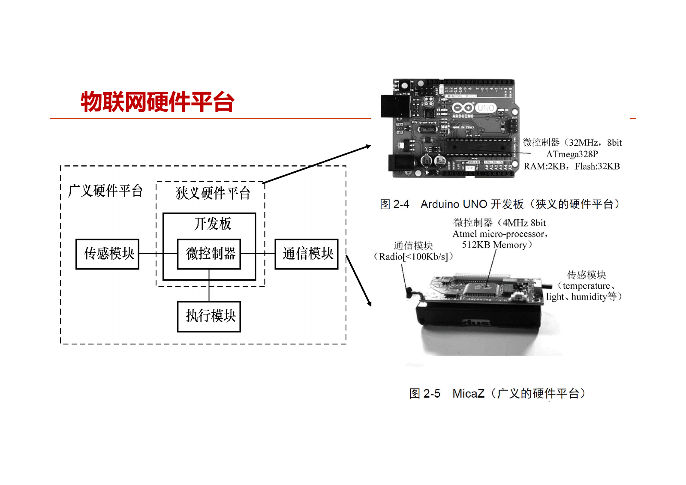
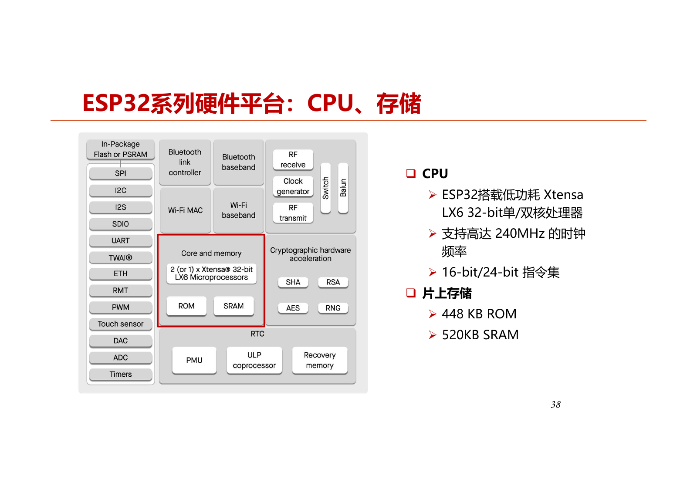
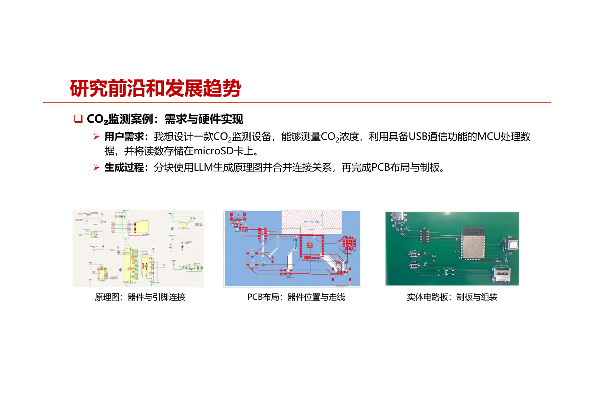

# 第2章 物联网硬件平台

本章围绕硬件平台的概述、关键特性、常见平台、案例开发与学术研究进展展开，重点理解资源约束、接口连接、功耗计算与平台选型。

本章高亮并加粗的内容配有重点标记与详细讲解；标记含义见[课程目录](index.md#review-guide)。

## 2.1 概述：平台的分类与组成

### 2.1.1 生活中的物联网硬件与发展趋势

**知识点**

物联网设备通过感知、计算与通信参与具体应用，燃气报警器、智能车锁、智能电表都是例子。PPT引用的预测是2030年全球物联网设备达390亿；这是课件中的预测值。硬件总体朝体积更小、价格更低的方向发展，适合更广泛和更密集的部署。（PPT，PDF第3—4页）

**老师讲解**

> 这次课按照课本的逻辑顺序，重点讲物联网硬件平台。  
> 下次讲物联网操作系统，后面还会讲无线协议和边缘AI。  
> 硬件平台这一部分，首先是概述，第二是关键特性，第三是常见硬件平台，第四是案例开发，第五是学术研究进展。  
> 生活中的物联网硬件已经很常见了。  
> 比如家里的燃气报警器，本身有计算和感知模块，当然计算能力比较弱，可能通过Zigbee这样的低功耗无线协议接到网关。  
> 上次讲的智能车锁和智能电表，也是典型的物联网设备。  

**老师讲解**

> 据预测，到2030年全世界物联网设备数将达到390亿。  
> 前面还报过一个数据，2020年底物联网连接数首次超过非物联网连接数，达到约117亿。  
> 物联网硬件的发展趋势是怎么样的？  
> 图里横轴是时间，从1950年一直到2080年；纵轴代表计算设备的尺寸。  
> 1946年首次发明计算机时，可能要占好几个房间。  
> 后来是工作站，每个工程师一台，尺寸也比较大。  
> 我上大学时开始逐步流行个人计算机，每个家庭一台。  
> 后来是更小的笔记本，再后来是性能已经很强的智能手机，以及智能物联网硬件和芯片。  
> 从发展趋势看，体积越来越小，价格越来越低。  

### 2.1.2 类PC设备、智能物件与物件

**知识点**

PPT采用按能力区分的三类平台视角。类别帮助理解计算能力与开发环境的关系，不能只凭外观尺寸判断。（PPT，PDF第5页）

| 类别 | 典型处理器与能力 | 典型系统/运行环境 | 场景 |
|---|---|---|---|
| 类PC的嵌入式设备 | Intel Core，接近缩小版PC | Windows Embedded、Linux；Win32/Linux | 自动取款机、零售服务点 |
| 智能物件 Smart Things | ARM Cortex-A7、Intel Atom，可处理较复杂任务 | Linux、Wind River、Android Things；Node.js/Python/C API | 可编程逻辑控制器、边缘网关 |
| 物件 Things | MCU，资源有限 | Contiki、RIOT、HarmonyOS；C API | 温度传感器、智能灯泡 |

表中数量约1亿、8亿、90亿属于该分类示意的统计背景，不应与2030年的预测混用。第21页将传感节点、STM32、ESP32、Arduino归入Things，树莓派、Jetson归入Smart Things。

**老师讲解**

> 物联网硬件平台怎么分类？  
> 上节课大概提到过，这里参考微软之前的分类，分成三类，我觉得挺有道理。  
> 从强到弱，第一类是类PC的嵌入式设备，数量约1亿台。  
> 它可以装Windows、Linux，至少从系统角度看跟PC没什么差别，只是能力弱一点。  
> 第二类是智能物件，数量约8亿台，处理性能更弱一些，一般采用ARM Cortex系列处理器。  
> 它可以装一些实时操作系统，比如Wind River的系统，或者Android Things，也可以用定制、裁剪的Linux，应用在边缘网关等设备里。  
> 最多、最便宜的是things，翻译成中文就是物件，数量约90亿台。  
> 它的处理性能更弱，好比上次发给大家的ESP32。  
> 它不能跑传统的Linux、Android，所以装的是物联网特有的操作系统，比如Contiki、RIOT。  
> RIOT是后面大家实验要用的。  

### 2.1.3 狭义开发板与广义硬件平台

**知识点**

狭义平台主要指开发板及其微控制器；广义平台还需要根据应用加入传感模块、通信模块、执行模块，并配置供电装置。MCU集成CPU、存储和接口等部件；仅有计算开发板还不足以构成具有感知与联网能力的完整应用平台。（PPT，PDF第6页）

图用于理解模块关系。图中Arduino主频标为32MHz，与第8页课堂例题采用的16MHz不同；后文计算以第8页题设为准。



图：狭义开发板与传感、通信、执行模块构成的广义平台（本章PPT，PDF第6页）。

**老师讲解**

> 什么是物联网硬件平台？一般有狭义和广义两种理解。  
> 狭义的物联网硬件平台其实就是开发板。  
> 开发板最重要的是微控制器，叫Microcontroller，缩写MCU。  
> 微控制器跟CPU不一样，除了CPU，还把存储等部件集成在一块。  
> 开发板一般携带微控制器，但把它称为物联网平台，可能还缺少一些必要部分。  
> 我们说物联网是沟通物理世界和信息世界的桥梁，所以首先要有传感器，把传感模块接进去。  
> 第二个，要通过无线接入网关、接入因特网，还需要通信芯片。  
> 特别是现在具身智能很热门，还可能需要执行模块。  
> 此外还有供电装置。  
> 这里给了两个例子，上面是Arduino Uno开发板，这是狭义的硬件平台，上面有很多接口，可以外接传感器。  
> 下面是早期伯克利做的MicaZ节点，集成程度比较高，板上已经集成无线通信芯片。  
> 还有一些平台把八种传感器集成在同一块电路板上。  

## 2.2 关键特性：如何选择硬件

### 2.2.1 运算速度、主频与存储容量

**知识点**

- 运算速度常用MCU/CPU主频描述，但每条指令所需周期数也影响执行速度。题设16MHz、每条指令20周期，则每秒执行 $16\times10^6/20=8\times10^5$ 条这样的指令。
- 主频提高会增加能耗。PPT第8页写作 $P=CV^2FT$，包含时间 $T$；老师也称其与能耗相关。因此这里保留课件表达，学习时区分功率与能量，不能直接把含时间的量当作瞬时功率。
- RAM是易失性数据存储，数组、全局变量、函数调用栈会占用它；Flash是非易失性程序存储，断电后程序仍在。外接SD卡属于另外的外部存储。
- RAM不足会限制数据结构与运行，Flash不足会限制程序映像大小；Flash写入较慢，有写入寿命约束。（PPT，PDF第8页）

| 平台（第8页例子） | 主频 | RAM | Flash/程序存储 |
|---|---:|---:|---:|
| TelosB | 8MHz | 10KB | 48KB |
| Arduino Uno | 16MHz | 2KB | 32KB |
| STM32F103（课件所列配置） | 72MHz | 64KB | 512KB |
| 树莓派4B | 1.5GHz | 1/2/4/8GB | 外接SD卡决定 |

TelosB的主频在第28页又列4MHz，位数在第8页列8而第28页列16；这些课件条目有差异，后文不把它们拼成唯一型号规格。STM32F103具体容量也须区分型号，第35页C8T6与VET6不同。

**老师讲解**

> 物联网硬件平台有哪些关键特性？  
> 第一是运算速度和内存大小，主要针对MCU这个部件。  
> 运算速度一般用MCU或者CPU的主频描述。  
> 主频和能耗有关系，式子里C是常数，V是电压，f是主频，包含V的平方、主频以及时间T[完整公式识别不清]。  
> 主频越高，能耗也越高，所以不能认为主频越高越好。  
> 运算速度和主频之间是什么关系？这里举个例子。  
> 如果一条汇编指令需要20个时钟周期，也就是clock cycle才能完成，对于16MHz的Arduino MCU来说，每秒有16×10^6个时钟周期。  
> 每条指令需要20个周期，所以每秒可以执行16×10^6÷20条指令。  
> 下面的表格列举了TelosB、Arduino Uno、STM32、树莓派4B等开发板。  
> 树莓派4B功能比较强，主频是1.5GHz，有些弱的平台只有8MHz，能力差距很大。  
> 支持的位数和内存大小也不一样。  
> 物联网里经常把RAM和Flash分开讲。  
> RAM是易失性的，用来存数据；Flash是非易失性的闪存，用来存程序，断电后程序仍然存在。  
> 早期我用的TelosB节点，RAM只有10KB，开一个大一点的数组可能就用不了。  
> Flash是48KB，也很小，意味着编译后的程序必须小于48KB，否则装不下。  
> 也可以外接SD卡，但那是另一类存储。  
> 内存的存取速度很快，Flash读取比较快，写入比较慢。  
> 写入次数多了会影响生命周期，闪存可能坏掉，所以有规定的写入次数。  
> SD卡属于外部存储，在RAM和Flash之外。  

### 2.2.2 物理接口、外设通信与共享接口调度

**知识点**

引脚使用杜邦线连接，灵活但易接错；Grove Port将一组引脚封装为连接套接口，连接较方便，也减少方向与线序错误。选择板子时要同时检查物理连接和协议支持。（PPT，PDF第9—10页）

| 方式 | 作用与特点 |
|---|---|
| Analog | 用模拟量表示数据，输入数字计算前需要ADC转换 |
| Digital | 用离散值序列表示数据 |
| PWM | 基于数字信号的脉宽调制 |
| UART | 异步、逐位、全双工串行通信；常用于调试输出 |
| I²C | 串行总线；MCU与外设通信的常见方式 |
| SPI | 高速、同步、全双工通信总线 |

同一接口被多个模块共享时，上层系统需要安排I/O访问，不能只看“能接上”，还要考虑模块能否按应用需求使用。老师以TelosB外部存储和无线模块共享接口为例解释这一点。

**老师讲解**

> 第二个关键特性是接口类型，这里指物理接口。  
> 上次给大家发了一些板子，物理接口分两种，一种叫引脚，一种叫连接套接口，英文是Grove Port。  
> 引脚是裸露在外面的，连接套接口已经封装好了。  
> 比如把四个引脚封装成一组，明确哪几个引脚是一组。  
> 用杜邦线连接引脚，过程复杂，也容易接错。  
> 引脚接错可能导致程序不能工作，甚至烧坏外设和主板。  
> 通过Grove Port连接线接入外设更容易、更快，也不容易出错，因为方向不对可能就扣不上。  
> 从通信协议角度看，MCU主板与外设之间主要有六种通信方式。  
> 第一是模拟信号，analog signal，用模拟量表示数据。  
> 有些传感器输出模拟信号，要转成数字信号就需要ADC，也就是Analog-to-Digital Converter。  
> 第二是数字信号，digital signal，用一系列离散值表示数据。  
> 第三是PWM，Pulse Width Modulation，是基于数字信号的脉冲调制技术，也比较常见。  
> 还有UART，调试程序时用得比较多，英文全称是Universal Asynchronous Receiver/Transmitter。  
> 它是异步、逐位传输数据的全双工通信接口标准。  
> 嵌入式设备没有屏幕，printf打印到哪里呢？可以通过UART传到电脑上。  

**老师讲解**

> 还有I²C，Inter-Integrated Circuit，是一种串行总线协议。  
> SPI，Serial Peripheral Interface，是高速、全双工、同步通信总线。  
> 为什么要讲这些稍微底层的东西？  
> 做物联网硬件平台时，MCU和外设之间需要通过这些协议连接。  
> 比如早期的TelosB节点，要装外部存储，它可能通过I²C接口跟MCU通信。  
> 无线传输模块也可能通过I²C跟MCU通信。  
> 以前还有一种情况，两个部件用了同一个I²C接口。  
> 这意味着两个部件不能同时使用。  
> 发送数据包时，不能同时往外部存储里存东西，因为共享同一个接口。  
> 上层做系统时就要考虑这一点，做好I/O调度。  

### 2.2.3 UART波特率与接收缓冲区计算

**知识点**

按PPT题设，每次UART传输11位，其中8位数据位、2位标识位、1位校验位；接收缓存只存数据位，忽略串口接收响应时间。设波特率为 $B$，中断处理时间为 $t_h$ 秒。（PPT，PDF第11—12页）

1. 每个传输位所用时间为 $1/B$ 秒。
2. 在 $t_h$ 内到达 $Bt_h$ 个传输位。
3. 数据位为 $Bt_h\times8/11$ 位。
4. 换算为字节并向上取整：$C_{\min}=\left\lceil Bt_h\times\frac8{11}\times\frac18\right\rceil=\left\lceil\frac{Bt_h}{11}\right\rceil$。

当 $B=9600$、$t_h=1$ ms时，$C_{\min}=\lceil9600/11000\rceil=1$ 字节。第12页思考题把中断时间改为2ms，按同一模型得到 $\lceil9600\times0.002/11\rceil=2$ 字节。这是依据给定量的推算。

==**本题使用课件给定的11位帧模型和处理时间模型；计算中特别注意位与字节的换算，最小容量需要向上取整。**==

<a id="exam-2-2-3"></a>

!!! important "考试提示 · 2.2.3"

    ==**UART 缓冲区题必须扣除帧开销、换算字节，并向上取整。**==

    **老师提示**：“我刚才把解题过程给了，最后考试可能会把波特率等条件改一改，所以还是要会计算。”

    **推导**：波特率 $B$ 在本题二进制 UART 模型中对应每秒 $B$ 个传输位。处理间隔 $t_h$ 秒内到达 $Bt_h$ 位；11 位帧只有 8 位数据，实际数据量为 $Bt_h(8/11)$ bit，再除以 8 得到 $Bt_h/11$ 字节。因此最小容量为 $\lceil Bt_h/11\rceil$。

    **例题**：9600、1 ms：$\lceil9600\times0.001/11\rceil=1$ B；9600、2 ms：结果 2 B。练习变式若改成 19200、2 ms，则 $\lceil38.4/11\rceil=4$ B。这里的变式是复习练习，并非老师公布的试题。

    **易错点**：ms 先除以 1000；11 是帧的总传输位数，8 才是有效数据位；最小容量必须向上取整，不能四舍五入。若题面改成 10 位帧就替换分母；真实 UART 还需考虑突发到达、硬件 FIFO 和长期处理速率，课内此题采用给定的简化接收模型。

**老师讲解**

> 这里还有一道思考题，也可以计算一下。  
> 每次UART传输有11位，其中8位是数据位，两位是标志位，一位是校验位。  
> 假设忽略串口接收响应时间，中断处理时间为1ms。  
> 具体意思是，从UART缓冲区读出一位并复制到内存，需要1ms。  
> 当波特率为9600时，接收缓冲区应该多少字节？假设缓冲区只存数据位，不存标志位和校验位。  
> 缓冲区太小会丢数据，所以要算这个大小。  

**老师讲解**

> 传输一位需要的时间是1除以波特率，也就是1÷9600秒。  
> 中断处理时间是1÷1000秒，在这个时间里有多少数据到达？  
> 波特率为B时，到达的数据是B÷1000位。  
> 其中每11位有8位数据需要存储，校验位和标志位不用存。  
> 这里有个要注意的地方，题目问的是多少字节，前面算的都是位，所以还要除以8。  
> 接收缓冲区大小由这些条件计算出来，最后需要向上取整。  
> 因为这是最小容量，零个字节肯定不行，会丢数据。  
> 下面还有个简单问题，UART波特率还是9600，但假设中断处理时间为2ms，缓冲区应该多少字节？  
> 刚才是1ms，现在是2ms，题目比较简单。  
> ==**我刚才把解题过程给了，最后考试可能会把波特率等条件改一改，所以还是要会计算。**==<br>

### 2.2.4 可扩展性与接口数量

**知识点**

可扩展性指开发板支持外设种类和数量的程度，接口数量、接口类型是重要指标。PPT第13页比较树莓派4B（28 Digital、6 UART、6 I²C、5 SPI、2 PWM）和BeagleBone Black（65 Digital、7 Analog、2 I²C、4 UART、8 PWM、2 SPI），并认为后者可扩展性更好。老师的讲解更谨慎：数量和种类多通常更方便，但具体应用仍应检查需要的接口组合。（PPT，PDF第13页）

**老师讲解**

> 继续看接口类型，接口类型越多、接口数量越多，开发板的可扩展性一般就越强。  
> 可扩展性就是开发板对接入外设种类和数量的支持程度。  
> 接口数量和类型是评估可扩展性的重要指标。  
> 下面有两个例子，也不一定能说一个严格优于另一个，但一般认为数量越多、类型越丰富，可扩展性越强，因为可以接更多外设。  
> 树莓派4B这里列了28个数字接口、6个UART、6个I²C；下面的平台列了65个数字接口、7个模拟接口[平台名识别不清]。  

### 2.2.5 传感器类别、精度与应用要求

**知识点**

开发板能否接某类传感器取决于接口及驱动等支持；广义平台还要考察选用传感器的感知模态、精度和价格。MicaZ通常需要外置传感板，TelosB集成温度、湿度、光照等传感功能，PPT称内置8类传感器。高精度粒子、北斗定位、加速度传感器与低价器件的能力差距很大；软件校准可以补偿一部分误差，但选型应从应用精度要求出发。（PPT，PDF第14页）

**老师讲解**

> 第三个特性是支持的传感器类别和精度。  
> 支持哪些传感器，重要因素就是接口类型和数量。  
> 采用的传感器精度，也是物联网平台的重要部分，这属于广义平台。  
> 狭义的开发板可以一个传感器都没有，但没有传感器，只能在实验室里玩、用于开发。  
> 现实中使用的物联网设备需要有感知能力。  

**老师讲解**

> 有些板子，比如Arduino，本身没有传感器，需要自己外接。  
> 有些节点内置了一些传感器。  
> 不同传感器的感知精度和价格差别很大，上节课讲过。  
> 比如移动空气质量检测项目里的粒子传感器，精度最高的是空气监测站，造价很高。  
> Dylos节点可能要五六千元，而比较便宜的传感器100元就能买到。  
> 价格不同，测量粒子浓度的精度也不同，之前的表格已经讲过。  
> 大桥项目的北斗监测站，要接入北斗定位传感器，它们的精度差异也很大。  
> 加速度传感器也一样，发给大家的是比较便宜的，贵的也有超过两万元的。  
> 做北斗定位时，我们以前买过司南的开发板，支持的定位精度差异很大。  
> 硬件不行，可能用软件弥补，设计一些更先进的校准算法来提升精度。  
> 但本质上是软硬件结合的问题，软件做得再好，硬件能力就在那里，也很困难。  
> 为什么讲这个？因为要根据应用需求选择合适的传感器。  

### 2.2.6 无线协议、多制式与通信模块

**知识点**

通信芯片可能内置或外接，常见支持Wi-Fi/Wi-Fi HaLow、BLE、Zigbee、LoRa。课件强调，多制式芯片支持多种无线技术并不等于共享无线硬件在同一时刻并行工作，需要协议切换或调度；具体支持情况应以对应型号为准。无线能力是完整平台选型的一部分。（PPT，PDF第15页）

**老师讲解**

> 第四个关键特性是支持无线协议的情况。  
> 通信芯片有内置的，也有外置的，不同芯片支持的无线协议不同。  
> 有些支持Wi-Fi，Wi-Fi也有低功耗版本。  
> 有些支持低功耗蓝牙，也就是Bluetooth Low Energy。  
> Zigbee在智慧家居里用得比较多，LoRa是一种长距离、低功耗通信协议。  
> 现在有一个趋势，很多芯片是多制式的，支持多制式切换。  
> 同一个通信芯片支持多种无线协议，但不能同时支持，需要切换，同时只能支持一种。  

### 2.2.7 成本、尺寸与部署密度

**知识点**

节点成本更低、体积更小，通常可以提高部署密度。课件给出2026年9月平台裸板售价与尺寸作为比较例子：TelosB 574元/63.75×32mm，Arduino Uno 185元/68.8×53.4mm，GEMMA 90元/27.94×27.94mm，STM32F103例板316元/130×100mm，树莓派4B 981元/88×58mm。传感器、通信芯片等附加模块还会增加成本和体积，这些价格只作课件当时的比较背景。（PPT，PDF第16页）

**老师讲解**

> 再一个关键特性是低成本和微型化，这是针对整个节点的重要考量。  
> 我们总希望价格越低、尺寸越小，这意味着可以提高部署密度，布更多节点。  
> 表里列举了一些常见硬件平台的价格和尺寸，这里是裸板，不包括通信芯片和传感器。  
> 数据按今年的价格重新调整过。  
> 比较弱的Arduino Uno仍然比较便宜，[另一型号识别不清]可能更便宜，STM32这里是三百多元，树莓派4B是981元。  
> 现在是不是已经有5B了？  
> 我记得树莓派有一段时间涨价很多，最近存储是不是也涨价比较多？  

### 2.2.8 模块与状态的能耗累加

**知识点**

功率单位为W，电流单位为A，能量单位为J；课件表中用μA/mA表示的“能耗”栏实际给的是电流。恒压下先用 $p_i=VI_i$ 求状态功率，再按状态持续时间累加能量。（PPT，PDF第17—18页）

$$\Delta E=\sum_{i=1}^{n}\Delta t_i\,\mathbb{I}_i\,p_i$$

这里 $i$ 为能耗状态，$n$ 为状态数量，$\Delta t_i$ 为状态持续时间，$p_i$ 为该状态功率，$\mathbb{I}_i$ 为指示变量：该状态时间大于0时取1，否则取0。整个平台还要对计算、通信、传感等模块继续累加。

Arduino Uno例题：5V恒压运行1s，休眠与工作各0.5s。题设休眠电流0.1μA、工作电流0.2mA，则

$$p_1=5\times0.1\times10^{-6}=5\times10^{-7}\;\mathrm W,\qquad p_2=5\times0.2\times10^{-3}=10^{-3}\;\mathrm W$$

$$\Delta E=0.5p_1+0.5p_2=0.50025\times10^{-3}\;\mathrm J=0.50025\;\mathrm{mJ}$$

这是第18页可见的计算结果；字幕没读出最终值。题目虽写“总功耗”，计算得到的是这1秒的总能量。例子没有计入外设。第17页TelosB睡眠电流列2.6μA，第29页另列5.1μA，保留各页口径，不能当作同一条件下的唯一电流。

**老师讲解**

> 另一个重要考量是整块板子的功耗和能耗，特别是野外、没有有源供电的部署场景。  
> 功耗越低，就意味着运行时间越长，第一次课让大家算过节点生命周期。  

**老师讲解**

> 这里列了两个开发板，一个是早期伯克利做的TelosB，一个是Arduino Uno。  
> 供电电压分别支持1.8V到3.6V，以及1.8V到5.5V。  
> 睡眠电流分别为2.6μA和0.1μA，工作电流分别为0.5mA和0.2mA。  
> 注意单位不同，前面是微安，后面是毫安。  
> 整个板子的能耗是各个模块能耗的总和。  
> 计算模块、通信模块、传感器模块的能耗，都要叠加起来。  
> 这里的ΔE按各个能耗状态累加，状态编号i从1到N。  
> 表里为了简单，只列工作和睡眠两个状态。  
> 实际上，板子可能有浅度睡眠、深度睡眠等多种状态。  
> N是模块能耗状态的数量，Δt_i是模块处于状态i的时间，P_i是该状态的功率。  
> 如果没有在这个状态工作，Δt_i就是0，这一项就不计入。  
> 公式里还有一个指示变量，表示有没有在这个能耗状态待过，没用过的状态就不累加[指示变量具体取值的口述识别不清]。  
> 这个例子很简单，但可以拓展，板上有多个模块就继续累加。  
> 假设Arduino Uno电压保持5V，运行1秒，其中0.5秒休眠、0.5秒工作，计算运行总能耗。  
> 套用前面公式，跟第一次课算平均功耗、平均电流的思路一样。  
> 令i=1表示睡眠，i=2表示工作。  
> 睡眠状态功率P₁=0.1μA×5V，工作状态功率P₂=0.2mA×5V。  
> 把两种状态的能耗加起来，就得到ΔE[最终数值在字幕中未读出]。  
> 这个例子没有考虑外设，有外设还要加进去。  

### 2.2.9 RAM容量与占空比共同决定MCU选型

**知识点**

第19页给出两款MCU：

| 参数 | MSP430F2618 | MSP430F5437 |
|---|---:|---:|
| 工作电压 | 1.8—3.6V | 1.8—3.6V |
| RAM | 8KB | 16KB |
| Flash | 116KB | 256KB |
| 工作电流 | 0.5mA | 0.28mA |
| 睡眠电流 | 1.1μA | 1.7μA |

代码声明 `char buf[10240]`，仅数组就需10240字节，即10KiB；8KB的第一款放不下，应在这两个选项中选第二款。还需为其他变量和栈留空间。字幕中元素类型未识别清楚，PPT明确为 `char`。（PPT，PDF第19页）

按总观察时间 $T=10$ s、恒压 $V=3$ V、占空比 $d$ 计算：

$$E=VT\bigl[dI_{\mathrm{work}}+(1-d)I_{\mathrm{sleep}}\bigr]$$

| 占空比 | F2618能量 | F5437能量 | 较低者 |
|---|---:|---:|---|
| 80% | 12.0066mJ | 6.7302mJ | F5437 |
| 0.1% | 0.047967mJ | 0.059349mJ | F2618 |

表中是根据题设补算的结果，老师课堂给出了定性判断与计算思路，没有读出这组数值。==**工作时间占比高时重视工作电流；占比极低时睡眠电流可能主导总能耗。**==

<a id="exam-2-2-9"></a>

!!! important "考试提示 · 2.2.9"

    ==**MCU 选型先满足 RAM/Flash，再按工作和休眠电流比较能耗。**==

    **老师提示**：“这个题不难，最后考试如果考这种题，属于送分题。”

    **第一步检查能否运行**：`char buf[10240]` 占 10240 B，即 10 KiB，第一款 8 KiB RAM 放不下，第二款 16 KiB 才可能满足，还要给栈、其他变量和系统留空间。Flash 存程序，空余 Flash 不能直接替代 RAM 中的数组。

    **第二步比较平均电流**：换成 mA 后，第一款为 $I_1=0.0011+0.4989d$，第二款为 $I_2=0.0017+0.2783d$。同电压、同观察时间下比较电流就能比较能量。80% 时第二款更省；0.1% 时第一款更省，因为长期睡眠时更低的休眠电流胜过更低的工作电流。

    **进一步理解**：令 $I_1=I_2$，得 $d=0.0006/0.2206\approx0.00272$，即约 0.272%。这是按给定参数推得的交点，帮助解释选型反转；不代表老师要求记忆这个数。这里按固定总观察时间比较；若题目固定“完成一次任务的工作时间”，先用占空比求完整周期。第一问和第二问条件也要分开：只有程序在两款上均能运行时，才有第二问的能耗比较。

**老师讲解**

> 这里有个思考题。  
> 表中描述了两款MSP430 MCU的部分属性，型号分别为MSP430F2618和MSP430F5437。  
> 工作电压都是1.8V到3.6V，RAM分别为8KB和16KB，Flash分别为116KB和256KB。  
> 第一款工作电流是0.5mA，睡眠电流是1.1μA；第二款工作电流降低到0.28mA，但睡眠电流增大到1.7μA。  
> 第一问，程序中有给定的代码片段，为了支持这段代码应该选择哪块MCU？  
> 第二问，假设一段程序在两款MCU上都执行10秒，占空比为80%时，谁的能耗更低？  
> 占空比为0.1%时，谁的能耗更低？  
> 占空比的概念上节课讲过。  
> 假设两个处理器工作电压恒定为3V，也就是暂时不考虑电池电压在工作过程中下降。  

**老师讲解**

> 先看看思路，第一问挺简单，应该选哪一个？  
> 你说不知道，能说说为什么不知道吗？这些条件不是已经给定了吗？  
> 现在程序是这样写的，应该选择哪款芯片？  
> ==**这个题不难，最后考试如果考这种题，属于送分题。**==<br>
> 你看数组有10240个[元素类型识别不清]，这个数组已经用了10KB空间。  
> 第一款只有8KB，肯定放不下，编译后烧不上去。  
> 第二个问题需要计算，但能不能先大胆猜想一下？  
> 工作占空比越低，哪一款芯片会更好？从定性角度判断一下。  
> 占空比很低，意味着睡眠时间多、工作时间少，所以肯定要选择睡眠能耗小的芯片。  
> 具体怎么算还得算一算，上节课给出过一些公式，后面也可能再讲，计算比较简单。  
> 课后回头再算一算，出这种类似题目也是挺正常的。  

## 2.3 常见硬件平台：从感知节点到边缘AI

### 2.3.1 统一选型视角与平台总览

**知识点**

物联网硬件高度异构，同一系列也有不同配置。学习多个平台的目的，是按应用的计算、存储、接口、传感、通信、成本与能耗要求选择合适方案。（PPT，PDF第21页）

| 平台 | 类别 | 核心适用特点 |
|---|---|---|
| 传感节点 | Things | 高度集成、低功耗无线传感网络 |
| STM32 | Things | Cortex-M MCU，多型号、外设丰富 |
| ESP32 | Things | MCU与Wi-Fi/蓝牙集成，联网应用 |
| Arduino | Things | 原型开发、入门教学、盾板与社区 |
| 树莓派 | Smart Things | 单板计算机，完整OS与高级语言 |
| Jetson | Smart Things | GPU并行计算与边缘AI |

<a id="exam-2-3-1"></a>

!!! important "老师强调 · 2.3.1"

    ==**Things 与 Smart Things 的区别要联系资源、系统和应用需求理解。**==

    **老师提示**：“重点关注后两类，一类是things，计算能力比较弱的物件；另一类是智能物件，有一定计算能力。”

    **详细讲解**：STM32、经典 ESP32、Arduino 和早期传感节点主要提供有限计算、感知与通信资源，适合简单控制和低功耗采样；树莓派、Jetson 等资源更强，可以运行完整系统或复杂边缘 AI。分类依据是课程中使用的平台能力，不能只看体积，更不能把所有 MCU 芯片型号都视为完全相同。

    **选型答题**：先给出应用约束，再检查算力、RAM/Flash、传感器与接口、无线协议、工作/睡眠电流、成本和体积。温湿度监测不需要为了性能选 Jetson，实时视觉可能需要 GPU/NPU。较强平台通常耗电更多，“低功耗”应给出比较对象和供电条件。不要只背板子名字而不会解释为何选择它。

**老师讲解**

> 接下来看常见的硬件平台。  
> 先用几张表格给一个整体概览，前面已经分成三大类。  
> 第一类是PC-like embedded，类PC的嵌入式系统，装的系统跟常见计算机差不多，这里就不讲了。  
> ==**重点关注后两类，一类是things，计算能力比较弱的物件；另一类是智能物件，有一定计算能力。**==<br>
> 属于things的有早期传感器网络节点、STM32平台、发给大家的ESP32平台等。  
> 比较强的有树莓派，还有带GPU、能力更强的Jetson平台。  
> 国内现在也有一些带AI计算能力的物联网硬件。  
> 传感器节点最早由加州大学伯克利分校开发，高度集成计算、感知和通信能力，专为低功耗无线传感网设计。  
> STM32基于ARM Cortex-M系列微控制器。  
> ARM有Cortex-A和Cortex-M两个系列，M系列能力更小一些。  
> STM32提供从低功耗到高性能的广泛型号，适合有一定处理能力和外设扩展需求的应用，也有丰富的工具和库，适合快速开发、原型设计。  
> ESP32是国内乐鑫科技发布的平台，重要特点是集成Wi-Fi和蓝牙，通信芯片也集成进去了，支持两种制式。  
> 它有双核处理器和低功耗特性。  
> Arduino是开源电子原型平台，也有Arduino这家公司，编程模型简单、社区支持广泛，适合初学者和教育用途。  
> 模块化设计允许快速开发原型，有大量现成的扩展板和库。  
> 树莓派是基于ARM的单板计算机，有完整操作系统和较高处理能力。  
> Jetson由NVIDIA发布，基于NVIDIA GPU，有很强的图形和并行计算能力，适合图像处理、机器学习、深度学习，支持CUDA、OpenCV等库。  

**老师讲解**

> 前面三张表，第一张以开发板为主，讲物联网硬件平台。  
> 后面讲这些平台可以内置或外接的传感器、通信芯片。  
> 一般要有计算、传感器和通信，才是完整的物联网硬件平台。  
> 为什么讲这么多平台？这也是我们的教材跟原来一些书不一样的地方。  
> 市面上有些书讲STM32应用开发、Arduino应用开发，会固定在一个平台里。  
> 我们写教材时考虑到物联网需求很广，底层硬件很异构，具体应用到底选哪个，不一定总选同一个。  
> 虽然一个系列内部也可以有很强的功能，还是希望用统一视角看各个平台的优点，便于设计具体应用时选到最合适的平台。  

### 2.3.2 代表性感知芯片与通信芯片

**知识点**

完整平台不仅选开发板，还要选内置或外接的感知、通信部件。课件按模态列举代表性感知器件（PDF第22页）：

| 感知任务 | 代表器件 | PPT要点 |
|---|---|---|
| 图像 | OV2640 | 约200万像素，1600×1200，压缩输出 |
| 声音 | T5848 | 数字MEMS麦克风，24位I²S输出，低功耗声学活动检测 |
| 温湿度 | SHT31-DIS-B | 典型湿度精度±2%RH，I²C |
| VOC | SGP40 | 配合算法生成VOC指数，I²C |
| CO₂ | SCD40 | 光声NDIR，温湿度补偿，I²C |
| 三轴加速度 | ADXL345 | ±2/4/8/16g，I²C/SPI |
| 六轴惯性 | LSM6DSOX | 加速度与角速度，I²C/SPI |

代表性通信芯片（PDF第23页）包括Nordic nRF52832、nRF52840（BLE，其中52840支持长距离编码物理层）、ESP32-H2（BLE、Mesh与IEEE 802.15.4，可用于Thread/Zigbee），以及LoRa终端收发器SX1278、SX1262、集成MCU与射频的STM32WLE5CC和网关基带SX1302。终端收发器还需要配合MCU，网关基带需要射频前端与主处理器，不能把所有通信芯片都当作独立开发板。

LoRa是Long Range通信技术，与模型微调中的LoRA不是同一概念。上述具体型号参数主要依据PPT，字幕提供了类别和厂商层面的讲解，未逐项完整解释所有新表格型号。

**老师讲解**

> 如果只考虑计算，就是开发板，跟传统嵌入式没什么区别。  
> 但物联网平台通常还要集成感知芯片，有些内置，更多需要外接。  
> 另外还要支持通信芯片，乐鑫的平台就是已经集成进去的。  
> 这张表列了代表性的感知芯片，也按照感知类别进行了分类。  
> 比如视觉，就是采集图像，摄像头是代表。  
> 海康也算物联网公司，在智慧城市里用摄像头，主要感知模态就是视觉。  

**老师讲解**

> 视觉就是刚才讲的摄像头这些。  
> 声学也有用于声音采集的传感器。  
> 温湿度传感器是不是已经发给大家了？以前经常用DHT11等。  
> 还有气体传感器，比如前面讲的粒子传感器，以及二氧化碳等其他气体传感器。  
> 运动传感器包括三轴加速度测量、六轴惯性测量等，传感器类别非常多。  
> 再看通信芯片。  
> 这次书改版，无线部分只讲两个协议：短距离的以蓝牙为代表，长距离的以LoRa为代表。  
> 蓝牙芯片全球出货量很大，因为每个手机上可能都有。  
> 表里也列了乐鑫，但我不清楚乐鑫的蓝牙芯片做得多不多。  
> 国内还有泰凌微，Nordic是北欧半导体公司，也做蓝牙芯片。  
> 如果要二次改装蓝牙芯片，比如做底层协议开发、改链路层，Nordic的开放程度比较高。  
> 这里的LoRa不是大模型参数微调里的LoRA，而是Long Range的缩写，是低功耗、长距离传输协议。  
> 基本上只有一家公司能做，就是Semtech，表里的意法半导体可能也是使用它的技术。  
> 后面讲无线协议时会讲LoRa的调制方式，它跟以前计算机网络里讲的QPSK等不一样。  
> 它的频率随时间变化，这种调制英文叫chirp。  

### 2.3.3 传感器网络的动态多跳传输

**知识点**

无线传感网络通过传感节点采样，再沿多跳路径把数据送至汇聚节点。无线链路和父节点选择可能变化，因此是动态网络；节点不仅采样，也可能转发其他节点数据。老师以农林大学实地部署和TinyOS为例说明。（PPT，PDF第24—25页）

**老师讲解**

> 首先看传感器硬件平台，它主要用于传感器网络。  
> 这个图是十几年前在农林大学、以前叫林学院的地方部署的传感器网络，当时用航拍得到这个图。  
> 里面的小点就是传感器节点，底层用了伯克利做的TinyOS操作系统，也集成了一些网络协议。  
> 它通过多跳方式传输，左上方红点代表汇聚节点。  
> 节点把数据包传给上一跳，上一跳再继续往上转，最后传到汇聚节点。  
> 因为是无线网络，连接有时会变，并非一成不变。  
> 我们讲选择父节点，选择哪个父节点来传数据可能变化，所以这是一个动态的多跳网络。  
> 这里也有实景图，白点就是部署的节点。  

### 2.3.4 传感节点演进与低功耗定位

**知识点**

早期研究沿UCLA的低功耗无线传感/WINS与伯克利Smart Dust两条主线开展。传感节点发展受技术不均衡、功耗与成本共同制约，不能照搬计算性能按摩尔定律快速增长的预期。（PPT，PDF第26—29页）

| 代际（第28页） | 节点 | 主频 | 位数 | RAM/Flash |
|---|---|---:|---:|---:|
| 第一代 | Mica、MicaZ | 4MHz | 8 | 4KB/128KB |
| 第二代 | TelosB | 4MHz | 16 | 10KB/48KB |
| 第三代 | Firestorm | 48MHz | 32 | 64KB/512KB |
| 第三代 | Imote2 | 104MHz | 32 | 256KB/32MB |
| 第三代 | Hamilton | 48MHz | 32 | 32KB/256KB |

典型特点是低功耗、小尺寸、高集成度、低成本。第29页TelosB睡眠电流例为5.1μA，板子63.75×32mm；在低占空比应用中电池和休眠状态十分关键。表格中Firestorm、Hamilton具体配置依据PPT补充，课堂主要讲Mica、TelosB、Imote2。

**老师讲解**

> 看传感节点平台的早期研究，有两条主线。  
> 无线传感网研究始于20世纪90年代，最早的两个研究机构是加州大学洛杉矶分校UCLA，以及加州大学伯克利分校。  
> 伯克利做系统很厉害。  
> UCLA有低功耗无线传感项目[项目缩写识别不清]，把节点集成在设备上，并在[年份识别不清]开发了WINS节点。  
> 伯克利有Smart Dust项目，Dust翻译成中文是灰尘，就是智慧灰尘，愿景是把物联网节点做得这么小。  
> 1999年发布了一个节点，这个节点我用得不多。  
> 之后的一系列节点，在传感器研究里用得很多，比如Mica、Mica2、Mica2Dot、MicaZ。  
> 传感器节点平台的发展趋势怎么样？可能现在已经不太发展了。  
> 图的横轴是年份，纵轴是硬件能力，整体发展比较缓慢，而摩尔定律预测的曲线增长很快。  

**老师讲解**

> 发展缓慢的原因是什么？  
> 一方面是技术发展不均衡，不能只让计算能力很强，因为耗电也大，电源跟不上；另一方面是成本限制，实际使用仍然希望每个节点低成本。  
> 传感节点平台总体分成三代，右边放了实物图。  
> 第一代是Mica系列，主频大约4MHz，处理器是8位，RAM只有4KB，比TelosB更小。  
> 写程序时会很痛苦，一旦有全局变量，或者函数调用要用堆栈，都会占用RAM。  
> 当时Flash相对大，有128KB。  
> 第二代TelosB做了升级，处理器从8位改成16位，RAM变成10KB，极大缓解RAM太小的痛点。  
> 但Flash从128KB变成48KB。  
> 第三代我们以前买过Imote2，它的处理性能提高很多，主频从4MHz提高到104MHz，处理器变成32位，RAM和Flash也大幅提升。  
> 传感节点平台的主要特点可以归结为四方面。  
> 第一，低功耗。  
> 以第二代TelosB为例，睡眠电流只有5.1μA，很省电。  
> 以前传感器网络一般是低占空比，大部分时间休眠，所以工作时长比较长。  
> 第二，体积小。  
> 最初设计为军事探测系统，要求隐蔽性高。  
> TelosB板子本身很小，主要是两节AA电池占的体积比较大。  
> 很早以前写传感器网络论文，经常把军事探测作为用途，比如布在边境，有人越过边界就检测出来，及时预警。  
> 第三，集成度高，集成MCU、传感模块、通信模块。  
> 我记得早年的MicaZ集成MCU和通信芯片，传感模块是单独的板，要接进去才能支持很多传感器。  
> TelosB把常见传感器内置在同一块板上，这里讲的是八种。  
> 第四，单个传感节点成本较低。  

### 2.3.5 STM32：CPU、MCU、MPU与型号

**知识点**

CPU是运算和控制核心；MCU把CPU、内存、I/O、时钟等集成到一个芯片，偏向控制、低功耗和电池应用；MPU相对偏向高性能计算与复杂任务。STM32系列包含多种ARM Cortex内核产品，课件介绍Cortex-M0/M3/M4/M7及主流、高性能、低功耗分类。（PPT，PDF第30—33页）

型号中的产品类别、功能系列、引脚数、Flash容量、封装和温度范围影响实际选型，不能只说“STM32”。开发板还包含主控、USB电源、扩展、电源、下载接口、复位键。第35页最小系统板C8T6为72MHz、Flash64KB/RAM20KB；VET6例板为72MHz、512KB/64KB。

**老师讲解**

> 接下来看STM32系列硬件平台，由意法半导体推出，采用Cortex-M内核。  
> 从内核分，又有Cortex-M0、M3、M4、M7等，每种还细分为主流、高性能、低功耗等类型。  
> 整个系列包含很多基于ARM Cortex内核的32位MCU和MPU产品。  
> 术语比较多，这里澄清CPU、MCU、MPU，大家也可以网上查一查。  
> CPU是Central Processing Unit，是计算机运算和控制的核心，也是信息处理、程序运行的最终执行单元。  
> MCU是Microcontroller Unit，把CPU、内存、I/O接口、时钟电路等基本组件集成在一个芯片上，集成程度更高，包含的东西更多。  
> 通常设计为低功耗设备，适合长时间运行和电池供电的应用。  
> MPU是Microprocessing Unit，比MCU更侧重高性能计算和复杂任务处理，具有更高的[识别不清]、更大内存和更强计算能力。  
> STM32经过多年发展，衍生很多规格型号，每个字母、数字有不同含义，这里给了一个命名例子。  
> 前缀是STM32，后面是产品类别，A代表汽车级，F表示基础级，L代表超低功耗等。  
> 103代表特定功能，不同数字表示入门级、基础级、高性能等。  
> 后面的V代表引脚数，E代表Flash容量，T代表封装，6代表适用温度范围。  

**老师讲解**

> 也介绍一下ST，也就是意法半导体的成立背景。  
> 它成立于1987年，由意大利SGS微电子公司和法国汤姆森半导体公司合并而成。  
> 1998年5月，公司改名为意法半导体有限公司，是世界最大的半导体公司之一。  
> 从成立以来，ST增长速度超过半导体工业整体增长速度，从1999年起始终是世界十大半导体公司之一，在很多市场居领先地位。  
> 所以我们说物联网产业链长，底层有芯片厂商，包括通信芯片、传感器、计算芯片，上面有方案提供商、集成商等。  
> 产业链下面的厂商，单片板子卖得不是很贵，但量很大。  
> 开发板主要包括主控芯片、USB、电源接口、下载接口、扩展接口和复位按钮。  
> 右边图展示了这些主要部件。  
> 就核心微控制器而言，经过十余年发展，拥有十大产品系列、七百多种产品，从超低功耗到高性能，覆盖不同应用需求。  
> 图中年份没有更新到最新，2007年发布了世界上首个Cortex-M MCU，后面又发布了世界上首个超低功耗Cortex-M等。  

### 2.3.6 STM32低功耗模式、接口与调试

**知识点**

以STM32F103为例，睡眠模式停止内核运行但外设保持运行；停机模式停止所有时钟，约20μA；待机模式关闭所有时钟与1.2V区域电源，约2μA。更深休眠一般需要更长唤醒时间，应按事件响应需求取舍。（PPT，PDF第34—36页）

STM32提供I²C、USART/UART、SPI、CAN、USB等接口，可通过库模块开发和串口烧写，支持JTAG/SWD调试。PPT第34页与第35页对同名VET6例板的UART/SPI数量存在差异，学习重点是比较方法，实际接口数量须检查对应器件和板卡资料。

**老师讲解**

> 看MCU能耗和接口，以STM32F103为例，有三种低功耗模式。  
> 睡眠模式下，内核停止运行，外设保持运行，通常在等待外设中断时降低功耗。  
> 停机模式下，所有时钟停止，功耗比较低，大约20μA。  
> 待机模式功耗最低，大约2μA，关闭所有时钟，也把1.2V区域电源完全关闭。  
> 前面为了简单只计算工作和睡眠两种模式，实际上处理器有多种休眠模式。  
> 天下没有免费的午餐，深度睡眠功耗很低，但唤醒时间也很长。  
> 不能每次休眠都直接进最低功耗模式，否则下次遇到紧急事件，唤醒会很困难。  
> 右边表格比较了两种典型开发板的扩展接口数量。  
> 接口越丰富、数量越多，可扩展性一般越强，未来接外设就更容易。  
> 常见开发板有STM32最小系统板等，表中列了Flash、RAM、接口数量、尺寸、电源输入等特性，最新也可能有更新的开发板。  
> STM32平台主要特点，第一是开发方便，可以通过库文件开发，程序模块化，接口简单，一个串口就可以烧写。  
> 第二是通信接口丰富，包括I²C、UART、SPI、CAN，以及USB 2.0全速接口。  
> 第三是调试简单，支持标准JTAG仿真调试[接口具体位数识别不清]。  
> JTAG是专门的调试接口，在PC上打开IDE调试，可以看到内存、寄存器等状态。  
> 还支持针对Cortex-M3内核的串行单线调试功能。  
> 第四是低功耗，支持睡眠、停机、待机模式，在低功耗、短启动时间和多种唤醒事件之间取得平衡。  

### 2.3.7 ESP32：集成计算、存储与双模无线的SoC

**知识点**

SoC指系统级芯片；ESP32实例把处理器、存储、无线及许多外设功能集成在一个单芯片方案中。课件介绍乐鑫2014年ESP8266EX Wi-Fi SoC、2016年ESP32 Wi-Fi+Bluetooth SoC的发展。（PPT，PDF第37—40页）

第38页ESP32采用Xtensa LX6 32位单/双核处理器，最高240MHz，支持16/24位指令集，片上448KB ROM、520KB SRAM。图中的Bluetooth基带与链路控制、Wi-Fi基带与MAC、RF收发模块体现了无线集成。ROM和Flash都属于非易失性存储，但不能因为老师说“类似”就把二者视为同一器件。

外设包括34个GPIO、SPI、I²C、I²S、UART、SD/SDIO、以太网MAC等数字接口，以及ADC、DAC、触摸传感器等模拟外设；具体可用引脚取决于芯片与开发板配置。



图：ESP32片上计算与存储、无线收发和外设接口的结构（本章PPT，PDF第38页）。

**老师讲解**

> 再看ESP32，这是中国乐鑫科技设计的集成2.4GHz Wi-Fi、蓝牙双模的单芯片方案。  
> 乐鑫全称乐鑫信息科技，是一家全球化的无晶圆厂半导体公司，专注研发高性能、低功耗无线通信芯片。  
> 公司成立于2008年，总部在上海张江高科技园区。  
> 2013年发布第一款产品ESP8089，专为手机和机顶盒应用设计的Wi-Fi SoC。  
> 2014年推出ESP8266EX，是面向物联网应用的超低功耗、高度集成Wi-Fi SoC。  
> 2016年发布旗舰产品ESP32，是用于物联网的Wi-Fi加Bluetooth SoC。  
> 2018年在Wi-Fi MCU市场达到全球领先地位，2023年物联网芯片全球出货量突破十亿颗。  
> 左边图展示了芯片主要部件，先看CPU和存储。  
> ESP32搭载低功耗Xtensa 32位单核或双核处理器，时钟频率最高240MHz，支持16位或24位指令集。  
> 内部有CPU、ROM和SRAM。  
> ROM类似Flash，用于存程序；SRAM用于存数据。  
> 片上ROM是448KB，SRAM是520KB。  
> 框起来的核心部分还有Bluetooth芯片，具体包括基带模块和链路控制模块。  
> Wi-Fi也一样，除了基带模块，还包括MAC，也就是Media Access Control模块。  
> 最右边是RF transmitter和receiver，RF是Radio Frequency，也就是射频。  
> 这对应前面讲的双制式，它把无线部分也集成进去了。  

### 2.3.8 多制式无线的时分调度

**知识点**

多标准芯片可以集成多个协议能力，但无线资源共享时需要安排不同协议的使用时间。老师举出5ms蓝牙、5ms Wi-Fi轮转的思路，并说明要错开两个协议栈的占空比工作时间。这里重点是多制式能力与同时占用射频资源之间的区别。（PPT，PDF第15、39—40页；时分例子为课堂补充）

**老师讲解**

> 这张表来自我们几年前发表的论文，也是现在的一种发展趋势。  
> 现在有很多multi-standard radio chip and platform，也就是多标准无线芯片和平台。  
> 一个芯片支持多种制式，比如这个例子同时支持Wi-Fi和蓝牙，此外还有很多这样的芯片。  
> 表格第一行支持BLE、6LoWPAN、Zigbee三种协议。  
> 这里还列了Wi-Fi、LoRa、Sigfox、NFC等，不同芯片可以支持多种。  
> 但是支持多种不代表同时连接Wi-Fi和蓝牙，同时只能选择一种制式。  
> 以前有研究工作，想在这种多标准芯片上既连接蓝牙网关，又连接Wi-Fi网关，怎么办？  
> 可以按照操作系统的思路做时分多路复用。  
> 比如分时间片，5ms用蓝牙，5ms用Wi-Fi，时间片轮转后，用户看起来两种无线技术都能用。  
> 内部还有一些特殊问题。  
> 之前的工作会结合两种协议栈的duty cycle模式。  
> 占空比模式不只针对计算，通信也一样，有时工作，有时休眠。  
> 怎么把两个模式耦合好？这里的耦合实际上是错开，要用的时候错开。  
> 左边的外设接口也很丰富，这里不一一念，有34个通用输入输出接口，还有模拟外设接口等。  

### 2.3.9 ESP32功耗模式与“低功耗”的判断

**知识点**

ESP32有Active、Modem-sleep、Light-sleep、Deep-sleep、Hibernation等状态。Active时射频工作；Modem-sleep时CPU运行而Wi-Fi/蓝牙基带与射频关闭；Light-sleep暂停CPU，RTC和ULP等保留；Deep-sleep让CPU与大部分外设掉电；Hibernation进一步禁用8MHz振荡器与ULP。（PPT，PDF第41—42页）

性能稳定、高集成、低功耗机制、双模方案是平台特点。具体能耗要看datasheet在对应模式下的电流、发射/接收方式和工作条件，不能只凭“超低功耗”宣传判断。Wi-Fi和BLE在不同状态下电流差异大，电源与电池预算应按实际应用的模式占比估计。

**老师讲解**

> 看ESP32系列的能耗，datasheet里给了一张很大的表。  
> 它的功耗模式比STM32更多。  
> Active模式是射频处于工作状态。  
> Modem-sleep模式下，CPU运行，Wi-Fi和蓝牙基带、射频关闭。  
> Light-sleep模式下，CPU暂停，RTC外设和协处理器运行，唤醒事件可以唤醒芯片，也就是浅度睡眠。  
> Deep-sleep模式下，CPU和大部分外设掉电。  
> 还有Hibernation，也就是冬眠模式，内置8MHz振荡器和协处理器都禁用。  
> 再后面就是彻底断电关闭。  
> 表格上半部分列了Active模式下的不同工作情况，典型电流消耗也不同。  
> 前面是802.11，也就是Wi-Fi，功耗比较高，而且发送状态肯定比接收状态高。  
> 后面两行是BLE，低功耗蓝牙。  
> 无论发送还是接收，尤其发送状态下，功耗基本是Wi-Fi的一半或稍多一点。  
> ESP32主要特点也可以归结为四部分。  
> 第一，性能稳定，工作温度范围达到-40℃到125℃，集成自校准电路，实现动态电压调整，消除外部电路缺陷并适应外部条件变化。  
> 第二，高度集成，把天线开关、射频功率放大器、接收低噪声放大器、滤波器、电源管理模块等集成一体。  
> 第三，超低功耗，针对移动设备、可穿戴电子产品和物联网设计，包括精细时钟门控、省电模式和动态电压调整。  
> 第四，双模解决方案，既可以作为独立系统运行应用，也可以作为主机MCU的从设备。  
> 为什么可以作为从设备？因为它自带两种通信支持，通信能力比较出色。  
> 顺便提一句，每家嵌入式、物联网芯片厂商都说自己低功耗、超低功耗，到底谁更低？  
> 还得翻datasheet，像刚才这样看数据。  
> 比如前面TelosB睡眠电流只有5.1μA，另一个也说超低功耗，却有20μA，显然还不如前一个。  
> 到底有多低，得用数据说话，不能只看厂商宣传。  

### 2.3.10 Arduino与AVR哈佛结构

**知识点**

Arduino包含硬件开发板、软件环境、社区与开放设计；2005年第一块Arduino问世。典型组成是MCU、USB串口、扩展插座、电源。（PPT，PDF第43—44页）

| 第44页参数 | ATmega328 | ATmega2560 |
|---|---:|---:|
| 时钟范围 | 0—20MHz | 0—16MHz |
| RAM | 2KB | 8KB |
| Flash | 32KB | 256KB |

ATmega采用AVR精简指令集体系结构，存储采用哈佛结构，数据和程序寻址空间分离；老师用MSP的统一地址空间作对比。许多MCU没有MMU和分页虚拟内存，直接使用物理地址，不能按PC的虚拟内存方式理解。

**老师讲解**

> 再看Arduino系列硬件平台，2005年第一块Arduino问世，名字来源于意大利的一家酒吧。  
> Arduino不只是开发板，还包括软件开发团队、开源社区、设计原理等。  
> 开发板由MCU、USB串口、扩展插座、电源等组成，左边是实物图，右边是核心模块的抽象图。  
> 前面表格列了两个型号，分别采用ATmega328和ATmega2560，表里有时钟频率、RAM、Flash和能耗情况。  
> 下面图展示早期各年份发布的平台。  
> 需要强调，MCU采用AVR体系结构的处理器。  
> 前面有些采用MSP，有些采用AVR，到底有什么差别？  
> AVR是挪威理工学院两位科学家开发的精简指令集计算机，也就是RISC，Reduced Instruction Set Computer体系结构。  
> 它的存储体系结构属于哈佛体系结构，跟大家熟知的冯·诺依曼体系结构不一样。  
> 哈佛体系结构有分离的数据寻址空间和程序寻址空间。  
> MSP跟AVR不一样，它是同一个地址空间，RAM和Flash在统一空间里编码。  
> 比如RAM从零地址开始到某个最后地址，Flash第一个地址紧接着，地址空间是连续、统一的。  
> 哈佛体系结构是两个独立地址空间，RAM从零地址编码到一个地址，Flash也从零地址编码到另一个地址。  
> 好处是什么？不会误用。  
> 统一地址空间里，有时不太清楚访问的是哪部分。  
> MCU一般比较简单，没有MMU，也没有虚拟内存和分页机制。  
> 主机上有virtual memory，但单片机访问哪个地址就是哪个地址，没有做地址转换。  
> 这个点很重要，AVR是哈佛体系结构，数据和程序寻址空间分离。  

### 2.3.11 Arduino盾板、统一接口与开源生态

**知识点**

Shield盾板可叠加在主体开发板上，扩展传感、通信和接口能力。Uno与Mega2560在接口数量上差异明显：Digital 14/54、Analog 6/16、PWM 6/14、UART 1/4，而I²C、SPI各1。Micro、Nano、Zero、LilyPad、GEMMA等其他板卡适用需求也不同。（PPT，PDF第45—47页）

Arduino的主要优势是底层封装高、统一编程接口、跨板快速移植、盾板扩展以及开源社区。低功耗是与树莓派等高性能平台比较的定位；仍需看具体型号和状态数据。开源设计允许第三方制造，课件强调保留Arduino团队贡献声明。

**老师讲解**

> 再看扩展接口和盾板。  
> 这里举了两个例子，一个比较弱的Arduino Uno，一个是Mega2560，比较接口类型和数量。  
> 讲Arduino扩展性，就要讲一个核心部件：盾板，也就是Shield。  
> 前面空气质量项目的实物图里给大家看过。  
> 盾板给Arduino提供很强的扩展能力，尺寸跟主体开发板差不多，可以插上去扩展原来的能力。  
> 比如原来的接口数量、类型只有这些，加一块盾板后就能增加。  
> 盾板上还能再加盾板，所以扩展能力很强。  
> 大表格列了这个系列其他主要开发板。  
> 考察开发板，无非看MCU、主频、RAM、Flash、接口数量、尺寸、功耗等前面讲的关键特性。  
> 虽然我们不生产硬件，但得知道这些特性，否则用错了可能不满足应用需求。  
> Arduino的一切都是开源的，任何人都可以在它的技术基础上稍作改动，发布新的开发板，但必须声明Arduino团队的贡献。  
> Arduino Uno、Mega2560是意大利Smart Projects这一正式制造商的官方产品。  
> 也有其他制造商，比如美国SparkFun基于Arduino技术生产LilyPad Arduino。  
> 发展到今天，Arduino已经不只是硬件、软件、开发，还有开源和互助精神。  
> 它的第一个主要特点是上手容易，设计初衷就是为学生提供便宜、好用的开发平台。  

**老师讲解**

> 为了让它容易上手，Arduino底层电路做了很高程度的封装。  
> 第二，开发简单，为旗下不同型号开发板提供统一编程接口，相同应用能快速移植，实现快速开发。  
> 第三，可扩展性强，盾板可以扩展功能和接口。  
> 第四，低功耗，它的主频和其他性能远低于树莓派等高性能平台。  
> 第五，开源创新，软硬件技术全部开源，使用Creative Commons授权。  
> 不同厂商可以生产Arduino开发板，个人也可以用面包板加AVR处理器构建简单开发板。  

### 2.3.12 树莓派：完整OS的单板计算机

**知识点**

树莓派更接近微型计算机，可连接鼠标、键盘、显示器，运行Linux与高级语言程序。开发板包括处理器、扩展、USB电源、SD卡、HDMI、音频、以太网和USB接口。第49页4B为1.5GHz、RAM最高8GB，明显高于前述微控制器平台。（PPT，PDF第48—49、53页）

课件沿代际列出HDMI、USB、以太网和后续Wi-Fi/BLE集成。第48页“2012年树莓派二代”等历史条目在字幕中也按课件出现，未在本笔记中补成经外部核实的年表；学习重点是平台能力和开发环境差异。

**老师讲解**

> 后面看树莓派系列，它是一款微型计算机，性能几乎和一台计算机相同。  
> 2006年原型树莓派采用[处理器型号及主频识别不清]作为微控制器，整块板成本只需25美元。  
> 2011年新集成功能包括HDMI、USB、以太网。  
> 它可以当电视盒子使用，性能可能更强，还可以装更多软件。  
> 字幕这里说2012年发布第二代，处理器换成BCM2836；第三代发布于2016年，集成Wi-Fi、BLE，处理器更新为BCM2837。  
> 第四代发布于2019年，支持蓝牙5.0、BLE 5.0，处理器也有更新。  
> 下面图展示每代更新以及主要功能变化。  
> 开发板包括微控制器、扩展接口、USB电源、SD卡、HDMI、音频接口、以太网口和USB接口。  
> 对用户来说，它就是一台微型计算机，接电源和鼠标、键盘、显示器等外设，就能开机办公。  
> 树莓派始终定位在高性能硬件平台，左边图展示主要部件，右边图比较第一代到第四代的时钟频率和内存大小。  

### 2.3.13 树莓派功耗、GrovePi+与其他型号

**知识点**

树莓派4B标准供电5V，第50页按CPU负载列电流760—1200mA，对应功率约3.8—6W（由PPT给定量换算）；这里的“平均能耗/mA”应按平均电流理解。高算力同时带来更高供电需求。（PPT，PDF第50—53页）

4B没有原生Analog输入；GrovePi+通过I²C和树莓派通信，把模拟Grove Port传感数据转换后转发，扩展Grove接口。Grove Base HAT也是扩展板例子。不同树莓派型号的主频、内存、无线和尺寸不同，Zero W较小，课件把它用于可穿戴场景，其他型号偏向教育与迷你PC。

**老师讲解**

> 看能耗和扩展接口，树莓派4B标准工作电压为5V，可以有一定波动。  
> 5V工作模式下，能耗随CPU核心负载变化，表格列了具体情况。  
> 从表里看，树莓派属于高功耗产品。  
> 要记住前面平台的量级，工作电流可能只是几毫安，这里却是几百毫安，甚至到1000mA。  
> 性能越高，功耗越大。  
> 扩展接口用来连接外设，树莓派系列也有盾板，可能继承了Arduino这个很好的想法。  
> 这里讲GrovePi+，可以让原本不支持模拟外设的树莓派接入模拟信号外设。  
> GrovePi+通过I²C和树莓派通信。  
> 模拟类型Grove Port收到外设传感数据，再通过I²C转发给树莓派。  
> 它也是盾板，能扩展Grove Port，兼容树莓派第二、第三、第四代。  
> 这里列了树莓派2B、3B+、4B、Zero等其他产品，比较主频、RAM、数字和模拟引脚数量，以及集成功能。  
> 早期没有Wi-Fi，后期有Wi-Fi和蓝牙；HDMI本来就支持，因为要接显示屏。  
> 最后的树莓派Zero比较小，可以用于可穿戴场景，前面那些主要当迷你PC，用于教育场景。  
> 树莓派主要特点，第一是开发简单。  
> 软件开发库支持C、Python，还支持JavaScript等跨平台高级语言，开发快速、易上手。  
> 上面可以装Linux，开发环境可以跟普通计算机一样。  
> 第二是上手容易，接键盘、鼠标、显示器，装好系统就能像普通计算机使用。  
> 第三是功能强大，采用Cortex-A系列高频处理器。  
> 前面说过ARM有Cortex-A和Cortex-M，A是高端系列，M性能更弱。  
> 主频可达1.5GHz，内存可达8GB，有HDMI、USB等，所以跟PC很像。  

### 2.3.14 Jetson：边缘AI算力与计量单位

**知识点**

Jetson是NVIDIA嵌入式AI平台，集成GPU，面向图像处理、机器学习、机器人、智慧城市等任务。选型比较算力、GPU核心、内存、存储、功耗，并考虑供电和散热。PPT第57页展示GPU架构与能效演进，不要求从主频一个指标判断AI能力。（PPT，PDF第54—57页）

- TOPS：每秒万亿次操作，课件通常按INT8整数运算说明，$1\;\mathrm{TOPS}=10^{12}$ 次操作/秒。
- FLOPS：每秒浮点运算次数；TFLOPS为 $10^{12}$ 次/秒，GFLOPS为 $10^9$ 次/秒。具体比较还要说明FP16、FP32等精度。
- 因此1.3TFLOPS表示每秒约 $1.3\times10^{12}$ 次浮点运算；TOPS与FLOPS不能忽略精度就直接当作相同算力。

第55页Jetson Nano例为472GFLOPS、4GB LPDDR4、5—10W；Orin Nano为20/40TOPS、4/8GB、7—15W；Orin NX为70/100TOPS、8/16GB、10—25W；AGX Orin为200/248/275TOPS、32/64GB、15—75W。

**老师讲解**

> 刚才讲完树莓派平台几个重要特点，接下来看Jetson系列硬件平台，这是去年加进去的。  
> 现在AI越来越热门，后面会讲端侧AI、边缘AI，底层需要硬件支撑。  
> 以前NVIDIA的平台做实验比较方便，我们实验室也买了一些，现在国产平台也很多。  
> Jetson是NVIDIA推出的一系列嵌入式AI计算平台，主要用于边缘计算和人工智能应用。  
> 已经广泛应用于制造、物流、零售服务、农业、智慧城市、医疗保健和生命科学。  
> 表里列了主要开发板，从Nano等低性能型号到高性能型号。  
> 比较它们的AI性能是多少TOPS、TFLOPS、GFLOPS，GPU有多少核心，显存多大，存储和功耗如何。  
> 有GPU，功耗比前面的树莓派还大，通常用于有电源供应的边缘场景。  
> 比如路由器改成智能网关，本来就插电，功耗稍大一点没关系，但发热、散热会是问题。  
> 度量AI性能时，有些单位需要弄清楚。  
> TOPS是Tera Operations Per Second，1TOPS表示处理器每秒可以进行一万亿次操作，通常默认INT8整数运算。  
> FLOPS是Floating Point Operations Per Second，即每秒浮点运算次数，通常是32位浮点。  
> TFLOPS表示每秒万亿次浮点运算，GFLOPS表示每秒十亿次浮点运算。  
> 以后出题比较算力，或者现在讨论算力网、多少算力，这些度量指标都很重要。  

### 2.3.15 Jetson模型部署与平台定位

**知识点**

第58页给出模型部署示意：Orin Nano 8GB对应Llama-7B，Orin NX 16GB对应13B，AGX Orin 32GB对应33B，64GB对应70B。它说明模型规模、内存、算力、价格与功耗共同约束选型；课件未展开量化精度、运行缓存等部署条件，因此这些例子不能理解为所有运行配置下的无条件容量保证。（PPT，PDF第58—59页）

老师说的“8GB Nano”对应第58页Orin Nano，不是第55页4GB的Jetson Nano。Jetson的低功耗定位主要相对于服务器，不能直接与μA级睡眠节点比较；它支持TensorFlow、PyTorch等框架，便于边缘AI开发。第59页AGX Xavier“超过32TFLOPs”与第55页30/32TOPS口径不一致，保留课件来源区别，不把两项换算为同一种指标。

**老师讲解**

> 有这样的板子，要部署多大的模型？现在也讲端侧大模型，跟硬件有什么关系？  
> 这里的Nano有8GB显存，大概可以部署Llama 7B，算力40TOPS，功耗7W到15W，售价大约299美元。  
> 性能更高，显存也更大，比如16GB、32GB、64GB。  
> 16GB大概可以部署Llama 13B，64GB大概可以部署Llama 70B。  
> 一般算力越高，价格越贵，功耗越大。  
> 除了Jetson，我们买的香橙派也可以接华为昇腾310B计算芯片。  
> 国产RK3588等也有一定AI计算能力，所以带AI能力的边缘硬件越来越广泛。  
> Jetson代表新兴的一类，支持端侧或边缘AI的硬件，跟前面平台不太一样。  
> 第一是计算能力强，不同型号提供不同级别算力。  
> Jetson Nano提供472GFLOPS，Jetson AGX[具体型号识别不清]提供超过32TFLOPS浮点运算性能。  
> 第二是低功耗设计，但跟前面的小平台比，已经不能算低功耗；这里是跟服务器相比。  
> 比如Jetson Nano功耗5W，适合对功耗有严格要求的无人机、机器人，也可以用于现在热门的具身智能。  
> 第三是高度集成、体积小巧，TX2只有信用卡大小，方便集成到设备中。  
> 第四是支持多种AI框架，比如TensorFlow、PyTorch、Caffe等现代神经网络框架，方便开发AI应用。  
> 前面走马观花讲了很多，稍微停一段时间，大家思考一些问题，或者复习一下前面的内容。  

## 2.4 案例开发：室内温湿度监测

### 2.4.1 原生开发环境与基于OS的开发

**知识点**

硬件厂商一般提供原生开发环境，同一硬件可能还支持其他OS。选择时要看具体型号、驱动与移植支持，PPT列出的是平台层面的例子。（PPT，PDF第62—63页）

| 平台 | 课件中的原生环境 | 其他OS例子 |
|---|---|---|
| 传感节点 | TinyOS | Contiki |
| STM32 | STM32CubeMX，生成C初始化代码 | RIOT、Zephyr |
| ESP32 | ESP-IDF，默认集成FreeRTOS | RIOT、Contiki、Zephyr、RT-Thread |
| Arduino | Arduino IDE，编译与烧写 | Zephyr |
| 树莓派 | Raspbian与相应开发工具 | Windows 10 IoT Core |
| Jetson | NVIDIA软件工具与库 | Ubuntu、其他Linux |

案例目标是每3秒读取温湿度并打印到串口或控制台。先做单节点监测，再扩展蓝牙、网关和云连接。

**老师讲解**

> 后面是案例开发和学术研究进展，也稍微讲一下。  
> 不同硬件平台有原生开发环境，也支持不同操作系统。  
> 硬件上可以装不同操作系统，但生产厂商一般提供原生开发环境，也可以基于原生环境开发。  
> 比如传感节点平台，伯克利既造硬件，也做TinyOS；同一个节点上也可以装其他操作系统开发。  
> STM32也有自己的开发工具，也能装其他操作系统[此处系统名识别不清]。  
> 这里举两个典型例子，一个是Arduino，一个是树莓派，做简单的室内环境监测应用。  
> 现在微信公众号里有很多物联网DIY，不知道同学们感不感兴趣。  
> 比如把LoRa集成进去，或者收发卫星信号等，可以方便地用硬件做各种有意思的应用。  
> 这个案例比较简单，基于现有物联网硬件平台开发室内环境监测，周期采集温度、湿度，周期打印到控制台和串口。  
> 后面会讲通过蓝牙连手机、传给手机，或者传给网关，再通过MQTT接云平台。  
> 这里先讲比较简单的单节点，先用Arduino，再看基于树莓派4B怎么开发。  

### 2.4.2 Arduino：硬件、IDE与setup-loop程序

**知识点**

Arduino Uno没有内置温湿度传感器，选择外接DHT11，数据引脚接2号引脚。使用Arduino IDE提供库、交叉编译、烧写和串口功能。`setup()`只执行一次，负责9600波特率串口和DHT初始化；`loop()`不断读取、打印，然后延迟3秒。（PPT，PDF第64—66页）

下面按第66页整理代码排版（使用普通代码引号，去掉PPT行号）：

```cpp
#include "DHT.h"
DHT dht(2, DHT11);

void setup() {
  Serial.begin(9600);
  dht.begin();
}

void loop() {
  float h = dht.readHumidity();
  float t = dht.readTemperature();
  Serial.print("Humidity: ");
  Serial.println(h);
  Serial.print("Temperature: ");
  Serial.println(t);
  delay(3000);
}
```

这里的 `delay(3000)` 是示例的循环间隔控制；老师指出示例没有用低功耗 `sleep`，不能仅因加了delay就断定节点进入了低功耗睡眠。DHT库依据PPT所列Grove温湿度库，实际开发应匹配所安装库的接口。

**老师讲解**

> 第一步，确定硬件解决方案。  
> Arduino Uno只有MCU和作为执行模块的LED，没有集成传感模块，需要外接温湿度传感器。  
> 这里选择DHT11，它集成温度和湿度感知。  
> 图展示实物连接关系，买来的传感器是这样，要把它连接起来。  
> 第二步，确定IDE开发环境，采用原生Arduino IDE。  
> 它是为Arduino系列开发板定制的集成开发环境，包含软件库、交叉编译、程序烧写和串口通信，支持Windows、macOS和Linux。  
> 打开IDE，界面大概是这样，再编写应用代码。  
> Arduino编程比较简单，就是setup和loop两个函数。  
> setup做初始化，loop顾名思义一直循环执行。  
> 一直执行也不行，比如要低功耗就需要休眠，可以调用sleep函数，睡一段时间后再执行loop。  
> 右边代码字比较小，这里把代码放进去了。  
> 这个例子对DHT11的库支持比较好，直接调用读取传感器就行。  
> 代码使用setup和loop结构，循环体重复执行。  
> 这里并没有用sleep，而是用delay，延迟3秒。  
> 因为开源社区里别人做过的库已经放上去了，直接调用即可。  

### 2.4.3 Arduino：交叉编译、烧写与串口验证

**知识点**

完整步骤是确定硬件→选择IDE/库→编程→交叉编译→烧写→测试。IDE“工具—开发板”选择Arduino Uno，点击“验证”编译，再把程序烧到板上。串口监视器设置9600，与 `Serial.begin(9600)` 一致，观察温湿度输出。应用更成熟后再接入云、边、端后台。（PPT，PDF第67—69页）

**老师讲解**

> 第四步，交叉编译，在Arduino IDE里选择“工具—开发板”，选Arduino Uno。  

**老师讲解**

> 点击“验证”，开始交叉编译程序。  
> 第五步是烧写程序，编译完以后，要把程序烧到板子上。  
> 最后一步是测试验证，打开串口窗口，设置波特率为9600。  
> 因为前面程序初始化时写的波特率就是9600，这样就可以查看实时监测的室内环境数据。  
> 这就是一个比较简单的物联网应用的开发过程。  
> 比较成熟的应用还要有云、边、端，要接入后台。  

### 2.4.4 树莓派：Linux、GrovePi与Python验证

**知识点**

树莓派4B提供计算和Wi-Fi/BLE/以太网通信，但还需外接DHT11。PPT选择Raspbian Stretch with desktop，使用GrovePi扩展板及驱动库；WiringPi是另一类GPIO C/C++库。可SSH登录树莓派后直接运行Python程序，与Arduino交叉编译后烧写的流程不同。（PPT，PDF第70—73页）

以下按第73页整理Python缩进与跨行条件，保留课程程序逻辑：

```python
import grovepi
import math
import time

sensor = 2
blue = 0
while True:
    try:
        [temp, humidity] = grovepi.dht(sensor, blue)
        if not math.isnan(temp) and not math.isnan(humidity):
            print("temperature = %.02f C\nhumidity =%.02f%%" %
                  (temp, humidity))
            time.sleep(3)
    except IOError:
        print("Error")
```

程序读取温湿度，检查NaN后打印并等待3秒；错误时打印Error。这里是课堂代码整理，PPT的运行命令为 `Python indoorEnv.py`，本笔记未在真实硬件上执行验证。开发时需满足扩展板、传感器、驱动与系统环境条件。

**老师讲解**

> 接下来看基于树莓派4B怎么开发。  
> 第一步，确定硬件平台。  
> 树莓派4B开发板只包含MCU和通信模块，通信模块包括Wi-Fi、蓝牙和以太网，没有集成传感器模块。  
> 需要外接温度、湿度传感器模块，这里仍然采用DHT11，把它连接起来。  
> 连接这些硬件需要有一定的硬件知识。  
> 第二步，确定开发环境和开发库。  
> 这里选择Linux系统，Linux下有两个常见的开源开发库。  
> 一个叫WiringPi，是用于通用输入输出操作的C/C++库。  
> 另一个是GrovePi，是针对GrovePi和GrovePi+扩展板的软件库，提供扩展板的驱动程序，支持多种主流开发语言。  
> 这里选择GrovePi，使用Python语言。  
> 第三步，通过SSH远程登录，基于Python和GrovePi进行开发。  
> 基于树莓派4B开发比较方便，因为它本身基于Linux，可以通过SSH登录上去。  
> 前面的Arduino不行，需要把最终程序烧上去，它没有这样的操作系统运行环境。  
> 第四步是运行和验证测试。  
> 运行这个Python程序，就能把读取的数据打印到屏幕上。  
> 这是两个简单的应用开发案例。  

## 2.5 学术研究进展与发展趋势

### 2.5.1 高性能边缘计算与模块化

**知识点**

AI与边缘计算推动硬件处理能力提升；模块化则提高可定制性与模块重用性，避免重复设计相同电路。Signpost（IPSN’18）用于城市感知，用户能替换路灯节点上的模块；SenSys’08例子将控制、供电、存储、通信、传感模块通过标准接口组合。（PPT，PDF第75页）

**老师讲解**

> 接下来讲研究前沿和发展趋势，有些内容比较早，后面又新增了两项。  
> 第一个是高性能边缘计算，特别是AI的发展，对处理性能提出了更高要求。  
> 处理器工艺进步，芯片计算能力增强，功耗降低。  
> 刚才也讲过，除了Jetson，现在还有很多国产的边缘AI硬件和芯片，包括昇腾系列。  
> 第二个是模块化。  
> 前面讲狭义平台、广义平台时说过，扩展性很重要，模块化也是为了更容易组装。  
> 一方面，提高硬件的可定制性，开发者可以选择不同模块，搭建适合应用的硬件平台。  
> 另一方面，提高模块的可用性，避免重复设计相同功能的电路模块。  
>
> 这里有两个例子。  
> 第一个项目叫Signpost，是IPSN 2018年一个比较早的工作，用于城市感知。  
> 很多物联网节点可以装在路灯上，但要做成模块化、可插拔的形式。  
> 图里可以看到，路灯上的节点分了八个格子，模块可以插拔、替换，功能可以升级。  
> 用户可以方便地更换节点中的某个模块，以匹配自己的应用。  
> 下面一个例子，把硬件节点分成控制模块、供电模块、存储模块、通信模块和传感模块。  
> 模块之间通过标准的数据传输接口连接。  
> 开发者使用时，可以根据自己的需求选择不同模块进行组装，定制适合自己应用的物联网硬件平台。  

### 2.5.2 从数据库约束选型到生成式器件设计

**知识点**

传统原型选型可以把开发板、接口、电压、电流、精度等记录在硬件数据库中，把组装问题转成约束满足与成本优化问题。生成式IoT硬件设计进一步从整块开发板选择深入器件级：LLM理解自然语言需求，结合器件知识与EDA工具，生成和迭代原理图及PCB布局布线。PPT标注IoTGen（MobiSys 26）。（PPT，PDF第76页；早期数据库选型细节为课堂补充）

开发板加盾板便于快速原型，但叠层和连线可能增加体积与不稳定性；定制PCB将适合需求的器件连接到一块板上。老师没有展开所有关键技术，不能据此补写成完整EDA设计教程。

**老师讲解**

> 总的来说，以前一旦涉及硬件，就比较困难，有时只能“看天吃饭”。  
> 做软件工程的，往往要看底下有什么硬件，再考虑怎么用。  
> 但现在可能不一定了，因为有AI，我们组也在做这样的工作。  
> 同期有个工作发表得更早，已经发表了，但我们的研究路径也可以不太一样。  
> 这里有两个级别。  
> 其实我们2017年的工作，之前讲过的[项目名识别不清]，已经做了一个级别。  
> 以前的做法是建一个硬件数据库，把各种板子有什么接口、需要多少电压、测量精度是多少，都存在数据库里。  
> 用户如果要开发一个程序，或者有某种需求，可以先编写程序，比如调用Wi-Fi或者某些传感器。  
> 系统可以自己分析，帮助组装成价格最低的硬件平台，并告诉用户连接关系，到底哪个口连接哪个口。  
> 为什么能这样做？因为它会搜索数据库，还可以把整个问题转化为一个可满足性问题。  
> 硬件之间要匹配，电压要满足，电流要满足，接口协议也要满足。  
> 这里有很多约束，需要寻找最优方案。  
>
> 现在可以做得更底层一些。  
> 原来只能选择前面介绍的那些开发板，整块拿过来用；现在可以选择得更细。  
> 比如不选择整个开发板，而是选择CPU芯片的型号，例如ATmega328，或者选择某个通信芯片。  
> 这样可以自己画PCB，把它们连接起来，做在一个板子上。  
> 以前用Arduino只能做原型开发，盾板加了三层，最后体积很大，连线复杂，还可能不太稳定。  
> 这里尝试生成式物联网硬件设计，已经能选到component，也就是器件的级别，可以自己画PCB板。  
> 传统做法是工程师主导器件选型、原理图设计、布线和布局，依赖专业经验与人工迭代。  
> 现在基于生成式方法，LLM可以理解自然语言需求，结合器件[相关工具名称识别不清]，生成并迭代电路设计。  
> 后面还有更详细的例子，展示底下具体怎么做。  
> 这个工作我们已经复现了。  
> 实际上，这一章更合适的内容可能不只是前面的编程。  
> 以前硬件生成很困难，做不了，只能有什么硬件就用什么；现在还真不一定。  

### 2.5.3 CO₂监测：需求到实体板

**知识点**

给定需求包括测CO₂浓度、使用支持USB通信的MCU处理数据、将读数存储在microSD卡。约束应直接写进需求。流程是分块生成原理图→合并引脚连接关系→PCB布局/走线→交给制板厂生产组装。原理图描述器件与引脚连接，PCB布局描述器件位置与走线，实体板是制板与组装结果。（PPT，PDF第77页）



图：CO₂监测设备的原理图、PCB布局与实体电路板（本章PPT，PDF第77页）。

**老师讲解**

> 这门课的助教钟浩天在做这个东西，他桌上摆了很多，我们自己生产了很多这样的硬件。  
> 只要有原理图、PCB和布线图，就可以交给外面的第三方，比如深圳某家公司，帮你把板子生产出来。  
> 这个生态已经很成熟。  
> 用户可以用自然语言写需求，比如“I would like to…”[后续英文示例识别不清]。  
> 需求写得越详细越好，写进去以后，最后就能生成电路设计。  
>
> 这里有个二氧化碳监测的具体案例，我们现在也都可以做。  
> 用户需求是：想设计一款二氧化碳监测设备，能够监测二氧化碳浓度，利用具备USB通信功能的MCU处理器，并将读数存储在Micro SD卡上。  
> 这里已经加了限定，MCU一定要支持USB。  
> 最终可以做出这样的设备。  
> 里面有些关键技术，这里略过。  
> 分块使用LLM生成原理图，合并连接关系，再生成PCB布线，并进行云制版。  
> 用LLM生成原理图和PCB布局，把这几个文件交给第三方生产厂商，就能生成最终的板子。  
> 我们已经能生成各种各样的板子。  
> 这些部件并不是自己选的，而是LLM在库里自己选择它认为最合适的部件，也可以生成这样的PCB布线。  
> 前面硬件部分讲得差不多了。  

## 2.6 复习与选型练习

### 2.6.1 把应用需求落实为硬件约束

**知识点**

按本章复习，选择平台时依次明确计算与存储、感知模态与精度、通信能力、功耗、成本、体积，最后检查接口连接和开发方式。简单室内温湿度监测如果强调低价，Arduino是课堂讨论的合适选择；树莓派与Jetson的高性能应由应用实际需要支撑。（PPT，PDF第8—19、21、60、63、70、75—77页）

**老师讲解**

> 对硬件部分做个总结。  
> 这本书每章的结构基本一样，首先讲概述，大概有哪些内容。  
> 原来希望大家能够从创意走到原型，懂得多一些，才能去选择，光知道一种也不行。  
> 但选择也要有条理，主要看哪些最重要的关键特性。  
> 比如选择硬件平台，涉及计算模块时，运算速度、主频、内存大小都很重要，因为关系到程序跑得怎么样。  
> 这和我们自己挑选计算机是一样的。  
> 第二，传感器需要哪种模态的感知能力，精度怎么样？  
> 然后需要哪些通信模块，具备哪些通信功能，支持哪些通信协议？  
> 这些也需要专业地考虑。  
> 另外还要考虑整个平台的功耗有没有要求，成本和体积有什么要求。  
> 这些都是设计物联网应用时可能要考虑的因素。  
>
> 讲完关键特性以后，讲了很多物联网硬件平台，主要围绕计算开发板来讲。  
> 大概分成两类，一类是things，也就是物件，另一类是smart things。  
> Smart things主要讲树莓派、Jetson这些高性能板子。  
> 再后面是具体案例，比如设计一个室内环境监测应用。  
> 之前没有更新，现在可以结合最后讲的内容做得更好，因为现在硬件也能做了。  
> 以前只能由应用开发者根据列出的这些硬件自己选。  
> 比如满足刚才的需求，同时要求价格最低，那肯定选择Arduino Uno。  
> 树莓派放在这个场景里就像“杀鸡用牛刀”，性能很强，价格也贵。  
> 结合刚才的例子，如果有生成式系统，就可以为某个应用定制物联网硬件，再开发相应的软件。  

### 2.6.2 PPT思考题自查

**知识点**

以下问题来自第60页，答案按本章PPT和前述课堂讲解整理，数值题由给定量推算：

| 问题 | 核对答案与依据 |
|---|---|
| 哪些属于Things、Smart Things？ | 传感节点、STM32、ESP32、Arduino为Things；树莓派、Jetson为Smart Things，第21页。 |
| RAM和Flash有什么区别？ | RAM易失，存运行数据；Flash非易失，存程序；不能拿Flash空余直接当RAM数组空间，第8页。 |
| MicaZ能否放4100字节数据？ | 第28页RAM为4KB，按4×1024=4096字节计，4100已经超过总容量，还没计其他运行空间，不能放下。 |
| ATmega是什么架构？ | AVR RISC，哈佛存储结构，程序和数据寻址空间分离，第44页。 |
| STM32有哪些低功耗模式？ | 本章F103例子为睡眠、停机、待机；待机功耗最低，但需考虑唤醒，第34页。 |
| 盾板做什么，哪些平台讲过？ | 扩展功能与接口；Arduino、树莓派都有例子，第45、51页。 |
| ESP32集成哪些无线模块，能否同时运行？ | 本章经典ESP32为Wi-Fi与蓝牙；共享无线资源需要切换/时间调度，第15、39页与课堂。 |
| Jetson特点与场景？ | GPU算力强、较高集成、支持AI框架，适用于边缘图像/AI、无人机、机器人等，功耗需相对服务器理解，第54—59页。 |
| 1.3TFLOPS是什么意思？ | 每秒约1.3×10¹²次浮点运算，比较时同时核对运算精度，第56页。 |

这些自查题对应讲解已分别放在前面的知识点下；现有字幕未提供第60页逐题作答的独立完整讲解。

[返回课程目录](index.md)
