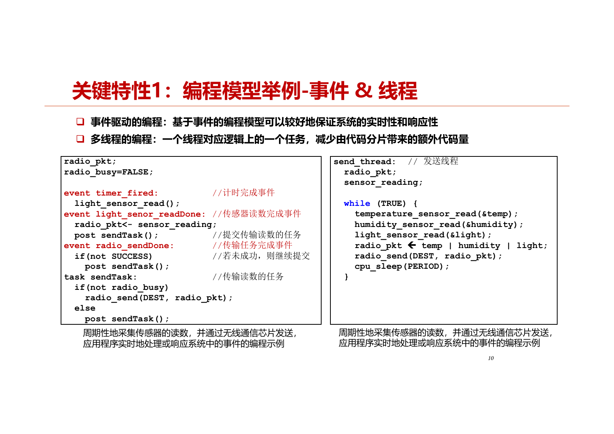
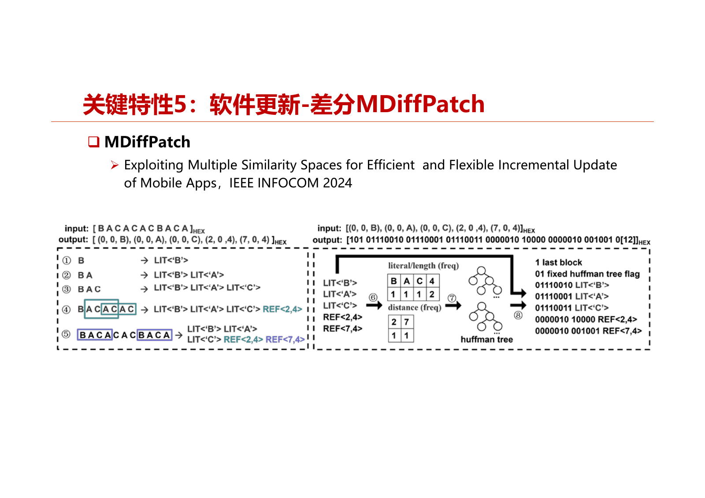
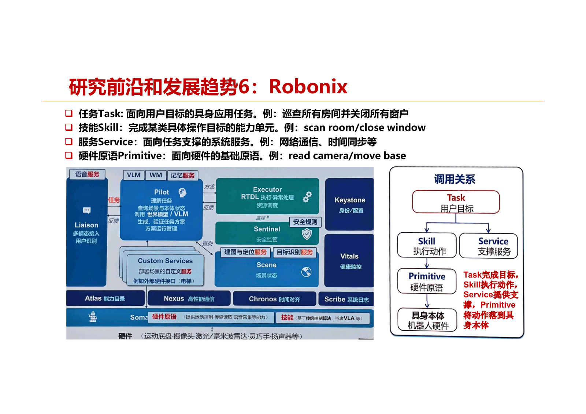

# 第3章 物联网操作系统

本章按“概述—关键特性—典型操作系统—案例开发—学术研究进展”组织，重点理解编程模型、调度、资源管理、网络与软件更新。

本章高亮并加粗的内容配有重点标记与详细讲解；标记含义见[课程目录](index.md#review-guide)。

## 3.1 概述

### 3.1.1 三个核心能力与选择思路

**知识点**

物联网操作系统的核心能力与通用操作系统相同：**硬件抽象、资源管理、应用使能**。硬件高度异构，OS通过驱动与统一接口屏蔽差异；调度计算、内存和I/O等资源，提升全局能效；为应用提供执行环境与生态入口。系统数量众多，应先确定应用需求，再比较关键特性，最后用具体案例验证选择。

**老师讲解**

>
> 端侧硬件讲完了，接下来要讲软件。  
> 软件里最核心、最基础的是操作系统，所以接下来讲物联网操作系统。  
> 也按照一样的目录结构：第一是概述，第二是关键特性。  
> 操作系统很多，可能有十几种、二十种，选择时重点要看哪些关键特性？  
> 第三部分看典型的物联网操作系统。  
> 有一些仍然很活跃，一直在更新；有一些可能不怎么更新，所以课程也在持续迭代。  
> 第四部分是案例开发，第五部分是学术研究进展。  

>
> 物联网操作系统是支撑物联网大规模发展的核心软件，屏蔽物联网硬件开发的差异性。  
> 原来讲操作系统，它有哪三大核心功能？物联网操作系统也一样。  
> 第一，屏蔽硬件差异，里面有很多驱动，要对硬件有很好的支持。  
> 第二，资源管理。  
> 资源包括计算资源，CPU调度是核心功能，还要管理内存、GPU资源，以及I/O资源的管理和调度。  
> 第三，使能生态，使上面的应用开发更容易。  
> 操作系统的核心就是这三方面能力：硬件抽象、资源管理和应用使能。  
>
> 因为物联网硬件特别异构，需要屏蔽差异，提供统一的编程接口，为多个应用执行提供运行环境。  
> 这其实也是使能应用，降低物联网应用开发的成本和时间。  
> 硬件抽象是操作系统的核心功能之一。  
> 物联网操作系统的发展现状，可以用“数量众多，百家争鸣”概括。  
> 早期有TinyOS，是伯克利较早做的操作系统。  
> 还有让大家做实验用的RIOT，以及Linux基金会下面的Zephyr操作系统。  
> 国内有RT-Thread，鸿蒙之前它的装机量也挺多。  
> 鸿蒙操作系统里还有开源鸿蒙。  

### 3.1.2 与传统操作系统的区别

**知识点**

- **存储占用**：物联网系统可能只需几十KB，资源有限的节点难以容纳通用Linux或Windows。
- **内存管理**：传统系统通常有MMU，支持虚拟地址与物理地址映射；很多MCU无MMU。
- **特权与保护**：很多物联网芯片缺少CPU特权模式，程序可能直接访问硬件，错误程序可能占用CPU或破坏其他资源。

这三点说明轻量化与安全隔离都必须结合实际硬件能力考虑。

**老师讲解**

>
> 为什么需要物联网操作系统？它和传统操作系统的区别在哪里？  
> 如果大家开发应用就会有感受，刚才知道了硬件的特点，也就能感受到原因。  
> 有些硬件平台内存实在太小，刚才讲的内存只有10KB，Flash是48KB。  
> 这么小的内存，怎么可能装传统操作系统？根本不在一个量级上。  
> 这里画了一张图，横轴是数据内存，对应RAM；纵轴是程序闪存，对应Flash，表示程序有多大。  
> 不同操作系统对内存大小的需求差别很大，传统的Linux和Windows需要的内存太多。  
> 很多物联网硬件没有这么大的内存，怎么办？只能为它定制合适的操作系统。  
>
> 和传统操作系统的区别主要有三点。  
> 第一，存储空间占用不一样。  
> 物联网操作系统的内存占用较小，一般只有几十KB。  
> 第二，内存管理方式不一样。  
> 传统操作系统一般使用MMU，英文是Memory Management Unit，支持虚拟内存，有虚拟内存和物理内存的概念。  
> 物联网操作系统一般没有MMU，只有一些比较强的平台才有。  
> 第三，OS的特权模式不一样。  
> 很多物联网芯片不具有CPU特权模式，所有指令都能访问任何硬件资源。  
> 这样好像不太安全，有bug的程序可以在不受操作系统控制的情况下，轻松占用CPU周期。  

### 3.1.3 系统构成与资源抽象

**知识点**

系统组件分为三类：嵌入式OS核心组件（任务调度、动态加载、RAM/Flash管理、资源抽象、传感器接口），无线网络组件（芯片配置、MAC、队列、连接与数据收集分发），AI支持组件（TinyML、TensorFlow Lite、拆分计算等）。

资源抽象可区分为：**专用资源**由单一使用者独占；**虚拟化资源**将有限硬件映射成多个逻辑实例，如一个硬件时钟对应多个软件timer；**共享资源**允许多人使用，但同一时刻通常需要协调、仲裁。

**老师讲解**

>
> 操作系统的系统构成有哪些？这里大概分成三大类。  
> 第一类是嵌入式OS的相关组件，包括OS的一些核心功能。  
> 比如任务调度，模块怎么加载、是否支持动态加载，存储空间怎么管理、内存怎么管理，以及资源怎么抽象和管理。  
> 还有传感器接口，到底提供怎样的传感器接口？  
> 传感器也可以归结到和I/O相关的部分，一般通过I/O读取传感器的内容。  
> 第二类是无线网络相关组件。  
> 从传统嵌入式操作系统升级成物联网操作系统，很重要的一点是要联网。  
> 所以要支持很多无线网络相关组件和网络协议，比如整个蓝牙协议栈，还有[另一协议栈名称识别不清]。  
> 否则怎么连接到因特网？  
> 第三类是结合最近AI发展的AI支持相关组件。  
> 这里讲了TinyML，是在小型平台上做机器学习的库。  
> 今天OS对AI的支持，还没有集成到内核里面，可能还是通过第三方AI引擎来支持。  
> 比如现在大模型的推理引擎，可能也是通过第三方支持。  
> 未来我觉得可能需要和OS的kernel结合得更加紧密。  

>
> 为什么需要更紧密地结合？因为今天软件的形态已经在发生变化。  
> 以前听[老师姓名识别不清]的报告时也讲过，过去的程序可以认为都是基于规则的。  
> 程序需要事先写好，if、else、while循环、for循环，都写好了。  
> 但未来可能就是一个神经网络，里面是AI模型。  
> AI模型不是预先编好的if、else或者switch之类的规则。  
>
> 这里有几种形态。  
> 一种是在通用计算机上，以后和人交互可能不需要原来那样的程序，就像电影里的机器人，可以通过自然语言交互，跑的是神经网络。  
> 对于嵌入式平台，这可能有点奢侈，能跑得了AI大模型吗？可能跑不了。  
> 所以它仍然跑确定性的规则程序，但程序本身可以通过AI Coding工具生成。  
> 还有中间一种模式，以后可能把两者混合起来。  
> 既运行一些基于规则的程序，也运行一些神经网络程序，要考虑OS怎么进行调度。  
> 传统意义上，OS调度的都是以前这些基于规则的程序，现在还有神经网络模型。  
> 这是我们考虑的OS主要组成部分。  
> 除了最后一个AI支持相关组件，前面的组件发展了这么多年，已经比较成熟。  

>
> 比如任务调度，接下来要讲的主要调度方式有事件驱动的任务调度和多线程任务调度。  
> 多线程任务调度大家不陌生。  
> 但有些物联网操作系统认为，多线程都太奢侈，因为每个线程都要占堆栈、占资源，只支持事件驱动就可以了。  
> 动态加载，就是允许模块动态加载。  
> 这在软件更新时比较方便，否则要更新整个image，代价太大。  
> 存储空间的管理，特别是RAM的管理，也很重要。  
>
> 资源抽象，这里沿用之前[操作系统名称识别不清]对资源抽象的分类，把资源分成三大类。  
> 第一类称为专用资源，就是专门由你使用，除了你，没有别人用。  
> 第二类是虚拟化资源，可以像虚拟机一样，虚拟出很多个版本。  
> 例子是timer，也就是定时器，硬件时钟可能只有一个，但软件上可以虚拟出N多个时钟。  
> 第三类称为共享资源，可以共享，但同时只能有一个人使用，所以可能要设计相应的调度算法。  
> 最后还有一点时间，讲两个对物联网操作系统比较关键的概念。  

### 3.1.4 Library OS、微内核与宏内核

**知识点**

| 概念 | 核心组织方式 | 主要考虑 |
| --- | --- | --- |
| Library OS（库操作系统） | 将所需系统功能以库的形式链接到应用；可直接调用服务 | 定制方便，减少系统调用及上下文切换；物联网中常与应用编译为一个镜像 |
| 微内核 | 内核保留任务/线程、内存、IPC等基本机制；其他服务通过消息交互 | 模块化、独立更新与隔离，消息传递也有开销 |
| 宏内核 | 将大量系统功能集成于内核态 | 功能交互直接，Linux为课堂例子 |

Library OS描述系统服务如何与应用结合，微内核/宏内核描述内核功能如何划分，不能把它们当成同一分类轴。

**老师讲解**

>
> 第一个是Library OS，是什么意思？  
> 在操作系统研究中，Library OS也称为库操作系统，指将操作系统的某些功能作为库，而不是作为一个单独的内核运行。  
> 这种设计允许应用程序直接调用操作系统服务，而不是通过系统调用接口。  
> 这种方式可以提高性能，因为减少了用户态和内核态之间的上下文切换，并且可以为特定应用程序定制操作系统功能。  
> 简单讲，它没有提供运行时环境，就是一个库。  
> 比如早期的Contiki、TinyOS，或者大家用的RIOT，可能都是这样。  
> 因为用了这些库函数，用到的功能最后都编译进来，和你的程序放在一起，再烧到节点上。  
> 不像传统Linux操作系统，它有运行环境，可以通过SSH登录上去，再执行程序。  
> 这就是Library OS，在物联网领域特别常见。  

>
> 第二个提得比较多的是微内核，尤其早些年，物联网领域的阿里、腾讯等都提过微内核。  
> 微内核是一种操作系统内核的设计哲学，提供操作系统最基本的核心功能，比如任务、线程管理，内存管理和进程间通信。  
> 微内核的意思就是内核很小，只提供最基本的功能。  
> 其他服务，如文件系统、设备驱动和网络协议，通常作为用户态进程运行，通过消息传递与微内核通信。  
> 其他功能可以作为配件，需要的时候再用，不需要就不用。  
> 这种设计使操作系统具有高度的模块化和灵活性。  
> 服务和驱动可以独立添加、更新或替换，不需要修改整个内核。  
>
> 和微内核相对应的是宏内核，英文是Monolithic Kernel，是另一种设计哲学。  
> 它把操作系统的许多功能集成在一个大型的内核态进程中，今天的Linux就是宏内核。  
> 原来讲过，微内核不太流行，因为需要解耦，通过message passing，也就是消息传递进行交互，效率比较低。  
> 宏内核的功能都在一起，效率比较高。  
> 今天就到这儿。  

## 3.2 关键特性

### 3.2.1 编程模型：源代码模块化与二进制模块化

**知识点**

非模块化程序作为整体设计、测试和调试；模块化程序按功能划分独立模块。要进一步区分：TinyOS的组件化保留在**编码阶段**，编译链接后为单个镜像；SOS在**二进制阶段**仍保留模块头、导入/导出信息，能够动态加载。接口稳定时，更换底层通信芯片不一定要求修改应用；但源代码模块化不等于可以独立更新二进制模块。

**老师讲解**

>
> 接下来看看物联网操作系统的几个关键特性，首先是编程模型。  
> ==**编程模型非常重要，因为应用程序就是基于操作系统提供的编程模型来开发的。**==<br>
> 依据程序结构分类，可以分为非模块化编程和模块化编程。  
> 非模块化编程把应用程序作为一个整体进行设计、测试和调试。  
> 模块化编程强调把程序功能分离成独立、可以互换的模块，每个模块执行某个具体功能。  
> 模块化编程里面又分两类。  
> 一类是编码层面的模块化，比如早期伯克利设计的 TinyOS，它采用组件化编程。  
> 编程时可以分成一个个模块，但最后编译、链接在一块，在二进制层面就看不到一个个模块了。  
> 与它对应的是二进制层面的模块化，比如 UCLA 早期的操作系统 SOS，在二进制层面还能保留模块信息。  
>
> 依据执行逻辑分类，又可以分为两大类。  
> 第一类是基于事件驱动的编程，早期物联网操作系统里面挺常见，一般不支持多线程。  
> 好比以前写 GUI 程序，有很多消息，也有很多 callback function 去处理这些消息。  
> 事件驱动编程就是及时处理系统中的各种事件。  
> 事件处理函数是 run-to-completion 的，意思是必须运行到结束，才会释放 CPU 控制权，才能调度下一个事件处理程序。  
> 应用程序由多个事件处理函数组成。  
> 另一类是基于多线程的编程，大家不会陌生，一个线程对应一个逻辑任务。  
>
> 这里给出一些例子。  
> TinyOS 应用由多个组件组成，编译以后是单个二进制程序镜像，不再保留组件化信息。  
> 左边这个图里面，BlinkToRadio 可能是一个 TinyOS application，它用到了 ActiveMessageC 这个组件，通过接口使用组件的功能。  
> 图里的箭头表示通过某种接口使用组件。  
> 这样编程有一个好处：底下的通信芯片变了，比如从 CC[识别不清] 变成 CC1000，只要接口不变，应用就不用变。  
> 通信模块的具体实现可以变，接口和应用程序不用变。  
>
> 右下角给出 SOS 模块编程的例子。  
> 这里可能没有展示底下具体的编码，但能看到 SOS 模块首先定义了一个模块头。  
> 模块头有很多信息，比如这个模块提供多少个函数，这里写的是 0；订阅了多少个函数，到底订阅哪些函数。  
> 就像动态加载，一个模块要有表头，说明提供哪些函数、使用哪些函数，有导出表、导入表等。  
> 即使编译成二进制，这些信息仍然保留在里面。  

### 3.2.2 执行逻辑：事件驱动与线程

**知识点**

事件驱动将业务分散到多个事件处理函数，典型顺序是timer触发→请求采样→readDone→post发送task→发送→sendDone/重试。事件处理通常run-to-completion，`post task`只将任务入队，不代表立即运行。

线程方式将一个逻辑任务顺序写在一个循环中：读温度、湿度、光照→组合数据→发送→sleep。逻辑直观，但每个线程通常需要自己的栈与上下文；事件方式更轻量，代码容易被分片。



图：同一采样发送任务的事件驱动与线程写法对照。

<a id="exam-3-2-2"></a>

!!! important "老师强调 · 3.2.2"

    ==**事件驱动与线程决定程序如何等待 I/O、保存状态和消耗栈内存。**==

    **老师提示**：“编程模型非常重要，因为应用程序就是基于操作系统提供的编程模型来开发的。”

    **详细讲解**：事件驱动把程序拆为回调和任务，发起异步读传感器后返回，由完成事件继续处理，需要显式维护跨事件状态；线程允许把“读取 → 发送 → 休眠”写成顺序逻辑，等待 I/O 时阻塞当前线程，系统调度其他工作。真正的多栈线程一般要给每个线程分配栈，因此 RAM 占用是取舍之一。

    **比较题**：从控制流程、等待方式、状态保存、内存开销四个角度回答。不要把事件驱动等同于轮询，也不要认为线程阻塞一定导致整个 CPU 无事可做。Contiki 的 Protothreads 用宏保存续执行位置并共享栈，不能自动保留所有局部变量，和拥有独立栈的传统线程不同。

**老师讲解**

>
> 另一个例子是事件驱动编程和基于线程的编程，这是物联网操作系统经典的两种方式。  
> 基于事件的编程模型可以较好保证系统的实时性和响应性。  
> 左边的图给出了事件驱动的编程模型，里面有很多事件。  
> 比如 timer fired 事件发生后，就开始读取光照传感器，调用 light sensor read。  
> 这个函数是分阶段 I/O 函数，不是阻塞式调用，调用后立即返回。  
> 等传感器读完，又会产生一个事件，再去处理这个事件。  
> 一旦 light sensor 读完，系统产生 sensor read done 事件，这时才把 sensor reading 放到 radio packet 里面。  
> 然后可以 post 一个 task。  
> 什么叫 post task？就是把任务放到任务队列里。  
> 所有事件都处理完以后，自然会处理这些 task，它也不是立即执行的。  
> 事件处理完以后，再处理发送任务，把这个包发送出去。  
> 发送完成后，又产生 radio send done 事件。  
> 它会检查标志位，如果没有成功，就继续调用 send task，直到成功为止。  
>
> 把这个逻辑用线程方式来写，就非常不一样了。  
> 比如写一个 for 循环，先调用 temperature sensor read，这时 I/O 是阻塞式的，一定等它完成。  
> 没有完成时，如果 CPU 没事干，就挂起。  
> 然后再调用 humidity sensor read、light sensor read，把几个传感器的数据放到 radio packet 里面，再发送出去。  
> 如果要以低占空比模式运行，这个 duty cycle 上节课讲过，就要主动发起 sleep，睡一段时间。  
> 多线程是这样编写，事件驱动则是前面那样编写。  

### 3.2.3 调度方式与原子操作

**知识点**

| 调度方式 | 交出CPU的条件 | `x++; write(x);`的课堂处理 |
| --- | --- | --- |
| 抢占式 | 高优先级线程就绪可抢占 | 以mutex保护共同临界区 |
| 非抢占式 | 当前线程完成或阻塞 | 连续执行这两个操作 |
| 协作式 | 线程主动yield | 两个操作之间不得yield |
| 时间片轮转 | 时间片耗尽被切换 | 与抢占式一样考虑mutex |

原子性讨论针对PPT给定的调度模型及共享变量示例；若临界区内还有阻塞或其他并发访问，仍需结合实际机制分析。

**老师讲解**

>
> 第二个关键特性是任务调度方式，跟传统操作系统有点类似。  
> 抢占式调度就是高优先级线程会抢占低优先级线程执行。  
> 非抢占式系统一旦把处理器分配给就绪队列中的某个线程，该线程就一直执行下去，直到完成或者阻塞。  
> 阻塞了也要把控制权交给别人。  
> 协作式调度中，只有线程主动交出 CPU 控制权，比如调用 yield 函数，其他线程才可以得到 CPU 控制权。  
> 最后一种是通用操作系统用得比较多的时间片轮转，它当然也会抢占。  
> 每个线程分配相同时间片的 CPU 资源，时间片用完后，必须交出 CPU 控制权，让其他线程执行。  
>
> 不同调度方式对程序的原子操作会产生重要影响。  
> 假设多个线程同时有权操作共享变量 X，怎样进行原子操作，才能让 X 在内存和外存之间始终保持一致？  
> 比如 X++ 是对内存里的变量进行操作，write(X) 则把它写到磁盘、写到外存里。  
> 在非抢占式调度环境中，只要连续写 X++ 和 write(X) 就行，一旦执行 X++，就会执行后面的 write(X)，没人能抢占它。  
> 在协作式环境中，要主动交出控制权，因此 yield 函数不能插在这两个操作中间。  
> 如果插在中间，交出控制权以后，就不一定能保证一致性。  
> 如果是抢占式或时间片轮转，任何一个时间点都可能被抢占，就需要用互斥锁 mutex 把它保护起来，变成原子操作。  

### 3.2.4 调度计算：执行时间、就绪时间与完成时间

**知识点**

给定A、B、C各自需要CPU时间10s、20s、30s，忽略调度切换开销。

1. 非抢占式，0s按A→B→C启动：`A 0—10；B 10—30；C 30—60`，完成时间为**10、30、60s**。B=30s由给定量推算，字幕对此处回应识别不清。
2. 优先级C>B>A，就绪时间1、2、15s：`A 1—2；B 2—15；C 15—45；B 45—52；A 52—61`，按A、B、C顺序完成时间为**61、52、45s**。
3. 轮转时间片10s，启动时间0、10、20s：若在20s边界把新就绪C加入队列后再将B入队，则`A 0—10；B 10—20；C 20—30；B 30—40；C 40—60`，完成时间为**10、40、60s**。若边界先将B入队、后加入C，B可在20—30s结束，得到10、30、60s。PPT未规定同一时刻的入队规则，课堂也未完整给出第三问答案，需说明所采用规则。

<a id="exam-3-2-4"></a>

!!! tip "可能考点 · 3.2.4"

    ==**调度计算先画就绪时间与抢占点，再跟踪每个线程的剩余 CPU 时间。**==

    **老师提示**：“学在浙大里有一个线程调度的课堂测试，题目一样，大家思考一下，填一填。”

    **推导示例**：A、B、C 分别需 10、20、30 秒，优先级 C>B>A，就绪时刻 1、2、15 秒。0—1 秒空闲；A 在 1—2 执行 1 秒，剩 9；B 在 2—15 执行 13 秒，剩 7；C 在 15—45 完成；B 在 45—52 完成；A 在 52—61 完成。因此按 A/B/C 顺序回答 61、52、45 秒。

    **为什么不能直接累加**：高优先级线程没就绪时不能运行，低优先级线程被抢占后保留剩余执行量。完成时刻是绝对时间；周转时间是完成减就绪；等待时间在本题无 I/O 条件下为周转减 CPU 执行时间。

    **易错点**：轮转题要说明同一时刻新线程入队与旧线程回队的先后规则，本节保留两种结果；非抢占线程阻塞或完成后仍会让出 CPU。这里只能依据课堂测试认定值得复习，老师没有在此明确公布期末会考该题。

**老师讲解**

>
> 有一个简单题目，大家可以思考一下，它跟物联网关系不大，跟传统操作系统比较相关。  
> 给定三个线程 A、B、C，单独执行完的时间分别为 10 秒、20 秒、30 秒。  
> 第一问：在非抢占式调度下，0 秒时按照 A、B、C 顺序启动，三个线程完成时间分别是多少？  
> 第二问：在抢占式调度下，优先级 C 高于 B，B 高于 A；A、B、C 的就绪时间分别为第 1 秒、第 2 秒、第 15 秒，三个线程完成时间分别是多少？  
> 第三问：在时间片轮转调度下，时间片长度为 10 秒，A、B、C 的启动时间分别为 0 秒、10 秒、20 秒，三个线程完成时间分别是多少？  

>
> 第一问比较简单，等于送分题。  
> 非抢占式调度，A、B、C 顺序启动，A 是 10 秒，最后一个是 60 秒。  
> 中间关于 B 完成时间的课堂回应[识别不清]。  
>
> 看第二问，首先要注意就绪时间，线程在就绪之前还没有开始。  
> 抢占式调度中，C 优先级最高，B 在中间，A 最低。  
> 先把 1 秒、2 秒、15 秒这三个就绪时间点画出来。  
> A 在 0 到 1 秒肯定没跑，因为没就绪。  
> 1 秒以后 A 就绪，先跑了 1 秒，接着 B 来了，B 的优先级更高，会抢占 A。  
> B 从第 2 秒跑到第 15 秒，跑了 13 秒，它总共需要 20 秒。  
> C 在第 15 秒启动，需要跑 30 秒，所以第 45 秒跑完。  
> C 跑完以后，B 还没跑完，剩下 7 秒，因此到第 52 秒跑完。  
> 然后再把 A 跑完，A 还剩 9 秒，所以完成时间是第 61 秒。  
> 按 A、B、C 的顺序，完成时间就是 61 秒、52 秒、45 秒。  
> 最后一问时间片轮转也类似，可以这样画一画。  

### 3.2.5 I/O方式与数据采集

**知识点**

**阻塞式I/O**在操作完成后才返回，编程顺序直观；**分阶段I/O**把发起与完成分开，发起后立即返回，完成时执行事件或回调，便于并发与响应。阻塞的是调用/线程，不能直接推断CPU一直满载；“发送完成”可能指硬件已发出，也可能要求收到ACK，取决于接口实现。

采集方式包括单次、周期性、高频连续采集。高频数据逐样本中断会有较大开销，可用硬件FIFO暂存、驱动缓冲或DMA批量搬运，再通知CPU处理。

**老师讲解**

>
> 第三个关键特性刚才也提到过，是 I/O 的操作方式，分为阻塞式 I/O 和分阶段 I/O。  
> 阻塞式 I/O 是程序调用一个 I/O 操作时，要等这个操作完成，调用才会返回。  
> 分阶段 I/O 把调用和操作完成分成两个阶段。  
> 比如阻塞式 send，可以是对方收到并回了 ACK 后才返回。  
> 但这不意味着调用 send 时，CPU 一直处于 100% 运行状态，CPU 做完自己的事情，也可以挂起去做别的事情。  
> 分阶段 I/O 则是调用 send 后立即返回，发送完成时再触发 send done 函数，在里面处理后续逻辑。  
> 这里要看具体实现，有一种逻辑是收到对方 ACK 后触发，也有一种是网卡仅仅把数据发送出去后就触发。  
> 所以到底什么时候算发送完成，取决于实现逻辑。  
>
> 从数据采集角度看，I/O 跟物联网非常相关。  
> 我们经常说物联网是 I/O-intensive，而不是 CPU-intensive，因为它会处理很多传感器，传感器读取都要经过 I/O。  
> 最简单的是单次采集，需要时请求一次数据，每次操作的数据通常较小。  
> 还有周期性采集，按固定周期获取数据。  
> 另一类是高频连续采集，比如一秒采 1000 个 RSSI，或者采集连续声音及其他信号。  
> 如果每采一个数就产生一个中断，一秒产生 1000 个中断，执行效率太低。  
> 这时通常需要硬件 FIFO 缓存数据，或者采用 DMA 技术，把数据存到一块，不要老是中断 CPU。  
> 一次完成后，再批量通知 CPU 处理。  

### 3.2.6 内存分配与RAM/Flash布局

**知识点**

静态分配在编译时确定，可用静态数组实现，效率高、无动态内存池碎片，但不能按需申请；动态分配在运行时通过`malloc/free`申请和释放，灵活但可能产生碎片、泄漏等问题。

RAM存数据且掉电丢失；Flash存程序且非易失，写入速度与寿命有限。`.bss`对应未初始化或零初始化的静态存储变量，`.data`对应具有初值的数据；栈保存函数调用相关数据，在课堂示意布局中由高地址向低地址增长。实际中断向量表等位置应结合芯片与链接布局理解，PPT图展示的是本章例子。

**老师讲解**

>
> 接下来的特性是内存分配，分为静态内存分配和动态内存分配。  
> 以前伯克利做的 TinyOS 是静态内存分配，内存区域在编译时确定。  
> 优点是效率高，内存池没有碎片，缺点是不能按需申请。  
> 动态内存分配是在运行时确定，比如通过 malloc 申请、free 释放。  
> 这样容易产生碎片，也可能造成安全隐患，比如申请后没有释放，这些都是老生常谈的问题。  
>
> 右上角的图还要稍微讲一下。  
> 在物联网里编程，经常需要非常清楚、熟悉自己的 memory layout。  
> 图画了两个区域，上面是 RAM，放数据；下面是 Flash，放程序。  
> 前面讲硬件时讲过，RAM 是易失性的，掉电以后数据不能持久化；Flash 断电以后内容还在。  
> 内存里的读取和写入都比较快，Flash 读取比较快，所以程序一般只要读取执行就行。  
> Flash 写入比较慢，而且写入有固定次数的限制。  
>
> RAM 从低地址到高地址一般怎么分配？  
> 程序编译后会产生 .bss 段，就是初始化为 0 的变量放在那里。  
> .data 段放初始化不为 0 的那些全局变量。  
> 程序运行过程中，stack 从 RAM 高地址向低地址生长。  
> 执行过程中需要堆栈，比如调用、退出函数，函数里的局部变量也分配在堆栈上。  
> 如果函数还没返回，又调用下一个函数，堆栈会继续增长；函数调用完成后，它又会清退。  
> 底下的 Flash 放程序，一般中断向量表放在尾巴那个地方。  

### 3.2.7 软件更新：Bootloader与升级粒度

**知识点**

有线升级可用串口、以太网；无线升级称OTA（over-the-air）。Bootloader在设备加电后先运行，初始化硬件，再启动OS/应用。PPT升级过程为：启动前查找升级文件→擦除旧文件所在Flash→写入新文件→校验→重启执行；错误时重新烧写或回滚。

升级粒度有整个镜像、独立模块、差分三类。完整镜像更新简单但分发量大；模块更新要求二进制保留模块边界；差分利用本地旧版本与补丁重构新版本，可以针对整镜像或单个模块。回滚能力需要预留旧版本等机制，不能只关注下载是否成功。

**老师讲解**

>
> 第五个关键特性是软件更新，物联网里的 OTA 软件更新非常重要。  
> 更新可以通过有线方式，但有线不太方便；无线更新一般称为 OTA，也就是 over-the-air，比如通过 Wi-Fi 或其他无线技术。  
> 如果要进行软件更新，通常要在 Flash 前面的部分安排一个 Bootloader，才能启动、加载新的东西。  
> Bootloader 是设备加电后执行的第一段代码。  
> 它完成 CPU 和相关硬件初始化后，将操作系统或固化的应用程序装载到内存，然后跳到操作系统所在空间，启动操作系统。  
>
> 具体更新步骤是：操作系统启动前，通过 Bootloader 查找升级文件。  
> 找到文件后，擦除 Flash 中存储的旧文件，再写入升级文件。  
> 然后检查新写入的文件是否正确，这一步也很重要。  
> 万一没检查，程序坏了，整个设备就坏了，而且不好回退。  
> 因此回退非常重要，可能还得保留老程序的副本，万一新程序没有启动成功，还能回退到老版本。  
>
> 软件更新有不同方法。  
> 第一种是基于整个镜像更新，对软件系统所有部分都进行更新。  
> 最老的 TinyOS 就是所有东西一起更新，因为它是 Library OS，跟应用一起编译、打包成整个东西。  
> 一旦哪个地方变化，整个东西都需要更新，分发量、下载量比较大，当然 Bootloader 不变。  
> 第二种是基于模块化更新，把软件镜像细分为各个模块。  
> 前面讲的 TinyOS 虽然模块化，但只停留在编程阶段，二进制阶段没有模块信息，对更新没有帮助。  
> SOS 本身的镜像有各个模块，因此可以更新单个模块，不需要更新整个 image。  
> 第三种是基于差分更新，现在用得非常广泛。  
> 新版本基于旧版本肯定有变动部分，理想情况下只是中间一部分变了。  
> 做差分以后，只需要更新 delta。  
> 因为节点上本来就有旧版本代码，根据旧版本和收到的差分文件，就能重构新文件。  
> 那么基于差分的软件更新到底怎么进行？主要就是这个差分怎么做。  

### 3.2.8 差分指令、空间计算与相似性保持

**知识点**

课堂简化格式：`COPY <n> <old_addr>`由1字节指令、2字节长度、2字节地址组成，共**5B**；`ADD <n> <新增字节>`有3B头部加nB数据，共**3+n B**。旧文件与新文件字节计数均按题目中的字母代表1B。

- 旧`ABCDEACBC`，新`WABCDEACBC`：`ADD 1 <W>; COPY 9 0`，大小$4+5=9\,B$，全量10B。
- 新`WABCDEACBCXDEACB`：`ADD 1 <W>; COPY 9 0; ADD 1 <X>; COPY 5 3`，大小$4+5+4+5=18\,B$；也可最后直接`ADD 6 <XDEACB>`，仍为$4+5+9=18\,B$。地址从0开始，旧地址3对应D。这里新文件本身16B，故本例差分并未比全量小；差分效果要计入指令开销。
- 差分大小取决于算法和新旧版本相似性。无压缩且指令集固定时，可用动态规划求最优差分；插入函数引起后续地址变化，会破坏相似性，课堂认为尾部插入通常优于头部插入。

<a id="exam-3-2-8"></a>

!!! tip "可能考点 · 3.2.8"

    ==**差分包大小要把 COPY/ADD 指令头计算进去，相似片段不一定值得复制。**==

    **老师提示**：“影响差分文件大小有两个重要因素。”

    **详细讲解**：本节模型中 COPY 固定 5 B，ADD 的开销为 $3+n$ B。直接新增 1 B 仍要用 4 B；复制 1 B 却要 5 B。因此不是找到相同字符就一定更省，更长连续相同片段才可能抵消指令成本。

    **例题**：旧文件 `ABCDEACBC`、新文件 `WABCDEACBC`，ADD 一个 W 花 4 B，COPY 9 个旧字节花 5 B，总 9 B；直接 ADD 全部 10 B 花 13 B。与“直接传原始新文件”的 10 B 也应区分。另一例子差分 18 B 大于新文件 16 B，所以差分并不必然减少传输。

    **答题要点**：大小同时取决于差分算法与新旧版本相似性。编译造成地址、布局变化会降低相似性；设备应用差分必须使用正确旧版本。此处属于根据课堂讲解和计算例子整理的可能考点。

**老师讲解**

>
> 差分文件通常有两种指令，这里给出一个非常简化的版本，方便大家理解。  
> 一种是 copy 指令，我在下面标出了各部分占用的字节数。  
> 假设 copy 指令本身占一个字节，这不是最优的，因为只有 copy 和 add 两种指令，其实可以用更少的位表示。  
> N 表示拷贝多少长度，占两个字节。  
> old address 表示从旧文件哪个地址开始，把多少个字节搬到新文件。  
> 这样一条 copy 指令总共占 5 个字节。  
> 另一种是 add 指令，因为新文件里面可能有新东西，不能全部从老文件拷贝。  
> 如果新旧文件完全一样，就用一条 5 字节的 copy 指令搞定。  
> add 指令本身占一个字节，N 占两个字节，表示新增多少长度。  
> 后面就是具体要加的 N 个字节，因此 add 指令占 3+N 个字节。  
> 新增一个字节就是 3+1，两个字节就是 3+2，三个字节就是 3+3。  
>
> 举个简单例子，用字母表示字节。  
> 旧文件是 ABCDEACBC，一共 9 个字节；新文件是 WABCDEACBC，在前面加一个 W，一共 10 个字节。  
> 用两条指令就能搞定：先 add 一个 W，再从旧文件第 0 个地址开始 copy 9 个字节。  
> add 占 3+1=4 个字节，copy 占 5 个字节，4+5=9，总共 9 个字节。  
> 这个例子看起来并不那么有效，但指令格式这里只是为了说明问题。  
> 全量更新是 10 个字节，差分更新是 9 个字节，有些场景会少很多。  
>
> ==**影响差分文件大小有两个重要因素。**==<br>
> 第一是差分算法，旧文件、新文件都给定，能否计算一个 optimal 的结果，也就是最小差分文件？  
> 第二是相似性保持技术，在保持代码功能的前提下，增加新旧代码之间的相似性。  
> 旧代码已经给定，如果编译新代码时完全不考虑旧代码，可能会编译出非常不一样的东西。  
> 但如果知道旧代码大概长什么样，就可以做一些工作，让新代码尽量跟旧代码相似，当然功能仍然要保持原定功能。  
> 这里列了一些常见差分算法，比如 bsdiff、xdelta3、HDiffPatch。  

>
> 这样的思考题最后可能还会有一些简单计算。  
> 给定一个旧文件和新文件，新文件前面加了 W，后面又加了一些东西，差分文件大小是多少，具体指令是什么？  
> 这个例子可以先 add 一个 W，再 copy 9 个字节，再 add 一个 X，然后 copy 5 个字节。  
> 后面这 5 个字节从旧文件第三个位置开始拷贝。  
> 因此一个 add、一个 copy、一个 add、一个 copy，总共 18 个字节。  
> 或者先 add 一个 W，再 copy 9 个字节，后面直接 add 6 个字节，也可以。  
> add 6 个字节占 3+6=9 个字节，加起来一样，也是 18 个字节。  
>
> 现在这个场景不考虑压缩，给定旧文件和新文件，怎样计算最小差分？  
> 其实可以用动态规划算法，给出最优解。  
> 早些年，应该是 2014 年，我们有一篇 TOSN 的 paper，专门探讨这个问题，可以设计最优算法。  
> 但最优算法有限制条件：一个是没有压缩，第二个是这两种指令已经给定。  
> 指令其实可以扩展。  
> copy 不一定只能从旧文件拷贝，也可以从新文件已经构建的部分开始拷贝。  
> 甚至有时可以从前往后拷贝，有时可以从后往前拷贝。  
>
> 下面还有一个定性思考题。  
> 基于差分编码，在程序头部插入函数和尾部插入函数，哪个差分升级包的空间更大，哪种更好？  
> 肯定在程序尾巴插入更好，因为尾巴插入只是这一点不一样。  
> 如果在头部插入，后面函数的地址都得变。  
> 前面的函数把后面的函数地址往下挤了一部分，以后别的函数调用这些函数时，对应 address 也都变了。  

### 3.2.9 压缩文件差分：MDiffPatch

**知识点**

APK/ZIP除代码外还含资源文件，压缩会改变新旧文件的字节相似性。PPT的MDiffPatch工作为IEEE INFOCOM 2024，题目强调**多个相似性空间**。

压缩过程先以LZ77生成literal/reference序列，再以Huffman编码压缩；前者保留字节粒度，后者可能打破字节边界。差分可选择原压缩空间、部分解码的LZ77空间、完全解码空间。完全解码会扩大文件，部分解码较紧凑，但差异分布可能不同，应按相似性和处理成本选择空间。字幕将相关概念口述为multiple semantic spaces；这里按PPT标题整理为multiple similarity spaces，不改动引用。



图：LZ77序列与Huffman编码的两阶段压缩示例。

**老师讲解**

>
> 正好我们也做过这方面工作，大概讲一讲。  
> 现在打开华为应用市场或小米应用市场，都有软件更新。  
> 它不是把所有新软件全量下载，而是使用差分分析，会标明下载差分包有多少字节。  
> 比如微信从一个版本升级到另一个版本，全量可能几百兆，太大了；下载差分更新文件就可能小很多。  
> 这对应用市场很关键，因为出口流量要收费，多下载一兆就要多交钱。  
> 所以怎样计算最小差分，还是挺有讲究的。  
>
> 刚才只是 ABC 这样的简单例子，实际里的 APK 是一个 ZIP 压缩文件。  
> 它除了常见的 Java 二进制代码，还有很多资源文件，比如游戏地图、数据库，所以才会那么大。  
> 但新旧文件经过压缩后，相似性就被破坏了。  
> 一个简单想法是先解压缩，再做差分，重构完以后再压缩回去。  
> 这实际上有几个难点。  
> 一个是未必完全知道原来压缩使用的软件和参数，不一定能完全解压[原话如此]。  
> 另一个是完全解压以后不一定效果好，这是更大的问题，因为解压后代码会膨胀。  
>
> 仔细研究 ZIP 会发现，现在的压缩文件基本采用两步压缩。  
> 第一步是 LZ77 算法，类似刚才的 copy、add 指令，会生成 literal 和 reference。  
> literal 就是字符，类似 add；reference 类似 copy，从里面拷贝一部分东西。  
> 这一步变成 LZ77 stream，后面采用 Huffman encoding，也就是哈夫曼编码。  
> 不知道大家在哪门课学过，数据结构还是其他课？  
> 哈夫曼编码就是出现频率越高，用越少的 bits 表示，这样达到压缩目的。  
> 这两个过程的性质不一样。  
> 第一步还是字节粒度，后一步会破坏字节边界，因为高频内容可能用三位、两位表示，不再保持 byte boundary。  

>
> 经过压缩后，相似性会破坏，甚至字节边界都被破坏了。  
> 前一个字节的后几位，可能挪到了下一个字节的前几位。  
> 我们在 2024 年的工作[发表场合识别不清]里面提出 multiple semantic spaces。  
> semantic space 是什么意思？可以在原压缩空间做差分，也可以在完全解压空间做差分。  
> 还可以在部分解压空间做差分，就是 LZ77 stream 这个空间，里面写的是 literal、reference 这些指令。  
> 在这个空间做差分，有一个好处，就是字节边界能够保持。  
> 直接在压缩空间做，可能每个字节都不一样，因为字节边界不保留。  
>
> 右上角的图给了例子，现有 HDiffPatch 算法在 fully decoded space，也就是完全解压空间里做差分。  
> 完全解压后文件比较长，可能还挺相似。  
> 图里用小黑竖线表示不一样的地方。  
> 如果在 partially decoded space，文件就短一点；完全解压的文件当然变大。  
> 部分解压时，不一样的地方可能多一点。  
> 但下面这个例子里，完全解压还有部分不一样，部分解压的空间比较小，相似性其实也蛮高，也没多少不一样。  
> 基于这个观察，到底在哪个空间做差分，我们提出了一个比较灵活的算法。  
> 这里跟之前最好的算法作比较，Google 的 Archive Patcher 是完全解压缩后再做差分，HDiffPatch 也是比较先进的算法。  

### 3.2.10 网络服务与统一2.5层

**知识点**

传统无线传感网以IEEE 802.15.4低功耗多跳自组织为主，提供数据收集、分发、时间同步。物联网支持BLE、Zigbee、Wi-Fi HaLow、LoRaWAN、NB-IoT等多种技术，更关注干扰共存与异构互联。

TinyNet提出**2.5层抽象、uniMAC接口**，关键模块为邻居发现、通信调度；通过适配层连接不同链路技术与IPv6/6LoWPAN，再复用上层路由、TCP/UDP及应用服务。传统端侧常依赖网关连接互联网，统一IP架构希望提升端侧直接互通与异构多跳能力。课堂关于“蓝牙和LoRa不支持多跳”的表述保留原话，具体协议能力仍应按所讨论的协议版本与组网机制区分。

**老师讲解**

>
> 再看网络服务，联网也是物联网的重要功能。  
> 传统传感网的网络协议和服务主要关注多跳自组织。  
> 大家主要采用基于 IEEE 802.15.4 标准的低功耗局域网协议。  
> 我读博士时，多跳自组织还挺热门，现在没什么研究了。  
> 以前典型传感网协议包括数据收集、数据分发、时间同步协议等。  
> 好，休息一下。  

>
> 到了物联网时代，通信技术和协议增多了。  
> 比如蓝牙、Zigbee，Zigbee 也是基于 IEEE 802.15.4，但包含直到应用层的协议，比较完整。  
> 还有 Wi-Fi 的低功耗版本、LoRaWAN、NB-IoT 等。  
> 学术界关注的是干扰共存、异构互联。  
> 这里是我们课题组做的一些尝试。  
> 以前异构性比较大，LoRa、802.15.4、蓝牙协议栈基本是垂直的，每一种有自己的协议栈。  
> 有些工作已经做了一些共享，比如 LoRa 还是单独的，但 802.15.4 和蓝牙有一部分可以耦合。  
> 比如 6LoWPAN，可以认为是在物联网里面使用 IPv6 的适配。  
> IPv6 包头太大，所以需要进行压缩。  
> 如果 IP 统一了，上面就可以有多跳协议，再架构 TCP、UDP。  
> 否则像原来的蓝牙就不支持 TCP 和 UDP。  
>
> 我们希望有一个统一协议架构，参照因特网。  
> 底下是不同 physical layer、MAC、链路层，接 adaptation layer，形成公共的 2.5 层。  
> 再接 IPv6，当然要结合 6LoWPAN，否则包头太大。  
> 再接多跳传输协议，上面跑 TCP、UDP，再接应用层协议，就跟今天主流因特网架构更类似。  
> 以前物联网协议架构跟因特网非常不一样。  
> 我们经常说，物联网设备不是 first-class Internet citizen，不是第一等因特网公民。  
> 什么意思？为什么这本书采用云边端架构？  
> 因为端侧设备通过自己的 Zigbee、蓝牙等协议连到网关，网关是懂因特网的，可以通过 TCP 或 HTTP 传到云平台。  
> 并不是端侧设备直接支持 TCP。  
>
> 有了这种架构，就能实现更多功能。  
> 比如通过一个网关让 Zigbee 跟蓝牙或 LoRa 通信，因为上面接口类似。  
> 一些模块可以共享，尤其是多跳组网模块。  
> 一个 Zigbee 节点也可以跟两跳以外的蓝牙节点通信。  
> 今天的蓝牙和 LoRa 都不支持多跳[老师原话]。  

### 3.2.11 AI支持：TinyML流程与优化

**知识点**

TinyML将模型部署到MCU及低功耗边缘设备，应用包括音视频推理、穿戴计算、健康监测。常用支持框架：TensorFlow Lite面向嵌入式Linux设备，TensorFlow Lite for Micro面向MCU，PyTorch Mobile面向Android/iOS。

流程为准备数据→训练与测试→转换/优化模型→部署→端侧推理。资源限制下需要同时比较模型大小、精度、速度和功耗。典型优化包括剪枝（去除低重要性权重后微调）、量化（将高位浮点表示变为8位或更低位表示）、知识蒸馏（教师知识迁移至轻量学生模型），以及紧凑架构和DSP等硬件加速。此处是OS支持能力概览，详细算法属于边缘AI章节。

**老师讲解**

>
> 第七个关键特性是 AI 支持能力，这是去年加上的，也是非常重要的能力。  
> 未来端侧设备能力虽然有限，也会运行一些简单 AI 模型。  
> 这里讲的视频、音频推理、穿戴计算、健康监测传感器，都是常见应用场景。  
> TinyML 专门面向嵌入式设备做 machine learning，之前还挺 popular。  
> 现在人工智能发展太快，也有一些别的技术。  
> 比如 TinyML 怎样使用？  
> 第一步 prepare data，准备数据，然后训练模型，可以用 80% 数据训练，剩下 20% 做 testing。  
> 然后 deploy model，把模型部署上去。  
> 部署时可能要 convert 一下，转换模型，甚至进一步优化，减小大小、提升性能。  
> 最后部署完再运行，也就是 inference at the edge，做推理。  
>
> 物联网设备做 AI、做推理，非常重要的是模型压缩。  
> 今年新增了一个模型压缩实验。  
> 希望在给定条件下，把模型压缩到某个大小以下，但不能乱压，压完精度掉了很多肯定不行。  
> 压到限制大小以下，精度还要越高越好，运行越快越好。  
> 这里也可以有排行榜，看怎样做得更好。  
> 模型压缩里三种典型技术是权重剪枝、量化、知识蒸馏，用来减少模型大小。  
> 这里不再详述，下次高老师来上课，专门讲边缘 AI，会讲得更详细。  
> 做完模型压缩，还有高效架构，怎样设计紧凑、高效的模型架构，也非常关键。  
> 第二是硬件加速，充分利用微控制器的硬件特性加速。  
> 端侧或边缘设备跟主流设备不太一样，硬件比较异构，比如 NPU、DSP、FPGA 等。  

## 3.3 典型物联网操作系统

### 3.3.1 总体比较：TinyOS、Zephyr与RT-Thread

**知识点**

| 系统 | PPT中的定位与特点 |
| --- | --- |
| TinyOS | UC Berkeley，无线传感网，nesC组件化、事件驱动、轻量低功耗，支持IPv6/6LoWPAN |
| Contiki | 轻量事件驱动网络OS，Protothreads、Flash小型文件系统、uIP/6LoWPAN/RPL/CoAP |
| RIOT | 实时多线程、优先级抢占、模块化，网络和开发板支持丰富 |
| Zephyr | Linux基金会的可扩展实时OS，多处理器、多网络栈、安全启动与加密，构建及第三方组件管理完善 |
| RT-Thread | 资源受限设备的实时系统，丰富软件包和通信协议支持 |
| HarmonyOS | 全场景分布式系统，统一开发与设备协同 |
| ROS 2 | 常运行于Linux之上的机器人分布式软件框架，DDS与节点通信 |

选择时应回到编程、调度、内存、更新、网络和AI能力的需求，不能仅凭系统名称或流行程度。表中功能是PPT/课堂介绍范围，社区规模等数字按课堂时点理解。

**老师讲解**

>
> 前面把操作系统关键特性大概梳理了一下。  
> 有一张表格，挑物联网操作系统时，要看看这些关键特性支持得怎样，再选择合适操作系统。  
> 下面看看典型操作系统有哪些，这里东西比较多，不会每个都介绍。  
> 大表格列出了使用比较广泛的操作系统。  
> 如果从无线传感器网络开始算，最早的是 UC 伯克利做的 TinyOS。  
> 它是开源、面向无线传感器网络的操作系统，事件驱动执行，专注低功耗、小型化。  
> 支持多种网络协议，包括 IPv6、6LoWPAN，采用比较特殊的 nesC 编程语言，支持组件化编程。  
>
> Contiki 也是比较早的开源、多任务、事件驱动、低功耗网络操作系统。  
> 支持 IPv6、6LoWPAN、RPL、CoAP 等网络协议。  
> RPL 是一个多跳传输协议，CoAP 和 MQTT 后面会讲，它们都是应用层协议。  
> Contiki 包括名为 Protothreads 的轻量级线程库，以及基于 Flash 的小型文件系统。  
> RIOT 在实验里面会用，设计轻巧、占用内存小，提供优先级驱动的抢占式调度，支持实时多任务。  
> 它采用模块化设计，支持多种微控制器架构、网络协议和通信标准。  
>
> Zephyr 现在也挺 popular，是 Linux 基金会下面的开源项目，是一个可扩展实时操作系统。  
> 支持多种处理器架构，具有模块化设计，支持蓝牙、LoRa、LTE、Ethernet、Wi-Fi 等无线协议和网络栈。  
> 它支持安全启动、数据加密，构建系统强大，支持第三方组件管理，社区活跃。  
> RT-Thread 是中国人创立的，大概在 2006 年。  
> 之前装机量挺大，几年前我看已经 8 亿多。  
> 它内存需求非常低，适合资源受限设备，提供实时性能、良好的网络支持，支持多种通信协议。  
> 还有鸿蒙，全场景分布式操作系统，适用于智能手机、平板和 IoT 等各种设备。  

### 3.3.2 Contiki的定位与关键特性

**知识点**

Contiki以C开发，适合少量内存的MCU和资源受限无线传感网。它提供Protothreads以及多栈线程库mt_thread；支持事件与线程调度、静态/动态内存、模块更新、丰富网络服务、Shell；PPT列AI为官方不支持、开发者可自行适配。发展历程作为课件介绍保留，不将年份当作另行核验的系统史。

**老师讲解**

>
> 先看 Contiki OS。  
> TinyOS 比较老，编程也不太友好，就不再讲了。  
> Contiki 是基于 C 语言的开源、高度便携、多任务操作系统，适用于资源有限的无线传感器网络，专为少量内存的 MCU 设计。  
> 2002 年，瑞典计算机科学研究所的 Adam Dunkels 提出了最早的 Contiki OS。  
> 2004 年，2.0 版本诞生，加入早期版本的网络模拟器 Cooja 和轻量级网络通信协议栈。[年份按老师口述保留]  
> 2011 年，丰富的网络协议加入 Contiki，包括基于 IPv6 的路由协议、ContikiRPL 和低功耗 MAC 协议 ContikiMAC。  
> 2012 年开始，由 Thingsquare 公司接手维护，原来是高校维护。  
> 2015 年，3.0 版本发布。  

>
> 前面讲了很多操作系统关键特性，介绍每个操作系统时，再回顾编程模型、任务调度、内存分配、软件更新、网络服务、AI 支持这些方面。  
> 每个操作系统特殊的部分，再单独拿出来讲。  
> Contiki 采用基于 Protothreads 的编程模型，支持多线程编程风格，也以库函数形式提供 mt-thread。  
> 任务调度包括基于优先级的事件调度、Protothreads 调度和 mt-thread 调度。  
> 内存分配同时支持静态、动态分配。  
> 软件更新采用基于模块的方式，支持二进制模块化，提高更新效率。  
> 网络服务比较丰富，官方不支持 AI，当然可以自己增加一些 AI 函数。  
> 它还提供基于 Shell 的交互式编程接口。  

### 3.3.3 Protothreads：共享栈与宏实现

**知识点**

Protothreads呈现线程式顺序代码，但执行基础是协作式事件调度，多个执行流共享单个栈。PPT概括为“不能使用局部变量”；准确学习重点是不能依赖普通自动局部变量跨等待/让出点保持状态，示例使用`static struct etimer`保存计时状态。

编程框架：`PROCESS`声明→`AUTOSTART_PROCESSES`登记启动项→`PROCESS_THREAD`定义实现→初始化持久变量→`PROCESS_BEGIN`→等待/业务循环→`PROCESS_END`。`PROCESS_WAIT_EVENT_UNTIL`结合保存的执行位置与`switch/case`恢复：条件未满足返回让出，条件满足继续处理。示例hello_one每1s输出，hello_two每2s输出。

**老师讲解**

>
> Protothreads 是 Contiki 很特殊的一个点，是 Adam Dunkels 在 2006 年提出的编程模型。  
> 它主要采用协作式调度。  
> 虽然名字里带 thread，但它是介于事件驱动编程与多线程之间的一种模式。  
> 看起来有点像多线程编程，却不是完全的多线程。  
> 可以开多个 Protothread，它们共享一个堆栈。  
> 我们通常用的多线程，每个线程有自己的堆栈、自己的上下文。  
> 这里使用单个堆栈，因此不能使用局部变量，这是它的限制。  
>
> 它的编程框架比较特殊。  
> 所有 Contiki OS 程序必须以宏 PROCESS 开头。  
> 另一个宏 AUTOSTART_PROCESSES 用于在程序启动时自动执行当前进程。  
> PROCESS_THREAD 定义 Protothread 的实现。  
> PROCESS_BEGIN 必须在变量初始化之后调用，也就是变量初始化要放在它之前。  
> 调用 PROCESS_END 表示当前线程终止。  
> 使用 Protothreads 编程，就必须采用这种风格。  
>
> 看两个例子，创建两个 Protothread，轮流输出 hello one、hello two，采用协作式调度，仅使用单个堆栈。  
> 先定义两个 process，再分别用 PROCESS_THREAD 定义 hello one 和 hello two。  
> 线程里定义 timer，第一个线程每隔一秒打印一次，第二个线程每隔两秒打印一次。  
> 这里也给出了控制台输出。  
> 总的来说，这种风格比较像多线程，但实际基于事件驱动方式执行。  
> 通过宏定义，可以实现类似多线程的编程方式。  
> 具体实现机理这里不展开，就是利用 switch、case 等 C 语言特性来实现这个能力。  

### 3.3.4 mt_thread：真正的多栈线程

**知识点**

与Protothreads相比，mt_thread为线程使用不同栈，支持协作式与抢占式。主要API：`mt_init`初始化，`mt_start`创建/启动，`mt_exec`执行，`mt_exit`退出当前线程，`mt_stop`停止指定线程。状态随start/exec/yield/stop在初始、准备、运行、退出间切换。PPT示例启动输出one、two的两个线程，计数满足条件后停止。

**老师讲解**

>
> 再看看真正的多线程库 mt-thread。  
> Protothreads 基于单个堆栈，功能比较受限；mt-thread 基于多个堆栈，功能比较完整。  
> mt-thread 支持协作式调度和抢占式调度。  
> 左边给出主要函数，例如 mt_start 可以启动线程，还可以退出、执行、终止线程。  
> 右边画出线程状态：初始状态执行 start 后到准备状态，stop 后到退出状态。  
> 调用 exec 到运行状态，在运行状态调用 yield，又回到准备状态。  
>
> 假设用 mt-thread 编程，可以用 mt_start 启动两个线程，再调用执行接口执行它们。  
> 线程的实现放在 thread_main 这里。  
> 示例右边还继续写了，当两个计数器都大于 5 时，终止这两个线程。  
> 大概就是这样编程。  

### 3.3.5 Contiki网络服务与Shell

**知识点**

| 组件 | 作用 |
| --- | --- |
| uIP | 将TCP/IP栈缩减到最小必要功能，提供TCP、UDP、ICMP、IP |
| 6LoWPAN | IPv6适配：包分割/重组、IPv6与UDP头压缩 |
| RPL | 低功耗有损网络的IPv6路由，支持多对一收集、一对多分发、一对一 |
| CTP | 本章对照中主要支持多对一收集 |

uIP例子：客户端连接192.168.0.1，服务端监听45端口，收到hello后返回ok。sky-shell烧录后支持`sense`、`txpower`、`rfchannel`等，也可注册自定义Shell命令；它是节点应用提供的交互环境。

**老师讲解**

>
> Contiki 的网络服务基于 uIP。  
> 为什么叫 uIP？它是一个小型 IP 协议栈，支持 TCP/IP。  
> uIP 把 TCP/IP 协议栈精简为必须的最小功能集合，减少内存占用。  
> 例子中，服务端监听 45 号端口，有数据来时向客户端反馈 OK。[端口号按口述保留]  
> 客户端向服务器 IP 地址发起连接，连接成功后发送 hello 字符串。  
> 它有自己的网络原语，总体上跟我们熟悉的 Socket 编程比较类似。  
>
> Contiki 还支持 6LoWPAN，主要包括数据包分割重组、IPv6 包头压缩和 UDP 包头压缩。  
> RPL 是针对低功耗有损网络设计的 IPv6 距离矢量路由协议。  
> 它是对早期多跳路由协议 CTP 的改进和功能扩充。  
> CTP 仅提供多对一通信，RPL 还支持一对多、多对一、一对一等多种通信方式。  
> 因此 Contiki 的协议支持比较丰富：精简 TCP/IP 协议栈 uIP、IPv6 适配层 6LoWPAN，以及通过 RPL 支持数据分发和收集。  
>
> Contiki 第三个比较特殊的特性，是基于 Shell 的交互式编程。  
> 它默认提供多种交互式命令。  
> 把样例程序烧录到节点之后，可以登录节点，执行传感器采集。  
> 这跟普通 Linux 不同，不是 ls、df 这些命令，它自己定义了一些指令。  
> 可以采集数据，或者改变发送能量、通信信道等。  
> 这些特性允许运行时登录 Shell 进行改变。  
> 除了系统自定义功能，也可以增加自己的 Shell 命令。  

### 3.3.6 RIOT的微内核与开发特点

**知识点**

RIOT面向物联网实时多线程开发，以微内核为基础，时钟与网络等服务可由独立线程实现。它支持C/C++、GCC/GDB与多平台编译，应用与硬件解耦，模块裁剪降低占用，SAUL统一设备接口。

关键特性为优先级线程调度、动态内存、模块更新、GNRC网络栈，PPT同时列出TensorFlow Lite支持。PPT所说“每线程通常少于25字节”的资源数字不应当成线程全部栈空间，后面的具体示例另外分配1024B栈。贡献者与开发板数量是课件给定时点数字。

**老师讲解**

>
> 接下来是 RIOT，它是专门面向物联网场景的实时多线程操作系统。  
> 它基于微内核实现，时钟、网络协议栈、网络服务等系统服务，都通过创建独立线程实现。  
> 最早由柏林自由大学开发维护，2008 年启动开源社区，目前已发展成为拥有 293 个贡献者的社区。[按课堂所述数字保留]  
> 得益于社区支持，开发板支持非常全面。  
>
> 它有三个特点。  
> 第一，开发者友好。  
> RIOT OS 的应用开发与传统软件开发流程非常接近，熟悉软件开发的人可以快速上手。  
> 它支持 C 和 C++，与 GCC、GDB 兼容，可以在 Linux、Windows、macOS 上编译。  
> 应用开发大多与硬件无关，编写的应用代码无需修改，就可以在各类开发板运行。  
> 还提供传感器和执行器抽象层，称为 Sensor Actuator Upper Layer，统一各类传感器、执行器接口。  
>
> 第二，资源占用低。  
> 微内核使系统内核占用较少硬件资源，模块化设计允许根据需求裁剪系统。  
> 它支持多线程任务调度，每个线程占用资源很少。  
> 第三，支持大量网络协议，涵盖物联网常见的传输层、网络层、链路层协议，为设备互联互通提供支持。  
>
> 再按前面的关键特性梳理。  
> 编程模型原生支持多线程，大量系统服务也基于多线程实现。  
> 模块化设计允许根据应用需求裁剪系统，进一步降低代码和内存占用。  
> 任务调度支持基于优先级的线程调度，开发者可以为每个线程分配不同优先级。  
> 支持动态内存分配、基于模块的软件更新，也有完善的网络协议栈。  

### 3.3.7 RIOT线程创建与模块加载

**知识点**

`thread_create`指定栈地址、栈大小、优先级、flag、入口函数、参数、名称。PPT示例栈1024B、优先级值8，**数值越大优先级越低**。

PPT列出`THREAD_CREATE_SLEEPING`、`THREAD_CREATE_WOUT_YIELD`、`THREAD_CREATE_STACKTEST`三个标志及课堂说明；后者涉及栈测试，是否立即运行仍需结合当前优先级与调度理解。模块在源码中以目录组织，通过Makefile的`USEMODULE`加载，示例导入DHT与计时器。移植新硬件应补充相应底层模块与驱动。

**老师讲解**

>
> 这是 RIOT 多线程编程的例子，方式与桌面级多线程编程非常类似。  
> 在 main 函数里创建线程，有几个重要参数：指定栈内存位置、栈内存大小、优先级。  
> 优先级的数值越高，实际优先级越低。  
> 下面红笔标出的字段是 flag，再后面是线程入口函数。  
> flag 有三个值可以选择。  
> 例子选择 STACKTEST，表示线程创建后立即执行，并测试内存占用量。  
> 另外两个选项，一个 SLEEPING 表示线程创建后立即进入休眠状态。  
> 另一个结尾带 YIELD 的选项，表示线程创建后可能不会立即执行，要等待系统调度。[完整标识识别不清]  
>
> RIOT OS 采用模块化设计，在代码目录中，模块表现为文件夹。  
> 开发者根据需求，把模块加载到应用程序中。  
> 几乎所有硬件组件也抽象成模块，例如 CPU、外设。  
> 移植到新开发板时，仅需开发相应的 CPU 模块。  
> 模块使用也比较简单，例如在 Makefile 中导入 DHT 温湿度传感器模块和系统计时器模块，把这两个模块加入即可。  

### 3.3.8 GNRC协议栈与各层线程

**知识点**

GNRC（Generic Network Stack）下层以**gnrc_netdev**抽象网络设备/链路接口，中间支持6LoWPAN与IPv6，上层提供UDP/TCP与Socket API。==**每层协议对应独立线程，底层优先级通常高于上层，PPT示例MAC最高、应用层最低。**==

理解重点是底层需要及时处理接收与链路时序，向上交付前先完成底层工作；这是根据PPT架构理解课堂思考题，不是字幕给出的标准答案。字幕中保留的“图中接口标识需复核”在知识点按课件澄清为gnrc_netdev。

<a id="exam-3-3-8"></a>

!!! important "考试提示 · 3.3.8"

    ==**GNRC 底层协议线程通常优先级更高，以满足链路时序并及时搬走接收数据。**==

    **老师提示**：“说不定最后考试会出个选择题：为什么底层协议需要比高层协议优先级高？”

    **详细讲解**：无线硬件接收到帧后，MAC/链路层要及时取出数据、处理确认和链路事件。硬件接收缓冲有限，若高层应用长时间占着 CPU，底层可能来不及接收下一帧，发生溢出、超时或丢包；而上层 UDP/Socket/业务处理依赖底层已经完成接收和交付。

    **选择题判断**：合理理由是底层具有更严格的时序要求、必须及时处理硬件事件并减少接收拥塞。不是“底层业务更复杂”，也不是“所有低层工作永远比用户任务重要”。按课堂 GNRC 示例，MAC 线程最高、应用层较低；RIOT 的优先级数值越大，实际优先级越低，不能仅凭数字大小猜测。

    **简答模板**：底层协议直接面对有限缓冲和链路时序，提高其调度优先级可及时处理接收与 ACK，降低丢包，并为上层提供数据。该解释依据协议栈机制补充，老师给出了可能出题的问句，未在字幕中公布标准答案。

**老师讲解**

>
> RIOT 的网络协议栈叫 GNRC，Generic Network Stack。  
> 看红框部分，自底向上有几类模块。  
> 最底层的 GNRC netdev，对下层各类网络协议做抽象，让 GNRC 兼容大量链路层协议，无需修改代码。[图中接口标识需复核]  
> 中间 GNRC IPv6 完全实现 6LoWPAN，在此基础上，向上提供 IPv6、UDP、TCP 支持。  
> 最上面的 GNRC Socket 层，允许应用开发者使用 Socket API 访问 GNRC 协议栈功能。  
> 大致分为这三个部分。  
>
> GNRC 基于 RIOT 多线程机制实现，每层协议分配一个独立线程。  
> 底层协议线程的优先级，普遍高于高层协议线程。  
> ==**说不定最后考试会出个选择题：为什么底层协议需要比高层协议优先级高？**==<br>
> 这里 MAC 层优先级最高。  

### 3.3.9 SAUL设备抽象与统一遍历

**知识点**

SAUL的全名按PPT为**Sensor Actuator Uber Layer**。每个设备以`saul_reg_t`抽象，含`next`、`dev`、`name`、`driver`，设备通过链表连接。`saul_driver_t`提供统一read/write函数与type；`phydat_t`承载传感器数据或执行器控制参数。

遍历所有传感器：从`saul_reg`取首项→为读数准备`phydat_t res`→`saul_reg_read(dev,&res)`→`phydat_dump(&res,dim)`→`dev=dev->next`直到空指针。这样上层不用为每类硬件单独写一套读取流程。

**老师讲解**

>
> 再看 RIOT 的传感器、执行器驱动。  
> 它专门有一个抽象层，用户通过统一代码，对各类传感器和执行器进行数据读取和控制。  
> 这里显示几个重要数据结构。  
> 左边的结构对每个外围设备进行抽象，里面包含 driver_t 类型的驱动数据结构。  
> 所有设备通过列表形式存储，每个设备有一个对应结构。  
> 如果有很多设备，就通过 next 指针，以链表形式串起来。  
> 驱动提供统一的读写接口，例如 read、write 函数。  
> 还包括统一的 phydat_t 数据类型，用于存储传感器数据和控制执行器的参数。  
>
> 每个设备以列表形式串起来，具体到每个 driver，可以看到 read、write 等函数。  
> 例如，通过 Sensor Actuator 这一层，读取开发板上所有传感器的数据，要怎么写？  
> 先定义表示所有设备的数据结构，这些设备以列表形式串在一起。  
> 用 while 判断当前指针不为空，调用对应函数读取数据，然后把指针移到下一个设备。  

### 3.3.10 HarmonyOS的目标与多内核

**知识点**

HarmonyOS面向全场景设备协同，1+8+N中1为手机，8为车机、音箱、耳机、手表/手环、平板、大屏、PC、AR/VR，N为其他IoT终端。目标涵盖消费者的能力整合、应用开发者的跨设备开发、设备开发者的组件裁剪。

课堂/PPT框架中：线程模型提供POSIX与CMSIS-RTOS API；支持两类I/O、时间片轮转、动态内存、多种更新与网络、AI库。系统分内核、系统服务、框架、应用层。LiteOS-A针对较强标准设备与MMU虚拟映射（课件参考内存≥128MB）；LiteOS-M针对无MMU的微/迷你设备（参考≥1MB/≥128KB），适配Cortex-M与RISC-V。LiteOS-A上有POSIX、下有HDF；LiteOS-M有硬件相关/无关层、HAL、最小功能集、KAL及可选组件。关于手机内核等按本次课堂材料理解，不延伸为所有鸿蒙版本的现状判断。

**老师讲解**

>
> 接下来是鸿蒙操作系统。  
> 它是华为开发的面向全场景的分布式操作系统，适用于多种场景，可以实现单个设备完整能力。  
> 在此基础上，HarmonyOS 提供适配多种终端形式的分布式理念，在同一套系统框架内支持 1+8+N。  
> 1 是手机，8 是图上这些设备，N 是其他物联网设备等各种终端，实现设备互联互通。  
>
> 设计目标针对不同对象。  
> 面向消费者，整合生活场景里各类终端能力，实现不同终端快速连接、能力互补、资源共享。  
> 面向应用开发者，使应用开发与不同终端设备的形态差异无关。  
> 面向设备开发者，根据设备资源能力和业务特征灵活裁剪，满足不同形态终端设备对系统的要求。  
>
> 它基于线程编程模型，提供 POSIX 和 ARM Cortex-M 的 MCU 软件接口标准这两种标准，便于应用在不同平台迁移。  
> 组件化设计支持多种语言 API，也支持阻塞式 I/O、分阶段 I/O。  
> 任务调度采用时间片轮转，支持动态内存分配、多种软件更新方式以及丰富网络服务。  
> 比如星闪，这是华为独有的。[老师原话]  
> 前面华为受美国制裁，被开除在蓝牙联盟之外，又做了一个新的。  
> 但华为很多时候做的东西属于备胎，也不一定真的在用，因为要跟别的设备兼容，还得用现在的蓝牙。[老师原话保留]  
>
> HarmonyOS 主要分内核层、系统服务层、框架层、应用层，可以按实际需求裁剪非必要的子系统或功能模块。  
> 它支持多种设备，手机端主要使用 Linux 内核。  
> 物联网设备包括 LiteOS-A 和 LiteOS-M 两个内核，这里要区分。  
> 虽然华为统称 HarmonyOS，例如 AX3 路由器、电视机、手机都叫 HarmonyOS，但实际上内核不同，只是封装成一样的。  
> 手机一般是 Linux 内核，物联网设备跑不了 Linux，尤其比如路由器。[老师原话]  
> LiteOS-A 针对 Cortex-A，LiteOS-M 针对 Cortex-M，这是 ARM 的两个处理器系列。  
> 一般 A 的能力更强，M 的能力更弱。  
> LiteOS-A 主要针对标准设备，支持有 MMU 的设备做虚拟内存映射。  
> LiteOS-M 主要针对微设备、迷你设备，没有 MMU。  

>
> 鸿蒙基于 Linux 的部分不讲，看看基于 LiteOS-A 内核的主要组成。  
> 框图自底向上，底下有 HDF，OpenHarmony Driver Foundation。  
> 它提供统一驱动框架，为设备厂商提供统一接入方式。  
> 中间 LiteOS-A 内核，是基于华为 LiteOS 演进发展的新一代内核，提供小体积、低功耗、高性能体验，以及统一开放的生态和系统能力。  
> 新增丰富内核机制，包括进程管理、内存管理、时间管理、软件定时器、中断异常、通信机制、文件系统、网络协议等常见操作系统功能。  
> 上面有 POSIX 接口，支持大量 POSIX 接口，提高应用可移植性。  
>
> LiteOS-M 与 A 有些不同，适合更低端设备，支持 Cortex-M 系列和 RISC-V 芯片架构。  
> 硬件架构分为硬件相关层、硬件无关层。  
> 硬件相关层提供统一硬件抽象接口，提升硬件适配性。  
> 内核部分包括内核最小功能集、可选组件，以及 KAL，即内核抽象层，把接口抽象为两个标准的统一形式。[两个标准名称未在这里读清]  

### 3.3.11 分布式软总线及设备虚拟化

**知识点**

软总线在设备间提供自发现、自组网、高带宽、低时延互联，在其上实现跨设备服务、多屏协同、文件共享。**分布式数据管理**使数据与单一物理设备解耦；**分布式任务调度**统一发现、同步、注册、调用，可按设备能力、位置和运行状态选择执行位置；**分布式设备虚拟化**融合设备资源，形成超级虚拟终端。

**老师讲解**

>
> 分布式软总线也是华为常提的概念。  
> 参考计算机硬件总线，在 1+8+N 不同设备之间构建一条无形总线，具备自发现、自组网、高带宽、低延迟特性。  
> 全场景设备可以基于软总线完成设备虚拟化、跨设备服务调用、多屏协同、文件分享等分布式业务。  
> 还有分布式数据管理，基于分布式软总线管理应用程序数据、用户数据，使用户数据不再与单一物理设备绑定。  

>
> 分布式任务调度也基于分布式软总线、分布式数据管理，构建统一的分布式服务管理，包括发现、同步、注册、调用等机制。  
> 最后是分布式设备虚拟化，实现不同设备资源融合，共同形成超级虚拟终端。  

### 3.3.12 AliOS Things：架构、Rhino与开发支持

**知识点**

AliOS Things是面向小型IoT基础设施的轻量嵌入式系统，强调简易开发、丰富服务、低功耗与更新便捷。架构由基础OS（Rhino、虚拟化、嵌入式Linux、TEE/ID²）、系统/硬件抽象、通用组件及中间件、终端应用组成；开发工具覆盖组件管理、IDE、远程硬件实验室和设备Web开发。

Rhino具有小Footprint、低功耗、实时多任务；静态/动态分配兼顾固定及可变块。优先级抢占与轮转均优先选择高优先级任务。CPU空闲时可执行WFI/HLT，预测一段空闲时间时抑制不必要时钟中断。支持事件/线程与Yloop、两类I/O，以及镜像、模块、差分更新，开发可用C/JavaScript、VS Code/WebIDE、GDB等。

**老师讲解**

>
> 简单看一下 AliOS Things。  
> 早些年它的开发比较热门，也是面向物联网领域的轻量级物联网操作系统。  
> 特点是开发简单、服务丰富、性能优越、更新便捷。  
> 看系统架构左边，自底向上，有自主实时操作系统内核 Rhino，还有 OS 级别虚拟化、自主增强的嵌入式 Linux、可信执行环境 TEE。  
> 上面一层是系统和硬件抽象层，包括 Linux 原生 API，以及 AliOS 提供的应用软件和中间件 API。  
> 再上面是通用系统组件和中间件，包括主流物联网网络和通信协议，如 lwIP、uMesh，以及轻量级图形用户界面等。  
> 右边是开发环境和工具，包括代码、组件管理，集成开发工具、集成开发环境、远程硬件实验室，以及设备端 Web 开发环境。  
>
> 这一页显示 AliOS Things 的关键特性。  
> 比较特别的一点是自研 Rhino 内核，基于 Rhino 实时操作系统进行研发，内存占用小，具有低功耗特性。  
> 通常 CPU 空闲时，执行处理器原生指令，进入低功耗状态。  
> 为进一步节省功耗，微内核提供空闲 CPU 模式。  
> 操作系统检测到固定时间内系统将空闲，就将 CPU 置于 C1、C2 或 C3 状态，阻止这段时间内的系统时钟中断。  
> 也就是在给定时间进入休眠、禁止时钟中断，直到空闲时间过去，才再次触发系统时钟动作。  
> Rhino 提供优先级抢占式调度和循环调度，两种策略都首先选择优先级最高的任务。  

### 3.3.13 AliOS的网络、安全身份与TEE

**知识点**

网络组件：uMesh提供自组织、自修复、多跳的本地互联；SAL（Socket Abstraction Layer）抽象连接能力；lwIP提供轻量TCP/IP；课件还列Wi-Fi、BLE、LoRaWAN、GPRS、NB-IoT与LoRaWAN Class A/C支持。

安全组件包括LinkTEE、Link ID²、对称/非对称密钥。ID²是不可篡改、不可伪造、全局唯一的设备可信身份，用于双向认证与链路加密。认证解决设备是否可信、能否接入，加密保护传输，TEE将保护扩展到计算过程。TEE依赖硬件与软件适配，不能简单把传输安全等同于计算安全。

**老师讲解**

>
> AliOS Things 还提供丰富连接组件和网络服务。  
> uMesh 提供自组织网络，实现设备本地互联，特点是自组织、自我修复、多跳。  
> Mesh 组网其实就是多跳组网。  
> 现在很多路由器也支持 Mesh，家里比较大，可以买多个路由器来组网。  
> lwIP 是轻量级 IP 协议栈，对 LoRaWAN 协议的支持也比较好。  
>
> 系统安全方面，阿里之前做了很多工作，提供系统级、芯片级安全保护。  
> 支持可信运行环境 Link TEE，可信身份认证与绑定 ID²，对称、非对称密钥，以及基于这些机制的可信连接和安全服务。  
> 阿里云 ID² 是物联网设备的可信身份标识，具有不可篡改、不可伪造的特点，可能以硬件模块形式实现。  

>
> 现在如果做物联网开发，要怎样保证安全？  
> 首先可能基于云平台，在云平台注册物联网设备。  
> 注册后生成公钥、私钥等。  
> 基于阿里云开发，可能生成一个三元组，其中有一个密钥，必须刷到节点里。  
> 节点连接云平台时要认证，不能随便一个设备都连到物联网云平台。  
> 一个要认证，另一个是传输时加密，这两个是最基础的安全保证。  
>
> 最后一章物联网安全会讲可信执行环境，它现在已经比较 popular。  
> 原来讲存储安全、传输安全，都有比较成熟的方法，传输安全有 SSL、TLS。  
> 但计算过程中，也可能泄露用户隐私。  
> 现在提的是用户数据“可用不可见”。  
> 机密计算环境是硬件支持的环境，在 TEE 里面计算，别人天然就接触不到、看不到。  
> 没有 TEE 这样的硬件执行环境，怎么办？  
> 可能只能采用传统的同态加密等技术，而这些技术通常效率比较低。  
> 一方面要安全，另一方面效率也重要。  
> 不能因为加密计算，效率降低十倍，系统都不可用了，还怎么谈安全？  

### 3.3.14 ROS 2：节点与软件框架

**知识点**

ROS（Robot Operating System）在本章指Linux或其他POSIX兼容系统之上的机器人软件框架，提供硬件抽象与IPC等系统服务。ROS 2应用可用Python/C++，由节点组成，通过回调处理事件；RMW对接DDS等中间件，提供发现、传输与QoS。节点是基本计算单元，**节点不等于进程，也不等于单个服务**，一个进程可含多个节点、一个节点可含多个接口。

Python框架为`rclpy.init()`→`Node()`→注册publisher/subscription/service/action/timer及回调→`rclpy.spin(node)`→销毁节点与shutdown。

**老师讲解**

>
> 表格最底下一个今年替换了。  
> 原来还讲 AliOS Things，但现在热度不是很高。  
> 随着具身智能越来越热门，这里换成 ROS 2。  
> ROS 最初就是专门面向机器人的操作系统，ROS 2 基于 Linux，采用基于 DDS 的节点架构，支持 topic、service、action 等通信模式。  
> 它可以实现传感器数据发布、请求响应、长时间任务控制。  
> ROS 2 本身在具身智能热门之前就已经存在，现在又出现很多具身智能操作系统，后面在学术研究前沿里可能会讲一些。  

>
> 接下来看 ROS 2。  
> ROS 全称 Robot Operating System，机器人操作系统。  
> 传统操作系统负责进程调度、内存管理、设备管理，ROS 则运行在 Linux 内核和其他兼容 POSIX 接口的操作系统之上，是机器人软件开发框架。  
> 严格说，它叫操作系统好像也不太准确，但有时这个边界也没那么清晰。  
> 它提供一系列面向机器人应用的系统级服务，抽象底层复杂的异构硬件资源，并提供应用间、应用服务间交互的 IPC 机制。  
> IPC 就是 Inter-Process Communication，进程间通信。  
>
> 第一个版本的项目从 2007 年开始开发，1.0 于 2010 年 1 月形成，首个正式发行版于 2010 年 3 月 2 日发布。[时间按老师口述保留]  
> ROS 2 在 2015 年开始有 Alpha 版本，首个正式发行版于 2017 年 12 月 8 日发布。  
> 它的关键特性与前面不在同一个层面，因为它建立在 Linux 之上，可以认为是上层编程开发框架。  
> 应用由多个节点构成，通过回调处理事件，可以用 Python 或 C++ 编写。  
> 好，休息一下。  

>
> ROS 的关键特性支持 topic、service、action 三种模式。  
> topic 采用发布订阅模型，支持多对多通信，适合连续数据流。  
> service 采用请求响应模型，适合启停、复位、参数查询等短操作。  
> action 提供目标、过程反馈、最终结果，支持请求和取消长时间任务。  
>
> 节点是 ROS 的基本计算单元，可以分别负责传感器采集、感知、规划或控制。  
> 节点不同于进程，也不等同于单个服务。  
> 一个进程可以包含多个节点，一个节点可以包含多个通信接口。  
> 节点通过话题、服务、动作协作，形成机器人应用的计算图。  
> 左边是 Python 代码，可以新建节点。  
> 根据数据交互方式和任务持续时间，选择 topic、service 或 action。  
>
> 发布订阅持续传递消息，后面讲物联网云平台也会讲。  
> 例如用 MQTT 传输，它跟传统模式不太一样，也属于发布订阅型。  
> 你发布一次，有几个人订阅，他们都能收到这个消息。  
> service 是请求响应，发起 request，得到 response。  
> action 管理目标、反馈、结果，主要管理长时间任务。  

### 3.3.15 Topic、Service与Action的选择及实例

**知识点**

| 机制 | 交互语义 | 场景与PPT示例 |
| --- | --- | --- |
| Topic | 发布/订阅，多对多持续流；无逐条业务结果响应 | 测距每1s发布0.3m，订阅回调以0.5m判断障碍 |
| Service | 一次请求/响应，无标准持续反馈 | `/motor_enable`接收SetBool，返回success与message |
| Action | Goal、Feedback、Result，可请求取消 | Nav2导航至map坐标(2.0m,1.0m)，回传剩余距离与结果状态 |

Topic示例使用Float32消息和`distance`话题，接口参数10为KEEP_LAST历史深度，保留最近10条消息。Action底层由SendGoal/GetResult/CancelGoal三个服务和Feedback/Status两个话题组成。导航示例需先初始化rclpy、创建node、启动Nav2并完成定位，再等待server、发送goal、处理接受状态、反馈和最终结果，可通过goal handle取消。Service也可异步调用，是否阻塞取决于客户端API，通信类型不直接决定线程阻塞方式。

**老师讲解**

>
> 这里有三种通信方式的应用实例。  
> 先看 topic，测距传感器每秒发布一个数据，假设当前读数是 0.3 米。  
> 检测节点以 0.5 米为阈值判断有没有障碍物，小于 0.5 米可能要撞上，需要预警。  
> 怎么通信？  
> 创建 publisher 节点，发布 message，把 message 的 data 写成 0.3。  
> 实际不一定是 0.3，要从真实传感器读取，这里只是举例。  
> 使用话题，只要 publish 这条 message 即可。  
> 右边可以订阅这个主题。  
> 一旦 topic 里发布新消息，就调用 callback，检查距离是不是很近，判断可能遇到障碍物。  
> 这就是用 topic 通信，主要用 publish、subscribe。  
>
> service 怎么用？  
> 例子里控制电机，enable 等于 request 的 data，response 的 success 设为 true，返回电机启动或关闭的响应。  
> 它有一个控制 enable 的 callback function。  
> 服务端创建 service，等待别人调用；服务被调用后，具体执行这个回调函数。  
> 客户端就像调用 RESTful API 一样，以某种形式调用这个服务。  
>
> 动作通信适合持续时间较长的任务，例如导航到地图某个位置。  
> 动作有几个要素：目标，即客户端请求完成的任务；反馈，即执行过程中实时返回的进度信息；结果，即执行完后的状态和结果。  
> ROS 2 的一个动作由三个服务、两个话题组成。  
> 它与前面不同的地方，就是适合长时间任务，而且执行中可以获取进度。  
> 这里也有代码示例，就不详细展开了。  

### 3.3.16 ROS 2模块化与接口复用

**知识点**

软件包组织节点、消息接口、参数、Launch和依赖；参数、名称重映射、Launch用于部署适配。不同雷达可由不同驱动输出相同`/scan`话题与LaserScan消息，上层定位、避障复用。替换驱动还要保持**话题名、类型、坐标系、单位、QoS**兼容，不能只看接口名称。

**老师讲解**

>
> ROS 2 具有模块化设计，支持软件复用。  
> 用软件包组织节点程序、消息接口、参数文件、launch 文件和依赖信息。  
> 通过标准接口隔离设备差异，更换驱动后，可以复用上层定位、避障算法。  
> 例如不同品牌雷达都提供相同的 LaserScan 接口。  
> 替换驱动时，只要保持话题名称、消息类型、坐标系、单位、QoS 兼容，上层节点通常不需要修改。  

## 3.4 案例开发：AntiTheft

### 3.4.1 采样窗口、方差与报警逻辑

**知识点**

AntiTheft通过加速度读数异常判断节点是否被移动/盗取：采样频率100Hz（间隔10ms），检测周期1s，窗口保存最近10个样本，默认方差阈值4。缓冲区满后将后9个值前移，再加入最新值。

令样本$x_i$、窗口长度$N=10$，平均值与方差为

$$\bar{x}=\frac{1}{N}\sum_{i=0}^{N-1}x_i,\qquad \sigma^2=\frac{1}{N}\sum_{i=0}^{N-1}(x_i-\bar{x})^2.$$

PPT代码累计的是平方差和`var`，因此以`var > 4 * ACCEL_SAMPLES`判断，与方差大于4对应。这里是滑动窗口10样本、每秒检查，不能把“每隔1s以100Hz”误读成每秒只有一次采样。传感器型号按PPT为mts300，保留字幕识别标记。Contiki代码只展示超过阈值时亮灯，RIOT代码还有未超阈值时关灯；课件文字中“持续一段时间”未给出完整独立计时实现。

**老师讲解**

>
> 下面是两个具体案例开发，PPT 列得比较细，大家可以自己再详细看。  
> 例如 anti-theft，本案例希望基于加速度传感器读数的异常检测，实现物联网节点防盗应用。  
> 应用每一秒以 100 Hz 频率采集加速度读数，检查方差是否超过给定阈值，默认例如是 4。  
> 超过阈值，判断节点被盗，点亮节点红色 LED，并持续一段时间。  

### 3.4.2 Contiki实现与构建烧写

**知识点**

硬件为TelosB+mts300，PPT选Instant Contiki虚拟机，也可源码安装交叉工具链。主程序由采样与检测两个Protothread构成，使用`etimer`等待，静态数组保存样本；采样间隔`CLOCK_SECOND/100`，检测间隔`CLOCK_SECOND`。

开发流程为环境→`anti-theft.c`→Makefile→编译→发现串口与烧写→静止/拿起测试。PPT命令示例：

```makefile
CONTIKI_PROJECT = anti-theft-demo
all: $(CONTIKI_PROJECT)
CONTIKI = ../..
include $(CONTIKI)/Makefile.include
```

```sh
make TARGET=sky anti-theft
motelist
make TARGET=sky MOTES=/dev/ttyUSB0 anti-theft.upload
```

课件中的项目名`anti-theft-demo`与烧写目标`anti-theft.upload`写法不同，使用时应按实际生成目标统一；PPT另有与加速度案例不一致的`SENSORS_ACTIVATE(light_sensor)`，这里保留为课件代码需核对项，不能照抄后当作已验证程序。命令来自课程例子，串口路径与源码目录需按具体环境确定。

**老师讲解**

>
> 基于 Contiki OS，使用 TelosB 节点，加上一个加速度传感器。[传感器型号识别不清，原字幕近似“mps300”]  
> 大概有几个步骤。  
> 先安装开发环境，也可以下载虚拟机。  
> 第二步编写主程序 anti-theft.c，采用 Protothreads。  
> 这里都有标注，例如添加缓冲区，每隔一秒，以 100 Hz 频率循环读取传感器数据，再判断方差有没有超出阈值，超过就亮灯。  
> 然后编写 Makefile，编译程序。  
> 第四步使用 motelist 命令发现节点串口，确认 USB 节点插在电脑哪个端口，再烧写程序。  
> 最后把节点放在静止桌面上，进行测试观察。  
> 类似程序应该已经布置给大家作为作业。  

### 3.4.3 RIOT实现与构建烧写

**知识点**

硬件为ESP32+mts300。Linux环境下载RIOT源码，安装编译/调试依赖并安装ESP32工具链。两个原生线程分别负责采样和检测，均分配1024B栈，示例优先级8；采样用`ztimer_sleep(ZTIMER_USEC, US_PER_MS*10)`，检测周期`US_PER_SEC`，共用10样本缓冲区。

课件构建步骤：

```sh
git clone https://github.com/RIOT-OS/RIOT
cd RIOT
dist/tools/esptools/install.sh esp32
```

Makefile设置`APPLICATION = anti-theft-demo`、`RIOTBASE ?= $(CURDIR)/../../`、包含RIOT Makefile，并加入`USEMODULE += ztimer`。编译烧写示例：

```sh
make BOARD=esp32-wroom-32
make BOARD=esp32-wroom-32 PORT=/dev/ttyUSB0 flash
```

测试时先静置再拿起节点，观察LED。完整驱动、`get_accx()`、`sample_move()`及平台LED支持须由具体工程提供；PPT片段用于理解开发流程，未给出一套可直接复制执行的完整工程。

**老师讲解**

>
> 基于 RIOT 怎么做？  
> 首先安装开发环境，然后用 C 语言编写程序。  
> 后面的步骤类似，编写 Makefile、烧写程序，最后测试。  

## 3.5 学术研究进展与发展趋势

### 3.5.1 高安全性：Rust、Tock与可信执行

**知识点**

无人值守节点容易被俘获，软件错误与物理接触都会扩大风险。安全研究可利用安全语言以及TEE等硬件机制。Tock以Rust编写内核，强调错误隔离、内存保护与有效内存管理，PPT引用SOSP 2017的“Multiprogramming a 64 kB Computer Safely and Efficiently”。ARM TrustZone是课堂提到的可信/机密执行环境例子。

**老师讲解**

>
> 后面看研究前沿和发展趋势。  
> 一个是安全性研究，这方面研究越来越多，因此后面增加物联网安全、系统安全章节。  
> 刚才提到 ARM Cortex 系列的机密计算环境，ARM 的是 TrustZone。  
> 在机密计算环境里，别人看不到计算过程，也窃取不到存在里面的数据。  
> 物联网节点通常无人值守，容易被俘获，所以系统安全始终是物联网操作系统的重要考虑。  
> 利用新型安全语言特性、利用 TEE 等新型硬件特性，是两个重要趋势。  

>
> 例如 Rust，现在也不算新语言，十年前可能还是新生事物。  
> Rust 在编译期就能保证一些安全特性，用它改写传统的重要组件，是很常见的做法。  
> 这里列出斯坦福大学 2017 年发表在 SOSP 的 Tock 操作系统工作，也有开源代码。  
> 它用 Rust 编写新的物联网内核，能隔离软件错误，提供内存保护和有效的错误隔离。  

### 3.5.2 高扩展性与间歇性计算

**知识点**

扩展性包括多语言、多协议以及统一协议结构，PPT例子有WAIT、TinyNet与FireStorm；FireStorm组合低功耗Cortex-M4平台、TinyOS软件、Lua等可扩展语言与多通信协议。

**Intermittent Computing**针对环境取能的电池受限或无电池节点：能量只能支撑短暂执行，断电使易失状态丢失，需要在断电前保存必要状态到非易失内存，有能量后恢复并维持一致性。PPT对应系统拼写为**InK**，字幕中的INK及“需复核”标记原样保留。

**老师讲解**

>
> 第二是高扩展性，尤其支持多种语言、多种协议很重要。  
> 前面每个物联网操作系统都支持很多协议，但不幸的是，每个系统可能有自己的协议栈、自己的具体实现。  
> 统一协议架构很关键，多种编程语言支持也很重要。  
> 这是一个早期工作 Firestorm，设计基于 ARM Cortex 系列的低功耗硬件平台，利用高扩展性语言，支持多种通信协议，工作比较系统。  
>
> 另外，物联网有一种新的计算类型，叫 intermittent computing，间歇性计算。  
> 节点可能用太阳能供电，有能量就多计算，没能量立刻停止；有些是从环境取能。  
> 某些物联网节点可以直接从环境采集能量，但电量有限，只运行很短时间就断电，导致处理器、内存、寄存器清零。  
> 因此断电前，要把状态保存在非易失性内存，下次有电继续执行。  
> 也就是说，时不时需要把运行状态同步到非易失性内存，否则下一次启动，不知道从哪里继续。  

>
> 这是早期一个叫 INK 的微内核工作。[名称按发音记录，需复核]  
> 它能感知系统能量，在能量耗尽前保存必要信息，确保内存一致性和程序正常恢复，是针对这种计算模型设计的操作系统内核。  

### 3.5.3 Agent OS与具身智能OS

**知识点**

Agent OS为智能体提供统一运行接口与公共服务，管理执行请求、状态及模型、工具、记忆、存储，支持并发与访问控制。PPT举AIOS，课堂说明它属于更上层的系统框架，可建立在传统OS之上。

具身智能OS面向感知—规划—行动闭环，将智能软件与物理本体结合，可涉及机器人、无人机及其他IoT设备。Agent与具身是两个可结合的概念，不必等同。PPT列Robonix、Insight OS、Abot-AgentOS、TypeGo、AEROS、PhyAgentOS、rosaOS等研究方向。

**老师讲解**

>
> 最近热门趋势之一叫 Agent OS，智能体操作系统，这个还不一定跟具身智能相关。  
> 它是面向智能体应用的系统软件。  
> 现在智能体很热门，可以调用大模型。  
> 通过统一运行接口和公共服务，对智能体执行请求、运行状态，以及模型、工具、记忆、存储等资源做调度管理和访问控制，支持并发、受控运行。  
> 美国罗格斯大学在 2023 年 12 月提出并开源 AIOS。  
> 这又越来越上层，像 ROS 一样，底下可以是传统操作系统。  
> 最好底层可以替换，例如都支持 POSIX 接口，就可以替换底层操作系统，上层构建自己的开发框架，让 AI Agent 执行。  
>
> 最后是具身智能操作系统。  
> 它可以是面向具身 Agent 的 OS，也可以不是 Agent 的，两个概念不一定耦合，但也可以结合。  
> 具身智能系统实现 AI 加物理本体的软硬件系统，具身脑是软件，具身本体是硬件。  
> 常见硬件是人形机器人，也有无人机或其他物联网设备。  
> 例如家里的扫地机器人、智慧家居等很多设备，可以看成分布式系统，也可以认为是具身系统。  
> 它通过感知、规划、行动闭环与外部环境交互，在环境中学习和适应。  
> 组成部分包括身体，也就是硬件；环境，因为要感知环境、执行动作；还有大脑，控制身体。  
>
> 今年以来具身智能操作系统很多，但刚起步，功能还不像前面那些操作系统那么稳定，研究很热门。  
> 右边列了一系列工作，现在研究节奏加快，很多论文先挂在 arXiv，还没正式发表。  
> 这是北大梅宏院士团队做的 RoboNix 具身操作系统。[系统名按上下文辨识，需复核]  
> 它也可以理解为上层面向 Agent 的编程框架，底下仍基于其他操作系统。[底层具体名称识别不清]  

### 3.5.4 Robonix的任务、技能、服务与硬件原语

**知识点**

Robonix的抽象分层：Task描述用户目标（巡查房间并关窗）；Skill封装具体行动能力（scan room/close window）；Service提供通信、时间同步等支撑；Primitive面向硬件操作（read camera/move base）。Task调用Skill与Service，Skill最终经Primitive作用于本体。系统名按PPT写作Robonix，字幕中RoboNix及原注记不改。



图：Robonix架构及Task、Skill、Service、Primitive调用层级。

**老师讲解**

>
> 里面几个概念比较重要，可以拿出来讲。  
> 它分几个层级。  
> 第一，task，任务，指面向用户目标的具身应用任务，是相对高层的目标。  
> 例如“巡查所有房间，并关闭所有窗户”，要指挥机器人完成这个任务。  
> 第二，skill，技能，是完成某类具体操作目标的能力单元。  
> 例如在一个 room 完成操作，或者拧一个螺丝。  
> 你有这个技能，会拧螺丝，它可能不会，这是具体技能，层次更低一点。[房间操作例子的动词识别不清]  
>
> 第三，service，服务，是支撑任务的系统服务，也可以由别人提供。  
> 例如调用传统操作系统提供的网络通信、时间同步或其他服务。  
> 最低层是硬件 primitive，基础原语。  
> 例如怎么读取 camera，怎么移动机器人底盘，以多大速度、多少角度移动，这些是面向硬件的服务原语。  
>
> 它们之间怎么调用？  
> task 跟用户目标比较接近，是高层任务，例如巡查房间、关窗户。  
> 完成任务，需要调用机器人本身具备的 skill。  
> 技能可以装进去，例如拧螺丝、拿茶杯，要看机器人会不会。  
> 也可以调用外部 service，由其他操作系统提供。  
> 完成技能，最终需要调用底层服务原语，对物理本体、机器人本体进行控制。  
> 概括来说，task 完成目标，skill 执行动作，service 提供支撑，primitive 把动作落到具身本体。  

### 3.5.5 高层任务的抢占、取消与继续执行

**知识点**

课堂实验任务：t1要求按A沙发→B右工位→C左工位拍照；完成A后t2加入紧急任务D大门，并取消B、保留C。预期应得到**A、D、C照片**。PPT展示Robonix未取得D照片，改进系统取得全部目标照片。

这个案例把调度单位从线程提升至高层任务，需要处理紧急任务抢占、部分取消、旧任务剩余步骤、反馈与编排。PPT是具体演示结果，没有提供完整调度算法或一般性能保证。

**老师讲解**

>
> 例如完成一个任务。  
> T1 时刻，用户发布任务一，要求机器人按沙发 A、右侧工位 B、左侧工位 C 的顺序巡逻拍照，拍完把照片返回。  
> T2 时刻，机器人已完成 A 的拍照，B、C 还没巡逻。  
> 这时用户发布任务二，要求机器人紧急前往大门 D 拍照，取消原任务里 B 的巡逻拍照，但 C 很重要，还要继续做。  
> 因为紧急，可以先做 D，B 不需要做了。  
> 预期结果是完成 A、D、C 的巡逻，并把照片发回来。  
>
> 但现在的操作系统不太能完成这个任务，因为对上层任务的抽象层次又提高了。  
> 原来操作系统调度的是 thread，现在任务比较 high level。  
> 这里原来有一个视频。  

>
> 上面是机器人和规划，下面是机器人第一视角。  
> 例如巡检完 A 点，再下达任务，要求去门口 D 巡逻，它可能就做不了了。  
> 多任务调度、抢占、编排还没有做得特别好，还不成熟。  
> 我们对这个系统做了一些改进，上面显示巡逻路径，下面是第一视角。  
> 可以用现在一些技术改进原系统，这只是其中一个方面。  
> 面向具身智能的操作系统，确实还有很多研究空间。  

### 3.5.6 课堂补充：演进驱动力与混合编程

**知识点**

末段另讲学术报告，补充物联网OS的轻量化、通用性、开发友好、高效更新/科研演进、安全、智能化等驱动力。它们相互制约：极端轻量并不自动带来通用能力，专用语言也可能提高开发门槛。

课堂补充研究包括在TinyOS事件模型中增加线程与混合调度/同步原语，以及裁剪传统ELF模块格式来适配8/16位节点。比较模块大小时，课堂给出原ELF可达裁剪后的4—7倍以上，不能扩展成所有模块格式的固定压缩比。

**老师讲解**

>
> 前面讲操作系统定位，向下管理很多泛在物联网设备，向上支撑很多泛在应用。  
> 课本介绍了不少物联网操作系统，如果列全，尤其把学术界工作列出来，就更多了。  
> 三个核心能力，课上也讲过。  
>
> TinyOS 在 2000 年发表在 ASPLOS。[会议名按上下文辨识，需复核]  
> 从二十多年物联网操作系统发展历史、研究角度看，有几个关键驱动力。  
> 第一是轻量化。  
> 早期 TelosB 节点只有 10 KB RAM、48 KB Flash，需要轻量化，伯克利才专门做这种操作系统。[硬件例子与历史时间按口述保留]  
> 第二是通用性，需要适配各种硬件、各种场景功能。  
> 单做轻量化容易，微内核功能很小，当然能轻量；但还要很多功能和通用性，就困难了。  
>
> 第三是开发友好性，这是早期 TinyOS 的经验教训。  
> 2010 年 OSDI 上有文章回顾 TinyOS：做得好的地方是专用语言 nesC，把轻量化做到极致。  
> 不好的地方是可能丢失了应用开发者群体，大家不太了解 nesC、不太使用，也不会用它开发。  
> 最后比较 popular 的系统，往往是用 C 语言的。  
> 第四是高效科研演进，支持高效、快速更新。  
> 第五是安全性和智能化，这是最近两个演进趋势；特别是智能化，前面 PPT 已经讲了很多。  
> 当时组织了一个图，中间是 IoT OS，周围是六个不同驱动力。  
> 既要轻量化，又要通用性、开发友好性、安全性，确实比较困难。  

>
> 每个时间段，研究重点可能不同。  
> 最早出现轻量化节点，当然先设计专门的轻量操作系统适配它，TinyOS 就是 2000 年做的。  
> 后来对通用性要求更多，课题组早期工作就在 TinyOS 基础上增加多线程，提出事件、多线程混合编程模型。  
> 再后来发现软件更新很重要，设备经常部署在无人值守环境，修复 bug 不能像手机、电脑一样天天带在身边，自动软件更新就很重要。  
>
> 后来意识到低代码开发、应用开发很重要，这也是 TinyOS 使用 nesC 不友好留下的经验教训。  
> 不过今天可能不同，现在用 nesC 开发，我觉得没什么不一样，因为大家都用 AI 生成代码，它可能更好掌握 nesC 语法，用自然语言表述也可以。  
> 后来关注安全性，刚才讲的 Tock，用 Rust 重构 OS 内核，是 2017 年以后这个 community 比较认可的做法。  
> 后面我们也有新做法，例如能不能用轻量级虚拟机，隔离不同应用。  

>
> 这是早期节点。  
> TinyOS 采用 nesC 编程，重要特点是组件式编程、静态绑定、基于事件、轻量化、静态内存分配。  
> 之前我们扩展内核调度器，原来只有左边事件调度，没有线程调度。  
> 同时考虑事件、线程，要设计混合调度和相应同步原语。  
> 用混合调度比较方便，同一个程序可以用事件方式，也可以用线程方式编写。  
> 例如一个 compression thread，专门做加密，可能运行很长时间，就放到线程里，CPU 有空再执行。[线程名与“加密”按原话保留]  
>
> 另外是模块化。  
> 传统 OS 的模块可能不适合物联网，直观例子是 ELF 格式一般是 32 位，也有 64 位，而在 8 位、16 位机器上，会存在冗余。  
> 这只是一个例子，可以对模块格式多方面裁剪，更适配物联网系统。  
> 这里做了对比，传统 ELF 模块与裁剪后模块，大小差距很明显。  
> 原始 ELF 最大可能是裁剪后的七倍以上，最小也有四倍以上。  

### 3.5.7 课堂补充：相似性保持与生成式系统

**知识点**

固定位置的跳转表、可重定位代码和重定位项优化，可减少函数插入引起的调用地址变化，增加版本相似性。课堂还补充TinyApp跨云端对象/函数抽象、低代码开发、大模型辅助开发及按需定义OS的探索。大模型调用物联网函数仍受语料与API信息不足影响。

**老师讲解**

>
> 再讲差分更新，我们在相似性保持方面做过工作。  
> 插入函数会导致后面函数地址都变化，调用这些函数的地址也变化，严重破坏相似性。  
> 直接方法是利用跳转表，只要跳转表位置固定，调用函数的地址就不变。  
> 这也属于操作系统里的东西，例如动态加载、可重定位代码。  
> 可重定位代码可以增加新旧版本相似性，但重定位项还需要很多优化。  
>
> 低代码开发方面，2017 年那个工作不讲了，它主要侧重硬件组装。  
> 后来特别关注云边端一体、分布式应用开发。  
> 2020 年还没有大模型，只能提出一些新的抽象。  
> 例如把 LED 写在 TinyApp 里面，有自己的 interface、变量、函数。  
> TinyApp 可以实例化，像 C++ 一样，可以实例化一个灯、两个灯、三个灯。  
>
> 云上主要执行规则，例如米家可以设计“光照小于 20 勒克斯，就自动开灯”，就是一条这样的规则。  
> 我们的抽象还允许在云上自由调用端侧函数，看起来就像在一起一样。  
> 手机端也可以在 App 中定义，跨端访问不同侧公开的函数、变量。  

>
> 再后来丰富协议栈、做更高效软件更新，AI 出现后，用大语言模型赋能编程开发。  
> 还有在 TEE 机密计算环境里编写应用驱动。  
> TEE 里写驱动与传统方式很不一样，传统驱动调用标准接口，但放进 TEE 后，运行环境都不同，迁移、移植很麻烦。  
> 到今天，希望做一个生成式操作系统，能够按需定义，需要什么就按需求定义。  
> 物联网里很多不同部分已经有了，但还不一定满足每个用户、各个场景需求。  

>
> 大模型辅助开发是很有意思的问题，现在这些工具都挺好用。  
> 不知道能在多大程度上帮助大家开发应用，简单应用我觉得已经不是问题。  
> 我们的工作 2025 年发表，可能 2024 年做。  
> 当时使用 DeepSeek、Copilot，仍有问题。  
> 物联网语料少，不像 GitHub 上 C 语言代码那么多，模型调用函数经常出错，所以我们提出了一些新机制。  

### 3.5.8 课堂补充：WebAssembly隔离与异构网络

**知识点**

课堂提出Rust可信内核与WebAssembly中间层结合：上层不可信应用在轻量虚拟机中运行，兼顾多语言与隔离。小内存MCU上执行引擎占用是难点，课堂所说“降到4KB以下”是特定研究结果，字幕未展开检查优化过程。

异构网络方面，2.5层适配不同无线技术，为上层提供IP/Socket/RESTful访问与模块化协议组装。更新对象也随平台变化：嵌入式二进制格式与包含资源的压缩APK并不相同。

**老师讲解**

>
> 这是 2017 年的 Tock 操作系统。  
> 底下是 hardware，上面是 kernel，用 Rust 重构。  
> 重构后，可以认为这个内核是 trusted 的。  
> 其中微控制器相关驱动也是 trusted，上面应用可以是 untrusted。  
>
> 另一个比较重要的技术是 WebAssembly，是谷歌、苹果等提出的字节码格式，现在浏览器广泛支持。  
> 原来主要是 JavaScript，WebAssembly 有一些很好的特性。  
> 首先支持多种语言，Rust 可以翻译成 WebAssembly 字节码，Go、R 等也可以。[语言例子按口述保留]  
> 第二，执行效率比较高。  
> 浏览器有执行引擎，边缘侧也有不同执行引擎，可以执行 WebAssembly 字节码。  
>
> 它可以认为是一个轻量级虚拟机，能够隔离应用。  
> 例如应用不可信，写了死循环，隔离后就不会影响其他应用；不隔离可能影响别人。  
> 因此我们认为比较好的 OS 架构，最底下核心用 Rust 重构，具备安全特性；上面加 WebAssembly 中间层。  
> 中间层上的应用可以 untrusted，因为隔离在虚拟机里，不会对整个硬件产生不良影响。  
>
> 但端侧设备要做好的 WebAssembly 执行引擎很困难。  
> 已有开源 WAMR、wasm3 等引擎占用内存很大，很难运行在小内存物联网设备上。  
> 这是 2022 年的工作，考虑编译期、运行期检查，把内存降到 4 KB 以下，当时我们是第一个。[具体检查优化过程未展开]  

>
> 网络方面，课件刚才也讲过，希望有一个 2.5 层。  
> 底下链路层技术很多，上面应用层协议也很多，有中间层就能适配各种无线技术，并为物联网设备提供 IP 支持。  
> 刚才说物联网设备不是第一等因特网公民，要通过网关、通过别人辅助，像小孩一样。  
> 所以云平台管理时，可能看不到端侧设备，只看到边缘设备。  
> 这个图课件里也有。  
>
> 有了这样的系统，可以让两个异构节点，例如 Zigbee 节点、蓝牙节点，用标准 Socket 通信，也可以调用更高层 RESTful API，实现异构通信、异构多跳通信等。  
> 还可以模块化组装协议。  
> 例如以前蓝牙不支持 rateless coding，这是可以看成链路层的一种编码技术。[名称按发音辨识，需复核]  
> 模块化以后，就可以比较容易做出更好的协议，现在借助大模型就更容易了。  
>
> 我们也研究软件更新。  
> 早期物联网与现在 APK 有什么差别？  
> 嵌入式设备仍需要嵌入式二进制格式，例如 IHEX、S-record 等。[IHEX 名称按原字幕“ihx”辨识，需复核]  
> 可以把它们看成二进制格式，不带资源文件。  
> APK 是打包压缩文件，很不一样。  
> APK 也不适合所有物联网设备，但适合安卓设备、一些穿戴设备、Android Things 设备。  

### 3.5.9 课堂补充：TEE驱动迁移与感知数据保护

**知识点**

TEE需要适配真实设备驱动，原运行环境与可信环境中的可用函数、接口不同，传统驱动不能直接平移。课堂介绍record-replay记录/重放方法，捕获相关行为后生成TEE驱动，并讨论Cortex-M上的支持。将传感器访问放入可信环境，目标是防止系统被入侵后篡改感知数据；具体保证依赖硬件、可信代码与完整数据路径。

**老师讲解**

>
> 最后是 TEE。  
> 现在很多 ARM Cortex 处理器已经支持机密执行环境，最后一章安全会讲。  
> 现在关键是怎么用，硬件已经支持，软件能不能适配好？  
> 重要问题之一是驱动：普通驱动要转成 TEE 里的驱动，到底怎么转，很困难。  
> 两边环境不同，非 TEE 环境调用的函数，TEE 里可能没有。  
>
> 我们提出 record-replay，即记录、重放的方法。  
> 捕获相关指令，再生成 TEE 驱动。[原字幕对指令捕获所在环境的表述不清，需复核]  
> 我们做的系统也是首个支持 Cortex-M 的此类系统。[老师原话]  
> 前人方法基本只支持功能强大的 Cortex-A，对 Cortex-M 支持不好。  

>
> 例如现在一些系统都有已知 CVE，可以登录系统修改传感器数据。  
> 具身场景里，这会产生很不好的效果。  
> 现在把它放在 TEE 里，感知数据就不能篡改，可以避免这样的问题。  
> 那行，今天的课就到这儿。  

## 3.6 课堂复习重点

### 3.6.1 典型概念检查

**知识点**

复习时能回答：Protothreads与传统线程为何不同；RPL与CTP的通信模式差异；GNRC哪层抽象链路设备；SAUL设备与读数数据结构；Rhino内核和uMesh/lwIP用途；LiteOS-A/M场景与软总线含义。对应答案已放在各知识点中。ROS 2虽未列入PPT思考题，也应掌握三类通信语义和节点/进程区别。

**老师讲解**

>
> 前面讲了这么多，这一页 PPT 帮大家回顾哪些地方需要知道，还没有加 ROS 的思考题。  
> 例如，Contiki OS 的 Protothreads 跟传统线程有什么区别？  
> Contiki 的 RPL 协议与 CTP 有什么区别？  
> RIOT 的 GNRC 哪一层抽象下层各类网络协议，使 GNRC 兼容大量链路层协议，而无需修改代码？  
> RIOT 中每个外围设备对应驱动里的哪个数据结构，传感器数据、控制执行器参数又存在哪个结构？  
> AliOS Things 基于哪种实时操作系统内核，主要特点是什么？  
> 哪个协议实现自组织网络，哪个实现轻量级 TCP/IP？  
> LiteOS-A 和 LiteOS-M 分别适用于哪些场景，分布式软总线是什么意思？  
> ROS 的题还没加上去。  
> 这些没有讲得特别细，但一些基本概念，大家还是要有印象。

[返回课程目录](index.md)
