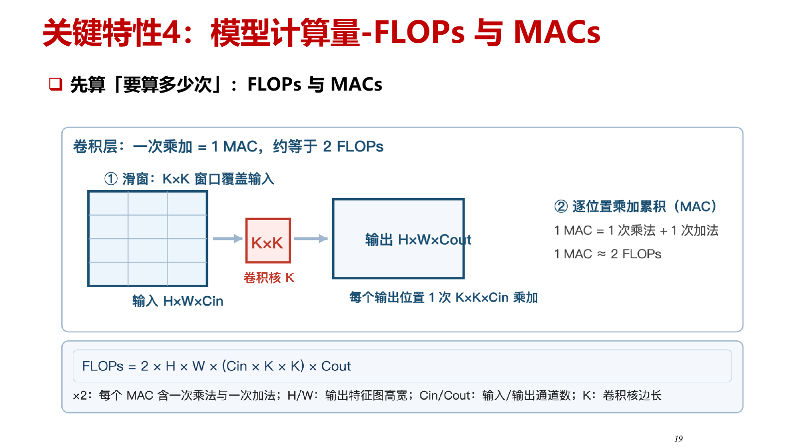
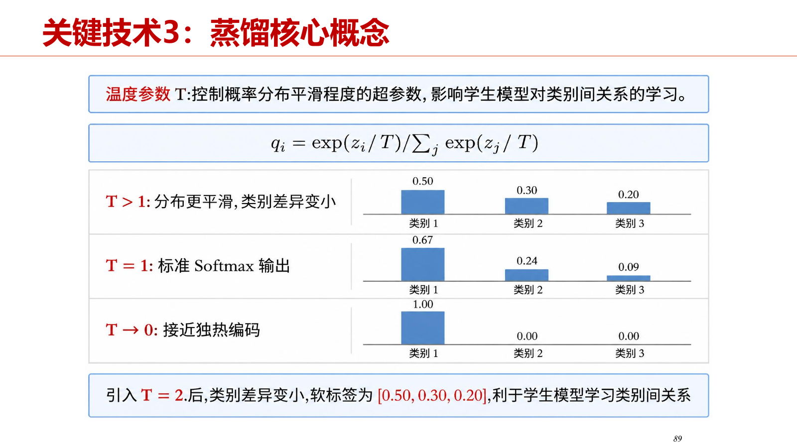
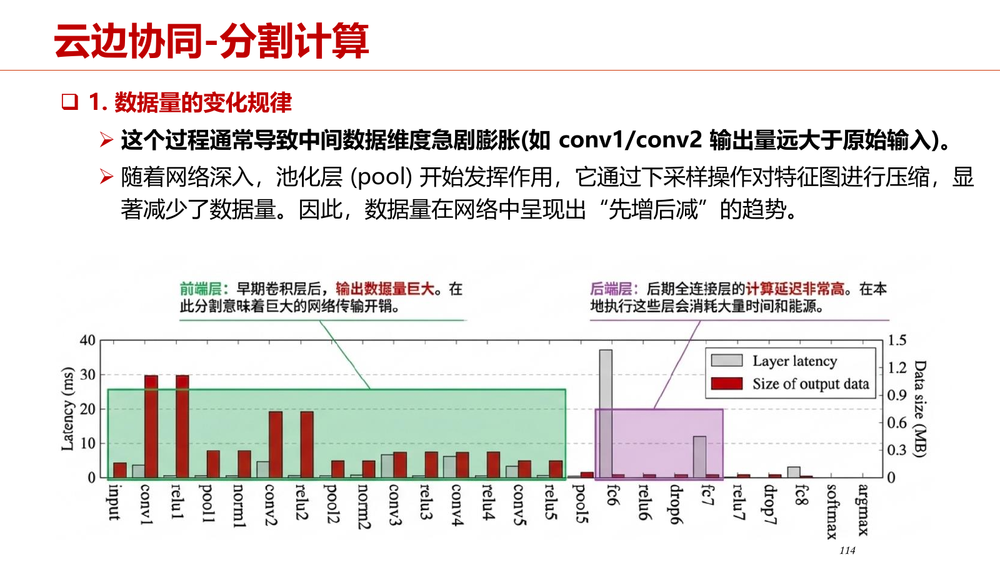

# 第4章 边缘智能

本章以《第四章-1009》PPT（147页）为主要依据，按照“概述—关键特性—关键技术—主流框架—课程实验”整理。**当前材料没有第四章完整课堂字幕**，因此知识点主要依据PPT；老师讲解仅引用09.16、09.23、09.30课次的实际相关段落，其余部分明确标注未提供。引用中的时间采用现有整理字幕的段落范围，所有PPT页数均指PDF物理页。

学习本章时，要能回答三类问题：模型在设备上是否放得下、运行得是否满足任务要求，以及怎样通过压缩和协同改善部署效果。参数量、文件大小、运行内存、计算量、硬件算力与实测速度各有含义，不能互相替代。（PPT，PDF第2—3页）

## 4.1 概述：把智能计算放到数据附近

### 4.1.1 边缘智能、端侧智能与边缘计算

**知识点**

边缘智能是把人工智能模型与算法部署在靠近数据源的IoT终端、边缘网关等计算节点，利用本地算力开展数据分析、模型推理、场景感知和智能决策。边缘计算讨论计算的位置；边缘智能进一步强调在这些位置运行AI模型。（PPT，PDF第4页）

- 端侧可以是摄像头、机器人、手机或传感节点；边缘侧常见形态是连接多台设备的网关。
- 广义的“边缘”可以包含端侧；狭义讨论中，应区分具体设备和能力更强的网关。
- 本地处理能减少原始数据上传、缩短网络链路并保留数据边界，但仍受本地算力、内存和能耗限制。
- 边缘智能不要求整个应用完全离线：本地感知、交互可以与云端复杂服务组合。

**老师讲解**（09.23，00:05—00:07）

> 第二个是边缘计算，这个概念比较大。  
> 从正面说，就是在靠近物或数据源头的网络边缘侧进行计算，就近提供服务。  
> 换一种角度说，不是云计算的都可以算边缘计算。  
> 从物联网云、边、端架构看，一般还是要提供服务，不能只给一个人服务，所以经常把网关上的计算称为边缘计算。  
> 更广义的边缘计算也包括端侧计算。  
> 它有三个主要好处，第一个是降低传输。  
> 比如家里有边缘网关和很多摄像头，数据在边缘侧已经处理了，只需要局域网传输，广域网上就没有这些流量。  
> 第二个是降低延迟，因为在公网、广域网上传输，时延比较大。  
> 第三个是增加隐私性，网关放在家里，数据在家里处理，没有离开本地的边界。  

**老师讲解**（09.16，00:27—00:31）

> “端侧”和“边缘侧”有时区分，有时不区分。  
> 广义上，云之外都可以看作边缘，物联网设备也包括在内。狭义讨论时，端侧通常指具体设备，边缘侧常指网关等计算能力更强的节点。  
> AI 可以在设备上运行，也可以放在网关上运行。  

### 4.1.2 应用形态：单设备智能与边缘网关

**知识点**

PPT用两个应用说明部署位置的差异。（PPT，PDF第5—6页）

| 应用 | 本地输入与处理 | 部署价值 | 协同关系 |
| --- | --- | --- | --- |
| 桌面陪伴机器人EMO | 摄像头、麦克风阵列、触摸传感器；识别人脸、定位声源、感知触摸 | 在用户身边完成感知与屏幕表情、声音、身体动作反馈 | 端侧承担感知交互，部分语音命令依赖云端 |
| 边缘智能网关 | 汇集多个传感器、摄像头和工业设备的数据，完成融合、推理和决策 | 多个终端共享较强算力，不必给每台设备都配置强AI芯片 | 本地网络内汇聚处理，按需要与云端连接 |

模型可以把低层传感数据转成应用可理解的状态，例如从IMU数据识别门的开关、从声音识别安静或嘈杂。这说明AIoT的输入不仅是图像，也包括加速度、角速度、声音等物理信号。以下课堂例子介绍的是机器学习感知流程，没有明确说明所有模型均部署在端侧，不据此补写部署位置。

**老师讲解**（09.16，01:02—01:05）

> 机器学习层怎样工作？  
> 第一步，用户选择特定数据并打标签；第二步，机器学习层训练分类器，得到用于分类或状态监测的虚拟传感器。  
> 机器学习是黑盒方法，不必把判定规则明确写成白盒程序。  
>
> 例如在门上装传感器，要检测门是开还是关，原来的程序不太好写。  
> 传感器本身未必就是一个“开关门传感器”。  
> 可以使用手机上类似的陀螺仪或 IMU，得到 X、Y、Z 轴加速度和角速度。  
> 如果写死规则，例如速度大于多少、倾斜大于多少就表示开门或关门，可能会有问题。  
> 传感器部署时可能装歪，未必安装得很正，明确写死的程序就不一定好用。  
>
> 机器学习的方法是：先把传感器装上，再开门、关门试十次，每次把标签打好，利用原始数据自动训练。  
> 这里的传感器就分成两层。  
> 物理传感器采集的是加速度、角速度等数据。  
> 虚拟传感器向上提供“门开还是关”这样的感知功能，它通过机器学习和打标签实现。  
>
> 优势是隐藏许多传感器细节。  
> 用户根据常识选择一些可能适用的传感器来开发，不必纠结数据阈值，开发难度降低。  
> 不只是阈值，判断还可能与安装位置、方向、高低等有关，这些都会影响采集数据。  
> 采用这个方法，可以减轻这些安装差异造成的影响。  

**老师讲解**（09.16，01:05—01:07）

> 这里举一个利用机器学习层开发应用的例子：帮助学生查找安静且有空闲座位的教室。  
> 假设每间教室已部署相关传感器，可以检测是否有人，以及座板是被坐下还是翻起来。  
> 具体包括声音传感器，以及安装在每个座位下的加速度计。  
>
> 应用开发可以分三步。  
> 第一，实现虚拟分贝计，训练声音传感器采集的数据，区分环境安静还是嘈杂。  
> 这是一个比较简单的二分类任务，只要分类器能区分安静和嘈杂就行。  
> 第二，实现座位占用虚拟传感器，训练座位上加速度计采集的数据，区分座位是否有人。  
> 数据可能包括 X、Y、Z 轴加速度、角速度等不同值。  
> 第三，结合虚拟分贝计和座位占用传感器，检测环境安静且有空闲座位的教室。  
> 利用机器学习层，这样的应用可以比较简单地开发出来，否则会复杂一些。  

### 4.1.3 从训练到压缩，再到部署

**知识点**

模型使用有三个相互衔接的阶段。（PPT，PDF第7—8页）

1. **训练**：准备数据、选择结构，执行前向计算、损失计算、反向传播并更新权重；用验证集评估，保存达到要求的模型。PyTorch、TensorFlow是训练框架的例子。
2. **压缩优化**：根据设备预算做量化、剪枝等优化，转换为目标格式，同时复核任务准确率与性能。
3. **部署推理**：将模型与推理引擎集成到应用中。引擎执行前向计算，应用负责输入预处理和输出结果处理；在目标设备验证时延、峰值内存和能耗。

| 结构 | 信息处理特点 | 常见任务 |
| --- | --- | --- |
| CNN | 提取局部空间特征 | 图像分类、目标检测 |
| RNN | 按时间步传递状态 | 时序信号、语音 |
| Transformer | 用注意力关联不同位置 | 语言、视觉任务 |

面向边缘设备选模型时，应同时控制层数、通道数、输入尺寸或序列长度，并检查硬件的算子支持。轻量结构如MobileNet可以降低开销，但最终仍须在目标设备实测；FLOPs小不保证实际速度快。

**老师讲解**（09.30，00:56—01:00）

> 第七个关键特性是 AI 支持能力，这是去年加上的，也是非常重要的能力。  
> 未来端侧设备能力虽然有限，也会运行一些简单 AI 模型。  
> 这里讲的视频、音频推理、穿戴计算、健康监测传感器，都是常见应用场景。  
> TinyML 专门面向嵌入式设备做 machine learning，之前还挺 popular。  
> 现在人工智能发展太快，也有一些别的技术。  
> 比如 TinyML 怎样使用？  
> 第一步 prepare data，准备数据，然后训练模型，可以用 80% 数据训练，剩下 20% 做 testing。  
> 然后 deploy model，把模型部署上去。  
> 部署时可能要 convert 一下，转换模型，甚至进一步优化，减小大小、提升性能。  
> 最后部署完再运行，也就是 inference at the edge，做推理。  

## 4.2 关键特性：如何判断模型能否落地

### 4.2.1 模型规模、参数量与权重存储

**知识点**

模型规模通常指模型中权重、偏置等参数的总数量，统计的是数值元素个数。参数通过训练学习输入与输出的关系。参数量关联学习容量，但容量大还会带来存储、内存和计算压力。（PPT，PDF第10—13页）

只估算权重数据时：

$$
M_W \approx N_{\mathrm{param}}\times \frac{b}{8}\quad\text{Bytes}
$$

其中$N_{\mathrm{param}}$是参数个数，$b$是每个参数的存储位数。此式不计文件头、量化尺度、零点、分词器等额外数据。

| 格式 | 每参数字节数 | PPT强调的特点 |
| --- | ---: | --- |
| FP32 | 4 | 精度高、支持广，但开销大；32位包含1位符号、8位指数、23位尾数 |
| FP16 | 2 | 减少占用，动态范围较小，可能溢出或下溢 |
| BF16 | 2 | 1位符号、8位指数、7位尾数；动态范围较大，尾数精度较低 |
| INT8 | 1 | 有符号范围$[-128,127]$；需量化映射与算子支持 |
| INT4 | 0.5 | 有符号范围$[-8,7]$；占用更低，精度风险和实现约束更强 |

以十进制容量粗略换算，1M是100万个参数、1B是10亿个参数。FP32下，1M约4MB，100M约400MB，1B约4GB，100B约400GB；BERT Base的110M参数约440MB。这里的MB/GB是容量单位，Mb/Gb是比特单位，计算中必须区分。

**老师讲解**

现有字幕未提供参数量与存储换算这一部分的完整讲解，以上知识点依据PPT整理。下面硬件相关原话中的“大概可以部署”是课堂概括，未给出量化位宽和上下文配置，不能直接当作所有同名模型的内存要求。

**老师讲解**（09.23，01:47—01:50）

> 有这样的板子，要部署多大的模型？现在也讲端侧大模型，跟硬件有什么关系？  
> 这里的Nano有8GB显存，大概可以部署Llama 7B，算力40TOPS，功耗7W到15W，售价大约299美元。  
> 性能更高，显存也更大，比如16GB、32GB、64GB。  
> 16GB大概可以部署Llama 13B，64GB大概可以部署Llama 70B。  
> 一般算力越高，价格越贵，功耗越大。  
> 除了Jetson，我们买的香橙派也可以接华为昇腾310B计算芯片。  
> 国产RK3588等也有一定AI计算能力，所以带AI能力的边缘硬件越来越广泛。  

### 4.2.2 运行时内存不等于模型文件大小

**知识点**

推理时除了权重，还要保存中间结果、缓存和运行库的工作空间。因此，部署前应测峰值内存，而不是仅查看下载文件的体积。（PPT，PDF第14—15页）

$$
M_{\mathrm{peak}}\approx M_W+M_A+M_{KV}+M_R
$$

- $M_W$：权重，主要取决于参数量与每参数字节数。
- $M_A$：激活及中间张量，取决于形状、精度和同时存活的张量；应关注峰值而非机械累加全部层。
- $M_{KV}$：自回归生成的KV Cache，受缓存长度、并发和精度影响。
- $M_R$：额外开销，包括工作区、运行库、内存池等。

PPT给出香橙派5 Plus的实例：Qwen2.5-0.5B-Instruct Q4_K_M的GGUF文件为468.6MiB，使用llama.cpp，输入128、输出32 tokens；上下文容量配置为512、2048、4096时，请求峰值RSS依次为609.2、627.1、651.2MiB。相同文件也会因为运行配置改变而有不同峰值。

另一个显存拆分示例包括CUDA Kernels 0.977GiB、参数5.178GiB、激活0.322GiB、输出0.391GiB。输出张量的估算为$4\times512\times51200\times4$ Bytes，分别对应batch、序列长度、词表大小和FP32字节数。PPT示例中的序列长度增长影响应结合具体算子理解，不能把所有模型的激活开销都视为同一种增长规律。

### 4.2.3 数值精度与任务准确率

**知识点**

数值精度指FP32、FP16、INT8等表示方式；任务准确率指模型在给定评测任务上的表现。改变数值表示可能影响预测，但两者不是同一指标。（PPT，PDF第10、16—17页）

二分类中，TP为实际正且预测正，TN为实际负且预测负，FP为实际负却预测正，FN为实际正却预测负。

$$
\mathrm{Accuracy}=\frac{TP+TN}{TP+FP+TN+FN}
$$

$$
P=\mathrm{Precision}=\frac{TP}{TP+FP},\qquad
R=\mathrm{Recall}=\frac{TP}{TP+FN}
$$

$$
F_1=\frac{2PR}{P+R}
$$

Accuracy回答总体预测对了多少；Precision回答预测为正的结果有多可信；Recall回答实际正类被找到多少；F1用调和平均综合Precision与Recall。评测应明确任务和数据集，不能只报告一个不带评测条件的“精度”。

### 4.2.4 延迟、吞吐量、FLOPs与FLOPS

**知识点**

延迟是一次请求完成的时间，常用ms；吞吐量是单位时间处理总量，常用样本/秒、FPS。增大batch可以提高硬件利用率和吞吐量，但凑批等待可能增大单请求延迟。端侧逐帧感知等场景通常优先保证延迟。（PPT，PDF第18—20页）

**FLOPs是运算次数，FLOPS是每秒运算速率**：前者衡量模型在指定输入下的计算量，后者衡量硬件算力。MACs表示乘加次数；按一次乘法加一次加法的统计口径，1 MAC约等于2 FLOPs。

对普通卷积层，忽略偏置等附加计算：

$$
\mathrm{MACs}=H_{\mathrm{out}}W_{\mathrm{out}}C_{\mathrm{out}}C_{\mathrm{in}}K^2,
\qquad
\mathrm{FLOPs}\approx2\,\mathrm{MACs}
$$

$H_{\mathrm{out}},W_{\mathrm{out}}$是输出特征图高宽，$C_{\mathrm{in}},C_{\mathrm{out}}$是输入与输出通道数，$K$是方形卷积核边长。输入尺寸或通道数改变会改变计算量。

图：普通卷积的MACs与FLOPs计数（本章PPT，PDF第19页）。

硬件GFLOPS表示每秒$10^9$次浮点运算，TFLOPS表示每秒$10^{12}$次浮点运算。TOPS表示每秒$10^{12}$次操作，比较时必须注明操作精度及统计口径。峰值算力不等于实际利用率，也不能把整数TOPS直接与FP32的TFLOPS横向比较。

PPT另用MAC表示Memory Access Cost，**这里的MAC是访存成本，不是上面的乘加次数MACs**。第20页给出的$1\times1$卷积访存估算为：

$$
\mathrm{Memory\ Access\ Cost}\approx HW(C_{\mathrm{in}}+C_{\mathrm{out}})+C_{\mathrm{in}}C_{\mathrm{out}}
$$

三项对应输入、输出与权重的数据访问规模。它提示：运算量之外还有搬运数据的成本，实际速度受内存带宽、缓存、复用、引擎实现等影响。

**老师讲解**（09.23，01:43—01:46）

> 度量AI性能时，有些单位需要弄清楚。  
> TOPS是Tera Operations Per Second，1TOPS表示处理器每秒可以进行一万亿次操作，通常默认INT8整数运算。  
> FLOPS是Floating Point Operations Per Second，即每秒浮点运算次数，通常是32位浮点。  
> TFLOPS表示每秒万亿次浮点运算，GFLOPS表示每秒十亿次浮点运算。  
> 以后出题比较算力，或者现在讨论算力网、多少算力，这些度量指标都很重要。  

### 4.2.5 功耗、能耗与本地处理的代价

**知识点**

功耗是单位时间消耗的能量，常用W；能耗是完成任务消耗的能量，常用J。平均功耗近似稳定时，一次推理的能耗为：（PPT，PDF第21页）

$$
E\approx \overline P\,t
$$

$\overline P$是平均功耗，$t$是推理时间。降低功耗或缩短时延都可能降低能耗，但应在同一任务、同一质量要求下比较。

频繁访存是重要的能耗来源。量化减少数据位宽和搬运量；算子融合可把卷积与激活等合并，减少中间结果的写回和读取。本地计算也可能减少无线传输能耗，但计算复杂时，本地增加的计算消耗可能超过传输节省，须对总成本做评估。

**老师讲解**（09.23，00:07—00:10）

> 边缘计算也受到越来越多工业界的关注。  
> 比如微软的Azure平台，原来有些数据流分析是在云上处理的，现在也可以下发、下沉到边缘侧处理。  
> 这里举了三星的边缘计算性能评测案例[系统名识别不清]。  
> 它做的是在智能手机上进行walking detection，判断你是不是在走路，以及走得多快。  
> 需要采集加速度计数据，连续采20小时，采样频率10Hz，也就是每秒采10个数据。  
> 有两种方法，一种是把原始数据上传到云上，在云上分析。  
> 另一种是在手机上直接处理数据，也就是边缘计算。  
> 表格有三列，首先是data size，也就是数据量。  
> 用边缘计算，每秒10个原始数据就不用上报；否则还要传到云上去计算，数据传输量比较大。  
> 第二个是power，这里可能综合考虑了计算和传输的能耗。  
> 原来的计算在云上进行，现在移到边缘侧，从计算角度看，边缘侧耗能会更多。  
> 但是这个例子的计算比较简单，walking detection不涉及大量计算，能耗很大一部分在传输方面。  
> 少传数据就能少消耗能量。  
> 当然也有反例，如果计算量太大，本地算不了，可能还要放到云上进行。  
> 第三个是时延，边缘侧的时延也比较低。  
> 这个具体案例说明了边缘计算相对云计算好在哪里。  

### 4.2.6 异构硬件与精度、速度、资源的权衡

**知识点**

边缘设备常同时具备CPU、GPU、NPU，部分设备还有DLA等专用加速单元。CPU适于通用推理、轻量模型与算子回退；GPU适于卷积和矩阵等并行计算；NPU适于已经完成工具链适配的神经网络计算。（PPT，PDF第22—25页）

硬件有加速单元还不够：推理引擎后端、驱动、SDK、数据类型与算子都必须兼容。llama.cpp有CUDA、Vulkan、Hexagon等后端；RKLLM则针对指定Rockchip NPU。模型架构不同也可能导致适配差异。

PPT以骁龙8 Elite的SoC说明CPU、GPU、NPU的集成形态，NPU承担AI推理可以减少对CPU、GPU计算资源的占用。但具体是否使用NPU，应由后端和执行情况确认。

端侧部署是精度、速度、资源的多目标优化：更强模型常需更多参数与复杂计算；更快响应依赖更高效率或更强算力；设备又有内存、供电、散热等约束。PPT用“不可能三角”概括这种权衡，压缩与协同的目标是在资源预算内尽可能保持模型能力。

**老师讲解**（09.23，01:43—01:46）

> Jetson是NVIDIA推出的一系列嵌入式AI计算平台，主要用于边缘计算和人工智能应用。  
> 已经广泛应用于制造、物流、零售服务、农业、智慧城市、医疗保健和生命科学。  
> 表里列了主要开发板，从Nano等低性能型号到高性能型号。  
> 比较它们的AI性能是多少TOPS、TFLOPS、GFLOPS，GPU有多少核心，显存多大，存储和功耗如何。  
> 有GPU，功耗比前面的树莓派还大，通常用于有电源供应的边缘场景。  
> 比如路由器改成智能网关，本来就插电，功耗稍大一点没关系，但发热、散热会是问题。  

**老师讲解**（09.30，00:56—01:00）

> 做完模型压缩，还有高效架构，怎样设计紧凑、高效的模型架构，也非常关键。  
> 第二是硬件加速，充分利用微控制器的硬件特性加速。  
> 端侧或边缘设备跟主流设备不太一样，硬件比较异构，比如 NPU、DSP、FPGA 等。  

**讲解来源说明**

现有字幕未提供运行内存拆分、分类指标、卷积运算计数和硬件适配机制的完整讲解，以上相关知识点依据PPT整理；本节引用只补充课堂实际讲到的算力度量、边缘计算能耗案例与硬件背景。

## 4.3 关键技术一：模型压缩与量化

### 4.3.1 三种压缩方法分别改变什么

**知识点**

模型压缩减少模型大小或复杂度，使其能在资源受限设备上运行。量化、剪枝、蒸馏属于模型层优化；云边协同属于执行位置与分工的系统优化，两者可以组合。（PPT，PDF第27—28页）

| 方法 | 改变的对象 | 主要收益 | 主要代价 |
| --- | --- | --- | --- |
| 量化 | 权重、激活等数值表示 | 减少存储和访存，在适配硬件上可能加速 | 离散化误差；收益依赖量化算子 |
| 剪枝 | 权重、通道、神经元等组件 | 减少有效参数与计算 | 结构改变带来精度损失，常需微调 |
| 蒸馏 | 小模型的训练监督 | 让学生学习教师的输出、特征或关系 | 额外训练/数据成本，受学生容量限制 |

不能只追求文件小：压缩后必须复核任务质量、时延、内存与能耗。

**老师讲解**（09.30，00:56—01:00）

> 物联网设备做 AI、做推理，非常重要的是模型压缩。  
> 今年新增了一个模型压缩实验。  
> 希望在给定条件下，把模型压缩到某个大小以下，但不能乱压，压完精度掉了很多肯定不行。  
> 压到限制大小以下，精度还要越高越好，运行越快越好。  
> 这里也可以有排行榜，看怎样做得更好。  
> 模型压缩里三种典型技术是权重剪枝、量化、知识蒸馏，用来减少模型大小。  
> 这里不再详述，下次高老师来上课，专门讲边缘 AI，会讲得更详细。  

### 4.3.2 线性量化：缩放因子、零点、舍入与截断

**知识点**

量化通过把高精度数值映射到较低精度表示，减少权重大小和访存量。线性整数量化用缩放因子$S>0$和整数零点$Z$建立映射；$S$决定一个整数步长对应多大的浮点区间，$Z$使浮点零可以被精确表示。（PPT，PDF第29—33页）

$$
q=\operatorname{clip}\left(\operatorname{round}\left(\frac{x}{S}\right)+Z,\ q_{\min},q_{\max}\right),
\qquad
\widehat x=S(q-Z)
$$

$x$是原浮点值，$q$是量化整数，$\widehat x$是反量化近似值，clip把结果限定在整数表示范围内。round是RTN（Round-to-Nearest，取最近整数）。舍入误差和越界截断会导致$\widehat x$与$x$不同。

MinMax方案用原数据最小值$x_{\min}$和最大值$x_{\max}$确定：

$$
S=\frac{x_{\max}-x_{\min}}{q_{\max}-q_{\min}},
\qquad
Z=\operatorname{clip}\left(\operatorname{round}\left(q_{\min}-\frac{x_{\min}}{S}\right),q_{\min},q_{\max}\right)
$$

PPT示例把$[3.0,-5.5,0.0,6.0,-6.0,2.5]$映射到有符号INT8，取$S=12/255\approx0.04705882$、$Z=0$，列出的量化结果是$[64,-117,0,127,-128,53]$。边界值受舍入规则与截断影响；PPT写出$\operatorname{round}(-0.5)=0$，实际实现应明确半整数的舍入口径，不把这一行视为所有语言的统一规则。

### 4.3.3 量化映射分类

**知识点**

按浮点值与量化级别的映射是否均匀，可分线性量化和非线性量化。线性量化实现简单、便于硬件执行；非线性量化更贴合某些分布，但常需专用计算实现。（PPT，PDF第34—37页）

- 对数量化使用指数分布的级别，例如$2^0,2^{-1},2^{-2}$；同底数幂相乘可以转为指数相加。
- 聚类量化通过K-Means寻找中心形成码本，推理时涉及查表。
- 可学习量化把量化电平作为训练中调整的参数。

线性量化又可分为对称和非对称两类。

| 类型 | 零点与范围 | 优点 | 局限和典型用途 |
| --- | --- | --- | --- |
| 对称 | $Z=0$，例如$[-a,a]\to[-127,127]$ | 映射和反量化较简单 | 偏斜分布会浪费范围；常用于权重 |
| 非对称 | 使用$Z$，把$[x_{\min},x_{\max}]$映射到整数区间 | 充分利用表示范围 | 需零点处理；适合ReLU后的非负激活 |

例如数据集中在$[-1,10]$，对称方案扩展到$[-10,10]$，其中$[-10,-1]$没有数据，对同一位宽而言会降低有效分辨率。选择方案应结合数据分布和执行后端。

### 4.3.4 PTQ、动态量化、静态量化与QAT

**知识点**

按时机分为训练后量化PTQ和量化感知训练QAT。PTQ从已训练模型出发；QAT在训练或微调中加入伪量化节点模拟误差，让权重适应低精度表示。PTQ又可按激活值处理方式分动态与静态量化。（PPT，PDF第38—49页）

| 路线 | 权重处理 | 激活处理 | 数据与实施要求 | PPT对应选择倾向 |
| --- | --- | --- | --- | --- |
| 动态量化 | 离线量化 | 推理时统计范围、量化 | 无需预先校准集，实施简单 | 快速部署、RNN/Transformer等 |
| 静态量化 | 离线量化 | 用代表性数据离线校准范围 | 需校准流程，输入分布应有代表性 | CNN等固定结构，追求推理速度 |
| QAT | 训练中适应量化 | 训练中模拟量化 | 要改训练流程并训练/微调，成本高 | 精度要求较高的任务 |

PPT的“最快”“最高”是路线对比的概括；实际精度和加速幅度仍由模型、硬件、校准/训练和算子实现决定。

动态量化的典型流程是：FP32输入激活在运行时变为INT8，与已量化权重计算，用INT32累加器保存中间结果，再反量化成FP32并处理偏置。每层实时求范围和量化/反量化的开销可能抵消部分计算收益。

PPT展示PyTorch的`torch.quantization.quantize_dynamic`，示例仅量化AlexNet的全连接层。该接口示例涉及Linear、LSTM、GRU等层，不使用Conv2d动态量化；卷积特征图较大，实时量化代价也较高。第42页示例模型从55.67MB降为16.65MB，精确度不变，吞吐量约241→250张/秒：存储压缩明显，速度提升较小。此处“每层激活值未量化”应结合动态流程理解为没有离线固定量化并跨层保持整数，并非完全没有运行时激活量化。

静态量化先用代表性校准数据运行FP32模型，统计各层输入/输出激活范围，预先确定尺度和零点。这样INT32累加结果可以重定标为下一层INT8输入，减少FP32中转。PPT AlexNet示例提到100—200张校准图像，这是该示例的用量，不是所有任务的通用要求。

### 4.3.5 静态量化为何需要INT32累加和重定标

**知识点**

INT8乘法和大量累加可能超出INT8范围，因而中间结果使用INT32。输入、权重和输出的尺度不同，累加结果还需转换到输出的量化空间。（PPT，PDF第44—46页）

令输入量化整数为$q_a$、权重量化整数为$q_w$，其零点分别为$Z_a,Z_w$，尺度为$S_a,S_w$。按照PPT不含偏置的乘法示意：

$$
a=S_a(q_a-Z_a),\quad w=S_w(q_w-Z_w),\quad
r_{\mathrm{int32}}=(q_a-Z_a)(q_w-Z_w)
$$

输出满足$y=S_y(q_y-Z_y)=aw$，故：

$$
q_y\approx\operatorname{clip}\left(\operatorname{round}(Mr_{\mathrm{int32}})+Z_y,q_{\min},q_{\max}\right),
\qquad M=\frac{S_aS_w}{S_y}
$$

矩阵/卷积运算中$r_{\mathrm{int32}}$对应这些乘积的累加；偏置也需按实现处理。$M$可在校准阶段计算，推理时直接使用。这里的scale是量化步长，由范围计算得到，不能将“范围”本身直接当作scale相乘。

### 4.3.6 大模型异常值与LLM.int8()

**知识点**

RTN可以按$Q=\operatorname{round}(W/S)+Z$快速量化权重，不一定需要校准数据；但粗粒度MinMax对异常值敏感。一个离群值拉宽范围后，$S$变大，大量普通值落入少数整数格，信息被舍入抹平。（PPT，PDF第50—56页）

PPT引用的大模型研究观察到：超过约60亿参数时，传统8位方法可能显著退化；极端特征值可能比普通值大20倍以上，虽稀疏却重要。这些数字是该研究与图中模型的现象，不能推为所有现代LLM的固定阈值。

LLM.int8()结合两项策略：

1. **向量级量化**：输入矩阵每行、权重矩阵每列使用各自的缩放因子，把影响限制在较小范围内。
2. **混合精度分解**：识别包含异常值的特征维度，拆分矩阵乘法；常规部分用INT8，异常部分保留FP16，最后合并结果。

PPT示意约99.9%常规值走低精度、约0.1%关键异常值走高精度，给出异常值识别阈值绝对值大于6.0的例子。核心是保留重要异常信息，而不是把所有异常值直接置零。第56页在所示13B模型实验中报告内存约减半、性能与16位模型相当。

### 4.3.7 前沿量化与GGUF部署实例

**知识点**

PPT列出的进一步思路不只量化权重，也覆盖激活和KV Cache。（PPT，PDF第57—59页）

| 方法（按PPT所列） | 核心思路 | 量化对象 |
| --- | --- | --- |
| SpinQuant，ICLR 2025 | 学习旋转，分散异常值 | W4A4KV4 |
| ThinQuant，2026-09预印本 | 样本筛选、低维旋转，降低校准成本 | W4A4，可结合KV量化 |
| TurboQuant，ICLR 2026 | 随机旋转与残差校正，在线压缩向量 | KV Cache |

其中W/A/KV分别表示权重、激活和KV缓存，后面的4表示4位。这是PPT提供的研究概览，不扩展为当前工具支持情况。

DeepSeek-R1-Distill-Qwen-7B的GGUF文件在PPT中为：F16 15.24GB、Q8_0 8.10GB、Q4_K_M 4.68GB；Q4_K_M约为F16的31%，减少约69%。这是基于Qwen的7B蒸馏模型，不能据此推断总参数671B的完整版DeepSeek-R1所需硬件。

量化降低下载、磁盘、加载与驻留权重的开销，但4.68GB仍只是文件体积。部署时还要检查上下文与并发下的KV Cache、工作区和峰值内存，并实测任务质量、首字延迟、生成速度和持续功耗。

**老师讲解**

现有字幕未提供量化映射、分类、校准、重定标、LLM异常值及前沿方法这一部分的完整讲解，以上知识点依据PPT整理。4.3.1引用的课堂原话只说明模型压缩的目标与三种典型技术。

## 4.4 关键技术二：剪枝

### 4.4.1 冗余、剪枝与彩票假设

**知识点**

剪枝系统性移除网络中冗余或不重要的权重、神经元、通道、注意力头或网络层。它改变参数/结构，与量化改变数值表示不同。目标是减少有效参数、计算量和部署开销。（PPT，PDF第62—64页）

剪枝利用网络的过参数化与冗余：训练好的大网络中，一部分组件对最终预测贡献较小，移除后可经微调恢复表现。但不能仅凭“参数很多”断言任意删去一半都无损。

彩票假设提出：一个随机初始化的密集前馈网络可能包含稀疏子网络；从其在原网络中的初始权重训练，该子网络可在相似训练步数内达到原网络相当的表现。要点包括**子网络结构与原始初始化**，不等同于“随便训练一个同尺寸小模型就一样”。

### 4.4.2 非结构化与结构化剪枝

**知识点**

分类依据是移除单元的粒度，实际加速则取决于结果是否适合目标硬件执行。（PPT，PDF第65—76页）

| 维度 | 非结构化剪枝 | 结构化剪枝 |
| --- | --- | --- |
| 移除对象 | 独立权重/连接 | 整个输出通道、滤波器、神经元、层等 |
| 权重表现 | 不规则零值、稀疏矩阵 | 规则结构可以被整体裁剪 |
| 主要优点 | 粒度细、灵活，较易保持精度 | 易与密集计算库和通用硬件配合 |
| 主要限制 | 需稀疏存储/计算支持才能兑现收益 | 粒度粗，精度损失可能更大 |
| 加速判断 | 零值多不等于执行少 | 真正缩小结构后，再在设备测延迟 |

PPT示例中，`prune.l1_unstructured()`按权重绝对值剪掉较小元素；`amount=0.5`表示将指定范围内约50%的权重置零。随机剪枝则不依赖重要性评分，仅作为对照。

结构化L1剪枝计算一个结构单元内全部权重绝对值之和，排序后剪掉低分单元。全连接层可以按行对应的输出神经元处理；卷积权重沿`dim=0`对应输出通道，剪一个滤波器就会把该通道的全部权重处理掉。

**必须区分掩码置零与真正裁剪**：PPT前面的PyTorch演示展示整行/通道置零，它说明结构选择；若张量形状、存储格式与执行算子保持不变，密集引擎仍可能计算零值。要得到后续示例那样的参数量减少，需重建较小层并同步调整相邻层连接。

### 4.4.3 如何衡量重要性

**知识点**

剪枝算法的共同问题是“保留谁、舍弃谁”。（PPT，PDF第77—79页）

- 幅度标准：以绝对值、L1范数或L2范数作为启发式重要性；实现简单，但权重小不必然贡献小。
- 梯度标准：借助一阶泰勒展开或二阶信息估计移除组件后对损失的影响，着重于任务结果。
- 其他信号：BN缩放因子、激活零值占比APoZ、激活均值、滤波器几何关系等。
- 搜索与渐进策略：线性增加稀疏度、AGP、ADMM、模拟退火、AMC等，把剪枝率或结构选择纳入优化。

对通道$j$，L1评分可记作$\|W_j\|_1=\sum_k|w_{jk}|$，在同层排序后保留较大者。该标准是一种可操作的近似，而不是重要性的严格证明；微调与验证用于检查删去组件后的真实影响。

### 4.4.4 AlexNet真正缩小结构的案例

**知识点**

PPT将AlexNet全连接层宽度从2048裁为1024，并保持被保留索引的原顺序。（PPT，PDF第80—81页）

| 层 | 原权重形状 | 新权重形状 | 联动关系 |
| --- | --- | --- | --- |
| fc1 | $[2048,4608]$ | $[1024,4608]$ | 裁剪输出神经元 |
| fc2 | $[2048,2048]$ | $[1024,1024]$ | 输入承接fc1，输出同时裁剪 |
| fc3 | $[5,2048]$ | $[5,1024]$ | 类别数不变，输入承接fc2 |

参数量从14,591,685降到6,720,197，减少约53.9%。PPT报告精度无损失、略有提升，速度实测更快，同时提醒存在测量波动。这是所示实验的结果，不能保证任意剪枝比例都无损。

第81页指出该例卷积层占约90%的计算量，只剪全连接层对总计算量和速度的收益有限。全连接层可以占很大参数量，而卷积层仍占很大运算量，因此**减参数量和减FLOPs是不同目标**。

**老师讲解**

现有字幕未提供剪枝原理、粒度分类、重要性判断和AlexNet结构裁剪的完整讲解，以上知识点依据PPT整理。

## 4.5 关键技术三：知识蒸馏

### 4.5.1 教师、学生、硬标签与软标签

**知识点**

知识蒸馏用训练好的教师模型指导较小学生模型，把教师的预测知识与泛化能力尽可能迁移给学生。通常部署学生，教师参与训练阶段。量化和剪枝直接修改同一模型，蒸馏可以训练结构不同的新模型。（PPT，PDF第84—88页）

- 教师模型：能力较强、已充分训练的知识提供者。
- 学生模型：面向设备预算设计的轻量结构，通过训练学习教师表现。
- 硬标签：数据集真实类别，常用one-hot，例如三分类的第二类为$[0,1,0]$。
- 软标签：教师的完整输出概率分布。除最高概率类别外，其他类别的概率也反映相似性，即“暗知识”。

PPT用猫、狗、车的类别示例说明：猫0.66、狗0.24、车0.10比单一“猫”标签保留更多类间信息。学生可以学习“这个样本更像猫，也有一些像狗”，而非只学习最终类别。具体比例是PPT示意，不作为精确数值计算题。

### 4.5.2 温度参数与三种知识形式

**知识点**

Softmax温度$T$控制分布平滑程度。设学生logits为$z_i$，则：（PPT，PDF第88—93页）

$$
q_i(T)=\frac{\exp(z_i/T)}{\sum_j\exp(z_j/T)}
$$

$T=1$为普通Softmax；$T>1$使类别概率更平滑，低概率类别的信息更容易进入学习过程；$T\to0^+$时，最大logit对应概率趋向1。蒸馏时教师与学生使用相同温度，部署预测通常用$T=1$。温度不是越大越好，过度平滑也会削弱有用细节。

图：Softmax温度与概率分布平滑程度（本章PPT，PDF第89页；概率为课件示意值）。

按迁移知识形式，可分为：

| 类型 | 学生模仿的信息 | 关注点 |
| --- | --- | --- |
| 基于响应 | 教师最终输出概率/logits | 输出类别关系 |
| 基于特征 | 教师中间层表示 | 特征提取能力 |
| 基于关系 | 样本之间或特征层之间的关系 | 结构化关系 |

### 4.5.3 Hinton蒸馏的组合损失与梯度

**知识点**

PPT展示离线蒸馏：先选教师并训练/微调，冻结教师，用软标签和硬标签共同训练学生，再保留最佳学生模型。（PPT，PDF第94—100页）

记教师logits为$v_i$、学生logits为$z_i$，类别真实one-hot为$y_i$。教师与学生的温度概率分别为：

$$
p_i(T)=\frac{\exp(v_i/T)}{\sum_j\exp(v_j/T)},\qquad
q_i(T)=\frac{\exp(z_i/T)}{\sum_j\exp(z_j/T)}
$$

软损失让学生拟合教师分布，硬损失锚定真实类别：

$$
L_{\mathrm{soft}}(T)=-\sum_i p_i(T)\log q_i(T),\qquad
L_{\mathrm{hard}}=-\sum_i y_i\log q_i(1)
$$

PPT第95页先给出未补偿的加权组合；第99页再强调软损失的温度补偿，合并可记为：

$$
L=\alpha T^2L_{\mathrm{soft}}(T)+(1-\alpha)L_{\mathrm{hard}},\quad0\leq\alpha\leq1
$$

$\alpha$控制软、硬监督的相对权重。PPT举0.98作为较大权重的例子，实际应按教师质量、数据和学生容量选择。

对学生logit求导：（第96、98页）

$$
\frac{\partial L_{\mathrm{soft}}}{\partial z_i}=\frac{q_i(T)-p_i(T)}{T},\qquad
\frac{\partial L_{\mathrm{hard}}}{\partial z_i}=q_i(1)-y_i
$$

温度增大不但显式引入$1/T$，还会让$q_i-p_i$的差别变小，软监督梯度整体减弱。$T^2$用于补偿温度造成的尺度变化，避免组合目标过度偏向硬标签；它不是关于任意温度下梯度大小恒定的严格保证。

软标签提供泛化与相似性信息；硬标签可以校正教师的偏差或噪声。只让学生模仿教师，可能把教师错误也一并传递。教师与学生能力差距过大时，学生容量不足以复现教师的知识，因此“教师越强必然越好”也不成立。

### 4.5.4 ResNet-18指导AlexNet的实例

**知识点**

PPT案例以ResNet-18为教师、AlexNet为学生，流程包括：加载并微调教师，冻结教师参数，同时前向得到教师与学生logits，计算软损失与硬损失，反向传播只更新学生，保存最佳学生。（PPT，PDF第101—104页）

第104页列出的结果如下，均限于课件所示评测条件：

| 模型 | 准确率 | 文件大小 | 平均每图时间 | 吞吐量 |
| --- | ---: | ---: | ---: | ---: |
| 教师 | 93.96% | 未在该表列出 | 0.7413ms | 1348.90张/秒 |
| 直接训练AlexNet | 72.53% | 55.67MB | 0.5741ms | 1741.74张/秒 |
| 蒸馏训练AlexNet | 76.92% | 55.67MB | 0.5797ms | 1724.99张/秒 |

学生的结构和文件大小不变，蒸馏后准确率提高4.39个百分点；它的价值在于同一轻量结构获得更好的训练结果。相对教师，学生推理更快，但准确率仍有明显差距，说明能力迁移并不完整。毫秒级时间和吞吐量属于该实例，不能拿来预测香橙派或其他设备速度。

**老师讲解**

现有字幕未提供教师/学生、温度、蒸馏损失、梯度及案例的完整讲解，以上知识点依据PPT整理。

## 4.6 关键技术四：云边协同

### 4.6.1 智能路由与分割计算

**知识点**

云边协同结合边缘本地算力与云端远程算力，根据任务和运行条件协调响应时间与资源开销。（PPT，PDF第107—112页）

| 模式 | 决策单位 | 基本流程 |
| --- | --- | --- |
| 智能路由 | 完整推理请求 | 选择边缘轻量模型或云端较强模型处理 |
| 分割计算 | 同一模型内部计算 | 边缘执行前半段，传中间结果，云端执行后半段并返回结果 |

智能路由的依据包括任务类型、质量/时延要求，本地与云端模型能力，边缘负载和可用内存，网络、调用成本及数据上传限制。前置路由在主要推理前选择路径；级联回退则先运行本地模型，结果不满足接受条件时再调用云端，需计入已发生的本地耗时。

**老师讲解**（09.16，00:25—00:27）

> 近年来端侧 AI 和云边协同系统的研究很多。能在端侧完成最好，端侧能力不足时可以让边缘和云协同，复杂任务则往往需要云端参与。  

### 4.6.2 怎样选择分割点

**知识点**

分割点应综合本地计算、云端计算和传输开销，而非按模型层数机械对半分。（PPT，PDF第113—117页）

- 前端卷积常增加通道数，早期中间特征可能比原图大，在此传输未必节省数据。
- 池化下采样使特征图缩小，传输量随网络深度可能先增后减。
- 各层实测延迟取决于硬件与引擎，不能仅凭参数量或FLOPs推断。
- 最佳点通常是在传输规模较小、还能卸载较多本地昂贵计算的位置。

图：AlexNet中早期特征输出量和后端层延迟的差异（本章PPT，PDF第114页）。

PPT案例选择pool5之后：边缘完成前半段特征提取，上传压缩后的特征，云端处理后面的全连接层。该实验第115页报告fc6/fc7占超过90%的计算时间，第116页说明背景为NVIDIA Tegra K1环境。

这里应与剪枝示例分清：第81页讲卷积占约90%的**计算量**，第115页讲另一个硬件环境中的全连接层占主要**实测时间**，统计对象不同。第116页对全连接层“无法用GPU加速”的表述应限定于其案例表现；不能泛化为所有GPU或实现都不能加速全连接层，矩阵计算的利用率、数据搬运和实现方式都会影响延迟。

网络条件改变时要重新比较各候选点的传输数据量和本地计算代价。信号变差通常提高传输成本，但分割点往前还是往后移动，必须看该网络的特征图大小变化，不能只背“越后越好”或“更多云端算”。

### 4.6.3 应用分工与适用条件

**知识点**

PPT还给出任务级分工案例。（PPT，PDF第118—119页）

- 个人助理：本地识别唤醒词，云端处理更复杂语音识别与语言理解。
- 自动驾驶/自主导航：本地执行行人检测、紧急制动等实时任务；云端更新地图或训练模型。
- IoT和可穿戴：本地保留基本、安全功能，复杂分析按条件卸载。

这些例子体现云边协同的大范围应用，但不同任务分工不必然等同于切开同一个神经网络。应先分清协同模式，再考虑网络依赖、故障时本地能否维持功能以及数据上传边界。

**老师讲解**

现有字幕未提供智能路由、DNN分割和切分点选择的完整讲解，以上知识点依据PPT整理；4.6.1的课堂原话只补充“端侧不足时由边云参与”的总体思路。

## 4.7 主流训练与推理框架

### 4.7.1 训练框架、模型格式与推理引擎

**知识点**

训练框架负责学习参数，模型格式表达结构与权重，推理引擎负责在目标环境执行。部署时常需转换、量化、图优化和硬件适配。不能把导出文件成功等同于目标设备性能达标。（PPT，PDF第7、121页）

| 部署需求 | PPT列出的框架 | 主要机制 |
| --- | --- | --- |
| 通用端侧CNN/Transformer | LiteRT / TensorFlow Lite | 转换、量化、Delegate加速 |
| 跨训练框架、跨设备部署 | ONNX Runtime | ONNX中间格式、图优化、Execution Provider |
| 本地LLM | llama.cpp | GGUF、低比特量化、CPU指令优化、GPU卸载 |
| 瑞芯微NPU视觉/语音/LLM | RKNN / RKLLM | 专用格式、量化、NPU计算图 |
| 高通平台 | QNN | 计算图与量化、Hexagon NPU加速 |

### 4.7.2 TensorFlow Lite：Converter与Interpreter

**知识点**

PPT第121页使用LiteRT名称，后续展开沿用TFLite。其部署链路包含模型转换器和轻量运行时。（PPT，PDF第122—127页）

- Converter把TensorFlow SavedModel或Keras模型转换为`.tflite`，使用FlatBuffers序列化，减少加载解析和占用。
- 转换优化包括算子融合与量化：融合减少调用和中间访存，量化降低数值位宽。
- Interpreter在设备执行模型，Delegate把支持的子图交给GPU、DSP、NPU等优化后端，未适配部分需要其他执行路径。
- 张量内存复用减少中间张量占用；核心运行时体积随裁剪和构建配置改变，PPT举约1MB的量级。

TFLite Micro面向MCU，不要求操作系统、文件系统和动态内存分配；PPT举核心约20KB Flash、Arduino Nano 33 BLE的256KB内存上离线关键词识别的例子。这些大小属于课件描述的裁剪版本或案例，不等同于所有模型的内存需求。

算子和动态形状支持要与选用版本及目标运行时核对。PPT将“约60个算子、不支持动态形状”列在该页的边界描述中，不宜视为整个TFLite生态所有版本的固定能力。

### 4.7.3 ONNX Runtime：解耦与执行提供程序

**知识点**

ONNX是模型的开放中间表示，用于将模型定义与训练框架解耦；ONNX Runtime是执行该计算图的引擎。PyTorch可以用`torch.onnx.export()`导出模型，再交给目标推理环境。（PPT，PDF第128—131页）

图优化包括常量折叠、推理无效节点消除和节点融合，例如把MatMul与Add融合以减少内核调用。Execution Providers（EP）作为硬件后端查询支持能力、分区计算图，并执行可支持的子图；其余部分可由CPU等后端回退。

CUDA EP面向NVIDIA GPU，TensorRT EP使用相应优化库。机制与TFLite的Delegate相似，都把可适配计算委托给加速后端。跨平台能力依然要求目标EP支持模型的算子、数据类型和形状；“一次转换，随处部署”应理解为标准化带来的可移植性目标。

### 4.7.4 llama.cpp：低比特LLM的本地推理

**知识点**

llama.cpp面向消费级设备上的本地LLM推理，课件提到Ollama、LM Studio、LocalAI等工具使用其推理核心。（PPT，PDF第132—141页）

- GGUF把权重、分词器、架构参数和量化元数据封装在一个文件中，便于分发、加载。
- GGML块量化内核让文件表示与计算实现配套；Q4_K_M表示以4位量化和K-quant混合策略为主要特征，不能将整个文件每个字节都按纯4位估算。
- CPU使用SIMD优化，例如x86 AVX2/AVX-512、ARM NEON，一条指令处理多个数据。
- 可把部分或全部层卸载到GPU，在CPU内存与显存之间安排模型，后端包括Metal、CUDA、Vulkan等。
- mmap将文件映射进虚拟地址空间，页面由系统按需调入；它不会消除实际驻留内存需求。模型大于物理内存时可能受换页/磁盘访问严重影响。

PPT给出香橙派3B（4GB RAM）运行Qwen-1.8B INT4的部署实例，文件约1.5GB，流程为获取源码、编译、下载GGUF和运行。课件中的`make`、`./main`与时间估计是示例版本的记录，复现时应以对应工具版本说明为准。

PPT把传统CNN/RNN和自定义算子列为其适用边界：选择它主要是为了本地LLM，传统视觉模型更适合通用或厂商视觉推理工具链。

### 4.7.5 RKNN、RKLLM与厂商工具链

**知识点**

厂商工具链强调自家NPU的适配与能效，但格式、量化方案、模型与算子支持受工具链约束。（PPT，PDF第142—144页）

RKNN面向视觉等模型，转换为RKNN格式，由RK3588三核NPU执行；RKLLM面向大语言模型，构建NPU计算图、量化并导出；高通QNN面向骁龙Hexagon。应根据模型类型和目标芯片选择，而不是只看模型文件后缀。

选型时先明确任务，再检查目标平台：跨平台一般优先考虑ONNX Runtime/TFLite，本地LLM可考虑llama.cpp，特定NPU可考虑厂商工具链。转换后仍需评测准确率、峰值内存与实际硬件执行。

**老师讲解**

现有字幕未提供这些框架内部机制的完整讲解，以上知识点依据PPT整理。09.30课次4.1.3引用的TinyML流程提供训练、转换、优化和部署的总体背景。

## 4.8 课程实验与复习

### 4.8.1 离线识物挑战

**知识点**

PPT实验目标是以ResNet-50 V1为基础，通过结构化剪枝、恢复微调和INT8量化，在香橙派实现低延迟、小体积的离线图像分类。（PPT，PDF第146页）

| 阶段 | PPT给定任务 | 需要观察的结果 |
| --- | --- | --- |
| 结构化剪枝 | Group-L1删除低重要性通道，约4.1GMACs降至2.9GMACs | 模型结构与计算量减少 |
| 恢复微调 | 20万张训练图片，微调20轮 | 恢复任务准确率 |
| 转换与量化 | PNNX转ncnn，5000张图像做KL校准，生成混合INT8模型 | 转换可用，质量与体积达到要求 |
| 部署评测 | 香橙派Mali-G610 GPU，固定10000张验收图片 | 同一平台实测准确率、时延和效率 |
| 提交 | `.param`、`.bin`、`model.json`三个文件 | 通过统一评测程序 |

进阶方向是改进剪枝、量化策略或引入知识蒸馏。本页实验链接：[离线识物实验说明](https://gitee.com/emnets/emnets_experiment/blob/master/part4_compress_model.md)。此处记录PPT给定要求，未以外部文档扩展验收细则。

**材料中的路线差异**：框架页第134、141—142页介绍教材案例使用Orange Pi 5 Plus与RKNN/RKLLM的NPU路线，而第146页课程实验明确使用PNNX/ncnn与Mali-G610 GPU。二者属于不同案例/部署路径，不能把NPU工具链自动替换成此次课程实验要求。

**老师讲解**（09.16，00:11—00:16）

> 实验二是今年新增的边缘智能实验，需要预约使用线上平台。  
> ESP32 的能力有限，复杂神经网络可能跑不起来。平台上有约十块 RK3588 开发板，算力更强，使用时间由老师和助教协调。  
> 结合第四章的内容，可能给大家一个模型，要求通过量化、剪枝或蒸馏，让模型能在板子上运行，同时避免精度下降过多。  
> 基本任务完成即可达到基本要求；想进一步提高，这方面也有很多研究论文可以参考。  

### 4.8.2 PPT思考题与复习提示

**知识点**

以下问题来自PPT思考题，答题提示依据本章已给出的机制整理。（PPT，PDF第60、82、105、119页）

1. **追求推理速度选动态还是静态量化？** 在课件对比条件下倾向静态量化，因为尺度/零点预先校准、跨层减少FP32中转；仍需检查目标后端的INT8能力并实测。
2. **MinMax直接取最大值有什么问题？** 离群值拉宽范围，步长变大，普通值量化分辨率下降。是否截断、怎样校准应兼顾信息损失。
3. **LLM为什么可能更难量化？** 课件重点是稀疏却关键的异常特征，粗粒度尺度会破坏普通值表示；向量级量化和混合精度可缓解。
4. **小权重一定不重要吗？** 不一定。幅度是启发式；梯度、组件功能与移除后的损失可以提供补充证据。
5. **为什么常用训练→剪枝→微调？** 利用已训练网络获得的表示，剪掉冗余后恢复质量；从头训练小模型不保证得到同样能力。
6. **蒸馏为何同时有软、硬损失？** 软标签传递类间知识，硬标签校正教师偏差，二者用权重平衡。强教师也受学生容量和数据限制。
7. **分割计算还能怎样降低传输？** 可以进一步压缩/量化中间表示；根据量化知识可知会引入误差，需要验证端到端准确率。这是依据已有机制对第119页问题的推理。
8. **网络变差怎样移动分割点？** 根据特征图数据量与本地/云端延迟重新比较；AlexNet案例在pool5后数据较小，但移动方向不是所有网络的固定规则。

做实验和计算题时，按“任务质量—参数/存储—运行内存—运算/访存—时延/吞吐—功耗/能耗—工具链兼容”的顺序核对。报告每个数字的模型、输入、精度、硬件和运行配置，才能解释优化收益来自哪里。

[返回课程目录](index.md)
