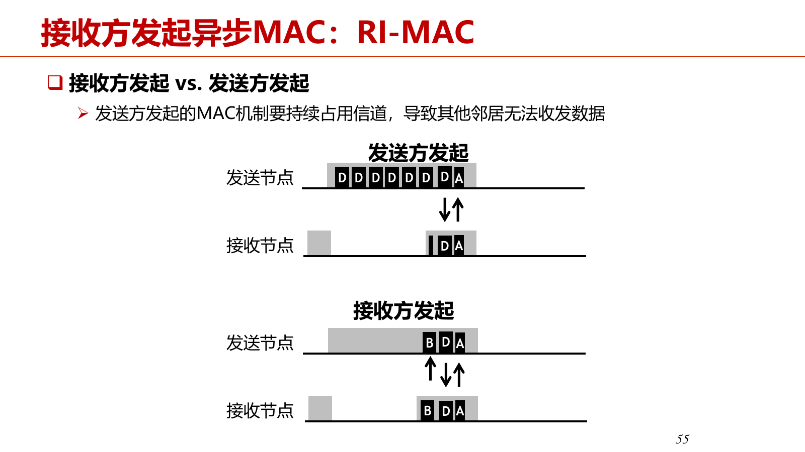
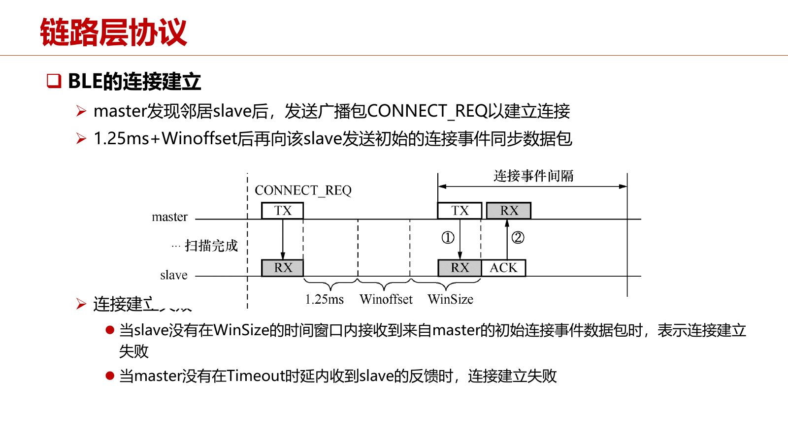
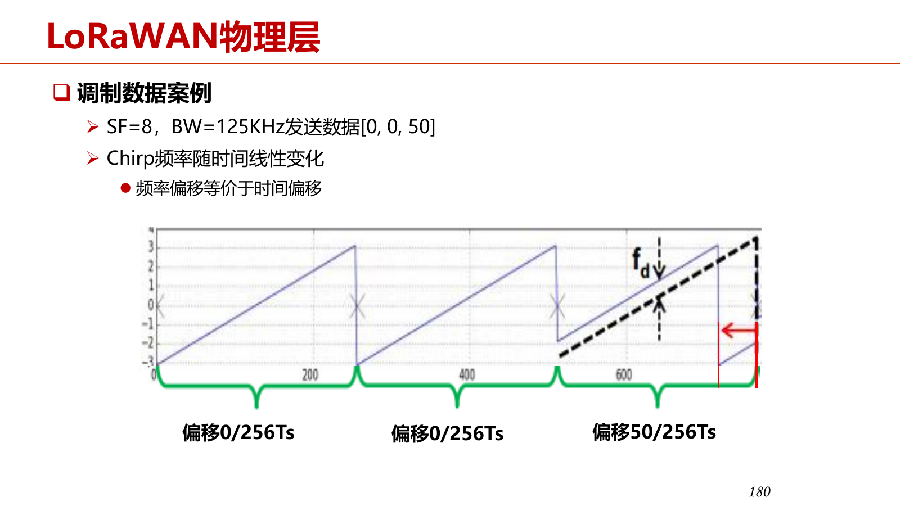

# 第5章 低功耗通信协议

本章依据《第五章-2026v2》PPT（214 页）和 10.14 整课字幕整理。页码统一指 PDF 物理页。本章包括低功耗短距离通信和低功耗长距离通信两部分。知识点依据 PPT 提炼，老师讲解保留整理字幕原句及时间；课堂未展开的内容另标为 PPT 补充。

今年课堂将原来的两次通信课压缩为一次，弱化底层调制、协议时序和复杂计算要求。PPT 第 2、124 页仍保留较完整的旧学习目标，应结合章末课堂说明理解，不能把 PPT 上的每一道题都视为本次课堂已经讲解。

本章黄色高亮并加粗的内容配有“考试提示”“老师强调”或“可能考点”标记及详细讲解；标记依据见[课程目录](index.md#review-guide)。补充讲解与老师字幕原句分开呈现。

## 5.1 低功耗短距离通信：需求与协议概览

### 5.1.1 为什么物联网需要低功耗、低速无线通信

**知识点**

物联网终端常有体积小、能源有限、部署后难以换电池等限制；水表、电表等场景只需低频率、小数据量上传，优先满足长寿命，再考虑吞吐量。（PPT，PDF第5—8页）

在其他条件相近时，达到接收要求所需的发射功率与距离近似满足 $P\propto d^n$。$n$ 是路径损耗指数；若 $n=2$，距离从 10 m 增加到 100 m，所需发射功率增至 100 倍。因此早期系统用短距离、多跳覆盖换取低功耗。这里的关系描述发射功率需求，不能直接等同于整机功耗的精确模型。

**老师讲解**

> **10.14，00:03—00:05**  
>
> 今年教材把低功耗无线短距离和长距离这两章合并了，删掉了一些底层通信内容。  
> 前几年上下来，我们觉得通信内容比较复杂，不太适合计算机相关专业，所以更强调上层协议本身，删掉了一些物理层细节。  
> 物理层细节可能更适合通信专业去学。  
> 上一次讲的边缘智能是今年完全增加的内容，希望更加重视人工智能。  
> 低功耗无线还是分成两部分来讲：低功耗短距离通信和低功耗长距离通信。  
> 短距离部分主要介绍 IEEE 802.15.4 和 BLE 这两套协议。  
> 802 系列大家应该比较熟悉：802.11 是 Wi-Fi，802.3 是以太网，802.15.4 是低功耗短距离通信标准。  
> BLE 是蓝牙的低功耗版本，手机、耳机、手表，以及以后的眼镜，会大量使用它。  

> **10.14，00:05—00:08**  
>
> 先看概述。  
> 低功耗无线技术，特别是低功耗短距离技术，目的是实现万物互联，把各种各样的物体都连上网。  
> 很多设备甚至比电池还小，没办法装电池；有的装上电池以后，也不可能再拿出来。  
> 比如我们之前在港珠澳大桥上，在造桥的时候就在桥里面装了一些位移、振动传感器。  
> 这些传感器已经装在水泥混凝土里面，直到桥的生命周期结束也不会拿出来，电池显然是一次性的。  
> 所以一定要做到低功耗，而通信功耗很高，降低通信功耗就非常关键。  
> 物联网通信除了低功耗，还有低速无线这个特点。  
> 速度往往不是我们很在意的，很多时候一天传一个数就够了，比如水表、电表。  
> 这类设备一般要求一颗纽扣电池至少支撑三年以上，最好能到五六年，但数据频率和数据率都很低。  
> 低功耗无线的需求来自各种应用场景。  
> 为什么做短距离，而不直接做长距离？这里有历史原因。  
> 后面会看到，长距离技术其实很新，没出现几年。  
> 早期为了降低功耗，真正有效的办法就是降低距离。  
> 功耗与传输距离不是线性关系，至少是二次方以上的关系，指数 n 可能等于 2，也可能是 3 或更大。  
> 从传到 10 米变成传到 100 米，功耗可能需要增加 100 倍，而不是 10 倍。  
> 所以为了降低功耗，只能作出妥协，做短距离无线通信。  
> 主要技术包括 802.15.4、完全基于 802.15.4 的 Zigbee、一些传感网协议以及 BLE。  
> Wi-Fi 也有相应的低功耗技术，比如 802.11ah。  
> 这些技术可以用于各种场景，国内厂商推出了很多这样的设备。  
> 比如小米生态里面有大量物联网设备，使用低功耗无线技术，可能主要以 BLE 为主。  

### 5.1.2 IEEE 802.15.4、ZigBee、传感网、BLE 与 RFID

**知识点**

| 技术 | 标准范围或主要定位 | 典型特点 |
| --- | --- | --- |
| IEEE 802.15.4 | 低速无线个域网物理层与 MAC 层 | 上层可由不同协议定义；支持低功耗短距离通信 |
| ZigBee | 复用 802.15.4 PHY/MAC，定义网络和应用层 | 低速率、低成本、灵活多跳组网 |
| 传感网协议 | 大量低功耗节点组成的自组织多跳网络 | 面向感知数据收集，研究 MAC、链路质量和路由 |
| BLE | Bluetooth Low Energy，蓝牙 4.0 引入 | 手机生态支持强；后续支持 Mesh |
| RFID/NFC | 射频识别与近场通信 | 识别、刷卡等短距离应用；NFC 由 RFID 演变 |

以上依据 PPT，PDF第9—13页。PPT 将 NFC 描述为 13.56 MHz、20 cm 内的近场技术；课堂关于 RFID 与 NFC 谁“更远”的说法只是口头概括，不作为普遍距离比较。Thread 的 IPv6 协议栈与 Matter 的生态关系见 5.4。

**老师讲解**

> **10.14，00:08—00:13**  
>
> 802.15.4 是比较经典的协议，2003 年由 IEEE 发布，覆盖低速无线个域网的物理层和 MAC 层。  
> 大部分同学应该也在同步上计算机网络，对网络分层架构有印象。  
> 这里讲无线通信协议，也会用到物理层、MAC 层这些网络术语。  
> 802.15.4 标准化物理层和 MAC 层，MAC 层以上就可以自由发挥。  
> 它在 sub-GHz 频段和 2.4 GHz 频段都有，也可以工作在开放的 2.4 GHz ISM 频段。  
> Zigbee 是差不多同一时期基于 802.15.4 出来的低功耗无线通信协议，也翻译成“紫蜂”，不过一般直接叫 Zigbee。  
> 它把 802.15.4 的物理层和 MAC 层完全搬过来，在上面拓展网络层和应用层，就形成整个 Zigbee 协议。  
> 有几年工厂里用了很多 Zigbee 技术，把工厂设备连起来。  
> 它的网络层和应用层由 Zigbee 联盟自己定义。  
> Zigbee 是一个多跳协议，而蓝牙在很长时间里是单跳的，所以有些应用场景无法用蓝牙。  
> 比如智能家居，一户大约 100 平方米、三四个房间，再买一个蓝牙网关就可以。  
> 但如果是商场、别墅或者办公楼，就需要很多网关才能把蓝牙设备接进来，所以那几年有很多 Zigbee 智能家居设备。  
> 这两年蓝牙技术进步，也支持多跳了，现在智慧家居市场可能基本上是蓝牙占比较大的优势，Zigbee 已经比较少见。  
> 还有一个同样基于 802.15.4 的系列，更偏学术研究。  
> 2000 年代这套体系出来后，存在很多问题，国内外很多学者都在研究。  
> 后来它从学术界慢慢走向工业界，走到了 Thread 这条线，后面会再讲。  
> 传感网协议早期也是用 802.15.4。  
> BLE 中的 LE 是 low energy，也就是低功耗。  
> 蓝牙本身的历史更久，20 世纪 90 年代就已经推出，用来连接移动电话的配件。  
> 因为手机天然支持蓝牙，所以蓝牙发展很快，后来到了 4.0、5.0 等版本，也有了多跳。  
> 低功耗无线技术还包括大家可能听过的 RFID。  
> 它是非常短距离、完全被动的方式，比如拿一张卡去刷。  
> 卡片本身不带电源，电来自阅读器发出的无线电波。  
> 无线电波到达卡片，卡片上的线圈再反射回去。  
> 每张卡片的线圈有一点不同，就代表不同的 ID；RFID 叫射频识别，非常实用。  
> NFC 与 RFID 非常类似，老师这里说 NFC 的距离可以稍微远一点，而 RFID 要求非常近。  
> NFC 现在也用得很多。  
> Thread 的起源来自学术界对 802.15.4 的各种优化，创始人也是从那个时候开始做的。  
> 后来相关人员去了 Nest，最初还不是谷歌的公司。  
> Nest 做的是欧美家庭使用的恒温器，装在家里调节温度，可以认为也是空调的一种。  
> 上面的协议栈后来变成 Thread，后面又成立了 Matter 生态，这些后面再介绍。  

## 5.2 短距离通信的关键特性

### 5.2.1 dBm 换算：发射输出功率与芯片功耗

**知识点**

$dB$ 表示对数比值；$dBm$ 是以 1 mW 为基准的绝对功率表示。令 $P_{\mathrm{mW}}$ 为功率的毫瓦数值，则

$$D_{\mathrm{dBm}}=10\log_{10}P_{\mathrm{mW}},\qquad P_{\mathrm{mW}}=10^{D_{\mathrm{dBm}}/10}.$$

| dBm | 功率 |
| --- | --- |
| −20 | 0.01 mW = 10 μW |
| 0 | 1 mW |
| 10 | 10 mW |
| 20 | 100 mW |
| 30 | 1000 mW = 1 W |

芯片电功耗由 $P_{\mathrm{chip}}=UI$ 求出，与天线发射输出功率不同。例如 3 V、10 mA 对应芯片消耗 30 mW。CC2420 输出 0 dBm 时，PPT 给出电流 17.4 mA；接收电流 18.8 mA，说明收包同样消耗显著能量。不要用射频输出功率直接推电池寿命。（PPT，PDF第16页）

PPT 的电池例子给出两节 750 mAh 电池、连续最大功率发射约 86 h；串联电池的 mAh 容量本身不相加，具体寿命还取决于供电连接和电流条件，该页估计只用于说明连续开无线收发器不可行。

!!! important "老师强调 · 5.2.1"

    ==**dBm 是对数功率单位，计算能量前应换算为 mW/W。**==

    **字幕依据（10.14，00:13—00:18）**：老师说：“这些换算大家要会，因为题目给出的数很可能以 dBm 计，真正计算能耗时通常还要换成毫瓦这样的功率单位。”

    **公式与例题**：$P_{dBm}=10\log_{10}(P_{mW})$，反算为 $P_{mW}=10^{P_{dBm}/10}$。0 dBm=1 mW，10 dBm=10 mW，−10 dBm=0.1 mW，−20 dBm=0.01 mW=10 μW。增加 10 dB 对应功率乘 10，增加约 3 dB 对应约乘 2。

    **能量计算**：发射输出 −20 dBm、持续 2 s，只算输出射频能量是 $0.01\times2=0.02$ mJ。但芯片从电池取走的功率还包括电路与放大器损耗，通常明显更大；不能拿发射输出功率直接替代设备供电功率。

    **易错点**：负 dBm 是小于 1 mW 的正功率，不是负能量；dB 表示比例，dBm 表示相对 1 mW 的绝对功率。两个独立模块的总功率要先在线性单位相加，再转换回 dBm，不能直接把两个 dBm 数值相加。

**老师讲解**

> **10.14，00:13—00:18**  
>
> 接下来重点看低功耗无线技术的关键特性：功耗、通信距离、频带、数据率、安全性，以及其他非技术特性。  
> 最重要的是前面几个。  
> 先看功耗，这里列出了几个常见协议和 Wi-Fi。  
> 802.11b 是比较早期的 Wi-Fi 版本。  
> 802.15.4 和 BLE 的功耗大概在 10～100 毫瓦，而 802.11b 大概在 1 瓦，相差一到两个数量级。  
> 实际中，发射功率经常用 dBm 来表达。  
> dB 是对数单位，大家可能在不同场合见过。  
> 功率有时低到 1 毫瓦以下，有时又是几瓦、几十瓦，中间相差五六个数量级，直接看数字不太方便。  
> dBm 以 1 毫瓦为基准，如果 P 是以毫瓦计的功率，那么 D = 10 log₁₀ P。  
> 比如 P = 100 毫瓦，D = 10 × 2 = 20，也就是 20 dBm 等于 100 毫瓦。  
> 10 毫瓦对应 10 dBm，1 瓦对应 30 dBm。  
> 这样就可以用一个比较容易看的数表达很大范围的功率。  
> 右边这张表是一块常见短距离无线通信芯片的发射功率，以 dBm 计。  
> 它的功率可以非常低，不同 power level 可以到 −10 dBm、−20 dBm，甚至更低。  
> −20 dBm 是多少毫瓦？是 0.01 毫瓦，也就是 10 微瓦。  
> ==**这些换算大家要会，因为题目给出的数很可能以 dBm 计，真正计算能耗时通常还要换成毫瓦这样的功率单位。**== 
> 表中还列出芯片的电流；发射输出功率和芯片本身消耗的功率要区分。  
> 随便选一个数，假设电流是 10 毫安。  
> 这样的芯片一般用大约 3 伏的电池供电，10 毫安乘以 3 伏，就是 30 毫瓦，这是芯片本身的功率。  
> 如果给它一两节五号干电池或者纽扣电池，一直用这个功耗发数据，撑不了多久，算下来可能只有两周左右。  
> 这里用的是 TI 早期经典的低功耗芯片 CC2420。  
> 课件的例子是两节 750 毫安时的电池，如果以最大功率发射，最多只能发 80 多个小时，不到一周。  
> 刚才选的功率小一点，也只是一周多，不到两周。  
> 无论用来监测家里空气质量，还是电表、水表，两个星期换一次电池都没人能接受。  

### 5.2.2 低占空比：让无线收发器大部分时间睡眠

**知识点**

- 占空比 $\delta=T_{\mathrm{active}}/T_{\mathrm{total}}$，表示设备活跃时间比例。
- 平均功耗 $\bar P=\delta P_a+(1-\delta)P_s$；$P_a$、$P_s$ 分别是活跃、睡眠功耗。
- PPT 例子：$P_a=10\,\mathrm{mW}=10000\,\mu\mathrm W$，$P_s=10\,\mu\mathrm W$，$\delta=0.001$，因此 $\bar P=10+9.99=19.99\,\mu\mathrm W$。
- 降低发射电流通常只有倍数级改善；从连续活跃改为低占空比，才可能把生命周期提高数百倍。
- 睡眠意味着不能收发、不能靠普通无线消息叫醒，只能由本地定时器唤醒。这正是后续 MAC 协议必须解决的通信汇合问题。

PPT，PDF第17、37—38页。TelosB 例子中 CC2420 约占节点总能耗的 81%；该比例是特定硬件与活动场景的例子。

!!! important "老师强调 · 5.2.2"

    ==**低占空比省电的核心是关闭无线电；降低发送频率不等于自动降低全部功耗。**==

    **字幕依据（10.14，00:18—00:22）**：老师说：“低占空比是低功耗短距离协议里最重要的技术。”

    **详细讲解**：无线电在接收、侦听和发送时都可能耗电。发送少却一直开着接收器，仍会有显著消耗。占空比控制的是活动时间比例，平均功率应分别计入 TX、RX、侦听、睡眠等状态：$P_{avg}=\sum_i d_iP_i$，各状态占比之和为 1。

    **性能代价**：节点睡着时不能立刻接收，发送者需要等待、重发、保持侦听或依赖同步窗口，所以更低接收占空比常以更大时延、发送开销或同步成本为代价。答题应把功耗与可达性一起分析，这正是后面异步 MAC 和 Class A/B/C 的共同主线。

**老师讲解**

> **10.14，00:18—00:22**  
>
> 所以降低通信功耗，是低功耗短距离和物联网领域几十年来一直关注的话题，不能直接一直这样发数据。  
> 仔细看功耗来自哪里。  
> 这里是一款把感知、计算、无线通信集成在一起的节点，饼图给出了整个功耗占比。  
> 红色这块就是 CC2420，在实际发送、接收数据时，通信功耗占大部分。  
> 还有 TI 的主控芯片 MSP430，它在实际收发数据时只占百分之十几，80% 多是通信带来的。  
> 温湿度传感器等其他部件只占一点点。  
> 要延长两节电池一次部署后的生命周期，必须降低通信功耗。  
> 但是稍微降低发射功率，差别并没有那么大。  
> 比如电流从 17.4 毫安降到 8.5 毫安，功耗还是同一个数量级。  
> 光用这些技术，无法从两周变成两年，这中间可能有上百倍的差距。  
> 因此必须用低占空比技术。  
> 低占空比，就是实际发送数据的时间占比非常低，大部分时间让节点进入 sleep，也就是睡眠状态，既不收也不发。  
> 收和发都耗电，甚至空闲侦听也不行。  
> 一直 listen，等待网络里有没有人发数据，功耗照样很高，必须直接让它睡眠。  
> 举个例子，活跃时功耗是 10 毫瓦，休眠时降低到千分之一，也就是 10 微瓦。  
> 假设真正工作的时间只占千分之一，即占空比为 0.1%，平均功耗就降到了大约 20 微瓦。  
> 与 10 毫瓦相比，相差几百倍，这才是实际可以接受的。  
> 节点部署出去以后，可以工作很长一段时间。  
> 但这也意味着，99.9% 的时间你联系不上它，它完全处于睡眠状态，既不收也不发。  
> 假设睡很长时间，一个小时只醒几秒钟，按千分之一来说，一小时醒大约三秒钟。  
> 这样的方式对通信和整个多跳网络的组成都会带来挑战。  
> ==**低占空比是低功耗短距离协议里最重要的技术。**== 

### 5.2.3 路径损耗、RSSI 与最大通信距离

**知识点**

常用对数距离模型为

$$PL(d)=PL(d_0)+10n\log_{10}(d/d_0)+X_\sigma.$$

$PL$ 为路径损耗，单位 dB；$d_0$ 为参考距离，通常 1 m；$n$ 为衰减指数；$X_\sigma$ 表示随机误差。链路预算可写为

$$P_{\mathrm{rx}}=P_{\mathrm{tx}}+G_t+G_r-PL(d).$$

发射、接收功率用 dBm，天线增益和损耗用 dB。最远通信距离可用 $P_{\mathrm{rx}}$ 等于接收灵敏度估计。PPT 例子忽略天线增益及随机项：$P_{\mathrm{tx}}=0\,\mathrm{dBm}$，接收灵敏度 −85 dBm，$PL(d_0)=28.5\,\mathrm{dB}$，$n=3$，得到

$$d=10^{(85-28.5)/30}\,\mathrm m\approx76.4\,\mathrm m.$$

PPT 第 18 页将基准损耗标成 dBm；按损耗含义应写 dB。PPT 第 18 页 BLE 距离约 300 m、第 25 页概览约 100 m，说明这些比较属于条件相关的量级，不能当作固定覆盖承诺。（PPT，PDF第18、25页）

!!! tip "可能考点 · 5.2.3"

    ==**通信距离由链路预算与接收灵敏度决定，损耗单位用 dB。**==

    **字幕依据（10.14，00:22—00:26）**：老师说：“举个例子，先不考虑天线增益，假设发射功率是 0 dBm。”

    **推导**：忽略天线增益和随机项，有 $P_{rx}=P_{tx}-PL(d)$。可通信要求 $P_{rx}\ge P_{sens}$，边界处最大允许损耗是 $P_{tx}-P_{sens}$。代入 $PL(d)=PL(d_0)+10n\log_{10}(d/d_0)$ 后解距离。

    **课堂条件**：0 dBm 发射、−85 dBm 灵敏度，允许 85 dB 损耗；基准 28.5 dB、$n=3$、$d_0=1$ m，故 $\log_{10}d=(85-28.5)/30$，得约 76.4 m。这个值是模型估算，不是设备在所有环境中的固定覆盖半径。

    **易错点**：灵敏度 −95 dBm 比 −85 dBm 能接收更弱信号；更“负”通常代表更灵敏。指数前是 10n，不是 n；随机衰落、墙体和干扰可能降低可靠距离。本项依据课堂计算例子列作可能考点。

**老师讲解**

> **10.14，00:22—00:26**  
>
> 第二个特性是通信距离。  
> 这些所谓短距离协议的覆盖范围，一般在几十米到一两百米。  
> 考虑距离，要用到路径损耗公式。  
> PL(d) 表示信号经过长度为 d 的路径后的损耗，path loss。  
> 它等于一个基准 PL(d₀)，再加上 10n log₁₀(d/d₀)。  
> 比如以 1 米作为基准，那么后面用的 d 就是以米计。  
> n 是衰减指数，一般在 2～3 左右。  
> 根据这个式子，可以算出任意距离，比如 100 米，对应的路径损耗是多少。  
> 结果用 dB 计，从 10 log 这种形式也可以看出来。  
> 有了路径损耗，就知道信号从发出到经过 100 米后，在接收端损失了多少。  
> 最远通信距离还要看接收信号强度 RSSI。  
> 接收信号强度等于发射强度，加上发射天线增益，再加接收天线增益，最后减去路径损耗。  
> 天线增益的细节不需要了解；硬件固定时，前面几项也就固定了。  
> ==**举个例子，先不考虑天线增益，假设发射功率是 0 dBm。**== 
> 0 dBm 是没有功率吗？不是，0 dBm 就是 1 毫瓦，这是基准。  
> 接收灵敏度是 −85 dBm，意思是收到的信号必须大于 −85 dBm 才能接收。  
> 0 dBm 到 −85 dBm 相差八个多数量级，但信号衰减也很快。  
> 在 1 米处，基准路径损耗已经是 28.5 dB；衰减指数取 3，这是一个典型场景。  
> 套用这个式子，通信距离只有 70 多米，到那里信号就已经从 0 dBm 衰减到大约 −85 dBm。  
> 通信距离不断增大时，信号衰减非常快。  
> 实际到 −85 dBm，甚至 −90 dBm 时，已经很难接收，几乎与背景噪声一样。  
> 实际网络背景噪声也差不多在 −90 多 dBm 这个范围。  
> 所以为了降低功耗，必须用多跳网络实现更大的覆盖。  

### 5.2.4 ISM 频段、信道共存与实际数据率

**知识点**

ISM 指工业、科学、医疗频段，2.4—2.4835 GHz 是常见非授权频段。授权频段需要许可证。Wi-Fi、BLE、802.15.4 在 2.4 GHz 共存，频谱重叠会产生干扰。（PPT，PDF第19—22页）

| 协议/模式 | 典型信道参数 | PPT 最高物理层数据率 |
| --- | --- | --- |
| 802.15.4，2.4 GHz | 16 个信道，每信道约 2 MHz | 250 kbps |
| BLE，2M PHY | 40 个 2 MHz 信道 | 2 Mbps |
| 802.11b | 历史 Wi-Fi 例子，约 22 MHz 信道 | 11 Mbps |

这些速率须连同版本、模式理解；BLE 2 Mbps 并非所有模式的速率。实际载荷速率受到竞争退避、协议头部和控制消息影响。PPT 用下式描述传输效率：

$$\eta=\frac{T_{\mathrm{payload}}}{T_{\mathrm{backoff}}+T_{\mathrm{header}}+T_{\mathrm{payload}}},\qquad R_{\mathrm{real}}=\eta R.$$

这是一种简化效率模型，$R$ 为物理层速率；头尾控制开销、ACK 等应在具体题目中按给定条件计入。课堂提到达到理论值的一半已经理想，PPT 给 802.15.4 约三分之一作为例子。

!!! important "老师强调 · 5.2.4"

    ==**课堂要求记住 BLE 2 Mbps 与 802.15.4 250 kbps，并区分理论速率和实际吞吐。**==

    **字幕依据（10.14，00:33—00:35）**：老师说：“比如 BLE 是 2 Mbps，802.15.4 是 250 kbps，这些数字需要记住。”

    **详细讲解**：课程比较条件下，2 Mbps/250 kbps=8；这是相应 PHY 配置的标称速率比，不表示应用有效数据必然快 8 倍。帧头、确认、竞争退避、重传、连接间隔和睡眠窗口都会占用时间。

    **答题检查**：Mbps/kbps 是位每秒，换成字节每秒再除以 8；若用十进制单位，2 Mbps=250000 B/s，250 kbps=31250 B/s，均是忽略开销的换算上限。BLE 还有其他 PHY 速率，802.15.4 也有其他频段配置；本节记忆的是老师课堂指定的比较口径。

**老师讲解**

> **10.14，00:26—00:30**  
>
> 再看频带和数据率。  
> 低功耗短距离通信协议大部分工作在 2.4 GHz 频段。  
> 这里涉及 ISM band，ISM 是 industrial、scientific and medical，也就是工业、科学和医疗。  
> 国际上认可这些用途可以使用 ISM 频段。  
> ISM 有好几段，最典型的是 2.4 GHz，这个频段不需要授权，所以有很多设备工作在这里。  
> 手机的移动通信频段需要授权。  
> 比如从 3G 更新到 4G、从 4G 更新到 5G，会看到中国移动或者中国联通从工信部拿到牌照的新闻。  
> 拿到牌照，就是拿到那一段频率的使用权。  
> 移动通信使用的是授权频段，而我们这里讲的是非授权频段。  
> 比如要造设备，不需要向工信部花十亿、几十亿买牌照，可以免费使用。  
> TP-Link 造 2.4 GHz 无线路由器，不需要买牌照；做智能手表也不需要。  
> 大家记得 2.4 GHz 里有这个 ISM 频段就可以。  
> Wi-Fi、BLE、802.15.4 都在这个频段，全球通用；北美和欧洲稍微特殊一点。  
> 802.15.4 的数据率大约是几十到几百 kbps，实际能达到一半就挺不错。  
> 蓝牙这里是 2 Mbps，Wi-Fi 表里给的是早期版本，现在的 Wi-Fi 快很多，不展开。  
> 这张频段图很经典，横轴是频率，里面结合了很多熟悉的协议。  
> 三个大的半圆是 Wi-Fi 的三个信道。  
> Wi-Fi 占用的频宽很宽，2.4 GHz Wi-Fi 一般一个 channel 至少是 20 MHz，有时可以配置成 40 MHz，图里应该是 20 MHz。  
> Wi-Fi 信道编号是 1、2、3、4 等，相邻信道之间有重叠。  
> 配置无线路由器时，可以选择信道，默认一般会自动选到 1、6、11 这三个信道。  
> 它们的好处是互相没有重叠。  
> 2.4 GHz 是一个很忙的频段，图里背后还有两种颜色：蓝色是 BLE，橙色是 802.15.4，也就是 Zigbee。  
> 它们的信道全都互相嵌在一起。  
> 802.15.4 有 16 个信道，BLE 有 40 个信道，每个 2 MHz。  
> 它们全部重叠在这里，所以实际中的蓝牙与 Wi-Fi 显然存在冲突，在同一频段同时发数据肯定有影响。  

> **10.14，00:31—00:32**  
>
> 实际数据率肯定比理论数据率低很多。  
> 比如 802.15.4 理论上是 250 kbps，BLE 理论上是 2 Mbps，实际还要考虑很多因素。  
> 最重要的是 MAC 层退避。  
> 我的计算机网络班上次课刚讲到 MAC 层，其他平行班可能还没讲到。  
> MAC 协议让多个用户共享一个信道，为了避免干扰，会先做 CSMA，侦听有没有别人在发。  
> 如果有，就先等一会儿，这个等待会让实际数据率显著低于理论值。  
> 比如同一环境里有三对节点同时收发数据，它们互相等来等去，每一对的实际数据率就会比较低。  
> 一般能达到理论值的一半就非常理想，三分之一也算不错。  
> 除了退避，一个数据包前后的 header 和 footer 等控制字段也会消耗带宽。  
> 时间关系，安全性和非技术特性不讲了，回头把 PPT 放出来，大家看一下就可以，教材里也有相关表述。  
> 关键特性主要是功耗、通信距离、频带和数据率。  
> 特别是 802.15.4 和 BLE 在这些特性上的数值，大家要有个印象。  

### 5.2.5 PPT 补充：安全性与非技术特性

**知识点**

PPT，PDF第23—25页：CC2420 支持 AES-128 硬件加密；802.15.4 MAC 提供保密性与消息完整性代码 MIC 检查。选型还需考虑芯片厂商、价格、终端生态、标准组织和协议开放性；BLE 的手机支持是重要生态优势。跳频有助于抗干扰，不能用它代替加密与完整性保护。课堂明确略过安全性和非技术细节，相关数字是课件历史实例。

**老师讲解**

现有字幕未提供这一部分的完整讲解，以上知识点依据 PPT 整理。

## 5.3 IEEE 802.15.4：物理层与低功耗 MAC

### 5.3.1 自组织多跳网络与物理层概览

**知识点**

传感网通常以低功耗节点自组织多跳传输采集数据；火山、森林和生态监测是典型应用。协议栈从物理层、MAC、链路估计到网络和应用层逐步建立。（PPT，PDF第27—30页）

802.15.4 的数据发送流程为：比特流 → DSSS 扩频 → O-QPSK 调制 → 脉冲成形 → 数模转换、射频发送。DSSS 将每 4 bit 映射为 32 chip；2 Mchip/s 对应 250 kbps，即扩频系数为 8。合法序列之间的距离有助于抵抗错误。O-QPSK 中偶数码片进入 I 路、奇数码片进入 Q 路，存在 offset；具体波形和码片映射题今年未要求展开。（PPT，PDF第30—32、35页）

**老师讲解**

> **10.14，00:33—00:35**  
>
> ==**比如 BLE 是 2 Mbps，802.15.4 是 250 kbps，这些数字需要记住。**== 
> 接下来简单过一下两类协议：802.15.4 的传感网协议和蓝牙，主要是 BLE。  
> 802.15.4 传感网协议起步非常早，当时美国的哈佛、斯坦福、MIT 等高校做了很多应用场景。  
> 这里换了几个例子，其中一个经典工作叫[识别不清]。  
> 它把检测振动的传感器节点放到火山上，火山振动时收集数据，再通过多跳方式一跳一跳传到中继节点，回到服务器做分析，用于火山监测。  
> 还有一个经典案例，最左边的图是美国军方在 20 世纪 60 年代越战时使用的一套技术。  
> 他们用飞机把类似感知节点的设备抛洒到关键道路旁边，感知大型车辆经过时的声音和振动。  
> 数据传回来后，可以帮助美军空军轰炸。  
> 当然那时还不叫传感网，也不叫 802.15.4，互联网都还没起来，没有这样的协议栈和标准，只能认为是概念上的早期应用场景。  
> 中间这张图是在杭州临安做森林碳汇监测，是国内团队做的，清华、浙大和很多其他学校一起参与。  
> 在双碳政策背景下，要精确计算一片森林能固定多少碳，就要监测二氧化碳浓度。  
> 精确测量需要密密麻麻布置很多传感器节点，我记得其中一个网络就布了 400 多个。  
> 还有一些其他应用场景，使用的都是 802.15.4 早期自组织、多跳传感网协议栈。  
> 这里给出了协议栈：物理层、链路层、链路估计，再往上是网络和应用相关内容，这里不展开。  

> **10.14，00:36—00:39**  
>
> 简单看物理层。  
> 802.15.4 物理层负责把数据比特流变成射频信号。  
> 工作流程是先做 DSSS 扩频，再做 O-QPSK 调制、脉冲成形，最后数模转换。  
> 右边这张图给出这个过程，比如要发送“拜拜”这样的二进制数据，变成 16 个 bit。  
> 先做 DSSS 扩频，把任意 4 个 bit 映射成一个 32 位码片。  
> 比如图里的 1110，映射成这么长的一串，然后拆成偶数位和奇数位两份。  
> 图里只画了中间的 1110，其他部分没有画出来。  
> 拆开后分别加载到 O-QPSK 的 I 路和 Q 路，合成波形再发送。  
> 这个过程比较偏通信，没有通信基础可能不太好理解。  
> I、Q 两路稍微解释一下。  
> 我们希望把数据放在一个波上，假设有一个正弦波，就可以改变它的参数。  
> 最简单的是改变振幅，大一点表示 1，小一点表示 0。  
> 也可以改变频率，高一点表示 1，低一点表示 0。  
> 还可以改变相位，比如 sin 表示 1、cos 表示 0。  
> 这就形成调幅、调频、调相三种调制方式。  
> I、Q 是为了方便器件设计，把数据分成 I 路和 Q 路，用来合成这些调制能力，细节不展开。  
> DSSS 扩频把 4 比特映射成 32 比特，而且这个映射非常稀疏。  
> 4 比特只有 16 种可能，32 比特却有 2³² 种可能，我们只从中选一些来映射。  
> 这样做有什么好处？传输时右边发生一点误码，就很明显可以找到离它最近的合法序列，所以可以用来纠错。  
> 做完扩频，数据率已经降到原来的八分之一。  
> 接下来做 O-QPSK 调制，O 指 offset，表示 I 路与 Q 路之间有一个偏移，再做脉冲成形。  

### 5.3.2 PHY 帧、MAC 帧与睡眠的真实含义

**知识点**

物理层数据单元 PPDU 包含前导码、SFD、长度字段以及承载完整 MAC 帧的 PSDU。PPT 图中前导码 4 B、SFD 1 B、长度字段 1 B；PSDU 最大 127 B。MAC 帧再包含帧控制、序列号、地址、载荷和 FCS。（PPT，PDF第33—34页）

PPT 文字对 SHR/MFR 的说明存在不一致，学习时抓住图中的层次关系：物理层也有自己的帧边界与同步字段，MAC 帧被封装在它的载荷内。老师明确不展开帧字段及第 35 页调制思考题。

低功耗 MAC 的目标是让收发双方在低占空比下找到共同活跃时段；通信能量浪费包括空闲侦听、冲突、偷听和控制开销。睡眠中的无线电不能正常接收，不能把普通消息当作唤醒机制。（PPT，PDF第37—38页）

**老师讲解**

> **10.14，00:39—00:41**  
>
> 再稍微看一下物理层帧结构。  
> 802.15.4 的物理层有前导码、SFD 和 frame length。  
> SFD 是帧定界符，计算机网络的数据链路层也有类似概念。  
> 这里要注意，计算机网络课程里讲物理层时通常不涉及帧，frame 一般在链路层，但 802.15.4 的物理层定义不完全一样。  
> 它的物理层数据段里放了一个完整 MAC 帧，MAC 帧里面有地址信息等内容。  
> 帧结构不展开，思考题也不做了。  
> 现在相当于把两次课压缩到一次，很多细节都跳过。  
> 我们稍微花些时间讲低功耗 MAC，因为传感网和 802.15.4 早期十几年的发展中，这些研究比较有价值，当时涌现了很多有意思的算法。  
> 低占空比意味着每个节点只有一小段时间醒着，大部分时间睡着。  
> 这里的睡眠，不是别人一发消息就能叫醒。  
> 节点要保持微瓦级低功耗时，别人叫不醒它，只能通过自己的 timer 在规定时间醒来。  
> 这给网络协议设计带来很多挑战：大部分节点大部分时间都在睡觉，还要让它们互相通信，非常困难。  

### 5.3.3 同步 MAC：S-MAC 与时钟同步成本

**知识点**

同步 MAC 对齐邻居的活跃/睡眠时刻，通信在共同活跃窗口发生。S-MAC 采用周期性调度，并可结合载波侦听、NAV 与 RTS/CTS 避免冲突。优点是通信汇合明确，比持续在线的 CSMA 更节能；代价是同步、空闲侦听及 RTS/CTS 控制开销。（PPT，PDF第38—41页）

课堂重点是本地晶振漂移和保持同步的困难，未完整讲 NAV、RTS/CTS 时序。异步 MAC 不要求节点共享准确时钟，分为发送方发起与接收方发起两类。

**老师讲解**

> **10.14，00:41—00:45**  
>
> 假设一个班的同学，每个人收到消息后回复的概率只有千分之一。  
> 让大家协调一件事，消息发出去以后，99.9% 的情况都不回复，怎么协调？怎么转发数据？  
> 低功耗 MAC 就是解决这个问题，在尽可能低的占空比下达到尽可能低的功耗，同时实现数据连通。  
> 对比的是经典 CSMA MAC，传统 802.11 Wi-Fi 用的就是 CSMA，先侦听，空闲时再发。  
> 这种机制太耗电，传感器网络的能源条件接受不了，必须实现低占空比。  
> 这里有几种方式，第一种叫同步 MAC。  
> 同步 MAC 是大家的时间对齐，就像每个人手表都对齐，你是一点，我也是一点。  
> 这样就可以规定所有要通信的节点在某个时刻醒来，比如九点、十点各醒一次。  
> 大家醒来时通信，睡着时整个网络就非常低功耗。  
> 问题是保持传感器节点时间精准也不容易。  
> 现在手机、电脑时间比较准，是因为它们一直联网，时不时通过时钟服务向授时服务器获得精准时间。  
> 手机还有 GPS 或北斗，这些服务本身就有授时能力。  
> 但非常弱小的低功耗传感器节点没有这些能力，不长期联网，也没有 GPS，只靠本地晶振维护时间。  
> 晶振很脆弱，温度稍微高一点、低一点就不准，运行几天可能差几个毫秒、几十个毫秒，所以时钟同步不容易。  
> 另一类是异步 MAC，不假设每个节点对时间有同样认知。  
> 可能你那边九点，我这里已经九点零一分。  
> 在异步情况下实现节点之间的低功耗通信也很困难，还可以细分为两种，后面再说。  
> 同步 MAC 比较简单，有调度器规定什么时候听、什么时候 sleep、什么时候发，大家时间对齐。  
> 经典协议叫 S-MAC，完全采用对齐方式，细节不展开。  
> ==**重点还是异步 MAC，同步情况下正常发就可以，问题在于时间对齐本身做不到。**== 

### 5.3.4 发送方发起异步 MAC：LPL

**知识点**

LPL（Low Power Listening）让接收者周期性短暂采样信道，平时睡眠；发送者持续发送足够长的前导码/探测包列，本章例子直接用数据包重复发送，直到接收者醒来并回复 ACK。（PPT，PDF第42—45、53页）

设接收者唤醒间隔为 $T$，唤醒相位相对发送起点近似均匀，则发送者平均等待约 $T/2$，最坏约 $T$。单播收到 ACK 后可提前停止；广播若要覆盖所有相位，包列时间应至少覆盖接收者睡眠时间。优点是不必同步且接收方低功耗；缺点是发送方等待时不断占用信道，影响周围节点。

!!! important "老师强调 · 5.3.4"

    ==**LPL 让接收者周期采样，发送者用持续前导码或重复包覆盖未知唤醒时刻。**==

    **字幕依据（10.14，00:41—00:45）**：老师说：“重点还是异步 MAC，同步情况下正常发就可以，问题在于时间对齐本身做不到。”

    **详细讲解**：无需统一时钟时，发送者不知道接收者何时醒来，因此持续发送足够长的前导码/包列，直到接收者醒来发现并确认。接收者每隔 T 醒一次；若发送起点相对唤醒相位均匀，等待在 0 到 T 之间，平均为 T/2，最坏接近 T。

    **例题（复习自拟）**：T=2 s，则平均约等 1 s。减小接收占空比、拉长唤醒间隔可能使接收方省电，但增加发送方占用信道的时间和传输时延。单播可在收到 ACK 后提前停止，广播没有单一 ACK 能证明所有接收者都已醒过，因此需覆盖全部目标相位。

**老师讲解**

> **10.14，00:45—00:48**  
>
> 异步 MAC 中有一个经典方式叫 low power listening，LPL。  
> 假设接收节点周期性地睡和醒，比如睡一秒、醒一秒，占空比是一半，功耗还是太高。  
> 所以做得极端一点：睡一秒，只醒非常短的一瞬间，看看有没有人在发。  
> 如果没有人给它发，就马上继续睡；如果有，就接收。  
> 这样才能实现真正的低占空比。  
> 两次醒来之间有一个 wake-up interval，唤醒时间间隔；每次醒来的时间很短，可以忽略。  
> 那么发送节点怎么给这样的接收节点发数据？图里已经给出了答案：连续不断地发。  
> D 表示 data，发送者不停重复发送，直到接收节点醒来、收到数据，并返回 ACK 响应。  
> 比如接收者一秒钟醒来一次，那发送者最多发一秒钟，就能保证接收者醒来。  
> 发送者的预期发送时间大约是半个 sleeping interval，也就是半个 wake-up interval。  
> 灰色部分代表高功耗状态。  
> 只有完全 sleep 才不怎么耗电，一旦醒来侦听或者发送数据，功耗都很高。  
> 这种情况下接收节点功耗较低，每隔一段时间只醒一点点。  
> 发送节点功耗却比较可观，因为会发送很长时间，可能发一秒钟。  
> 实际一个包可能只有 20 或 30 毫秒，甚至更短，所以一路发可能重复发送几十、几百个包。  
> 但它确实能让收发两个节点在时钟完全不同步的情况下完成数据发送。  
> 关于[识别不清]和 CCA，以及错误唤醒等细节比较偏通信，这几页全部跳过。  

### 5.3.5 接收方发起异步 MAC：RI-MAC

**知识点**

RI-MAC 中发送者有数据时打开无线电等待；接收者周期性醒来广播 beacon，告知自己可以接收，发送者听到后发送数据。与 LPL 相比，等待阶段不持续发包，释放了信道；发送者侦听仍耗电，因此不能简单声称 RI-MAC 的等待功耗大幅下降。（PPT，PDF第54—56页）

下图灰色代表无线电开启，B 是 beacon，D 是数据，A 是 ACK。课堂先用 beacon 与数据两个包解释基本机制；PPT 的完整示意还画出 ACK。冲突与指数退避属于 PPT 补充，课堂未展开。

图：LPL 持续发包与 RI-MAC 侦听等待的时序对比（本章 PPT，PDF第55页）。

!!! important "老师强调 · 5.3.5"

    ==**RI-MAC 改为发送者侦听、接收者发 beacon，减少等待期间的信道占用。**==

    **字幕依据（10.14，00:41—00:45）**：老师说：“重点还是异步 MAC，同步情况下正常发就可以，问题在于时间对齐本身做不到。”

    **与 LPL 对照**：LPL 的等待阶段主要由发送者持续发包占着信道；RI-MAC 的发送者先开启无线电侦听，接收者醒来发 beacon，发送者听到后再发数据。双方仍需重合的活动时间，但不必维持全局同步。

    **易错点**：侦听也要耗电，因此应说“减轻等待期间对信道的占用”，不能直接说“发送者几乎不耗电”。多个发送者可能同时响应同一 beacon，还需要碰撞处理。比较题从谁发起、谁等待、信道占用、功耗与时延四个角度展开。

**老师讲解**

> **10.14，00:48—00:52**  
>
> 这种方式叫发送方发起，sender-initiated。  
> 取这个名字，是因为发送者连续发很多包来实现同步。  
> 它比完全同步、醒一半睡一半的方式低功耗得多，但有一个问题。  
> 连续发送过程中，把整个信道全占用了，珍贵的通信资源被占用。  
> 一个人拼命发一秒钟，发几百个包，这段时间周围其他人就不能发包，这是当时的痛点。  
> 这个协议很经典，很多标准实现一直维护和使用它，但这个问题很多年都没有解决。  
> 后来大家想到把机制反过来，形成 RI-MAC，这也是一篇经典论文，叫 receiver-initiated，接收方发起。  
> 光看名字让大家设计，可能很难想到为什么存在“接收者发起”的 MAC：接收者怎么发起？  
> 来看过程。  
> 假设发送者 A 有数据要发给 B，它不再重复发送，而是醒来进入 listen 状态。  
> 它仍然耗电，但至少没有占用信道，只是在等 receiver 醒来。  
> 接收者自己醒来时，发送者原本不知道，所以这种 MAC 要求每个接收节点醒来的瞬间广播一个 beacon，也就是信标，可以认为是一个很短的包。  
> 它不光醒来看看有没有人发，还告诉大家：“我醒了，谁要给我发包，赶快发。”  
> 这时 sender 马上发送数据，只发一次，因为可以确保 receiver 是醒着的。  
> 整个过程网络里只发了两个包：接收者醒来时的 beacon，以及发送者发的数据。  
> 这样就实现了 receiver-initiated。  
> 这里的 B 表示接收者发出的 beacon。  
> 对比 sender-initiated 和 receiver-initiated，功耗本身没有明显优势。  
> 因为空闲侦听和发送状态功耗差不多，两张图里的灰色部分长度差不多。  
> 对发送节点来说，只要打开 radio，不管是否在发，都可能消耗十几个毫安。  
> receiver-initiated 最大的好处是等待过程中没有占用信道，别人可以发送。  
> 刚才只讲了 basic idea，真正实现这种协议，还有如何解决冲突、如何退避等很多复杂机制。  
> 这个思考题也不做，我们继续往下看。  

### 5.3.6 PPT 补充：CCA、错误唤醒与链路质量

**知识点**

- CS 与 CCA 都检查信道能量；本章 LPL 语境中，CS 检测到别人发送后退避，接收方 CCA 检测到能量后保持醒来收包。阈值过高可能漏检，过低可能被噪声触发。（PPT，PDF第43页）
- 接收 ACK 后延长侦听可接收连续数据，但 Wi-Fi、BLE 等同频干扰可能造成错误唤醒和空听。课件列出 RSSI 的广播时间、包间隔、峰均比等特征辅助识别。（PPT，PDF第45—52页）
- PRR 是收包率，PPT 第 2 页将链路 PRR 的计算与估计列为目标，第 28—29、57、64 页列出链路估计在协议栈中的位置；当前 PPT 未给独立的 PRR 估计方法教学页，现有字幕也没有完整估计讲解。不要自行补出某个估计算法并当成课堂内容。

**老师讲解**

现有字幕未提供这一部分的完整讲解，以上知识点依据 PPT 整理。

## 5.4 从传感网接入 IP：6LoWPAN、路由与智能家居生态

### 5.4.1 6LoWPAN：为什么需要适配层

**知识点**

6LoWPAN 是 IPv6 over Low-Power Wireless Personal Area Network，在 802.15.4 MAC 与 IPv6 之间加入适配层，主要做分段重组和头部压缩。（PPT，PDF第58—63页）

802.15.4 最大帧长 127 B，有效载荷约 80—100 B；IPv6 基本头部 40 B，UDP 头部 8 B，源/目的 IPv6 地址合计 32 B，小帧中开销比例很高。IPv6 要求链路支持至少 1280 B 的 MTU，6LoWPAN 用分段适配小帧；这里的 1280 B 是 IPv6 最小 MTU 要求，不是 IPv6 报文的普遍最大长度。

PPT 补充：分段头用共同 Tag 标识同一报文，以 Offset 确定重组位置；可省略能从链路层或上下文恢复的字段，压缩地址和常用头部字段。课堂只要求知道这两项工作，没有展开压缩位布局。IPv6 地址本身为 16 B，不能把 IPv4 的 4 B 与 IPv6 搞混。

**老师讲解**

> **10.14，00:52—00:55**  
>
> 刚才这些是 802.15.4 协议栈比较早期的发展，主要在学术界研究。  
> 研究得差不多以后，逐渐进入标准化、工业界和实际产品。  
> 第一步是与 IPv6 结合。  
> IPv6 的目标可以说是给世界上每一颗沙子都连上网，每颗沙子都能分一个 IPv6 地址。  
> 计算机网络课应该还没讲到，先预告一下。  
> IPv4 是 4 个字节，比如 110 点多少点多少点多少；IPv6 不是 8 个字节，它的字节数多很多，把地址空间一下扩大了。  
> 物联网要把各种物体连上网，所以与 IPv6 天然适合结合。  
> 把底层 802.15.4 技术与上层 IPv6 网络层地址结合，就形成 6LoWPAN：IPv6 over Low-Power Wireless Personal Area Networks。  
> 它主要是在 802.15.4 MAC 层与 IPv6 网络层之间增加一个适配层。  
> IPv6 本身不是为低功耗无线协议设计的，很多参数设置不适合。  
> 比如 IPv6 地址很长，包里放一个 sender 地址、一个 receiver 地址，就占掉几十个字节。  
> 802.15.4 一整个包通常只有一百多个字节，不像 Wi-Fi 一个包可以有 1500 字节。  
> 1500 字节前面放几十字节地址问题不大，一共一百多字节就不行，所以需要适配。  
> 6LoWPAN 会做头部压缩、分段重组等处理，因为包长度不一样。  
> 细节不展开，大家知道它有分段重组和头部压缩等工作就可以。  

### 5.4.2 CTP 与 ETX：收集树为什么不只数跳数

**知识点**

CTP（Collection Tree Protocol）主要面向多对一数据收集；选择父节点时比较到 sink/root 的累计传输开销。ETX 是成功交付数据所需传输次数的期望。（PPT，PDF第65—69页）

$$\mathrm{ETX}_{\mathrm{link}}=\frac{1}{d_f d_r}\approx\frac{1}{d_f},\qquad \mathrm{ETX}_{\mathrm{path}}=\sum_{i=1}^{n}\mathrm{ETX}(e_i).$$

$d_f$ 是正向数据成功到达概率，$d_r$ 是反向 ACK 成功到达概率；只有 ACK 成功率近似 1 等条件下，才用 $1/d_f$。课堂例子：第一跳成功率 100%，第二跳 50%，链路 ETX 分别 1、2，总开销为 3。路径求和源于逐跳传输次数相加及期望的线性性，不能用各跳成功率直接相乘代替 ETX。

CTP 用 beacon 传播当前路径开销，邻居结合本地链路开销更新路由表。PPT 第 68 页 B 直达 S 的开销为 3，经 A 为 $1+1=2$，因此更换父节点为 A；这一具体图例是 PPT 补充，课堂未逐步讲动画。

!!! important "老师要求理解 · 5.4.2"

    ==**路径 ETX 等于各链路 ETX 之和，不能把它当成端到端成功率。**==

    **字幕依据（10.14，00:55—00:58）**：老师说：“这个结论不要求大家自己推算：已知一条 n 跳路径，路径 ETX 等于各链路 ETX 之和。”

    **应用方法**：ETX 衡量成功交付的平均传输次数。单链路数据与 ACK 成功率分别为 $d_f,d_r$ 时，常用 $1/(d_fd_r)$；忽略 ACK 损失时才简化为 $1/d_f$。两跳成功率 1 和 0.5，对应 ETX 1 和 2，总成本 3。

    **选路示例**：直达链路 ETX=3；经中继两跳分别 1、1，总成本 2，应选中继路径，说明跳数更少未必更好。老师明确不要求自行推导该结论；复习时要会代入、求和与比较，不必扩展成概率推导题。将 $1\times0.5=0.5$ 当作路径 ETX 是把成功概率与期望次数混淆。

**老师讲解**

> **10.14，00:55—00:58**  
>
> 下面看网络层，有一个经典协议 CTP，Collection Tree Protocol。  
> 当时在物联网和传感器网络里，发现绝大多数场景都是 collection tree，收集树。  
> 就是把几百个节点的数据，通过多跳传到中心节点，中心节点再连电脑。  
> 这与现在互联网拓扑不一样，互联网要支持任何人到任何人之间的通信，而传感网是多对一的路由模式。  
> 当时实现了很多版本的 CTP，这个协议比较经典。  
> 这里用到一个值得讲的路由指标 ETX。  
> 网络层做 routing 时，要选择哪条路，就需要路由指标。  
> 这里的标准是 expected number of transmissions to sink，也就是从节点发一个数据包到中心节点 sink 或 root，预期一共需要发送多少次。  
> 这是把多跳上的发送次数全部加起来。  
> 比如第一跳发一次，第二跳发两次；为什么第二跳要发两次？因为链路质量比较差，只有 50% 成功率，所以预期要发两次。  
> 它大约等于 1 除以收包率，也就是发送成功率。  
> 这里讨论的是整条路径的 ETX。  
> ==**这个结论不要求大家自己推算：已知一条 n 跳路径，路径 ETX 等于各链路 ETX 之和。**== 
> 很容易理解，因为数据是一条链路一条链路转发，所以一条条加起来。  
> CTP 的基本工作原理，是发送 beacon 更新路由表。  
> 图上 S 是 sink，下面给出每个节点的路由表，包括下一跳是谁、开销是多少，也就是 ETX 是多少。  
> 具体过程和这些动画不详细展开。  

### 5.4.3 RPL 与路由机制的 PPT 补充

**知识点**

RPL 面向低功耗有损 IPv6 网络，结合 6LoWPAN 支持多对一（MP2P）、一对多（P2MP）和点对点（P2P）。CTP 更集中于数据收集，RPL 的通信模式更广。（PPT，PDF第74—81页）

PPT 补充，课堂未完整展开：RPL 用 DODAG（面向单一根的有向无环图）组织路由，目标函数依据 ETX、跳数、时延等确定 Rank 与父节点；DIO 从根向下传播建立上行关系，DAO 提供下行路由信息。CTP 的 beacon 包含 Parent、路径 ETX 等，数据帧包含 THL、Origin、SeqNo；路由陈旧可能形成回路，正常到根的 ETX 应逐跳下降，不一致时触发 beacon 更新。自适应 beacon 间隔在稳定时变长、不一致时重置以平衡准确性与控制开销。（PPT，PDF第70—73、76页）

**老师讲解**

> **10.14，00:58—01:00**  
>
> CTP 可以认为是学术界对多跳网络的探索，后来标准化时与 IPv6 结合，形成 RPL。  
> RPL 是 IPv6 Routing Protocol for Low-Power and Lossy Networks。  
> IPv6 与 802.15.4 的结合是 6LoWPAN，基于它的路由策略是 RPL。  
> 这样就能看到过去二十多年从学术界、标准化组织到工业界的发展路径。  
> 底下是 802.15.4，再是 6LoWPAN、RPL，加上 TCP，上面就进入我们熟悉的互联网世界。  
> 物联网节点就这样慢慢接入互联网。  
> RPL 细节不展开，它与 CTP 比较接近，不过比 CTP 多了点对点传输，而 CTP 主要是多对一。  

### 5.4.4 Thread：802.15.4 上的 IPv6 网络协议栈

**知识点**

Thread 是面向低功耗 802.15.4 Mesh 设备的 IPv6 网络协议栈，结合 6LoWPAN、IP 等开放标准，支持路由节点和终端节点。（PPT，PDF第83—85页）

PPT 补充：完整功能设备 FTD 包括 Router、可成为路由器的 REED、FED；最小功能设备 MTD 包括 MED 与睡眠终端 SED。划分角色使电池终端可以减少长期在线和转发负担。课堂结合 Nest 恒温器、Google 收购及智能硬件出口生态解释其产业来源；人物名在 PPT 中是 Jonathan Hui，原字幕的不清标记仍保留。

**老师讲解**

> **10.14，00:58—01:00**  
>
> 后面的 Thread 和 Matter 是早期 802.15.4 发展的另一条路径，更从生态角度来做。  
> 一个关键人物是这里这位乔纳森[识别不清]，他早年也做 802.15.4 协议研究，后来加入 Nest，也就是前面说的恒温器公司。  
> Nest 在 2014 年被 Google 以 32 亿美元收购。  
> 收购时，把 Nest 使用的这套协议变成 Thread，形成整个生态。  
> 现在 iPhone 15、16、17 里面也带有 Thread 芯片，可以做低功耗短距离无线通信。  
> 这套协议最底下是 802.15.4，再往上是 6LoWPAN、IP，和前面的 IETF 路线有一些区别，上面再加 UDP 等[图中其余层名称识别不清]。  
> 国内很多物联网厂商生产智能硬件，要卖到欧洲、美国，就需要支持 Thread 协议。  

### 5.4.5 Matter：解决智能家居生态割裂

**知识点**

Matter 是依赖 IP、位于传输层之上的应用层互联协议，前身为 Connected Home over IP（CHIP）。它使不同厂商的智能家居设备遵循统一交互标准，Thread 则提供底层 IP 网络能力，二者所在层次不同。（PPT，PDF第87—90页）

Matter 运行于 IPv6/TCP 或 UDP 等之上，结合 Thread、Wi-Fi、以太网；BLE 可用于配置、配网等辅助流程，不能因 PPT 概览把 BLE 与其他承载一起列出，就认为普通 BLE 连接天然承载完整 IPv6 Matter 网络。课件另展示单一逻辑网络和通过边界路由器连接外围 Thread 网络的星形结构，课堂未展开拓扑细节。

**老师讲解**

> **10.14，01:01—01:02**  
>
> Thread 的细节不展开，在 Thread 之上又构建了 Matter。  
> Matter 是互联协议，几个创始公司都是巨头，包括 Amazon、Apple、Google，再加 Zigbee 联盟。  
> 这几家发现智慧家居生态太割裂，买 A 品牌设备与 B 品牌设备互不相通。  
> 你要安装其他 APP，有时安装了也控制不了，每个 APP 只能控制自家的设备，这不是办法。  
> 所以成立了 Connected Home over IP，CHIP 联盟，后来就变成 Matter。  
> 它的协议栈比较简单，在 IPv6、TCP 或 UDP 上面是 Matter。  
> 底下支持 Thread、BLE，以及以太网、Wi-Fi 等协议，形成现在智能硬件和智慧家居领域的体系。  

## 5.5 BLE：跳频、连接事件与 Mesh

### 5.5.1 Piconet、角色划分与协议栈

**知识点**

BLE 的基本连接网络是 piconet 星形网络，由一个中心设备与多个外围设备组成；PPT 和课堂沿用 master/slave 术语。中心协调参数，设备也可在多个网络承担不同角色。（PPT，PDF第92—95页）

BLE 栈包含物理层、链路层及 L2CAP、ATT/GATT、SMP 等；课堂集中于底层跳频和连接事件。L2CAP 的分割/融合、ATT/GATT 的服务属性框架及 SMP 的密钥机制仅作为 PPT 结构补充，不附虚构的课堂解释。

**老师讲解**

> **10.14，01:03—01:06**  
>
> 这是现在全球最流行的一套标准，细节不展开。  
> 到这里，整个 802.15.4 的脉络就讲完了：最早的物理层、各种 MAC 协议、6LoWPAN、RPL，以及后面的 Thread 和 Matter，都属于这套体系。  
> 低功耗短距离的另一条线是 BLE，它里面没有这么混乱，基本就是自己的一套。  
> BLE 来自 Bluetooth，到了 4.0 之后有了 low energy。  
> BLE 网络由一个个 piconet 构成，一个 piconet 有一个 master 和多个 slave。  
> 国外教材现在已经不这么叫，不过国内还是这样叫，标准一开始用的就是 master、slave。  
> master 节点管理网络所有参数，包括频率、频段等，slave 基本完全根据 master 的配置改变自己配置，所有通信协调由 master 负责。  
> 一个 BLE 设备可以同时有多个角色，比如同一个节点在一个 piconet 里是 master，在另一个里是 slave，这样就实现了多角色 BLE。  
> BLE 后来的版本也实现了多跳。  
> 之前一直没有多跳，相对于 Zigbee 就一直处于劣势，后来也推出多跳，但它的多跳与 Zigbee 很不一样。  
> 老师这里把 Zigbee 的节点理解为比较对等，没有区分很多不同身份。  
> BLE 设计时可能吸取了一些 Zigbee 的经验，后来 Thread 也给各节点划分不同身份。  
> 划分身份很关键，因为实际产品定位不同，如果所有节点都对等，有时会造成资源浪费。  
> BLE 把节点分成普通节点、转发节点、朋友节点、低功耗节点，以及图里其他未使用的朋友节点等，由这些节点进行 relay。  
> 过程比较复杂，后面有时间再看。  
> 整个协议栈有物理层、链路层，以及上面的 BLE 协议栈。  
> 今天稍微讲物理层和部分链路层，以前讲的上层部分现在完全不讲了。  
> 应用层可能也没那么重要，感兴趣的同学自己看会比较容易。  
> 蓝牙真正有特色的是底下的物理层和链路层。  

### 5.5.2 40 个信道、跳频与 GFSK

**知识点**

BLE 在 2.4 GHz 频段划分 40 个 2 MHz 信道：37、38、39 是主要广播信道，其余 37 个用于连接数据。广播信道编号位于末尾，频率位置并非简单连续堆在整个频段高端。（PPT，PDF第96—98页）

每对连接双方按共同伪随机序列切换信道，避免固定频率受到持续干扰；自适应跳频还依据信道质量更新可用信道集合。与常见固定信道 Wi-Fi 连接区分。BLE 调制使用 GFSK（高斯频移键控），以高斯滤波改善频率切换和频谱特征。帧中包含前导码、Access Address、PDU 等，具体位布局课堂未展开。

**老师讲解**

> **10.14，01:06—01:09**  
>
> 蓝牙物理层工作在 2.4 GHz，每个 channel 是 2 MHz，一共有 40 个信道，编号 0～39。  
> 其中最后三个，37、38、39，叫广播信道，不用于实际数据发送，主要用于协调。  
> 注意，蓝牙的信道与平时说的 Wi-Fi 信道不是同样的使用方式。  
> Wi-Fi 也有 1 到十几号信道，但是手机和路由器配置好后，会固定在同一个信道，比如都是 6 号，否则连不上。  
> 蓝牙这几十个信道都会用上，不是手机和耳机固定在 5 号信道。  
> 手机和耳机处于不断跳频的状态，可能在十几个信道里不断切换，这是核心区别。  
> 每一对 master 和 slave 用同一个伪随机序列切换信道，每隔一段时间跳一次。  
> 比如从 3 号变 7 号，再变 15 号、4 号，不断跳频。  
> 跳频由 master 决定，它会决定相关参数，控制具体怎么跳。  
> 再看调制，物理层绕不开怎么把 bit stream 变成信号。  
> 最后仍然涉及 I、Q 两路，但与 Zigbee 不一样。  
> Zigbee 先做 DSSS，把 4 bit 变成 32 bit，然后切成 I、Q 两路，做 O-QPSK 叠加。  
> 蓝牙用的是 GFSK，也就是高斯频移键控，与一般 FSK 有些区别。  
> 具体不展开，大家记得蓝牙用高斯版本的 FSK 调制就可以，主要目的是降低不同频率调制之间的干扰。  
> 这里还有物理帧结构，简单看一下，不展开。  
> 跳频细节不展开，但一定要记得蓝牙里存在跳频。  

### 5.5.3 广播扫描、邻居发现与连接建立

**知识点**

连接前，一方广播、另一方扫描 37/38/39 信道发现邻居，发出 CONNECT_REQ 协商连接参数。CONNECT_REQ 包含地址、链路标识 AA、WinSize/WinOffset、Interval、Latency、Timeout、信道图和跳频参数。（PPT，PDF第101—105页）

PPT 时序：连接请求结束后等待 $1.25\,\mathrm{ms}+\mathrm{WinOffset}$，在 WinSize 窗口内开始首次连接事件；没收到首次数据或对方反馈超时，建立失败。课堂扫描示例中广播间隔约 10 ms，扫描某一信道约 30 ms；这是对应图例的参数，不是所有 BLE 扫描的固定设置。

图：BLE 从 CONNECT_REQ 到首次连接事件的时间窗口（本章 PPT，PDF第105页）。

**老师讲解**

> **10.14，01:10—01:12**  
>
> 简单看链路层。  
> 蓝牙数据传输流程是先加密、生成 CRC，再做白化，最后发送。  
> CRC 校验在计算机网络里应该已经学过，蓝牙也用一个多项式进行校验。  
> 数据白化和这里的状态机不展开。  
> 主要关注连接请求：蓝牙怎么建立连接、怎么发送数据。  
> 蓝牙有一个关键概念，连接事件。  
> 耳机和手机不是随便就能直接连上、随时发数据，而是要开出若干连接事件，在这些窗口里才能发送数据。  
> 它会开一些窗口做邻居发现，有一点像前面 802.15.4 的思想，但不完全一样。  
> 这里横向标出的不是时间，而是 37、38、39 这些 channel。  
> 设备处于 advertiser 状态时，会在三个广播信道上这样发送，广播信道专门用于连接。  
> 另一个要连接的设备进入 scan 状态。  
> 图里下面间隔是 10 毫秒，三倍就是 30 毫秒，所以扫描方在一个信道，比如 37 号上，扫描 30 毫秒。  
> 这样就能确保扫描到对方，然后通过 connect request 建立连接，这是邻居发现过程。  
> 扫描完成、建立连接之后，真正发送数据还要再按一段时间开出窗口。  
> 只有固定窗口内才能发送数据，这些细节先跳过。  

### 5.5.4 连接事件、Interval 与多连接协调

**知识点**

连接后的数据在连接事件中交换：中心发起，外围反馈，通信结束就休眠。Connection Interval 范围 7.5 ms—4 s，按 1.25 ms 的倍数设置。Slave latency 可让外围设备跳过若干事件以省电；监督超时限制长时间无反馈。（PPT，PDF第106—108页）

同一个中心维持多个连接时，用时间调度与窗口偏移协调；WinSize 是实际收发窗口，WinOffset 用于错开多连接。数据头用 SN/NESN 等支持包序号与确认，MD 表示后续还有数据。CRC 检测错误，白化将数据与伪随机序列异或；白化不能代替加密。（PPT，PDF第100、106页）

课堂明确降低复杂窗口计算要求；保留“连接事件决定通信机会、结束就睡眠”的核心理解即可。

**老师讲解**

> **10.14，01:12—01:14**  
>
> 具体发送时间怎么确定，涉及几个关键参数。  
> connection interval 的范围是 7.5 毫秒到 4 秒，以 1.25 毫秒为基数取倍数。  
> 每次由 master 发起通信事件，再由 slave 反馈。  
> master 可以开出连接事件窗口，在窗口里发送数据。  
> 不同节点还可以取不同 offset，虽然这页没有写，可能在下一页。  
> 比如同一个连接事件窗口里有两个 slave，第一个刚好从开头开始，第二个错开一个 offset，进行多点协调。  
> 细节很复杂，去年还做了很多相关题，后来觉得太复杂，今年降低这部分要求。  
> 大家大概知道有这么个东西，看看 PPT 上的内容就可以，不要求做复杂计算。  
> 蓝牙主要讲这些，L2CAP 和 ATT 全部跳过。  

### 5.5.5 BLE Mesh：朋友节点、低功耗节点与 TTL 示例

**知识点**

PPT，PDF第93、110—112页区分以下角色与链路：

| 角色 | 任务 |
| --- | --- |
| 普通节点 | 收发本节点消息，不承担 relay |
| 转发节点 | 转发 Mesh 广播消息 |
| 朋友节点 Friend | 为低功耗节点缓存消息，可按配置提供 relay |
| 低功耗节点 LPN | 通过 Friend 查询缓存消息，不需始终侦听 |
| Proxy | 使不具备 Mesh 广播能力的设备通过 GATT Bearer 接入 |

四类示意链路为 ADV（Not Relayed）、ADV（Low power）、ADV Bearer、GATT Bearer。低功耗节点可以接收朋友节点缓存的数据；原讲解“只往外发送”的描述是本例简化，不应记为 LPN 完全不能收数据。

PPT 的 J→E 例子：J 发出 TTL=3 的包给 P；P 广播前改为 2，A/Q/H 收到；Q 转发前改为 1，A/B/C/D/E/R 收到；E 根据 DST 接收，R 因 TTL=1 不再中继。TTL 限制传播范围，广播收到消息不等于所有节点都作为目的端接收。第 112 页 E→L 题未提供课堂完整解答，不自行补成原讲解。

**老师讲解**

> **10.14，01:14—01:16**  
>
> BLE mesh 稍微提一下，它分成很多不同角色，大家大概要知道有哪些链路类型、哪些角色。  
> 这里有普通节点、低功耗节点、中继节点等。  
> 中继节点负责把收到的消息转发，也就是前面说的转发节点。  
> 还有 proxy node、friend node，朋友节点可以开启中继功能。  
> 图里黄色的是低功耗节点，可以简单理解成叶子节点。  
> 老师这里把它描述为只往外发送，其他网络任务不做，没有别人往它发数据，因此功耗非常低。  
> 这样的节点特别适合换电池比较麻烦的设备。  
> 比如这个例子，节点 J 要给节点 E 发数据，TTL，也就是 time to live，设为 3。  
> J 先把数据包发送给 P，也就是朋友节点。  
> P 收到后广播，A、Q、H 都能收到。  
> Q 收到后，把 TTL 改为 1，再进行广播，周围节点都能收到，E 也收到。  
> 数据包 destination 写的是 E，所以 E 接收，其他节点直接丢掉即可。  
> 这里不详细展开。  

### 5.5.6 PPT 补充：蓝牙 5.x 的增强

**知识点**

PPT，PDF第114—117页：2M PHY 增加速率；LE Coded PHY 用 FEC 与模式映射增加冗余，换取更远距离；扩展广播由主广播信道指向次要广播信道，减少主广播信道负载。后续版本支持测向、EATT、多路音频、功耗管理和 connection subrating 等。具体作用、精度与性能依赖标准模式和硬件条件，课堂只要求了解更新方向，不展开编码与定位计算。

**老师讲解**

> **10.14，01:16—01:18**  
>
> 蓝牙 5 的部分简单看一下，2021 年已经到了 5.3，更新了很多内容。  
> 比如远距离编码、扩展广播、室内定位等，今天不讲，大家自己看一下大概是什么就可以。  
> 我主要希望大家理解蓝牙的跳频，以及连接事件这些基本概念。  
> 这门课对整个低功耗无线部分的要求降低了很多，原来要求计算的内容，现在全部改为了解。  

## 5.6 低功耗长距离通信：LPWAN 与关键特性

### 5.6.1 从多跳的工程困难到 LPWAN 单跳覆盖

**知识点**

短距离多跳扩大覆盖，但链路易随温度、雨水、干扰改变，累积丢包和转发负担可能形成“能量黑洞”。LPWAN（Low-Power Wide-Area Networks）以低速率、低发送频率换取公里级单跳覆盖，面向智能表计、智慧城市、农业、资产追踪等。（PPT，PDF第126—130页）

NB-IoT 是 Narrowband Internet of Things；LoRa 是 Long Range，LoRaWAN 则在 LoRa 物理通信技术上规定网络和 MAC。不要与机器学习中的 LoRA 混淆。远距离和低功耗并不意味着高吞吐、低延迟；少量低频数据才符合其主要定位。

**老师讲解**

> **10.14，01:23—01:25**  
>
> 接下来继续讲低功耗长距离。  
> 先看这张图，就是之前在杭州临安布置的碳汇监测网络，使用 802.15.4 低功耗短距离技术。  
> 这是网络拓扑，每一个点代表一个节点，在那里感知二氧化碳浓度，每一条线代表可以进行多跳转发的对象。  
> 有的链路传得比较远，有的很近。  
> 颜色代表丢包率，越红代表丢包率越大。  
> 当时把网络全部可视化出来，发现很多节点丢包率很高，因为维护多跳网络非常困难。  
> 为了覆盖比如一平方公里森林，布置几百个节点，但节点之间经常丢数据。  
> 当时遇到很多不同场景，比如温度过高、过低、下雨、有车路过，都可能让数据质量变差。  
> 多跳覆盖大片区域的想法很好，但实际做到很困难，需要很多工程优化。  
> Zigbee 或者 802.15.4 协议设计得很好，用起来却很困难。  
> 为什么最初要用多跳，不用单跳？因为单跳传不远，要传远，功耗会成百上千倍提高，只能这样做。  

> **10.14，01:25—01:29**  
>
> 实际中需要很多远距离低功耗传输场景，比如智慧城市、个人应用、工业、路灯、农业、建筑等。  
> 怎么办？这是技术进步带来的好处。  
> 传感网可能是过去二三十年的事情，但过去十年通信技术进步，突然可以实现既低功耗、无线，又长距离。  
> 这件事二十年前不可行，现在可以传几公里，极端情况下甚至几十公里。  
> 既然一跳能传到，事情就简单了，不需要多跳，类似手机到基站就是一跳。  
> 当然手机不能算低功耗设备，基本一天一充，物联网做不到。  
> 我们希望通信体验像手机一样，但节点非常低功耗。  
> 比如智能电表放在家里，最好很长时间都不用换电池，不希望每年、每半年有人上门换，或者让你自己换。  
> 电表还可能有源供电，水表则希望装上以后五年、十年不用换电池。  
> 以前做不到，现在智能水表确实能做到，每天报一次数字到基站，像手机一样。  
> 它用的就是低功耗长距离无线通信，专门叫 LPWAN，Low-Power Wide-Area Networks。  
> 代表技术主要有 NB-IoT 和 LoRaWAN，或者 LoRa。  
> NB 指 narrow band，窄带。  
> 这几年两个协议都有较大发展，特别是 LoRaWAN，发展很快。  
> NB-IoT 前几年发展很快，这两年慢了一点，实际还有很多问题，单跳传这么远，效果不一定理想。  
> 用这张图概括，两个维度是网络性能要求和距离。  
> NB-IoT 与 LoRa 都到了长距离这一端，但性能要求很低，速率很慢，比蓝牙还慢很多。  
> LoRa 有时连 1 kbps 都做不到，速度非常低。  
> NB-IoT 全称是 Narrowband Internet of Things。  
> LoRa 是 long range，远距离，不要与神经网络中的 LoRA 混淆，神经网络里那个指低秩，是不同意思。  
> 其他还有 Sigfox、eMTC、LTE Cat 1 等协议。  
> LTE 是 4G 技术，早年大家不太重视 Cat 1，后来基于 4G 做这一版用于 M2M。  
> 这两年它发展很快、很成功，用户连接数迅速上升。  

### 5.6.2 代表协议、频段与产业背景

**知识点**

NB-IoT 由 3GPP 标准化，使用授权频段，融合 NB-M2M、NB-OFDMA、NB-CIoT、NB-LTE 等方案；LoRa 来自 Semtech 的 CSS 芯片，LoRa 联盟定义 LoRaWAN，主要使用 sub-GHz 非授权频段。（PPT，PDF第131—132页）

其他 LPWAN/移动物联技术包括 Sigfox（超窄带）、eMTC（LTE 裁剪，支持移动性等）、EC-GSM（复用 GSM）、LTE Cat 1（可接入已有 LTE 网络，速率高于 NB-IoT）。（PPT，PDF第133—135页）

PPT 第 135 页表格及第 136—137 页市场图有特定年代、条件和预测口径。LoRa 速率不能一概记成“低于 10 bps”，应结合 SF、BW、编码和 duty-cycle；参数化计算见 5.8。课堂对 2026 年产业趋势的判断作为当时讲解保留，不作为独立实时市场结论。

**老师讲解**

> **10.14，01:29—01:31**  
>
> 先看已成为国际标准的 NB-IoT。  
> 它的发展历史挺巧合，到了那个时间点，国际通信巨头不约而同收敛到同一个方向。  
> 2014 年，英国沃达丰与华为提出 narrowband M2M 战略解决方案。  
> 同年，美国高通提出 NB-OFDMA，从名字能看出与 OFDMA 有关，同样都是 narrowband，使用窄带。  
> 中国、英国、美国各做一套不合适，于是商量、融合，形成 NB-CIoT。  
> 第二年，爱立信自己提出 NB-LTE，之后 NB-LTE 与 NB-CIoT 进一步融合。  
> 2016 年形成 NB-IoT 技术标准，随后又成为国际标准，发展很快。  
> 大家都走到 narrowband 这条技术路线上，可以说殊途同归。  
> 为什么用窄带讲起来比较复杂，总结一句就是：带宽很窄的信号，抗干扰能力比较强。  
> LoRaWAN 比 NB-IoT 还稍微早一点，发展历史不同，是由一家公司推动。  
> Semtech 发布了基于扩频调制的长距离通信芯片，叫 LoRa，后面会看到。  
> 2015 年成立 LoRa 联盟，目前发展非常快。  

> **10.14，01:32—01:33**  
>
> 甚至可以说 LoRa 现在发展比 NB-IoT 还快，实际部署越来越多。  
> 这两个技术的区别，后面会从多个维度仔细看，其他协议不展开，知道有这些就可以。  
> Cat 1 稍微提一句，它也是用于 M2M 物联网通信的规范，由 3GPP 标准化。  
> 早年影响力很小，这两年发展甚至比 NB-IoT 快得多。  
> 把短距离和长距离放在一起，就得到这张表。  
> 短距离覆盖几十到一两百米，长距离动不动几公里、十几公里，体现长距离特性。  
> 它们的频率也不同。  
> 短距离通常在 ISM 非授权频段，主要是 2.4 GHz，也有 900 MHz 等非授权频段，总体都是非授权。  
> 长距离情况不同，LoRa 比较特殊，也跑在非授权频段，典型是 900 MHz。  
> 其他几个则使用授权频段。  
> 从国家战略看，后面这些被认为是移动通信的一部分，属于 3G、4G、5G、6G 体系。  
> 前面说 5G 的特点是万物互联，这个特性就来自 5G 中的 NB-IoT 标准，NB-IoT 也是 5G 的一部分。  

> **10.14，01:34—01:36**  
>
> LoRa 比较特殊，走了一条运行在非授权频段的路线，这可能也是它现在取得较大成功的原因之一。  
> 它的成本比较低，比较朴实。  
> 接下来看看数据率，虽然都是长距离技术，数据率仍有数量级上的差异。  
> 5G 非常快，这里先不看，NB-IoT 等典型技术有几十 kbps。  
> LoRa 这里没有 k，只有 10 bps 这样的量级，一秒钟只能发几十个 bit。  
> 它比一般的低功耗长距离通信技术还低两三个数量级，速率非常低。  
> 但有时候，有和没有是核心区别，至于是 10 还是 1000，没那么重要。  
> 这里还有全球规模的统计，是在 2023 年左右对 2024—2032 年情况做的预测。  
> 图里有包括中国和不包括中国的全球占有率，两者差别非常大。  
> 包括中国时，NB-IoT 占一大半，LoRa 占 24%；把中国去掉，NB-IoT 占得很少，LoRa 反而更多。  
> 这意味着 NB-IoT 的大多数装机量在中国。  
> 中国的运营商，主要是中国移动和华为，主推 NB-IoT，布置了非常多支持它的基站，也做了很多应用场景。  
> 这是当时的预测，但到了现在 2026 年，实际中 NB-IoT 的发展遇到了较多挑战，反而 Cat 1 可能发展得更好。  

### 5.6.3 NB-IoT 覆盖增强之一：窄带与功率谱密度

**知识点**

$$\mathrm{PSD}=P/B,\qquad G_{\mathrm{PSD}}=10\log_{10}(\mathrm{PSD}_{\mathrm{new}}/\mathrm{PSD}_{\mathrm{ref}}).$$

$P$ 为发射功率，$B$ 为占用带宽；PSD 是单位频率上的功率。固定发射功率下缩小带宽提高 PSD，不能把它说成整机消耗自动减少。（PPT，PDF第140—141页）

PPT 的比较例子：NB-IoT 为 $200\,\mathrm{mW}/3.75\,\mathrm{kHz}=53.33\,\mathrm{mW/kHz}$，是 GSM 参考值的 5.33 倍，增益约 $10\log_{10}5.33\approx7.27$ dB（课件取约 7 dB）。LoRa 示例为 $1000/125=8\,\mathrm{mW/kHz}$，参考比值 0.8，约 −0.97 dB，说明该例不是靠 PSD 获得覆盖优势。该页 1000 mW 是其比较参数，其他页 LoRa 100 mW 的例子不能混合为同一设备配置。

**老师讲解**

> **10.14，01:36—01:39**  
>
> 接下来看看关键特性，我们最关注的是通信距离。  
> 2010 年左右，大家还觉得用这么低的功耗、用电池发到一公里之外不可能，为什么 2013、2014 年突然就可能了？  
> 这是多种技术进步叠加的结果，并非某一种技术一下把距离从 100 米增大到 1000 米。  
> 这里列了几个角度：增加功率谱密度、重传、多接收天线、扩频等。  
> 增加功率谱密度，就是增加单位频率中的发送能量，这也是为什么一直要做窄带，narrow band。  
> 把带宽做窄，功率谱密度就变大。  
> 前面几个技术主要由 NB-IoT 采用，LoRa 主要使用啁啾扩频，后面再看。  
> NB-IoT 的窄带究竟有多窄？假设用 200 mW 发射，带宽只有 3.75 kHz，注意这里的单位是 kHz。  
> 之前蓝牙一个 channel 的带宽是 2 MHz，而这里是 3.75 kHz，是非常窄的带宽。  
> 用功率除以带宽，功率谱密度就变得很大。  
> 与第二代移动通信 GSM 相比，老师先说有 10 倍提升，随后更正：不是 GSM 的值为五点几，而是除以 GSM 后得到五点几，因此是高约 5 倍。  
> GSM 的功率谱密度大概在 10 左右，这里没有读清具体单位。  
> LoRaWAN 的功率比 NB-IoT 稍高，带宽也更宽，功率谱密度没有这么极端，因此很难说它完全通过提高功率谱密度来增加距离。  
> NB-IoT 则较多使用这一技术。  
> 功率除以带宽叫 PSD，PSD 越大，单位频率上的信号越强，越容易传得远。  
> 把它折算成分贝，相比 GSM 大概有 7 dB 的优势，就是用 10 乘以 log 5.3 得到约 7 dB。  
> 这里的增益都以 GSM 为基准。  

### 5.6.4 NB-IoT 覆盖增强之二：重复传输与多接收天线

**知识点**

PPT 所说重传包含接收方融合多次接收信号的重复传输机制，不能只理解为独立尝试、第一次失败再碰运气。理想模型下重复 $N$ 次，信号表示的欧氏距离增至 $\sqrt N$ 倍，等效功率增至 $N$ 倍，理论增益 $G_N=10\log_{10}N$ dB；$N=128$ 对应约 21.1 dB。PPT 文字取约 20 dB，并在效率考虑下使用约 12 dB 的工程比较值。（PPT，PDF第142页）

NB-IoT 上行最大重复次数为 128，下行 2048；基站供电较充足，终端能源受限，因此上、下行配置不同。重复越多，可靠性通常提高，但占用时间、能量与时延增加。多接收天线融合信号，理想 $1T mR$ 相对 $1T1R$ 增益为 $10\log_{10}m$；两根接收天线约 3 dB。（PPT，PDF第143页）

**老师讲解**

> **10.14，01:40—01:43**  
>
> 第二种技术是重传，用非常多的重传实现远距离通信，简单说就是碰运气。  
> 无线信号在空气中经过多次反射、折射，到达终点时究竟加强还是减弱，说不准。  
> 为了传得更远，就多发几次，不只一两次，而是成百上千次，同样内容的一个包不停地发送。  
> 折算下来，相比 GSM 可以有约 12 dB 的提升。  
> NB-IoT 上行最多可以重传 128 次，下行可以传 2000 多次。  
> 下行是基站传到 UE，也就是用户设备或节点。  
> 用户设备的能耗受限，energy constrained，而基站没有这样的限制，所以基站可以发 2000 多次，客户端最多发 100 多次。  
> 下面用星座图定性理解，为什么重传会提升通信距离。  
> 发送一次时，可以用右边代表 1、左边代表 0，在一维上分别是 a 和负 a。  
> 重传以后，相当于变成二维，分别是 (a, a) 和 (负 a, 负 a)。  
> 这两个点的距离原来是 2a，现在变成 2√2a，距离变远了。  
> 重传 N 次，不同数据之间的欧氏距离就变远，本质上可以等效映射为功率增加。  
> 功率又与平方有关，因此多传一次就会增加相应的分贝增益，具体数值此处识别不清。  
> 传得越多，整体速率越慢，误码率越低。  
> 老师再次提到上行最大传输次数及理论增益，但这里的数字识别不清；前面明确读到的上行最大重传次数为 128 次。  
> 实际中不会传这么多次，大概有 12 dB 的提升，这是通过重传提升通信距离。  
> 还可以利用多天线增益，一根天线发、两根天线收，又会多出 3 dB 的增益。  
> 前面这些都是 NB-IoT 采用的关键技术。  

### 5.6.5 LoRa 的覆盖增强：CSS 扩频

**知识点**

扩频通过带宽或数据冗余增强解调可靠性，常见 DSSS、FHSS、CSS。LoRa 使用 CSS（Chirp Spread Spectrum），以线性调频脉冲承载数据：up-chirp 频率上升，down-chirp 频率下降，不同起始位置/循环偏移代表符号。（PPT，PDF第144—145页）

PPT 补充：接收时可用下啁啾解啁啾后 FFT，在频域寻找表示符号的峰值，实现时间上的信号累积和低信噪比解调；课堂未完整展开这一接收算法。Chirp 不是保持单一频率的载波，SF 与符号时间关系见 5.8。

**老师讲解**

> **10.14，01:43—01:45**  
>
> 再看看 LoRa 使用的扩频技术。  
> 前面已经见过 DSSS，直接序列扩频，就是把 4 个比特变成 32 个比特。  
> LoRa 用的是 CSS 扩频，后面会稍微详细展开。  
> 大概想法是，把信号放在一个频率不断变化的符号上承载。  
> 比如要发一个 5，不是发一个振幅为 5，或者频率为 5 的波形，而是发一个频率不断变化的波形，只不过变化的起点不同。  
> 如果横轴是时间、纵轴是频率，就得到图里这种形状。  
> 把它看作声波，听起来像一声鸟叫，因为频率不断升高，所以叫 chirp。  
> 这种波形叫线性调频脉冲，频率从比较低的频率开始迅速增大到比较高的频率，用这样的方式做 CSS 扩频。  
> CSS 扩频可以实现很好的抗干扰能力和传输距离。  
> 这是第一个关键特性，通信距离；后面讲 LoRa 时还会展开，包括 SF，也就是扩频因子。  

### 5.6.6 LPWAN 睡眠、PSM 与 eDRX

**知识点**

发送、接收和持续监听都耗电，低功耗依赖睡眠与受控通信机会。NB-IoT 的 PSM（Power Saving Mode）深度睡眠时 UE 无法被访问；Idle 周期性寻呼使设备有机会接收下行。eDRX 延长非连续接收周期，以更少寻呼监听换取省电与更高下行时延。（PPT，PDF第146—150页）

PPT 示例（3.6 V）电流：发送 120 mA、接收 50 mA、空闲 1 mA、PSM 5 μA。字幕只读出“5”而单位不清，依据第 146—147 页补为 μA。电流不是功率，计算时还需乘电压。PSM 比周期性空闲寻呼更省电，但实时可达性更差。eDRX、TAU 状态转换及长期电池寿命只是 PPT 补充，课堂未展开；“5 Wh、每天 200 B、12.8 年”是给定参数下的课件估计，不能直接推广。

**老师讲解**

> **10.14，01:45—01:47**  
>
> 第二个关键特性是功耗，看看 NB-IoT 和 LoRa 的情况。  
> 设备有发送、接收、空闲、睡眠等状态，低功耗长距离协议对功耗的控制非常复杂。  
> 早期传感网研究中，这件事相对简单，大家主要研究低功耗 MAC。  
> 到了 LPWAN，低功耗 MAC 的设计更复杂，涉及很多项内容和低功耗模式。  
> LoRaWAN 有 Class A、Class B 等模式，NB-IoT 有 eDRX 等方式，这里不会每个都讲，只挑典型的了解一下。  
> 这是 NB-IoT 的 PSM 机制。  
> PSM 属于深度睡眠状态，功耗非常低，类似前面 802.15.4 中的 sleep 状态，不能被其他人唤醒。  
> 还有 idle 状态，可以做周期性寻呼，周期性醒过来，因此可以被访问到。  
> 发送时电流大概 120 多 mA，idle 状态变成约 1 mA，大概是前者的 1%。  
> PSM 深度睡眠可以一次睡十几天，300 多个小时也可以，电流的具体单位此处识别不清，老师读到的数值为 5。  
> 接收数据的功耗也很高，电流约 50 mA。  
> 这里是 PSM 和 idle 状态的功耗及状态转换，转换细节就不展开。  
> eDRX 也是 NB-IoT 的低功耗方式，这里不讲。  
> LoRaWAN 主要定义三种不同的 MAC 类型：Class A、Class B、Class C，讲到它时再展开。  

### 5.6.7 数据率、频段与公网/私网部署

**知识点**

| 比较 | NB-IoT | LoRaWAN |
| --- | --- | --- |
| 频谱 | 授权频段 | 非授权 sub-GHz |
| 带宽例子 | 系统约 200 kHz，传输 180 kHz | CN470 信道间隔 200 kHz，调制 BW 125 kHz |
| 部署 | 常复用运营商 LTE 基站、公网 | 可自行部署网关、私网 |
| 速率条件 | 上下行资源调度、重复次数、反馈间隔等影响 | SF、BW、编码和占空比等影响 |

PPT 第 152 页给 NB-IoT 最高上行 250 kbps、下行 226.7 kbps，实际例子上行 62.5 kbps、下行 27.2 kbps；LoRaWAN 最大物理速率例子 5.470 kbps，若发送占比 1%，长期平均约 54.7 bps。必须区分活跃发送速率和按时间平均的有效数据率。（PPT，PDF第152—156页）

CN470 示例：上行 470.3—489.3 MHz，共 **96** 个信道；下行 500.3—509.7 MHz，共 48 个信道。第 153 页及早段字幕写“30”与第 178 页冲突，按更完整信道编号 0—95 的第 178 页整理；原讲解仍原样保留。非授权使用也有地区规则，课件例子不能直接当作当前全部频谱许可说明。

NB-IoT 三种部署：独立使用空余 GSM 等信道、利用 LTE 边缘保护带、占用 LTE 内部 PRB；具体可选 PRB 限制属于第 155 页补充，课堂未展开。复用基站省建网成本，自建网关则便于针对园区、机场等需求覆盖。（PPT，PDF第154—157页）

**老师讲解**

> **10.14，01:47—01:49**  
>
> 第三个关键特性是数据率，LPWAN 相比其他通信技术肯定比较低，特别是 LoRa。  
> 图里写的是最高速率，实际中远远达不到，通常到不了 1 kbps，几十、几百 bps 就不错了。  
> 老师指着 LoRaWAN 的数据读到“五十几”，具体单位和对应条件识别不清；NB-IoT 则是几十 kbps。  
> 然后是频段分配和使用，LoRa 使用非授权频段。  
> 老师这里读到，中国上行使用 470—489 MHz，有 30 个信道，下行使用 500—509 MHz，都是 ISM 频段。  
> 这些范围及信道数量可能存在字幕识别问题，按此处读数保留，待复核。  
> 带宽都是 200 kHz，LoRa 在每个 200 kHz 的 channel 里面实际只用 125 kHz，其他作为保护带。  
> NB-IoT 使用授权频段，每个带宽也是 200 kHz，传输使用 180 kHz，20 kHz 用于保护。  
> 中国移动和中国电信分别有自己的 NB-IoT 授权频段。  

> **10.14，01:49—01:51**  
>
> 再提一下 NB-IoT 的带宽部署方式，这涉及技术进步中的成本考虑。  
> 要把 200 kHz 的带宽放在哪里？  
> NB-IoT 是一个基站加多个 UE，和传统移动通信网络一样。  
> 在已有基站上增加 NB-IoT 功能，成本最低，因此希望把这些 200 kHz 的 channel 放进原有移动通信网络。  
> 可以有多种方式。  
> 第一种，把原来的 GSM 信道拿出来给 NB-IoT 用。  
> GSM 是 2G，老师说现在已经没有人用 2G 手机了，原来的信道可以拿出来，刚好是 200 kHz。  
> 直接使用一个独立、未使用的 200 kHz 信道，叫独立部署。  
> 第二种，在 4G LTE 的 channel 之间存在保护带，以避免相互干扰，这些保护带也可以用于部署 NB-IoT。  
> 图里两块非常宽的是 LTE，中间空出来的位置放一个 NB-IoT channel。  
> 第三种，直接从 LTE 内部划出一块给 NB-IoT 使用，因为它占的这一大块也不是每个地方都用满了。  
> 这样形成三种部署方式：独立部署、保护带部署、带内部署。  
> 具体展开的内容这里不讲。  
> 从物理部署看，NB-IoT 比较好的方式是复用 4G、5G 基站，使用公网。  
> LoRaWAN 则自行搭建基站，比较灵活。  
> 在园区、机场等地方，如果使用广域网技术，一般会选择 LoRa，自己搭一个基站，覆盖很大一块区域。  
> 其他非技术特性这里直接跳过。  

## 5.7 NB-IoT：网络架构、物理层与卷积码

### 5.7.1 UE、基站、核心网与 IoT 平台

**知识点**

NB-IoT 适合城市范围内的表计、垃圾桶状态等小数据采集。架构为 UE（终端）→ BS（基站）→ 核心网 → IoT 平台 → 应用服务器。无线空口承担 UE 至基站的接入，核心网管理安全、移动性及数据转发，IoT 平台汇聚和转送业务数据。（PPT，PDF第161—163页）

物理层下行传输带宽 180 kHz，由 12 个 15 kHz 子载波组成，使用 OFDM；上行使用 SC-FDMA，子载波间隔可为 15 kHz 或 3.75 kHz。更窄上行配置有助于能源受限 UE 获得更高 PSD。PPT 第 166 页时隙/子帧分配仅作为补充：slot 0.5 ms、子帧 1 ms、无线帧 10 ms，课堂未展开调度计算。（PPT，PDF第165—166页）

**老师讲解**

> **10.14，01:52—01:54**  
>
> 关键特性讲完，再看这两个典型协议，稍微重点讲 LoRaWAN，NB-IoT 简单过一下。  
> NB-IoT 特别适合智慧城市中的智能表计，比如燃气、水、电表。  
> 整体架构首先有 UE，即用户设备，然后有基站、核心网，以及 IoT 平台。  
> 后面章节会讲云平台，数据上来之后，先收集到运营商云平台，再通过云平台与应用服务器建立数据通信和互操作。  
> NB-IoT 的物理层展开讲会非常复杂，这里只看这一页。  
> 物理层分为上行和下行，下行带宽为 180 kHz，分成 12 个子载波，每个子载波 15 kHz。  
> 子载波主要是无线通信里的概念，把一个很宽的载波分成很多较窄的载波，使每个子载波的频宽比较窄，抗干扰能力比较强。  
> 180 kHz 还不够窄，就继续细分为 12 个子载波。  
> 这里用 OFDM 技术，实现正交频分多路复用，每个子载波之间正交，效果很好。  
> 目前绝大多数无线通信技术中，都能看到 OFDM 的身影。  
> 上行也使用 180 kHz，但上行是 UE 发向基站，能耗比较敏感，希望传得更远，因此希望把带宽变得更窄。  
> 上行有两种配置：15 kHz 和 3.75 kHz。  
> NB-IoT 最窄的上行带宽出现在 3.75 kHz 这个状态，可以达到非常高的功率谱密度，实现较远距离的传输。  
> 这里使用的技术叫 SC-FDMA，不展开。  
> NB-IoT 物理层还有很多细节，这里就不讲了。  

### 5.7.2 有记忆的卷积码：异或与寄存器

**知识点**

卷积码是有记忆的差错控制码，输出不仅依赖当前输入，还依赖寄存器保存的历史输入。通常以 $(n,k,L)$ 描述，码率 $R=k/n$；本例每输入 1 bit，输出 2 bit，码率 $1/2$。（PPT，PDF第168—169页）

按第 168—170 页示意，若寄存器状态为 $(s_1,s_2)$，输入 $x$，则两路输出可写为 $y_1=x\oplus s_1\oplus s_2$、$y_2=x\oplus s_2$，更新状态为 $(x,s_1)$。两个寄存器形成四种状态；课件对约束长度 $L$ 的命名口径与寄存器数混用，复习以图中状态/输出为准，不外推其 $L=2$ 标记。

**老师讲解**

> **10.14，01:55—01:56**  
>
> 接下来是 NB-IoT 的链路层，只讲一种东西，卷积码。  
> 卷积码是一种差错控制编码，计算机网络的数据链路层可能也讲过类似的 error correction code，纠错码。  
> 数据从左边 X 进来后走两条路，一条进入中间的缓存，另一条与一些值进行异或，得到输出。  
> 中间缓存的比特数可以有多个，这里画了两个。  
> 每个 X 进来，与两个缓存位异或在一起，得到第一个输出位。  
> 再用 X 自己与第二个缓存位异或，得到第二个输出位。  
> 到下一个时刻，当前 X 向前走一格，进入第一个缓存位，原来第一个缓存位的值进入第二个缓存位，原来第二个缓存位的值直接丢弃。  
> 通过不断异或，把一个个比特变成多个比特输出，这就是这里所说的卷积操作，叫卷积码。  
> 卷积码有一个很大的好处：输出中即使有些比特翻转、出错，仍可以纠回来。  

### 5.7.3 Trellis 示例、维特比与咬尾卷积码

**知识点**

Trellis 网格图记录每个状态在输入 0/1 时的下一状态和输出；译码依据接收序列与合法路径的差异寻找最可能路径。老师只要求了解纠错作用，未展开维特比算法计算。（PPT，PDF第170—173页）

PPT 第 170 页用输入 $[1,1,0,1]$、初始状态 00，编码输出 $[11,01,01,00]$；接收序列 $[11,01,11,00]$ 中第 5 位发生翻转。这是 PPT 补全原字幕未识别出的后两组输出，不是把补算结果冒充老师原话。第 169 页另一输入 $0110$ 的输出为 $[00,11,01,01]$，注意不要把两个例子混在一起。

TBCC（咬尾卷积码）让最后一位编码后寄存器回到初始状态，PPT 标明 NB-IoT 下行采用 TBCC。Turbo code 通过交织和迭代译码获得更强纠错能力，但译码较复杂，课堂未展开；第 171 页维特比题没有课堂完整解答。

**老师讲解**

> **10.14，01:57—01:59**  
>
> 卷积码的细节不展开，稍微看一个例子，这道题就不让大家做了。  
> 可以用 trellis diagram，也就是网格图，把上面的某一种卷积编码器画出来。  
> 编码器有很多种，这里是最简单的一种，中间有两个缓存位，因此有四种状态，S0、S1、S2、S3，对应两个缓存位的四种取值。  
> 比如当前两个缓存位是 00，再输入一个 0，无论怎么异或还是 00，更新后的状态还是 00。  
> 它的输出也是 00，因为全是 0，异或后还是 0，这样上面这根线就清楚了。  
> 如果输入一个 1，状态变成 10，就是红色这根线，输出也可以按编码器计算。  
> 图里有八根线，每一步输入 1 或输入 0 后，状态变成什么、输出是什么，都可以画出来。  
> 有了这个图，就可以进行编码和解码。  
> 比如输入数据 1101，初始状态全是 0，可以得到图里的红色轨迹。  
> 第一个 1 的输出为 11，再输入一个 1，输出为 01；后续状态及输出在字幕中没有完整识别清楚，不在这里补齐。  
> 最终得到正确的编码输出。  
> 既然是纠错码，它要允许出错，可以对编码结果进行一些比特翻转。  
> 比如把这个例子里第五位的 0 变成 1，仍希望用 trellis diagram 进行纠错，把它纠回来。  
> 这里用到维特比算法，细节不展开，计算细节也不要求掌握，知道有卷积码就行了。  
> NB-IoT 链路层用卷积码，这里还有一道题，也不展开。  
> 实际 NB-IoT 使用的是咬尾卷积码，与普通卷积码略有区别。  

> **10.14，02:00—02:02**  
>
> 咬尾卷积码就是最后一个比特编码完成后，寄存器又回到初始状态，这里不展开。  
> 实际中还有 turbo code 等用于 LTE 的编码，和 NB-IoT 关系不大。  

## 5.8 LoRa/LoRaWAN：Chirp、SF 与低功耗 MAC

### 5.8.1 星形网络、sub-GHz 与长距离应用

**知识点**

LoRa 是采用 CSS 的无线通信技术；LoRaWAN 在其上规定网络架构和终端通信方式。终端与一个或多个网关单跳通信，网关连接网络服务器和应用服务器，形成星形覆盖。（PPT，PDF第175—178页）

特点是牺牲部分数据率以换取覆盖与低功耗，使用 sub-GHz 非授权频段。地面物联网的典型距离为数公里至数十公里；课堂还介绍货轮向卫星汇报速度、位置的合作场景。卫星应用的距离不能直接当作常规地面、遮挡环境的覆盖指标。CN470 频段的 96 个上行/48 个下行信道按第 178 页理解。

**老师讲解**

> **10.14，02:00—02:02**  
>
> NB-IoT 就讲这些，后面的接入过程相当复杂，全部跳过。  
> 最后稍微讲讲 LoRaWAN。  
> 学术界用 LoRaWAN 更多，很多研究都在研究它，因为 NB-IoT 相对封闭。  
> 从工业界来说，这两年 LoRaWAN 的发展也比 NB-IoT 更好一些。  
> 2013 年 Semtech 发布这项技术，核心使用扫频信号，就是频率随时间不断变化的信号。  
> 它采用星型拓扑，工作在 sub-GHz，也就是 1 GHz 以下的非授权频段，主要有 433、868、915 MHz 等频段。  
> 它的特点是长距离，有时可能超出大家想象。  
> 一般说几公里、几十公里算长距离，但最近几年发现，LoRa 可以用于一个很有意思的领域，卫星通信。  
> 老师认为，卫星和地面之间几乎没有干扰，距离可以有几十公里、上百公里，也有上千公里的卫星。  
> 卫星与地面站通信，已有很多产品开始使用 LoRa 技术，这是最初设计时完全没想到的，但确实可行。  
> 比如之前和一家企业合作，在公海的轮船、货轮上装这样的设备，让它定期汇报当前速度、位置等，汇报给卫星，这是很典型的应用场景。  
> 它非常低功耗，又使用 CSS 扩频技术，有很强的抗干扰能力，才能传得非常远。  
> 成本也很低，非授权频段本身就降低了很多成本，因为授权频段有成本。  
> 看看中国 470—510 MHz 频段的信道分配，上行有 96 个信道，位于 470.3—489.3 MHz，下行有 48 个信道。  
> 这里的上行信道数与前面读到的 30 个不一致，按本段读数保留，待复核。  

### 5.8.2 Chirp 与扩频因子 SF 的公式

**知识点**

一个完整扫频段是一个 chirp，也就是一个 symbol。$BW$ 是调制带宽，$SF$ 是扩频因子；一个符号可表示 $2^{SF}$ 种数值、承载 $SF$ bit。经典 LoRa 常用 SF=7—12，课堂提到较新芯片支持更小 SF。（PPT，PDF第179页）

$$T_s=\frac{2^{SF}}{BW},\qquad R_{\mathrm{symbol}}=\frac{BW}{2^{SF}},\qquad R_{\mathrm{raw}}=\frac{SF\cdot BW}{2^{SF}}.$$

$BW$ 代入 Hz，$T_s$ 才以秒计；$R_{\mathrm{raw}}$ 是每符号承载位数除以符号时间，由给定关系推算，未计纠错编码、帧开销和信道 duty-cycle。若题目给编码率 $r_c$，对应编码后信息速率再乘 $r_c$，不能把原始速率当作长期应用吞吐量。

$BW=125000$ Hz 时，SF=7 的 $T_s=1.024$ ms；SF=10 为 8.192 ms；SF=11 为 16.384 ms；SF=12 为 32.768 ms。课堂所说约 10/20 ms 是量级估计。SF 每增 1，符号时间加倍，承载信息只多 1 bit，因此 SF 越大，原始数据率越低；大 SF 的价值是更强的低信噪比解调能力和覆盖，而不是更快。

!!! important "老师强调 · 5.8.2"

    ==**LoRa：一个符号承载 SF bit，符号时长为 2 的 SF 次方除以带宽。**==

    **字幕依据（10.14，02:03—02:06）**：老师说：“有几个关键参数及其关系，要理解准确。”

    **公式链**：一个 chirp 可以表示 $2^{SF}$ 个数值，因此信息位数为 $\log_2(2^{SF})=SF$。$T_s=2^{SF}/BW$，符号率为 $BW/2^{SF}$，未计纠错和帧开销的原始信息速率为 $R_{raw}=SF\,BW/2^{SF}$。

    **例题**：课堂 BW=125 kHz，计算时填 125000 Hz。SF=7 得 $T_s=128/125000=1.024$ ms，$R_{raw}\approx6835.94$ bit/s；SF=12 得 32.768 ms，原始速率约 366.21 bit/s。若给出编码率 $r_c$，再乘 $r_c$ 得相应信息速率，实际有效吞吐还须扣帧与时间占比开销。

    **易错点**：SF 不是一个符号能表示的状态数，$2^{SF}$ 才是；kHz 要换 Hz；$T_s$ 公式不能把分子分母反过来。125 kHz 是老师指定的课堂记忆值，LoRa 系统也可以有其他带宽配置。

**老师讲解**

> **10.14，02:03—02:06**  
>
> 这里稍微展开讲扩频信号。  
> LoRa 在 200 kHz 里面选择 125 kHz 作为一个信道，传输数据时整个 125 kHz 都用到，不是只用一部分。  
> 从这个频宽的初始位置开始，一路扫频，频率越来越高。  
> 图里的零位置不是实际的 0 Hz，实际工作在 400 多 MHz 的频段，这里是信道内的相对起点。  
> 只画频率随时间变化的图可能不好理解，画一张时域图就好理解了。  
> 时域信号一开始频率比较低，随后频率逐步变高，就是这样一种扫频信号。  
> ==**有几个关键参数及其关系，要理解准确。**== 
> 首先是带宽，这里记住 125 kHz 就可以，使用中国这里的 125 kHz。  
> LoRa 最核心的参数是 SF，Spreading Factor，扩频因子。  
> SF 代表一个 chirp 承载多少个 bit。  
> 一整段扫频信号叫一个 chirp，也是一个 symbol，即符号。  
> 调制里关心一个符号代表多少个 bit，这个值就是 SF。  
> 一般 SF 取 7—12，较新的 LoRa 芯片可以支持更小的 SF，比如到 5。  
> 还有一个关键参数 Ts，就是一个 chirp 的发送时间。  
> 这里老师读出的关系是 Ts = 2^SF / bandwidth，bandwidth 在这个例子里是 125 kHz。  

### 5.8.3 循环偏移如何表示数据

**知识点**

Chirp 在固定频宽内线性扫频，起始频率/时间循环偏移表示符号值，到频带上边界后回到下边界继续扫。若符号数值为 $m\in[0,2^{SF}-1]$，图示循环时间偏移为 $(m/2^{SF})T_s$。（PPT，PDF第179—180页）

PPT 例子 $SF=8$、$BW=125$ kHz，发送 $[0,0,50]$：每符号 8 bit、$T_s=2.048$ ms，前两个偏移 0，第三个偏移 $(50/256)T_s=0.4$ ms。课堂以 64 个频点的简化例子解释“从 5 号开始扫”表示数字 5；64 个值对应 6 bit 的示意，不要把它与此处 SF=8 的 256 个取值混用。

图：SF=8 时数据 0、0、50 对应的 chirp 循环偏移（本章 PPT，PDF第180页）。

**老师讲解**

> **10.14，02:06—02:08**  
>
> 一个 chirp 怎么承载真实数据？  
> 对它调频吗？它本身的频率就在不断变化；调幅似乎也不对，如果只是调幅，为什么要搞这么复杂？  
> 老师先说也不是调相，接着说明调的是 offset，也就是偏移量。  
> 比如一个 chirp 的偏移量是 0，就代表 0。  
> 在一个符号的时间里，不一定从信道的零位置开始，也可以从中间开始扫到最上面，再回到最下面继续扫。  
> 整体上有一个相位的概念，老师这里又补充说有点调相的作用，就是调整 chirp 的相位，使 offset 不同。  
> 不同 offset 代表不同数字。  
> 比如在 125 kHz 频宽里放 64 个不同的频点，编号 0—63。  
> 如果从 0 号频点扫到 63 号，代表一个 0。  
> 如果从 5 号频点扫到 63 号，再回到 0 号扫到 4 号，相当于偏移 5 格，就可以代表数字 5。  
> 通过这样的频率偏移实现调制。  
> 在这里，频率偏移与时间偏移是等价的。  

### 5.8.4 SF 大小、并发与帧结构

**知识点**

按 $R_{\mathrm{raw}}=SF\cdot BW/2^{SF}$ 推算，固定 BW 时：==**SF=9 与 SF=12 的符号时间相差 8 倍，承载位数只由 9 变为 12，故 $R_9/R_{12}=6$。**==这解释了课堂比较题中的方向。（PPT，PDF第179—181页）

PPT 第 181 页用不同 SF 的近似正交特性说明同频并发能力；这属于理想化理解，不能把所有不同 SF 下的实际信号都视为无条件完全无干扰。帧中包括 up-chirp 前导码、同步字、down-chirp 帧定界符和数据 chirp（PPT 第 182 页给同步字 2 个 up-chirp、定界符 2.25 个 down-chirp）。课堂没有要求恢复完整波形排列。

!!! important "老师强调 · 5.8.4"

    ==**固定带宽时 SF 越大，符号更长、原始数据率更低；SF9 的原始速率是 SF12 的 6 倍。**==

    **字幕依据（10.14，02:08—02:10）**：老师说：“注意别记反：SF 越大，数据率越低。”

    **为什么是 6 倍**：从 SF9 到 SF12，符号时长变为 $2^{12}/2^9=8$ 倍，信息只从 9 增至 12 bit。因此 $R_9/R_{12}=(9/12)\times8=6$，不是 8 倍，也不是 12/9 倍。

    **取舍题**：大 SF 通过更长的扩频符号获得更强的弱信号解调能力，有利于覆盖，但代价是更低速率、更长空中时间，可能增加一次发送的能耗和占用。不是 SF 越大越好。老师最后安排了 SF 课堂题，这里依据公式补全解法，不声称恢复了未提供的完整试卷题面。

**老师讲解**

> **10.14，02:08—02:10**  
>
> 再看 chirp 扩频的细节，不同 SF 下，符号的长度不同。  
> 发送时间仍按前面的关系 Ts = 2^SF / bandwidth 计算。  
> [此处字幕的分子、分母与前文倒置，结合前文公式和随后“SF 越大，发送时间越长”的解释统一。]  
> 随后明确说明：SF 越大，一个 chirp 的发送时间越长，符号不是定长的。  
> 图里 SF = 10 时大概 10 ms，SF = 11 时变成约 20 ms，chirp 变得更长。  
> 可以思考一下，SF 越大，数据率是越大还是越小？  
> 比如 SF = 9 和 SF = 12，哪个数据率更大？  
> SF = 9 时一个 chirp 带 9 个 bit，SF = 12 时带 12 个 bit，看起来更多。  
> 但 SF = 12 花的时间是 SF = 9 的 8 倍，用 8 倍时间只多发 3 个 bit，显然 SF 越小，数据率越大。  
> 这也是为什么较新的 LoRa 芯片支持更小的 SF。  
> SF 越小，每个 chirp 的时间越短，SF = 7 时大概只有 1 ms，SF = 5 时只有几百 μs，一个很短的 symbol 里还可以代表 5 个 bit。  
> ==**注意别记反：SF 越大，数据率越低。**== 
> 有了基本概念，就能构造实际 LoRa 数据包。  
> 可以使用一串 up-chirp，即频率从低到高的 chirp，以及反过来从高到低的 chirp，构造帧定界符；具体排列此处没有完整读清。  
> 后面实际数据的 chirp 有不同 offset，代表不同数据，这就是实际 LoRa 物理层的做法。  
> LoRa 入网的细节不展开。  

### 5.8.5 PPT 补充：入网激活与信道占空比

**知识点**

OTAA 通过空中入网协商设备地址、会话密钥等；ABP 提前写入必需通信信息。PPT 第 183—187 页展示 Join-request、Join-accept 与后续确认，涉及 DevEUI、JoinEUI、DevAddr、密钥及 RXDelay。课件不同页混用不同版本的密钥名，本章只提炼激活思想，不拼接为单一版本的实现流程。课堂明确跳过入网细节。

LoRaWAN 发送采用 ALOHA 型机制，信道 duty-cycle 限制发送时间占比。若允许占比为 $\delta$，单次发送耗时 $T_{\mathrm{on}}$，则对应最小周期 $T_{\mathrm{cycle}}=T_{\mathrm{on}}/\delta$，间隔 $T_{\mathrm{off}}=T_{\mathrm{on}}(1/\delta-1)$。PPT 例子 1%：发送 0.5 s 后等待 49.5 s，或发送 10 ms 后等待 990 ms。这里是信道发射占比，和芯片活跃功耗占空比相关但不是同一统计概念；也不能将发射约束泛化成接收也绝对禁止。（PPT，PDF第151、188页）

**老师讲解**

现有字幕未提供这一部分的完整讲解，以上知识点依据 PPT 整理。

### 5.8.6 Class A/B/C：下行时延与功耗的权衡

**知识点**

| 类型 | 接收机会 | 功耗/时延取舍 |
| --- | --- | --- |
| Class A | 每次上行后开 RX1、RX2 | 默认且省电，下行需等上行触发 |
| Class B | A 的窗口外，加同步 beacon 与 ping slot | 增加下行机会，缩短等待，额外耗电 |
| Class C | 除发送及特定 RX1 时段外持续开接收 | 下行等待更短，适合有源供电 |

PPT，PDF第189—201页。Class A 常见 RX1/RX2 在上行完成后 1 s、2 s 开启；若 RX1 成功收到，下次 RX2 不再开启。第二窗口用于另一次接收机会，不应只理解成“第一窗口数据量不够，再到第二窗口接着接”。PPT 第 151 页 RXDelay2=1 s 与第 190 页 2 s 是相对时刻口径不清，按第 190 页明确的上行结束参考理解。

PPT 补充：需确认的上行可在接收窗口获取 ACK，未收到时按超时/退避重试；Class B 用 beacon 时间同步定时开启 ping slot，失去同步后回 Class A。具体确认时序和参数计算课堂未展开。Class C 仍受上行机会和确认超时约束，并非可以无限制请求确认。（PPT，PDF第191—201页）

!!! important "老师强调 · 5.8.6"

    ==**LoRaWAN Class A 最省电，B 增加定时下行机会，C 持续接收换取较低下行时延。**==

    **字幕依据（10.14，02:11—02:13）**：老师说：“Class A 是 LoRaWAN 的默认设备类型，Class B 用来减少下行通信时延，Class C 以终端能耗为代价进一步降低时延。”

    **详细讲解**：Class A 每次上行后开 RX1/RX2，下行要等设备触发接收机会，适合电池供电的周期上报。Class B 在 A 基础上依靠同步 beacon 安排 ping slot，云端更快获得下行机会，但设备需额外唤醒。Class C 除发送和规定窗口外基本持续接收，适合有电源、需要低下行等待的设备。

    **场景判断**：长期电池供电水表偏向 A；需周期可预测控制的设备可考虑 B；市电供电、希望较快接收控制的执行器可考虑 C。这里比较的是设备接收机会，不承诺无线网络没有排队和干扰。

    **易错点**：RX2 是第二次接收机会，不是必然给 RX1 的“未传完数据”续传；收到 RX1 后通常不再打开 RX2。LoRa 是物理层调制技术，LoRaWAN 是网络/MAC 机制，Class A/B/C 属于后者。

**老师讲解**

> **10.14，02:11—02:13**  
>
> 最后再讲一个点，为了在 MAC 层、链路层降低功耗，LoRaWAN 划分三种类型：Class A、Class B、Class C。  
> 这三种类型的功耗和性能不同。  
> ==**Class A 是 LoRaWAN 的默认设备类型，Class B 用来减少下行通信时延，Class C 以终端能耗为代价进一步降低时延。**== 
> 具体看 Class A，发送信道和数据率由网关指定，设备想发就发。  
> 它有一个特殊机制：发送一段数据后，打开两个接收窗口。  
> 这与前面 BLE 的连接窗口不是同一个概念，这里叫接收窗口。  
> 发送后经过 RX delay 1，打开第一个接收窗口，经过 RX delay 2，打开第二个接收窗口，这是标准做法。  
> 这样严格限制占空比、降低功耗，不能发完以后随便接收，必须按照要求来。  
> 老师这里说，一般用一个接收窗口，数据实在多再用第二个。  
> 设备先发送数据给网关，经过 receive delay 1 开一个接收窗口，再开另一个接收窗口，通过这样的过程大幅降低设备功耗。  
> 这里有不同情况，不一一展开。  
> 第二类是 Class B，在接收窗口 RX1 和 RX2 的基础上，给网关提供更多下行窗口。  
> 设备通过接收网关发送的 beacon 来进行通信，除了 RX1、RX2 之外，还增加其他通信机会。  
> 增加窗口后，响应可以更快，延迟更小。  

> **10.14，02:14—02:15**  
>
> Class C 是另一种情况，设备处于供电状态，不必考虑能耗，就一直开启接收，是一种特殊的高功耗状态。  

## 5.9 PPT 补充：研究进展与复习范围

### 5.9.1 短距离通信研究进展

**知识点**

PPT，PDF第119—122页列举：Oppcast 用机会路由和多信道多样性增强可靠收集；WEBee 模拟波形实现 Wi-Fi→ZigBee 跨技术通信；RT-BLE 优化实时多连接调度；BTrack 利用频率合成器瞬态硬件差异追踪 BLE 设备。研究关注可靠性、不同协议互通、实时性及隐私。具体实验指标属于论文设定，课堂未讲这些研究细节。

**老师讲解**

现有字幕未提供这一部分的完整讲解，以上知识点依据 PPT 整理。

### 5.9.2 长距离通信研究进展

**知识点**

PPT，PDF第203—213页包含性能测量、参数优化与实际应用：NELoRa 用神经网络增强低信噪比解调；CoLoRa 分离碰撞中的多包；LMAC 用 CAD 支持载波侦听；Seirios 用多信道进行定位；LoRa 也可做穿墙感知。WiRa 研究 Wi-Fi→LoRa，LigBee 按论文标题与原理是 LoRa→ZigBee（PPT 第 212 页首条“WiFi 到 ZigBee”与标题冲突）；ChirpTransformer 引入多种 chirp 特征改善覆盖、吞吐与能效。以上是 PPT 提供的研究方向，现有字幕未给论文完整讲解。

**老师讲解**

现有字幕未提供这一部分的完整讲解，以上知识点依据 PPT 整理。

### 5.9.3 课堂明确的掌握程度与复习提示

**知识点**

复习重点放在 dBm 与电功耗的区别、低占空比平均功耗、路径损耗与链路预算、LPL/RI-MAC 的信道占用差异、6LoWPAN 适配、ETX 的意义、Thread/Matter 分层、BLE 跳频与连接事件、Mesh TTL、LPWAN 覆盖增强、PSM、CSS/SF 以及 Class A/B/C。

课堂明确弱化复杂协议计算，BLE 窗口、卷积码维特比、帧位布局等未完整展开；LoRa SF 关系是本次课堂实际要求理解并完成题目的内容。最后的课堂 SF 题题干未出现在现有字幕或本章 PPT 中，不编造题干或标准答案。5.8 中的数值只是依据公开给定参数推算，帮助理解公式。

**老师讲解**

> **10.14，01:16—01:18**  
>
> 我主要希望大家理解蓝牙的跳频，以及连接事件这些基本概念。  
> 这门课对整个低功耗无线部分的要求降低了很多，原来要求计算的内容，现在全部改为了解。  

> **10.14，02:14—02:15**  
>
> LoRa 就介绍这些，课程授课部分讲完了。  
> 最后有一道 SF 题，请大家做一下，比较简单，做五六分钟。  
> 题目应该已经开启，大家能看到，就是刚才讲的 LoRa 题。

[返回课程目录](index.md)
