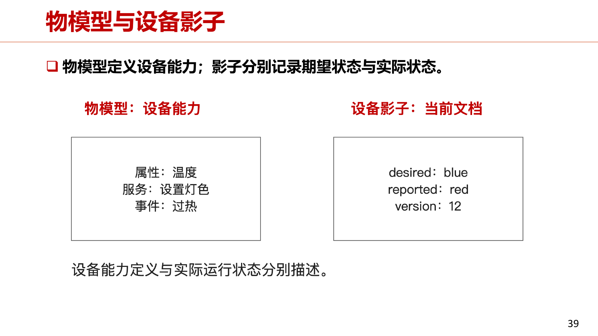
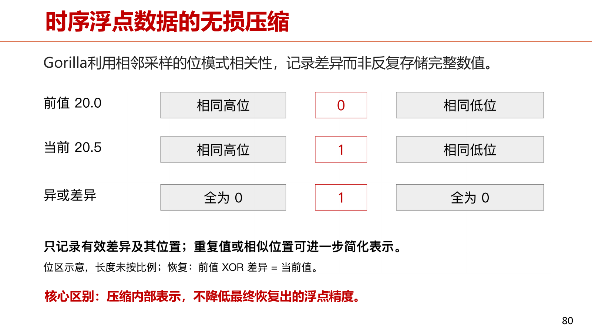
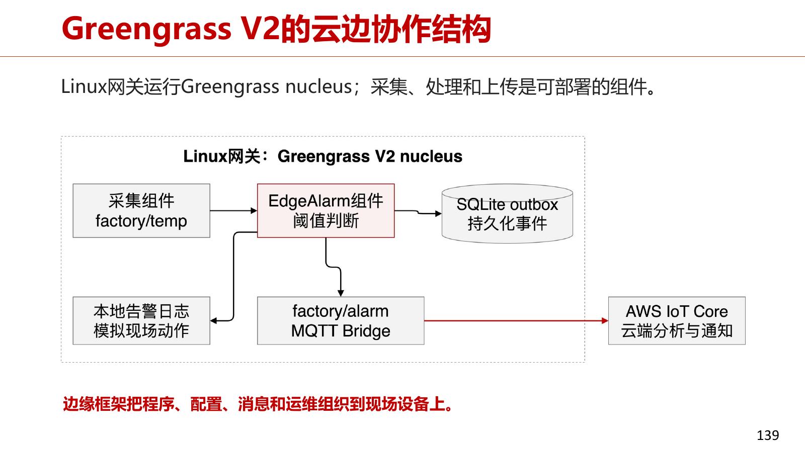

# 第6章 物联网云平台

本章依据《第六章-2026》PPT（212页）与10.21课次整理字幕编写，按“概述—主要功能—典型平台—案例开发—总结”的知识结构组织。页码统一指PDF物理页。老师讲解直接引用整理字幕原句，保留原有识别不清提示；PPT能够确认的术语、公式与计算单列在知识点中。6.4语音控制智能灯在本课明确未讲，按PPT补充整理。

## 6.1 概述

### 6.1.1 云平台在物联网系统中的位置

**知识点**

物联网云平台是设备数据的统一存储、管理和调度中心，连接设备、用户与业务系统。设备侧完成采集、操作系统与底层通信之后，还需要应用层接入、状态管理、历史存储、实时计算和业务部署。（PDF第4—5页）

- 共享单车：车辆身份、位置、锁状态与用户扫码、账户、计费在云端关联；控制请求最终需要车辆执行和回报。
- 城市运行：交通、环境、设施数据先汇聚、分析与可视化，再形成监测、预警和调度反馈。
- 课堂“城市大脑”案例强调打通摄像头感知与红绿灯控制；救护车到达时间的数字是老师回忆的案例口述。

**老师讲解**（10.21，00:00—00:10）

> 今天讲第六章，物联网云平台。  
> 前面的章节已经解决了设备端的问题，包括操作系统，以及低功耗的短距离、长距离通信链路。  
> 上次课内容比较多，讲得快了一些。  
> 这些解决之后，剩下的问题就是：数据应该传到哪里？  
> 用户会在电脑、各种终端、各种地方使用这些数据，因此中间需要统一的数据存储、管理和调度中心。  
> 在一般的物联网系统架构里，这个中心就是物联网云平台。  
> 云平台涉及很多方面，包括算法、数据结构、操作系统和数据库，是一个相当交叉的领域。  
> 本章要学习云平台与终端通信的应用层协议。  
> 上次讲的无线通信协议偏底层，主要是 MAC 层、物理层。  
> 这次要看应用层怎样接收数据、管理设备，收到数据后怎样存储、查询、分析和实时计算，以及怎样部署云平台上的应用。  
> 还是先看一个概述，了解云平台做什么。  
>
> 以共享单车为例，云平台管理车辆身份、位置、锁的状态，以及用户服务。  
> 用户扫码后有没有余额，这些信息都保存在云平台的数据库里。  
> 用户拿手机与自行车交互时，云平台处于中间位置，既保存设备数据，也把用户请求送到对应车辆执行。  
> 因此它处于比较核心的位置。  
> 智慧城市里也有大量物联网设备，包括水表、电表、智慧楼宇中的设备，以及交通设备。  
> 杭州比较典型的项目是阿里当时做起来的“城市大脑”。  
> 发起者是阿里云的王坚院士。  
> 他说，世界上最遥远的距离，是路口的红绿灯和路口的摄像头。  
> 红绿灯用来控制交通，摄像头用来拍违章，但摄像头已经拍到了路口的繁忙状态，为什么不用它进行动态调度？  
> 一个方向没车，却一直给绿灯；另一个方向排了很多车，只给 30 秒，就一直堵在那里。  
> 阿里与杭州市政府，可能是下面某个区的政府，开展试点合作，把这两条链路打通。  
> 摄像头数据在云平台上存储、分析和可视化，再由云平台下发调度指令，决定哪里放行、哪里红灯时间长一点。  
> 我记得几年前的一个案例，是对救护车等应急车辆进行实时调度。  
> 通过城市大脑这套体系，救护车平均到达时间大概能缩短 50%，原来 10 分钟，现在 5 分钟就能到。  
> 因为它提前用红灯阻断可能造成拥堵的交通流。  

### 6.1.2 与通用云的差异及设备异构性

**知识点**

物联网云在通用云服务之上强化五种能力：轻量与异构连接、离线及弱连接状态管理、时序数据处理、安全认证、并发消息与计算。安全既受到设备资源约束，又直接影响实体设备和人身安全。（PDF第6—7页）

PPT的三类设备为UNO R3（8位MCU）、工业智能网关、树莓派4B（64位处理器）。受限节点可经网关接入，具备完整网络栈的设备可直接接入；网关负责协议适配、身份与数据格式统一。PPT对应左侧设备名为UNO R3，引用仍保留字幕未辨认的标记。

**老师讲解**（10.21，00:00—00:10）

> 物联网云平台与传统云平台有很多区别，这里列一小部分。  
> 首先是轻量、异构连接。  
> 传统云平台的访问终端，如手机、电脑，能力不弱，能运行完整操作系统和 HTTP、TCP 协议栈。  
> 物联网终端节点可能非常弱小。  
> 第二，终端节点的状态管理更加复杂。  
> 物联网设备经常离线，网络不稳定，也可能低电量，因此需要特殊处理。  
> 第三，数据类型不同。  
> 传统云平台处理用户登录、用户数据、商品数据等；物联网的数据经常是传感器读数，是典型的时序数据。  
> 时序数据的存储、管理和访问很不一样，后面会详细介绍。  
> 第四是安全认证，这里有“两头堵”的问题。  
> 一头是安全非常重要：传统互联网受攻击可能是谋财，物联网设备被攻破可能涉及害命。  
> 例如智能门锁被攻破，影响很大。  
> 另一头是设备能力很弱，复杂的加密、密码学算法可能跑不起来，或者运行很慢，严重影响体验。  
> 怎样解决安全认证，是很有挑战的问题。  
> 还有高并发问题。  
> 一个人通常有电脑、平板、手机等三四个设备，但物联网设备的数量会不断增加。  
> 一个家庭四五个人，即使三代同堂，电脑、手机可能也就十来个。  
> 我看到大概三年前的统计，典型家庭中能联网的物联网设备已经超过 20 个，甚至 30 个。  
> 包括智能门锁、摄像头、电动窗帘、电动幕布，以及水表、电表。  
> 这些设备的数据都要以不同频率上云，数量会迅速膨胀。  
> 2020 年发布的一份全球统计显示，所有能联网的东西，大到电脑、服务器，小到蓝牙耳机，其中超过一半已经是物联网连接。  
> 2020 年是物联网连接数超过非物联网连接数的重要时刻。  
> 到今年或明年，应该已经达到 75%。  
> 未来物联网连接会占绝大多数，可能达到 70%、80%，甚至 90%。  
> 这些节点不断向云平台发送数据，并发处理很有挑战，不能全部依赖云，需要一些新技术解决。  

**老师讲解**（10.21，00:10—00:19）

> 从异构设备的角度看，设备可以按能力分成不同类型。  
> 最左边是一个 [识别不清：设备名称]，只有 8 位 MCU，资源非常受限。  
> 中间稍强一些，可以做汇聚接入，通常是工业现场使用的多协议网关。  
> 这里是典型的工业 RTU，也就是远程数据通信单元。  
> 再强一些的设备可以运行 Linux，执行简单的 AI 程序。  
> 这些资源不同的设备，连接云平台的方式、云平台对它们的管理，都有差异。  

### 6.1.3 参与者与四类平台

**知识点**

运营商以网络接入、SIM卡和资费运维见长；设备厂商以产品、设备全生命周期和行业场景见长；云与应用厂商提供计算、存储、软件和业务分析。四类平台是功能侧重，可以组合，并非互斥分类。（PDF第8—13页）

| 类别 | 主要职责 | PPT例子 |
| --- | --- | --- |
| CMP：Connectivity Management Platform | 网络/SIM卡、套餐、用量、账单、故障 | 中国移动连接管理、联通ControlCenter、天翼物联 |
| DMP：Device Management Platform | 用户与设备配置、重启、固件升级及回退、告警 | 海尔U+、美的云、BOSCH IoT Suite、根云 |
| AEP：Application Enablement Platform | SDK、API、中间件、业务逻辑引擎、应用开发工具 | AWS IoT、阿里云IoT、涂鸦智能、IoT Studio |
| BAP：Business Analytics Platform | 数据分析、业务预测、预测维护、生产决策 | Predix、Azure IoT、MindSphere |

涂鸦的课堂例子说明“芯片+整套工具和链路”能支持消防、汽车模块、智慧农业等合作伙伴快速开发产品。业务分析需要领域模型与数据质量，才把采集数据转化为价值。

**老师讲解**（10.21，00:10—00:19）

> 再看云平台的参与者和分工。  
> 不同参与者从自身优势出发，提供连接、设备、数据处理和应用服务，这四块形成了四种功能角色。  
> 最早的参与者通常是通信运营商，中国移动、中国电信、中国联通都有物联网云平台。  
> 他们沿用运营商的逻辑：通过我的网络连接，我给你发 SIM 卡。  
> 一些智能手表等设备可以使用物联网卡，可能每月 10 元，支付物联网的 4G 或 3G 流量费用。  
> 第二类是设备制造商，如海尔、三一重工，原本生产家电或大型工程机械。  
> 这些机械、家电也需要联网，企业规模大了，就希望自建平台。  
> 海尔、三一重工都建立过自己的物联网云平台，管理售出设备和机械的状态，进行全生命周期管理。  
> 第三类是云和应用厂商。  
> 物联网云平台是传统云平台的自然扩展，阿里云、腾讯云、华为云都有物联网业务。  
> 阿里在 2018 年左右曾把物联网业务作为与阿里云平级的机构，后来又回到阿里云内部。  
>
> 按连接能力、设备管理能力、数据和应用能力，可以理出四类平台。  
> 分类并不严格，例如中国移动的平台不一定只属于连接管理平台，只是各有侧重。  
> 第一类是连接管理平台 CMP，最初很多由运营商推出，做连接管理、售卖流量，按月租收费。  
> 第二类是设备管理平台，通常由设备厂商推出，管理自己生产的设备。  
> 第三类是应用使能平台。  
> 移动互联网繁荣的一个标志性事件，是苹果推出 App Store。  
> 诺基亚时代没有这个东西，现在大家觉得安卓、华为应用市场和苹果 App Store 理所当然，但当时这个概念很出人意料：应用还可以这样使用和商业化。  
> 一些物联网云厂商也想复制这种逻辑，建立应用开发生态，提供 SDK 和完善的开发流程，帮助开发各种物联网应用。  
> 杭州有两家典型厂商，一家是阿里云。  
> 它希望做生态、合作伙伴，提供底层支撑，其中重要的一部分就是应用使能，帮助开发者简化流程。  
> 使用它的 SDK，开发智慧硬件产品就比较容易。  
> 另一家是涂鸦，在紫金港西门对面大约 100 米，是国内物联网云平台上市第一股。  
> 它不只是应用使能平台，但应用使能是很重要的功能。  
> 我参观过它的展厅，它赋能了很多行业。  
> 它做一块很小的物联网芯片，在芯片之上提供整套开发工具和链路。  
> 合作伙伴可能做消防器材、电动汽车中的某个模块，也可能做智慧农业。  
> 这些伙伴用它的芯片和应用开发技术栈，就能快速开发产品，卖到国内，甚至欧美、日本。  
> 第四类是业务分析平台，用来分析数据。  
>
> 连接管理平台主要通过 SIM 卡管理，是典型的运营商逻辑。  
> 国内如中国移动的 OneNET、中国联通的平台，以及中国电信的天翼物联。  
> 设备管理平台如海尔、美的、博世，以及 [识别不清：厂商名称]，这些厂商本身销售设备，通过平台进行用户管理、设备配置、重启和 OTA。  
> 大家现在对 OTA 应该很熟悉，新能源汽车经常 OTA，也就是在线更新，这需要设备管理平台。  
> 应用使能平台包括涂鸦、AWS、IBM、阿里云等，希望通过开发者生态形成绑定。  
> 说直白一点，就是想垄断市场，但目前看来相当困难。  
> 特别是有了大模型以后，自主开发应用的门槛越来越低，想通过开发生态统一市场很困难，不过应用使能仍然不可缺少。  
> 阿里云的 IoT Studio，从名字也能看出是在模仿 VS，也就是 Visual Studio。  
> 业务分析平台是物联网数据真正产生价值的地方。  
> 对做智能电表、水表、楼宇暖通，以及恒温恒湿空调的厂商来说，业务分析很重要。  
> 以上是概述，接下来是本章重点。  
> 前几章第二部分通常叫关键技术或关键特性，本章叫主要功能。  
> 本章绝大多数内容都在 6.2，后面几个部分视时间简单过一下。  
> 主要功能包括设备连接、设备管理、规则引擎、时序数据库、流计算、安全、无服务器计算和边缘计算。  
> 每一项都值得讲很久，本课程主要让大家有所了解，深入部分以后工作中用到再看。  

## 6.2 主要功能

本节按设备连接、设备管理、规则引擎、时序存储、流计算、安全认证、无服务器计算、边缘计算依次展开。（PDF第15页）

### 6.2.1 MQTT：发布订阅与生产消费解耦

**知识点**

MQTT采用Broker为中心的发布—订阅：设备以具体主题发布数据，应用以主题过滤器订阅，Broker进行匹配和分发。生产者无需知道每个消费者地址；看板、告警、存档等消费者可以独立加入。（PDF第16—19页）

| 协议 | 交互特征 | 适用考虑 |
| --- | --- | --- |
| HTTP/1.1 | 通用请求—响应 | Web生态成熟，小载荷关注首部开销 |
| CoAP | 轻量资源访问，Observe可订阅资源变化 | 受限网络中的资源访问 |
| MQTT | Broker发布—订阅 | 一对多分发、主题匹配、可选交付保障 |

轻量报文与交互模型是两个维度。一次流程为看板CONNECT→CONNACK→SUBSCRIBE→SUBACK，再由设备PUBLISH到Broker、Broker转发PUBLISH给看板。订阅建立与发布数据是独立步骤。

**老师讲解**（10.21，00:19—00:28）

> 首先看设备连接，关键协议叫 MQTT，是 publish/subscribe，即发布订阅通信协议。  
> 与 HTTP 做个对比。  
> 如果同时在上计算机网络课，可能还没讲到应用层，但大家每天上网都在使用 HTTP。  
> 用户通过浏览器打开网址，例如本科生院 ZDBK 网站，网页存在学校某个机房的服务器上，服务器通过 HTTP 把首页发送给你。  
> 它采用请求、响应机制：你发起请求，服务器直接给出响应。  
> 物联网里并不是不能使用这种方式，但很多场景更适合另一种方式。  
> 中间有一个 broker，把设备端与应用端解耦。  
> 设备只负责往上传数据，传到 broker 对应的位置；谁来消费数据，是另一件事。  
>
> 想象一个工厂，各种机械设备不断上传运行数据。  
> 我们最近在规划一个能源装备项目，例如 AI 计算中心使用的大型变电设备。  
> 要管理它的生命周期，就要采集振动、电压、电流、电磁辐射等大量数据。  
> 数据产生与后续分析、使用、展示，需要解耦。  
> 自动化产线调度系统可能需要数据，老板每天查看产能也需要数据。  
> 消费者有很多角色，生产者就是设备，因此物联网特别适合这种模式。  
> 发布订阅模式不是物联网发明的，在计算机领域存在很多年，只是特别适合这一场景。  
> MQTT 参考了一部分 HTTP，但采用了这种模式。  
> 还有一个协议叫 CoAP，类似 HTTP，也是请求、响应，不过开销更低。  
> MQTT 不仅开销更低，而且采用发布订阅模式，实际中使用更多。  
>
> broker 可以部署在边缘服务器，或者离现场比较近的位置。  
> 设备作为数据产生者，也就是 publisher，把数据发布到 broker。  
> 发布时要带内容，并说明发布的是什么，这就是 topic，也叫主题。  
> 例如温度、湿度、振动，是设备 A 还是设备 B 的数据，都需要命名清楚，同时带上数据本身。  
> 发布后，broker 把数据提供给订阅了这个主题的人。  
> 设备 A 的温度数据，可能被所在产线的调度软件订阅。  
> 车间检修人员也可以订阅，使每次温度数据都送到他的控制终端。  
> 智慧工厂的看板要显示产线健康状态、产量、节拍，也会订阅这些数据。  
> 不同订阅者可以同时向同一个 broker 订阅消息。  
>
> 这里的 topic 示例是 campus/b1/a1/t [识别不清：设备层级的具体拼写]。  
> 这是一种较标准的 MQTT 主题命名方式：校园、一号楼、某台设备、温度。  
> 具体名字可以自己定义，有了命名，后续查询就方便。  
> 例如查询一号楼所有温度，通过主题匹配，就能一次订阅所有相关数据。  
> 以看板为例，看板先连接 broker，得到连接确认，再发送 subscribe 订阅请求。  
> broker 确认订阅后，看板这一侧就完成了，它是订阅者、消费者。  
> 生产者设备 A 向对应 topic 发布数据，完成整个过程。  
> 数据发布和订阅都围绕 topic 展开。  

### 6.2.2 Topic层级、通配符与匹配

**知识点**

主题层级用`/`组织设备与数据类别，发布必须使用具体主题；订阅过滤器中的`+`匹配一个层级，`#`匹配后续多个层级并置于过滤器末尾。（PDF第20—21页）

- 一号楼所有温度：`campus/b1/+/temp`；一号楼全部层级：`campus/b1/#`。
- 对发布主题`factory/A/temp`，`factory/+/temp`与`factory/#`匹配。
- `factory/B/temp`及`factory/+/state`均不匹配：前者设备不同，后者数据类别不同。
- 主题命名是业务组织约定；大小写及层级应保持一致。课堂口述使用小写`a`与末层`t`，PPT当前示例为`A`与`temp`。

**老师讲解**（10.21，00:19—00:28）

> 可以使用模糊匹配。  
> 例如一号楼所有设备的温度，可以订阅 campus/b1/+/t。  
> 加号匹配这里所有设备，不只有 a1，还可能有 B、C、D 等设备。  
> 这样一行就能订阅一号楼所有温度。  
> 如果要订阅一号楼所有层级，不管温度、湿度还是别的数据，也可以使用相应匹配。  
> MQTT 规定，“+”匹配一个层级，“#”匹配多个层级，是通配符。  
> 再看怎样选中具体消息。  
> 设备 A 发布完整主题，假设是 factory/a/temp，也就是工厂设备 A 的温度数据。  
> 过滤器 factory/+/temp 可以匹配，因为“+”占一个层级，a 符合。  
> factory/# 也能匹配，因为“#”覆盖后续层级，范围更宽。  
> 下面两种则不匹配。  
> 一种中间指定的是设备 B，另一种虽然用“+”匹配所有设备，但最后要求的是状态 state，发布的却是温度。  
> 这样就能理解 topic 怎样进行具体匹配。  

### 6.2.3 QoS交付语义、两段链路与业务选择

**知识点**

QoS是相邻MQTT端点间的协议交付保障，设备→Broker和Broker→订阅者分别处理。（PDF第22—25页）

| QoS | 语义 | 机制与代价 | 业务选择 |
| --- | --- | --- | --- |
| 0 | 至多一次 | 无协议确认重发，可能缺失，开销低 | 高频温度、允许少量缺测 |
| 1 | 至少一次 | 确认、必要重传，可能重复 | 重要告警，消费者处理重复 |
| 2 | 恰好一次 | 更多交互与协议状态 | 平台支持且能接受额外成本的严格交付 |

ACK丢失时，QoS 1发布者可能重传Broker已经收到的数据。下行QoS还受订阅获准等级限制：上行QoS 1、订阅最大QoS 0，则下行按QoS 0交付。即使上行QoS 2，也不会自动提高所有下游保障。协议恰好一次交付不等于设备动作执行一次；控车、投药等业务仍需执行回报和业务语义设计。

**老师讲解**（10.21，00:28—00:31）

> 接下来看重要概念 QoS，quality of service，表示通信服务质量的承诺。  
> MQTT 有三个等级：QoS 0、QoS 1、QoS 2。  
> 先看它们向使用方承诺什么语义。  
> QoS 0 是“最多一次”。  
> 不管 publish 还是 subscribe，数据只传一次，例如温度只上报一次，接收方是否收到、数据是否丢失，都不管。  
> 这是最低等级的保障。  
> QoS 1 是“至少一次”，保障能力强一些，至少保证接收方收到一次。  
> 这意味着必须有确认机制。  
> 发布者发出数据包，到达 broker 后，怎样知道 broker 收到了？  
> broker 要返回 ACK。  
> 如果发布者没有收到反馈，无论是原始数据丢了还是反馈丢了，都必须重发。  
> 因此 QoS 1 隐含响应、反馈和重发机制。  
> 它保证至少一次，但不保证不会收到重复数据。  
> 典型情况是 broker 收到数据并返回 ACK，但 ACK 丢了，发送者再发布一次，broker 就会收到两次。  
> 有些业务不希望重复，希望发布出去的数据“恰好一次”。  
> 既要确定对方收到，又要确定 broker 只收到一次，这就是要求最高的 QoS 2。  

**老师讲解**（10.21，00:31—00:37）

> MQTT 在协议层面有比较复杂的状态管理机制。  
> 选择 QoS 2，传输代价肯定提高，延迟可能变大，但可以保证数据只有一次被正确交付到 broker。  
> 这三个等级的质量保障依次提高。  
> 假设设备用 QoS 1 把事件交给 broker，而 broker 到看板使用另一个 QoS 等级。  
> 设备 A 发布数据，以及 broker 把数据推送给 subscriber，是两条链路，可以使用不同等级。  
> 例如设备上传用 QoS 1，希望数据能传到，保证至少一次、不丢失。  
> broker 到看板可以用 QoS 0，只尝试发送一次，看板是否收到则不管。  
> 图中，QoS 0 直接发布一次就结束；QoS 1 有确认，确认没收到或发布丢失就重传；QoS 2 除了发布和确认，还有完整的状态管理流程。  
>
> 实际中怎样选择 QoS？  
> 还是以温度采样为例。  
> 如果允许偶尔缺少一个温度点，采样频率又很高，例如每秒采一次，温度高了半度，一会儿就知道，可以用 QoS 0。  
> 有时传感器部署在重要位置，比如我们之前做过的宁德时代电池仓库项目。  
> 电池一旦热失控，可能整个仓库都烧起来，仓库里每块电池的温度都很重要。  
> 要求给每块电池配置温度传感器，实时监控，并规定几秒内、以多少精度把数据传到控制中心。  
> 这种重要告警至少要用 QoS 1。  
> 平时测出 20 度，丢了可能问题不大，一秒后又会采样。  
> 但如果采到 80 度，必须尽快交付，不能等下个采样时刻，因为几秒后电池可能就热失控。  
> 重要告警要用较高的 QoS 等级。  
> 更严格的交付要求可能要用 QoS 2，不过一般用 QoS 1 可能就够了。  

### 6.2.4 确认等待、在途窗口与吞吐计算

**知识点**

QoS 1下若最多允许$C$条未确认消息，确认往返时延为$RTT$秒，忽略处理、重传等开销，则理想吞吐上界约为：

$$\lambda_{\max}\approx\frac{C}{RTT}$$

（PDF第26—27页）

1. $C=20$，$RTT=80\text{ ms}=0.08\text{ s}$：$20/0.08=250$条/秒。
2. 目标500条/秒、同样RTT：依据给定量推算，$C\ge500\times0.08=40$条。
3. RTT=100 ms、每条1 KB：窗口1时约10条/秒；窗口20时约200条/秒，载荷速率约200 KB/秒。

窗口覆盖确认等待时间，但更大窗口需要发送端、接收端状态和缓冲空间。实际吞吐还受网络带宽、Broker处理能力等限制，不能把理想上界视为实测性能。

**老师讲解**（10.21，00:31—00:37）

> QoS 提升是有代价的，确认会占用等待时间。  
> 假设最多允许 C 条未确认消息，也就是允许 C 条消息同时在途，虽然还未确认，但可以继续发送。  
> 往返延迟为 RTT，理想吞吐上界就是 C / RTT。  
> 例如 C = 20，RTT = 80 毫秒 = 0.08 秒，上界为 20 / 0.08 = 250 条消息/秒。  
> 如果目标是 500 条/秒，就需要更大的在途容量。  
> 在途容量变大，通常意味着接收侧窗口和缓冲区要足够大，发送端缓冲区也要足够大。  
> 因为消息已经发出，却还未收到确认。  
> 再改一个条件：不再每次只等待一条消息，而是允许 20 条同时在途，确认往返时间为 100 毫秒。  
> 这样可以算出上界有所提升。  
> 让多条消息同时在途，可以提高吞吐率，特别适合在途时间长的长距离链路。  

### 6.2.5 MQTT客户端、工业互通与车联网

**知识点**

Paho接口把协议概念落实为参数：`publish(topic, payload, qos=1)`；`subscribe(filter, qos=1)`；消息到达后触发`on_message`。连接成功回调对应CONNACK，订阅确认由`on_subscribe`处理，网络循环持续接收并调用回调。（PDF第28—33页）

- Sparkplug统一主题、数据类型与含义、设备状态：PPT对应Sparkplug 3.0（2022）及ISO/IEC 20237:2023，补充MQTT的工业语义互通。
- 标准MQTT 3.1.1以TCP为基础，MQTT over QUIC探索移动链路连接迁移和弱网恢复，需要客户端与Broker共同支持，应区分标准与扩展。
- 吉利/亿咖通及上汽大众案例：车端发布状态、订阅云端命令，多类业务经Broker解耦；手机远程开空调最终仍需车端执行结果。

**老师讲解**（10.21，00:37—00:42）

> 再看 MQTT 在具体框架中的实现，这里给出 Python 示例。  
> 写一个 publisher，调用 publish，发布到指定 topic。  
> 发布内容 payload 要提前创建，还要指定 QoS。  
> 一般 MQTT 的 publish 带三个参数：topic、payload、QoS，它们的语义前面已经讲清楚了。  
> 订阅端 subscriber 也要订阅一个 topic，可以使用通配符。  
> 这里一行的意思是，订阅校园一号楼所有设备的温度数据，要求 QoS 1。  
> subscriber 可能是看板或移动端应用，它要求 broker 到自己这一条链路必须交付，不允许丢数据。  
> 还要注册 on_message，这是 event handler，也就是消息处理函数。  
> 订阅之后，程序不是一直死循环等消息，而是等待消息触发。  
> 消息到达后调用回调函数，例如 handle_temperature。  
> 通过这份代码就可以用 MQTT 传递消息，其他细节没有展开，核心是这里几行。  
>
> 在具体应用或框架里，会对 MQTT 加更多规范，例如 Eclipse 推出的 Sparkplug。  
> 它对主题层级怎样命名、数值类型和含义怎样表示、设备状态怎样描述，都规定了更多应用层规范。  
> 这页 PPT 给出了 Sparkplug 的一些规范，它本身也是国际标准。  
> MQTT 还有新的演进路径。  
> 传统 MQTT 基于 TCP，但物联网设备有时处在弱网或移动网络，网络不可靠。  
> 这时基于 TCP 的要求可能太高，或者效率没有那么高。  
> 现在有基于 QUIC 的实现。  
> 计算机网络讲到 QUIC 时大家可能会理解得更深，它应该是谷歌推出的、构建在 UDP 上的一套协议，MQTT 也有这样的演进版本。  
>
> 移动应用，特别是最近的一些汽车，用 MQTT 较多。  
> 例如吉利汽车，车与云之间的连接用 MQTT。  
> 夏天想提前 20 分钟用手机打开车内空调，手机到云可以通过移动流量或 Wi-Fi，云平台到汽车则用 MQTT。  
> 上汽大众的车机与云端业务也使用 MQTT，它有一套自己的云平台。  
> 设备连接这一部分重点讲了 MQTT，大家要准确理解 topic、QoS 等概念。  

### 6.2.6 设备管理：对象、方式与服务

**知识点**

设备管理覆盖注册/删除、启用/禁用、在线/离线、当前固件版本、更新地址及升级过程。（PDF第35—37页）

- 管理对象：直接接入设备，智能网关及其子设备，以及身份、拓扑关系。
- 管理方式：直接控制、设备影子，分别关注请求结果和状态同步。
- 管理服务：注册、配置、状态与版本查询、OTA及回报。
- 网关既是管理对象，也承担子设备汇聚、协议适配、数据格式转换和身份维护。

**老师讲解**（10.21，00:42—00:50）

> 第二个功能是设备管理。  
> 先建立管理对象、服务的整体认识，再区分直接控制和设备影子，最后看 OTA。  
> 设备管理贯穿物联网设备整个生命周期。  
> 接入前注册，退出时注销、删除，运行期间持续跟踪设备状态，维护固件版本。  
> 例如从 1.0 升到 1.1 或 2.0，通过 OTA 维护版本，都是设备管理的工作。  
> 表格列出了设备标识、属性、含义和对应管理内容。  
> 这里从三个要素展开：管理对象、管理方式、管理服务。  
> 管理对象有直接接入的设备，也有通过智能网关、两层架构管理的设备。  
> 管理方式分直接控制和设备影子。  
> 管理服务包括注册、配置、OTA、版本查询等。  
>
> 云平台直接管理设备时，通常要求设备能力稍强一些。  
> 间接方式则通过智能网关管理下一层子设备。  
> 网关本身和下面的子设备，都属于云平台管理对象。  
> 这种场景支持很弱的设备，如子设备 A、B、C，可能是家里的智能灯。  
> 这些灯一般不会直接被云平台管理，平台上不会直接有灯的实体，而是通过蓝牙网关接入互联网，蓝牙网关接受平台管理。  
> 这是管理对象的两种类型。  

### 6.2.7 物模型、直接控制与设备影子

**知识点**

物模型定义设备能力，包括属性、服务、事件，可类比类定义；设备影子记录某个具体设备的目标与最近上报状态。（PDF第38—40页）

直接控制表达一次操作，可能因离线、超时或执行失败而未完成。影子把应用期望`desired`与设备回报`reported`分开保存，例如：

```json
{"state":{"desired":{"fan":"ON"},"reported":{"fan":"OFF"}},"version":12}
```

两者不一致表示目标尚未得到回报确认。设备执行并更新reported后，该属性才收敛。影子在云端保存状态，不意味着离线设备已执行，也不替代真实设备的状态回报。



图：物模型定义能力，设备影子分别保存期望状态与实际回报（本章PPT，PDF第39页）。

**老师讲解**（10.21，00:42—00:50）

> 直接控制很好理解：表达开灯或关灯请求，转换成指令发给设备执行。  
> 问题是设备可能离线、超时或执行失败。  
> 平台让它开灯，以为灯已经开了，实际上灯没开，可能指令丢了。  
> 这样就导致云平台状态和实际设备状态不一致。  
> 一个灯还好，在工厂里这种情况就很麻烦。  
> 因此很多场景使用间接控制。  
> 云平台为每个设备设置一个设备影子，具有与真实设备完全相同的操作接口和功能，但它是服务器内存或其他存储中的虚拟存在。  
> 设备影子负责与真实设备同步状态，应用只操作设备影子，例如设置开关灯。  
> 具体状态同步交给设备影子完成，使影子与真实设备尽可能一致。  
>
> 这里还有一个相关概念，叫物模型，下一章可能还会提到。  
> 学过面向对象编程就容易理解：把物联网设备看作一个 class，物模型就是 class 的定义。  
> 它有属性、服务、事件。  
> 属性可以理解为成员函数和成员变量，服务、事件可以理解为成员函数，是典型的面向对象方式。  
> 物模型定义设备能力，设备影子是在服务器上对同一个物模型的软件实现。  
> 这里是一个 JSON 文档。  
> 应用希望风机打开，desired 是 on，但设备最近上报仍是 off，说明目标状态尚未确认。  
> 平台发现状态差异，就可以让设备打开风机。  

### 6.2.8 离线状态收敛、版本与瞬时命令

**知识点**

设备离线期间，应用先设红色再设蓝色；重连后取最新目标蓝色，执行、回报，不必重放红色。（PDF第41—43页）

- 影子适合幂等的目标状态设置：`reported=OFF`→`desired=ON`→设备重连取影子→执行ON→上报ON。
- 晚到旧版本不能覆盖新目标，状态同步要明确版本顺序。
- “灯最终为蓝色”是状态；“投药一次”“开一次门”是具有次数、时效和执行结果要求的动作，不能只保存最终状态或无限期重放。此区分依据PPT补充，老师未展开。
- 字幕在版本处转向固件管理，PPT第43页还明确讨论状态版本；两类版本应分别理解。

**老师讲解**（10.21，00:42—00:50）

> 设备影子在离线情况下有一个核心功能。  
> 设备暂时无法连接，应用可以先把灯的目标设成红色，后来又改成蓝色。  
> 设备上线后，只需要达到当前目标蓝色，不必把中间红色也执行一遍。  
> 重新连接后，读取最新期望状态，与实际状态对比并同步即可。  
> 这也是云平台与设备实际交互的方式。  
> 这里给了一个设备影子状态同步的具体例子，就不详细展开。  
> 管理方式里还有版本管理：晚到的旧版本不应该覆盖新版本。  
> 必须对设备固件有清晰的版本管理。  

### 6.2.9 OTA差分包与升级闭环

**知识点**

OTA（Over the Air）在线管理固件升级。闭环为启动上报当前版本→判断升级→下载→校验差分包→重建新固件→验证并切换→主动上报新版本。版本通常在启动和升级后上报，无需周期重复。（PDF第44—46页）

差分包是旧版与新版的差异，减少传输量；设备必须满足基线版本，如base=1.2、target=1.3，才能套用对应补丁。清单包含版本与摘要，重建后还检查完整固件；失败保留回退路径。CDN负责靠近用户分发，差分算法优化可减少大规模更新的流量费用。

**老师讲解**（10.21，00:50—00:56）

> 版本管理与 OTA 密切相关，OTA 是 over the air，也就是空中升级技术。  
> 需要在线检测设备是否要升级，并管理升级过程。  
> 这里列出的三步只是极简过程，实际 OTA 非常复杂，可能涉及很多第三方。  
> 例如汽车 OTA，要进行大量状态管理、安全控制和内容分发，不一定由车厂直接下发。  
> 手机应用更新稍简单一点，但也很复杂。  
> 设备拥有者或管理者先在云端制作差分包，计算旧版本与新版本之间的差异 delta，再让设备下载。  
> 云端可以下发指令，让设备从某个地址下载差分包。  
> 更多时候，差分包由第三方 CDN，也就是内容分发网络提供商负责分发。  
> 设备拿到差分包，用重建算法把旧版本和差分包合成新版本，再重启、加载新版本，完成一次 OTA。  
> 开始前必须确认版本，例如当前 1.2，目标 1.3，可以升级，反过来不行。  
>
> 差分过程在物联网、移动互联网、车联网里都广泛使用。  
> 手机应用市场的大部分升级包都是比较小的差分包。  
> 差分对手机厂商很重要，我们之前与华为合作过应用市场差分算法优化。  
> 你用华为手机，从应用市场更新微信、微博、小红书，流量由谁付钱？  
> 用户这一端当然使用自己的网络服务，但差分包分发一般由 CDN 完成。  
> 不可能全国华为用户都从深圳某个中心机房下载。  
> 一个手机可能有 100 个 App，每个 App 每月可能更新一次，乘上数千万、上亿用户，流量非常巨大。  
> CDN 是第三方，在全国各城市建设很多机房。  
> 例如微信更新，先把包上传到华为应用市场，华为再把差分包信息给 CDN。  
> CDN 把差分包放到杭州、上海等地，可能有几十个机房。  
> 用户请求更新时，自动匹配最近服务器，取回差分包。  
> 华为要向 CDN 付费，CDN 又要向运营商、网络服务提供商付费，因为机房流量也要付钱。  
> 这一部分钱最终不是用户或微信出的，而是华为出的。  
> 华为过去每年为此支付数亿元，所以差分算法优化一个点，可能就能节省数百万元流量费用。  
> 这是很直白的优化点，国内外厂商，包括苹果，也在不断优化 App 更新。  

### 6.2.10 OTA安全：真实性、版本与可恢复启动

**知识点**

OTA链路可能遭遇中间人替换更新包、强制降级并利用旧漏洞等攻击。PPT列出的防护包括签名校验、双向认证、升级包加密、通信安全防护。（PDF第47—49页）

摘要检测内容变化；签名验证固件内容与可信发布者的关联，摘要本身不能证明发布者。安全切换流程为接收→摘要→验签→型号与版本检查→写备用分区→试启动→运行确认→标记成功。传输安全、固件真实性、可恢复启动分别解决不同问题。PPT的OTA评估比例是该页列举的研究结果，不能泛化为所有当前设备。

**老师讲解**（10.21，00:50—00:56）

> 汽车场景更加复杂，因为安全要求太高。  
> OTA 中某个环节被攻破，就意味着整个应用或终端失去控制权，攻击者想干什么都可以。  
> OTA 安全涉及中间人攻击、利用旧版本漏洞等。  
> 收到差分包并重建得到新版本后，还要验证，例如计算摘要，确认版本正确、一个比特都不差，然后才重启并切换到新版本。  
> 设备管理就包括这些管理对象、管理方式和管理服务。  

### 6.2.11 IFTTT与规则冲突检测

**知识点**

IFTTT（If This Then That）用条件—动作表达业务逻辑，例如土壤湿度低于阈值开始灌溉，回家开门打开玄关灯。可解耦设备代码与云端业务、支持多设备联动。（PDF第51—57页）

冲突必须同时满足：触发条件可能同时成立；控制同一设备且动作相互冲突。

| 规则组合 | 判断 |
| --- | --- |
| light>10000关灯；light<500开灯 | 条件无交集，无冲突 |
| light>10000关灯；light<20000开灯 | 10000<light<20000同时触发，冲突 |
| 同上条件，两条都关灯 | 动作相同，无相反动作冲突 |
| 光照条件关灯；19:00—24:00开灯 | 不同输入条件仍可能同时成立 |
| temp>30风机ON；temp≥28风机OFF | temp=31可同时触发，冲突 |

条件判定可表示为可满足性问题。SAT处理布尔表达式；SMT在此基础上加入实数、整数、数组等理论约束，Z3为SMT求解器。PPT还要求排除同一传感器上不可能的条件赋值，不能只查布尔组合。

**老师讲解**（10.21，00:56—01:01）

> 有了设备和数据，接下来看应用怎样实现。  
> 许多物联网应用相对简单，先考虑极简场景 IFTTT，即 if this then that。  
> 很多应用都是简单规则：温度超过多少就开空调，湿度超过多少就开换气扇。  
> 小米等智能家居 App 里，用户可以自己配置规则，例如回家开门，就打开玄关灯。  
> 智慧农业里，土壤湿度低于阈值就开始自动滴灌，也有温度相关场景。  
> IFTTT 用简单条件语句表达应用逻辑，在物联网中很实用。  
> 但它也有复杂问题，包括规则冲突、实时性、能耗、公平性，以及应用逻辑与执行操作的耦合性，这些都需要规则引擎解决。  
>
> 先看规则冲突。  
> 第一组规则：光照大于 10000 勒克斯就关灯，光照小于 500 勒克斯就开灯。  
> 条件范围没有重合，因此开灯和关灯不会冲突。  
> 光照处于任何值时，只会触发其中一条。  
> 第二组中，一个条件是大于 10000，另一个是小于 20000，一个让灯关，一个让灯开。  
> 光照在 10000 到 20000 之间时，两个规则都成立，不知道执行哪个，就发生冲突。  
> 用户设置大量规则时未必考虑这些，所以规则引擎、IFTTT 执行引擎必须检测冲突，这很复杂。  
> 再把例子改一下，大于 10000 和小于 20000 的规则都执行 turn off，就没有冲突。  
> 另一组动作分别是灯 off、on，但前面条件不是同一个量，一个看光照，一个看时间，也可能在某种场景发生冲突。  
>
> 规则冲突有两个条件：if 条件能同时成立；then 控制同一个设备，动作互相冲突。  
> 经过理论分析，检查一堆规则有没有冲突，是一个可满足性问题。  
> 大家学计算理论应该学过可满足性问题，这是经典的 NP 难问题，没办法快速求解。  
> 实际规则引擎会用各种 heuristic、启发式方法检测。  
> 例如第一条：超过 30 度打开风机；第二条：大于等于 28 度关闭风机。  
> 共同条件是温度大于 30 且大于等于 28，显然存在，动作又冲突，因此两条规则冲突。  
> 可以据此写出算法，把它表示为可满足性问题，用 SMT、Z3 等复杂求解器，不再详细展开。  

### 6.2.12 实时性、能耗与公平调度

**知识点**

频繁查询提高触发响应实时性，但传感器I/O耗能；低频查询省电，可能错过及时关窗。PPT规则是`humidity>75% and light<1000lux → window.close`，字幕这里把light听成温度，引用保留原标记。（PDF第58—60页）

PPT补充RT-IFTTT的自适应间隔：预测接近阈值时缩短查询间隔，远离阈值时加长；增强规则约束为`WITH time<60 and missratio<0.01`。公平性则用优先级、配额、公平调度避免单应用规则过多或过频，挤占其他应用执行机会。

**老师讲解**（10.21，01:01—01:04）

> Z3 这样的求解器可以求解 SMT 问题，前面讲的是冲突问题。  
> IFTTT 还有实时性与能耗问题。  
> 例如湿度大于 75%，且温度小于 [识别不清：字幕为“1000”] 时，把窗关上。  
> 如果频繁查询，传感器每次读写都要消耗能量。  
> 很多端侧设备的 I/O 操作，特别是读写传感器，能耗很大。  
> 查询频率过高，能耗太大；查询频率很低，实时性又跟不上，需要平衡、折中。  
> 有些论文和技术研究这种实时性与能耗问题，这里不展开。  
> 下面给出的论文来自实时计算领域的顶会。  
> IFTTT 还有公平性问题。  
> 某个应用涉及很多规则，或者某条规则触发特别频繁，就会占用大量执行机会。  
> 设计云平台中的自动规则执行器、规则引擎时，都要考虑这些问题。  

### 6.2.13 规则引擎：校验、筛选、转发与追踪

**知识点**

规则引擎按Topic与条件筛选消息，提取字段，转给存储、函数、推送、机器学习等服务，把业务逻辑与执行操作分开。（PDF第61—63、67、70页）

对`{"device":"A","temp":35.2}`先检查字段存在、类型为数值、范围合法，再判断过热。PPT有效区间为$[-40,125]$℃，过热条件为严格大于30℃：−40与30通过但不告警，30.1和125通过且告警，126不通过，不进入业务判定。

用同一`event_id`贯穿链路：输入A-17→校验True→Overheat→alarm(A-17)。无结果时逐节点区分消息未到、被过滤、转发或输出失败。追踪与边界推演是PPT补充，课堂快速跳过。

**老师讲解**（10.21，01:01—01:04）

> IFTTT 是应用的表现方式，怎样执行则是规则引擎的工作。  
> 规则引擎首先按主题和条件筛选消息，提取消息字段，再转发给合适的服务。  
> 例如转发给时序数据库存储、后续处理或机器学习服务。  
> 传感数据经过规则引擎，才到达后端的各种服务。  
> 规则引擎收到一条 MQTT 消息，例如设备 A 的 temp 为 35.2。  
> 先确认 temp 字段存在，判断它是数值，并确认数值在某个范围内，再向后转发。  
> 这里还有手机控制灯泡的案例，结合了 MQTT，不展开，有兴趣可以自己看。  
> 规则引擎的过滤规则也容易写错，这里给出了具体例子，这几页快速过一下。  
> 以上是 IFTTT 与规则引擎。  

### 6.2.14 手机控制灯泡：两个Topic的职责（PPT补充）

**知识点**

手机获取目标灯泡deviceName，把控制消息发布到Topic1 `/pk1/controlApp/update/`；规则引擎筛选、转换并转发到Topic2 `/pk2/bulb/get`；灯泡订阅Topic2，按消息改变状态。（PDF第64—66、68—69页）

两个Topic的理由：限制设备订阅范围以保护敏感信息；隔离不同设备与命令，降低耦合；新增设备或变更消息格式时由规则引擎适配，控制端无须逐设备改变命令格式。老师只提到案例并说明未展开，流程依据PPT。

**讲解来源说明**：现有字幕未提供这一部分的完整讲解，以上知识点依据PPT整理。

### 6.2.15 时序数据、容量规模与关系数据库

**知识点**

连续采样的数据重点访问设备序列、时间范围，常用区间均值、趋势、异常检测。（PDF第72—74页）

10,000设备×每秒1点：10,000点/秒，$10^4\times86400=8.64$亿点/天。每点只计8字节时间戳+8字节数值，则日容量$8.64\times10^8\times16=13.824$ GB（十进制）；未计设备标识、索引、副本、协议。最近10分钟单设备600点，全部设备600万点。

关系库可以存时序、按`(device,sample_time)`建联合索引，再执行时间范围AVG查询。比较时应使用合理索引、分区等设计；持续追加、索引写入和范围聚合造成负载，但不能据此认为关系库无法高效查询任何时序数据。

**老师讲解**（10.21，01:04—01:09）

> 接下来是时序数据库和流计算，它们在云平台中很重要。  
> 时序数据库实际承载数据，流计算是物联网中常用而特殊的数据处理算法。  
> 物联网数据连续采样，不断形成历史记录。  
> 访问历史记录时，经常要做区间统计，例如几点到几点某处温度如何、某处振动如何。  
> 假设有 10000 台设备，每台每秒采一个数，一天就有 8 亿多个数据点。  
> 每点占 16 字节，一天大概要 14 GB 存储，考虑一年就非常可观。  
>
> 时序数据库与关系数据库有什么区别？  
> 大家数据库课学的主要是关系数据库。  
> 区别在于数据类型和访问方式很不一样。  
> 关系表当然也能存时序数据，加时间戳，为温度、湿度建表，都没有问题，但实际查询和存储效率会有问题。  
> 数据不断增加，要维护记录索引；查询一段时间的数据，还要聚合，传统关系数据库效率就会受影响。  
> 典型 SQL 查询是：从 samples 中求 AVG(temperature)，条件是 device = A，且 sample_time 处于某个区间。  
> 时序数据库能否把这种动作做得更好？  

### 6.2.16 InfluxDB数据模型与写查链路

**知识点**

InfluxDB 2.x结合缓存、持久化特殊格式、按类型压缩、时间范围管理来优化持续采样访问。（PDF第75—79页）

`temperature,device=A temp=25.3 1700000000`中measurement为temperature，tag为device=A，field为temp=25.3，末项为时间戳。tag参与身份筛选，基数影响序列数量和资源；不断变化标识不宜随意作为tag。

写入接口需指定org、bucket、Token和`precision=s`，保证时间单位明确；查询同一bucket，以range限定时间、filter限定measurement/device/field，再mean。PPT五点20、20.5、21、21、21.5℃均值20.8℃。具体接口语法老师明确不要求。

**老师讲解**（10.21，01:04—01:09）

> 以经典产品 InfluxDB 为例，现在已经到 3.x，先看 2.x 怎样做。  
> 数据不断采集，日志和内存不断缓存，到一定时候持久化为特殊格式文件，并进行压缩。  
> 做区间查询时，可以自动聚合，高效取回某段数据。  
> 例如 temperature，device = A，temp = 25.3；device = B，temp = 26.1。  
> temperature 表示测量类型，device 标识设备，25.3 是测量值。  
> InfluxDB 中的标签参与身份筛选。  
> 同一设备的数据不断到来，测量值变化，右边是时间戳，假设每秒一个点。  
> 这里五个温度数据有 20 度、20.5 度、21.5 度等，均值为 20.8。  
> 区间统计可以通过 InfluxDB 接口代码完成。  
> 具体代码写法本课不要求，大家大概知道即可，先跳过接口。  

### 6.2.17 Gorilla无损压缩及数据分布

**知识点**

Gorilla利用相邻浮点数二进制位模式的相关性，编码XOR差异的有效位及其位置；恢复时前值XOR差异得到当前值。它压缩内部表示，保持最终浮点精度，区别于量化或简单数值相减。（PDF第80—82页）

| 合成序列 | 原始浮点字节 | 编码后字节 |
| --- | --- | --- |
| 5点20、20.5、21、21、21.5 | 40 | 23 |
| 1000个固定值 | 8000 | 144 |
| 1000个规则缓变值 | 8000 | 1465 |
| 1000个随机噪声值 | 8000 | 6767 |

五点减少17字节，即原空间的42.5%；23字节含浮点编码器头部、结束标记和填充，不含完整数据库开销。固定、缓变序列更易压缩，噪声与解码成本影响实际收益。



图：相邻浮点值的XOR差异、相同高低位与有效差异位置（本章PPT，PDF第80页）。

**老师讲解**（10.21，01:09—01:14）

> 重点看数据压缩。  
> InfluxDB 用到 Gorilla 压缩方法，基于一个观察：传感数据变化不大。  
> 例如温度一会儿 20 度、一会儿 20.5 度、一会儿 21 度，变化缓慢，就只记录变化部分，用更小空间存储。  
> 实现不是直接相减、乘一个数，而是回到二进制表达。  
> 把前一个值 20 度和后一个值 20.5 度分别转为二进制，经常会发现只有很少的 bit 变化，可能只差一个 bit。  
> 这里高位和低位相同，中间差一个 bit。  
> 把两个值异或，结果前后都是 0，中间有 1，再存储这个异或值。  
> 可以只记录前后有多少个 0，空间就比存整个原始值小很多。  
>
> 刚才五个浮点数，不压缩需要 40 字节，用 Gorilla 编码后为 23 字节，基本减半。  
> 在 InfluxDB 2.7 中，用浮点编码器分别编码 1000 个合成采样值，做了一个实验。  
> 如果所有采样都为 20 度，1000 个数只需 100 多字节。  
> 如果温度缓慢变化，原来 1000 个浮点数需要 8000 字节，用算法后大约只需 1400 多字节，大幅降低存储开销。  
> 如果数据完全无规律，是随机噪声，有时也能稍微减少，但可能不值得。  
> 因为后续查询有时要重建数据，会付出代价。  

### 6.2.18 整条记录压缩、存储选型及研究进展

**知识点**

字段压缩率不能直接当作整库容量减少率。（PDF第83—87页）

- 第83页：时间8 B+数值8 B+其他16 B=32 B；数值压为2 B后为26 B。数值字段省75%，整记录省$6/32=18.75\%$。
- 第84页给定仅时间8 B+数值8 B：数值压为2 B后共10 B，整记录省$6/16=37.5\%$。沿用每天8.64亿点，依据给定量推算日容量8.64 GB，仍未计其他开销。
- 时序库侧重持续测量、趋势、区间统计、保留策略；关系库侧重事务、约束、复杂业务关联。平台可组合使用，按持续写入率、容量、代表查询时延选型。
- TsFile（PVLDB 2024）把设备、时间与类型编码组织成物联网原生可交换文件，减少端边云重复解析转换。
- InfluxDB 3 Core（2025）采用Arrow、DataFusion、Parquet面向列式分析，2.x的TSM与Flux不能直接等同3.x。

**老师讲解**（10.21，01:09—01:14）

> 另一个例子也说明压缩效果很显著。  
> 但要注意，它只压缩记录中的数据部分，没有压缩整条记录，整体压缩比会比只看数据部分小一些。  
> 这里是刚才例子的计算，就不展开了，可以根据查询负载选择存储方案。  
>
> 时序数据库领域仍有很多新研究。  
> 例如 2024 年 VLDB 的 TsFile 论文，提出物联网原生的时序文件格式，论文细节不展开。  
> 前面讲的是 InfluxDB 2.7，到 3.x 又有新优化。  
> 例如更重视按列计算，相比一行一行的数据，物联网里按列计算更重要。  
> 这些新发展大家了解即可。  
> 接下来讲流计算，先休息一会儿。  

### 6.2.19 流计算：到达即处理及实时风控

**知识点**

同一采样一路进入时序库存储、供后续查询，另一路随到达持续维护计算状态并输出告警或指标。历史批式分析按请求取一批已存数据，流式处理面向持续输入和时效要求。（PDF第88页）

银行信用卡风控课堂例子：支付瞬间关联用户位置变化和历史记录，要求约一秒内判断、告警、阻断；用户等待限制使“先存后批量分析”难以满足该任务。流计算不限于物联网。

**老师讲解**（10.21，01:20—01:23）

> 继续讲流计算。  
> 图中展示时序数据库和流计算的关系。  
> 数据到来后，一路进入时序数据库存储，之后做查询和分析。  
> 另一路做实时分析，有些任务来不及等数据进数据库再分析，希望数据边来边分析，例如实时性要求高的告警任务。  
> 流计算对应的是批式计算。  
> 流式计算是数据不断到来、不断计算；批式计算是数据存好后，拿一大批数据计算。  
> 流计算的数据随着窗口不断向前平移，实时性要求高，对算力要求也高。  
>
> 陈刚校长团队，包括 [识别不清：院士姓名]，与邦盛公司合作做了“流立方”，进行实时流计算处理。  
> 它处理海量持续到来的数据，不仅用于物联网。  
> 我印象中有一个银行刷卡风控场景，很有挑战。  
> 全国用户刷卡、使用信用卡支付的一瞬间，要在一秒以内，在北京某个机房迅速判断是否可能盗刷或遭遇电诈。  
> 用户不希望刷卡后等 5 秒、10 秒没反应，因此必须一秒内给结果。  
> 需要复杂、多步的关联分析，例如用户位置是否短时间内跨越很多地方，以及历史记录等各种信息。  
> 如果有问题，一秒内报警并阻断消费，给实时流计算带来很大挑战。  
> 物联网也有大量这样的场景。  

### 6.2.20 滑动均值：问题定义、递推与环形缓冲

**知识点**

输入单设备按顺序到达的$x_1,\ldots,x_n$，窗口点数$1\le k\le n$。满窗口后每到一新点输出一次：

$$S_i=\sum_{j=i-k+1}^{i}x_j,\qquad y_i=S_i/k\quad(i\ge k)$$

相邻窗口共有$k-1$点，初值$S_k$为前$k$点之和，之后：

$$S_i=S_{i-1}-x_{i-k}+x_i$$

（PDF第89—95页；递推已按PDF第91—92页画面核验。）

输入20、22、24、30、28，$k=3$：初始$S=66,y=22$；退出20、加入30后$S=76,y=76/3$；退出22、加入28后$S=82,y=82/3$。

环形缓冲保存最近$k$点，指针指向最旧位置：先取退出值，更新总和，再覆盖该槽，最后指针模$k$前进。不变式是“每次更新后S等于当前窗口总和”。仅保留S无法确定将退出的旧值。

**老师讲解**（10.21，01:23—01:28）

> 用滑动平均看一个简单流计算例子。  
> 一台设备按顺序产生采样 x1 到 xn，要算给定窗口中样本的平均值。  
> 窗口大小为 k，在第 i 个时刻，对 x(i-k+1) 到 xi 这 k 个数据求平均。  
> 例如数据为 20、22、24、30、28，窗口大小为 3。  
> 第一个窗口是第 1 到 3 个，第二个是第 2 到 4 个，第三个是第 3 到 5 个。  
> 平均值分别为 22、76/3、82/3。  
> 传统算法很容易算，但存在重合和重复计算。  
> 20 + 22 + 24 之后，又算 22 + 24 + 30，其中 22 + 24 已经算过。  
> 窗口只有 3 还好，如果窗口为 1000，每向前移一格都重算，绝大部分计算是浪费，效率很低。  
>
> 流式算法强调增量计算，尽可能复用上个时刻的结果。  
> 用 Si 表示当前窗口的和，S(i-1) 表示上个窗口的和。  
> 就有 Si = S(i-1) - x(i-k) + xi。  
> 也就是移除最前面的旧值，加上最新值，再除以 k 得到均值。  
> 这样把传统算法改成流式、增量算法，计算量就少很多。  
> 递推正确性就是刚才的原理，不另验证。  
> 可以用环形缓冲区实现，难度不大。  
>
> 先求出前三点总和 66、均值 22。  
> 之后每步移出一个、加入一个，计算量都是常数，只要两次加减和一次除法。  
> 这里 movavg 或 moving mean 的代码，就是每步去掉旧值、加回新值。  

### 6.2.21 均值算法复杂度与多设备状态

**知识点**

直接重算每个窗口要$k-1$次加法；增量算法初始化后只需一次减、一次加，除法和输出为共同成本。（PDF第96—97页）

| 指标 | 直接重算 | 增量维护 |
| --- | --- | --- |
| 全部输入时间 | $O((n-k+1)k)$ | $O(n)$ |
| 每个新结果加减 | $k-1$次 | 2次（初始化后） |
| 在线窗口空间 | $O(k)$ | $O(k)$ |

$n=10000,k=1000$，输出9001个窗口：直接加法$(10000-1000+1)(1000-1)=8,991,999$次；增量$(1000-1)+2(10000-1000)=18,999$次。

多设备各有独立状态。每值8 B、窗口1000，每设备8000 B；10万设备约0.8 GB，只计窗口值。总状态约$8Dk$字节，$D$为设备数，不含对象和框架元数据。减少运算不会消除窗口存储。

**老师讲解**（10.21，01:23—01:28）

> 直接重算时，对长度为 k 的序列要做 k-1 次加法；流式算法只要两次加减。  
> 初始化稍多一点，之后每移一格只做两次，空间开销一样。  
> 例如 n = 10000，窗口 k = 1000，原来的加减次数有八百多万、接近九百万次，增量算法不到两万次，加速很明显。  
> 这就是流式算法的价值。  
> 单设备再扩展为很多设备，各自不断产生流式数据，优化收益又被放大。  

### 6.2.22 滑动窗口方差：保留平方和

**知识点**

PPT定义的是窗口内$k$点的总体方差，分母为$k$：

$$V_i=\frac1k\sum_{j=i-k+1}^{i}(x_j-y_i)^2$$

（PDF第98页，已视觉核验；老师给出展开凑平方和的思路，未完整推导。以下为依据该定义的推算。）

除窗口总和$S_i$外维护平方和$Q_i=\sum x_j^2$，展开得到：

$$V_i=Q_i/k-(S_i/k)^2$$
$$S_i=S_{i-1}-x_{i-k}+x_i,\qquad Q_i=Q_{i-1}-x_{i-k}^2+x_i^2$$

窗口[20,22,24]：$S=66,Q=1460$，$V=1460/3-22^2=8/3$。
下一窗口[22,24,30]：$S=76,Q=1960$，$V=1960/3-(76/3)^2=104/9$。

状态包括S、Q、最近k点和环形指针。直接每窗重算需$O(k)$时间，增量每点$O(1)$、总时间$O(n)$，在线窗口空间仍$O(k)$。这里给出的是题目数学推算，数值实现中的浮点误差需另评估，不能把推算写成老师已完整讲过。

**老师讲解**（10.21，01:28—01:34）

> 滑动平均比较简单，实际还要处理更复杂的指标。  
> 例如观察序列稳定性，可以用方差定义。  
> 数据不断到来，要持续跟踪某个窗口的方差，怎样做？  
> 直接算法就是每次套方差公式，重新计算。  
> 能否变成流式算法，推出前后两个窗口方差的关系？  
> 大家可以拿纸笔算一算，自己思考。  
> 它也是可以推出来的。  
> 关键是展开窗口方差公式，再变换成前一项方差、均值和最新项目之间的关系。  
> 今天没那么多时间详细推导，有兴趣可以自己试，比较容易推出来。  
> 思路是展开后凑平方和，利用前后项的流式关系，减少中间重复计算。  

### 6.2.23 滑动最大值：候选双端队列

**知识点**

PPT输入30、22、24、20、28，$k=3$，输出30、24、28。只保存旧最大值与新输入不够：当30过期时，需要知道剩余候选中的最大值。（PDF第99—100页）

维护保存下标、值从大到小的双端队列：队首下标离开窗口时移除；新值到来时从队尾淘汰更小候选，再入队；窗口满后队首为最大值。队列演变为[30]→[30,22]→[30,24]（输出30）→[24,20]（输出24）→[28]（输出28）。

每个下标至多入队、出队一次，总时间$O(n)$、空间$O(k)$；均摊更新$O(1)$，单次最坏可淘汰$O(k)$候选。直接扫描每窗需$O(k)$，总时间$O((n-k+1)k)$。字幕在解释旧最大值时说“30、20、24”，与PPT初始窗口“30、22、24”不同，原话保留，计算按PPT序列。

**老师讲解**（10.21，01:28—01:34）

> 还可以把方差改成最大值。  
> 这里例子三个窗口的最大值分别为 30、24、28。  
> 直接扫描的时间、空间开销是什么？怎样设计流式算法？  
> 如果只保存旧的最大值和最新输入，够不够？  
> 第一个窗口是 30、20、24，旧最大值为 30，接下来新输入为 20。  
> 旧最大值恰好移出了窗口，只记它已经没用，无法知道剩下的数据谁更大。  
> 因此还要记录后面的部分数据。  
> 细节不展开，提示可以用双端队列这个数据结构实现。  
> 这里给出例子，就不继续展开了。  

### 6.2.24 Flink：算法、托管状态与系统评测

**知识点**

Apache Flink为分布式有状态流处理引擎，组织设备分区、调度、托管状态和故障后恢复。`keyBy(device).process(new MovingMean(k))`中的MovingMean是自定义算子，仍需实现前述递推。（PDF第101—107页）

- 每设备状态包含窗口槽位、指针、已收数量、总和，`ValueState`与`MapState`按设备键隔离。
- 适合多设备持续指标、在线异常告警、需要扩展和状态恢复的长期任务；较小规模或定期历史报表要比较运维成本。
- 评测固定任务、窗口、输入分布、设备数、CPU/内存和状态输出方式，先与直接算法核对全部结果及数量，再测持续吞吐、P95时延、状态量、恢复时间。
- PPT对应字幕不清术语为Flink 2.0（PVLDB 2025），其主要状态与计算分离，降低迁移和扩缩容约束。特定约290 GB物流状态工作负载由Flink 1.20的16 CU变为2.0的8 CU；每CU为1核、4 GB内存、20 GB本地盘。这是论文特定部署结果，并非所有任务的通用加速比。

**老师讲解**（10.21，01:28—01:34）

> 流计算主要考虑滑动窗口下怎样快速计算、尽可能降低资源消耗。  
> 实际中很多算子不用自己手写，现有软件框架已经实现。  
> 例如 Apache Flink，专门做流计算，是分布式、有状态流处理引擎。  
> 它不只处理一台设备，可以处理成千上万台持续产生数据的设备和大量流算子。  
> 框架自动按 device 分组，调用常见算子，完成实时、高速的物联网时序数据处理。  
> 在 Flink 中实现前面的滑动均值，只需要几行代码，底层细节不展开。  
> 这里是 Java 调用方式。  
> Flink 适合大量工业设备持续上报，平台不断计算每台设备的窗口指标，并要求长期运行、及时告警、故障后恢复的场景。  

**老师讲解**（10.21，01:34—01:37）

> 流计算引擎其实有很多，浙大也有自己的“流立方”。  
> 在某些指标上，流立方甚至比 Flink 快很多。  
> 评测流计算系统时，一般要固定任务、窗口和输入分布，观察它的表现。  
> 同时校验输出结果是否正确，再看吞吐量、延迟等维度。  
> 这里的校验机制不展开。  
> 最新的顶会也很关注流处理。  
> 这里是 2025 年 VLDB 上的 [识别不清：名称听写为“fik 2.0”]，提出状态与计算分离的架构。  
> 这是扩展阅读材料，不详细展开，图里对照的是 2.0 和 1.2 版本。  
> 时序数据库、流计算是物联网云平台中比较核心的内容。  

### 6.2.25 共享密钥认证与HMAC

**知识点**

设备与平台预持有共享秘密，通过认证数据的消息认证码证明持有相应密钥。（PDF第109—111页）

示例`body=b"A|1700000000|nonce7"`，双方用相同key和完全相同字节计算HMAC-SHA256，平台用`hmac.compare_digest`比较。HMAC验证来源与完整性，业务载荷加密是另一件事；防重放还需检查时间戳、随机挑战等新鲜性。

共享密钥机制开销小，适合受限设备；主要难题为大批量设备的安全注入、分发、端侧存储和平台保护。课堂用“加密/解密”引入共享密钥；这里按PPT区分HMAC认证与加密。

**老师讲解**（10.21，01:34—01:37）

> 接下来简单讲安全认证。  
> 这部分很难跳出已有安全框架去设计机制。  
> 从研究角度，还有侧信道等其他安全方法，但主流仍是基于密码学的体系。  
> 如果有共享密钥，事情比较简单。  
> 设备和云提前约定一个密钥，就可以用它处理双方通信，一边加密，一边解密。  
> 这里给出 Python 中 HMAC 的实现例子。  
>
> 共享密钥本身也有问题，最大的问题是密钥怎样分发。  
> 假设生产一款智能电表，一共生产 1000 万个，怎样把共享密钥存进去？  
> 难道直接写在内存或外存里？  
> 例如电表板子上有一张 SD 卡，把共享密钥写进去，别人把卡拿出来就读到了。  
> 设备本身并不安全，是可能被攻破的。  
> 因此密钥分发是很大的问题：怎样让设备天然拥有一个与平台共享的密钥？  

### 6.2.26 公私钥、CA、X.509与双向TLS

**知识点**

非对称体系中私钥由持有者保密，公钥可公开。设备用私钥签名，平台以对应公钥验证；公钥真实性通过X.509/PKI证书将身份与公钥关联。（PDF第112—114页）

课堂A→B秘密通信例子：A以B公钥处理秘密内容，B用自己私钥解密；可先传会话密钥，再用于后续通信。该例子讨论保密性；CA签名、设备签名讨论身份与完整性，不能混为同一个操作。字幕中e/d标识混乱，不据此补写板书公式。

证书可由CA颁发、云平台生成、第三方工具创建。设备配置证书、保管私钥；双向TLS中设备验证服务器证书，平台验证设备证书并要求证明私钥持有，然后建立受保护连接。平台还需独立检查主题与操作权限。大量证书的传输维护带来成本。

**老师讲解**（10.21，01:37—01:41）

> 于是又有了非对称密钥。  
> 计算机网络课最后一章可能会讲，安全相关专业的同学可能更熟悉。  
> 密码学里分对称和非对称。  
> 对称密钥就是加密方和解密方使用同一个密钥。  
> 比如用 12345 加密，再用 12345 处理，就可以解密。  
> 非对称是用 12345 加密的数据，必须用 56789 才能解密，加密与解密的密钥是一对不同的密钥。  
> 有了非对称密钥，就能实现设备认证或签名机制，里面的过程比较复杂。  
>
> 这里给了一个数字签名的例子。  
> 首先是一段要证明的话：“I hereby certify that the public key …”，证明这段公钥属于某个实体。  
> 例如一个叫 [识别不清：人名听写为“Robert John斯Smith斯”] 的人，后面还有地址、邮编、电话、邮箱等信息。  
> 下面由 CA，也就是权威机构，用它自己的私钥来处理。  
> 非对称密钥中，一把叫私钥，一把叫公钥。  
> 每个实体都有自己的一对密钥，私钥自己保存，千万不要告诉别人；公钥则是公开的。  
> 这里要把自己的公钥公开，因为别人给你发消息时，必须先知道你的公钥，才能用它加密。  
>
> 画一个例子：A 要向 B 发送消息，A 有自己的 eA、dA，B 有自己的 eB、dB。  
> 这里把 e 叫私钥，把 d 叫公钥；命名不一定，换一下也可以。  
> 私钥是秘密的，公钥是公开的。  
> 它们可以先在本地计算出来，得到两个数。  
> 例如 12345 和 [识别不清：另一串数字]，其中公钥要公开，dA、dB 都是公开的。  
>
> A 要向 B 发送一段秘密消息，要从这四把密钥里选一把加密，应该选哪把？  
> A 能用哪几把？  
> B 的私钥，A 是不知道的。  
> A 希望除了 B 以外，别人都不能解开消息，因此应该用 B 的公钥来处理消息 m。  
> A 把处理后的东西发给 B，只有 B 用自己的私钥才能解开，这样就实现了秘密通信。  
> [板书标识识别不清：前面口述 d 为公钥，此处又读作“Eb 公钥”；不据此补写加密公式。]  
> 公私钥体系的价值在于，不必在公共信道中传递共享密钥。  
> 实际传的 message 很多时候就是一个 session key，即会话密钥。  
> 第一轮通信可以先用这种方式传密钥，完成后，后续通信再用这个 key 加密。  

**老师讲解**（10.21，01:41—01:45）

> 加密过程怎样进一步实现签名？  
> 这里的问题是：A 怎么确定 dB 就是 B 的公钥？  
> 公钥虽然公开，但怎样公开、为什么可信，还是问题。  
> 比如我做一个网站，把公钥放上去，说“这是我的公钥”，你就相信吗？  
> 网站说自己是百度，真的就是百度吗？也可能是伪造的。  
> 网站说自己是浙大的选课系统，你把账号密码都填进去，结果系统可能是我伪造的，我就可以攻击你。  
> 所以需要第三方来证明 B 的身份与它的公钥之间的关联。  
> 信任要一层一层建立。  
>
> 这里一串公钥与下面身份之间的关联，由 CA 用自己的私钥签名。  
> 简单来说，就是进行加密，而 CA 的公钥大家都知道。  
> CA 可以是某个电信管理部门，或者它授权的权威机构。  
> 它的公钥明确放在网站上，或者内置在浏览器、软件里。  
> 用 CA 的公钥解开，就可以看到并相信这段话，里面写的是身份与公钥的关联关系。  
> 设备认证有时也要用这样一套公私钥流程。  
>
> 这里还涉及 X.509，它专门用来管理证书。  
> 证书可以由 CA 机构颁发，也有物联网云平台生成、第三方工具创建等方式。  
> 以 CA 颁发为例，用户为设备获取包含公钥的证书，并在设备代码里配置证书。  
> 设备持有私钥进行签名，通过证书传递公钥，云平台就能认证。  
> 这套体系实现设备与云平台之间的身份互认。  
> 实际使用时，设备先确认服务器可信，在双向 TLS 这个传输层加密体系下通信。  
> 平台同样要求设备提供证书，双方都要验证证书。  

### 6.2.27 标识公钥与授权策略

**知识点**

IBC以设备序列号、网络地址等标识及公共参数确定公钥，减少证书传输和维护。PPT流程为按标识向KGC（密钥生成中心）申请私钥、加密传送并配置设备，设备与平台据此认证。（PDF第115—117页）

身份认证回答“是谁”；授权回答“允许对哪些资源做什么”。例如设备A仅能发布自身温度，看板能订阅温度但无权控制门锁。AWS策略`iot:Publish`只授予具体Topic ARN；Connect、Subscribe等需独立授权。IBC流程与策略片段为PPT补充，老师只作简述。

**老师讲解**（10.21，01:41—01:45）

> 还有一些机制，利用设备标识和系统公共参数确定公钥，进行密钥或公私钥分发，减少代价，这里不展开。  
> 此外还有身份认证与权限控制问题。  
> 身份认证要回答“这个身份是不是对的”。  
> 你说自己是管理员，究竟是不是？用户名、密码是不是对的？  
> 互联网里也有同样的问题，MQTT 中也有这些场景，这里不展开。  
> 后面还有一章专门讲物联网安全，所以今天云平台中的安全部分讲得简单一点。  

### 6.2.28 Serverless：事件函数与执行环境

**知识点**

Serverless把服务器管理交给平台，应用仍实际运行于服务器。常驻服务维持进程；事件函数按需准备或复用执行环境，适合偶发告警等波动负载。AWS温度告警链路为设备→IoT Core/规则→Lambda→SNS，Lambda是业务处理程序，Broker负责接入。（PDF第119—122、164页）

部署由代码与配置组成：app.py内handler，template.yaml定义`Handler: app.handler`、运行时、内存、超时及权限。新环境需取得包/依赖→建立隔离环境与Python运行时→导入app并执行顶层语句→调用handler(event,context)。热调用可以复用已初始化环境。字幕将按需执行通俗表述为“服务器上不存在”，知识点按PPT明确实际服务器仍由平台管理。

**老师讲解**（10.21，01:45—01:49）

> 物联网云平台主要功能还剩最后两个：无服务器计算，Serverless Computing；边缘计算，Edge Computing。  
> 它们是实际承载物联网应用的形式。  
> 先看无服务器计算，这个很重要，不只物联网在用，现在很多 AI 应用也经常用。  
>
> 一般要在云上部署业务，可以租一个阿里云服务器，把业务放在服务器里。  
> 学校很多网站都是这样，例如选课系统、浙大主页。  
> 这些服务常驻在服务器上。  
> 但有些服务平时没什么用，只有数据或请求到来之后才需要。  
> 主页时不时有人访问，所以一直常驻。  
> 告警处理业务可能平均一天触发一两次，或者偶尔触发一次；有的时段经常触发，有的时段不触发。  
> 如果一直常驻，就很花钱，云厂商的常驻资源比较贵。  
> 为了降低成本、提高资源利用率，就出现了无服务器计算。  
> 这里说没有一个实际的服务器：在云上部署一个服务，但它平时不一定在，以 on demand 的方式，需要时才出现。  
> 我们把这个东西叫一个函数，它看起来像函数一样，调用时出现，给它输入，它返回输出。  
>
> 典型例子是车牌识别。  
> 可以在云上部署车牌识别服务，写成函数形式，喂一张车牌图片，返回车牌文本。  
> 现在很多云服务已经直接提供函数计算服务。  
> 比较经典的是亚马逊 AWS 的 Lambda 函数，在里面完成函数计算。  
> 例如设备 A 拿到温度，通过接入规则 [识别不清：此处缩写听写为“PPT”] 上传。  
> 上传后由一个用 Python 写的 Lambda 函数处理温度，比如做流计算、阈值判断或其他处理，完成后再执行一些 action。  
>
> Lambda 函数有一个关键点：请求到达之前，这个函数在服务器上是不存在的。  
> 比如某台 Linux 服务器，本来没有这个函数；用户虽然已创建并部署函数，但在未调用时，函数不存在于云平台服务器上。  
> 因此需要使用时，要迅速把它拉起来。  
> 按需启动涉及很多工作，环境准备比较复杂。  
> 要取得代码包和相关依赖，建立执行环境，再导入应用、执行顶层语句。  
> 云服务本身也要先拉起来，然后才能接收输入。  
> 所以这个过程的延迟很关键，函数计算中的冷启动是核心问题。  

### 6.2.29 冷启动、热调用与环境复用

**知识点**

冷调用包括调度、环境准备、加载依赖、应用初始化、业务执行；同环境热调用复用初始化状态。（PDF第123—126页）

PPT假设业务40 ms、调度10 ms、环境50 ms、依赖与初始化350 ms：冷调用450 ms，热调用50 ms，差400 ms。Python模块顶层配置、SDK对象和BOOT_ID在初始化时建立，同环境后续调用可看到同一BOOT_ID。

单环境串行、连续空闲30秒回收，事件0/10/50秒到达：依次冷、热、冷；预保温并覆盖到60秒则三次热调用。课堂“到30秒回收”与“调用结束后连续空闲30秒”存在歧义，引用保留提示，不据此声称精确回收时刻。SAM片段给出内存256 MB、超时3秒，这些配置并不直接保证启动时延。

**老师讲解**（10.21，01:49—01:55）

> 这里给的是一个真实温度处理项目的文件结构，按 AWS Lambda 的规则组织。  
> app.py 里存处理代码，template 定义运行时、入口、内存等。  
> 导入模块时，会先运行顶层语句。  
> 冷启动一般花多少时间？它与热调用有什么区别？  
> 冷启动需要调度、环境准备、加载依赖、应用初始化。  
> 这一趟跑下来一般就过去了几百毫秒，已经算快的。  
> 热调用没有冷启动过程，一般不到 100 毫秒。  
> 这里会有数百毫秒的延迟差异，对某些业务非常关键。  
> 下面是模块导入、应用初始化的实例。  
>
> 继续用这个简单告警函数。  
> 假设单个环境串行处理，调用结束后连续空闲 30 秒，没人用，就回收。  
> 事件分别在第 0 秒、10 秒、50 秒到达。  
> 第一条要冷启动；第 10 秒环境还在，可以热调用。  
> 然后到 30 秒就回收，回收后第 50 秒又要冷调用。  
> [原话时间有歧义：此处说“到 30 秒回收”，前面的条件是“调用结束后连续空闲 30 秒”；不据此自行改算回收时刻。]  
> 如果有一个预先保温、已经初始化好的环境，能保留到第 60 秒，那么这三次都是热调用，延迟就很低。  
> 设计函数计算引擎时，经常要做预先保温，或者预测请求可能到来，提前调用函数。  
> 这里给出以 AWS 为例，把前面的函数放在可配置资源里的实际代码，具体格式不作要求。  

### 6.2.30 SnapStart与三种启动策略的取舍

**知识点**

初始化快照保存已经完成准备的状态，新环境从快照恢复，减少重复初始化；恢复仍需I/O、内存映射、状态校验。AWS Lambda SnapStart在发布版本时保存初始化快照，配置`ApplyOn: PublishedVersions`并调用版本或别名，恢复后校验连接与临时状态。（PDF第127—129页）

| 策略 | 假设新环境调用时延 | 平均时延（10%需新环境） | 资源取舍 |
| --- | --- | --- | --- |
| 从头启动 | 450 ms | $50+0.1\times400=90$ ms | 重复初始化，空闲驻留少 |
| 快照恢复（恢复假设60 ms） | 110 ms | $50+0.1\times60=56$ ms | 保存快照、按需恢复 |
| 预先保温 | 容量覆盖时50 ms | 容量覆盖时50 ms | 驻留资源，例如0.5 GiB×60 s=30 GiB·s |

依PPT题给定量推算：若从头启动平均时延≤70 ms，$50+400p\le70$，则冷启动比例$p\le5\%$。平均值不能替代慢调用和时延上限；资源积不是完整费用。PPT注明SnapStart与预置并发不能在同一函数上同时启用。

**老师讲解**（10.21，01:49—01:55）

> 预热或保温要求环境一直驻留，会占用资源，尤其是运行时内存。  
> 服务器内存有限，不能一直给你占着。  
> 另一种方式是初始化快照。  
> 把函数执行环境做成快照，包括内存状态、应用状态、各种变量状态。  
> 以后不必从零把函数拉起来，而是把已经启动完成的状态从上到下做一次快照，下次直接恢复，会非常快。  
> 这样就不用重新跑完整过程。  
> AWS Lambda 有一个叫 SnapStart 的机制，可以实现快速恢复。  
>
> 基于快照的快速恢复，与预先保温有本质区别。  
> 预先保温会占用内存资源。  
> 做完快照后，这份东西可以存在硬盘里，不占用运行时内存资源，成本会低很多。  
> 这里展示 SnapStart 的使用过程。  
> 因此有三种方式：从头启动、快照恢复、预先保温。  
> 从头启动成本最低，延迟最大。  
> 快照恢复的成本与延迟都居中。  
> 预先保温成本最高，但延迟最低。  

### 6.2.31 函数输入输出、日志与Spice研究

**知识点**

温度输入`{"device":"A","temp":35.2}`，先字段与范围校验，再按严格大于30℃判断alarm=true。返回对象含device、temp、alarm、boot；SNS.publish产生通知副作用，返回值、外部通知、设备动作是不同观测位置。（PDF第130—136页）

PPT日志补充：新环境INIT→INVOKE→REPORT，复用环境INVOKE→REPORT；记录Init Duration、Duration、Billed Duration，区分初始化、执行、计费口径，统计冷启动比例与尾时延。本机导入不能代替云端冷启动计时。

字幕不清论文名对应Spice（OSDI 2026）。其协同设计快照存储布局与OS接口，降低数据搬运、地址空间重建、进程元数据恢复开销。PPT报告相对热调用额外0.6—18 ms，基线3.6—1197 ms；特定28核Xeon、128 GB内存、NVMe、冷页缓存实验，且不计函数无关隔离准备，不是任意云函数全部启动过程的统一上限。

**老师讲解**（10.21，01:49—01:55）

> 这里是前面温度处理函数的逻辑：温度输入后，得到输出。  
> 后面是函数日志的补充信息，跳过，不展开。  
> 最近函数计算在系统领域的研究很热。  
> 这里是 2026 年 OSDI 的 [识别不清：论文名称听写为“spice”]，研究快照式恢复设计，细节不展开。  
> 它的效果是让冷启动非常快，最多不超过 18 毫秒，就可以把函数拉起来。  

### 6.2.32 Greengrass：现场组件与数据语义

**知识点**

Greengrass V2在Linux网关运行nucleus，把采集、阈值判断、本地消息、持久记录、云端路由和运维组织成可部署组件。本地告警减少网络往返依赖，同一数据仍可上传供历史分析。（PDF第138—144页）

- 采集适配器按设备手册解码：`0x00FD`按大端有符号16位为253，比例0.1℃/单位，得25.3℃；字序、符号、量程不能随意套用。
- 统一事件包含device、temp、event_id，同事件重试沿用ID，发布到本地`factory/temp`。
- EdgeAlarm订阅温度、判断阈值、写SQLite outbox、发布`factory/alarm`；MQTT Bridge路由至IoT Core。
- recipe描述组件名称、版本、Linux平台、artifact与Run命令。IPC订阅与发布权限分别配置，独立于云端IoT策略。

采集解码、组件配方、权限配置细节主要依据PPT，老师明确快速跳过。



图：采集、EdgeAlarm、本地告警、SQLite outbox与IoT Core桥接的职责（本章PPT，PDF第139页）。

**老师讲解**（10.21，01:55—01:59）

> 最后一个功能是边缘计算。  
> 前面讲边缘智能时已经提到过这个概念，今天快速过一下，不重复智能相关内容，主要讲其他部分。  
> 边缘计算的需求来自云端处理有时对告警反应太慢。  
> 这里以 Amazon Greengrass 边缘计算引擎为例。  
> 如果不用它，设备数据要通过网络传到云端的 Lambda，再返回。  
> 现场处理则可以让传感器直接把数据交给 edge alarm 组件，现场直接报警，网络依赖更小，延迟更低。  
>
> 这是 Greengrass 的云边协同架构。  
> 可以有一个采集组件，例如采集工厂温度，再配置一个 edge alarm 组件做阈值判断。  
> 用 SQLite 做持久化，还有 MQTT bridge 做数据分析。  
> 这里是采集适配器中的数值解码，解释前面看到的值怎么来的。  
> 例如读到的值是 253，实际含义是 25.3 度。  
> 这个值怎样映射，是 Greengrass 的细节，这里跳过，不详细讲。  

### 6.2.33 云边卸载：端到端时延与带宽阈值

**知识点**

比较相同输入和结果，不能只比CPU计算。（PDF第145—147页，公式已视觉核验。）

$$T_{cloud}=\frac{1000D}{R}+L+C,\qquad T_{edge}=E$$

$D$为上传数据Mbit，$R$为Mbit/s；$L,C,E$分别为网络往返、云端计算、边缘计算的毫秒时延。结果量较小时其下行时间并入L，较大时另加。忽略排队与重传。

云端更快要求$E>L+C$，并满足：

$$R>\frac{1000D}{E-L-C}$$

若$E\le L+C$，该模型下云端不可能更快。给定$D=2$ Mbit，$L=30,C=10,E=100$ ms，阈值$R>2000/60\approx33.33$ Mbit/s；20 Mbit/s时云端140 ms，边缘100 ms更快；50 Mbit/s时云端80 ms更快。阈值处两条路径相同。

以下引用保留老师未辨认出的公式标识，知识点按PPT恢复。

**老师讲解**（10.21，01:55—01:59）

> 再看云边计算卸载的端到端时延。  
> 前面边缘智能里讲过云边协同，还有几种不同的协同方式。  
> 抛开神经网络等智能部分，传统计算也可以云边协同。  
> 判断是否把计算放到云端时，要考虑云端计算、数据上传、网络往返时延，把它们全部算进去，得到 Tcloud。  
> 再与边缘计算的 Tedge 比较总体延迟。  
> 有些情况适合 offload 到云端，有些情况适合在边缘执行。  
> [公式中的 c、d 等标识及完整关系识别不清，未补写。]  
> 这里给了带宽、连接条件，根据刚才的式子进行比较。  
> 如果 Tcloud 小于 [识别不清：此处比较对象听写为“th”]，就可以考虑把数据卸载到云端处理。  
> 这里有一个具体例子，不展开。  

### 6.2.34 持久缓存、补传与运行验收（PPT补充）

**知识点**

Greengrass的消息桥接与磁盘持久队列是两种机制，Bridge不会自动读取SQLite；outbox补传需另设上传器。（PDF第148—155页）

- `id TEXT PRIMARY KEY`保存稳定event_id；事务提交才算本地落盘，`INSERT OR IGNORE`去重，同ID应为同事件。
- 本地发布`factory/alarm`经Bridge的Pubsub→IotCore路由，云端还需发布授权。路由并不替代持久化与补传。
- 50 KB/s、断网4小时：$50\times4\times3600=720000$ KB=720 MB（十进制），数据库预算应大于720 MB，并留索引、页、系统日志、安全余量。
- 理想600 MB缓存：$600000/50=12000$秒=3小时20分钟，实际更短；满盘可背压、丢最旧、降采样，按告警与普通遥测的价值取舍。
- 持续生成200条/s、上传500条/s、积压10000条：净清理300条/s，清空约33.33秒；云端业务确认后才删除相应记录，重传沿用ID。
- 断网时核对本地告警继续、outbox增多；重启后记录仍在；联网后核对云端event_id，确认再删除。本地IPC订阅通过SDK进入回调，主线程维持运行；部署后分别看RUNNING状态、订阅日志、同ID业务结果。

以上实现与数值题在课堂明确跳过，按PPT补充，不视作已作现场演示。

**老师讲解**（10.21，01:55—01:59）

> 处理后还需要持久化；持久化和 AWS IoT Core 桥接的细节也跳过。  
> 到这里，6.2 就讲完了，包括设备相关功能，以及云平台本身的边缘计算、无服务器计算。  
> 接下来简单看几个实际物联网云平台。  

### 6.2.35 边缘智能的补充研究

**知识点**

PPT列出MELTing Point（MobiCom 2024）：联合评估端侧推理时延、内存、能耗、精度；PowerInfer-2（2024预印本）：以神经元簇协调CPU、NPU与存储，重叠加载与计算、缓存减少I/O。（PDF第156—157页）

这些扩展材料强调端侧可用性及异构执行瓶颈。本课未提供完整讲解，内容主要属于PPT补充。

**讲解来源说明**：现有字幕未提供这一部分的完整讲解，以上知识点依据PPT整理。

## 6.3 典型物联网云平台

### 6.3.1 Amazon AWS IoT

**知识点**

AWS IoT于2015年推出，面向工业、家庭设备，利用托管基础设施连接设备与应用。（PDF第159—165页）

- IoT Core提供MQTT、WebSockets、HTTP 1.1接入，消息代理、设备影子、规则引擎、注册表、认证授权。
- 支持X.509、SigV4、客户令牌等认证形式；注册表管理唯一标识和设备元数据。离线时影子可被应用访问，真实设备执行仍需重连。
- 设备SDK支持C、JavaScript、Arduino、Java、Python等；配套Lambda、Kinesis、S3、DynamoDB、SNS。
- PPT数据处理链路：传感器→Kinesis→Lambda→DynamoDB→查询可视化。Lambda托管运行、扩展和服务器管理。

**老师讲解**（10.21，01:59—02:04）

> 首先是亚马逊的 AWS IoT，前面已经提过多次，包括 Greengrass。  
> 它推出比较早，2015 年就推出来了，用在工业和家庭场景中。  
> 这是总体架构，有设备端 SDK，也就是开发工具，前面讲设备端操作系统时应该提到过。  
> 开发者可以用 SDK 开发设备端代码。  
> 平台还有安全机制、消息代理、设备影子、规则引擎，后面连接一批 AWS 服务，例如函数计算、数据库等。  
> 主要功能包括设备通信、设备影子、规则引擎、身份验证、注册表等。  
> AWS 有自己的 SDK 和配套云服务，前面都讲过，包括以 Lambda 为例的函数计算，数据处理链路也是这样的过程，这里不展开。  

### 6.3.2 Microsoft Azure IoT

**知识点**

Azure IoT支持设备连接、身份管理、可靠双向通信，与分析、存储和应用服务集成。设备直接接入或经本地/虚拟协议网关适配。（PDF第166—171页）

连接包括MQTT、HTTPS、AMQP，存储可用Cosmos DB、MySQL、PostgreSQL、MariaDB，设备认证可用对称密钥/安全令牌及X.509。Azure Functions提供托管按需函数，机器学习、AI及分析能力可下沉到边缘。

PPT第169页对照MQTT轻量、AMQP较重量并列SASL/TLS安全机制；不能将它理解为MQTT禁止TLS或协议名本身保证业务安全。云端机器学习覆盖开发、训练、测试、部署、管理跟踪，集成TensorFlow、Scikit-learn、Jupyter和VS Code工具。

**老师讲解**（10.21，01:59—02:04）

> 然后是微软的 Azure IoT。  
> 它支持设备连接、身份管理、双向通信等功能。  
> 这里是精简架构图：设备可以直接接入，也可以通过网关适配后接入。  
> 云平台管理消息与设备，再把数据交给分析、存储或业务服务。  
> 连接管理、存储所用的 MQTT 等机制，与前面大同小异，不展开。  
> 还有一个与 MQTT 类似的协议，AMQP，更重量级一些，安全性可能更高，有些场景也会用。  
>
> 微软平台也有函数计算，不叫 Lambda，更直接地叫 Azure Functions，是完全托管的计算平台。  
> 它也支持较深的边缘计算优化，包括机器学习、AI 服务以及其他无服务器计算。  
> 这些可以下沉到边缘，变成边缘服务、边缘无服务器计算。  
> 平台也有很强的 AI 能力，这里不展开。  

### 6.3.3 阿里云IoT：云网边端、ID²与IoT Studio

**知识点**

阿里云IoT提供平台、基础和应用服务，PPT组织为云—网—边—端。（PDF第172—177页）

- 通信MQTT、CoAP、HTTPS；设备直接管理、影子、OTA；时序存储及基于Apache Flink实时计算。
- 规则引擎转发存储、函数或其他Topic，支持数据处理与M2M。
- 一机一密与芯片级安全存储ID²；Link ID2提供可信设备身份及端云认证。
- Link Edge提供接入、边缘函数、消息路由、断网续传；IoT Studio支持设备/云/移动协同、流式编排、Web和移动可视化搭建。
- 函数计算PPT计费由调用次数、执行时间、公网流量构成。

字幕“ID方”按PPT确认为ID²；MQTT与HTTP间未清协议按PPT为CoAP，引用仍保留原标记。

**老师讲解**（10.21，01:59—02:04）

> 国内还有阿里云。  
> 阿里云在 2018 年全面进军 IoT，成立 IoT 事业部，与阿里云几乎平级。  
> 很快又回到阿里云下面，现在一直作为其子部门存在。  
> 这是阿里云云、管、边、端的架构，大同小异，MQTT、HTTP 都支持。  
> [识别不清：MQTT 与 HTTP 之间还有一个协议名或字母，原文为“c”。]  
> 它的特点是大而全，前面提到的几乎所有技术都支持。  
> 设备认证还有一点特色，提供芯片级安全。  
> 认证方案叫 [识别不清：听写为“ID方”，可能是 ID²]，在硬件芯片生产时注入 ID，实现一个芯片一个安全控制。  
> 边缘计算有专门的 Link Edge 产品，还有 IoT Studio 用来实现一站式应用开发。  

### 6.3.4 ThingsBoard：开源平台与业务界面

**知识点**

ThingsBoard社区版提供开源、私有化部署的设备接入、规则处理和仪表盘，便于修改和构建实际系统。（PDF第178—182页）

- 遥测保存连续数据与历史曲线；属性保存配置；RPC表达具体控制调用。
- 温度上报后在平台检查遥测；规则链在保存前做类型与数值范围校验。这里PPT第180页为严格$-40<temperature<80$，与前面的$[-40,125]$是不同示例条件。
- 仪表盘呈现实值、历史曲线、设备状态；排查需检查设备时间、规则处理与图表时间范围。
- 控制链需区分RPC请求、设备执行、结果回报；后面的语音识别→RPC→ESP32灯为PPT实验。

**老师讲解**（10.21，01:59—02:04）

> 最后是一个开源平台，很多实际产品、系统会选择 ThingsBoard。  
> 它是目前影响力最大的开源物联网云平台，提供可以私有化部署的设备接入、规则处理和仪表盘。  
> 功能不能说比阿里云、微软等更强大，但优势是开源、方便修改。  
> 现在有大模型帮助，用它部署实际系统也比较方便。  
> 例如实现温度上报、规则过滤，针对不同温度做不同处理，也能做监测界面和设备控制。  

## 6.4 案例开发——语音控制智能灯（PPT补充）

**讲解来源说明**：老师在10.21明确表示6.4不讲。下列系统结构、开发步骤与约束全部依据PPT第184—208页，不构造课堂操作讲解，也不把PPT命令写成已经执行过的实验结果。

**老师讲解**（10.21，02:04—02:07）

> 6.4 今天不讲了，剩下的时间做本章 Quiz。  
> 实验内容仍然放在 PPT 里，有兴趣可以看一下，到时候也会有相关实验手册供大家做。  
> 这个部分就到这里。  

### 6.4.1 系统架构与八步开发流程

**知识点**

系统为Web、云端、设备端协作：浏览器录音→语音识别→匹配开/关意图→ThingsBoard云端RPC→设备MQTT回调→LED线程→GPIO控灯；状态另经遥测上报。（PDF第184—186页）

八步为：①注册登录与设备创建；②PC验证MQTT；③硬件接线；④写设备端；⑤编译烧录；⑥手动RPC；⑦Web语音控制；⑧整系统联调。先逐段验证通信与硬件，再把语音链路接入，有利于定位失败发生在哪一层。

### 6.4.2 云端设备、凭据、MQTT连通性与接线

**知识点**

ThingsBoard Cloud添加ESP32_LED、类型default，配置MQTT Basic的Client ID/User Name/Password；另记录设备UUID给Web端RPC使用，UUID与MQTT凭据职责不同。（PDF第187—191页）

PPT在PC用mosquitto_pub、QoS 1、Broker `mqtt.thingsboard.cloud:1883`、遥测主题`v1/devices/me/telemetry`发送`{"temperature":25}`。命令收到CONNACK(0)与PUBACK、平台遥测出现25，才进入设备开发。示例凭据`esp32_test/esp32/esp32`是教材值，部署时需与实际配置一致。

共阴极RGB LED：GPIO26→R、GPIO25→G、GPIO27→B、GND→公共阴极，各通道串220 Ω限流；单色示例仅GPIO26与GND。

### 6.4.3 RIOT设备端：构建、线程与RPC约束

**知识点**

代码分Makefile、LEDController、main.cpp。Makefile配置esp32-wroom-32、2.4 GHz WiFi、LWIP IPv4、Paho MQTT、C++模块，WiFi名密码替换实际值；LEDController初始化GPIO_OUT并用gpio_write设置电平，当前示例只控制红色通道。（PDF第192—201页）

- MQTT 3.1.1的连接标识、用户名密码与平台一致；连接后订阅`v1/devices/me/rpc/request/+`，`+`匹配requestId。
- RPC示例`{"method":"setLed","params":{"value":true}}`。回调解释开/关意图，用msg_send传递LED线程，线程阻塞msg_receive后执行GPIO。
- 消息类型为初始化0x3456、开灯0x3111、关灯0x3110；LED线程优先级THREAD_PRIORITY_MAIN−2，高于主线程。
- MQTT载荷不保证空字符结尾，要按payloadlen拷贝到独立缓冲并补终止符；后台MQTTYield持client.mutex，回调中再MQTTPublish会重新获取不可重入锁，导致死锁。因此本例使用单向RPC，回调不直接发布。
- 该RIOT Paho移植层PINGRESP检查窗口约10 ms，云RTT可能超过200 ms。教材设置DEFAULT_KEEPALIVE_SEC=0，依靠TCP keepalive/RPC保持活性、主线程每5秒检查断线并重连重订阅。这是特定移植层处理，不能直接泛化为所有MQTT系统建议。

主函数初始化Network、MQTT客户端/后台线程、LED线程，等待IPv4非零后连接。mqtt_connect清旧连接、NetworkConnect、MQTTConnect、MQTTSubscribe；mqtt_pub把r_led_state=0/1发布为遥测。

### 6.4.4 编译烧录与手动RPC验证

**知识点**

按教材环境启动esp_idf工具链并进入RIOT示例`30_mqtt_thingsboard`，依次make编译、flash烧录、term查看串口，BOARD为esp32-wroom-32。（PDF第202—203页）

手动RPC先验证设备链路：设备详情→向设备发送RPC→Method=setLed→Params为`{"value":true}`或`{"value":false}`。预期串口LED ON/OFF且实体LED相应亮灭；平台请求成功与实体执行应分别检查。

### 6.4.5 Web语音、代理与完整联调

**知识点**

voice_led.html含配置、状态、语音、日志；server.py提供静态文件及API转发，/proxy接POST，以X-Target-URL指定目标，处理CORS及OPTIONS，默认端口8080。（PDF第204—208页）

- getUserMedia获取麦克风，MediaRecorder收集音频块，最多10秒或手动停止；AudioContext重采样16 kHz单声道PCM，再编码WAV/Base64。
- 通过代理访问百度`https://vop.baidu.com/server_api`，dev_pid=1537（普通话），按PPT预先申请凭据。
- “开/open/on/亮”匹配开灯，“关/close/off/灭”匹配关灯；登录取得JWT Token后调用`/api/plugins/rpc/oneway/{deviceId}`，method=setLed、params.value为布尔值。
- 启动server.py，Chrome访问`http://localhost:8080/voice_led.html`，核对平台、UUID、账号；按手动开→手动关→允许麦克风→语音开→语音关的顺序检查页面日志、设备串口、实体灯。

RPC单向请求被受理不代表灯已执行，最终通过实体变化与设备遥测观察；PPT运行效果页是教材展示，不作为本笔记实测结果。

## 6.5 总结与复习

### 6.5.1 本章知识链与典型题

**知识点**

本章的完整链路是“设备接入→身份与权限→设备/状态管理→规则筛选→时序存储与实时计算→事件函数或边缘组件→业务反馈”。（PDF第210—211页）

复习时重点能解释与计算：

1. MQTT为何适合多消费者？Topic匹配与两段QoS如何分别设置？ACK丢失为何导致重复？吞吐上界C/RTT及窗口题见6.2.4。
2. 物模型、desired/reported、一次性命令有何区别？OTA差分为何依赖旧版本？摘要、签名、回退各解决什么问题？
3. IFTTT冲突为何要同时检查条件可满足与动作冲突？查询频率、能耗、公平性如何制约规则执行？
4. 时序容量与字段/整记录压缩率怎样计算？Gorilla为何无损且压缩效果依数据分布变化？
5. 滑动均值、方差、最大值各保留哪些状态？直接与增量总时间、单次最坏时间、空间如何区分？
6. Lambda冷、热调用与SnapStart/保温怎样比较？云边卸载为何计入传输？断网缓存与补传净速率如何计算？
7. 四平台侧重：AWS云基础设施及Lambda；Azure机器学习及模型开发；阿里云ID²与IoT Studio；ThingsBoard开源私有化、规则与仪表盘。

课堂只确认Quiz涉及MQTT和流计算，未在整理字幕中提供完整题面与标准答案；本章的方差等答案明确依据PPT给定定义推算。

**讲解来源说明**：总结按PPT整理；Quiz题型已在6.4开头的课堂说明中引用。

[返回课程目录](index.md)
