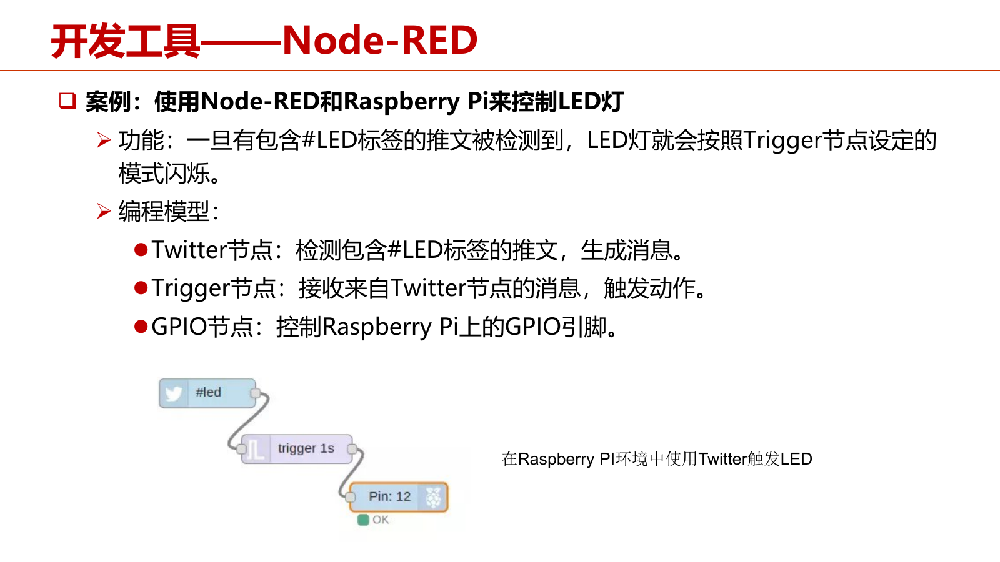
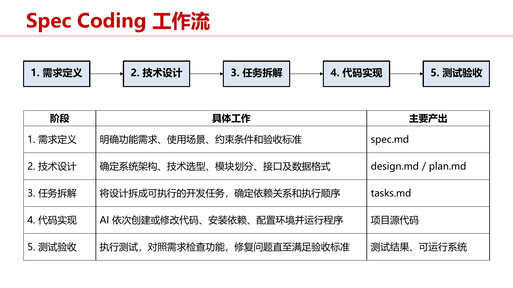
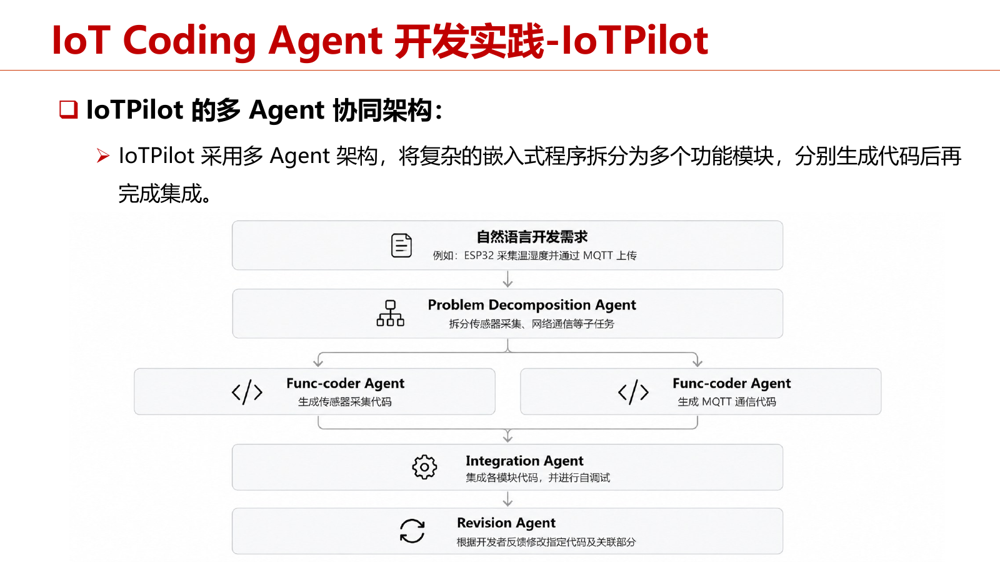

# 第7章 云端融合物联网软件开发

本章依据《第七章 云-端物联网软件快速开发-1028》PPT（94页）及10.28课次的整理字幕，按照三端协同、传统开发、LLM辅助开发和物联网代码智能体的知识关系组织。所有页码均为PDF物理页。PPT末尾的低代码回顾与前文合并；重复复习仅保留实质补充。老师讲解直接摘录整理字幕，原有识别不清标记保留。

本章黄色高亮并加粗的内容配有“考试提示”“老师强调”或“可能考点”标记及详细讲解；标记依据见[课程目录](index.md#review-guide)。补充讲解与老师字幕原句分开呈现。

## 7.1 以物模型连接设备、云和应用

### 7.1.1 智能灯光控制中的三端协同

**知识点**

一个完整的物联网应用涉及设备端、云端和Web/APP端。用户点击“开灯”后，应用按照约定生成指令；云侧鉴权、查找目标连接并下发；设备解析指令并映射为硬件动作。三端必须预先统一设备能力和交互数据，否则应用不知道有哪些功能，云不知道如何下发，设备不知道如何解释。（PPT：PDF第4—6、15页）

**老师讲解**

> 10.28，00:05—00:08  
>
> 先进入传统的物联网软件开发。  
> 正式讲怎么开发之前，先看传统物联网应用到底怎么使用。  
> 这里举智能家居中常见的智能灯光控制案例。  
> 它分成三端：自己的手机、隐藏在后面的云平台，以及家里的智能灯泡。  
> 我们在手机网页或 APP 上点击开灯，APP 把指令发送到云平台。  
> 云平台收到指令，根据指令里的设备标识找到对应的智能灯泡，再把指令下发给设备。  
> 灯泡收到指令，首先解析内容，判断用户希望执行什么操作，再调用对应的硬件接口把灯打开。  
> 日常生活中很简单的一次开灯，实际上涉及 Web 或 APP 前端、云端、设备端三个部分的协同工作。  
> 介绍完完整流程，就能把云端、设备端和 Web 端的代码写出来了吗？  
> 其实还不行，着手写代码之前，还有几个问题需要解决。  
> 编写 APP 时，APP 怎么知道灯支持哪些操作？  
> 比如我们想开关灯，或者调节亮度，这款灯能不能支持，开发时都需要提前知道。  
> 编写云端时，云端怎么知道应该下发哪些指令？  
> 收到开灯请求之后，需要什么指令格式，才能让智能灯泡真的亮起来？  
> 编写设备端时，灯泡收到指令，又怎么知道这是一条开关指令，而不是调节亮度的指令？  
> 这三端遇到的问题都指向统一需求：在编写代码之前，应用端、云端和设备端必须对设备功能以及交互数据有统一定义。  
> 因此，我们需要引入物模型，统一描述物联网设备的属性、服务、事件等。  

### 7.1.2 物模型的定义、作用与异构性

**知识点**

物模型（Thing Model）抽象并标准化描述设备的功能、状态和交互能力，规定设备具有什么属性、支持什么操作、能够产生什么事件。它使应用层、云侧和端侧依据统一语义与接口协同开发，屏蔽不同厂商底层协议、格式和控制接口差异。但物模型本身也有不同平台实现，需要区分概念和具体实现。（PPT：PDF第7页）

!!! important "考试提示 · 7.1.2"

    ==**物模型统一描述设备功能、状态和交互能力，使设备、云和应用按同一接口协作。**==

    **字幕依据（10.28，02:14—02:17）**：老师说：“要理解物模型的作用，不同建模思路的区别，以及各自的好处。”

    **详细讲解**：不同厂商灯泡的通信协议和消息格式不同，但都有开关、亮度等能力。物模型在这些底层差异上提供统一的数据和操作描述，应用按模型读状态、调用服务，设备实现负责把统一操作适配到底层硬件。

    **例子**：亮度统一为某个约定范围后，设备、云和页面都遵循该字段及单位；若设备上报0—255、页面直接按0—100解释，即使联网成功也会控制错误。统一模型不只列字段名，还要约定类型、单位、范围、读写权限和事件/服务语义。

    **答题模板**：物模型是设备能力的数字化、标准化描述，屏蔽异构实现，为三端并行开发与接口复用提供共同契约。它不自动让所有底层协议相通，仍需设备驱动与协议适配。此内容属于老师在“后面考试会涉及”的集中复习中明确要求理解的部分。

**老师讲解**

> 10.28，00:08—00:10  
>
> 物模型是对物联网设备的功能、状态及交互能力进行抽象和标准化描述的数字化模型。  
> 说人话，就是把设备具有什么属性、支持什么操作、能够产生什么事件规定好。  
> 提前规定好之后，云端、应用层和端侧就能按照约定的语义和接口协同开发。  
> 为什么需要物模型？  
> 物联网和普通互联网很大的不同，是异构性非常强。  
> 由于生态壁垒等原因，不同厂商的智能灯可能使用不同的通信协议、数据格式和控制接口。  
> 对用户来说，它们都可能具有开关、调节亮度、调节色温这些功能，但底下怎么控制，各家的接口并不一样。  
> 物模型把设备能力统一抽象出来，让云端和应用端编写代码时，不必依赖每款设备底下的实现。  
> 比如有些设备的开灯指令叫 turn on，有些厂商代码不标准，甚至可能用“开灯”的拼音。  
> 引入物模型之后，顶层开发者不需要再看设备底下具体怎么实现。  
> 物模型是一个概念，不同厂商也有不同的物模型实现，这也体现了物联网异构性很强的特点。  

### 7.1.3 阿里云：产品级建模及属性、服务、事件

**知识点**

阿里云对同类产品定义一套完整物模型。三类元素及示例为：

| 元素 | 描述对象 | 灯泡示例及关键字段 |
| --- | --- | --- |
| 属性 properties | 设备状态，可按权限读取或设置 | `PowerSwitch`：bool，0关/1开；`accessMode=rw`可读可写；`required=true`必选 |
| 服务 services | 外部可调用的设备能力，定义输入和输出 | `turnOn`、`turnOff`；开灯方法为`thing.service.turnOn`，示例输入输出为空、`callType=async`异步调用 |
| 事件 events | 设备主动上报的事件及携带数据 | `overTemperature`过温告警；类型`alert`；方法`thing.event.overTemperature.post`；`CurrentTemperature`为float |

属性/服务/事件的`identifier`是程序使用的标识，`name`是便于人理解的名称。服务与事件示例中的`required=false`，不能把“必选”理解为所有灯功能都必选。字幕中服务方法和调用方式识别不清，PPT对应上述字段；以下引用保留原标记。（PPT：PDF第8—10页）

!!! important "考试提示 · 7.1.3"

    ==**阿里云物模型按产品组织属性、服务、事件；状态、操作和主动通知要区分。**==

    **字幕依据（10.28，02:14—02:17）**：老师说：“阿里云采用产品级建模，同类设备共用一套物模型，包括属性、服务和事件。”

    **分类方法**：属性描述“现在是什么”，例如开关状态、亮度、当前温度；服务描述“能要求设备做什么”，例如开灯、设置亮度；事件描述“设备主动告诉外界发生了什么”，例如过温告警、故障通知。同类产品共享模型，各设备实例保存自己的状态值。

    **例题（复习自拟）**：当前亮度是属性，“设亮度为60”是操作/服务，设备过温主动上报是事件。温度既可作为持续更新的属性，也可在越阈值时触发告警事件；字段含义与消息产生方式决定类别，不能见到“温度”就一律认作事件。

    **易错点**：服务请求成功接收不等于动作完成，需结合返回值、属性报告或执行结果。答题应指出模型描述与设备实例数据的区别。

**老师讲解**

> 10.28，00:10—00:12  
>
> 下面举两个例子，先看国内阿里云物联网平台的物模型定义。  
> 它采用产品级建模，同一类设备共用一套物模型，不必为每台设备单独定义。  
> 比如这个教室有很多同一厂家、同一款的 LED 灯，定义物模型时，为这一类灯定义一套就可以了。  
> 隔壁教室如果是另一种吊灯，就再为吊灯定义一类物模型。  
> 同一个产品用同一个物模型，不同产品用不同物模型。  
> 阿里云物模型主要包含三个部分：属性、服务和事件。  
> 属性描述设备状态，比如智能灯泡的开关状态、当前亮度和色温。  
> 这些状态可以由设备上报，也可以通过云端设置。  
> 服务描述设备能够被执行的操作，比如打开灯泡、关闭灯泡。  
> 云端可以调用设备提供的服务，并向设备传递参数。  
> 事件描述设备上传云端的事件，比如灯泡检测到温度过高，需要向云端发送高温告警。  
> 概括来说，属性描述设备是什么样的，服务描述它能提供什么能力，事件描述它能支持什么事件。  
> 通过这三个方面，就能描述一个物联网产品。  

> 10.28，00:12—00:16  
>
> 通过代码看看物模型具体怎么实现。  
> 左边第一个框是属性定义，最外层是属性集合，每个对象对应一个属性，再在属性下面给出具体定义。  
> 以灯泡开关为例，identifier 是属性的唯一标识符，这里定义为 PowerSwitch，名字是“灯泡开关”。  
> 定义了灯泡开关属性之后，还要进一步定义它的 dataType，也就是数据类型。  
> 这里是布尔类型，用 0 代表关灯状态，用 1 代表开灯状态。  
> accessMode 表示属性的读写权限，rw 代表可读可写。  
> 设备可以向云端上报当前开关状态，云端也可以设置、改变这个属性。  
> required 表示是否为必选属性。  
> 对灯泡来说，开关肯定是必选的，所以设置为 true。  
> 除了开关，也可以用同样方式定义颜色、亮度等属性。  
> 比如定义亮度时，把数值类型换成 float，再列出范围，比如 0 到 10000 lux 之间可以调节亮度。  
> 如果希望智能家居中的灯泡能够改变亮度，就把亮度设置为可读可写。  
> 必选表示这个灯泡具有这个功能，可以写为 true。  
> 用类似方法，就能定义智能灯泡支持的功能。  
> PPT 右半部分是服务，最外层的 services 代表设备支持的服务集合。  
> 这里定义了两个服务：turn on，即开灯；turn off，即关灯。  
> 拿开灯为例，首先要有服务标识符，name 是“打开灯泡”，方便人理解。  
> method 定义服务调用的方法标识，这里是 thing.service.[识别不清]。  
> inputData 和 outputData 分别定义输入参数和输出参数。  
> 开灯不需要输入、输出参数，所以这里都是空的。  
> 最后的调用方式字段[识别不清]说明它采用异步调用。  
> 关灯服务的定义基本和开灯一样，只是在标识符、名称和 method 等位置作相应改变。  
> 通过这些字段，就能把一个服务定义清楚。  

> 10.28，00:16—00:18  
>
> 阿里云物模型的第三部分是事件。  
> 假设灯泡支持高温告警，内部温度超过安全阈值时，需要主动向用户上报过温告警事件。  
> 对应模型最外层是 events，说明这是设备的事件集合。  
> 下面定义 over temperature 这个事件标识符，表示过温告警。  
> 和前面一样，首先定义标识符和名称。  
> 这里不同的是，还要定义事件类型。  
> 平台预先提供了一些类型，这里是 alert，表示告警事件。  
> 接着定义 method，说明采用哪个函数上报。  
> 最下面的 outputData 定义事件上报时携带的数据。  
> 这个事件应该携带当前温度，所以用 current temperature 参数上报灯泡温度。  
> 下面的 dataType 是温度的数据类型，这里为 float，即浮点数。  
> required 表示是否必选，描述字段则用人能看懂的语言说明事件触发条件。  
> 把属性、服务、事件全部定义好，灯泡发生过温情况时，就可以向云端上报告警。  

### 7.1.4 SmartThings：能力组合及可复用接口

**知识点**

SmartThings通过组合标准化Capability描述设备，每个Capability由Attributes（状态）和Commands（动作）组成。灯泡的main组件可以组合`switch`、`switchLevel`等能力；前者有on/off状态和on()/off()命令，后者有0—100的level及`setLevel(level)`。PPT另列`colorControl`，属性为hue、saturation，命令为`setColor(color)`。字幕提到色温是课堂扩展说明，不能把它替换成该表的原字段。与阿里云产品级完整建模相比，能力组合更强调跨设备复用，例如抽油烟机直接复用开关灯能力。（PPT：PDF第11—12页）

!!! important "考试提示 · 7.1.4"

    ==**SmartThings 以可复用 capability 组合设备能力，对比阿里云产品级模型。**==

    **字幕依据（10.28，02:14—02:17）**：老师说：“三星 SmartThings 采用能力组合的建模方式，把功能抽象成标准化 capability，再组合起来描述设备。”

    **详细讲解**：capability 是可复用能力单元，主要包含属性与命令。抽油烟机可以组合开关、照明、空气质量监测能力；照明开关能力也可用于灯泡和晾衣架。产品级模型侧重同类产品共享完整描述，能力组合侧重跨设备复用部分功能。

    **比较题答案**：先说两者均屏蔽设备异构并提供统一能力接口；再说阿里云按产品组织属性/服务/事件，SmartThings 按标准能力组合属性/命令；最后给出开关能力跨设备复用的例子。不要只说“一家有事件、另一家没有事件”来概括整个生态，也不要把 capability 当成某种传感器硬件。

**老师讲解**

> 10.28，00:18—00:23  
>
> 刚才看的是阿里云，国外以三星 SmartThings 为例。  
> 阿里云采用产品级建模，SmartThings 采用能力组合的建模方法。  
> 它把设备的不同功能抽象为标准化能力，再通过组合这些能力描述设备。  
> 一个设备可以包含多个能力，比如开关灯、改变亮度。  
> 每个能力由两部分组成：属性描述设备状态，比如灯泡开还是关、亮度是多少；command 描述设备可执行的动作，比如打开、关闭或调节亮度。  
> 最重要的一点是，SmartThings 的 capability，也就是能力，可以复用。  
> 比如开关灯不只用于智能灯泡，很多抽油烟机也有开关灯能力。  
> 智能灯泡已经定义好开关灯功能，抽油烟机只需把这个能力引进来，就不必像前面的产品级建模那样，针对抽油烟机把每个功能重新写一遍。  
> 这就是基于能力组合方法的好处。  
> 同样用智能灯泡设备模型看看怎么定义，这是缩略版本。  
> 最上面的 name 定义设备模型名称，为 smart light。  
> components 定义设备组件，一个设备可以有多个组件，这里只定义 main 主组件。  
> 每个组件可以包含多个能力，这里定义了两个：switch 表示开关控制能力，switch level 表示亮度调节能力。  
> 后面分别跟着 1，代表版本。  
> categories 指定设备类型，这里为 light，表示灯设备。  
> 这里没有展开能力的具体细节，switch 和 switch level 都是在定义设备之前预先定义好的能力。  
> switch 的 attributes 包括 on 和 off 两种状态，commands 包括开灯和关灯两个功能。  
> switch level 的属性代表当前亮度，比如 level 为 0 到 100。  
> 它的命令可以是 set level，用来改变当前 level 的值。  
> 还可以预先定义其他能力，比如家里的灯要调节颜色、色温，就再定义 color control。  
> 属性包括当前色温值等，command 可以用 set color 设置颜色。  
> 这是三星 SmartThings 的例子。  

### 7.1.5 先定义模型，再并行开展三端开发

**知识点**

开发顺序是：明确功能、属性和事件→转成目标平台的物模型定义→设备、云及应用端按模型开发。智能灯泡示例含开/关两项功能、光照和颜色属性及属性上报事件。设备侧完成硬件和控制，云侧完成接入及处理，应用侧依据属性和操作呈现界面；PPT还提出通过虚拟设备模拟真实设备开展应用开发。（PPT：PDF第13—14页）

**老师讲解**

> 10.28，00:23—00:27  
>
> 下面以智能灯泡为例，看定义完模型之后怎么完成应用开发。  
> 整个过程分成两个步骤：物模型定义和应用开发。  
> 开发之前，先明确智能灯泡需要支持哪些功能、有哪些属性、能够上报哪些事件。  
> 比如我想做一个简单的灯泡，能够通过云平台或小爱音箱开、关它，这是两个功能。  
> 它还需要上报当前光照和颜色属性，包括光照强度、颜色是多少。  
> 第三，要包含属性上报事件，比如通过手机查询当前灯光是什么状态。  
> 这些内容定义完之后，再根据具体使用的平台，把定性描述转化为代码。  
> 采用阿里云平台，就转成属性、事件、服务；采用 SmartThings，就转成 capability。  
> 物模型定义完成，再进入应用开发。  
> 应用开发涉及设备端、云端和 Web 或移动端，物模型定义好之后可以同步开展。  
> 设备端的硬件开发人员完成硬件组装，软件开发人员根据物模型编写设备程序，把开关控制指令转化为实际硬件操作。  
> 云端完成设备接入和数据处理。  
> Web 端开发人员根据物模型中的属性和控制，完成最后的界面呈现。  

## 7.2 设备端：系统基础与应用部署

### 7.2.1 系统软件开发的对象与流程

**知识点**

设备端负责通信接入、业务逻辑、硬件控制和状态上报。系统软件提供基础运行环境，工作包括驱动/硬件抽象、网络协议栈、调度及资源管理；应用软件面向具体业务。系统软件流程为硬件与需求分析→系统方案设计→底层移植与驱动开发→系统组件集成→编译、烧录和调试。PPT中的驱动例子是为RIOT OS添加SHT31传感器驱动；字幕对应操作系统名称不清。（PPT：PDF第16—17页）

**老师讲解**

> 10.28，00:27—00:31  
>
> 讲完物模型这个串联三端的核心，再正式介绍三端开发任务。  
> 完整物联网应用涉及设备端开发、云服务开发和应用端开发。  
> 设备端软件运行在物联网终端设备上，主要负责通信接入、业务逻辑执行、硬件控制和状态上报。  
> 按照开发对象，可以分成系统软件和设备应用软件。  
> 以前我们常认为设备端开发就是应用开发，面向具体业务在设备上实现功能和控制逻辑。  
> 但随着物联网领域拓宽，很多现有系统软件无法支持应用所需功能，所以应用开发之外，系统软件开发也很重要。  
> 系统软件开发面向设备的基础运行环境，负责硬件资源管理、驱动支持、任务调度、通信能力等，为上层提供基础运行环境。  
> 开发对象包括设备驱动和硬件抽象。  
> 比如端侧操作系统是[识别不清]，想让它支持一款新温湿度传感器。  
> 公司说新出了一款传感器，可以试试，但现有操作系统没有它的驱动。  
> 这个时候就需要开发设备驱动和硬件抽象，让上层应用能够读取新传感器的温湿度数据。  
> 第二种是网络协议栈开发，比如在 BLE 设备上集成 6LoWPAN 和 IPv6 协议栈。  
> 前面应该介绍过，现在 BLE 官方协议栈不支持 IPv6，有自己的一套设备发现和连接方式。  
> 如果有一个场景，希望蓝牙耳机支持 IPv6，但现在不支持，就需要开发系统中的网络协议栈，把 BLE 接进去，使它具备基于 IP 的网络通信功能。  
> 这两种情况都需要系统软件开发。  
> 大概开发流程分为以下几步，这里不详细展开，后面还有案例可以回顾。  
> 首先分析硬件和需求，知道现有硬件具备什么功能、需要支持什么功能。  
> 然后设计系统方案，选择合适的嵌入式操作系统，确认驱动、协议栈、系统组件的实现方式。  
> 再开展底层移植和驱动开发，让操作系统适配目标硬件。  
> 在这个基础上集成系统组件，把驱动、协议栈、任务调度等模块组织起来。  
> 最后编译，把生成的固件部署到实际设备上。  

### 7.2.2 编译烧录式开发：交叉编译、链接和固件

**知识点**

传统方式一般用C/C++编写设备程序，依次进行源代码开发、交叉编译与链接、固件镜像生成、烧录运行。开发电脑和目标设备架构常不同，因此需要目标工具链；链接器组合SDK和驱动库。ELF通常用于调试，bin/hex常用于烧录，取决于平台。优势是运行开销通常低、适合资源受限和实时控制；应用修改往往需要重新构建和部署，增加实验及调试迭代成本。（PPT：PDF第18、22页）

!!! important "考试提示 · 7.2.2"

    ==**编译烧录式运行开销通常低，解释器式更新方便但需要额外运行时资源。**==

    **字幕依据（10.28，02:18—02:20）**：老师说：“接着回顾设备端开发的两种方式：编译烧录式开发，以及解释器运行时开发。”

    **详细讲解**：编译烧录式把应用与所需系统组件构建、链接成固件，交叉编译后烧到目标设备。运行通常少一层脚本解释，但修改后要重新构建与部署。解释器方式先部署运行时，之后可上传脚本更新应用，适合教学和快速原型；代价是额外 Flash/RAM、解释执行或运行时管理开销。

    **选型题**：资源紧、对时延有严格要求时优先考虑原生固件路线；频繁试验逻辑、资源允许且非硬实时场景可选解释器。不能绝对写“固件永远不能 OTA”或“脚本完全不需要烧录”：解释器自身仍需初始部署或升级，固件也能远程更新。第7.2.3节的 MicroPython 示例与本比较一起复习。

**老师讲解**

> 10.28，00:31—00:34  
>
> 再看应用软件开发，根据编译、烧录方式可以分为两种。  
> 第一种是传统的编译烧录式开发，大家做的实验基本应该都是这种方式。  
> 一般用 C、C++ 编写设备业务逻辑，通过编译器和链接器，把源代码转为目标平台可执行程序。  
> 整个过程有四步。  
> 第一步，开发人员根据设备功能需求编写源代码。  
> 开发智能灯泡时，需要编写 Wi-Fi 连接、云端指令接收、设备开关控制代码。  
> 第二步，交叉编译和链接。  
> 最初通常在自己的笔记本上开发，笔记本和物联网设备一般采用不同处理器架构，所以要通过交叉编译器，把源代码转换成目标设备能够执行的机器代码。  
> 链接器再把程序和所需 SDK、驱动库组合起来。  
> 第三步，生成固件镜像。  
> 编译、链接完成后，会生成 ELF、bin 或 hex 等格式的文件。  
> ELF 通常用于调试，bin、hex 等通常用于固件烧录，具体取决于目标平台。  
> 第四步，烧录到设备并运行。  
> 在笔记本上编译好后，通过 USB、串口等调试接口，把固件写入设备的 Flash 存储器。  
> 设备启动后，加载并执行相应程序。  
> 这种方式很广泛，ESP32、STM32 基本都采用这种开发方式。  
> 它有什么问题？  
> 应用逻辑变化时，通常需要重新编译、部署固件。  
> 这也是物联网调试或做实验比较困难的原因。  
> 比如测试物联网协议栈性能，只改一个参数，就要重新编译、链接、烧到设备上采集数据。  
> 如果不行，整个过程还要重新走一遍。  
> 在研究或教学中，这个问题比较大，也比较麻烦。  

### 7.2.3 解释器运行时开发及MicroPython案例

**知识点**

设备先部署解释器/运行时，应用使用Python、Lua或JavaScript脚本；运行时通过底层驱动、操作系统或SDK访问硬件。典型平台包括MicroPython、CircuitPython、Espruino、NodeMCU Lua Firmware。MicroPython案例先安装ESP32固件，在Thonny编写和运行GPIO 2控制脚本，再直接修改重执行。方便快速原型、教学和非硬实时业务，代价是额外内存和计算开销。CircuitPython、Espruino的详细使用方法现有字幕未提供完整讲解，平台名称与概览依据PPT补充。（PPT：PDF第19—22页）

| 对比 | 编译烧录式 | 解释器运行时 |
| --- | --- | --- |
| 执行 | 目标机器代码 | 运行时执行脚本/字节码 |
| 部署与修改 | 通常构建并烧录固件 | 通常更新应用脚本 |
| 调试 | 编译、下载、调试 | 支持交互与快速迭代 |
| 资源代价 | 通常低 | 增加运行时与内存开销 |

**老师讲解**

> 10.28，00:34—00:38  
>
> 能不能像在电脑上运行 Python 程序一样，直接在物联网设备上执行脚本，不必每次重新编译完整固件？  
> 这就是基于解释器或运行时的开发方法。  
> 和传统方式不同，需要先在设备上部署解释器或运行时环境。  
> 这样开发人员不必每次把应用程序编译成完整固件，可以直接把应用脚本部署到设备上执行。  
> 看下面这个图，第一部分是应用程序层，可以使用 Python、JavaScript 等语言编写设备应用。  
> 比如写一个读取温湿度传感器数据，再通过网络向云端上报的应用。  
> 第二部分是解释器或运行时，负责解析和执行应用代码。  
> 比如 MicroPython 可以在 ESP32 上运行 Python 程序。  
> 第三部分是底层驱动、操作系统和 SDK。  
> 解释器本身不会直接完成所有硬件操作，要通过底层驱动和 SDK 提供的接口访问硬件资源。  
> 最后才落实到物联网硬件上，这是完整的解释器开发方式。  
> 现在这类平台已经有很多，包括 MicroPython、CircuitPython 等。  
> MicroPython 用得相对比较多，是面向微控制器的精简 Python 运行环境，可以在 ESP32、RP2040 等设备上运行 Python 程序。  
> NodeMCU Lua Firmware 面向 Lua 编程语言，提供网络和硬件操作 API，可以上传 Lua 文件更新应用逻辑，采用事件驱动开发模式。  
> 以 MicroPython 为例，看看怎么在 ESP32 上开发一个简单的 LED 闪烁程序。  
> 这里开发工具用的是 Thonny，整个步骤分四步。  
> 第一步，在 ESP32 上安装 MicroPython 固件，为设备提供 Python 运行环境。  
> 安装完成，设备就具备了解释执行 Python 脚本的能力。  
> 第二步，在 IDE 中编写 Python 应用，具体代码在左边。  
> 首先通过 from machine import Pin 导入 GPIO 控制接口，再用 Pin(2, Pin.OUT) 把 GPIO 2 设置为输出引脚，控制 LED。  
> 后面定义 flash 函数，在循环中交替调用 LED 的 on 和 off，每次间隔一秒，实现灯每隔一秒亮灭。  
> 写完之后，可以直接运行脚本，设备上的 LED 就按照设定的时间间隔闪烁。  
> 这种方式下调试非常简单。  
> 需要修改代码，只需在 IDE 中修改，马上就能在设备上看到效果，不需要重新编译、链接、烧写再执行。  
> 这个例子说明，基于解释器运行时的方式简化了应用代码的编写、执行和调试。  
> 开发人员可以直接修改脚本，快速验证程序运行结果。  

> 10.28，00:38—00:40  
>
> 回顾一下应用程序的两种开发方式：编译烧录式开发，以及解释器运行时开发。  
> 编译烧录式通常采用 C、C++，需要编译和链接，生成目标设备可执行的机器代码。  
> 解释器运行时通常使用 Python、Lua 或 JavaScript，应用代码由设备上预先部署的运行时加载和执行。  
> 第二个区别是应用部署方式。  
> 编译烧录式一般需要把整个程序构建成固件，再烧录到设备；修改应用逻辑，通常要重新构建和部署固件。  
> 解释器方式可以直接上传、更新应用脚本，不必每次重新烧录，所以更方便。  
> 第三个区别是调试。  
> 编译烧录式调试一般需要完整进行编译、下载、调试。  
> 解释器一般支持交互式执行，可以直接修改脚本、查看结果，有利于快速验证和迭代。  
> 第四个区别是运行开销。  
> 编译烧录式不需要额外运行时开销，通常开销比较低。  
> 解释器的运行时需要占用一定内存和计算资源，对端设备资源有一定要求。  
> 因此，编译烧录式适合资源受限、实时性要求较高的场景。  
> 解释器运行时适合快速原型、教学和非实时业务逻辑等场景。  

## 7.3 云端业务与Web/移动应用

### 7.3.1 云服务特点和设备接入

**知识点**

云服务面对大量异构设备和协议，许多业务由传感数据触发，同时数据存储、读取和状态管理具有复用性。开发分为设备接入和业务逻辑。PPT案例中的接入配置顺序为设备发现→控制认证（设备确认云平台控制权）→设备注册（分配ID、对接属性和控制接口）。（PPT：PDF第23—24页）

**老师讲解**

> 10.28，00:41—00:43  
>
> 前面介绍了设备端主要代码开发方式，设备端主要负责数据采集、硬件控制和云端通信。  
> 下面看云端开发需要哪些功能。  
> 物联网云服务第一个特点是设备异构性。  
> 系统往往接入大量不同厂商、不同功能的设备，支持的协议也不一定相同，所以云端开发首先要解决设备如何接入的问题。  
> 第二个特点是很多业务由设备数据触发。  
> 比如温度传感器上报数据超过设定阈值，云端需要自动触发告警，根据设备数据执行相应规则。  
> 第三个特点是存在大量可复用的应用逻辑。  
> 比如数据存储、数据查询、设备状态管理，不同物联网应用都可能用到。  
> 云平台会把这些能力封装成通用服务，供开发人员直接使用。  
> 总的来说，云端服务大概分两部分：设备接入管理和业务逻辑开发。  
> 设备接入在第六章大概已经讲过，这里从开发、设置的角度讲。  
> 它在平台上可以分成设备发现、控制认证和设备注册三个部分。  
> 下面是移动云的截图案例。  
> 首先，云平台发现可连接的物联网设备。  
> 发现之后点击设备，由设备确认云平台有没有控制权。  
> 设备端确认之后，云平台为设备分配 ID，把设备属性、控制接口等对接到云平台。  
> 实际操作就是在云平台上点一点，连接几个按钮。  

### 7.3.2 IFTTT规则：事件、条件和动作

**知识点**

IFTTT（If This, Then That）在事件发生且满足条件时自动执行动作。OneNET温度告警示例选择temperature数据，配置温度超过30℃时发邮件。事件驱动、规则配置和低代码自动化适合简单业务。涉及多个服务的执行顺序、复杂分支、状态跟踪和失败恢复时，独立规则越来越难维护。（PPT：PDF第25—27页）

!!! important "考试提示 · 7.3.2"

    ==**IFTTT 表达触发条件与动作，服务编排组织多个设备/服务的协作。**==

    **字幕依据（10.28，02:18—02:20）**：老师说：“云端开发介绍了设备接入、IFTTT 规则和服务编排，也讲了 Web 端开发。”

    **详细讲解**：IFTTT 适合“若事件出现且条件满足，就执行动作”，如温度越阈值时启动通风。服务编排在此基础上组织跨服务执行路径，如先检查房间占用，再调节空调并更新业务状态。三端开发需要设备接入、云端处理和用户界面的完整闭环。

    **答题方法**：给出事件、条件、动作与目标设备，说明消息如何从设备到云，再把操作下发或结果展示给用户。多规则并存时要检查冲突；涉及多个动作时要明确失败、重试和执行先后。此处根据老师末课集中复习的云端开发范围列为考试提示，具体延伸例子是笔记补充。

**老师讲解**

> 10.28，00:43—00:47  
>
> 设备接入之后，要开发业务逻辑。  
> 最简单直接的方式是基于 IFTTT 规则驱动开发，第六章应该也讲过。  
> IFTTT 是 If This Then That 的缩写，指某个定义好的事件发生、并满足相应条件时，自动执行指定动作。  
> 下面拿中移 OneNET 平台看看怎么开发规则。  
> 先选择要判断的数据，比如 temperature，再设置触发条件，比如温度大于 30 度。  
> 这个应用是温度告警服务，下面可以定义信息接收方式。  
> 比如选择邮箱，家里温度大于 30 度时，就往邮箱发送一封邮件，告诉我温度超了。  
> “如果温度大于 30 度，就给我发邮件”，就是非常简单的 IFTTT 规则驱动开发。  
> 它有几个特点：事件驱动、规则配置和低代码自动化。  
> 规则把业务逻辑表示为事件、条件和动作之间的关联。  
> 简单业务逻辑可以完全通过在云平台上点一点、写一写完成，不必手工编写业务逻辑。  

### 7.3.3 服务编排：从单设备控制到多设备协同

**知识点**

“离家模式”需要关闭灯、空调、锁门窗并收集各设备执行结果，失败还需异常处理。服务编排把常用功能封装为节点，再配置参数、条件和连接顺序。典型链路为触发→查询设备状态→脚本判断→设备操作。“无人且灯开着则关灯”有两种判断顺序；功能等价，先查灯是否开启可能更合理，因为检测人是否在场更复杂。（PPT：PDF第27—29页）

**老师讲解**

> 10.28，00:43—00:47  
>
> 但是业务涉及多个服务时，IFTTT 规则会越来越复杂，可能出现问题。  
> 比如原来只是用户开关灯，现在变成用户点击“离家模式”。  
> 系统需要关闭所有灯光、空调，锁好门窗，还要确认每项任务是否执行成功。  
> 这两种执行控制有多大区别？  
> 开关灯只需用户点击，发送指令到云端，云端下发指令，灯泡执行，流程就结束。  
> 离家模式中会有非常多条件语句，全部执行之后，还要确认每个设备是否成功。  
> 业务逻辑复杂很多，系统需要同时向多个设备发送不同控制指令，协调设备操作，分别收集执行结果。  
> 如果某个设备执行失败，还需要相应的异常处理。  
> 业务从单设备控制发展为多设备联动后，云端不只负责转发指令，还需要组织多个操作的执行顺序等。  
> 简单 IFTTT 可能无法满足要求，这时就需要服务编排。  
> 服务编排的基本思想，是把常用功能封装为独立服务节点，再按业务需求把节点连接起来。  

> 10.28，00:53—00:56  
>
> 服务编排有两个关键概念，第一个是服务节点。  
> 每个节点负责完成一项具体工作，比如查询设备状态、存储数据、向设备发送控制指令等。  
> 如果服务节点已经定义好，开发人员可以直接拿来使用，不必重复编写底层代码。  
> 定义好节点之后，就要把它们编排起来。  
> 把节点拉过来，配置输入参数和执行条件，再通过连线连接。  
> 下面是一个基础案例。  
> 首先通过设备节点触发业务流程，再通过设备查询节点获取当前设备状态。  
> 接下来是脚本节点，可以点进去写具体操作，根据设备查询结果进行判断和处理。  
> 最后通过设备操作节点向目标发送指令，完成整个流程。  
> 这是比较模板化的编排。  
> 再举智能家居灯控制的例子：房间里没有人，而且电灯处于打开状态时，自动关闭电灯。  
> 业务有两个条件：房间里有没有人，电灯当前是否打开。  
> 只有“没人”和“开灯”同时满足，才执行关灯操作。  
> 下面两张图都是这个应用的流程。  
> 左边先判断房间有没有人，没有人就继续判断电灯是否打开，电灯开着就调用设备操作节点关闭它。  
> 右边实现相同功能，但调整了判断顺序：先检查电灯是否打开，再判断房间有没有人，没有人就关灯。  
> 两种业务逻辑都能实现相同需求。  
> 同一个需求可以通过不同节点组合实现，当然也有好坏之分。  
> 这个场景中，先判断灯有没有打开，再判断有没有人可能更合理，因为判断是否有人更复杂，涉及的节点可能更多。  

### 7.3.4 Web/移动应用的三种开发路径

**知识点**

物联网UI与设备功能密切相关，开关、文本、折线图和仪表盘等组件复用性高。开发方式包括依据设备代码和框架自动生成、可视化拖拽组合、以及大模型辅助生成。自动生成通常依赖模板映射，拖拽方式依赖平台组件；本课仅概览前端开发。（PPT：PDF第30页）

**老师讲解**

> 10.28，00:56—00:58  
>
> 最后讲 Web 和移动应用开发。  
> 这个应该有单独一门课讲，这门课就用一页 PPT 大致介绍，不深入展开。  
> 现在主要有三种方式。  
> 第一种，基于设备端代码和应用框架自动生成。  
> 如果前端要求不高，有些工具能根据设备端代码自动生成应用端。  
> 比如左下角的图，工具可以提取 temperature 等字段，自动填写到固定 APP 前端的字块，再在这里设置数值。  
> 这是基于模板映射。  
> 第二种，基于可视化拖拽的 Web 和移动端开发。  
> 右下角是案例，云平台已提供模板，开发时把操作框拉过来，自动生成后端代码。  
> 现在很多应用模块都能复用，通过拖拽、模块组合，也能搭建 Web 或移动应用前端。  
> 第三种是基于大模型的开发。  
> 现在大模型开发前端非常厉害，这节课也不细讲，Web 端低代码开发大概主要有这几种方式。  

## 7.4 传统低代码工具：流程编排与软硬件一体生成

### 7.4.1 Node-RED的Flow与LED控制案例

**知识点**

Node-RED是IBM于2013年推出、基于Node.js的开源可视化编程工具，以流组织业务。Flow可指编辑标签页，也可指实现特定功能的一组连接节点。流包含节点（输入/处理/输出）、连线（路径和方向）以及消息（承载数据的JavaScript对象）。编辑器由节点库、流程编辑区、调试区构成，Deploy部署运行。案例为Twitter检测`#LED`消息→Trigger产生控制动作→GPIO转换为树莓派引脚电平，三个节点、两条连线实现LED闪烁。（PPT：PDF第32—34页；第86—88页为重复回顾）

图：Twitter消息经Trigger节点驱动Raspberry Pi GPIO的Node-RED流程（本章PPT，PDF第34页）。

!!! important "考试提示 · 7.4.1"

    ==**Node-RED 的 Flow 由节点、连线和消息组成，三者分别表示执行、路径和数据。**==

    **字幕依据（10.28，02:18—02:20）**：老师说：“它的重要概念是流，流由节点、连线和消息组成。”

    **详细讲解**：输入节点接收 MQTT 或其他事件，处理节点筛选或转换数据，输出节点发布控制或展示结果。连线决定消息流向，message 携带字段和值。以温度控制为例：“MQTT输入 → 阈值判断 → MQTT控制输出”就是一条流。

    **易错点**：连线不是设备之间真实拉了一根电线；流程画通不代表消息格式、设备权限与 topic 都已正确配置。处理节点若改变字段，下游也必须适配。答题时用实际消息走过三个节点说明抽象，比只背工具名称完整。

**老师讲解**

> 10.28，00:58—01:03  
>
> 下面讲两个传统物联网软件开发的工具和框架，都是低代码的。  
> 首先是 Node-RED，它是基于 Node.js 的开源可视化编程工具，最早由 IBM 在 2013 年提出。  
> 它采用基于流的编程模型。  
> 开发人员不需要从头到尾编写完整业务程序，可以把预先定义好的功能节点连接起来，构建业务流程。  
> 下面是开发界面，左边是节点库，提供 MQTT、HTTP、TCP 等通信节点，也有条件判断、数据处理等功能节点。  
> 中间是流程编辑区，把左边定义好的模块拖过来，通过连线定义消息在不同节点之间的传递路径。  
> 比如传感器数据上来之后，判断有没有超过阈值，超过就执行设备控制。  
> 在 Node-RED 中，先把 MQTT 节点拉过来，接收传感器数据，再拉一个处理节点，把数据送进去判断阈值。  
> 最后是设备控制节点，超过阈值就进入设备控制。  
> 中间就是通过拖拽进行流程编辑的区域。  
> 最右边是调试区，可以查看节点输出消息和运行结果。  
> 全部完成后，点右上角小小的 Deploy 按钮，就可以部署并运行流程。  
> Node-RED 中，流是最核心的基本单位，由节点、连线和消息组成。  
> 节点是基本执行单元，一般包括输入节点、处理节点和输出节点。  
> 输入节点负责产生或接收消息，就是刚才例子中的 MQTT 节点。  
> 处理节点负责转换或判断消息，比如判断是否超过阈值。  
> 输出节点负责发送或显示处理后的消息，就是最后执行操作的节点。  
> 不同节点通过连线连接，连线决定消息在流中传递的路径和方式。  
> message 是流中节点之间传递的消息数据。  
> 通过一个案例，看看用 Node-RED 开发要怎么做。  
> 这个案例比较神奇：检测到包含 #LED 标签的推文，就让 LED 按照 trigger 节点设定的模式闪烁。  
> 需要三个节点。  
> 第一个是 Twitter 节点，检测包含 LED 标签的推文，检测到就生成消息，传给下一个节点。  
> 第二个是 trigger 节点，接收 Twitter 消息并触发动作。  
> 第三个是 GPIO 节点，负责操作树莓派的 GPIO 引脚。  
> 它收到 trigger 的控制消息，转换成实际引脚电平变化，控制 LED 亮灭。  
> 说起来比较复杂的程序，用 Node-RED 做就是三个节点、两条线。  
> 通过拖拽方式，代码量大大降低了。  

### 7.4.2 传统自底向上开发的知识门槛

**知识点**

传统流程先需求分析、硬件选型及连线组装，再基于硬件编程、交叉编译、烧录和调试。环境监测例子采用Arduino、SDS018、光照传感器和DHT11；软件需知道驱动库及数据引脚。门槛分为硬件知识、软件驱动知识、软硬件协同与兼容性；更换硬件平台可能需要大量软件迁移。（PPT：PDF第36—40页；第90—91页为重复回顾）

**老师讲解**

> 10.28，01:03—01:07  
>
> 下面介绍 tinyLink，这是之前我们实验室做的软硬件一体快速开发平台。  
> 先回顾传统物联网应用开发的流程。  
> 根据应用需求构思程序功能和逻辑，再选择满足需求的开发板、外设和控制板，设计硬件连线图，组装硬件平台。  
> 硬件选型完成，再开发应用程序，经过交叉编译得到二进制文件，烧到开发板上，观察应用结果并调试。  
> 传统流程是自底向上的，从需求、硬件开始，一步一步到最终程序。  
> 用室内环境监测案例看看传统开发需要哪些步骤。  
> 比如要做 PM2.5、温湿度和光照检测，先根据功能进行硬件选型。  
> 这里选 Arduino、SDS018、光照传感器和 DHT11。  
> 选好之后，根据 Arduino 编程环境打开 IDE，编写应用代码。  
> 代码不能随便写，需要了解很多细节。  
> 比如读取 DHT11 温湿度传感器时，要知道调用什么读取函数，具体函数名[识别不清]。  
> 读取光照传感器数据，还要知道它接在开发板的 A0 引脚上。  
> 整个过程有哪些不便？  
> 首先，需要一定硬件知识，能够根据需求选择合适硬件。  
> 做环境监测，要了解哪些现有硬件能提供 PM2.5、温湿度和光照监测，再把它们选出来。  
> 其次，需要软件知识，了解各种外设在不同硬件平台下的驱动编写方法，有开发经验去选择合适驱动库。  
> 比如写代码时，就要知道光照传感器的数据引脚接在 A0 上，这些都需要前置知识。  
> 第三，还需要软硬件协同知识。  
> 选定 Arduino 后，硬件选型时要考虑外设驱动库是否兼容这个平台。  
> 软件设计时，也需要根据硬件关系确定每个外接设备对应的通信引脚和端口。  
> 传统物联网应用开发有门槛，要求开发者有硬件、软件和软硬件协同基础。  

### 7.4.3 TinyLink的自顶向下开发与五步流程

**知识点**

TinyLink 1.0于2017年3月推出；2.0于同年12月在设备侧基础上集成Web和手机端开发。它从需求与领域特定语言（DSL）代码出发，分析所需功能，再自动生成硬件配置和对应二进制软件，屏蔽驱动与引脚细节；支持云编译、自动接入平台和价格/功耗等目标优化。（PPT：PDF第35、41—49页；第89、92—94页为重复回顾）

实际五步为：编写包含`TL_PM25.read()`等API的程序→上传并云编译→获取硬件列表及连接图→购买并按图组装→USB连接并一键烧录。PPT配置例子的硬件是Arduino Mega2560、Mega Shield及相应外设；它与前文传统Arduino例子分属不同示例，不应混为固定唯一配置。

!!! important "考试提示 · 7.4.3"

    ==**TinyLink 从应用需求向下选择和生成软硬件，传统方式先懂硬件再向上构建应用。**==

    **字幕依据（10.28，02:18—02:20）**：老师说：“tinyLink 把传统自底向上的开发变成自顶向下的开发。”

    **详细讲解**：传统开发者先选板子、查引脚与驱动、学习各组件接口，再编写应用。TinyLink 让用户先表达所需功能，工具根据组件描述和约束寻找硬件组合、生成连接与代码，降低入门门槛。它仍依赖组件库、接口模型和约束求解，不是完全摆脱硬件条件。

    **比较题**：围绕起点、所需知识、工具承担的工作、可支持范围回答。应用需要无线温湿度采集时，自顶向下工具先分析感知/通信需求再匹配组件；组件库缺少特殊器件或有复杂需求时，仍需人工补充。课堂要求理解开发思路差异，不要求背研究实现全部细节。

**老师讲解**

> 10.28，01:08—01:12  
>
> 对小白，或者喜欢研究智能家居的爱好者来说，这个门槛可能很高。  
> tinyLink 把开发过程从自底向上改成自顶向下。  
> 传统方式先搭硬件平台，再做节点软件编程；它从应用需求分析开始，先做节点软件编程，最后自动生成硬件平台配置。  
> 使用流程大概分三步。  
> 第一步，用户编写程序代码，这个代码是 DSL，也就是领域特定语言，比较容易写，不是专家也能写。  
> 把代码上传云端，系统根据代码中需要实现的功能，自动生成硬件配置。  
> 第二步，用户根据硬件配置文件组装物联网平台。  
> 系统帮助选择需要哪些硬件，用户拿过来组装。  
> 第三步，选完硬件，系统还能根据选定的硬件生成对应软件。  
> 输出是二进制程序，直接烧入开发板即可。  
> 整个过程屏蔽了很多底层知识，用户不必了解大量硬件、软件细节。  
> 它自动生成硬件配置和二进制代码，自动接入 IBM Watson IoT、OneNET 等物联网平台。  
> 还可以优化指定目标，比如价格、功耗。  
> 用户只需编写代码描述所需功能，不必理会兼容性、是否支持等细节。  
> 整个编译在云端完成，不需要复杂的本地编译环境。  
> 比如要读取各个传感器数据，再打印出来，只需调用 PM2.5、temperature、humidity 和 light 的 read，再通过串口 print 打印。  
> 上传并编译后，系统知道需要读取光照、温湿度和 PM2.5，就把开发板型号、外设型号列出来。  
> 比如读取 PM2.5，系统会选择 SDS018。  
> 除了硬件列表，还会给出配置图，告诉我们应该怎么连接。  
> 根据连线示意图把硬件接好，一键烧写软件，整个应用就完成了。  
> 这个开发工具的目标是屏蔽底层所需细节，让开发流程更高效。  
> 以上是第一个部分：传统方式如何开发物联网应用。  

## 7.5 LLM辅助开发：从交互原型到规范驱动

### 7.5.1 低代码局限与代码智能体的演进

**知识点**

传统低代码依赖预置组件或DSL，存在定制能力不足、供应商锁定、迁移成本和复杂场景能力有限等局限。LLM让开发者用自然语言表达需求，经历代码补全（2021）、对话编程助手（2023）和自主规划、执行、验证的代码智能体阶段（2025—2026）。IDE、命令行及云端均可提供开发工具。Terminal-Bench评估完整智能体系统在终端环境中完成任务的能力；课堂列出的工具版本和成绩是当时PPT快照，不代表持续有效的性能排序。（PPT：PDF第50—52页）

**老师讲解**

> 10.28，01:12—01:16  
>
> 下面进入 AI 辅助物联网开发，回答第二、第三个问题：现在用 AI 工具如何开发物联网应用，如何开发自己的 IoT coding agent。  
> 先回顾传统低代码开发的缺陷。  
> 前面介绍过可视化组件拖拽，比如 Node-RED；也介绍过编写领域特定语言描述需求，比如 tinyLink。  
> 这些方式能减少开发者直接编写的代码量，但仍有局限。  
> 首先，开发者通常只能使用平台已经提供的功能。  
> 比如 Node-RED 提供了一些组件，想用特定功能组件但平台没有，就可能无法支持。  
> 其次，复杂定制和应用迁移仍有成本。  
> 不同平台有各自开发规范，原来基于 Node-RED 的开发，换到另一个平台之后，之前的内容不一定能迁移，成本很高。  
> 大语言模型的发展为物联网开发提供了另一种思路。  
> 开发者不一定需要学习特定平台的操作方式，可以用自然语言描述需求，让 AI 生成代码。  
> 从 AI 发展的时间尺度看，历史也蛮久了。  
> 2021 年 GitHub Copilot 已有代码补全功能，2023 年 AI 开始通过对话理解更多上下文。  
> 到 2025、2026 年，代码工具进入智能体阶段，能够自主规划、执行、验证完整任务。  
> 这里列了很多常见 AI 开发工具，相信大家也用得比较多。  
> 产品形态有所不同，有的集成在 IDE 中，有的通过命令行工作，有的在云端执行任务。  
> 包括国外 Copilot、Cursor、Claude Code，国内工具名称[识别不清]、TRAE 等。  
> 首次发布有 2021、2023、2025 年，版本进展很快。  
> 为了评价开发能力，表格引入了 Terminal-Bench。  
> 目前还没有一个 benchmark 能把这些工具都很好地测出来，当时找到了这些结果。  
> 可以看到 Codex 比较厉害，在这些任务上获得了较高分数。  

### 7.5.2 智能灯泡：给AI明确已有系统和设备约束

**知识点**

智能灯泡案例的云和Web已完成，只生成ESP32 Arduino设备程序。要求Wi-Fi及阿里云接入，遵守已有物模型和通信协议，实现开关、调亮度、状态实时上报及断网自动重连。老师报告实际运行成功，但仍需人提供设备ID等参数。Prompt应说明开发边界和项目已有约束。（PPT：PDF第53—54页）

**老师讲解**

> 10.28，01:16—01:20  
>
> 利用这些 AI 工具完成前面的智能灯泡开发，现在就非常简单了。  
> 比如告诉它：“请帮我开发一个基于 ESP32、使用 Arduino 框架的智能灯泡控制程序。”  
> 要求包括：ESP32 通过 Wi-Fi 连接互联网，云端采用阿里云物联网平台，云端和 Web 端已经开发完成。  
> 让它按照阿里云平台已有物模型和数据通信协议开发设备端。  
> 设备要接收云端控制指令，实现灯泡开关和亮度调节，实时向阿里云上报开关状态和当前亮度，断联后能够自动联网。  
> 把这个 prompt 发给它，就能生成很多程序。  
> 我们运行过，这个程序真的能成功运行，当然中间需要人补充设备 ID 等细节。  

### 7.5.3 统一AI Coding范式：人、项目和编码智能体

**知识点**

人负责需求、约束、关键决策、反馈和验收；项目提供源代码、数据库、接口文档、领域知识和运行环境；编码智能体读取上下文、制定方案、使用工具创建修改代码、安装依赖、编译运行和测试。编译失败后，将错误日志反馈给模型，分析、修改并重新编译。减少人工琐碎工作仍依赖充分上下文及结果验收。（PPT：PDF第55页）

**老师讲解**

> 10.28，01:16—01:20  
>
> 在这个模式下，可以抽象出统一 AI coding 开发范式，涉及人类开发者、软件项目和编码智能体三者。  
> 人类开发者负责提出需求，告诉 AI 实现什么功能、有哪些约束。  
> 比如远程开关灯和调节亮度。  
> AI 完成后，人还要检查运行结果、发现问题、提出修改要求。  
> 软件项目，也就是 project，不只包含源代码，还包含数据库、接口文档、领域知识和运行环境，为 AI 提供开发上下文。  
> 比如开发智能灯泡设备程序，需要告诉它阿里云物模型是什么、MQTT 通信协议是什么、ESP32 支持什么开发框架。  
> 第三部分是 coding agent，它实际执行开发任务。  
> 它读取项目文件，理解已有代码和开发环境，根据用户需求制定计划。  
> 再调用工具创建、修改代码，安装依赖，编译运行，最后执行测试。  
> 如果编译失败，就根据错误日志分析问题、修改代码，再重新编译。  
> 人的工作被大幅简化，主要负责提需求、中间关键决策，以及最后验收结果。  
> 其他很多 dirty work 都交给 coding agent。  
> 灯泡控制这样的简单应用，现在 AI coding 已经做得还可以，可以直接生成代码，再根据运行结果不断修改。  
> 但比较复杂的物联网系统，用这种直观、直接的方式是否仍然有效？  

### 7.5.4 座位系统Vibe迭代（一）：采集成功之前先补工具链

**知识点**

案例涉及座位传感节点、云端实时/历史统计、管理员Web以及学生查询和短时预约。Vibe Coding先实现最小功能，再运行反馈。第一轮指定ESP32、HC-SR501、GPIO18，在串口打印占用状态；PPT指定RIOT，字幕对应系统名不清。生成代码后缺少ESP32工具链，无法验证；第二轮告知工具链位置后才打通读取链路。生成代码与验证成功是不同步骤。（PPT：PDF第56—57页）

**老师讲解**

> 10.28，01:20—01:22  
>
> 下面举之前实际做过的案例。  
> 当时用的基座模型比较老，现在的模型说不准已经能做了，还是从这个案例开始。  
> 我们要开发智能教室座位使用统计与预约引导系统。  
> 在教学楼、自习室或图书馆，学生常常需要找空闲座位，管理员也要了解不同教室在不同时段的使用率。  
> 系统要在每个座位下方或桌面边缘部署低成本传感节点，自动感知座位是否占用，并把数据上传云端。  
> 云端统计每间教室的实时空座率、历史使用率和异常占座情况。  
> Web 管理端供教师、管理员查看，移动端供学生查询空闲座位并进行短时预约。  
> 这个系统比较复杂，涉及教师端、管理员端、学生端，也涉及终端硬件和前端页面展示。  
> 如果用 prompt、用 vibe coding 方式来开发，怎么做？  
> 第一轮不要求 agent 一次完成全部系统，先完成最基本的传感器数据采集。  
> 告诉它：做教室座位占用检测，硬件使用 ESP32，传感器采用红外热释电运动传感器 HC-SR501，接在 GPIO 18。  
> 应用基于[识别不清]操作系统开发，先写程序，在串口直接打印座位是否占用。  
> 发过去之后，可能出现什么问题？  
> 它可能写完代码，却提示找不到 ESP32 工具链，无法验证生成程序的正确性。  

> 10.28，01:23—01:25  
>
> 这时需要第二轮交互，把电脑中 ESP32 工具链所在的目录告诉它，比如用户目录下的 ESP-IDF 文件夹。  
> 告诉它之后，传感器读取链路可以打通，串口能够成功打印座位是否占用。  

### 7.5.5 座位系统Vibe迭代（二）：字符串上报无法支撑云端统计

**知识点**

串口可用后加入Wi-Fi、MQTT，并补充网络参数和EMQX地址。程序可以运行，但只发送occupied字符串，云端不知道哪间教室、哪个座位及何时上报；下一轮改为JSON，字段为`classroom_id`、`seat_id`、`occupied`、`timestamp`，设备端才可连续上报可归属的记录。PPT轮次编号由Prompt 2跳到4，且后面重复使用6；笔记按实际迭代顺序解释。（PPT：PDF第58页）

**老师讲解**

> 10.28，01:23—01:25  
>
> 接下来进一步提需求：原来只是串口打印，但最终由云端管理，所以要通过 Wi-Fi 和 MQTT 上传座位状态。  
> 告诉它，把 occupied 座位占用信息通过 Wi-Fi、MQTT 发布出去，并提供 Wi-Fi 名称、密码以及 EMQX 这个 MQTT broker 的地址。  
> 智能体就在原来代码上加入 MQTT 和 Wi-Fi 逻辑，代码也可以运行。  
> 但是云端订阅程序收到的只是简单字符串，后续很难按教室、座位统计。  
> 查看云端时，我们发现这样不行：只知道字符串，不知道哪个教室、哪个座位、什么时候被使用。  
> 于是再次交互：云端需要知道哪间教室、哪个位置、什么时候上报，把 MQTT 消息改成 JSON。  
> 字段要包括 classroom ID、座位 ID、occupied 占用状态和 timestamp 上传时间。  
> 告诉它之后，代码真的生成了，截图就是当时交流后最后生成的代码。  
> 到这里设备程序已经可用，云端能看到连续上报：教室 ID、座位 ID、占用状态和时间。  

### 7.5.6 座位系统Vibe迭代（三）：预约与物理占用混淆

**知识点**

云端有数据后生成Web总座位、占用、空闲数页面，再加学生预约：提交`seat_id`后锁定10分钟，返回`reservation_id`和`expire_time`。问题是预约者尚未入座，传感器仍报`occupied=false`，Web又计为空闲，其他学生可重复预约。修正为free、occupied、reserved三类业务状态：预约未过期不得再预约，也不计为空闲；随后重新修改数据模型、设备与云代码并反复调试。物理传感值不能独自表达业务可用性。（PPT：PDF第59—60页）

**老师讲解**

> 10.28，01:25—01:28  
>
> 信息收集上来之后，可以让 agent 生成 Web 管理页面。  
> 告诉它：“云端已经能收到具体座位状态，请帮我写 Web 管理端，显示每间教室的总座位数、已占用座位数和空闲座位数。”  
> 它写出了 PPT 里的座位管理页面，显示教室数量、总座位数、已占用数和空闲数，下面还有占用率等。  
> 智能教室使用统计系统的雏形已经完成，但页面还只展示座位状态。  
> 下一步要引入预约、取消预约、超时释放等功能，案例要求展示之外还能预约。  
> 接下来告诉它：“学生移动端支持短时预约，增加预约接口，学生提交座位 ID 后，把座位锁定 10 分钟，返回预约号和超时时间。”  
> 这时又出现新问题。  
> 座位被预约之后，设备仍然上报 occupied 为 false，因为学生只是预约，还没有入座。  
> Web 端认为座位依然空闲，其他学生还能再次预约。  
> 这说明后面写的数据模型没有区分物理占用状态和业务占用状态。  
> 所以下一轮又要修改代码：座位状态不能只有 occupied 或 not occupied，要分成 free、occupied、reserved 三类。  
> 预约还没过期时，不能再次预约，也不能计为空闲座位。  
> 这个过程很冗长，但就是当时开发这个系统面临的真实过程。  
> 不断修改数据模型、设备代码，不断重新调试设备代码正确性，还要检查云端代码是否正确。  
> 开发比较大的系统，需要非常多轮交互。  

### 7.5.7 多端一致性为何要在开发前约定

**知识点**

复杂系统需要设备、数据库、HTTP接口和页面共享数据模型，明确空闲/占用/预约/异常之间的状态转移，同时约定Topic、字段类型、异常处理。PPT还补充历史统计和实时查询需要不同存储策略。多轮Prompt临时补齐约束会牵动多个模块，增加回归测试与维护成本，因而引出编码前先形成需求规范。（PPT：PDF第61—62页）

**老师讲解**

> 10.28，01:28—01:31  
>
> 这就引出一个问题：vibe coding 确实能帮助开发者快速获得可运行原型。  
> 但随着功能不断增加，如果前期没有明确系统约束，缺点会不断暴露。  
> 首先，设备端、云端数据库、Web 接口和移动端必须共享一致数据模型。  
> 像前面的案例，没有一致数据模型，就会导致已预约座位再次被预约。  
> 其次，空闲、占用、预约、异常等业务状态，需要明确状态转移规则，不能仅靠一个传感器字段判断。  
> 另外，topic、HTTP 接口、字段类型等细节，也需要提前约定，否则生成的代码可能不兼容。  
> 如果像前面一样，在后续 prompt 中一次一次临时补充，agent 虽然能继续修改，但每次可能涉及多个模块，增加回归测试和维护成本。  
> 因此，对于需求比较明确、接口比较复杂的工程，可以考虑编码前先把需求和约束组织成规范。  

### 7.5.8 Spec Coding五阶段及人的决策职责

**知识点**

Spec Coding（Spec-Driven Development，SDD）先形成相对稳定的规范，再按规范生成实现。五阶段及产出为需求定义`spec.md`→技术设计`design.md/plan.md`→任务拆解`tasks.md`→代码实现（源代码）→测试验收（结果和可运行系统）。人确认业务规则、审核方案、检查任务完整性和优先级、提供设备与接口资源，并在真实场景验收；AI负责需求整理、设计候选、拆解执行及自动化测试。失败时修复代码，必要时回到设计或需求阶段。（PPT：PDF第62—64页）

图：Spec Coding五阶段、具体工作和主要产出（本章PPT，PDF第63页）。

!!! important "考试提示 · 7.5.8"

    ==**Spec Coding 五阶段是需求定义、技术设计、任务拆解、代码实现、测试验收。**==

    **字幕依据（10.28，02:21—02:23）**：老师说：“spec coding 有五个阶段：需求定义、技术设计、任务拆解、代码实现、测试验收。”

    **把五阶段落到座位系统**：需求定义确定谁预约、什么算空闲、并发规则和验收标准；技术设计约定设备上报格式、云端状态模型和接口；任务拆解列出采集、上传、存储、查询与预约的依赖；代码实现按接口完成三端；测试验收检查断网、重复消息、并发预约和真实设备读数。

    **为什么先写规范**：三端如果各自猜字段和状态含义，单独运行正常也会集成失败。规范提供共同契约，测试再检查实现是否满足契约。人负责需求、方案审核和关键取舍，不能仅把“让 AI 多写文档”当作 Spec Coding。

    **易错点**：测试不只是看编译通过，必须检查业务规则与端云链路；任务需要可执行和可验收。需求改变时同步修改设计、任务与测试，不能让规范停留在过时版本。

**老师讲解**

> 10.28，01:31—01:35  
>
> spec coding 的核心思想，是先明确设计和需求，再拆解开发任务，让 AI 按照规格逐步完成。  
> 一共分五个阶段。  
> 第一，需求定义，明确系统实现哪些功能、有哪些约束、如何判断功能完成。  
> 教室预约系统需要占用检测、数据上报、座位预约等，这些整理成需求规格文件。  
> 第二，技术设计，根据需求确定系统架构、技术选型、接口规范和数据格式。  
> 比如选 ESP32 作为设备硬件、[识别不清]作为操作系统、MQTT 作为传输协议，形成 design 或 plan 文件。  
> 第三，任务拆解，把完整设计拆成逐步执行的开发任务，比如传感器驱动、网络连接、数据上报、接口开发等，形成 task 文件。  
> 第四，代码实现，AI 根据任务清单依次编写代码、配置环境、安装依赖，完成任务。  
> 第五，测试验收，根据第一阶段的验收标准检查功能是否正确。  
> 比如传感器状态能否正常读取、数据能否成功上传云端。  
> 测试有问题就修改代码，必要时返回前面调整设计。  
> 人在这个工作流中起什么作用？  
> 需求定义阶段，AI 把自然语言整理成功能、业务规则和验收标准，但有些规则仍需要人决定。  
> 比如学生可以预约多久，预约后多久没有入座就释放，需要开发者明确。  
> 技术设计阶段，人需要判断方案是否合理、技术选型是否合适。  
> AI 可以给出候选方案，人最终确认传感器、通信方式和云平台。  
> 任务拆解阶段，AI 拆出具体开发任务，人检查是否完整、哪些优先。  
> 比如先开发座位检测和数据上报，还是先开发预约功能。  
> 代码实现阶段，人仍需提供设备参数、接口 token 等，有些硬件问题大模型无法处理，也需要人解决。  
> 测试阶段，大模型可以执行自动化测试，但系统最终是否满足实际需求，仍需开发者判断。  
> 比如传感器能否准确判断座位是否占用、预约功能是否符合学生习惯、系统能否稳定运行。  
> spec coding 并不是完全让 AI 取代开发人员，而是改变分工。  

### 7.5.9 Spec案例阶段1：功能、业务规则和验收条件

**知识点**

需求定义识别设备、云、Web管理和学生移动端职责：检测上报、统计历史及异常、展示查询、预约取消。必须区分实际occupied与已预约reserved，限定可预约座位，超时未入座自动释放。PPT补充设备离线时不得直接将最后上报作为实时状态。功能、规则、异常及验收标准写入`spec.md`。（PPT：PDF第65—66页）

**老师讲解**

> 10.28，01:43—01:47  
>
> 我们接着讲功能需求梳理。  
> 这个应用涉及设备端、云端、Web 管理端和学生移动端。  
> 设备端自动检测座位占用状态，定期上报；云端接收座位状态；Web 端展示实时使用情况；移动端查询空闲座位，提交和取消预约。  
>
> 业务规则也要在这一阶段定义好。  
> 例如必须区分 occupied 和 reserved：一个表示座位实际有人使用，另一个表示已经预约、但还没有使用。  
> 学生只能预约当前允许预约的座位，预约超时没有入座时要自动释放。  
> 把各模块功能、业务规则、异常情况和验收标准整理进需求文档。  

### 7.5.10 Spec案例阶段2：架构、数据与接口设计

**知识点**

技术设计确定ESP32和传感器、Wi-Fi/MQTT、阿里云接入与后端统计预约、Web与移动页面。座位信息含教室、座位编号、占用/在线状态、更新时间；预约含用户、座位、时间及状态。约定MQTT消息、设备属性和查询/预约提交/取消API，并把架构、数据库、模块、接口和关键流程写入`design.md`。（PPT：PDF第67页）

**老师讲解**

> 10.28，01:43—01:47  
>
> 第二阶段是技术设计，根据需求规格确定系统架构、硬件选型、通信协议、数据结构和接口。  
> 在这个案例里，设备端使用 ESP32 连接座位检测传感器，通过 Wi-Fi 和 MQTT 上传状态。  
> 云端通过阿里云物联网平台接收设备数据，后端处理统计和预约。  
> Web 页面展示教室使用状态，移动端提供座位查询和预约。  
>
> 还要定义数据和接口。  
> 座位信息包括座位编号、教室编号等；预约信息包括预约时间、超时时间和预约状态。  
> 定义 MQTT 消息格式和设备属性，以及座位查询、提交预约、取消预约等业务 API 的含义。  
> 这些内容形成技术设计文档。  

### 7.5.11 Spec案例阶段3：任务和依赖必须可执行、可验证

**知识点**

把设计拆成T1—T10：设备Wi-Fi、状态读取、平台上报；云数据接收存储、空座及历史统计、预约/取消/超时释放、异常检测；应用分布统计页、学生查询预约页；三端联合测试。`tasks.md`为每项注明文件、依赖、完成条件和测试要求，避免只列抽象功能名称。（PPT：PDF第68页）

**老师讲解**

> 10.28，01:43—01:47  
>
> 第三阶段是任务拆解。  
> 根据设计文档，把项目拆成能够独立执行和验证的编码任务，确定任务间的依赖关系，生成 tasks.md。  
> 设备端任务包括网络连接、状态读取和状态上报。  
> 云端任务包括数据接收、使用率统计、座位预约，以及异常占座检测和提醒。  
> 应用端任务包括教室座位分布和统计页面，以及查询、预约页面。  
> 任务清单要为每项任务命名，注明相关文件、依赖关系、完成条件和测试要求。  

### 7.5.12 Spec案例阶段4：按清单实现设备、云和应用

**知识点**

按任务逐项创建修改代码和配置文件，安装依赖、构建并初调。设备完成采集、MQTT、打包上传及编译；云完成接收存储、统计预约异常逻辑和API；应用完成分布图、状态展示、查询预约取消及前后端交互。记录任务完成情况，以设计和任务文件约束每一部分。（PPT：PDF第69页）

**老师讲解**

> 10.28，01:43—01:47  
>
> 第四阶段是代码实现。  
> 按照任务文件逐步编辑代码，调用终端和编程工具安装依赖、编译程序，开展初步调试。  
> 分别完成设备端、云端和应用端代码。  

### 7.5.13 Spec案例阶段5：通信、并发预约和集成验收

**知识点**

根据`spec.md`而非“代码已生成”验收。PPT列出的检查包括：模拟有人/无人上报、断网识别离线、多个座位变化时空座统计、两名学生同时预约同座位只允许一人成功、超时释放及异常判定、设备与Web同步、预约后状态更新。记录通过项、未解决问题和修复结果，失败重新测试或更新规格设计。以下字幕只概述该阶段，详细检查项依据PPT补充。（PPT：PDF第70页）

**老师讲解**

> 10.28，01:43—01:47  
>
> 最后是测试验收。  
> 根据需求文档中的验收标准执行测试，分析错误并修复。  
> 例如模拟座位有人、无人两种状态，检查云端能否正常收到数据。  
> 还要测试业务功能，完成系统集成验证。  
> 这样就通过同一个座位预约案例，把 vibe coding 和 spec coding 的流程都走了一遍。  

### 7.5.14 Vibe与Spec的选择及组合

**知识点**

Vibe强调自然语言交互、运行反馈和快速修改，适合简单应用、快速原型、探索需求；Spec提前明确需求、技术方案、接口及验收，更适合复杂功能、多模块/多人协作和长期维护。区别还在人的职责：Vibe偏想法与体验反馈，Spec偏前期确认、方案审核和关键决策。两种方法可以结合：先Vibe探索，再把核心功能规范化。

| 维度 | Vibe Coding | Spec Coding |
| --- | --- | --- |
| 需求 | 可模糊并随开发调整 | 提前明确功能、约束、验收 |
| 实现依据 | 当前Prompt及反馈 | 设计与任务清单 |
| 可控性 | 灵活，但易反复改接口 | 任务和变更容易追踪 |
| 适用 | 简单、原型、探索 | 复杂、协作、维护 |

（PPT：PDF第71—72页）

!!! important "考试提示 · 7.5.14"

    ==**Vibe 适合快速探索，Spec 适合约束多、跨端协作和需要可追踪验收的系统。**==

    **字幕依据（10.28，02:21—02:23）**：老师说：“大家要能说明各自优势，以及什么场景选哪一种。”

    **详细比较**：Vibe Coding 以提出想法、生成、运行反馈、再修改为主，需求可在探索中逐步清晰，反馈快。Spec Coding 在编码前明确需求、接口和任务，再实施与验收，前期投入更多，但能减少多端各自猜测造成的返工。

    **场景题**：做一个座位页面交互原型可以先用 Vibe；接入真实传感器、多人同时预约、需要可靠记录与部署时，应明确数据契约和并发规则，用 Spec 组织开发。可以先 Vibe 探索体验，再把确认的需求转成规范。

    **易错点**：不能写“Vibe 一定差”或“Spec 保证没有 bug”。两者都是 AI 辅助开发方式，差别在需求明确程度、流程、人的决策职责和追踪方式。复杂度与验收要求决定选择，而非只看代码长度。

**老师讲解**

> 10.28，01:28—01:31  
>
> 两种方法并不互斥。  
> 可以先用 vibe coding 快速探索原型，再针对核心功能引入 spec coding，提高后续大型系统开发的可控性。  

> 10.28，01:48—01:51  
>
> 这两种方式究竟有什么区别？  
> 第一是核心思想和开发流程。  
> vibe coding 通过自然语言与 AI 反复交互，逐步生成和修改程序。  
> spec coding 先明确需求和技术方案，再拆解开发任务，让大模型按照规格逐步实现。  
>
> 第二是人与 AI 的分工。  
> vibe coding 中，开发者主要提出想法、体验功能、反馈问题，agent 根据当前提示快速生成或修改代码。  
> spec coding 中，人更多参与前期需求确认、技术方案审核等决策。  
> agent 除了生成代码，还负责整理需求、形成设计、拆解任务和执行测试。  
>
> 第三是开发过程的可控性。  
> vibe coding 快速、灵活，但系统涉及多个模块、需求不断变化时，可能出现接口不一致、功能遗漏、反复修改。  
> spec coding 用需求文档、设计方案和任务清单约束开发，使任务执行和需求变更更容易追踪。  
>
> 第四是适用场景。  
> vibe coding 适合简单应用、快速原型和探索性开发。  
> 大型系统、复杂功能、多模块协作或需要长期维护的软件，往往更适合 spec coding。  
>
> 大家可以思考两个问题：spec coding 相比 vibe coding 的优势是什么？什么情况下分别使用这两种方式？  
> 提前定义技术规格和测试方案，可以使开发过程更可控，更适合大型软件。  
> 只有一个大致想法，需要快速试验界面效果或验证某项功能时，迭代式的 vibe coding 比较方便。  
> 项目涉及多个模块和开发人员，对协议接口、异常处理和验收标准有明确要求时，更适合 spec coding。  

## 7.6 构建自己的物联网代码智能体

### 7.6.1 专用IoT智能体的四类挑战

**知识点**

通用智能体能生成C/C++、安装库、调用编译器和测试，并不保证完成真实IoT开发。特殊挑战为硬件异构（驱动和资源限制）、复杂工具链（交叉编译/SDK/烧录）、端云跨域（多协议和接口）、真实设备验证（串口、传感器及网络状态）。必须从代码、依赖、构建、运行、修复一直检查到端云系统验证。（PPT：PDF第73—75页）

**老师讲解**

> 10.28，01:52—01:56  
>
> 最后一部分，如何构建自己的物联网代码智能体？  
> 先看为什么需要专门的 IoT coding agent。  
> 用户提出：开发一个 ESP32 座位检测程序，实时采集占用状态，通过 MQTT 上传到阿里云物联网平台。  
> 通用 coding agent 确实可以生成 ESP32 的 C 或 C++ 代码，但生成了代码，不代表系统就能正常运行。  
>
> 代码生成阶段，生成的接口可能不符合实际开发板和传感器。  
> 依赖管理阶段，虽然能安装软件库，却未必能判断驱动与芯片、SDK 和开发框架是否兼容。  
> 编译阶段，能调用本地编译器，却可能无法针对目标芯片正确交叉编译。  
> 程序运行、调试修复和系统验证阶段，也可能看似完成了流程，实际落地却有问题。  
>
> IoT coding agent 与通用 agent 相比，有几个特殊挑战。  
> 首先是硬件异构。不同设备使用不同 MCU、传感器和开发板，驱动接口和硬件资源也不同。  
> 即使都读取温湿度，不同传感器的初始化和读取接口也可能完全不一样。  
> agent 要理解具体硬件配置，生成匹配目标设备的代码。  
>
> 其次是开发环境更复杂。  
> 嵌入式程序通常需要针对目标芯片交叉编译，涉及 SDK 配置、驱动适配和固件烧录。  
> agent 不只要生成代码，还要正确配置、操作这些工具。  
>
> 第三是端云跨域。  
> 物联网应用涉及设备端、云端和应用端，各部分有自己的接口和协议。  
> ESP32 要按照阿里云平台的 MQTT 协议约定和物模型上传数据，云端与 Web 端又有其他接口。  
> agent 要理解不同模块的数据格式和交互关系。  
>
> 第四是真实设备验证。  
> 代码在电脑上编译成功，不代表烧到设备上就能正常运行。  
> 传感器可能接错线，Wi-Fi 可能连接失败，MQTT 数据可能上传不了。  
> 这些问题需要结合串口日志、传感器数据和网络状态定位。  

### 7.6.2 能力需求覆盖硬件、工具链、部署和联调

**知识点**

IoT智能体所需能力包括查硬件引脚与驱动文档、安装PlatformIO/SDK/依赖、生成GPIO/I²C/Wi-Fi/MQTT程序、交叉编译并分析构建错误、识别串口并烧录、读取运行日志、检查云端消息和设备属性上报。能力目标是闭合从需求到实际设备工作的验证过程。（PPT：PDF第76页）

**老师讲解**

> 10.28，01:56—02:00  
>
> 为了应对这些问题，IoT coding agent 需要哪些能力？  
> 硬件适配要求理解硬件与驱动知识，例如查询 ESP32 引脚，查找传感器驱动文件。  
> 环境配置要求操作工具链，例如安装 PlatformIO、SDK 和依赖库。  
> 设备代码开发要求生成嵌入式代码，例如 GPIO、I²C、Wi-Fi 和 MQTT 程序。  
> 固件构建要求正确交叉编译，分析构建错误。  
> 程序部署要求识别串口、烧录固件。  
> 运行调试要求感知设备状态，读取串口日志并分析运行情况。  
> 端云联调要求与云平台交互，例如检查 MQTT 消息和设备属性上报。  

### 7.6.3 基础架构：LLM、Context、Tools与Workflow

**知识点**

四模块各司其职：LLM理解需求、分析问题、规划方案；Context提供硬件资料、SDK、驱动、物模型和已有项目；Tools实际执行检索、编译、烧录、串口及云API操作；Workflow安排顺序及成功/失败分支，把工具结果送回模型形成“生成→编译→烧录测试；失败→反馈→修复→重编译”的闭环。通用架构相似，IoT的区别在专用上下文、工具和验证方式。（PPT：PDF第77页）

!!! important "考试提示 · 7.6.3"

    ==**IoT 代码智能体的四模块是 LLM、Context、Tools、Workflow，物联网差异体现在内容与真实设备工具。**==

    **字幕依据（10.28，02:21—02:23）**：老师说：“基础架构包括 LLM、context、tools 和 workflow。”

    **分别解释**：LLM 理解需求和分析错误；Context 提供硬件引脚、SDK、API、云端消息格式和项目代码；Tools 执行检索、交叉编译、烧录、串口日志读取和云端验证；Workflow 组织“生成 → 编译 → 烧录 → 测试 → 按反馈修复”的顺序。

    **IoT 特有要求**：硬件异构、工具链和驱动复杂、设备云端接口要一致，还要验证真实设备。电脑上编译成功不能证明引脚正确、传感器能读、Wi-Fi 能连和 MQTT 上报成功。

    **答题模板**：先列四模块并解释职责，再说 Context 与 Tools 要覆盖目标硬件/OS/云平台，Workflow 要把设备部署和端云联调纳入闭环。只说“换一个大模型”不足以说明专用 IoT 智能体设计。

**老师讲解**

> 10.28，01:56—02:00  
>
> 一个基础 IoT coding agent 的架构，与通用代码智能体大体相似，有四个模块：LLM、context、tools 和 workflow。  
> 差异主要在这些模块内部的具体内容。  
>
> LLM 是大语言模型，负责理解需求、分析问题、制定方案。  
> 例如理解座位检测程序需要哪些功能，把开发过程拆成步骤，并分析可能的错误原因。  
>
> context 是上下文，为模型提供硬件资料、SDK 文档和已有项目代码。  
> 它需要知道传感器接在哪个 GPIO 引脚、怎样读数据，以及阿里云平台要求什么消息格式。  
> 把这些信息放进上下文，避免模型仅凭已有知识生成不符合实际需求的代码。  
>
> tools 是工具集合。模型本身不能直接操作真实开发环境，需要工具执行任务。  
> 编译工具生成 ESP32 固件，烧录工具把程序部署到设备，串口工具读取日志。  
> 也可以调用云平台 API，检查设备是否连接成功、是否上报数据。  
>
> workflow 是工作流和执行控制，组织任务顺序，决定根据结果进入哪一步。  
> 例如代码生成后先编译；成功后烧录、测试；失败时把错误反馈给模型，分析、修改，再编译。  

### 7.6.4 IoTPilot背景和两类典型错误

**知识点**

IoTPilot面向嵌入式物联网应用，结合模型已有编程知识与嵌入式OS文档、代码库及编译反馈。它针对两类问题：①API/头文件使用错误，如Linux库和RIOT专用接口混用；②API调用逻辑错误，如遗漏初始化、调用先后顺序或返回值检查。四模块实例为DeepSeek；OS文档/API与头文件关联/SFG模式；文档代码检索、编译反馈和工作区操作；问题分解、功能编码、集成、修改修复流程。课堂明确这是特定时期的研究实践，基座模型改进后问题程度可能变化。（PPT：PDF第78—79页）

**老师讲解**

> 10.28，02:01—02:04  
>
> 听起来与普通 coding agent 差不多，具体有什么不同？  
> 下面通过 IoTPilot 这个开发实践，看看底层设计需要考虑哪些细节。  
> 这是我们提出的面向嵌入式物联网应用的 AI 编程工具，课堂介绍它发表于 MobiSys 2025，工作从 2023 年就开始了。  
> 现在基础模型进步很快，当时的一些问题可能已经减轻，但设计思路仍然可以参考。  
>
> 通用模型生成嵌入式程序时，经常有两类错误。  
> 第一类是 API 和头文件使用错误。  
> 不同嵌入式操作系统提供的接口不同，同样实现 MQTT 通信，Linux 和 RIOT OS 的库、API 不完全一样。  
> 直接让通用模型生成代码，可能把不同实现混用，导致无法编译。  
>
> 第二类是 API 调用逻辑错误。  
> 即使选对了 API，调用顺序和程序逻辑仍可能不对。  
> 例如建立 MQTT 连接前，需要初始化网络；调用某些函数后，还需要检查返回值。  
> 遗漏这些前后逻辑关系，程序也可能无法运行。  
>
> IoTPilot 的思路，是把模型已有编程知识与嵌入式操作系统专有知识结合，指导应用开发。  
> 它仍然有前面四个核心模块。  
> 模型部分使用 DeepSeek；上下文包括嵌入式 OS 文档、API 与头文件关联、状态流图模式等。  
> 工具包括文档与代码检索、编译反馈，以及工作区代码操作。  
> 工作流采用多个 agent 协作，包括问题分解、功能编码、代码集成和修改修复。  

### 7.6.5 IoTPilot协作流程：分解、功能编码、集成与修订

**知识点**

Problem Decomposition分析需求并拆成传感器采集、网络通信等模块；Functional Coder分别完成具体模块并结合OS文档与编译反馈修复；Integration组合成完整程序并处理接口冲突；Revision依据新需求修改相关部分。多角色分工使复杂代码先模块开发再集成，仍需显式集成调试。（PPT：PDF第80页）

图：IoTPilot从需求分解、功能编码到集成和修订的协作结构（本章PPT，PDF第80页）。

**老师讲解**

> 10.28，02:04—02:07  
>
> 多 agent 协作把复杂嵌入式程序拆成多个功能模块，分别生成代码，再集成。  
> problem decomposition agent 负责分析需求，把任务拆成相对独立的功能块。  
> 例如把座位检测需求拆成传感器数据采集和 MQTT 网络通信。  
>
> functional coder agent 负责某个具体模块。  
> 一个 agent 写传感器初始化和数据读取，另一个写网络连接和 MQTT 数据上传。  
> 编码时结合嵌入式 OS 文档和编译反馈，检查、修复代码。  
>
> integration agent 在各模块生成后，把它们组合成完整程序，做集成调试，处理接口不匹配、代码冲突等问题。  
> revision agent 根据开发者的新要求修改相关部分，不需要每次重新生成整套程序。  
> 例如某项功能并不是开发者想要的，就根据反馈调整对应代码。  
> 这是一种工作流组织方式，现在也有很多其他方法。  

### 7.6.6 修正机制（一）：上下文感知的API自动校准

**知识点**

针对API/头文件混用，结合OS文档、生成代码及编译错误分析强关联、弱关联和冲突关联，形成下一轮生成的约束。强关联例如API必须配套特定头文件；冲突关联例如不同实现的接口不可混用。目标是让模型使用适合目标OS的API和头文件，修复接口使用正确性。PPT和字幕未展开弱关联的判定细则。（PPT：PDF第81页）

!!! important "考试提示 · 7.6.6"

    ==**IoTPilot 用上下文感知 API 校准解决目标 OS 的 API/头文件混用。**==

    **字幕依据（10.28，02:07—02:10）**：老师说：“第一个是上下文感知的 API 自动校准，解决不同操作系统 API 和头文件混用的问题。”

    **详细讲解**：Linux 与 RIOT 提供的接口、头文件和库不同，名字相近不代表能互换。系统结合目标 OS 文档、生成代码与编译反馈，分析 API 必须配套的头文件、接口冲突等约束，把约束加入下一轮生成上下文。

    **例题**：模型选用了目标系统不存在的 MQTT API，或把不同库的头文件与函数组合，属于接口使用错误，应检索并校准目标 OS 的合法组合。强关联如 API 必须包含指定头文件；冲突关联如两个实现不能混用。不能靠随意再加几个 include 保证修复。

    **记忆对应**：“接口用错 → 文档/关联约束 → API 自动校准”。老师明确要求掌握 IoTPilot 两类问题与对应方法，该机制与下一节调用逻辑修正要成对回答。

**老师讲解**

> 10.28，02:07—02:10  
>
> 接着看 IoTPilot 为解决前面两类错误设计的两个机制。  
> ==**第一个是上下文感知的 API 自动校准，解决不同操作系统 API 和头文件混用的问题。**== 
> 例如模型生成了 Linux 的 MQTT 接口，但在 RIOT OS 中不能使用。  
> 系统结合 OS 文档、生成代码和编译错误，分析 API 与头文件之间的关联。  
>
> 关联包括强关联、弱关联和冲突关联。  
> 某个 API 必须配合特定头文件使用，属于强关联；两个来自不同实现、不能混用的接口，属于冲突关联。  
> 下一轮生成时，把这些约束加入上下文，要求使用正确接口，避免不兼容代码。  

### 7.6.7 修正机制（二）：基于SFG的代码模式复用

**知识点**

API名称正确仍可能因调用逻辑错误失败。将已有程序抽象为状态流图（State Flow Graph，SFG），检索相似执行模式，检查是否缺初始化/API调用、顺序要求或返回值判断，再把结果反馈给模型修复。例如通信应先建立网络，再连接服务，之后发送消息。此机制优化执行逻辑，与前一机制的接口校准互补；以下引用保留MQTT场景中原字幕的不清说明。（PPT：PDF第81页）

!!! important "考试提示 · 7.6.7"

    ==**IoTPilot 用 SFG 状态流图模式复用修正 API 调用顺序和遗漏步骤。**==

    **字幕依据（10.28，02:07—02:10）**：老师说：“第二个机制是基于状态流图的代码模式复用，解决 API 调用逻辑的问题。”

    **详细讲解**：API 都存在仍可能用错流程。通信程序应先初始化硬件/网络、建立网络连接、连接 MQTT 服务、检查连接结果，再发送；若跳过初始化或连接失败仍继续发送，就属于调用逻辑错误。

    **SFG 作用**：把正确程序的状态与转换抽象成可检索模式，比较生成程序是否遗漏状态、调用、先后关系或返回值检查，再反馈修正。它不是重新发明 API，而是利用已有正确程序的执行模式。

    **成对答案**：API/头文件错，用上下文感知 API 自动校准；API 调用逻辑错，用状态流图模式复用。编译器能发现不少接口错误，但合法 API 的错误顺序不一定导致编译失败，因此还要检查运行逻辑和设备结果。

**老师讲解**

> 10.28，02:07—02:10  
>
> ==**第二个机制是基于状态流图的代码模式复用，解决 API 调用逻辑的问题。**== 
> API 名称正确，不代表调用顺序正确。  
> 例如通信程序要先建立网络连接，再连接服务，之后才能发送消息。  
> [此处原字幕把 MQTT 场景中的服务识别成“HTTP 服务、Web 服务器”，具体表述不清。]  
> 遗漏初始化或连接结果检查，程序仍可能失败。  
>
> 系统把已有程序的执行逻辑抽象为状态流图，即 SFG。  
> 检索相似状态流图，找到可以复用的执行模式，再检查生成代码是否漏掉 API 调用、顺序要求或返回值检查。  
> 把这些信息反馈给模型，供下一轮修复使用。  
> 这两个机制分别从 API 使用正确性和执行逻辑两个方面优化上下文。  

### 7.6.8 代码智能体评测：通用终端任务与IoT任务

**知识点**

评测要衡量完整系统完成任务的准确性及效率。Terminal-Bench主要关注通用终端环境，IoTBench则面向硬件平台、嵌入式OS、传感器接口等IoT开发任务；可提交自行开发的智能体比较表现。IoTPilot结果图在PPT第82页，老师仅说明当时基准上改善明显，现有字幕未给出各项准确数值，因此不据模糊图形补造分数。（PPT：PDF第52、82—83页）

**老师讲解**

> 10.28，02:07—02:10  
>
> 图中橙色代表 IoTPilot，在当时的一些 benchmark 上，相比对照工作，性能改善比较明显。  
> 这个例子说明，开发自己的 coding agent 时，要根据实际发现的问题，对不同模块做具体优化，才能让通用智能体更好地适应物联网。  

> 10.28，02:11—02:13  
>
> 物联网智能体也需要性能评估，这里展示 IoTBench 排行榜。  
> Terminal-Bench 等工具主要关注通用终端任务，难以完整衡量物联网开发。  
> 物联网还涉及不同硬件平台、嵌入式操作系统和传感器接口。  
> IoTBench 覆盖 ESP32、STM32、多个嵌入式操作系统等相关任务。[另一个硬件平台名称识别不清。]  
> 通过这些任务，可以观察不同 agent 在特定物联网开发任务上的表现。  
> 有兴趣的同学可以开发自己的 coding agent，提交到 IoTBench，看看能取得什么成绩。  

## 7.7 复习问题与课堂补充

### 7.7.1 本章应能解释的关系和案例

> **老师的复习提示（10.28，02:11—02:13）**
>
> ==**课程内容差不多讲完了，还有时间，再回顾一下重点，后面考试会涉及这些内容。**==

**知识点**

结合PPT思考题与课堂总结，复习时应能回答：物模型为何连接三端、阿里云与SmartThings有何区别；编译烧录和解释器的更新/运行代价如何权衡；Node-RED的流及TinyLink的自顶向下是什么；座位案例为何把传感occupied和业务reserved区分；Spec五阶段如何约束协作；IoT智能体的四模块、IoTPilot两类错误和两个机制如何对应。上述答案见各节完整案例。（PPT：PDF第14、22、33、43、61—64、71—72、75—81页）

**老师讲解**

> 10.28，02:14—02:17  
>
> capability 可以复用：开关灯能力既用于灯泡，也可以用于抽油烟机、智能晾衣架等设备。  

> 10.28，02:18—02:20  
>
> 再看基于大语言模型的开发，相比传统低代码，它有助于应对定制能力不足、供应商锁定和复杂场景支持有限等问题。  

> 10.28，02:21—02:23  
>
> 构建自己的 IoT coding agent 时，要知道硬件异构、开发环境复杂等挑战。  
> ==**基础架构包括 LLM、context、tools 和 workflow。**== 
> IoTPilot 的实践要掌握它解决的两类问题，以及对应方法。  

### 7.7.2 附录：考试形式在本次课后仍待讨论

**课堂说明**

10.28课后关于期末形式、是否闭卷以及能否带A4纸的询问，老师表示当时尚未讨论到具体安排，须与另外两位老师商量后群内通知。==**本段不能作为已确定的考试规定。**==

**老师讲解**

> 10.28，02:24—02:27  
>
> 课后有同学询问期末考试形式、是否闭卷、是否允许带 A4 纸，以及复习重点。  
> [提问的部分原句识别不清，能辨认出上述几个问题。]  
> 老师回答：今年的具体安排还没有讨论到这么详细，需要与另外两位老师商量，再在群里通知。  
> 知识点如果下次课有时间，会尽量再过一遍，因为课件内容确实较多。  
> 今年课程与往年不完全相同，AI 相关内容和部分章节有调整。[后续逐章对比内容不清，未补全。]

[返回课程目录](index.md)
