# 第八章 物联网安全

这一章先想清楚一个问题：**设备连上网以后，怎么保证数据、程序和控制指令都可信？** 摄像头泄露数据是隐私问题，智能门锁执行伪造指令则会影响现实世界。安全不能只做在云端，还要从传感器、设备运行环境一路保护到通信与云接入。

本章介绍物联网攻击、防护、认证授权、可信运行与通信安全。逐章考试要求另见[考前复习](review.md)。

!!! important "本章复习要求"

    ==**要知道各类攻击是什么、各类安全机制保护什么、基本工作方式是什么。**== 老师明确点到被动／主动攻击、硬件攻击、熔断、看门狗、PUF、RoT、TEE、沙盒、蜜罐、无线安全和 TLS。案例与研究主要用于理解，复习课说“案例和研究基本上不会出现”。

## 8.1 安全问题：攻击者能从哪里下手

### 8.1.1 为什么物联网的攻击面更大

物联网的设备数量多、部署分散，而且直接接触物理环境。摄像头、温度传感器、无线链路、设备固件、手机 App 都可能成为入口。不能只检查“服务器有没有加密”。

| 层面 | 可能出什么问题 | 直观例子 |
| --- | --- | --- |
| 传感器 | 输入被干扰，读数失真 | 向摄像头或光学传感器施加特殊光信号 |
| 应用 | 凭据泄露、接口权限不足 | 手机 App 中的秘密被提取，门锁被非法控制 |
| 网络 | 窃听、篡改、重放、干扰 | 截获无线开门消息后再次发送 |
| 系统 | 软件漏洞、恶意程序 | 越界写破坏内核，旧固件漏洞没有修复 |
| 硬件 | 调试口、Flash、侧信道暴露秘密 | 从设备存储器读出固件或密钥 |

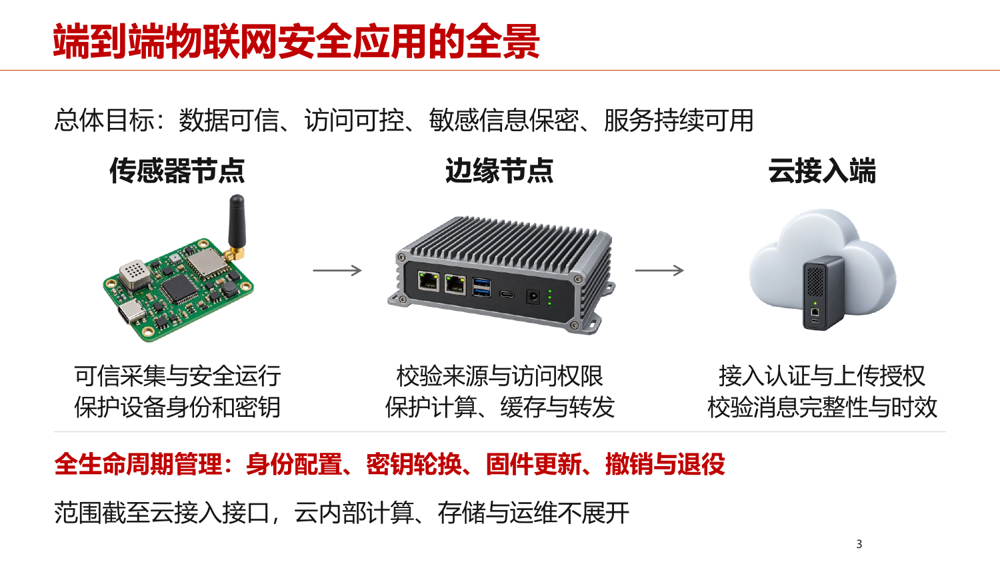

*读图时沿数据流看：端侧保证采集和运行可信，边缘侧校验与处理，云接入侧认证并检查上传权限。底下的生命周期管理贯穿所有节点。*

六类安全要求可以这样记：

| 要求 | 实际要回答的问题 |
| --- | --- |
| 身份与权限 | 你是谁？你能读什么、控制什么？ |
| 来源、完整性、时效 | 数据谁发的？有没有改？是不是过期的旧消息？ |
| 机密性与隐私 | 谁能看到？是不是采集了不必要的个人信息？ |
| 代码与密钥保护 | 固件能否被替换？普通程序能否偷走秘密？ |
| 可用性与恢复 | 出故障时能否继续服务或安全恢复？ |
| 维护与追溯 | 如何修补、撤权、退役，怎样找出事件原因？ |

### 8.1.2 被动攻击与主动攻击

先用一个区分：**被动攻击主要收集信息；主动攻击会改变消息、身份或系统运行。**

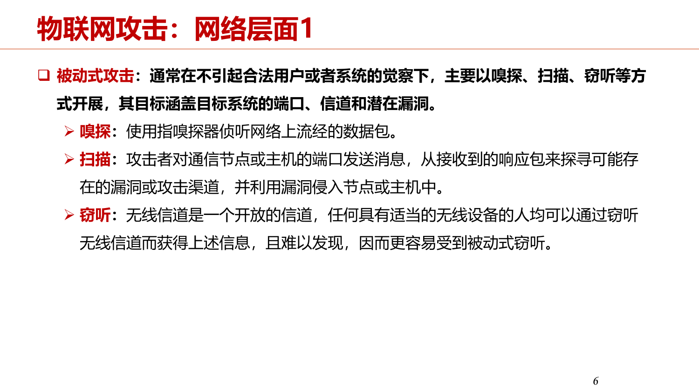

*课件把嗅探、扫描、窃听列在这一组。扫描实际上会发送探测消息；这里按课程分类记录，理解时记住它的主要目的在于发现信息和入口。*

| 类型 | 含义 | 例子 |
| --- | --- | --- |
| 嗅探 | 捕获和分析流经网络的数据包 | 从抓包中看到通信对象和消息内容 |
| 扫描 | 根据节点或端口的响应发现服务与潜在入口 | 探测哪些服务正在运行 |
| 窃听 | 监听开放无线信道上的信息 | 接收未加密的无线传感数据 |
| 假冒 | 冒充合法用户或设备 | 用复制的设备标识接入平台 |
| 信息篡改 | 修改、替换、删除原消息 | 把 25℃ 改成 80℃ 触发错误告警 |
| 重放 | 把过去合法的消息重新发送 | 再次发送以前的开门指令 |
| DoS／DDoS | 消耗资源或破坏服务，使正常用户无法使用 | 大量请求挤占设备的连接和处理资源；DDoS 来自多个来源 |
| Jamming | 发射干扰信号破坏无线通信 | 接收端难以分辨有效信号 |
| 恶意软件 | 让程序按攻击者意图运行 | 被控制的节点发送恶意指令 |

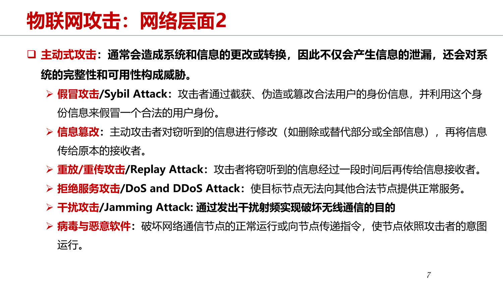

*注意重放不需要修改原消息，也属于主动攻击，因为它主动重新触发了系统行为。课件将 Sybil 与假冒并列；更准确地说，Sybil 强调一个实体伪装成多个身份。*

**重放为什么不能只靠加密解决？** 攻击者可以完全看不懂密文，只录下来再发。接收者需要检查随机挑战、计数器或时间戳等“新鲜性”信息，判断这条消息现在是否仍有效。

### 8.1.3 四种硬件攻击

| 攻击 | 怎样发生 | 与其他方式的区别 |
| --- | --- | --- |
| 故障注入 | 人为扰动电压、时钟等，使运行或校验出错 | **主动让计算出错**，再利用异常结果 |
| 接口植入／调试接口攻击 | 利用未关闭或未保护的 UART、JTAG 等接口 | 从原本为开发者留的入口接触日志、命令或内部状态 |
| 逆向工程 | 读取并分析固件，理解逻辑、凭据和缺陷 | 攻击对象主要是程序及其存储内容 |
| 侧信道攻击 | 分析功耗、时间、电磁、声音等附带信息 | **观察计算留下的痕迹**，不必直接读取秘密 |

例如，不同密钥位可能使密码程序执行不同分支，耗时和功耗也不同。通过这些差异推断秘密，就是侧信道。故障注入则是故意制造异常，二者不要混淆。

## 8.2 身份、权限和密钥

### 8.2.1 用户与设备怎样证明身份

用户口令认证的基本过程：注册时保存 **盐值和口令散列值**，登录时取出同一盐值重新计算，比较结果。盐值不必保密；它让同样的口令也能得到不同的存储值，增加预先计算攻击的难度。工程上还需要专用口令散列算法。

阿里云 IoT 的设备三元组：

| 字段 | 表示什么 | 能否仅凭它证明身份 |
| --- | --- | --- |
| `ProductKey` | 属于哪个产品 | 不能 |
| `DeviceName` | 哪一台设备 | 不能 |
| `DeviceSecret` | 设备秘密，参与签名校验 | 持有并正确使用秘密，才是证明身份的关键 |

射频指纹是另一种辅助识别思路：即使两个热点名称一样，硬件制造差异仍可能使发射信号不同。老师用伪 AP 说明“同名不代表同一设备”。

### 8.2.2 认证与授权必须分开

==**认证回答“你是谁”，授权回答“你能做什么”。**== 温度设备 A 认证成功，可以上传 A 的温度，但不应因此获得 B 的权限，更不应自动获得门锁控制权。


在 MQTT 中，认证解决设备能否连接 Broker，Topic 的访问控制还要决定它能发布和订阅哪些主题。不能把设备 ID、证书存在或“已经连接”直接当作任意操作的通行证。

### 8.2.3 密钥要管整个生命周期

生成并绑定到设备 → 安全存储与受控使用 → 定期轮换 → 泄露后撤销 → 移交或退役时清除。

只把一个密钥写进固件并长期使用，会留下三个问题：固件可能被读取，所有设备可能共用同一秘密，设备丢失以后旧身份仍然有效。设备身份、存储秘密、通信会话都需要生命周期管理。

### 8.2.4 加密、签名、证书分别做什么

| 机制 | 主要目的 | 一个容易理解的例子 |
| --- | --- | --- |
| 对称加密 | 用共享秘密保护内容 | 设备和服务器使用会话密钥加密数据 |
| 公钥加密 | 只有目标接收者能够解密 | 用服务器公钥加密，服务器私钥解密 |
| 数字签名 | 验证来源与内容完整性 | 厂商私钥签固件，设备用可信公钥验签 |
| 数字证书 | 把身份与公钥可信地绑定 | 检查服务器证书，避免把假公钥当成真公钥 |
| MAC／HMAC | 用共享密钥验证消息来源和完整性 | 设备与平台校验消息认证码 |

**签名和 MAC 本身不隐藏明文。** 证书是公开信息，持有证书文件不等于持有私钥；实际认证还要证明对应私钥的持有权。

## 8.3 硬件防护与可信执行

### 8.3.1 熔断、看门狗、PUF、RoT

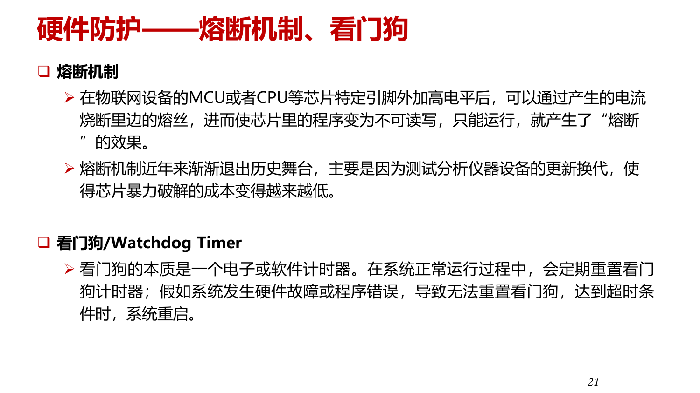

*上半部分保护程序读写入口，下半部分处理程序失去响应，两者解决的问题不同。具体芯片的熔丝权限效果要按其定义理解。*

| 机制 | 工作方式 | 主要保护什么 |
| --- | --- | --- |
| 熔断／熔丝配置 | 用一次性配置限制调试、程序读取或其他能力 | 限制外部读写与设备配置变更 |
| 看门狗 | 正常程序周期性重置计时器，超时则触发恢复 | 故障后的可用性与恢复能力 |
| PUF | 利用制造差异得到独特物理响应，可用于重建设备秘密 | 难以复制的设备身份基础 |
| RoT | 从受保护的硬件、密钥和固件建立最初可信基点 | 后续验证链的起点 |

**老师的看门狗例子：** 超时为 3 秒，程序每隔 1 秒“喂狗”。正常时计时器不断重置；程序卡死，3 秒没有重置，就触发重启。独立硬件看门狗对软件故障的依赖较少；软件看门狗依赖自身运行环境。

> “看门狗……主要提高的是这个系统……发生故障……自动恢复的一个能力。”（节选）

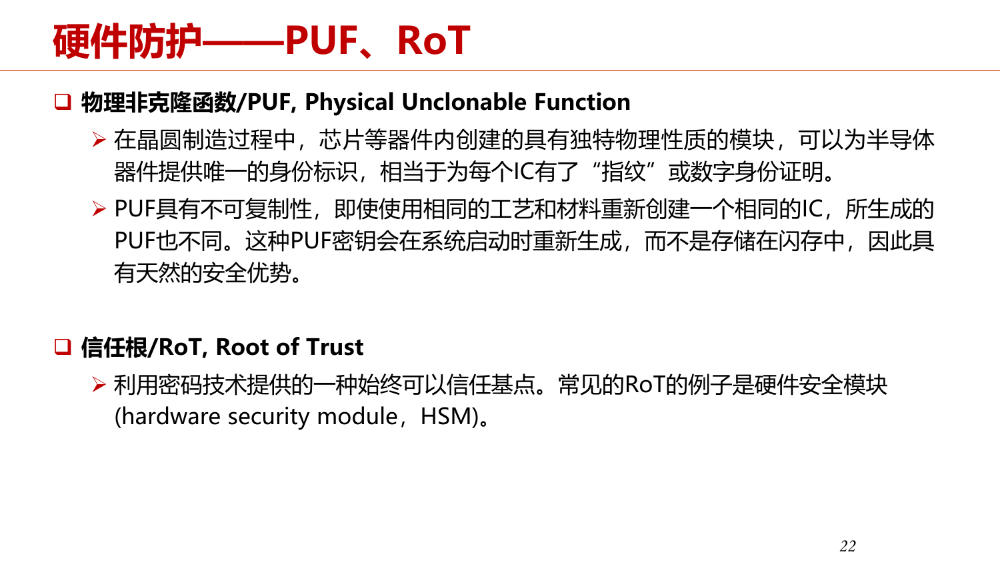

*PUF 可以理解为芯片的物理指纹；RoT 是“从哪里开始相信”的基础。PUF 并不意味着任何攻击都无法成功，实际重建秘密还需要稳定性处理。*

**安全启动是 RoT 的典型应用：** 最初可信代码验证下一阶段引导程序，下一阶段再验证固件。每一环只有验证通过才执行，构成信任链。它保护的是启动时加载的代码；运行中的秘密还需要 TEE 等机制。

### 8.3.2 TEE、REE、CA、TA

==**TEE 在设备中划出受保护的执行环境，把敏感操作与普通应用隔离。**== ARM TrustZone 是实现这一目标的一种硬件技术。普通世界常称 REE，可信世界为 TEE；它们可以在同一块芯片上，通过硬件访问规则隔离资源。

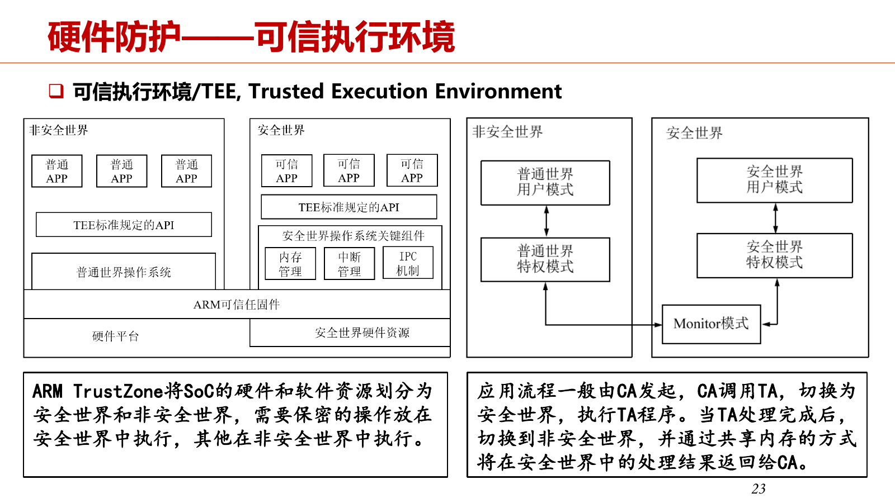

*左侧看资源如何隔离，右侧看调用如何往返。普通应用可以请求可信应用处理，却不能因此任意读取可信世界的内存。*

| 名称 | 在哪里 | 做什么 |
| --- | --- | --- |
| REE | 普通世界 | 运行普通 OS、界面、网络通信等 |
| TEE | 可信世界 | 保存敏感数据，执行密钥操作、认证等 |
| CA，Client Application | 通常在 REE | 发起可信服务请求、取回获准结果 |
| TA，Trusted Application | TEE | 实际执行受保护功能 |
| TEE Client API | CA 使用 | 建立上下文、会话，调用可信服务 |
| TEE Internal API | TA 使用 | 加密、安全存储和其他可信操作 |

**指纹解锁例子：** CA 发出验证请求 → TA 在 TEE 内比对指纹 → 返回成功或失败 → 普通应用继续相应流程。原始指纹模板无需直接暴露给普通应用。敏感授权结果的使用也要受保护，不能只依靠任意 App 自觉遵守结果。

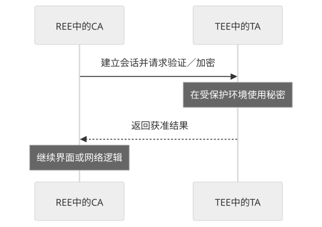

### 8.3.3 沙盒、栈保护与 WebAssembly

沙盒可以理解为“程序只能在划给自己的区域里活动”。无隔离时，用户模块越界写可能破坏内核；有隔离时，通过保护域与检查限制访问。

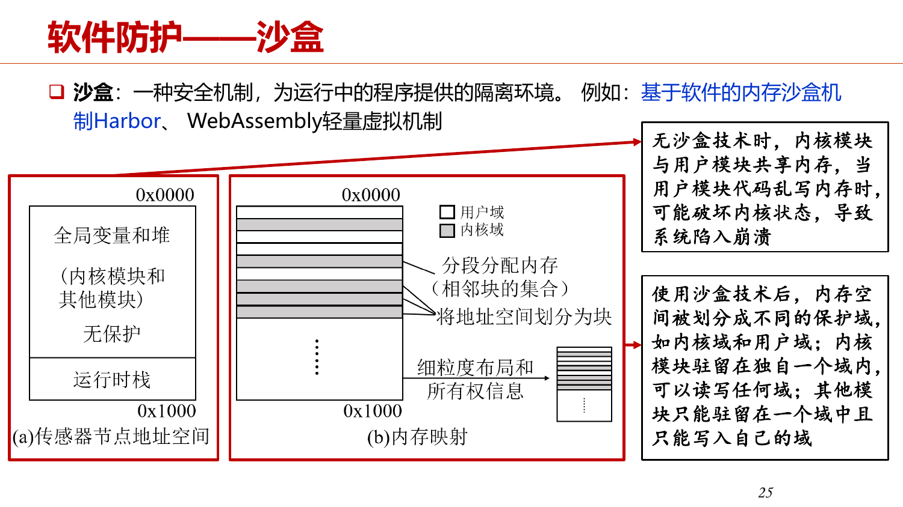

*不同模块拥有自己的域；课件里的内核域具有较高权限，用户模块不能任意改写其他域。*

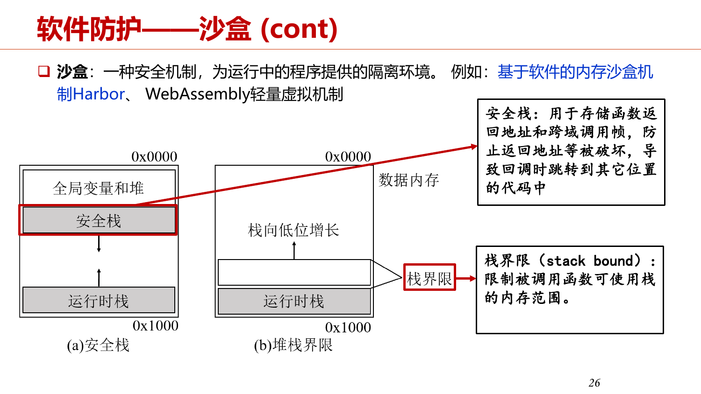

*安全栈保护返回地址等控制信息，栈界限限制允许使用的地址范围。隔离模块和保护模块内部的控制流是两个层次。*

- **安全栈**：把函数返回地址、跨域调用信息等与普通可写数据分开，减少缓冲区溢出改变执行位置的风险。
- **栈边界**：检查访问是否超过允许的栈范围，防止破坏相邻区域。
- **WebAssembly／Wasm（课堂补充）**：用轻量运行时执行字节码，给模块独立线性内存，越界访问触发检查；文件、网络、传感器等宿主资源通过受控导入接口访问。

例如，给 Wasm 程序开放“读温度”接口，不等于把整个网关文件系统和所有外设都开放给它。隔离效果仍取决于运行时与宿主接口的正确实现。

## 8.4 软件保护、蜜罐与安全更新

### 8.4.1 安全存储、漏洞挖掘、代码混淆

安全存储要同时关注数据是否加密、秘密放在哪里、谁能调用解密操作。把密文和解密密钥放在同一个任意可读的位置，保护效果有限。

| 工作 | 目的 | 例子 |
| --- | --- | --- |
| 漏洞挖掘 | 找到潜在问题 | 静态分析代码；Fuzzing 输入异常数据观察崩溃 |
| 漏洞分析 | 理解触发条件、原因、影响 | 找出过长数据包导致越界写的具体位置 |
| 修复与验证 | 消除根因，检查功能与异常输入 | 修正长度检查，并验证边界输入 |
| 代码混淆 | 保持功能，增加逆向分析难度 | 重命名、改变控制流、隐藏敏感字符串 |

**课堂例子：** `SmartLamp.turnOn()`、`turnOff()` 被重命名为不直观的名字后，功能仍相同，但程序结构较难理解。R8 还可以做代码缩减和优化。混淆不能代替认证、权限检查或修复漏洞。

### 8.4.2 蜜罐：先观察攻击行为

蜜罐是提供诱饵服务来吸引访问、记录攻击行为的系统。它主要帮助发现威胁和分析漏洞。

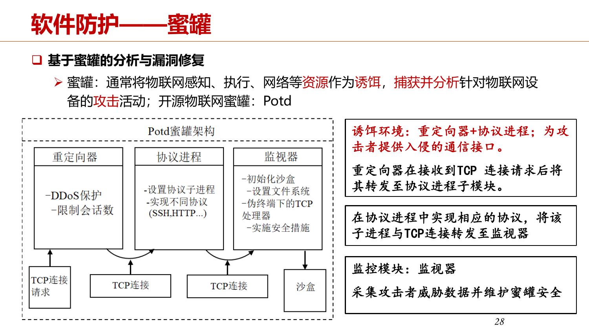

*重定向器接收连接并转发，协议进程模拟服务，监视器收集行为并维护蜜罐环境。诱饵环境本身也要隔离，避免成为新的攻击跳板。*

**沙盒与蜜罐的区别：** 沙盒限制程序能做什么；蜜罐观察攻击者做什么。

### 8.4.3 OTA 安全

OTA 是通过网络更新软件或固件。安全要求包括：传输受保护，发起者有权限，升级包可信且完整，型号与版本匹配，失败时能够恢复。


**为什么有 TLS 还要验固件签名？** TLS 保护一次传输链路；签名使设备能验证升级包本身来自可信发布者。升级文件经过缓存、存储或其他转发路径后，仍应验证。

**恢复与防回退也要区分：** 升级失败时恢复上一个可用版本，是可用性保障；阻止恶意安装过旧、有漏洞的固件，是版本安全策略。二者需要一起设计。

## 8.5 无线、传输与隐私保护

### 8.5.1 无线协议的安全能力

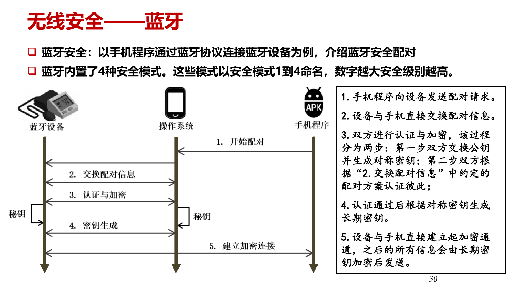

*重点看“交换配对信息—认证／生成密钥—建立加密通道”的顺序。不同蓝牙版本和配对方式有差异，课件安全模式编号不宜混用到所有 BLE 版本。*

| 协议 | 核心安全机制 | 要理解的关系 |
| --- | --- | --- |
| 蓝牙 | 配对、身份验证、密钥生成、链路加密 | 先建立可信关系，再保护通信 |
| ZigBee | 密钥、AES-128、帧计数与完整性校验 | 加密防窃听，认证码防篡改，计数防重放 |
| RFID Hash-Lock | 使用 `metaID` 代替真实 ID | 固定标识仍可被关联和追踪 |
| 随机化 Hash-Lock | 引入随机数和散列响应 | 降低固定响应问题，但不能据此认为整个流程无追踪风险 |
| LoRaWAN 1.0 | `AppKey` 派生网络和应用会话密钥 | 网络完整性与应用内容保护分工 |
| NB-IoT | SIM 凭据、3GPP 认证与密钥协商 | 网络与更上层安全机制分层使用 |

!!! note "课件中一个容易混淆的表述"

把 CRC 写成防篡改手段。CRC 能发现传输错误，却不能抵抗攻击者修改数据后重新计算 CRC。**防恶意篡改需要带密钥的认证码／MIC 等密码学校验。** 同样，授权频段降低部分干扰风险，不意味着通信天然保密。

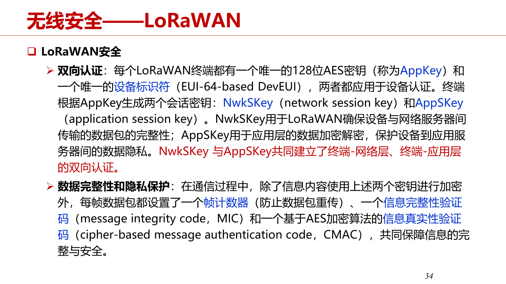

*老师按 LoRaWAN 1.0 介绍。`NwkSKey` 用于网络层消息完整性等功能，`AppSKey` 保护应用载荷，帧计数器参与防重放。不要把这个密钥名称表直接当作所有版本都相同。*

### 8.5.2 TLS 与安全 MQTT

TLS 为传输连接提供机密性、完整性，并通过证书等机制认证通信方。HTTP 运行在 TLS 上成为 HTTPS；MQTT 也可以在 TLS 上运行。

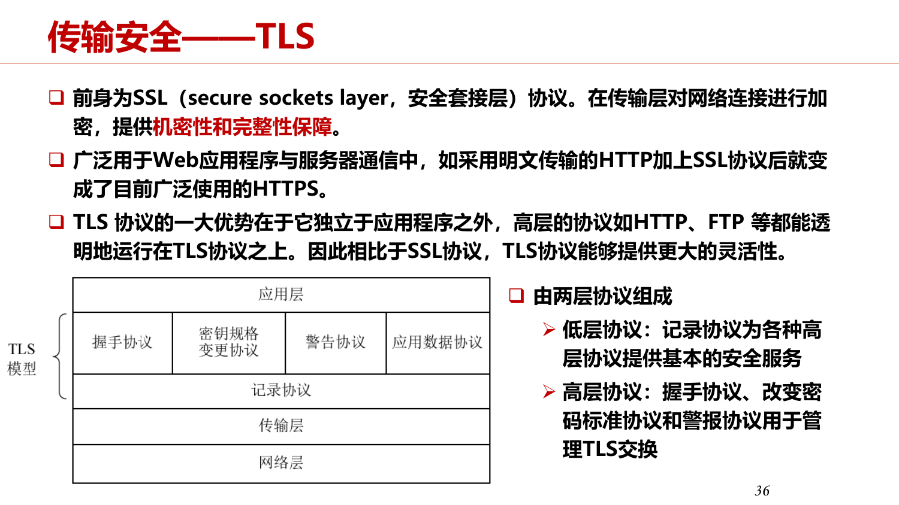

*记录协议负责保护数据，握手负责协商参数、认证和建立密钥。课件画的是包含 ChangeCipherSpec 的传统协议结构。*

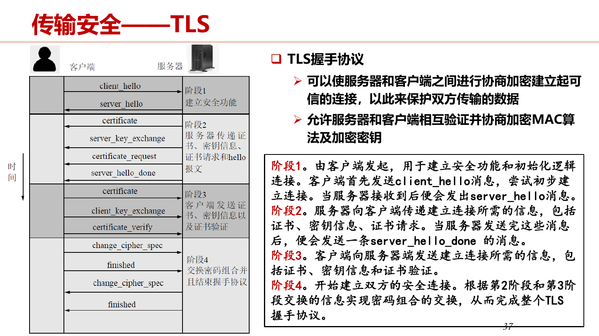

*按“Hello 协商—证书与身份检查—建立共享密钥—确认后安全传输”理解。这是较早版本的示意，TLS 1.3 的报文流程有所变化。*

| MQTT 所在层面 | 可以加什么保护 |
| --- | --- |
| 应用层 | 设备凭据、发布／订阅权限控制 |
| 传输层 | TLS；双向 TLS 时双方都提供并验证证书 |
| 网络层 | 专线、VPN 等附加隔离 |

**单向 TLS** 通常验证服务器身份，客户端仍可通过应用层凭据认证；**双向 TLS** 进一步用客户端证书认证客户端。QoS 则讨论交付保障，不能替代加密与授权。

### 8.5.3 设备指纹、语音重放与身份位置隐私

- **伪 AP 识别**：名称可复制，功率放大器非线性、帧间时间分布等物理特征可以辅助识别真实硬件。
- **蓝牙追踪**：固定设备地址方便关联轨迹；地址轮换可以减少这种关联，但射频物理指纹仍可能暴露可识别特征。
- **语音重放检测**：仅播放用户录音，可能欺骗语音控制。课堂介绍将声音与佩戴传感器测得的身体振动比对，检查是否来自正在说话的用户。
- **身份假名**：不同服务使用不同假名，减少跨服务直接关联。
- **假位置信息**：同时发送一个真实位置和若干假位置，使服务提供方难以判断真实位置；需要考虑服务效果、轨迹关联及额外开销。

这些方法的共同目标是减少身份与行为的可关联性。替换一个名字并不能自动消除所有隐私泄露。

### 8.5.4 AI 模型隐私与隐私计算（课堂补充）

| 风险 | 攻击者想得到什么 |
| --- | --- |
| 模型窃取 | 获得参数，或通过查询输入输出训练替代模型 |
| 成员推断 | 判断某条数据是否参加过训练 |
| 模型反演 | 从输出或模型信息推断原始敏感特征 |
| 课堂所称微调攻击 | 在获取部分参数后继续训练，尝试恢复能力或构造替代模型 |

**例子：** “某人的照片是否在训练集里”是成员推断；“推断出照片中人脸的特征”更接近模型反演；“训练一个行为类似的服务”是模型窃取。

| 隐私计算方法 | 主要做法 | 例子 |
| --- | --- | --- |
| MPC，安全多方计算 | 多方在尽量不公开各自原始数据的条件下共同计算 | 两家医院联合统计患者数量 |
| FL，联邦学习 | 本地训练，聚合模型更新 | 多个设备训练识别模型，原始采样留在本地 |
| HE，同态加密 | 对密文执行支持的计算 | 云端计算加密数值，授权方解密结果 |
| 机密计算 | 在 TEE 等隔离环境中处理敏感数据 | 同一服务器上的其他程序不能直接读到受保护计算的数据 |


*这是联邦学习的简化示意。原始数据留在本地不等于模型更新绝对没有隐私风险，仍可能需要额外防护。*

## 8.6 典型安全开发框架与软件保护工具

### 8.6.1 PPT 中的设备安全框架

| 框架 | 核心功能 |
| --- | --- |
| AWS IoT | 设备常用 X.509 证书认证，再由策略授予访问权限；Web／移动应用可用 IAM、Cognito 等身份 |
| 阿里云 Link ID² | 设备身份、双向认证、轻量安全连接、业务数据保护与密钥管理 |
| 百度 HISK | 面向设备、边缘、云与 App 的安全体系，包括设备身份和 PKI 证书服务 |

*设备收到服务端随机挑战，用秘密计算响应，认证服务校验结果。核心是证明持有秘密，并让旧响应不能直接用于新的挑战。*

### 8.6.2 DexGuard 与 Cloakware（课堂补充）

| 保护阶段或技术 | 作用 |
| --- | --- |
| 名称混淆 | 隐藏有语义的类、方法、变量名 |
| 控制流混淆 | 增加程序逻辑分析难度 |
| 资源加密 | 保护敏感字符串和其他资源 |
| 代码虚拟化 | 让关键代码在专用解释机制中执行，增加分析难度 |
| 白盒密码 | 在可能被观察的执行环境中增加密钥提取难度 |
| 反调试与完整性检查 | 检测异常调试或程序被修改 |

DexGuard 的课堂介绍分为构建阶段保护和运行阶段检测；Cloakware 的介绍强调代码／数据变换、白盒密码和反调试。它们主要增加逆向与篡改的成本，仍需与正确的权限和密钥设计结合。

## 8.7 安全温度监控案例

### 8.7.1 从采集到服务器解密

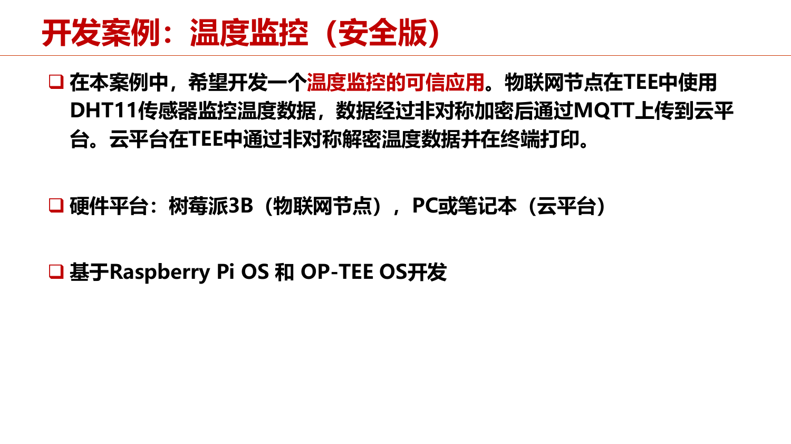

*课件说明案例目标与平台。数据流为：安全驱动把 DHT11 温度送进 TEE，可信应用加密，普通 MQTT 客户端上传，服务器可信应用解密。*

这里有三个保护层次：安全驱动与 TEE 保护采集和计算；应用载荷加密保护温度内容；TLS 保护设备与通信端点之间的链路。**TLS 不自动保护终点解密后的数据，TEE 也不自动保证传感器读数真实。** 每一段都要有相应设计。

### 8.7.2 CA、TA、PTA 的分工与调用

CA 处理普通世界的请求和 MQTT 通信；TA 处理可信世界的加解密；案例中的 PTA（Pseudo TA）承担靠近可信 OS 的传感器驱动功能。PTA 不是普通用户态 TA，不能把所有驱动都随意当作普通可信应用。

复习要理解上下文、会话、命令、资源释放的关系；不必逐行背案例代码。基本 API 的调用流程见下列示例。

| CA 的基本步骤 | 意义 |
| --- | --- |
| `TEEC_InitializeContext` | 初始化与 TEE 的通信环境 |
| `TEEC_OpenSession` | 与指定 TA 建立会话 |
| `TEEC_InvokeCommand` | 发送命令和参数，由 TA 执行 |
| `TEEC_CloseSession` | 关闭会话 |
| `TEEC_FinalizeContext` | 释放上下文资源 |

### 8.7.3 Coding Agent 生成代码后还要验证什么

老师给 Codex 的任务包含硬件、OP-TEE 仓库、传感器与 MQTT 要求。生成项目看上去有 CA、TA、编译配置，也能运行，但温度读取却返回固定测试值，没有完成真实采样。

这个例子要记住：**编译成功、上传成功，都不能证明业务要求完成。** 对这个任务，至少应检查真实温度变化是否能反映到上传数据，驱动时序和 GPIO 是否正确，秘密和敏感处理是否确实留在 TEE 中。

## 8.8 研究前沿：怎样减少安全开发的负担

### 8.8.1 dTEE：声明哪些数据需要保护

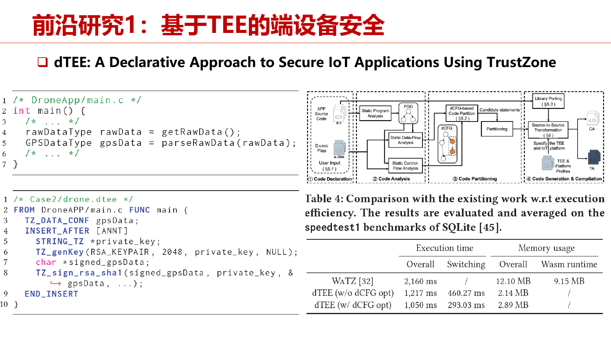

*开发者声明敏感变量和操作，工具自动拆分 CA／TA 并生成跨世界接口。课堂用 GPS 数据举例：先描述保护需求，再自动生成相应可信代码。*

### 8.8.2 资源受限设备上的 Wasm

课堂介绍将部分运行时工作提前到编译时：用 AOT 把字节码转成本地代码，并通过静态分析减少能提前确定的重复检查，从而降低小设备的执行与内存开销。安全检查不能因为追求性能就随意省掉，只能在有依据的情况下优化。

### 8.8.3 Matter：互联互通与设备认证

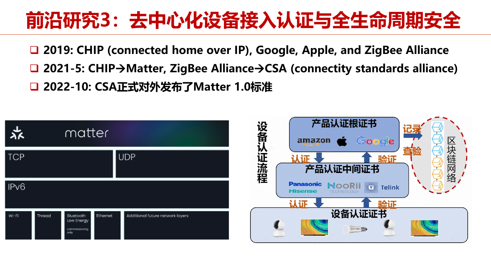

*不同厂商设备需要共同的接入和安全规则，不能只靠每家厂商自己的封闭认证。*

Matter 设备通过设备认证证书链证明来源：可信根 → 中间证书 → 设备认证证书。接入时还要证明相应私钥的持有权，并经过配网与授权过程，才能加入系统。

IP 通信、Wi-Fi／Thread／以太网等承载网络与配网方式需要区分：蓝牙常用于配网，不能简单理解为所有 Matter 业务数据都能直接经 BLE 承载。课堂的协议栈口述只作整体理解。

!!! tip "把本章串起来"

    **先识别攻击，再匹配保护机制。** 窃听对应加密；篡改对应 MAC／签名；重放对应新鲜性检查；非法访问对应认证与授权；固件替换对应安全启动与安全 OTA；敏感运行数据对应 TEE／隔离；程序卡死对应看门狗；威胁观察对应蜜罐。各机制互补，不能用一个名词回答所有安全问题。

下一步读[复习课的第八章部分](review.md#review-ch8)，按老师点到的概念逐项自测。
