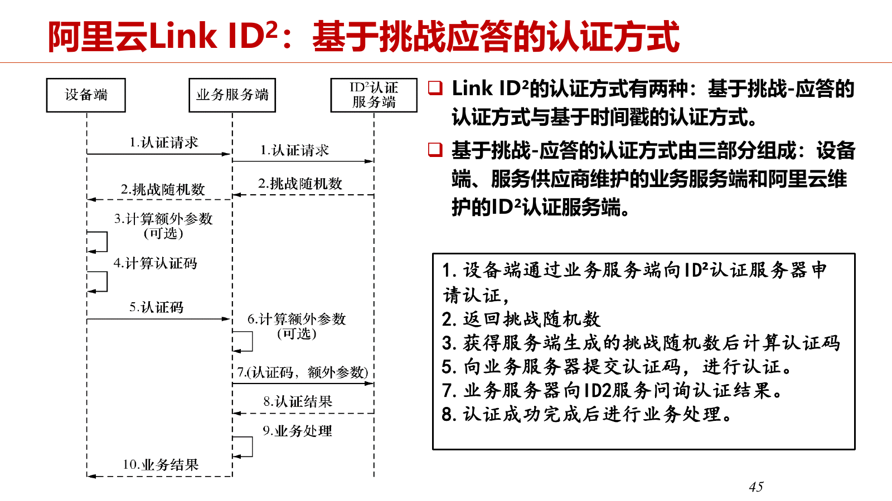

# 第八章 物联网安全

本章按《第八章-1024.pdf》的“概述—安全机制—典型框架—案例开发—研究前沿”组织。页码均指 PDF 物理页。

现有六份字幕没有第八章的完整授课记录，因此知识点主要依据 PPT；下方“老师讲解”只引用其他课次已经整理好的相关原句，并注明来源。没有对应讲解的部分保留为 PPT 笔记。

## 8.1 安全问题：要保护什么，攻击从哪里来

### 8.1.1 物联网安全与传统网络安全的区别

**知识点（PPT 第 3—5、12—13 页）**

- 物联网设备部署广泛、类型多、接触物理环境，攻击面不仅在网络，还包括硬件、固件、传感器和执行器。
- 摄像头被攻破可能泄露隐私；智能电表的数据被读取、伪造或篡改，可能暴露用电行为或改变计费结果。
- 安全目标贯穿“传感器节点—边缘节点—云接入端”，还要覆盖凭据配置、密钥轮换、固件更新、权限撤销和设备退役。
- 端侧资源受限，安全机制既要有效，也要考虑计算、内存和能耗开销。

| 安全要求 | 在应用中具体检查什么 |
| --- | --- |
| 身份与权限 | 谁可以接入、读数据、发消息、改阈值？ |
| 来源、完整性与时效 | 谁生成记录？是否被修改、重放或过期？ |
| 机密性与隐私 | 谁能看到数据？是否确有必要采集、上传？ |
| 代码与密钥保护 | 固件能否被替换？普通程序能否得到秘密？ |
| 可用性与恢复 | 断网、故障、资源不足时还能保住哪些功能？ |
| 维护与追溯 | 怎样更新、撤权、退役和定位安全事件？ |

**老师讲解（10.21，00:00—00:10，云平台安全的相关说明）**

> 第四是安全认证，这里有“两头堵”的问题。  
> 一头是安全非常重要：传统互联网受攻击可能是谋财，物联网设备被攻破可能涉及害命。  
> 例如智能门锁被攻破，影响很大。  
> 另一头是设备能力很弱，复杂的加密、密码学算法可能跑不起来，或者运行很慢，严重影响体验。  
> 怎样解决安全认证，是很有挑战的问题。  

### 8.1.2 网络攻击与硬件攻击

**知识点（PPT 第 6—11 页）**

| 维度 | 类型 | 主要影响 |
| --- | --- | --- |
| 网络 | 窃听、嗅探、探测 | 获取通信内容、接口或系统信息 |
| 网络 | 身份假冒、数据篡改、重放 | 冒充主体，改变消息或利用旧消息再次触发操作 |
| 网络 | DoS/DDoS、射频干扰、恶意软件 | 使设备或通信服务无法正常工作 |
| 硬件 | 故障注入 | 使计算产生异常，破坏保护机制或泄露秘密 |
| 硬件 | 调试接口暴露 | 从 UART、JTAG 等接口接触日志、命令或设备内部信息 |
| 硬件 | 固件逆向 | 分析固件中的逻辑、凭据和缺陷，或替换固件 |
| 硬件 | 侧信道 | 从功耗、温度、电磁、声音等间接信息推断计算行为 |

重放攻击的关键是“消息曾经合法，不代表现在仍然合法”，所以后面的计数器、随机数、时效校验都很重要。
侧信道关注正常计算过程中泄露的附带信息；故障注入则主动扰乱运行，两者的切入点不同。

现有字幕未提供这些攻击类型的完整逐项讲解，以上依据 PPT 整理。

## 8.2 身份认证、访问控制与密钥管理

### 8.2.1 用户认证与设备认证

**知识点（PPT 第 16—17 页）**

- 用户口令认证：注册时保存口令与随机盐值组合后的散列值；登录时使用保存的盐值重新计算并比较，而不是直接保存、比较明文口令。
- 阿里云设备三元组为 `ProductKey`、`DeviceName`、`DeviceSecret`。设备用秘密参与签名，平台验证，以证明设备身份。
- 设备名称或标识本身不是身份证明，知道设备 ID 不等于拥有设备秘密。
- 射频指纹利用设备物理特征辅助区分真实设备与仿冒设备，是课件列出的另一类认证思路。

**老师讲解（09.16，01:07—01:09，Giotto 的用户认证与令牌机制）**

> 第一，传输使用 HTTPS。  
> 现在用 Edge、Chrome 访问 HTTP 网站，浏览器会显示不安全标志。  
> 登录时用户名和密码可能是明文传输，HTTPS 则对传输内容加密。  
> 第二，使用 OAuth 2.0 进行用户认证和授权。  
> 用户用账号、密码登录中心服务器后，获得唯一 ID 和密钥。  
> 访问 Giotto 数据库前，先用 ID 和密钥获取 OAuth 令牌，取得数据访问权。  
> 令牌超时后需要重新生成，会自动失效，需要时重新获取，这样更安全。  

### 8.2.2 认证之后还要授权

**知识点（PPT 第 18 页）**

认证回答“你是谁”，授权回答“你能做什么”。两者不能混为一谈。

| 主体 | 合理权限 | 不应顺带拥有的权限 |
| --- | --- | --- |
| 传感器 A | 发布自己的温度数据 | 冒用 B 的标识、修改告警阈值 |
| 边缘采集服务 | 订阅指定节点、校验和处理数据 | 读无关节点、导出私钥 |
| 边缘上传服务 | 上传获准的数据和结果 | 管理所有设备和所有主题 |
| 维护人员 | 按职责配置或更新 | 以普通监控身份直接替换固件 |

权限检查要放在每次受保护操作的入口，不能只在建立连接时验证一次。

**老师讲解（09.16，01:07—01:09，访问控制的补充）**

> 第三，由访问控制层管理访问权限。  
> 用户分管理员和普通用户。  
> 管理员可以访问所有传感器数据，还能定义普通用户的权限、制定访问控制列表。  
> 普通用户按照访问控制列表中的权限访问数据，必须有相应权限才能访问。  

### 8.2.3 密钥为什么需要全生命周期管理

**知识点（PPT 第 19、22、44 页）**

- 生成与注入：确定由谁生成秘密，如何可信地绑定到设备。
- 存储与使用：限制谁能调用密钥、是否可以导出，考虑与普通程序隔离。
- 轮换与重启：处理新旧凭据交接，恢复计数器和会话状态。
- 泄露与撤销：阻止已泄露凭据继续接入，考虑已有连接何时失效。
- 移交与退役：清除秘密，同时撤销旧设备和旧人员的权限。

保护通信不只取决于加密算法，也取决于密钥如何进入设备、在哪里使用、什么时候失效。
HMAC 使用共享密钥校验消息的真实性与完整性，本身不负责隐藏消息内容；下面保留老师的直观讲法，学习时把认证与加密区分开。

**老师讲解（10.21，01:34—01:37，共享密钥与分发问题）**

> 接下来简单讲安全认证。  
> 这部分很难跳出已有安全框架去设计机制。  
> 从研究角度，还有侧信道等其他安全方法，但主流仍是基于密码学的体系。  
> 如果有共享密钥，事情比较简单。  
> 设备和云提前约定一个密钥，就可以用它处理双方通信，一边加密，一边解密。  
> 这里给出 Python 中 HMAC 的实现例子。  
>
> 共享密钥本身也有问题，最大的问题是密钥怎样分发。  
> 假设生产一款智能电表，一共生产 1000 万个，怎样把共享密钥存进去？  
> 难道直接写在内存或外存里？  
> 例如电表板子上有一张 SD 卡，把共享密钥写进去，别人把卡拿出来就读到了。  
> 设备本身并不安全，是可能被攻破的。  
> 因此密钥分发是很大的问题：怎样让设备天然拥有一个与平台共享的密钥？  

### 8.2.4 公私钥、数字证书与身份绑定

**知识点（结合 PPT 第 37、43、46 页及云平台课堂）**

- 对称密钥机制中，双方使用同一秘密；非对称机制中使用一对公钥、私钥。
- 要让 B 接收保密数据，可以使用 B 的公钥加密，由 B 的私钥解密。
- 公钥公开仍有一个问题：如何确认这把公钥确实属于 B？数字证书把身份与公钥绑定，由可信签发者签名。
- CA 的公钥用于验证其签名。注意区分“加密保证机密性”与“签名证明来源和完整性”；老师讲解中用“加密、解开”作直观说明。
- 私钥应由持有者保护；设备可以通过证书传递公钥，并证明持有对应私钥。

**老师讲解（10.21，01:37—01:41，公私钥通信例子）**

> 于是又有了非对称密钥。  
> 计算机网络课最后一章可能会讲，安全相关专业的同学可能更熟悉。  
> 密码学里分对称和非对称。  
> 对称密钥就是加密方和解密方使用同一个密钥。  
> 比如用 12345 加密，再用 12345 处理，就可以解密。  
> 非对称是用 12345 加密的数据，必须用 56789 才能解密，加密与解密的密钥是一对不同的密钥。  
> 有了非对称密钥，就能实现设备认证或签名机制，里面的过程比较复杂。  
>
> 这里给了一个数字签名的例子。  
> 首先是一段要证明的话：“I hereby certify that the public key …”，证明这段公钥属于某个实体。  
> 例如一个叫 [识别不清：人名听写为“Robert John斯Smith斯”] 的人，后面还有地址、邮编、电话、邮箱等信息。  
> 下面由 CA，也就是权威机构，用它自己的私钥来处理。  
> 非对称密钥中，一把叫私钥，一把叫公钥。  
> 每个实体都有自己的一对密钥，私钥自己保存，千万不要告诉别人；公钥则是公开的。  
> 这里要把自己的公钥公开，因为别人给你发消息时，必须先知道你的公钥，才能用它加密。  
>
> 画一个例子：A 要向 B 发送消息，A 有自己的 eA、dA，B 有自己的 eB、dB。  
> 这里把 e 叫私钥，把 d 叫公钥；命名不一定，换一下也可以。  
> 私钥是秘密的，公钥是公开的。  
> 它们可以先在本地计算出来，得到两个数。  
> 例如 12345 和 [识别不清：另一串数字]，其中公钥要公开，dA、dB 都是公开的。  
>
> A 要向 B 发送一段秘密消息，要从这四把密钥里选一把加密，应该选哪把？  
> A 能用哪几把？  
> B 的私钥，A 是不知道的。  
> A 希望除了 B 以外，别人都不能解开消息，因此应该用 B 的公钥来处理消息 m。  
> A 把处理后的东西发给 B，只有 B 用自己的私钥才能解开，这样就实现了秘密通信。  
> [板书标识识别不清：前面口述 d 为公钥，此处又读作“Eb 公钥”；不据此补写加密公式。]  
> 公私钥体系的价值在于，不必在公共信道中传递共享密钥。  
> 实际传的 message 很多时候就是一个 session key，即会话密钥。  
> 第一轮通信可以先用这种方式传密钥，完成后，后续通信再用这个 key 加密。  

**老师讲解（10.21，01:41—01:45，为什么需要证书）**

> 加密过程怎样进一步实现签名？  
> 这里的问题是：A 怎么确定 dB 就是 B 的公钥？  
> 公钥虽然公开，但怎样公开、为什么可信，还是问题。  
> 比如我做一个网站，把公钥放上去，说“这是我的公钥”，你就相信吗？  
> 网站说自己是百度，真的就是百度吗？也可能是伪造的。  
> 网站说自己是浙大的选课系统，你把账号密码都填进去，结果系统可能是我伪造的，我就可以攻击你。  
> 所以需要第三方来证明 B 的身份与它的公钥之间的关联。  
> 信任要一层一层建立。  
>
> 这里一串公钥与下面身份之间的关联，由 CA 用自己的私钥签名。  
> 简单来说，就是进行加密，而 CA 的公钥大家都知道。  
> CA 可以是某个电信管理部门，或者它授权的权威机构。  
> 它的公钥明确放在网站上，或者内置在浏览器、软件里。  
> 用 CA 的公钥解开，就可以看到并相信这段话，里面写的是身份与公钥的关联关系。  
> 设备认证有时也要用这样一套公私钥流程。  

## 8.3 设备防护与可信运行

### 8.3.1 熔断、看门狗、PUF 与信任根

**知识点（PPT 第 21—22 页）**

| 机制 | 要解决的问题 | 核心思路 |
| --- | --- | --- |
| 熔断保护 | 芯片内部程序被直接读写 | 利用熔丝或芯片保护配置限制读写，课件同时指出其保护能力受到分析设备进步影响 |
| 看门狗 | 程序错误或故障导致设备卡住 | 正常运行时定期重置计时器；超时未重置则触发恢复或重启 |
| PUF | 如何给物理器件独特身份或秘密 | 利用制造过程产生的物理差异，形成难复制的特征 |
| RoT | 信任链从哪里开始 | 以可信硬件或密码模块作为信任基点，例如 HSM |

看门狗主要服务于可用性和故障恢复，不等同于身份认证或数据加密。
现有字幕未提供这四项的完整讲解，以上依据 PPT 整理。

### 8.3.2 TEE 与 TrustZone：隔离敏感计算

**知识点（PPT 第 23 页）**

- TEE 是可信执行环境，用于隔离需要保护的代码、数据和计算。
- TrustZone 将硬件、软件资源划分为安全世界和非安全世界。
- CA 是普通世界中的客户端应用；TA 是安全世界中的可信应用。
- 典型流程：CA 发起调用，切换到安全世界执行 TA，再通过约定接口、共享内存等方式返回结果。
- 硬件提供隔离能力后，软件仍要适配，尤其是驱动、运行环境和接口。

图：TEE 的隔离结构与世界切换（第八章 PPT，PDF 第 23 页）。

**老师讲解（09.30，02:25—02:27，TEE 的软件适配问题）**

> 最后是 TEE。  
> 现在很多 ARM Cortex 处理器已经支持机密执行环境，最后一章安全会讲。  
> 现在关键是怎么用，硬件已经支持，软件能不能适配好？  
> 重要问题之一是驱动：普通驱动要转成 TEE 里的驱动，到底怎么转，很困难。  
> 两边环境不同，非 TEE 环境调用的函数，TEE 里可能没有。  

### 8.3.3 沙盒与 WebAssembly：限制不可信程序

**知识点（PPT 第 25—26、64 页）**

- 沙盒为程序提供隔离环境，限制其可以访问的内存和资源。
- 将内核与用户模块放入不同保护域，减少用户模块破坏内核状态的风险。
- 安全栈和栈界限保护返回地址、跨域调用帧及可使用的栈范围。
- WebAssembly 可作为轻量虚拟执行层，隔离不可信应用；端侧实现还要控制执行引擎的内存开销。
- TEE 与沙盒可以配合使用：前者保护可信计算，后者约束不可信应用的影响范围。

**老师讲解（09.30，02:20—02:22，安全内核与轻量虚拟机）**

> 这是 2017 年的 Tock 操作系统。  
> 底下是 hardware，上面是 kernel，用 Rust 重构。  
> 重构后，可以认为这个内核是 trusted 的。  
> 其中微控制器相关驱动也是 trusted，上面应用可以是 untrusted。  
>
> 另一个比较重要的技术是 WebAssembly，是谷歌、苹果等提出的字节码格式，现在浏览器广泛支持。  
> 原来主要是 JavaScript，WebAssembly 有一些很好的特性。  
> 首先支持多种语言，Rust 可以翻译成 WebAssembly 字节码，Go、R 等也可以。[语言例子按口述保留]  
> 第二，执行效率比较高。  
> 浏览器有执行引擎，边缘侧也有不同执行引擎，可以执行 WebAssembly 字节码。  
>
> 它可以认为是一个轻量级虚拟机，能够隔离应用。  
> 例如应用不可信，写了死循环，隔离后就不会影响其他应用；不隔离可能影响别人。  
> 因此我们认为比较好的 OS 架构，最底下核心用 Rust 重构，具备安全特性；上面加 WebAssembly 中间层。  
> 中间层上的应用可以 untrusted，因为隔离在虚拟机里，不会对整个硬件产生不良影响。  
>
> 但端侧设备要做好的 WebAssembly 执行引擎很困难。  
> 已有开源 WAMR、wasm3 等引擎占用内存很大，很难运行在小内存物联网设备上。  
> 这是 2022 年的工作，考虑编译期、运行期检查，把内存降到 4 KB 以下，当时我们是第一个。[具体检查优化过程未展开]  

### 8.3.4 存储、漏洞修复、OTA 与蜜罐

**知识点（PPT 第 24、27—28 页）**

- 安全存储包括设备秘密与数据的保护，以及云端的访问控制、授权、审计、容错和加密。
- 漏洞挖掘可结合静态分析、符号执行和动态 Fuzzing；发现缺陷后还要分析、修复。
- OTA 及时修复漏洞，但更新通道本身也要安全：验证操作权限、传输保护、更新完整性、版本和回滚机制。
- 蜜罐用诱饵设备或服务观察攻击行为，收集数据并辅助分析、修复，课件以 Potd 为例。

**老师讲解（10.21，00:50—00:56，OTA 的验证与安全要求）**

> 汽车场景更加复杂，因为安全要求太高。  
> OTA 中某个环节被攻破，就意味着整个应用或终端失去控制权，攻击者想干什么都可以。  
> OTA 安全涉及中间人攻击、利用旧版本漏洞等。  
> 收到差分包并重建得到新版本后，还要验证，例如计算摘要，确认版本正确、一个比特都不差，然后才重启并切换到新版本。  

现有字幕未提供存储防护、漏洞挖掘和蜜罐的完整展开，相关知识点依据 PPT。

## 8.4 通信安全与隐私保护

### 8.4.1 无线协议如何提供安全能力

**知识点（PPT 第 30—35 页）**

| 协议或方案 | 课件关注的安全机制 |
| --- | --- |
| 蓝牙 | 配对信息交换、认证、密钥协商、长期密钥和加密通道 |
| Zigbee | 计数器、认证、密钥管理与 AES 加密，课件也列出 CRC 检错 |
| RFID Hash-Lock | 用 metaID 代替直接暴露真实 ID，但静态关联与明文交换仍有局限 |
| 随机化 Hash-Lock | 随机数参与询问应答，课件同时指出最后明文传送 ID 仍可能被追踪 |
| LoRaWAN | AppKey、DevEUI、网络与应用会话密钥、帧计数器及 MIC |
| NB-IoT | SIM 凭据、3GPP 认证和密钥协商，以及网络层、传输层的密钥机制 |

LoRaWAN 在课件所述方案中区分 `NwkSKey` 和 `AppSKey`：前者承担网络侧完整性相关保护，后者用于应用数据加密。
计数器、随机数和消息认证分别围绕时效、重放和真实性发挥作用。
CRC 用于检错，不应把它等同于抵抗恶意篡改的密码学消息认证；同样，使用授权频段也不替代加密与认证。

现有字幕未提供上述协议安全机制的完整讲解，这一节主要依据 PPT。

### 8.4.2 TLS 与安全 MQTT

**知识点（PPT 第 36—38 页）**

- TLS 在传输层保护通信的机密性和完整性；HTTP 等应用协议可以运行在其上，形成 HTTPS 等使用方式。
- 握手用于协商安全参数，并验证对端、建立连接所需的密钥。课件第 37 页展示的是分阶段握手示意。
- 单向证书认证只要求服务器提供证书；双向认证则由客户端和服务器都提供证书。
- MQTT 安全可分层看：应用层身份与权限、传输层 TLS、网络连接层的专线或 VPN。
- 连接加密与 MQTT 主题的发布、订阅权限是不同检查，不能用“已经建立 TLS”替代授权。

**老师讲解（10.21，01:41—01:45，设备与服务器相互认证）**

> 这里还涉及 X.509，它专门用来管理证书。  
> 证书可以由 CA 机构颁发，也有物联网云平台生成、第三方工具创建等方式。  
> 以 CA 颁发为例，用户为设备获取包含公钥的证书，并在设备代码里配置证书。  
> 设备持有私钥进行签名，通过证书传递公钥，云平台就能认证。  
> 这套体系实现设备与云平台之间的身份互认。  
> 实际使用时，设备先确认服务器可信，在双向 TLS 这个传输层加密体系下通信。  
> 平台同样要求设备提供证书，双方都要验证证书。  

### 8.4.3 身份隐私与位置隐私

**知识点（PPT 第 40—41 页）**

- 假名或匿名机制减少向各服务公开真实身份，避免不同业务轻易关联同一用户。
- 课件以医院和保险公司使用不同假名为例，说明身份与跨机构关联隐私。
- 假位置方案发送多个候选位置，仅一个是真实位置；服务分别计算结果，用户选择与真实位置对应的结果。
- 隐私问题不仅是“通信被谁看到”，还包括“合法服务能否推断用户身份、位置或行为”。

现有字幕未提供该部分完整讲解，以上依据 PPT 整理。

## 8.5 典型安全开发框架

### 8.5.1 AWS IoT、Link ID² 与 HISK

**知识点（PPT 第 43—46 页）**

| 框架 | 主要身份或机制 | 学习重点 |
| --- | --- | --- |
| AWS IoT | X.509 证书、IAM、Amazon Cognito | 面向不同主体选择身份，再用策略授予、撤销权限 |
| 阿里云 Link ID² | 设备可信身份、iTLS/iDTLS、密钥管理 | 将设备身份、安全连接和业务数据保护贯通 |
| 百度函谷 HISK | 基于 GlobalPlatform 的基础服务与 PKI 证书服务 | 设备身份、凭据保护、安全传输与双向 TLS |

课件以设备通常使用 X.509、移动应用使用 Cognito、Web 或桌面应用使用 IAM 或联合身份为例。
Link ID² 支持挑战应答和时间戳认证；挑战应答中，设备端经业务服务器取得随机挑战，计算认证码，由认证服务验证。
要分清业务服务端和认证服务端，它们在流程中承担不同职责。

图：Link ID² 挑战应答认证流程（第八章 PPT，PDF 第 45 页）。

**老师讲解（10.21，01:59—02:04，阿里云芯片级身份认证的相关说明）**

> 它的特点是大而全，前面提到的几乎所有技术都支持。  
> 设备认证还有一点特色，提供芯片级安全。  
> 认证方案叫 [识别不清：听写为“ID方”，可能是 ID²]，在硬件芯片生产时注入 ID，实现一个芯片一个安全控制。  
> 边缘计算有专门的 Link Edge 产品，还有 IoT Studio 用来实现一站式应用开发。  

现有字幕未提供这三个框架的完整安全配置与实现讲解，表格及认证流程依据 PPT。

## 8.6 开发案例：可信温度监控

### 8.6.1 系统结构与可信数据流

**知识点（PPT 第 48—49 页）**

设备侧以树莓派 3B、DHT11 和 OP-TEE 为基础，在安全世界读取温度并进行非对称加密，通过 MQTT 上传；云平台在 TEE 中解密，再显示温度。
主线是“可信采集—可信加密—传输—可信解密”，普通世界中的代码负责协调和消息传递。

### 8.6.2 CA、TA、PTA 各自做什么

**知识点（PPT 第 50—60 页）**

| 部分 | 主要职责 | 对应页 |
| --- | --- | --- |
| 设备 CA | 建立 TA 会话，发起读取与加密，发布 MQTT 消息；示例每 3 秒采样 | 51—53 |
| 设备 TA | 调用传感器 PTA，设置 RSA 公钥对象，执行加密 | 54—56 |
| 传感器 PTA | 在安全世界实现 DHT11 底层 GPIO 与时序读写，转换原始数据 | 57 |
| 云侧 CA | 配置 MQTT/TLS，接收消息，在回调里调用解密 TA | 58—59 |
| 云侧 TA | 校验参数类型，设置 RSA 私钥，解密并返回结果 | 60 |

CA 到 TA 的调用顺序是：初始化上下文、打开会话、设置参数类型及缓冲区、调用命令、关闭会话、释放上下文。
例子中的临时共享内存需要指定输入、输出方向和缓冲区大小；TA 的 UUID 与命令标识用于定位目标应用及操作。
设备 TA 调用 PTA 也要打开会话、设置参数、调用命令、关闭会话。
RSA 公钥以模数、公开指数等属性构建对象；加密前准备操作句柄并绑定密钥，再调用非对称加密 API。
云端则使用相应私钥对象执行解密。

### 8.6.3 编译、部署与验证

**知识点（PPT 第 61 页）**

1. 准备目标平台的交叉编译工具链，编译 OP-TEE OS 和可信应用。
2. 部署对应系统镜像和应用，确认网络连通。
3. 核对 DHT11 的 GPIO 与驱动配置，检查 MQTT/TLS 连接和消息回调。
4. 观察云端是否打印出解密后的温度，并结合串口日志检查运行状态。

这一案例的重点是理解可信调用和数据流；课件代码片段不是完整项目，因此这里不将片段拼成可直接运行的程序。
现有字幕没有第八章案例的完整讲解，本节均根据 PPT 整理。

## 8.7 学术研究前沿

### 8.7.1 端设备隔离、驱动生成与互通认证

**知识点（PPT 第 63—65 页）**

- **dTEE**：以声明式方式构建使用 TrustZone 的安全物联网应用。
- **资源受限设备上的 WebAssembly、MiTEE**：关注轻量执行层与安全隔离，学习时联系第 3 章的安全内核和虚拟机设计。
- **Matter 与生命周期安全**：从 CHIP 到 Matter、从 Zigbee Alliance 到 CSA，课件列出 Matter 1.0 于 2022 年 10 月发布，关注跨生态接入、认证与维护。
- 驱动迁移是可信运行的实际难点：在普通世界可用的接口，不一定在 TEE 中存在。

**老师讲解（09.30，02:25—02:27，驱动的记录与重放）**

> 我们提出 record-replay，即记录、重放的方法。  
> 捕获相关指令，再生成 TEE 驱动。[原字幕对指令捕获所在环境的表述不清，需复核]  
> 我们做的系统也是首个支持 Cortex-M 的此类系统。[老师原话]  
> 前人方法基本只支持功能强大的 Cortex-A，对 Cortex-M 支持不好。  

**老师讲解（09.30，02:27—02:28，传感器数据保护的动机）**

> 例如现在一些系统都有已知 CVE，可以登录系统修改传感器数据。  
> 具身场景里，这会产生很不好的效果。  
> 现在把它放在 TEE 里，感知数据就不能篡改，可以避免这样的问题。  

现有字幕没有完整展开 dTEE、MiTEE 或 Matter 的本章研究讲解；这里保留课件中的研究入口，不据此补写论文细节。

## 8.8 复习时串起这条主线

可以用一个温度监控系统检查自己是否理解：谁产生数据、怎样证明身份、允许访问什么、秘密在哪里保存、如何保护数据与固件、消息如何防重放，以及故障后如何恢复。

重点区分认证与授权、加密与签名、TLS 通道保护与主题权限、TEE 与普通世界、CA/TA/PTA 的分工。
案例开发时，既要看“数据传到了”，也要看数据来源、采集过程、传输和解密是否受到对应保护。

[返回课程目录](index.md)
