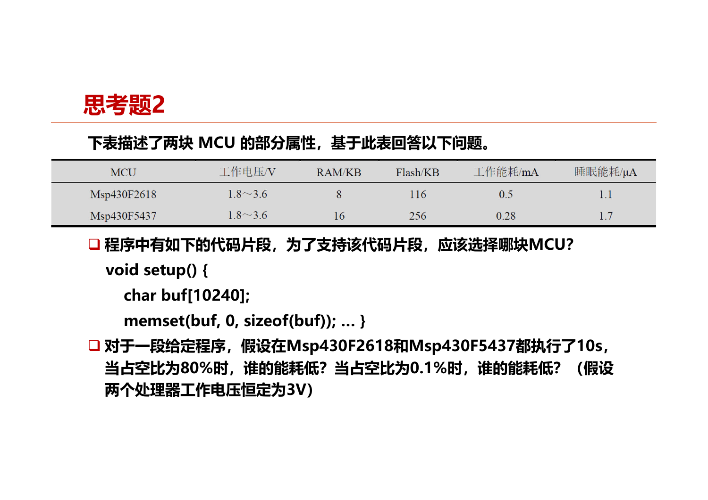
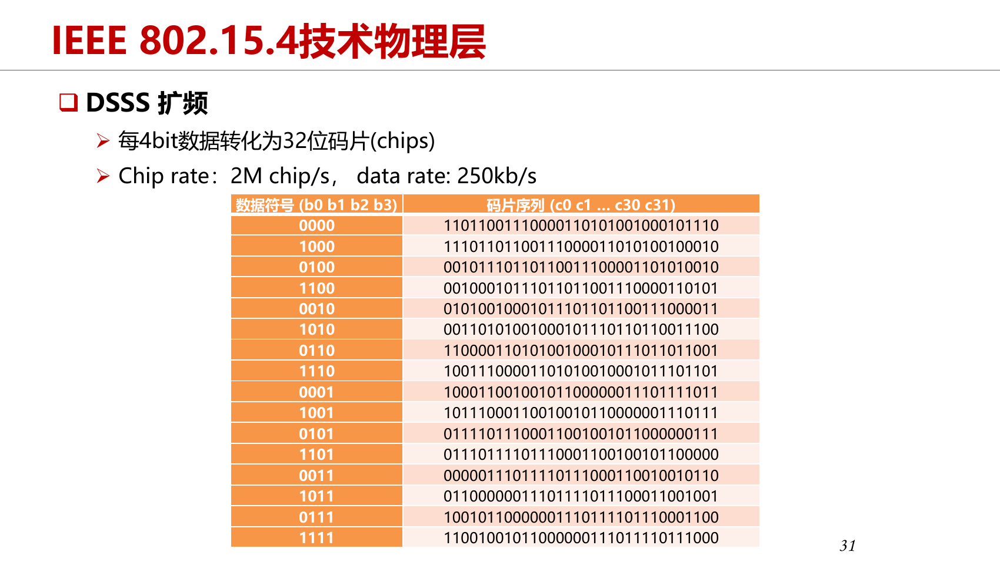
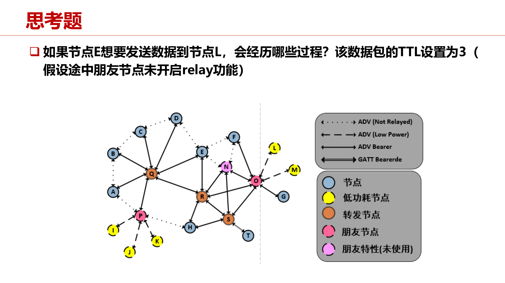
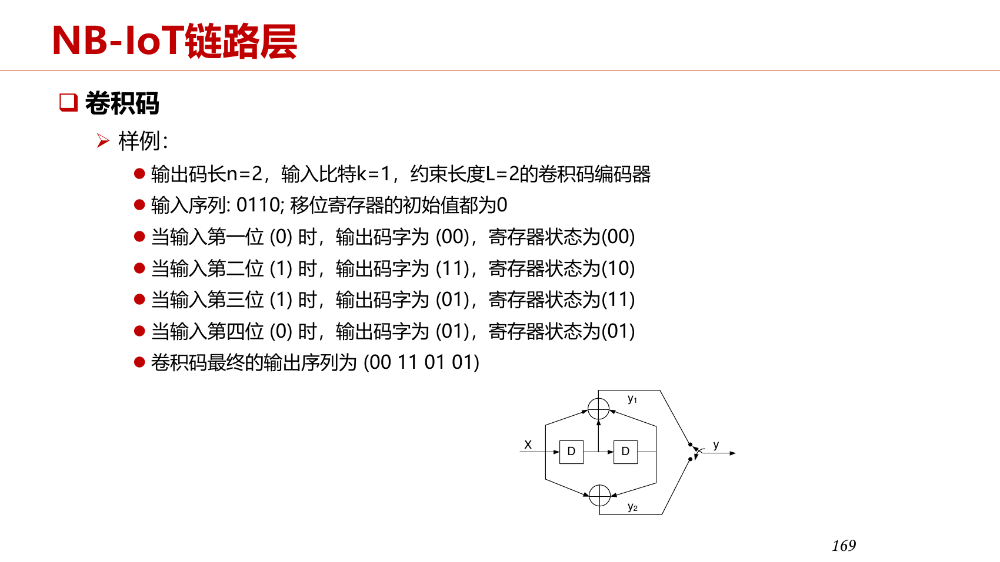

# PPT 思考题与计算题精讲

按本地八章 PPT 整理，**每道明确思考题都保留，正文里的计算例题按题型合并**。简单题给结论和原因；复杂题写清条件、关键步骤和易错点。不是重新抄一遍整章笔记，也不是另编一套模拟题。

页码均为 **PDF 物理页**。题意做了必要压缩，数字与图中条件按原课件核对。标为“方法”的条目是 PPT 中的公式／推导，没有给定数值时不补造原题。题设有歧义的地方单独说明。复习范围另见[11.04 复习课](review.md)，这里保留 PPT 中的题目，包括老师未要求深入掌握的维特比题。

| 章节 | 题目主线 |
| --- | --- |
| [第一章](#chapter-1) | 架构、GIoTTO、Mosaic、电池寿命 |
| [第二章](#chapter-2) | UART、能耗选型、硬件平台 |
| [第三章](#chapter-3) | 调度、差分更新、OS 思考题 |
| [第四章](#chapter-4) | 量化、剪枝、蒸馏、云边切分 |
| [第五章](#chapter-5) | 扩频码片、ETX、Mesh、维特比、无线计算 |
| [第六章](#chapter-6) | 规则、存储、滑动窗口、冷启动、缓存与卸载 |
| [第七、八章](#chapter-7) | 物模型、Vibe／Spec；第八章题目覆盖说明 |

<a id="chapter-1"></a>

## 第一章：物联网概述

来源：《第一章_169_20260825.pdf》。

<a id="ppt-1-18"></a>

### 1.1 典型物联网应用架构包括哪些部分？

**思考题｜第 18 页。**

**设备、网关、云平台、客户端。** 设备感知／控制，网关汇聚与协议转换，云平台接入、存储和处理，客户端展示与交互。

比如：温度传感器 → 网关 → 云端存温度、判断告警 → 手机看曲线。控制命令反向传回设备。有的设备直接联网，网关职责可被合并，不必机械要求四台独立机器。

### 1.2 物联网开发与传统 PC 程序开发有什么不同？

**思考题｜第 18 页。**

核心是 **物理世界＋资源有限＋端云协同**：要处理传感器噪声、执行器效果、硬件驱动、电池和内存；设备还可能休眠、断网，要协调设备与云的状态。PC 上代码跑通，不代表真实设备完成了采集与控制。

答题时举一个影响即可：设备休眠时收不到即时命令，所以需要目标状态同步或命令缓存。

<a id="ppt-1-48"></a>

### 1.3 GIoTTO 如何保证安全性？

**思考题｜第 48 页；依据第 31 页。**

三层回答：**HTTPS 保护传输，OAuth 令牌参与访问授权，访问控制列表限制具体数据权限。** 普通用户只能访问被授权的传感器；令牌过期后需要更新。

只写“加密”不完整，因为“别人看不见数据”和“这个用户有无资格读数据”是两件事。OAuth 主要是授权框架，课件将它放在用户认证授权流程中介绍。

### 1.4 GIoTTO 的机器学习层起什么作用？

**思考题｜第 48 页；依据第 29—30 页。**

把原始物理读数转成应用需要的**虚拟传感器状态**。例如加速度计输出一串数，模型输出“座位有人／没人”；声音模型输出“安静／嘈杂”。用户打标签训练分类器，应用就不用自己硬写所有阈值和安装方向规则。

虚拟传感器是基于数据的感知功能，不是额外安装一颗“虚拟硬件”。

### 1.5 Mosaic 的 PM2.5 测量原理是什么？

**思考题｜第 48 页；依据第 35 页。**

风扇提供空气流，光照到颗粒上产生散射，由光传感器测到光学响应，再推断颗粒浓度。**测到的是光学信号，不是直接称量颗粒质量。** 粒径、成分、湿度等会影响响应，所以低成本传感器还需要校准。

### 1.6 一元线性校准有什么缺陷？

**思考题｜第 48 页；依据第 36—39 页。**

\(y=a+bx\) 只用一个输入、一个线性关系，难描述温湿度等多因素和非线性误差。课件改进是：先用多元线性模型拟合主要趋势，再用随机森林拟合残差。记住 **“多因素＋非线性残差”** 即可，不必复述整篇论文。

<a id="ppt-1-52"></a>
<a id="ppt-1-53"></a>

### 1.7 电池寿命：持续工作、10% 和 1% 占空比分别多久？

**计算例／思考题｜第 52—53 页。** 电池 2800mAh，工作电流 20mA，休眠 0.5mA。

\[
\bar I=dI_a+(1-d)I_s,\qquad T=\frac C{\bar I}.
\]

| 条件 | 平均电流 | 理想寿命 |
| --- | --- | --- |
| 持续工作 | 20mA | \(2800/20=140\)h |
| 占空比 10% | \(20\times0.1+0.5\times0.9=2.45\)mA | 1142.86h |
| 占空比 1% | \(20\times0.01+0.5\times0.99=0.695\)mA | **4028.78h** |

**关键：** mAh÷mA 得小时；1% 要代入 0.01。休眠电流不为零，不能只计算工作时间那一项。

### 1.8 占空比 1%，再考虑 0.5%／天的自放电，寿命多久？

**思考题｜第 53 页。** 题目明确每天损失**初始容量**的 0.5%。

每天损失 \(2800\times0.005=14\)mAh，相当于恒定额外电流 \(14/24\)mA。因此：

\[
T=\frac{2800}{0.695+14/24}=2190.35\text{ h}\approx91.26\text{ 天}.
\]

若改成“剩余容量的 0.5%”，损耗会随剩余容量变化，不能沿用这个恒定相加模型。这道题不用引入指数衰减，因为原题已经指定初始容量。

<a id="chapter-2"></a>

## 第二章：硬件平台

来源：《第二章_169_20260923.pdf》。

<a id="ppt-2-11"></a>
<a id="ppt-2-12"></a>

### 2.1 UART 9600 波特，延迟 1ms／2ms，要多大缓存？

**计算例／思考题｜第 11—12 页。** 每帧 11bit，其中 8bit 是数据；缓存只存有效数据。

\[
\text{每秒有效字节}=\frac B{11},\qquad
N=\left\lceil\frac{Bt}{11}\right\rceil\text{ Byte}.
\]

- 1ms：\(\lceil9600\times0.001/11\rceil=\lceil0.873\rceil=1\)B。
- 2ms：\(\lceil9600\times0.002/11\rceil=\lceil1.745\rceil=\boxed{2\text{ B}}\)。

**为什么除以 11？** 线上每发 11bit 才得到一个有效字节；不是所有线上 bit 都进入数据缓存。帧结构变了就改分母，容量必须向上取整。这是课程理想最低容量，实际还需处理抖动余量。

<a id="ppt-2-18"></a>

### 2.2 Arduino 运行 1 秒，工作和睡眠各半，能耗是多少？

**计算例｜第 18 页。** 电压 5V，工作 0.2mA，睡眠 0.1μA，分别 0.5s。

\[
E=V(I_at_a+I_st_s)
=5(0.2\times10^{-3}\times0.5+0.1\times10^{-6}\times0.5)
=0.00050025\text{ J}=\boxed{0.50025\text{ mJ}}.
\]

平均功率为 0.50025mW。**电流先统一单位，功率乘时间才是能量。** PPT 写“总功耗”，按给出的分段时间计算，所得量实际是能量；这些电流是题设值，不是整板实测结论。

<a id="ppt-2-19"></a>

### 2.3 `char buf[10240]` 应选哪块 MCU？

**思考题｜第 19 页。**



`char` 在题设中占 1B，数组需 **10240B＝10KiB**。F2618 的 RAM 8KB 不够，F5437 的 RAM 16KB 更合适，还要给其他变量和栈留空间。Flash 大不能补救运行数组放不进 RAM。

### 2.4 同样运行 10s，80%／0.1% 占空比时谁更省能量？

**思考题｜第 19 页。** 3V 恒定；F2618 工作 500μA、睡眠 1.1μA；F5437 工作 280μA、睡眠 1.7μA。能耗问按给定程序可以在两者运行单独比较。

\[
\bar I_A=500d+1.1(1-d),\quad
\bar I_B=280d+1.7(1-d),\quad E=3\times10\times\bar I.
\]

| 占空比 | F2618 | F5437 | 结论 |
| --- | --- | --- | --- |
| 80% | 400.22μA → 12.0066mJ | 224.34μA → 6.7302mJ | **F5437 更省** |
| 0.1% | 1.5989μA → 47.967μJ | 1.9783μA → 59.349μJ | **F2618 更省** |

工作比例大，工作电流主导；工作比例极小，睡眠电流主导。不要只比工作电流就宣布一块芯片始终更省。

<a id="ppt-2-60"></a>

### 2.5 哪些属于 Things，哪些属于 Smart Things？

**思考题｜第 60 页。** 课件分类：传感节点、STM32、ESP32、Arduino 属于 **Things**；树莓派、Jetson 属于 **Smart Things**。后者较适合完整 OS 和复杂边缘计算。小 MCU 也可以运行 TinyML，分类不是“能否运行任何 AI”的绝对分界。

### 2.6 RAM 与 Flash 有什么区别？

**思考题｜第 60 页。** RAM 保存运行数据、堆栈，断电丢失；Flash 保存固件和持久内容，断电保留。选设备要同时检查两者容量，不能只看总存储大小。

### 2.7 4100B 数据能否放进 micaZ？

**思考题｜第 60 页；容量见第 28 页。** micaZ RAM 4KiB＝4096B，仅这块数据就超过容量，**不能按题设直接放入 RAM**，还没算其他运行开销。

### 2.8 ATmega 是什么架构，有什么特点？

**思考题｜第 60 页。** 本课 ATmega 属于 AVR 的 RISC 架构，采用**哈佛结构**：程序与数据有分离的寻址空间。不要推广成所有 Arduino 板都使用同一 ATmega 芯片。

### 2.9 STM32 有哪些低功耗模式，哪个最低？

**思考题｜第 60 页；具体例子见第 34 页。** 本课 STM32F103：**Sleep、Stop、Standby**。Sleep 停内核，Stop 停更多时钟，Standby 关闭更多供电域，通常最低。睡得更深会增加恢复代价，所以最低功耗不一定适合所有任务。

### 2.10 盾板有什么用，适用于什么平台？

**思考题｜第 60 页。** Shield 是插接在兼容开发板上的扩展板，增加传感、通信、驱动等功能，本课主要指 Arduino 兼容平台。它是硬件扩展，不是一个 OS。

### 2.11 ESP32 集成哪些无线功能，能否同时运行？

**思考题｜第 60 页。** 课件的 ESP32 集成 2.4GHz Wi-Fi 与蓝牙，支持共存工作；共享射频资源时需要调度，**不等于两套无线随时独立、满速并行**。具体能力依芯片型号、蓝牙类型与 SDK 配置。

### 2.12 Jetson 的特点和适用场景是什么？

**思考题｜第 60 页。** NVIDIA GPU 与 CUDA 等生态提供并行计算、图像处理和 AI 推理能力，适合机器人、视觉和边缘智能。代价通常是更高资源和功耗预算，不能只写“开发方便”。

### 2.13 1.3TFLOPS 是什么意思？

**思考题｜第 60 页。** 表示每秒约 \(1.3\times10^{12}\) 次浮点运算的性能口径。FLOPS 是**速度**，FLOPs 是模型的**运算次数**；比较硬件还要看统计精度和实际利用率。

### 2.14 16MHz、每条指令 20 周期，一秒可执行多少条？

**计算例｜第 8 页。** \(16\times10^6/20=\boxed{800000}\) 条。主频给每秒周期数，除以每条指令周期数才得到指令率。这是指定指令和理想条件下的结果。

<a id="chapter-3"></a>

## 第三章：物联网操作系统

来源：《第三章-20260927dw.pdf》。

<a id="ppt-3-13"></a>

### 3.1 非抢占调度：A、B、C 同时就绪，何时完成？

**思考题｜第 13 页。** A、B、C 需 CPU 时间 10、20、30s，0s 按 A→B→C 启动。

时间线：`A 0—10 → B 10—30 → C 30—60`。完成时刻按 A、B、C 为 **10、30、60s**。后一个任务要等前面的结束，不能直接把各自所需时间当完成时刻。

### 3.2 抢占调度：优先级 C>B>A，何时完成？

**思考题｜第 13 页。** 同样需求 10、20、30s，就绪时刻 A=1s、B=2s、C=15s。

| 区间 | 执行 | 关键状态 |
| --- | --- | --- |
| 0—1 | 空闲 | 还无任务 |
| 1—2 | A | 做了 1s，剩 9s |
| 2—15 | B | 做了 13s，剩 7s |
| 15—45 | C | 最高优先级，完成 |
| 45—52 | B | 完成剩余 7s |
| 52—61 | A | 完成剩余 9s |

答案按 A、B、C：**61、52、45s**。被抢占只是暂停，恢复时做剩余部分，不是从头重来。

### 3.3 时间片 10s，A=0、B=10、C=20s 就绪，何时完成？

**思考题｜第 13 页。** 20s 同时发生“B 片长结束”和“C 到达”，PPT 没写入队先后。

- **新任务先入队**：A 0—10，B 10—20，C 20—30，B 30—40，C 40—60。答案 **10、40、60s**。
- **旧任务先重新入队**：B 在 20—30 继续执行完，C 30—60。答案 **10、30、60s**。

题目没有这条约定，不能唯一确定 B 的完成时刻。考试遇到类似题先写队列规则，然后逐片扣剩余时间。

<a id="ppt-3-19"></a>
<a id="ppt-3-22"></a>

### 3.4 差分文件有哪些指令，原题补丁多大？

**计算例／思考题｜第 19、22 页。** `COPY n addr` 占 5B；`ADD m data` 占 \(3+m\)B。

旧文件 `ABCDEACBC`，新文件 `WABCDEACBCXDEACB`，地址从 0 起。

| 指令 | 生成内容 | 大小 |
| --- | --- | --- |
| `ADD 1 W` | W | 4B |
| `COPY 9 0` | ABCDEACBC | 5B |
| `ADD 1 X` | X | 4B |
| `COPY 5 3` | DEACB | 5B |

总计 **18B**。也可把最后两个指令改为 `ADD 6 XDEACB`，占 9B，总计仍 18B。

第 19 页较短例子只在旧文件前加 W，补丁 `ADD 1 W＋COPY 9 0`＝9B。不要只数新增加的字母，**指令本身也要占空间**。第 22 页新文件 16B，给出的补丁反而 18B，说明小文件差分不一定节省空间。

### 3.5 在程序头部和尾部插函数，哪里可能使补丁更大？

**思考题｜第 22 页。** 通常头部插入更容易改变后续代码位置及地址引用，导致更多二进制差异；尾部插入较容易保持原有布局。但实际依链接器、差分算法与地址修正，不能说头部插入必然更大。

<a id="ppt-3-73"></a>

### 3.6 protothreads 与普通多线程有什么区别？

**思考题｜第 73 页。** protothreads 通常不为每个任务保存完整独立栈，用较少状态表达等待与继续，省 RAM；代价是暂停点与局部变量保存受到限制。普通线程各有栈，代码流程较自然，资源开销较大。Contiki 的多栈 `mt_thread` 与 protothreads 不是同一机制。

### 3.7 RPL 与 CTP 有什么区别？

**思考题｜第 73 页。** CTP 主要建立多对一的数据收集树；RPL 面向低功耗有损 IPv6 网络，建立到根的有向无环结构，并可支持上行、下行等通信。共同点是为低功耗网络选路，不同点主要是协议定位与通信模式。

### 3.8 GNRC 中哪一层适配不同链路？

**思考题｜第 73 页。** 课件答案是 **`gnrc_netdev`**。它适配底层网络设备／链路接口，避免上层协议为每种无线硬件重写。

### 3.9 SAUL 用什么结构表示外设和数据？

**思考题｜第 73 页；依据第 48 页。** 外设用 **`saul_reg_t`** 注册，关联 **`saul_driver_t`** 的读写接口；读出的物理量或写入的执行参数用 **`phydat_t`** 表示。记成“注册项—驱动—读写数据”即可。

### 3.10 AliOS Things 基于哪个内核，有什么特点？

**思考题｜第 73 页。** **Rhino** 实时内核，强调小占用、低功耗和多任务，支持优先级抢占／轮转等调度及静态、动态内存管理。

### 3.11 AliOS 哪个组件做自组织网，哪个做 TCP/IP？

**思考题｜第 73 页。** **uMesh** 提供自组织、自修复、多跳本地连接；**LwIP** 提供轻量 TCP/IP。前者偏网络组织，后者偏 IP 协议栈。

### 3.12 LiteOS-A 与 LiteOS-M 分别适用于哪里？

**思考题｜第 73 页。** 本课 LiteOS-A 面向较强标准设备、支持 MMU；LiteOS-M 面向更小且通常无 MMU 的微／迷你设备。课件参考内存分别为 A≥128MB，M 的两类设备≥1MB／≥128KB；它们是本课说明，不是所有版本的通用硬门槛。

### 3.13 分布式软总线是什么？

**思考题｜第 73 页。** 用软件通信机制实现跨设备发现、连接、传输与服务调用，让多个设备协同、共享能力。像一条“无形总线”，不是实际把所有设备插到同一根物理导线上。

<a id="ppt-3-12"></a>

### 3.14 多线程怎样保证 `x++` 与 `write(x)` 不被拆开？

**正文提问｜第 12 页。** 要保护的是整个“修改 x＋把 x 写出”的过程。

非抢占式在没有其他中断／阻塞干扰的课件模型下，连续执行这两步；协作式不能在中间 `yield()`；抢占式／轮转应把两步放在同一互斥区，并让其他访问者遵守同一把锁。

只保护 `x++` 不够，因为加完到写出之间仍可能被另一个任务改值。互斥解决任务交错，不等于断电时数据也一定持久，需要区分两个问题。

<a id="chapter-4"></a>

## 第四章：边缘智能

来源：《第四章-1009.pdf》。

<a id="ppt-4-13"></a>

### 4.1 参数量怎样换成权重存储大小？

**计算例｜第 13—14 页。** \(\text{字节数}=\text{参数量}\times\text{位宽}/8\)。

| 参数量 | FP32 存储 | 计算 |
| --- | --- | --- |
| 1M | 4MB | \(10^6\times4\)B |
| 100M | 400MB | \(10^8\times4\)B |
| 1B | 4GB | \(10^9\times4\)B |
| 100B | 400GB | \(10^{11}\times4\)B |
| BERT Base 110M | 440MB | \(110\times10^6\times4\)B |

这里采用十进制 MB／GB。INT8 理想权重大小是同参数量 FP32 的 1/4，INT4 是 1/8，实际还要加量化元数据。**运行内存另含激活、KV Cache、工作区与框架开销**，不能直接等于模型文件大小。

<a id="ppt-4-17"></a>

### 4.2 Accuracy、Precision、Recall、F1 怎么算？

**计算方法｜第 17 页，原页未给数值题。** TP 是正确判正，FP 是误报，FN 是漏报，TN 是正确判负。

\[
\text{Accuracy}=\frac{TP+TN}{TP+FP+TN+FN},\quad
P=\frac{TP}{TP+FP},\quad R=\frac{TP}{TP+FN},\quad
F_1=\frac{2PR}{P+R}.
\]

先看分母：Precision 在“判成正的”里面算正确率，Recall 在“实际正的”里面算找回率。**误报关注 P，漏报关注 R**；Accuracy 则看所有样本。负样本特别多时 Accuracy 高不代表少数正样本被找到了。

<a id="ppt-4-19"></a>
<a id="ppt-4-20"></a>

### 4.3 卷积层 FLOPs 和访存开销怎么算？

**计算方法｜第 19—20 页。** 普通卷积，输出 \(H\times W\)，输入／输出通道 \(C_{in},C_{out}\)，卷积核 \(K\times K\)：

\[
\text{MACs}=HW C_{out}K^2C_{in},\qquad
\text{FLOPs}\approx2\,\text{MACs}.
\]

解释：每个输出位置需 \(K^2C_{in}\) 次乘加，一共有 \(HWC_{out}\) 个输出。H、W 用**输出**尺寸；偏置和其他算子若题目要求，另外计入。

第 20 页 1×1 卷积的简化访存模型：

\[
\text{访问元素数}\approx HW(C_{in}+C_{out})+C_{in}C_{out}.
\]

三项分别是输入、输出、权重；换字节再乘每元素字节数。该页缩写 MAC 指 **Memory Access Cost**，与乘加 MACs 不是一回事。2.2GFLOPs 指一次约 \(2.2\times10^9\) 运算；GFLOPS 指每秒速率，别混用。

<a id="ppt-4-32"></a>
<a id="ppt-4-33"></a>

### 4.4 把 `[3, −5.5, 0, 6, −6, 2.5]` 量化成 INT8

**计算例｜第 32—33 页。** 采用课件 MinMax，范围 [−128,127]。

\[
S=\frac{6-(-6)}{127-(-128)}=\frac{12}{255},\qquad
Z=\operatorname{round}\left(-128-\frac{-6}{S}\right)
=\operatorname{round}(-0.5)=0.
\]

此处按课件结果使用最近偶数舍入。然后
\(q=\operatorname{clip}(\operatorname{round}(x/S)+Z,-128,127)\)：

| x | x／S | 舍入并截断后的 q |
| --- | --- | --- |
| 3 | 63.75 | 64 |
| −5.5 | −116.875 | −117 |
| 0 | 0 | 0 |
| 6 | 127.5 | 128 截到 127 |
| −6 | −127.5 | −128 |
| 2.5 | 53.125 | 53 |

答案 **[64, −117, 0, 127, −128, 53]**。反量化 \(\hat x=S(q-Z)\)，比如 3 恢复为 \(64\times12/255\approx3.01176\)，并非原值，误差来自舍入。若题目换舍入规则，零点等结果也可能变化。

<a id="ppt-4-46"></a>

### 4.5 INT32 累加结果怎样转回 INT8？

**推导方法｜第 44—46 页。** 实数输入近似 \(x=S_x(q_x-Z_x)\)，权重同理。忽略偏置：

\[
A=\sum_i(q_{x,i}-Z_x)(q_{w,i}-Z_w),\qquad
y\approx S_xS_wA.
\]

输出整数刻度为 \(S_y,Z_y\)，因此：

\[
q_y=\operatorname{clip}\left(\operatorname{round}\left(\frac{S_xS_w}{S_y}A\right)+Z_y,\ q_{\min},q_{\max}\right).
\]

INT32 是累加器，INT8 是下一层采用的表示。**不是强制截取低 8 位**，而是先换输出刻度，再舍入、截断；偏置也要按累加尺度正确加入。

<a id="ppt-4-60"></a>

### 4.6 追求极致推理速度，选动态还是静态量化？

**思考题｜第 60 页。** 课件典型答案是**静态量化**：用校准集提前确定激活范围和量化参数，减少运行时统计及浮点中转，更易保持整数计算。前提是模型、引擎和硬件支持相应算子；不能把“静态”理解成任何模型必然更快。

### 4.7 MinMax 直接取极值有什么坏处？

**思考题｜第 60 页。** 少量离群值会把范围拉大，固定数量的整数刻度被摊得更粗，多数普通值难以区分。截断能改善普通值精度，却会损失极端值；重要离群值不能一律删掉，还可采用每通道或混合精度方案。

### 4.8 为什么 LLM 比传统 CNN 更难量化？

**思考题｜第 60 页。** LLM 可能包含数值很大、却重要的激活特征。统一缩放难同时表示这些离群值和普通值；误差也可能沿多层传播。课件 LLM.int8() 的思路是分离重要异常维度保留高精度，其余部分低精度计算，再合并结果。

<a id="ppt-4-80"></a>

### 4.9 结构化剪枝后，哪些层的维度一起变？参数减少多少？

**计算例｜第 80—81 页。**

| 层 | 原权重形状 `[输出,输入]` | 新形状 |
| --- | --- | --- |
| fc1 | [2048,4608] | [1024,4608] |
| fc2 | [2048,2048] | [1024,1024] |
| fc3 | [5,2048] | [5,1024] |

fc1 输出少了，fc2 输入也要对应减少；最后分类类别仍是 5，所以 fc3 输出不变。不能只改某一层而不处理后续连接。

课件总参数从 14,591,685 减到 6,720,197：

\[
\text{减少比例}=1-\frac{6720197}{14591685}\approx\boxed{53.95\%}.
\]

实际时延还取决于没有剪的卷积层、访存与硬件。参数省 53.95%，不代表速度必然提升同一比例。

<a id="ppt-4-82"></a>

### 4.10 小权重也可能很重要吗？

**思考题｜第 82 页。** **可能。** 看贡献不能只看 w，还要看输入和路径：例如 \(w=0.001\)、\(x=10000\)，乘积仍是 10；小权重也可能承载稀有关键特征。L1 幅度是重要性的近似判断，剪后必须验证性能。

### 4.11 为什么“训练 → 剪枝 → 微调”，不直接训练小模型？

**思考题｜第 82 页。** 大模型先学到表示，再从中保留有效部分；剪枝破坏了原有配合，微调让剩余参数重新适应。直接训练小模型可能缺少这种初始化与搜索空间，但并非永远更差，要结合任务和预算比较。

<a id="ppt-4-89"></a>
<a id="ppt-4-96"></a>

### 4.12 蒸馏温度和损失梯度怎么理解？

**计算／推导方法｜第 89、95—99 页。** 学生 logits 为 z，温度 T：

\[
q_i(T)=\frac{e^{z_i/T}}{\sum_j e^{z_j/T}},\qquad
L_{soft}=-\sum_i p_i\log q_i.
\]

T 增大，分布变平滑，非最大类别信息更容易体现。原页没有给完整 logits，不能由示意柱状图反推出唯一数值题。

求导只需两步：

\[
\frac{\partial\log q_i}{\partial z_j}=\frac{\delta_{ij}-q_j}{T},
\qquad \frac{\partial L_{soft}}{\partial z_j}
=-\frac1T\sum_i p_i(\delta_{ij}-q_j)
=\frac{q_j-p_j}{T}.
\]

最后用到 \(\sum_i p_i=1\)。硬标签交叉熵在 T=1 时是 \(q_j-y_j\)。高温还会使教师／学生概率差减小，常用 **T²** 缩放软损失来平衡梯度量级。T 是温度参数，不是学习率。

<a id="ppt-4-105"></a>

### 4.13 为什么总损失含软损失和硬损失，只用软标签行不行？

**思考题｜第 105 页。** 软标签教学生学习教师的类间关系，硬标签让预测符合真实类别，并纠正教师偏差。

一种约定：\(L=\alpha T^2L_{soft}+(1-\alpha)L_{hard}\)。只用软标签是可以选择的训练方案，但更依赖教师质量，不保证优于两者结合。答题要说明**知识迁移和真实监督各自的作用**。

### 4.14 教师一定越强越好吗？

**思考题｜第 105 页。** 不一定。学生容量太小，可能学不了教师复杂行为；教师与任务不匹配、概率过尖或训练数据偏差，也会影响效果。重点是教师知识能否由学生学到，可用中等教师、助教模型或特征对齐减小差距。

<a id="ppt-4-119"></a>

### 4.15 除了改切分点，还能怎样降低传输延迟？影响准确率吗？

**思考题｜第 119 页。** 压缩或量化中间特征、稀疏编码、筛掉冗余特征，降低上传字节数。无损压缩本身不改变结果，但有编解码成本；有损压缩和低位宽量化会引入误差，可能降低准确率，需要评估或联合训练。

只写“压缩”不够，应说明：传得少了，但多了本地处理，并可能损失信息。

### 4.16 Wi-Fi 换成弱 3G／4G，切分点向前还是向后？

**思考题｜第 119 页。** 先定义：**更深／更靠后＝更多层在本地算，云端负责的层更少。** 题干括号“向后（更多在云端算）”与这一常见定义不一致，不按括号机械背方向。

按第 113—117 页的模型：

\[
T(k)=T_{edge}(1{:}k)+\frac{D_k}{R}+T_{cloud}(k{+}1{:}L)+T_{network}.
\]

网络 R 变小，上传项更贵，通常考虑**选上传特征更小的切分点，必要时多做本地计算**。课件中池化后的特征更小，因此可考虑向这些较深位置移动。

但特征尺寸不是随层数一直下降：早期卷积可能膨胀，后移还增加本地计算。真正答案是比较各候选 k 的总时延，不能断言弱网时永远只向某一方向移。

<a id="chapter-5"></a>

## 第五章：低功耗通信协议

来源：《第五章-2026v2.pdf》。

<a id="ppt-5-17"></a>

### 5.1 活跃 10mW、睡眠 10μW，占空比 0.1%，平均功率多少？

**计算例｜第 17 页。** 统一为 μW，\(d=0.001\)：

\[
\bar P=10000\times0.001+10\times0.999=\boxed{19.99\text{ μW}}.
\]

0.1% 不是 0.1；前者是千分之一，后者是 10%。睡眠虽长，但功率低；活跃虽短，仍有显著贡献。

<a id="ppt-5-18"></a>

### 5.2 根据路径损耗求最大通信距离

**计算例｜第 18 页。** 发射 0dBm，接收灵敏度 −85dBm，\(PL_0=28.5\)dB，\(n=3\)，\(d_0=1\)m；忽略天线增益和随机误差。

\[
P_{rx}=P_{tx}-[PL_0+10n\log_{10}(d/d_0)].
\]

最远距离处 \(P_{rx}=-85\)，所以：

\[
-85=0-28.5-30\log_{10}d
\Rightarrow d=10^{56.5/30}\approx\boxed{76.4\text{ m}}.
\]

功率用 dBm，损耗用 dB；−90dBm 灵敏度比 −85dBm 更好，能接收更弱信号。课件 PL₀ 的 dBm 标注按损耗量理解为 dB。

<a id="ppt-5-22"></a>

### 5.3 功率、标称数据率与有效数据率怎么换算？

**计算方法｜第 16、22、31 页。**

- 功率：\(P_{dBm}=10\log_{10}P_{mW}\)，反算 \(P_{mW}=10^{P_{dBm}/10}\)。1mW＝0dBm，10mW＝10dBm。
- 802.15.4 每 4bit 变成 32chip，2Mchip/s 对应 \(2\times10^6/32\times4=250\)kbps。
- 有效率：\(\eta=t_{payload}/(t_{backoff}+t_{header}+t_{payload})\)，有效速率 \(R_{real}=\eta R\)。题目增加 ACK 等开销，就加进分母。

第 22 页说约三分之一是示例量级，不是所有条件下都固定乘 1/3。**没有给包长与时间，不能算出唯一实际吞吐。**

<a id="ppt-5-35"></a>

### 5.4 `10111110` 经过 802.15.4 后，I／Q 码片是什么？

**思考题｜第 35 页；查第 31—32 页。** 按课件表头 \(b_0b_1b_2b_3\) 的书写顺序拆为 `1011｜1110`。



先分别查表，再取 \(I=c_0,c_2,\dots,c_{30}\)，\(Q=c_1,c_3,\dots,c_{31}\)：

| 四位组 | 32 码片 | I 路偶数下标 | Q 路奇数下标 |
| --- | --- | --- | --- |
| 1011 | `01100000011101111011100011001001` | `0100010111101010` | `1000111101001001` |
| 1110 | `10011100001101010010001011101101` | `1010010001011110` | `0110011100001011` |

所以：

```text
I：0100010111101010｜1010010001011110
Q：1000111101001001｜0110011100001011
```

竖线只分组，不是数据。Q 路在时间上有 0.5μs 偏移，偏移**不改变码片序列**。最容易错的是把符号先当普通高位在前的十进制编号查表；本题直接按课件表中的四位字符串匹配。

<a id="ppt-5-66"></a>

### 5.5 证明路径 ETX 等于各链路 ETX 之和

**思考题｜第 66 页。** 令第 i 跳实际发送次数为 \(N_i\)，一条路径的总发送次数 \(N=\sum_iN_i\)。

\[
ETX_{path}=\mathbb E[N]
=\mathbb E\left[\sum_iN_i\right]
=\sum_i\mathbb E[N_i]=\boxed{\sum_iETX_i}.
\]

这是**期望的线性性**，不需要为了这一步假定各跳独立。在课件逐跳重传模型下，每跳若单次确认成功率 \(p_i=d_{f,i}d_{r,i}\)，则 \(ETX_i=1/p_i\)。路径 ETX 统计总发送次数，不是端到端一次成功概率，所以不相乘。

<a id="ppt-5-112"></a>

### 5.6 BLE Mesh：E 发给 L，TTL=3，朋友节点不开 Relay

**思考题｜第 112 页。**



主路径是 **E → R → O（朋友节点缓存）→ L（低功耗节点轮询取出）**。

1. E 广播消息，目标 DST=L，TTL=3；图中 Q、R 等邻居收到。
2. R 是 Relay，把消息以 TTL=2 转发，O 收到。Q 也可能转发形成其他分支；接收端按消息身份去重。
3. O 与 L 有 Friendship。O **不进行一般 Relay 泛洪**，但可以把发给低功耗朋友 L 的消息保存在 Friend Queue。
4. L 定期唤醒发送 Friend Poll，O 交付缓存消息；L 检查 DST 后接收。

**关键区别：朋友功能不等于 Relay 功能。** 禁用 O 的 Relay 不妨碍它为 L 缓存、响应轮询。不能把 O 当普通中继再次广播，也不能说 O 没开 Relay 所以 L 一定收不到。

<a id="ppt-5-158"></a>

### 5.7 增强距离有哪些技术，NB-IoT／LoRa 分别用什么？

**思考题｜第 158 页；依据第 140—145 页。**

课件四项：提高功率谱密度、重复发送并合并、多接收天线、扩频。NB-IoT 主要强调**窄带提高 PSD、重复合并、多接收天线**；LoRa 主要强调 **CSS／Chirp 扩频**。

它们提高弱信号解码能力，但常以速率、空中时间或硬件成本为代价。单纯“收到失败就再试一次”与接收端合并重复信号获得增益，要区分。

<a id="ppt-5-141"></a>

### 5.8 PSD、重复次数和天线数怎样换成 dB 增益？

**计算例｜第 141—143 页。**

| 项目 | 计算 | 结果 |
| --- | --- | --- |
| NB-IoT PSD | 200mW／3.75kHz | 53.33mW/kHz |
| LoRaWAN PSD | 1000mW／125kHz | 8mW/kHz |
| NB 相对课件 GSM 基准 | \(10\log_{10}5.33\) | 约 7.27dB |
| LoRa 相对同基准 | \(10\log_{10}0.8\) | −0.97dB |
| 理想重复合并 N 次 | \(10\log_{10}N\) | 128 次约 21.07dB |
| 理想 1T2R 对 1T1R | \(10\log_{10}2\) | 约 3.01dB |

这些是课件模型与特定输入，非所有协议的固定实测值。第 142 页将 128 次增益写作约 20dB，按公式精算是 21.07dB；实际有效收益还受条件和开销限制，课件另列工程量级约 12dB。

<a id="ppt-5-171"></a>

### 5.9 维特比：收到 `[00 10 01 01]`，原信息是什么？

**思考题｜第 171 页；编码器见第 168—170 页。** 两寄存器初始 00，按课件输出顺序：



设当前输入 x，旧寄存器状态 \((s_1,s_2)\)。输出：\(y_1=x\oplus s_1\oplus s_2\)，\(y_2=x\oplus s_2\)；新状态 \((x,s_1)\)。\(\oplus\) 是异或。

**维特比的做法：** 从 00 出发，每一步尝试输入 0／1，用预测输出与收到的两位比较，累计汉明距离；到同一状态只保留代价最小的路径。

| 处理到 | 状态 00 的最小代价 | 01 | 10 | 11 |
| --- | --- | --- | --- | --- |
| 初始 | 0 | ∞ | ∞ | ∞ |
| 收到 00 | 0 | ∞ | 2 | ∞ |
| 再收到 10 | 1 | 2 | 1 | 4 |
| 再收到 01 | 2 | 3 | 2 | 1 |
| 再收到 01 | 3 | **1** | 3 | 2 |

最小总代价 1，回溯得到输入 **`0110`**，重新编码：

| 输入 | 旧状态 | 正确输出 | 新状态 |
| --- | --- | --- | --- |
| 0 | 00 | 00 | 00 |
| 1 | 00 | 11 | 10 |
| 1 | 10 | 01 | 11 |
| 0 | 11 | 01 | 01 |

所以实际编码数据为 **`00 11 01 01`**，接收序列第二组从 11 变成 10，错了 1bit。原题只给初始状态，不要求结尾回到 00，**不能额外强制终止状态为 00**。

<a id="ppt-5-165"></a>

### 5.10 NB-IoT 的子载波、时隙和无线帧怎么换算？

**数值关系｜第 165—166 页。** 下行 180kHz／15kHz＝**12 个子载波**；1 个时隙 0.5ms、7 个符号；1 个子帧 1ms＝2 个时隙；1 个无线帧 10ms＝10 个子帧＝20 个时隙。

这是课件的时频资源单位关系，不代表一个应用包永远只占一个子帧。

<a id="ppt-5-179"></a>
<a id="ppt-5-180"></a>

### 5.11 LoRa 的符号时间与 `[0,0,50]` 偏移是多少？

**计算例／方法｜第 179—180 页。** \(T_s=2^{SF}/BW\)，BW 必须用 Hz。

SF=8、BW=125000Hz：\(T_s=256/125000=\boxed{2.048\text{ ms}}\)。数据 `[0,0,50]` 的循环偏移分别为：

\[
0,\quad0,\quad\frac{50}{256}T_s=\boxed{0.4\text{ ms}}.
\]

SF 加 1，符号时间翻倍；BW 翻倍，符号时间减半。符号原始信息速率为 \(SF/T_s\)，若加入编码率和帧开销，应用速率还会更低。**码片、符号、有效 bit 不是同一个单位。**

第 190 页接收窗口至少检测 5 个符号，按此物理参数即至少 \(5T_s=10.24\)ms 的符号检测时间；这是联用公式的解释，不是该页另外给出的一道数值原题。

<a id="chapter-6"></a>

## 第六章：云平台

来源：《第六章-2026.pdf》。

<a id="ppt-6-21"></a>

### 6.1 这些 MQTT 过滤器能匹配 `factory/A/temp` 吗？

**正文例子｜第 21 页。** `factory/+/temp` 和 `factory/#` 能匹配；`factory/B/temp` 和 `factory/+/state` 不能。

`+` 代替一个层级，`#` 代替剩余多个层级。它们出现在**订阅过滤器**里，发布主题本身不能含通配符。路径组织不同，匹配范围就不同。

<a id="ppt-6-26"></a>
<a id="ppt-6-27"></a>

### 6.2 确认窗口为 20，RTT=80ms，吞吐多少？500 条／秒要多大窗口？

**计算例／正文思考｜第 26—27 页。** 在途数量为 C，RTT 用秒：

\[
\lambda_{max}\approx C/RTT=20/0.08=\boxed{250\text{ 条/s}}.
\]

目标 500 条/s 时，\(C\ge500\times0.08=\boxed{40}\) 条。

第 27 页 RTT=100ms，每条 1KB：窗口 1 时 10 条/s；窗口 20 时 200 条/s，载荷约 200KB/s。窗口用于覆盖确认等待，增大它同时增加缓存与协议状态；实际吞吐还受网络和 Broker 限制。

<a id="ppt-6-43"></a>

### 6.3 “灯最终变蓝”与“投药一次”为什么不能只用同一种状态同步？

**正文提问｜第 43 页。** “灯为蓝色”是目标状态，中间多次改色可以合并为最新目标；“投药一次”是一次性动作，合并可能漏执行，重试又可能重复执行。

所以影子适合记录 desired／reported 状态；一次性动作要有命令 ID、执行确认和去重。**最终状态相同，不代表经历的动作次数相同。**

<a id="ppt-6-53"></a>
<a id="ppt-6-54"></a>

### 6.4 四组 IFTTT 规则是否冲突？

**正文题｜第 53—54 页。** 共同第一条：光照 \(>10000\)lux 时关灯。

| 第二条规则 | 结论 | 为什么 |
| --- | --- | --- |
| 光照 <500 时开灯 | 不冲突 | 条件不能同时成立 |
| 光照 <20000 时开灯 | **冲突** | 光照处于 (10000,20000) 时同时开／关 |
| 光照 <20000 时关灯 | 无相反动作冲突 | 可同时触发，但动作相同 |
| 19—24 点开灯 | **可能冲突** | 该时段仍可能有光照 >10000 |

判断分三步：**同一对象？动作矛盾？条件交集非空？** 最后一步要尊重数值约束，不能只看布尔变量形式上能同时为真。

<a id="ppt-6-67"></a>

### 6.5 有效温度 [−40,125]℃，超过 30℃告警，边界怎么判？

**正文推演｜第 67 页。**

| 输入 | 范围有效吗 | 告警吗 |
| --- | --- | --- |
| −40 | 有效 | 否 |
| 30 | 有效 | 否，题目是“超过” |
| 30.1 | 有效 | 是 |
| 125 | 有效 | 是 |
| 126 | 无效 | 不继续作正常温度告警判断 |

先检查有效范围，再检查告警条件；不要把缺失值默认为 0 或正常值。闭区间含端点，\(>30\) 不含 30。

<a id="ppt-6-69"></a>

### 6.6 规则引擎案例为什么用两个 Topic？

**正文提问｜第 69 页。** 三个原因：**安全隔离、降低耦合、方便扩展**。原始输入和设备控制消息可分开，由规则引擎转换后转发；设备只订阅获准主题，新设备也不要求所有控制端一起改格式。

分主题本身不是认证，还要有发布／订阅权限策略，才能真正限制越权访问。

<a id="ppt-6-72"></a>
<a id="ppt-6-84"></a>

### 6.7 1 万台设备每秒 1 点，每天多少数据？压缩后呢？

**计算例／计算题｜第 72、84 页。** 第 84 页容量题沿用第 72 页的采样规模。每点时间戳 8B、浮点值 8B。

\[
N_{day}=10000\times1\times86400=864000000\text{ 点}.
\]

未压缩 \(16\)B／点，每日 \(864000000\times16=\boxed{13.824\text{ GB}}\)。若只把数值压为 2B，时间戳不变：

\[
b'=8+2=10\text{ B},\quad
\text{节省}=\frac{16-10}{16}=\boxed{37.5\%},\quad
S'=\boxed{8.64\text{ GB/天}}.
\]

单台最近十分钟 600 点，全设备 600 万点。这里 GB 用十进制，未计标识、索引、副本等成本。

<a id="ppt-6-81"></a>
<a id="ppt-6-83"></a>

### 6.8 Gorilla 节省比例与整条记录节省比例怎么算？

**计算例｜第 81、83 页。**

- 第 81 页，5 个浮点数由 40B 压为 23B，节省 \((40-23)/40=\boxed{42.5\%}\)。这是**数值编码器输出**，不含整个数据库文件的全部开销。
- 第 83 页，时间 8B＋数值 8B＋其他信息 16B＝32B；数值压成 2B 后整条记录 26B，节省 \((32-26)/32=\boxed{18.75\%}\)。

数值字段自身省了 75%，**整条记录却只省 18.75%**。先确定被压缩的范围，再选正确分母。Gorilla 是无损位模式编码，不是降低浮点精度。

<a id="ppt-6-77"></a>
<a id="ppt-6-89"></a>
<a id="ppt-6-94"></a>

### 6.9 普通均值与滑动均值：输出是什么，怎样增量更新？

**计算例／问题｜第 77、89—96 页。**

第 77 页数值 20、20.5、21、21、21.5，普通均值 \(104/5=\boxed{20.8}\)℃。

滑动题输入 20、22、24、30、28，窗口 k=3，只有满窗口才输出。先保存总和 S，之后减退出值、加新值：

\[
S'=S-x_{old}+x_{new},\qquad \bar x'=S'/k.
\]

| 窗口 | 更新 | 输出 |
| --- | --- | --- |
| [20,22,24] | S=66 | 22 |
| [22,24,30] | 66−20＋30＝76 | 76/3＝25.333… |
| [24,30,28] | 76−22＋28＝82 | 82/3＝27.333… |

必须再保存最近 k 个值和最旧位置，否则只凭 S 不知道谁退出。直接逐窗重算每次 \(O(k)\)，增量法每次 \(O(1)\)，两种在线实现都需要 \(O(k)\) 窗口空间。

第 96 页 n=10000、k=1000，共 \(n-k+1=9001\) 个输出。只计加减：

\[
\text{重算}=9001\times999=8991999,\quad
\text{增量}=999+2(10000-1000)=\boxed{18999}.
\]

999 是初始化求和的加法次数，不能漏掉；两边共同的除法和输出开销不计。

<a id="ppt-6-97"></a>

### 6.10 10 万设备，每台窗口 1000、每值 8B，窗口内存多大？

**计算例｜第 97 页。** \(100000\times1000\times8=800000000\)B＝**0.8GB**。每设备 8000B。

增量算法减少重复运算，不消除窗口存储，还要另计每台设备的总和、指针、键和框架开销。

<a id="ppt-6-98"></a>

### 6.11 滑动总体方差：直接法和增量法分别怎样做？

**思考题｜第 98 页。** 原题窗口 [20,22,24] → [22,24,30]，k=3。

直接法每窗先求均值，再算 \(\sigma^2=\sum(x_i-\bar x)^2/k\)，每窗 \(O(k)\)。增量法除了总和 S，再存**平方和 Q**：

\[
\sigma^2=\frac Qk-\left(\frac Sk\right)^2,
\quad Q'=Q-x_{old}^2+x_{new}^2.
\]

| 窗口 | S | Q | 总体方差 |
| --- | --- | --- | --- |
| [20,22,24] | 66 | 1460 | \(1460/3-22^2=\boxed{8/3}\) |
| [22,24,30] | 76 | \(1460-400+900=1960\) | \(1960/3-(76/3)^2=\boxed{104/9}\) |

两种在线方法都存 \(O(k)\) 窗口，增量另存 S、Q，更新 \(O(1)\)，总处理 \(O(n)\)。**总体方差除 k，不是 k−1**；数值实现需关注平方和相减带来的浮点误差。

<a id="ppt-6-99"></a>

### 6.12 滑动最大值：为什么只存旧最大值不够？怎样单遍处理？

**思考题｜第 99 页。** 输入 30、22、24、20、28，k=3，输出 **30、24、28**。

旧最大 30 退出后，只记 30 与新值 20，无法判断剩下的 22、24 谁最大。直接扫描当前窗口每次 \(O(k)\)，可以改用存**值及下标的单调递减队列**：

1. 移除队首已过期的候选。
2. 新值到来，把队尾不大于它的候选删掉：旧候选更小且更早到期，以后不会比新值更有用。
3. 新值入队，满窗口后输出队首。

| 到达值 | 候选值（实际还存下标） | 输出 |
| --- | --- | --- |
| 30 | [30] | 未满 |
| 22 | [30,22] | 未满 |
| 24 | [30,24]，删 22 | 30 |
| 20 | [24,20]，30 过期 | 24 |
| 28 | [28]，删 20、24 | 28 |

每个元素至多入队、出队各一次，**总时间 O(n)，均摊每点 O(1)，单点最坏 O(k)，空间 O(k)**。最大值不能像总和那样“减掉退出值”直接更新。

<a id="ppt-6-123"></a>

### 6.13 冷调用与热调用分别多久？

**计算例｜第 123 页。** 调度 10ms，环境准备 50ms，加载依赖与初始化 350ms，业务 40ms。

\[
T_{cold}=10+50+350+40=\boxed{450\text{ ms}},\qquad
T_{warm}=10+40=\boxed{50\text{ ms}}.
\]

冷调用额外 400ms。热调用复用已准备的环境；不是每次调用都重新初始化，也不是整个函数一生只冷一次，回收或扩容仍会产生新环境。

<a id="ppt-6-125"></a>

### 6.14 空闲 30s 回收，事件在 0、10、50s 到达，哪些是冷调用？

**计算推演｜第 125 页。** 按需环境开始未准备：0s 冷，10s 热，最后一次调用后空闲超过 30s 被回收，所以 50s 冷。

若环境在首个事件前已保温并持续驻留，三次都可热调用，但要支付驻留资源成本。**不能把“预先保温”理解为免费且保证无限并发。**

<a id="ppt-6-129"></a>

### 6.15 100 次中 10 次冷启动，平均时延和优化后结果是多少？

**计算例／正文思考｜第 129 页。** 热 50ms、额外冷准备 400ms，冷比例 p=0.1：

\[
\bar T=T_{warm}+p\Delta T=50+0.1\times400=\boxed{90\text{ ms}}.
\]

快照恢复额外 60ms：新环境调用 110ms，平均 \(50+0.1\times60=\boxed{56}\)ms。充分保温时可为 50ms，代价例如 0.5GiB×60s＝30GiB·s 内存时间，非完整计费公式。

**原题追问：平均≤70ms，p 最多多少？** \(50+400p\le70\)，所以 \(p\le\boxed{5\%}\)。平均时延达标不保证所有调用都达标，冷调用仍然可能慢。

<a id="ppt-6-140"></a>

### 6.16 字节 `[0x00,0xFD]` 按有符号大端 16 位、比例 0.1 解码是多少？

**正文数值例｜第 140 页。** \(0x00FD=253\)，最高符号位为 0，所以 \(253\times0.1=\boxed{25.3}\)℃。

先确定字节序和有符号解释，再乘比例。若最高位为 1，16 位补码需按负数解释，不能直接把无符号整数乘比例；原题这两个字节为正数。

<a id="ppt-6-147"></a>

### 6.17 云边卸载：20／50Mbit/s 时哪里更快，临界带宽是多少？

**计算例｜第 145—147 页。** D=2Mbit，网络 L=30ms，云计算 C=10ms，本地 E=100ms。较小返回量并入 L，忽略重传和排队。

\[
T_{cloud}=1000D/R+L+C,\qquad T_{local}=E.
\]

| 带宽 | 云端总时间 | 选择 |
| --- | --- | --- |
| 20Mbit/s | 100＋30＋10＝140ms | 本地 100ms 更快 |
| 50Mbit/s | 40＋30＋10＝80ms | 云端更快 |

临界值：\(2000/R+40=100\)，\(R=\boxed{33.33\text{ Mbit/s}}\)。严格更快要求 R 大于此值。如果 E≤L+C，即使上传无限快云端也不能严格更快。

**Mbit 与 MB 差 8 倍，秒与毫秒差 1000 倍**。不要只比云计算 10ms 和本地 100ms。

<a id="ppt-6-150"></a>
<a id="ppt-6-151"></a>

### 6.18 50KB/s，断网 4h 要多大缓存？600MB 能撑多久？

**计算例｜第 150—151 页，十进制单位。**

\[
50\times4\times3600=720000\text{ KB}=\boxed{720\text{ MB}}.
\]

实际预算应大于 720MB，因为还有索引、日志和余量。600MB 的理想保存时长：

\[
600000/50=12000\text{ s}=\boxed{3\text{ h }20\text{ min}}.
\]

实际更短。满盘还要设计背压、丢弃旧遥测或降采样等策略，关键告警优先保留，不能拿全部系统磁盘都做缓存。

<a id="ppt-6-152"></a>

### 6.19 每秒新生 200 条，上传 500 条，积压 10000 条多久清空？

**计算例｜第 152 页。** 净清理速率 \(500-200=300\) 条/s，时间 \(10000/300=\boxed{33.33\text{ s}}\)。

不能除以 500，因为新数据也占上传能力。上传率≤生成率时，不能靠该固定速率清空旧积压。回收本地数据应按约定的云端确认，重试沿用同一 event_id，防止提前删除或重复记录。

<a id="chapter-7"></a>

## 第七章：云端融合软件开发

来源：《第七章 云-端物联网软件快速开发-1028.pdf》。

<a id="ppt-7-14"></a>

### 7.1 物模型的作用是什么？

**思考题｜第 14 页。** 标准化描述设备的属性、服务和事件，让设备、云、Web／App 共享接口语义。比如灯的亮度范围、开关服务和故障事件约定好，三端就不必各自猜字段。它描述能力，不是保存每台设备当前状态的影子。

### 7.2 阿里云与 SmartThings 的物模型思路有什么不同？

**思考题｜第 14 页。** 阿里云偏**产品级完整建模**：为一类产品定义属性、服务、事件；SmartThings 偏**标准能力组合**：用 switch、亮度等 capability 组合设备模型。前者从产品整体描述，后者重视能力复用。

<a id="ppt-7-72"></a>

### 7.3 Spec Coding 相比 Vibe Coding 有什么优势？

**思考题｜第 72 页。** 先明确需求、设计、任务与验收，减少端云接口不一致和边做边改的偏离，过程可追踪。五阶段：**需求定义 → 技术设计 → 任务拆解 → 代码实现 → 测试验收**。不是写了规格就不用测试。

### 7.4 什么时候用 Vibe Coding？

**思考题｜第 72 页。** 需求尚在探索、简单应用或快速原型，适合“描述—生成—试用—反馈—修改”。优势是快，限制是需求和接口可能不稳定。

### 7.5 什么时候用 Spec Coding？

**思考题｜第 72 页。** 端云模块多、接口复杂、多人协作或长期维护时，先定规格更合适。它多花前期设计成本，换取更清楚的约束、分工和验收。

## 第八章与题目覆盖

本地《第八章-1024.pdf》没有发现独立标注的思考题页或数值计算例题。第 13、19 页的安全要求／密钥生命周期问题是检查清单，没有给出一个待求数值的完整题设。因此这里不额外编一套第八章练习；定义与机制见[第八章笔记](chap8.md)。

下表核对 **23 页明确思考题／计算题**，每页的子问题均在对应条目讲解；正文例题与公式方法已另行注明。

| PPT | 明确题页 | 本页入口 |
| --- | --- | --- |
| 第一章 | 18、48、53 | [架构](#ppt-1-18)、[项目概念](#ppt-1-48)、[电池题](#ppt-1-53) |
| 第二章 | 12、19、60 | [UART](#ppt-2-12)、[选型](#ppt-2-19)、[平台问题](#ppt-2-60) |
| 第三章 | 13、22、73 | [调度](#ppt-3-13)、[差分](#ppt-3-22)、[系统问题](#ppt-3-73) |
| 第四章 | 60、82、105、119 | [量化](#ppt-4-60)、[剪枝](#ppt-4-82)、[蒸馏](#ppt-4-105)、[切分](#ppt-4-119) |
| 第五章 | 35、66、112、158、171 | [码片](#ppt-5-35)、[ETX](#ppt-5-66)、[Mesh](#ppt-5-112)、[距离](#ppt-5-158)、[维特比](#ppt-5-171) |
| 第六章 | 84、98、99 | [容量](#ppt-6-84)、[方差](#ppt-6-98)、[最大值](#ppt-6-99) |
| 第七章 | 14、72 | [物模型](#ppt-7-14)、[AI 开发方式](#ppt-7-72) |

做计算题先写模型和单位，再代数字。看概念题先回答“解决什么问题”，再给一个区别或例子；这比堆很多名词更容易把答案写完整。
