# 11.04 考前复习课：逐章理解与计算

这份笔记对应 **11 月 4 日字幕的第二部分，01:50—02:40**；前面讲第八章的新内容，见[第八章 物联网安全](chap8.md)。这里按老师实际复习顺序：**八 → 七 → 六 → 五 → 四 → 三 → 二 → 一**。

老师在复习时讲得很快，下面把每个点拆成“是什么、为什么这样做、怎样区分或计算”。时间戳是本次回放时间，PPT 页码是 PDF 物理页。例题分为课件原题和补充练习；补充解释帮助理解，不代表老师额外宣布了考点。

## 先看复习范围与考试形式

!!! important "老师明确说的内容"

    - **01:41、02:16**：70 道单选题，每题 1 分；另有 3 道计算／简述等主观题，共 30 分。
    - **01:41**：“案例和研究基本上不会出现。” **02:14、02:34** 再次说明案例开发不用重点看。
    - **02:25、02:31**：各章思考题要认真看，PPT 上的计算题要过一遍。
    - **02:29—02:31**：第四章比较重要，量化要全部看，剪枝的分类和方法、蒸馏核心概念要掌握。

具体掌握层次：

| 层次 | 本次课堂给出的方向 | 怎样复习 |
| --- | --- | --- |
| 优先掌握 | 关键特性、概念区别、思考题、PPT 计算 | 能解释、能比较、能换参数重算 |
| 理解大意 | 框架介绍、协议整体流程、平台概览 | 知道用途和主要特点 |
| 不必逐项死记 | 案例代码、引脚数量、协议包的细碎字段 | 用它们帮助理解前面的概念 |
| 课堂说基本不出现 | 案例开发和学术研究 | 不把这些大段实现作为主复习任务 |

老师在 **02:24** 明确说 BLE 包结构中的具体字段不会这样考。注意这不等于整个通信章节都不用看，跳频、调制、组网、分段重组、LoRa 计算仍被点到。

**A4 纸相关**：01:41、02:34 有学生讨论 A4 纸怎么记，老师回答了取舍方法，但这段字幕没有清晰完整地确认纸张规格、单双面和携带规则。笔记只更新能确认的题型，不据此补写考试规定。

## 第八章：把攻击与防护机制对上号

**课堂：01:50—01:53；PPT：《第八章-1024.pdf》第 6—38 页为主要概念。**

> “每个点至少要知道它到底是个啥。”（01:52，节选）

### 8-R1 被动攻击、主动攻击、硬件攻击

被动攻击主要是收集信息，课程列出嗅探、扫描、窃听；主动攻击会修改信息或影响系统运行，如假冒、篡改、重放、DoS、无线干扰和恶意软件。

**特别容易混的三组：**

| 容易混的概念 | 区分方法 |
| --- | --- |
| 窃听与重放 | 窃听是听到消息；重放是主动把旧消息再发出去，触发操作 |
| 篡改与重放 | 篡改改变消息；重放可以原样发送，问题在于消息已经过时 |
| DoS 与 DDoS | 都破坏服务可用性；DDoS 由多个分布来源共同发起 |

硬件层面四种攻击也要知道：**故障注入**主动扰乱计算；**接口植入攻击**利用 UART／JTAG 等未保护入口；**逆向工程**读取分析固件；**侧信道攻击**从功耗、时间、电磁等附带现象推断秘密。

**练习：** 攻击者没有改消息，只重新发送昨晚的开门消息，属于重放；测量密码运算功耗属于侧信道；故意扰动供电令校验跳过属于故障注入。

### 8-R2 熔断、看门狗、PUF、RoT

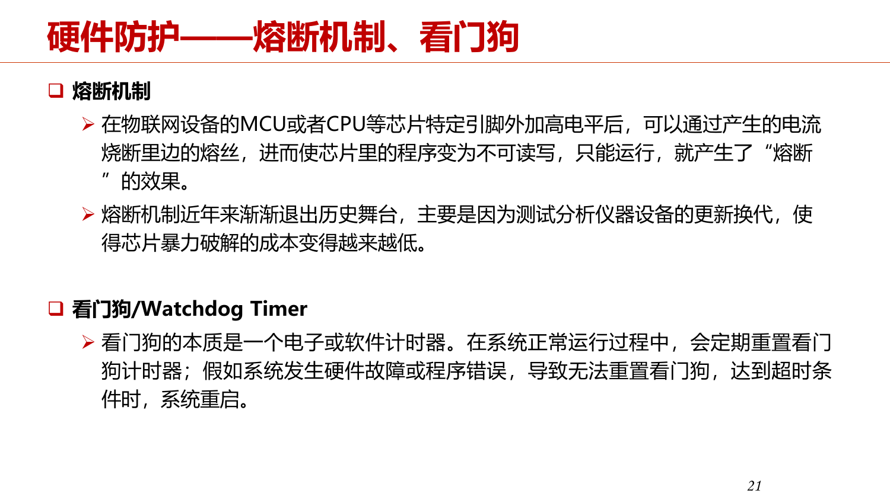

*第八章 PPT 第 21 页。熔断限制读写入口，看门狗检测程序是否及时响应。先看它们各自在保护什么。*

| 名词 | 一句话解释 | 例子 |
| --- | --- | --- |
| 熔断／熔丝 | 通过一次性硬件配置限制读取、调试或修改能力 | 量产后限制调试口或程序读取 |
| 看门狗 | 定时器超时没有被重置，就触发恢复 | 每 1 秒喂一次，3 秒没喂就重启 |
| PUF | 利用芯片制造差异形成难复制的物理响应 | 为设备身份或密钥重建提供物理基础 |
| RoT | 整个信任体系的起点 | 受保护启动代码用根密钥验证后续固件 |

**PUF 与 RoT 不等同：** PUF 偏向“这块芯片独特在哪里”，RoT 偏向“第一次验证从哪里开始可信”。**看门狗不负责认证身份**，它主要让系统在故障后恢复。

### 8-R3 TEE 与 REE：哪些东西在哪个世界

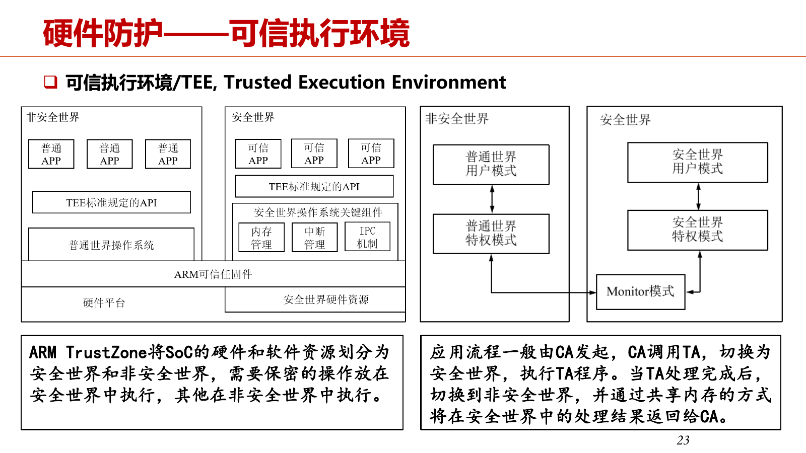

*第八章 PPT 第 23 页。普通世界发请求，可信世界执行敏感操作，然后只返回获准结果。*

TEE 是受保护的执行环境，REE 是普通执行环境。**CA 通常位于 REE，TA 位于 TEE。** 普通系统负责界面、网络等一般逻辑；密钥使用、敏感数据处理放在 TA 内。

指纹验证时，普通应用发出请求，TA 在 TEE 内比对模板，然后返回结果。重要的是模板不必原样暴露给普通应用。不能把 TEE 理解成“全部程序都放进去”，否则可信部分变大，验证和维护更困难。

**安全启动与 TEE 的区别：** 安全启动验证将要加载的程序；TEE 隔离运行过程中的敏感操作。前者偏启动链，后者偏运行隔离。

### 8-R4 沙盒、蜜罐与软件保护

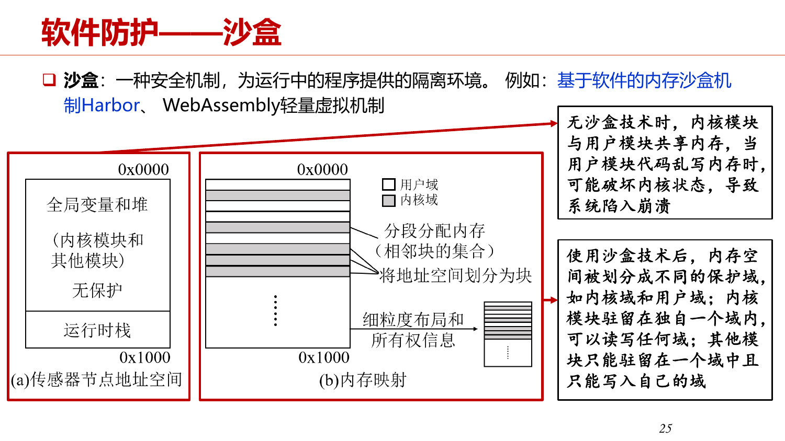

*第八章 PPT 第 25 页。用户模块只能在允许的内存和接口范围内活动，越界写不能任意破坏内核。*

沙盒提供受限运行环境；安全栈保护返回地址等控制信息；栈界限限制地址范围。Wasm 是一种可以提供线性内存检查和受控宿主接口的轻量执行机制。

蜜罐则模拟有吸引力的设备或服务，用来记录和分析攻击行为。**沙盒是限制程序，蜜罐是观察攻击。** 代码混淆增加逆向理解难度，漏洞挖掘寻找缺陷，漏洞分析解释原因，修复才真正消除对应问题。

### 8-R5 无线安全、TLS、认证和授权

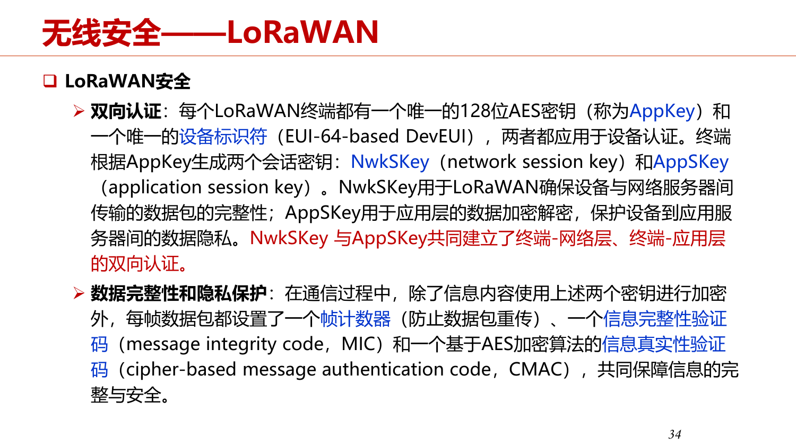

*第八章 PPT 第 34 页。课堂按 LoRaWAN 1.0 说明：网络会话密钥与应用会话密钥各有作用，帧计数参与防重放。*

蓝牙配对建立可信关系和密钥，再保护连接；LoRaWAN 用会话密钥保护网络完整性与应用载荷。**知道标识不等于证明身份。** 身份认证后，还要检查设备是否有指定 Topic、资源和操作的权限。

TLS 在传输连接上提供加密、完整性和身份验证。握手协商参数、建立会话密钥；后续用密钥保护数据。MQTT 可以运行在 TLS 上，但 MQTT 的 QoS 只讨论交付保障。

| 要解决的问题 | 对应机制 |
| --- | --- |
| 消息被窃听 | 加密 |
| 消息被恶意篡改 | MAC／数字签名等密码学校验 |
| 旧合法消息再触发操作 | 随机数、计数器、时效验证 |
| 非法设备接入 | 身份认证 |
| 合法设备越权 | 授权与访问控制 |
| 不可信固件被执行 | 验签、安全启动、安全 OTA |

**易错点：** CRC 检测传输错误，不是防恶意篡改的身份校验；会话加密不自动防重放；证书不是私钥；VPN 不能替代设备权限管理。

## 第七章：怎样把设备、云和应用一起开发出来

**课堂：01:54—02:01；PPT：《第七章 云-端物联网软件快速开发-1028.pdf》。**

老师先提出三个问题：传统方式怎么开发端云应用，怎样用 AI 开发，怎样构建自己的 IoT Coding Agent。下面分别展开。

### 7-R1 三端分工与物模型

设备端读取传感器、控制执行器；云端接入设备、存数据和运行业务；Web／App 展示状态并发出操作请求。三端可以各自开发，但必须共享接口和语义。

**物模型就是描述设备能力的共同约定**，包括它有哪些属性、服务和事件。比如智能灯：属性为开关、亮度；服务为设置亮度；事件为故障上报。这样云和 App 不必猜设备字段。

*PPT 第 7—14 页；字幕 01:56。箭头表示业务关系，物模型是接口约定，不是必须单独运行的一台服务器。*

### 7-R2 阿里云与 SmartThings 的建模区别

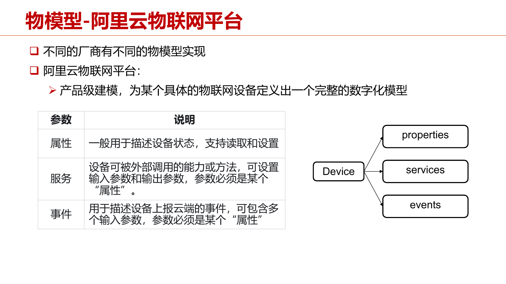

*第七章 PPT 第 8 页。重点看属性、服务、事件组成完整产品描述。*

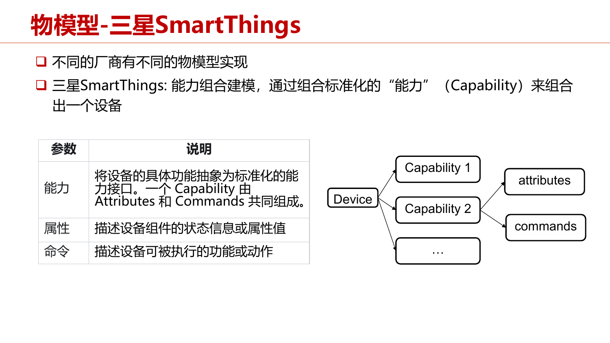

*第七章 PPT 第 11 页。把标准 capability 组合起来，例如开关能力＋亮度能力，构成设备功能。*

| 模型 | 组织方式 | 智能灯例子 |
| --- | --- | --- |
| 阿里云 | 为某一类产品定义完整模型 | 该灯产品有哪些属性、服务、事件 |
| SmartThings | 组合可复用的标准能力 | `switch`＋`switchLevel` 等 capability |

**思考题答案（PPT 第 14 页）：** 物模型让三端共享标准描述，降低接口不一致问题；两种方式的主要差别是产品整体定义与能力组合复用。

### 7-R3 系统软件开发与设备应用开发

系统软件包括驱动、OS、网络栈等基础能力；应用软件利用这些能力实现采集、控制和上报。设备应用可以采用两条部署路径（字幕 01:57—01:58）：

| 路径 | 怎样执行 | 好处 | 代价 |
| --- | --- | --- | --- |
| 编译烧录 | C／C++ 等编译为目标固件，再烧到设备 | 执行开销较小，直接利用硬件能力 | 修改后通常要重新编译和部署 |
| 解释运行时 | 设备先有解释器，再加载 Python 等脚本 | 改脚本较灵活，迭代方便 | 解释器占内存，也有执行开销 |

解释执行不等于永远无编译步骤，关键是设备运行时承担了脚本执行机制；编译方式也可以支持模块化或 OTA 更新。

### 7-R4 云端设备接入与业务逻辑

**设备接入**解决怎么连接、认证、收发消息；**业务逻辑**解决拿到数据以后要做什么。

规则驱动是 `IF 条件 THEN 动作`，如温度超过阈值就开风机；流程编排把多个处理步骤连接起来，如读取温度 → 检查阈值 → 写数据库 → 通知用户。Web／App 负责把这些状态和操作组织成用户界面。

### 7-R5 Node-RED 的三个基本元素

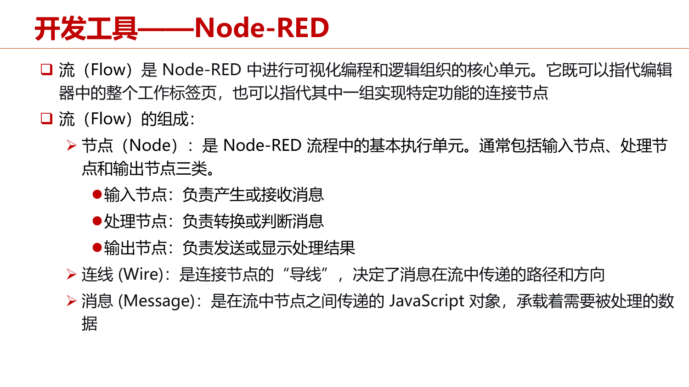

*第七章 PPT 第 33 页；字幕 01:59。看图时问：哪里产生数据，哪里处理数据，哪里输出，消息沿哪条连线流动？*

Node-RED 是基于 Node.js 的可视化编程工具。**节点**是执行单元，**连线**决定消息路径，**message** 是节点之间传递的 JavaScript 对象。

温度上报可以拆成输入节点接收 MQTT 消息、处理节点判断阈值、输出节点告警。不要把消息对象和连线混为一谈：连线是路线，message 才是沿路线传递的数据。

### 7-R6 TinyLink：自底向上改为自顶向下

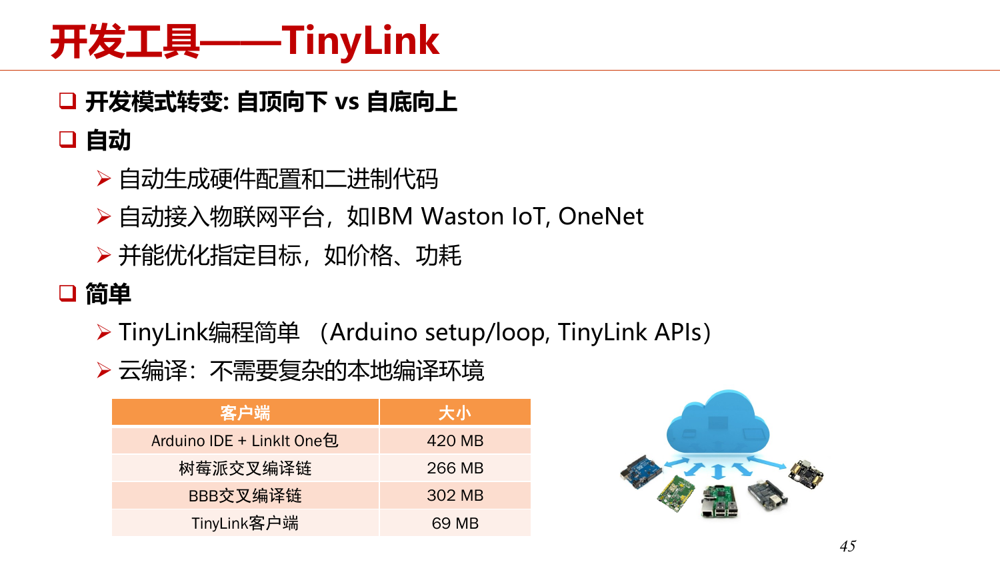

*第七章 PPT 第 43 页；字幕 02:00。先选板子、传感器再写程序是自底向上；先写应用需要什么能力，再由工具匹配硬件和生成配置是自顶向下。*

例如，“我要读取温湿度并上传”，传统方式先挑具体板子和传感器，自己适配接口；TinyLink 先描述应用功能，用抽象接口写程序，再寻找能够满足要求的硬件组合。抽象能降低开发负担，但硬件资源限制仍存在。

### 7-R7 Vibe Coding 与 Spec Coding

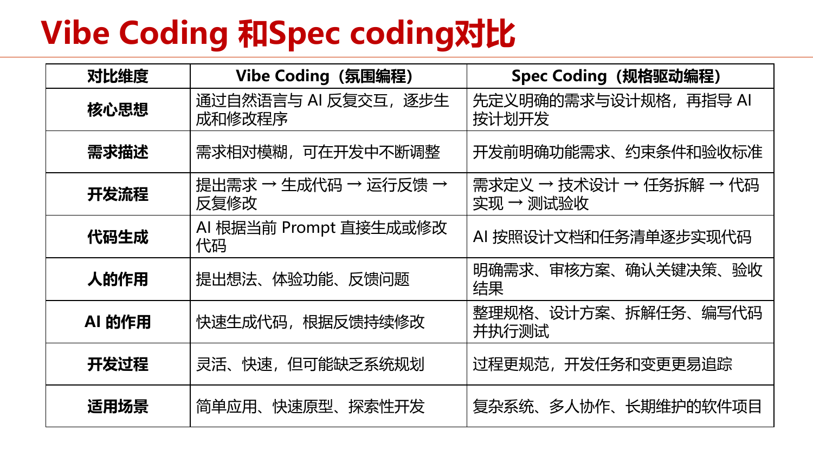

*第七章 PPT 第 71 页；字幕 02:00—02:01。Vibe 重交互试做，Spec 先明确规格，再按计划执行。*

Vibe Coding 是“描述 → 生成 → 运行 → 反馈 → 修改”，适合探索需求、快速原型。Spec Coding 是“需求 → 设计 → 任务 → 实现 → 验收”，适合端云接口复杂、需要长期维护的系统。

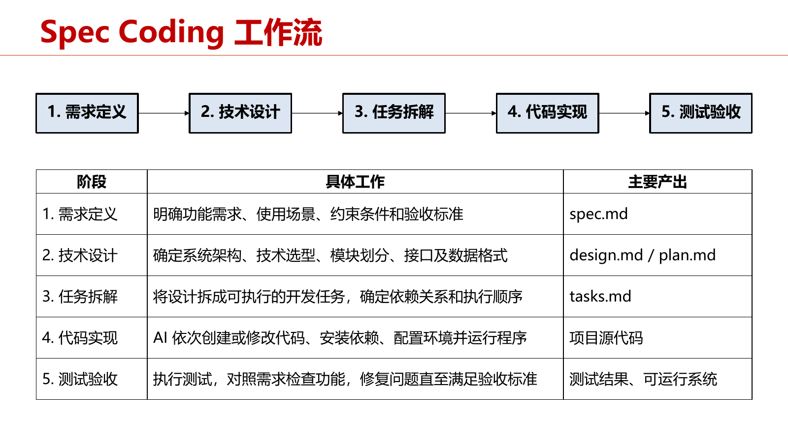

*第七章 PPT 第 63 页。记阶段是为了知道每一步解决什么问题，文档名字本身不是核心。*

| 阶段 | 应当明确什么 | 智能灯例子 |
| --- | --- | --- |
| 需求定义 | 功能、场景、约束、验收标准 | 断网时仍能本地开关 |
| 技术设计 | 架构、协议、接口、数据格式 | ESP32＋MQTT，约定亮度范围 |
| 任务拆解 | 小任务、依赖与顺序 | 先驱动，再通信，再联调 |
| 代码实现 | 按设计写程序并处理报错 | 实现订阅与控制 |
| 测试验收 | 根据需求验证真实行为 | 离线操作、重连同步、错误输入 |

**思考题答案（PPT 第 72 页）：** Spec 的优势是约束与验收可追踪，减少边做边改造成的接口漂移；Vibe 适合想法尚在探索的简单应用。Spec 也不保证 AI 永不出错，仍要实测。

### 7-R8 IoT Coding Agent 的特殊挑战与基本架构

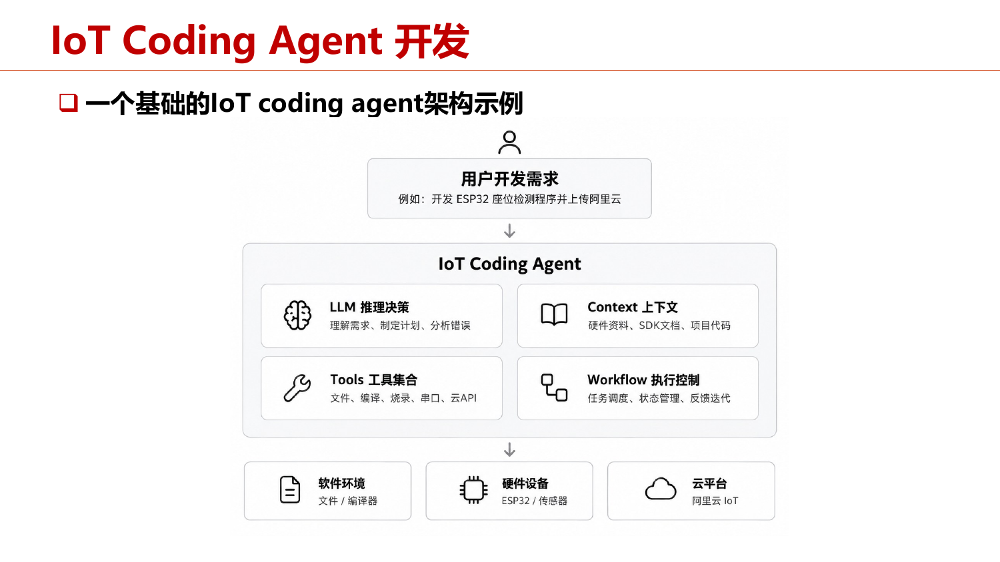

*第七章 PPT 第 73—81 页；字幕 02:01。模型需要环境知识、真实操作工具和反馈流程，不能只会输出源代码。*

| 挑战 | 为什么是 IoT 特有的负担 | 所需能力 |
| --- | --- | --- |
| 硬件异构 | 同样读温度，不同板子的引脚、驱动、内存不同 | 查硬件与驱动文档，正确适配 |
| 环境复杂 | 目标 MCU 与本地电脑架构不同 | SDK、交叉编译与依赖配置 |
| 部署到真实设备 | 本地运行不了目标固件 | 识别串口、烧录、读取日志 |
| 端云跨域 | 设备和云的消息格式必须一致 | 云端查询、MQTT 检查与联调 |
| 真实行为验证 | 编译通过还可能一直上传固定测试值 | 观察真实传感器、执行器与网络 |

基础组成可以记成 **LLM、Context、Tools、Workflow**：模型推理，文档与代码提供上下文，工具操作环境，工作流组织生成—编译—部署—验证—修复。课件的 API 校准解决“接口／头文件用错”，状态流图 SFG 解决“调用顺序或初始化缺失”。

## 第六章：云平台的重点功能与计算

**课堂：02:02—02:13；PPT：《第六章-2026.pdf》。** 老师主要点到 MQTT、设备管理、设备影子、OTA、规则、时序数据、函数计算和 PPT 计算题。

### 6-R1 HTTP 轮询与 MQTT 发布订阅

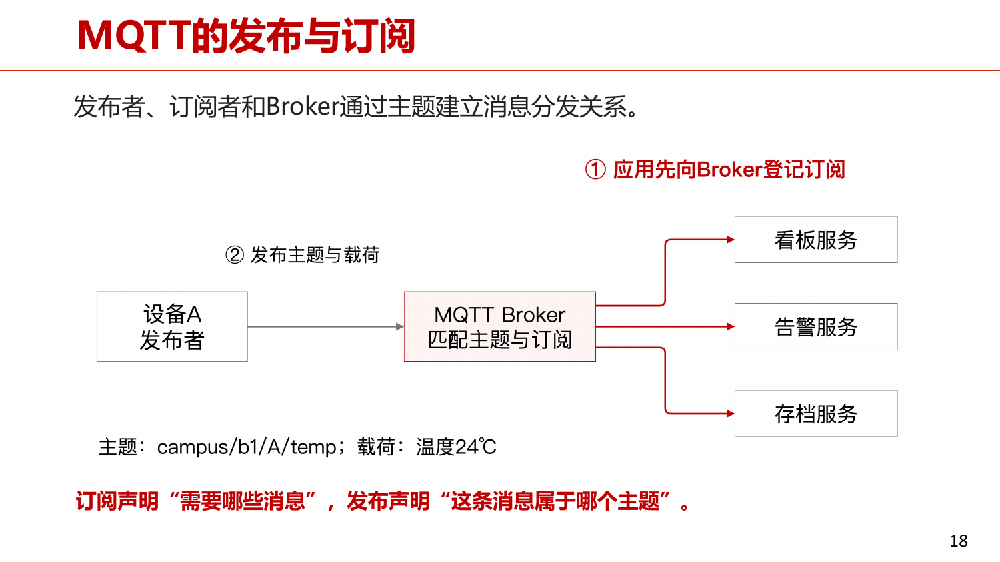

*第六章 PPT 第 18 页。发布者发到主题，Broker 按订阅关系转发，发布者无需直接知道所有消费者。*

HTTP 轮询是应用不断询问“有没有新数据”；MQTT 发布订阅是应用先订阅，消息产生后通过 Broker 分发。一个温度传感器的数据可以同时送给看板、告警和存档系统，彼此相对解耦。

**Topic 怎么理解？** `factory/deviceA/temp` 就像分类路径。`+` 匹配一个层级，`#` 匹配多个层级且放在过滤器末尾。例如 `factory/+/temp` 匹配各设备温度，`factory/#` 匹配该工厂下的多级主题。通配符用于订阅过滤器，不用于实际发布主题（PPT 第 20—21 页）。

Broker 的转发不意味着所有消息默认永久保存。保留消息、持久会话等是额外机制，不能把“经过 Broker”理解为自动拥有历史数据库。

### 6-R2 三种 QoS 与开销

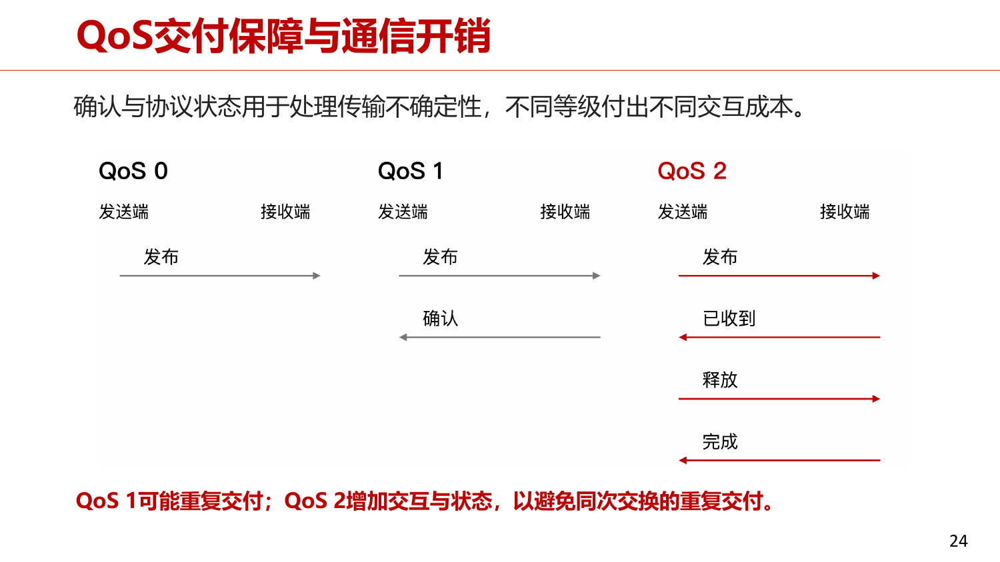

*第六章 PPT 第 22—25 页；字幕 02:03—02:04。等级越高，确认与状态管理通常越多。*

| QoS | 交付语义 | 主要交互 | 应用例子 |
| --- | --- | --- | --- |
| 0 | 至多一次，可能丢 | `PUBLISH`，无该层确认 | 持续温度采样，允许缺少一个点 |
| 1 | 至少一次，可能重复 | `PUBLISH → PUBACK` | 重要告警，业务处理要去重 |
| 2 | 恰好一次的协议交付 | `PUBLISH → PUBREC → PUBREL → PUBCOMP` | 对重复交付敏感的消息 |

==**QoS 是相邻 MQTT 端点间的交付语义，不能直接保证业务动作只执行一次。**== 设备到 Broker、Broker 到应用是两段交付，订阅方也有自己的 QoS。扣款、投药等一次性动作还需要业务 ID、去重和状态校验。

**为什么 QoS 1 会重复？** 接收方已处理消息，但确认丢了；发送方无法确定是否到达，就可能重传。接收数据与发送方知道已接收是两回事。

### 6-R3 确认窗口与吞吐量（PPT 计算）

最多允许 \(C\) 条消息等待确认，确认往返时间为 \(RTT\) 秒，则理想上界为：

\[
\lambda_{\max}\approx\frac{C}{RTT}.
\]

**课件原题（第 26 页）：** \(C=20\)，\(RTT=80\text{ ms}=0.08\text{ s}\)，得到 \(20/0.08=250\) 条／秒。要达到 500 条／秒，至少需 \(500\times0.08=40\) 条在途容量。

这个上界只考虑确认等待。链路带宽、Broker 处理能力、重传也会限制吞吐；窗口增大需要更多消息缓存和协议状态。

### 6-R4 设备管理与设备影子

管理要跟踪设备注册／删除、启用／禁用、连接状态、固件版本和更新过程。**启用状态和在线状态不同：** 启用的设备可以正在休眠，已连接设备也可能被策略禁用。

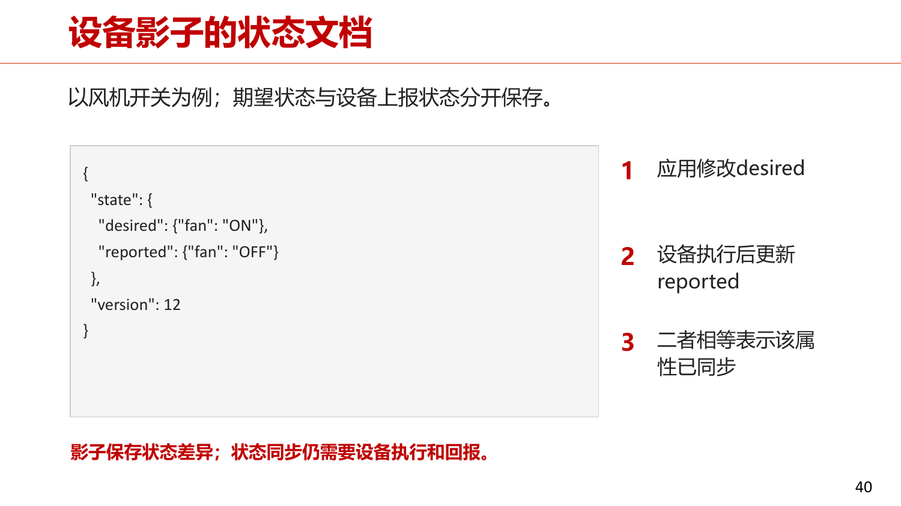

*第六章 PPT 第 35—43 页；字幕 02:05—02:06。图中 desired 是想让设备达到的状态，reported 是设备实际反馈的状态。*

直接控制要求设备及时接收；休眠设备可能收不到。设备影子把目标状态存到云里，设备上线后同步并回报实际状态。例如用户把风机目标改成 ON，设备还没醒时 `desired=ON`、`reported=OFF`；执行后再把 `reported` 更新为 ON。

**物模型与影子：** 物模型规定“有哪些属性和能力”，影子记录“这一台设备现在和期望是什么状态”。影子不是设备真正执行了动作的保证，还需要设备回报。

**一次性命令不适合只记最终状态：** “灯最终为蓝色”可以合并中间目标；“投药一次”不能任意覆盖或重做，需要独立命令、确认和去重。

### 6-R5 OTA：全镜像、模块、差分

**课堂 02:07—02:08；PPT 第 44—49 页，另见第三章第 18—22 页。**

| 方式 | 发送什么 | 优缺点 |
| --- | --- | --- |
| 全镜像 | 整个新版本 | 过程直接，传输量较大 |
| 模块化 | 被更新的模块 | 减少不相关模块传输，需要模块接口与版本管理 |
| 差分 | 从旧版本生成新版本的补丁 | 相似度高时更省，依赖正确旧版本和补丁应用 |

**差分不是“只发变化的字节”那么简单**，还要发送如何复制、插入的指令。课件格式：`COPY` 用 5 字节，`ADD m` 用 \(3+m\) 字节。

**课件原题（第三章第 22 页）：** 旧文件 `ABCDEACBC`，新文件 `WABCDEACBCXDEACB`。可用 `ADD 1 W`（4B）＋`COPY 9 0`（5B）＋`ADD 1 X`（4B）＋`COPY 5 3`（5B），共 **18B**。新文件本身只有 16B，这个小例子说明差分包不一定总比完整文件小。索引地址从 0 开始，最后复制旧文件位置 3 起的 `DEACB`。

在程序头部插入函数可能改变后面许多地址与跳转引用，因此补丁可能比尾部插入更大；具体结果受链接布局和相似性保持技术影响，不能只看源代码增加了几行。

### 6-R6 IFTTT 与规则冲突

`IFTTT = If This Then That`。判断规则冲突，要同时满足：**条件能同时成立、作用于同一对象、动作互不兼容。**

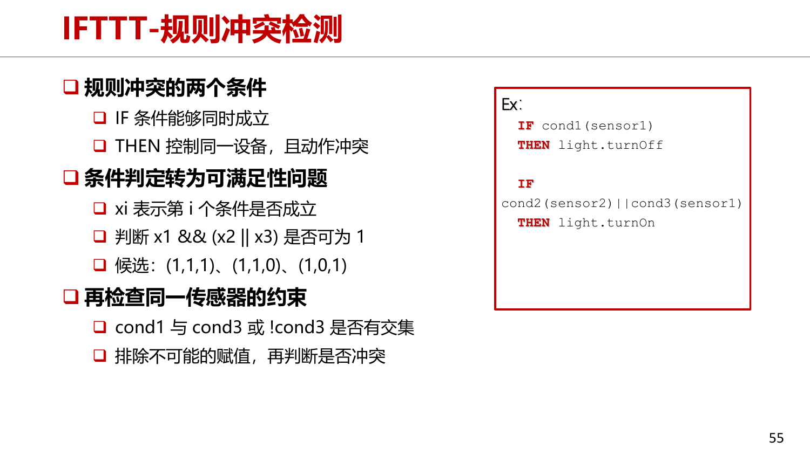

*第六章 PPT 第 54—56 页；字幕 02:09。布尔条件可满足还不够，同一传感器的数值约束也必须真的有交集。*

| 两条规则 | 冲突吗 | 理由 |
| --- | --- | --- |
| 温度 >30 开风机；温度 ≥28 关风机 | 是 | 温度 31 时同时触发，动作相反 |
| 温度 >30 开风机；温度 <20 关风机 | 否 | 两个条件不能同时成立 |
| 光照 >10000 关灯；光照 <20000 关灯 | 无相反动作冲突 | 条件可重叠，但都是关灯 |
| 光照 >10000 关灯；19—24 点开灯 | 可能 | 晚间仍有强光时，两个条件同时成立 |

遇到复杂逻辑，先求条件交集是否为空，再看执行对象和动作，不要只因为两条规则都提到灯就判断冲突。

### 6-R7 时序数据库：数据模型、容量与压缩

**课堂 02:09—02:10；PPT 第 72—86 页。** 老师要求看时序数据这部分；下面把其核心机制与算例展开。

时序数据按时间不断增长，常问“设备 A 最近十分钟平均温度”。这与交易系统的复杂关联、事务约束不同，存储要重点考虑持续写入、按设备和时间定位、压缩和保留策略。关系数据库也能做时间范围查询，不能说它完全不能存时序数据。

*第六章 PPT 第 72 页。10,000 台设备每秒 1 点，就是每天 8.64 亿点。先算点数，再算每点大小。*

InfluxDB 2.x 示例中，measurement 类似测量类型，tag 标识与筛选序列，field 存随时间变化的数值，timestamp 表示采样时刻。设备 ID 可作 tag，温度作 field；不要把不断变化的随机值随意当 tag，否则序列基数膨胀。

**容量公式：**

\[
N_{\text{day}}=N_{\text{device}}f\times86400,\qquad
S_{\text{day}}=N_{\text{day}}b.
\]

课件条件：10,000 台，每秒 1 点，时间戳 8B＋数值 8B＝16B。每日 \(864,000,000\) 点，原始容量为 **13.824GB**（十进制）。未计设备标识、索引、副本和协议开销。

**Gorilla 为什么能无损压缩浮点值？** 将相邻浮点数的位模式异或，若不变，差异为零；若变化集中在少数位，只记录有效变化和必要控制信息。它压缩表示，恢复后仍是原值，**与把 FP32 变成 INT8 的有损量化不同**。

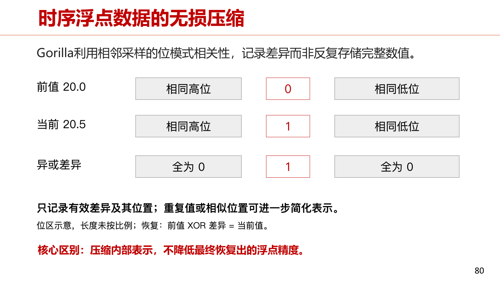

*第六章 PPT 第 80 页。这里比较的是浮点位模式，不是简单把两个十进制温度相减。固定值或缓慢变化序列通常更易压缩。*

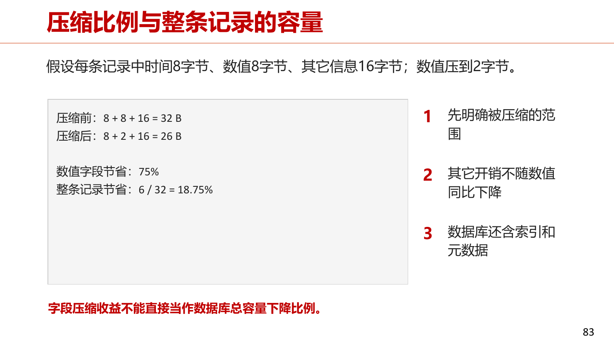

*第六章 PPT 第 83 页。仅数值字段从 8B 缩成 2B，其他字段仍占空间。*

**课件原题（第 84 页，沿用 16B／点）：** 数值 8B 压为 2B，时间戳仍是 8B，每点变成 10B；整条记录节省 \((16-10)/16=37.5\%\)，每日容量 **8.64GB**。若另有 16B 元数据，则从 32B 变成 26B，只省 **18.75%**。不能把“数值省 75%”直接当作数据库整体省 75%。

### 6-R8 滑动均值：每次只换两个数

**PPT 第 87—97 页，属于时序数据与流计算的计算练习。**

窗口长度 \(k\)，只在窗口填满后输出。朴素方法每个窗口重新求和，单次 \(O(k)\)。增量法保存窗口总和 \(S\)，旧值退出、新值进入：

\[
S'=S-x_{\text{old}}+x_{\text{new}},\qquad \bar x'=S'/k.
\]

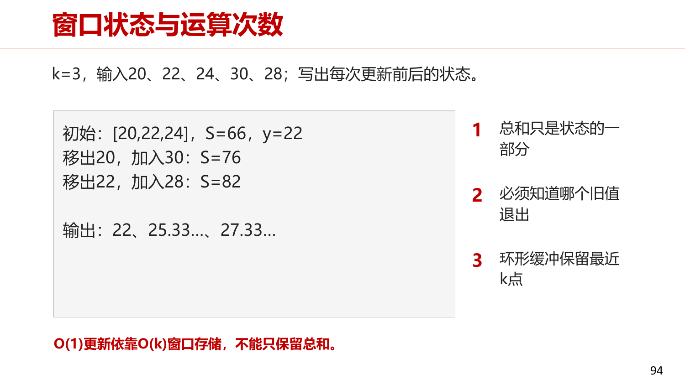

*第六章 PPT 第 94 页。总和不能告诉你哪个旧值要退出，还要保存最近 k 个值和最旧位置。*

**课件例子：** \(k=3\)，输入 20、22、24、30、28。

| 当前窗口 | 总和怎么来 | 均值 |
| --- | --- | --- |
| [20,22,24] | 初始 66 | 22 |
| [22,24,30] | 66−20＋30＝76 | 25.333… |
| [24,30,28] | 76−22＋28＝82 | 27.333… |

每次更新 \(O(1)\)，处理 \(n\) 个数总时间 \(O(n)\)，窗口存储 \(O(k)\)。单遍处理指每个输入按顺序读一次，不代表完全不用存储。

### 6-R9 滑动方差：再维护平方和

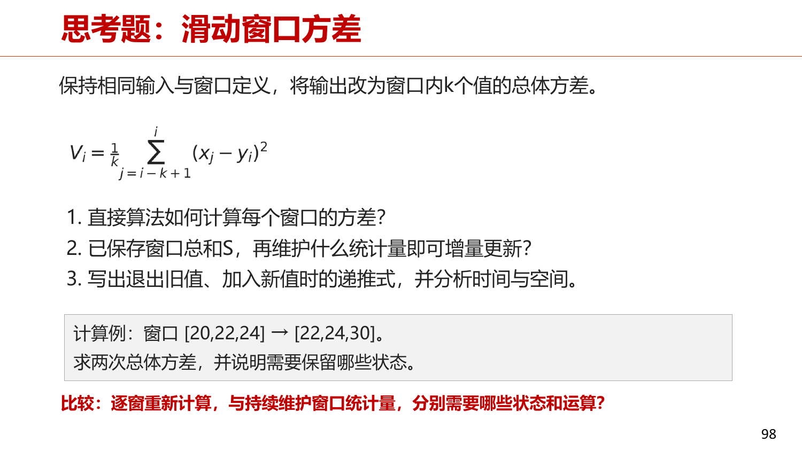

*第六章 PPT 第 98 页。要同时保存总和 S、平方和 Q 和退出值。*

总体方差：

\[
\sigma^2=\frac1k\sum_i(x_i-\bar x)^2
=\frac Qk-\left(\frac Sk\right)^2,\qquad Q=\sum_i x_i^2.
\]

更新时：

\[
Q'=Q-x_{\text{old}}^2+x_{\text{new}}^2.
\]

初始 [20,22,24]：\(S=66\)，\(Q=400+484+576=1460\)，方差 \(1460/3-22^2=8/3\)。更新为 [22,24,30]：\(S'=76\)，\(Q'=1460-400+900=1960\)，方差 \(1960/3-(76/3)^2=104/9\approx11.556\)。

时间仍为每次 \(O(1)\)，空间 \(O(k)\)。题目要求总体方差就除以 \(k\)，不能误用样本方差的 \(k-1\)。浮点工程实现还要注意平方和法的数值消减误差。

### 6-R10 滑动最大值：旧最大退出以后怎么办

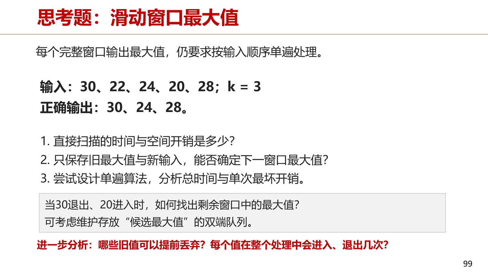

*第六章 PPT 第 99 页。输入 30、22、24、20、28，k=3，正确输出为 30、24、28。*

如果只记“旧最大值 30”，当 30 退出以后，无法知道剩余的 22 与 24 谁更大。办法是维护**单调递减的候选队列**，存值及其下标：

1. 先删掉已离开窗口的队首。
2. 新值到来时，删掉队尾不大于它的旧值：它们更小且更早到期，以后不会比新值更值得保留。
3. 把新值加入队尾，队首就是最大值。

| 新输入 | 候选值队列 | 完整窗口输出 |
| --- | --- | --- |
| 30 | [30] | 未满 |
| 22 | [30,22] | 未满 |
| 24 | [30,24]，22 被新 24 淘汰 | 30 |
| 20 | [24,20]，30 过期 | 24 |
| 28 | [28]，淘汰 20 和 24 | 28 |

每个元素最多入队、出队各一次，总时间 \(O(n)\)，**均摊**每点 \(O(1)\)，单点最坏可删 \(O(k)\) 个元素，空间 \(O(k)\)。均值、方差是减旧加新；最大值不能直接这样减，需要保存候选关系。

### 6-R11 常驻服务与函数计算

**课堂 02:10—02:13；PPT 第 119—129 页。**

常驻服务维持进程，等待事件发生；函数计算由事件触发，平台分配环境并运行函数，不要求应用自行长期维持服务进程。**Serverless 仍然有服务器**，只是部署者不直接管理常驻服务器实例。

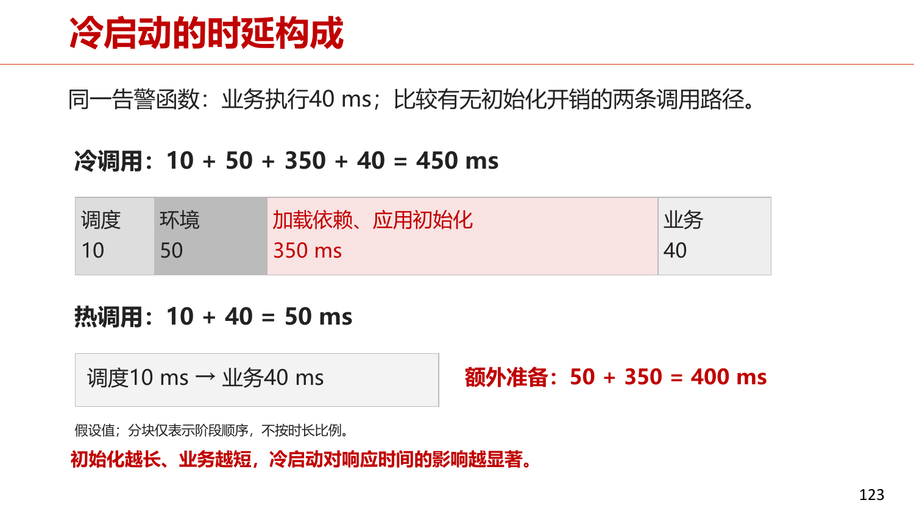

*第六章 PPT 第 123 页。冷调用多了环境准备与初始化；热调用复用环境。字幕把部分毫秒听成秒，数字按 PPT 核对。*

课件算例：调度 10ms、环境准备 50ms、依赖加载与初始化 350ms、业务 40ms。

\[
T_{\text{cold}}=10+50+350+40=450\text{ ms},\qquad
T_{\text{warm}}=10+40=50\text{ ms}.
\]

冷启动额外开销为 400ms。热调用不必每次重新初始化，但环境可能被回收，也可能因为扩容需要新环境，不能说函数每次都是冷启动或只在第一次冷启动。

### 6-R12 冷启动优化与资源取舍（PPT 计算）

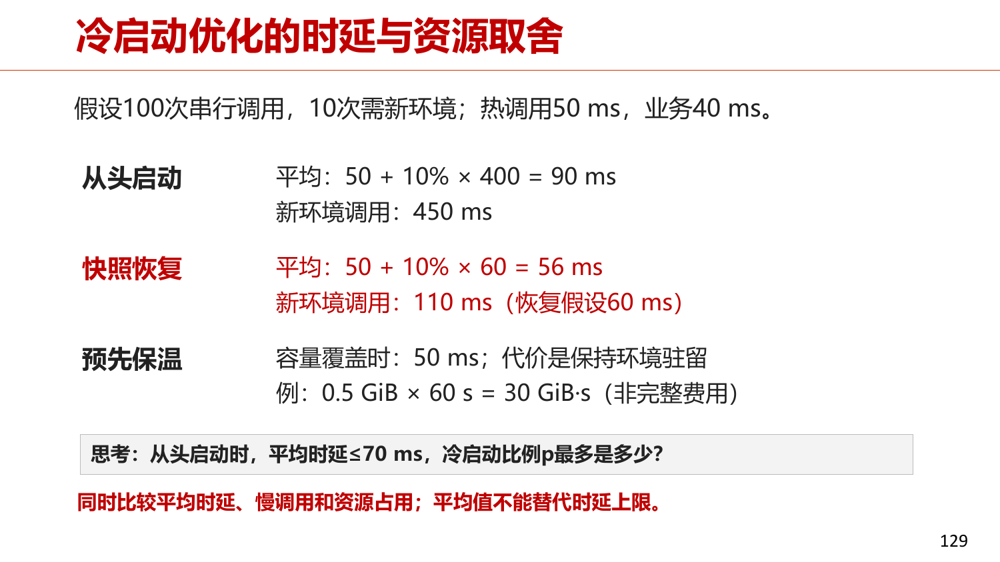

*第六章 PPT 第 129 页。快照恢复、保温降低时延，但有恢复成本或驻留资源开销。*

冷启动比例 \(p\)，则平均时延：

\[
\mathbb E[T]=(1-p)T_{\text{warm}}+pT_{\text{cold}}
=T_{\text{warm}}+p\Delta T.
\]

100 次调用中 10 次冷启动，平均 \(50+0.1\times400=90\text{ ms}\)。若要求平均不超过 70ms：\(50+400p\le70\)，得到 **\(p\le5\%\)**。

快照恢复的额外准备若为 60ms，冷调用为 110ms，平均 \(50+0.1\times60=56\text{ ms}\)。预先保温可降低等待，但 0.5GiB 环境驻留 60 秒占用 \(30\text{ GiB·s}\) 的内存时间，实际计费另依平台规则。

平均 90ms 不等于每次都在 90ms 内完成，慢调用仍可能是 450ms。考比较题时同时写时延、尾部慢调用和资源成本。

### 6-R13 云边卸载：先把传输算进去

**课堂 02:13 要求看 PPT 中的计算；PPT 第 145—147 页。**

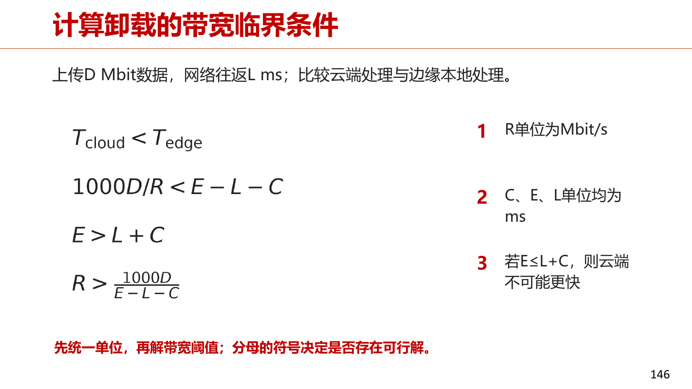

*第六章 PPT 第 146 页。输入量越大、网络越慢，传输越可能抵消云端计算优势。*

输入 \(D\) Mbit，带宽 \(R\) Mbit/s，网络往返 \(L\) ms，云计算 \(C\) ms，本地边缘计算 \(E\) ms：

\[
T_{\text{cloud}}=1000\frac DR+L+C,\qquad T_{\text{edge}}=E.
\]

云端更快需 \(1000D/R+L+C<E\)。若 \(E>L+C\)：

\[
R>\frac{1000D}{E-L-C}.
\]

若 \(E\le L+C\)，就算上传无限快，云端也不能严格更快。

**课件原题：** \(D=2\)，\(L=30\)，\(C=10\)，\(E=100\)。临界带宽 \(2000/60\approx33.33\text{ Mbit/s}\)。20Mbit/s 时云端 \(100+30+10=140\)ms，本地更快；50Mbit/s 时云端 \(40+30+10=80\)ms，云端更快。

这里忽略排队与重传，较小输出并入 \(L\)；大输出应另计下行传输。算时必须分清 **Mbit 与 MB、秒与毫秒**。

## 第五章：低功耗通信、802.15.4、BLE 与 LoRa

**课堂：02:16—02:29；PPT：《第五章-2026v2.pdf》。** 老师依次讲关键特性、物理层、6LoWPAN、蓝牙和 LoRa，尤其提醒 LoRa 的 SF／BW 计算及 A／B／C 的取舍。

### 5-R1 五类关键特性怎么比较

功耗、通信距离、频带与数据率、安全性、非技术特性是课件比较协议的几个维度（第 15—25 页）。要能说出“为什么适合”，不必背每个协议最大功率等零散表格数值。

| 维度 | 应该问什么 | 例子 |
| --- | --- | --- |
| 功耗 | 电池能撑多久，收发器醒着多久？ | 长期监测节点需要低占空比 |
| 距离 | 一跳够不够，需要网关或多跳吗？ | 城市抄表与近距离手环不同 |
| 频带与速率 | 是否共享频段，能传多少有效数据？ | 2.4GHz 中多个协议互相干扰 |
| 安全性 | 有无加密、认证、防重放？ | 机密数据不能只靠跳频保护 |
| 非技术因素 | 手机支持、成本、标准与生态如何？ | BLE 容易与手机配合 |

授权频段需要相应使用许可；ISM 等免许可频段仍受发射功率和地区规则约束。共享频段方便部署，也可能面临更多共存干扰。

### 5-R2 占空比与平均功耗（课堂原例）

无线收发器的发送、接收和空闲侦听都会消耗能量。让它有更多时间睡眠，通常比只优化少量 CPU 计算更有用。

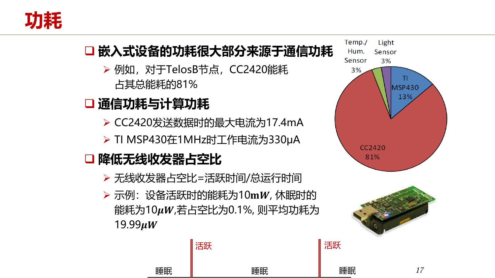

*第五章 PPT 第 17 页。占空比是活跃时间除以总时间；不是电池剩余比例。*

\[
d=\frac{t_{\text{active}}}{T},\qquad
\bar P=dP_{\text{active}}+(1-d)P_{\text{sleep}}.
\]

**课堂原例（02:18）：** 活跃功率 10mW，睡眠功率 10μW，占空比 **0.1%**。字幕有“0.1”与“0.1%”混杂，按 PPT 原题取 \(d=0.001\)。

先把单位统一：\(10\text{ mW}=10000\text{ μW}\)，再计算：

\[
\bar P=0.001\times10000+0.999\times10
=19.99\text{ μW}.
\]

若占空比其实是 10%，则 \(d=0.1\)，结果为 1009μW，差很多。**百分数必须先除以 100。** 功率乘时间才得到能量，不能把 mW 和 mJ 当成同一单位。

### 5-R3 路径损耗、灵敏度与通信距离

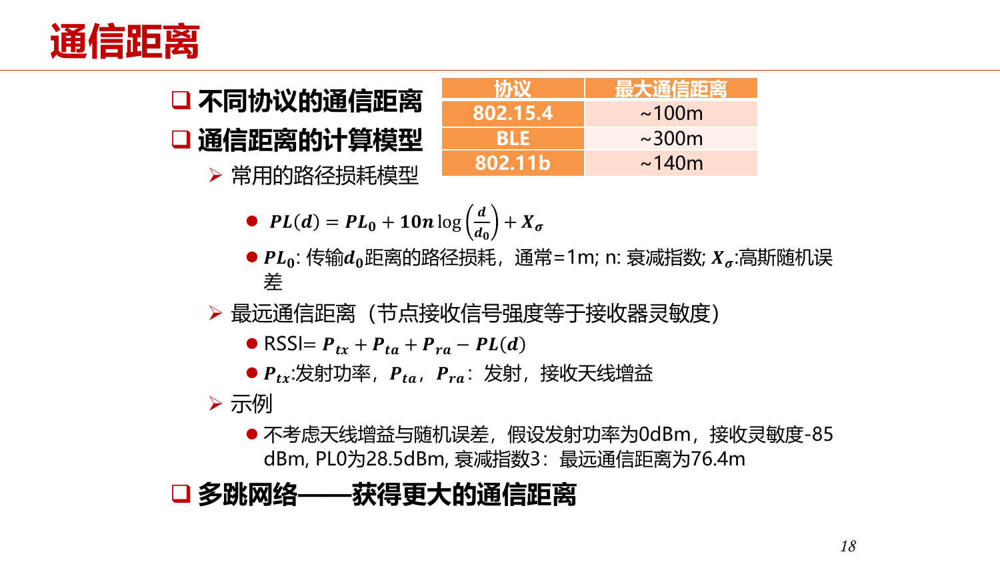

*第五章 PPT 第 18 页；字幕 02:18。图中路径损耗属于 dB，收发功率属于 dBm，天线增益属于 dBi；课件个别单位标注需按这一区别理解。*

基本链路预算：

\[
P_{\text{rx}}=P_{\text{tx}}+G_{\text{tx}}+G_{\text{rx}}-PL(d),
\qquad PL(d)=PL_0+10n\log_{10}(d/d_0)+X_\sigma.
\]

距离越大，路径损耗越大；能通信要求接收功率至少达到灵敏度门限。灵敏度 −90dBm 比 −85dBm 更好，因为可以接收更弱的信号。

**课件原例：** 忽略增益与随机误差，发射 0dBm、灵敏度 −85dBm、\(PL_0=28.5\text{ dB}\)、\(n=3\)、\(d_0=1\text{ m}\)：

\[
-85=0-[28.5+30\log_{10}d]
\Rightarrow d=10^{(85-28.5)/30}\approx76.4\text{ m}.
\]

增大距离的方式：提高发射功率、增加天线增益、提高接收灵敏度，或用多跳延伸网络覆盖。多跳增加的是**整体覆盖范围**，不是每一跳的无线传播距离。

**功率换算补充：** \(P_{\text{dBm}}=10\log_{10}P_{\text{mW}}\)。1mW＝0dBm，10mW＝10dBm，0.1mW＝−10dBm。dBm 是绝对功率，dB 是比值／增减量。

### 5-R4 实际速率为什么达不到标称速率

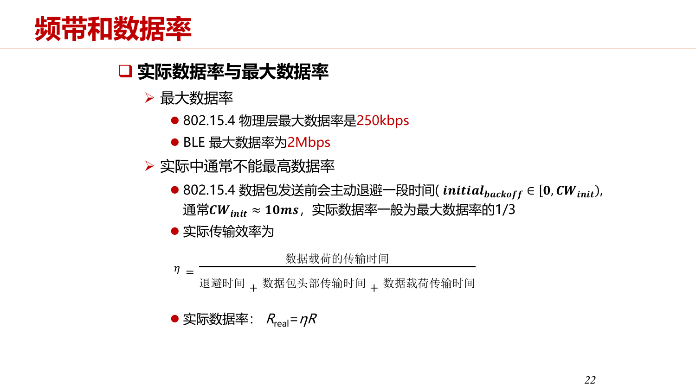

*第五章 PPT 第 22 页；字幕 02:19。物理速率描述链路发比特的速度，有效速率只计应用载荷。*

\[
\eta=\frac{t_{\text{payload}}}
{t_{\text{backoff}}+t_{\text{header}}+t_{\text{payload}}},\qquad
R_{\text{real}}=\eta R.
\]

**补充练习：** 物理速率 250kbps，载荷 100B、包头 25B、退避 6.4ms。载荷时间 \(800/250000=3.2\)ms；包头时间 \(200/250000=0.8\)ms；合计 10.4ms。有效速率 \(800/0.0104\approx76.92\)kbps，而不是 250kbps。

课件说约为标称速率的三分之一是其示例环境下的量级，**不是所有包长度和所有网络都固定三分之一**。若题目增加 ACK、重传或帧间隔，也要加入相应开销。

### 5-R5 IEEE 802.15.4 与 ZigBee 的关系

802.15.4 定义低速无线个域网的 **PHY 和 MAC**；ZigBee 在其上定义网络和应用等更高层机制。它们不是两个完全等价的名字。

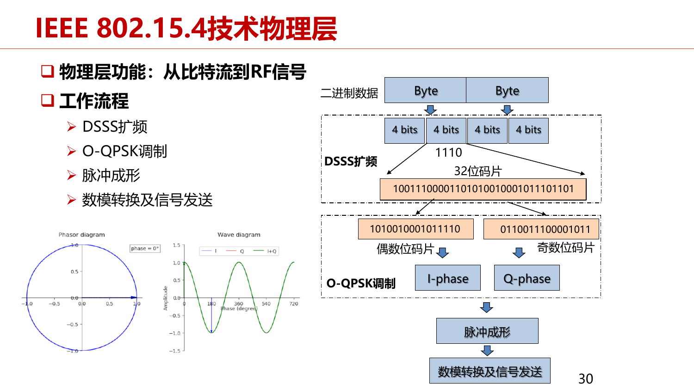

*第五章 PPT 第 30—32 页；字幕 02:20—02:21。先扩频，再调制，再成形发送。*

2.4GHz 经典 PHY：

1. 每 **4 个数据 bit** 映射为 **32 个 chip**，这是 DSSS 直接序列扩频。
2. 码片分到 I／Q 两路，使用 O-QPSK 调制；Q 路有半码片偏移。
3. 脉冲成形后转换为射频信号。

**为什么扩频提高鲁棒性？** 接收端按预定码序列判别，即使少数码片受扰，仍可能识别原符号。不是简单把每个数据 bit 原样重复 32 次；字幕对此口述有混杂，按课件的“4bit→32chip”理解。

码片率 2Mchip/s，每个符号 32chip，所以每秒符号数 \(2\times10^6/32=62500\)；每符号 4bit，数据率 \(62500\times4=250000\)bit/s＝250kbps。**chip 和 bit 不是同一个单位。**

### 5-R6 低功耗 MAC：怎样让双方醒着时碰面

**PPT 第 37—56 页；本次字幕 02:22 快速带过 MAC。以下为理解与课件思考题补充，不把每个机制都写成老师本次逐项强调。**

收发器睡得越多越省电，但发送者醒时接收者可能没醒。因此 MAC 还要找到两者都活跃的汇合点。

| 机制 | 怎么碰面 | 代价 |
| --- | --- | --- |
| 同步 S-MAC | 协调相同醒睡时间 | 同步报文、空闲监听开销 |
| 发送方发起 LPL | 发长探测包列，等接收者周期性检查到信号 | 发送者长时间占用信道 |
| 接收方发起 RI-MAC | 接收者醒来发信标，发送者听到后发数据 | 发送者要监听等待，也可能竞争 |

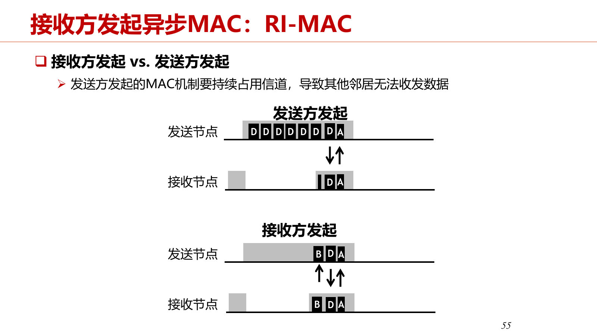

*第五章 PPT 第 55 页。上图持续发探测／数据包，下图等待接收方信标后再发送。*

LPL 单播收到 ACK 可以提前停止，广播要覆盖可能的接收者睡眠时间。Wi-Fi 等共存信号可能错误唤醒节点；长时间误醒会损失节能效果。低功耗不是只有发射功率低，还要减少无效监听、重传和控制开销。

### 5-R7 6LoWPAN：分段重组和头部压缩

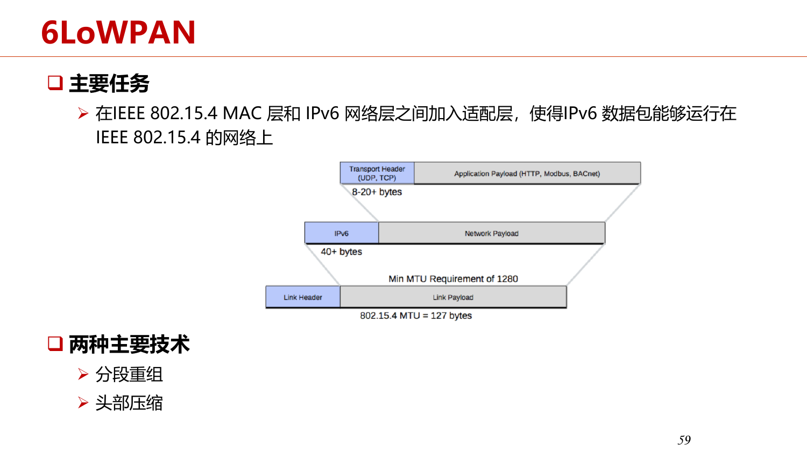

*第五章 PPT 第 58—63 页；字幕 02:22。6LoWPAN 是适配机制，不能与 IPv6 路由协议 RPL 混淆。*

IPv6 报文要在很短的 802.15.4 帧上运行，会遇到“装不下”和“头部太浪费”两个问题：

- **分段重组**：大报文切成多个链路可传的片段，在接收端重新拼起来。
- **头部压缩**：省略能够从上下文推导的字段，或用更短编码表示常见值，接收端再恢复。

IPv6 基本头 40B，UDP 头 8B，在短帧里占比很高。压缩是减少表示开销，不是删掉应用需要的语义；分段则改变传输单元，不能将二者混为一谈。

### 5-R8 CTP、RPL 与 ETX（思考题补充）

**PPT 第 66—80 页；本次老师未逐项重讲，依据“思考题要看”补入基本解法。**

CTP 主要把多个节点的数据沿收集树送向汇聚点；RPL 面向低功耗有损 IPv6 网络，组织到根节点的有向无环结构，并可支持上下行等通信。

链路发送成功概率为 \(p\)，独立重试时平均发送次数 \(ETX=1/p\)。若要同时考虑数据送达概率 \(d_f\) 与 ACK 送达概率 \(d_r\)，则 \(ETX=1/(d_fd_r)\)。路径 ETX 是各跳期望发送次数之和。

**补充练习：** 两跳成功率 0.8 与 0.5，忽略 ACK 丢失，则路径 ETX＝\(1/0.8+1/0.5=3.25\)。一跳成功率 0.25 时 ETX＝4；因此两跳路径可能反而更省平均发送次数。路径 ETX 不是把各跳 ETX 相乘。

### 5-R9 BLE：星型连接、跳频、GFSK 与 Mesh

**课堂 02:23—02:25；PPT 第 90—112 页。**

经典 BLE 连接可理解为中心设备连接多个外围设备，例如手机连耳机、手环。课件使用 master／slave，现代术语常用 central／peripheral。这与 Mesh 多跳转发需要区分。

BLE 在 2.4GHz 有 **40 个信道，37 个数据、3 个广播信道**。连接双方按约定方式切换数据信道，减少持续停留在干扰信道上的影响；自适应机制可以避开较差信道。**跳频减少干扰，不等于内容已经加密。**

调制方式为 **GFSK，高斯频移键控**：先用高斯滤波平滑信号，再通过频率变化表达数据，与 802.15.4 的 O-QPSK 不同。

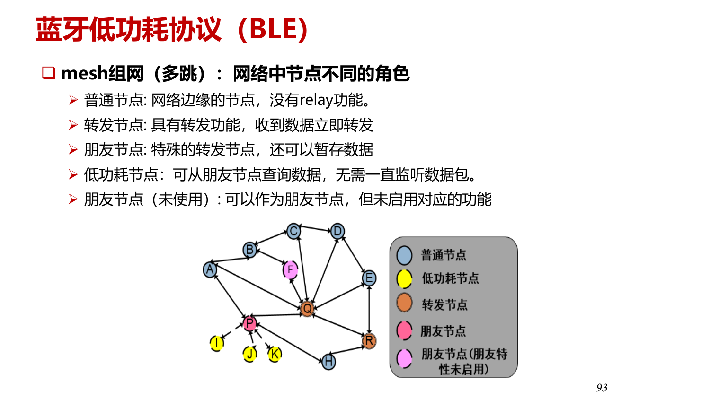

*第五章 PPT 第 93 页。Relay 转发，Friend 暂存数据，低功耗节点向 Friend 查询，从而不必持续监听。*

Mesh 中普通节点不一定转发；Relay 负责中继；Friend 帮低功耗节点暂存消息；TTL 限制转发范围。基本流程是接收、检查是否重复／能否继续转发、递减 TTL 后按规则发送，避免无限循环扩散。老师要求理解包怎么传，不要求逐个背包字段。

### 5-R10 NB-IoT 与 LoRaWAN

**课堂 02:25—02:26；PPT 第 130—158、175—177 页。**

| 技术 | 主要特点 | 典型差别 |
| --- | --- | --- |
| NB-IoT | 蜂窝体系、窄带、授权频段、运营商网络 | 依赖蜂窝网络与 SIM 等身份机制 |
| LoRa／LoRaWAN | 低功耗长距离，小数据率，网关汇聚 | LoRa 是 PHY 调制技术，LoRaWAN 组织 MAC／网络通信 |

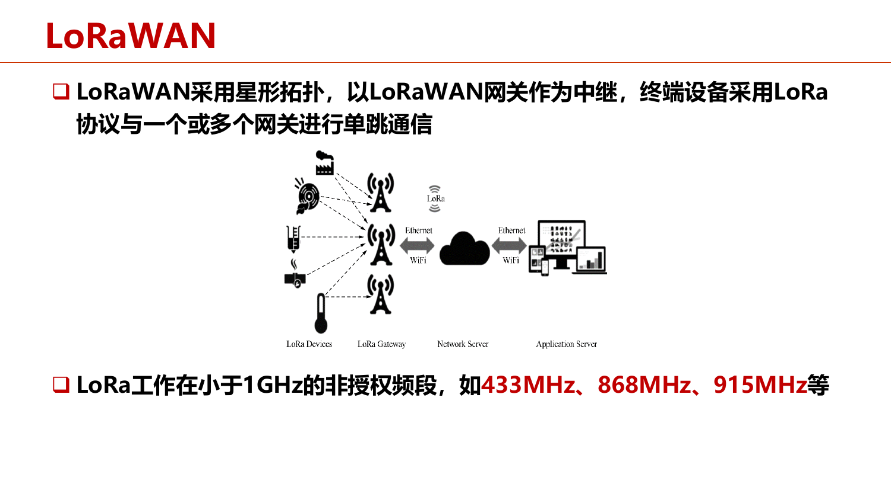

*第五章 PPT 第 176 页。终端可以被一个或多个网关接收，网关向网络服务器转发，常称星中之星结构。它不是让终端逐个转发的多跳网状网络。*

LoRa 技术源自 Semtech；LoRaWAN 标准由 LoRa Alliance 推进。课堂强调开放规范便于研究和部署，**不能据此把所有 LoRa 芯片实现都称为开源**。它适合抄表等小数据量任务，不适合拿来替代宽带视频传输。

### 5-R11 LoRa 的 Chirp、BW、SF 与符号时间

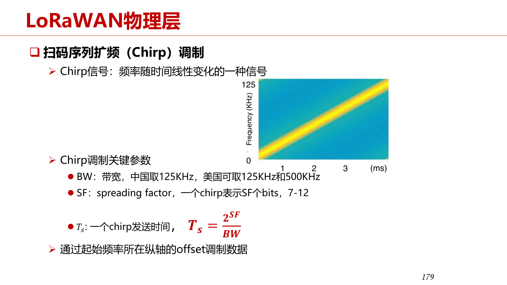

*第五章 PPT 第 179 页；字幕 02:27—02:29。纵向频率跨度对应 BW，一个符号的时长对应横向跨度。*

Chirp 是频率随时间变化的信号。BW 是带宽；SF 是扩频因子。理想符号可区分 \(2^{SF}\) 种位置，承载 \(SF\) 个原始 bit 的信息，符号时间：

\[
T_s=\frac{2^{SF}}{BW}.
\]

**补充练习：** BW＝125kHz＝125000Hz。

| SF | \(2^{SF}\) | 符号时间 |
| --- | --- | --- |
| 7 | 128 | \(128/125000=1.024\)ms |
| 8 | 256 | 2.048ms |
| 9 | 512 | 4.096ms |

**SF 每加 1，符号时间翻倍；BW 翻倍，符号时间减半。** 较大 SF 通常利于弱信号接收，但占空中时间更长、速率更低，且可能增加单次传输能耗。不是 SF 越大越好。

原始符号 bit 速率 \(R_{\text{raw}}=SF/T_s=SF\cdot BW/2^{SF}\)。若考虑编码率 \(CR\)，可写 \(R_b\approx SF\cdot BW/2^{SF}\cdot CR\)；最终应用速率还要扣除包头、前导和其他开销。

### 5-R12 LoRaWAN Class A／B／C

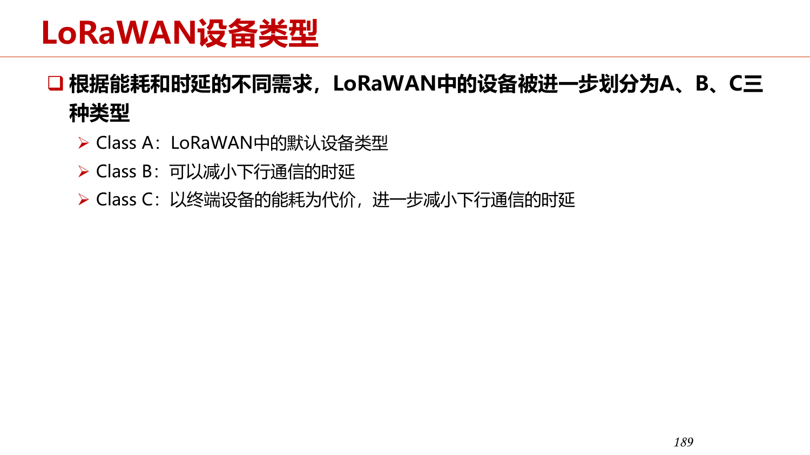

*第五章 PPT 第 189—201 页；字幕 02:29。复习核心是下行何时能接收，以及要付出多少监听成本。*

| 类别 | 接收窗口 | 优势 | 代价和应用 |
| --- | --- | --- | --- |
| A | 每次上行后打开两个接收窗口 | 最省电，默认支持 | 下行要等上行触发，适合电池抄表 |
| B | 在 A 基础上，用同步信标安排额外接收时隙 | 下行机会更可预测 | 要同步和多醒一些，适合周期控制 |
| C | 除发送等必要切换外，尽量持续接收 | 下行等待短 | 监听耗电大，适合持续供电设备 |

不是 B／C 比 A “全面更好”，而是用能耗换下行及时性。题目给电池与长寿命优先，通常考虑 A；给市电和即时控制优先，通常考虑 C。

## 第四章：边缘智能与三种模型压缩

**课堂：02:29—02:32；PPT：《第四章-1009.pdf》。**

!!! important "老师明确强调"

    “第四章……比较重要”；“量化……全部看一下”（02:29）；剪枝分类、方法、L1 策略要看（02:30）；蒸馏的教师／学生、硬／软标签及温度参数要知道（02:31）。这一部分不能只记三个名词。

### 4-R1 先分清模型大小、运行内存、精度和速度

边缘智能是在数据源附近的端设备或网关执行智能处理，减少上传和远程等待，但受内存、算力和能耗限制（PPT 第 4、10—25 页）。

| 指标 | 含义 | 易错点 |
| --- | --- | --- |
| 参数量 | 模型有多少参数 | 参数个数不等于文件字节数 |
| 权重存储 | 参数量 × 每参数位宽，再加必要元数据 | FP32 4B，FP16／BF16 2B，INT8 1B，INT4 理想 0.5B |
| 运行内存 | 权重＋激活＋缓存＋工作区＋运行时 | 模型文件能放下，不等于运行内存足够 |
| 数值精度 | 使用什么数值表示 | 不等于任务准确率 |
| 任务准确率 | 在任务数据上的预测表现 | 量化后要重新测 |
| FLOPs／MACs | 一次推理要做多少运算 | 通常一个乘加计约两个 FLOPs，但要说明口径 |
| FLOPS | 硬件每秒可做多少浮点运算 | 峰值不等于实际利用率 |
| 延迟与吞吐 | 单次多久，每秒处理多少任务 | 批量提高吞吐也可能增加等待 |

**补充练习：** 1000 万参数 FP32 仅权重约 40MB，INT8 约 10MB，理论减为四分之一；若激活和缓存仍占 30MB，总运行内存不会也自动减为四分之一。实际量化还要存 scale、zero-point 等信息。

### 4-R2 量化、剪枝、蒸馏分别改变什么

| 技术 | 改哪里 | 直观比喻 | 是否直接保证加速 |
| --- | --- | --- | --- |
| 量化 | 每个数的表示位宽 | 用更少刻度表示数值 | 需要低位宽算子和硬件支持 |
| 剪枝 | 权重连接、通道或结构 | 去掉不重要的部分 | 不规则零值不一定更快 |
| 蒸馏 | 学生模型的训练目标 | 用教师指导更小模型学习 | 最终速度取决于学生结构和部署 |

三者可以组合，例如先蒸馏一个小模型，再做剪枝和量化。压缩后的准确率、时延、峰值内存都要测，不能只看压缩比例。

### 4-R3 线性量化的 S 与 Z

**PPT 第 30—33 页。** Scale \(S\) 是一个整数刻度对应多少实数；Zero Point \(Z\) 是实数 0 对应的整数。

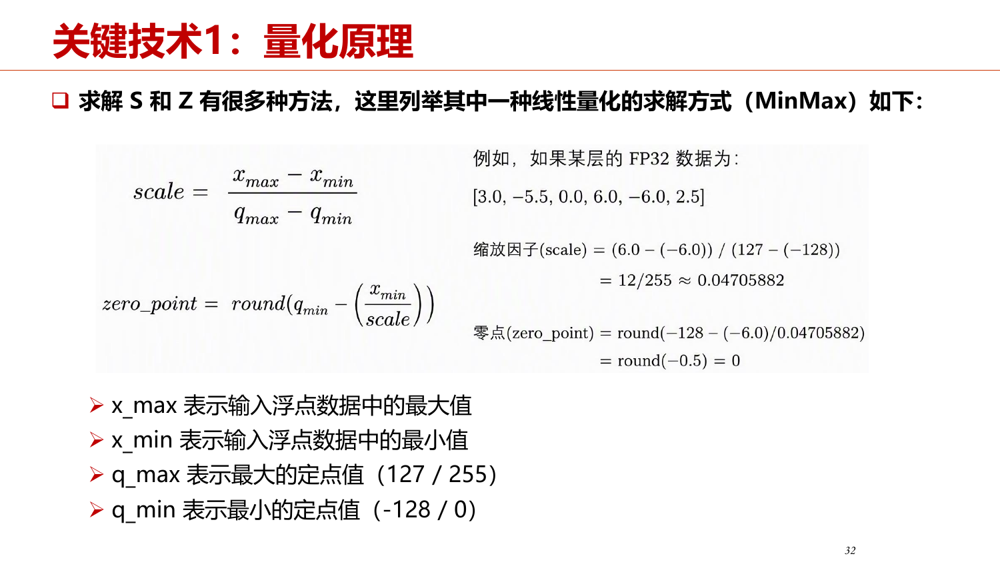

*第四章 PPT 第 32 页。先由实数范围和整数范围算步长，再定位零点。半整数的 round 规则因实现而异，计算时要注明规则。*

\[
S=\frac{x_{\max}-x_{\min}}{q_{\max}-q_{\min}},\qquad
Z=\operatorname{clip}\left(\operatorname{round}\left(q_{\min}-\frac{x_{\min}}S\right),q_{\min},q_{\max}\right).
\]

量化与反量化：

\[
q=\operatorname{clip}\left(\operatorname{round}(x/S)+Z,q_{\min},q_{\max}\right),\qquad
\hat x=S(q-Z).
\]

**一步步练习：** 实数范围 [−1,2]，整数范围 [−128,127]。

1. \(S=(2-(-1))/(127-(-128))=3/255=1/85\)。
2. \(Z=-128-(-1)/(1/85)=-43\)。因此实数 0 对应整数 −43。
3. 要量化 \(x=0.37\)：\(x/S=31.45\)，最近整数为 31，\(q=31-43=-12\)。
4. 反量化 \(\hat x=(-12+43)/85=31/85\approx0.364706\)。
5. 误差约 −0.005294，是舍入造成的，并非程序失效。

未发生饱和时，最近舍入误差通常不超过 \(S/2\)；超出校准范围会被截断，误差可能更大。**量化误差有舍入和截断两类，反量化不能一般地恢复原始浮点值。**

### 4-R4 对称、非对称、线性、非线性

**PPT 第 34—37 页。** 线性量化的整数刻度对应等距实数；非线性量化使用不均匀刻度来适配分布。

| 方式 | 关键设置 | 适合的情况 |
| --- | --- | --- |
| 对称 | \(Z=0\)，常用整数 [−127,127] | 权重在 0 两边分布，运算较简单 |
| 非对称 | 允许非零 \(Z\)，适配偏斜范围 | ReLU 后的非负激活等 |

例如实数范围 [−1,10]，对称方案按 [−10,10] 分配刻度，负侧大量刻度用不上；非对称可以更充分利用范围。但它要存储和处理零点。

**每张量与每通道（量化方法补充）：** 整个张量共享一个 \(S\) 简单，但某个通道离群值大，可能使其他通道刻度过粗；每通道单独设 \(S\) 可以改善表示，需要更多参数与算子支持（课件第 53 页向量级量化有类似动机）。

### 4-R5 PTQ、动态、静态与 QAT

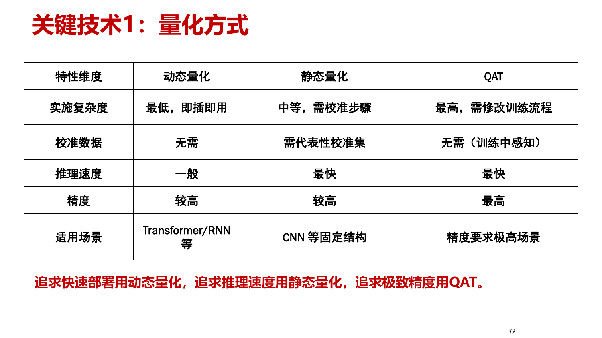

*第四章 PPT 第 38—49 页。表格中的速度和精度是课件典型比较，实际结果还受模型和引擎支持影响。*

**PTQ，训练后量化：** 先有训练好的浮点模型，再转换。动态和静态是常见部署方式。

| 方案 | 权重 | 激活 | 需要什么 | 主要取舍 |
| --- | --- | --- | --- | --- |
| 动态量化 | 通常提前量化 | 运行时根据当前范围量化 | 这类方案通常不需离线激活校准 | 上手快，但在线统计、转换有开销 |
| 静态量化 | 提前量化 | 用代表性数据提前校准范围 | 校准集、算子兼容 | 更易保持整数路径，分布变化会影响准确率 |
| QAT，量化感知训练 | 训练中模拟量化误差 | 训练中模拟 | 训练／微调、伪量化节点 | 帮助模型适应误差，成本更高 |

QAT 训练时常使用浮点数加伪量化模拟，并非“每个训练步骤都必须纯 INT8”。静态量化也不意味着不支持的算子永远不会回退到浮点。

### 4-R6 为什么 INT8 运算还要 INT32 累加

**PPT 第 44—46 页。** 两个 8 位整数相乘，结果可能已经超过 8 位范围；许多乘积相加，范围进一步扩大，所以通常用 INT32 保存累加结果。

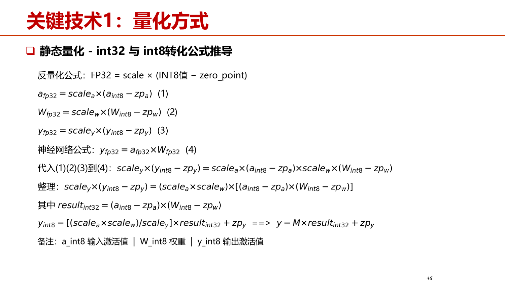

*第四章 PPT 第 46 页。输入、权重、输出各有自己的 scale，不能把 INT32 结果直接随意截成 INT8。*

忽略偏置，实数点积近似为：

\[
y\approx S_xS_w\sum_i(q_{x,i}-Z_x)(q_{w,i}-Z_w).
\]

如果输出量化参数为 \(S_y,Z_y\)，则：

\[
q_y=\operatorname{clip}\left(
\operatorname{round}\left[\frac{S_xS_w}{S_y}
\sum_i(q_{x,i}-Z_x)(q_{w,i}-Z_w)\right]+Z_y\right).
\]

输入和权重先扣零点再相乘，累加后换算到输出刻度。偏置还需按相应累加尺度处理。这解释了“都是 INT8”仍然不能简单逐项相乘、直接当下一层输入。

### 4-R7 MinMax 离群值与 LLM.int8()

**PPT 第 50—60 页。** 假设多数值在 [−1,1]，只有一个值是 100。直接取最大最小值会把量化范围拉到 100，步长变大，小值之间的差异被挤在少数格子里。

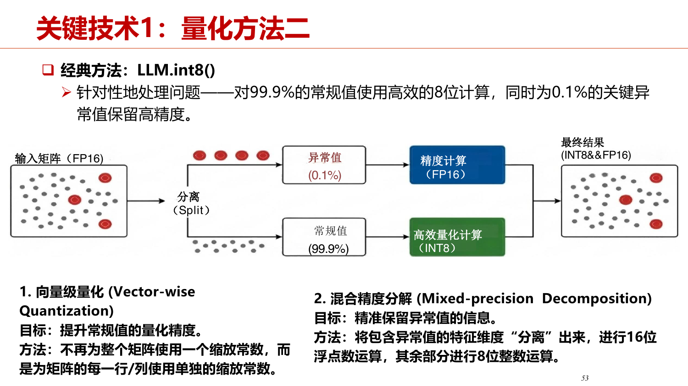

*第四章 PPT 第 53 页。向量级缩放改善常规值表示，混合精度分解则把重要异常维度单独处理。*

LLM.int8() 将含重要离群值的特征维度分离出来做较高精度计算，常规部分用 INT8，最后相加。图中的比例是课件示意，不要求所有模型都固定相同比例。

**思考题答案（第 60 页）：**

- 追求整数部署速度，典型 CNN 常考虑静态量化，因为激活参数提前确定，减少实时范围统计和浮点中转；仍要有硬件及算子支持。
- MinMax 容易被离群值拉宽范围，使多数普通值量化更粗。可以比较截断阈值、分通道或混合精度，但不能无条件删掉离群值。
- LLM 的激活可能有重要离群特征，量化噪声也可能逐层影响输出，所以简单全局缩放较难同时兼顾异常值和普通值。

### 4-R8 非结构化与结构化剪枝

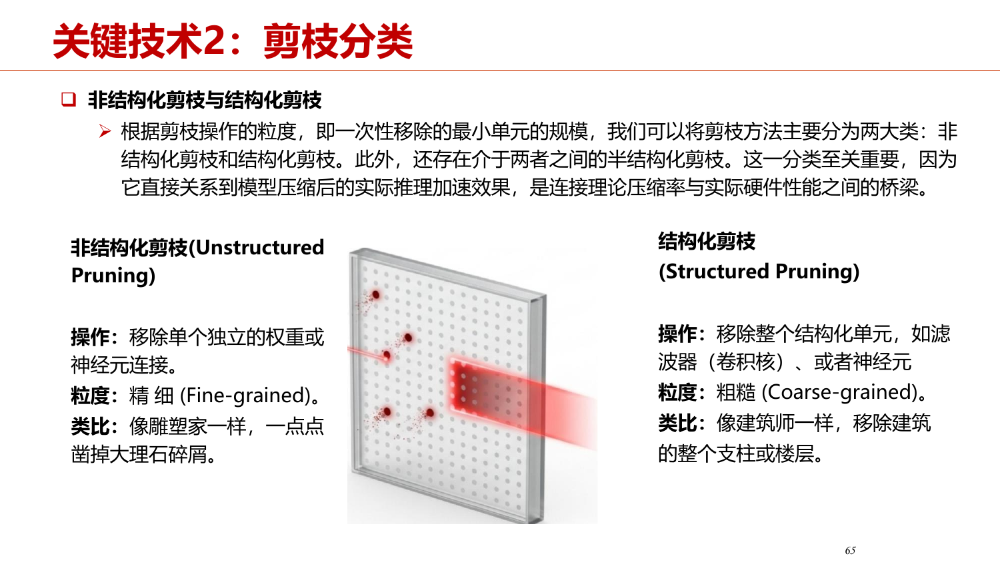

*第四章 PPT 第 65—76 页。非结构化像把矩阵里的零散元素归零；结构化像删掉整行、整个通道。*

| 分类 | 剪除单位 | 好处 | 主要问题 |
| --- | --- | --- | --- |
| 非结构化 | 单个权重／连接 | 细粒度，较灵活 | 张量形状仍在，普通密集计算未必更快 |
| 结构化 | 通道、神经元、滤波器等 | 真正缩小密集计算结构，更容易部署 | 一次移除信息较多，需微调保准确率 |
| 半结构化 | 规定局部稀疏模式 | 在自由度与硬件支持间取舍 | 依赖指定模式的引擎／硬件支持 |

**只把一整行置零也还不够：** 要获得结构化加速，通常要重建小张量，并把下一层对应的输入通道一起调整。例如第一层输出从 100 减至 80，下一层输入维度也要变为 80。

### 4-R9 L1 剪枝到底怎么算

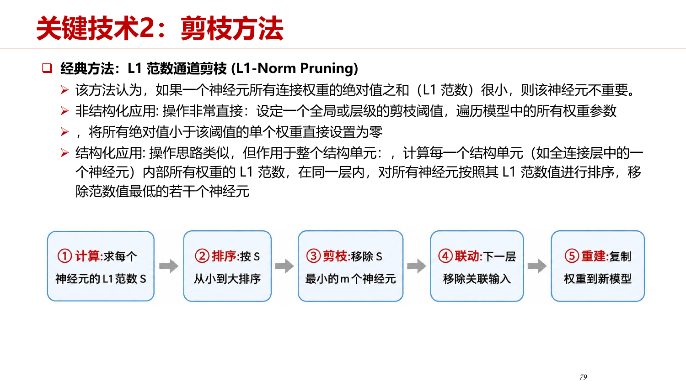

*第四章 PPT 第 67、71、78—80 页。先确定“对单个权重排序”还是“对整行／通道排序”。*

单权重用 \(|w|\)；通道／神经元可用 \(\lVert\mathbf w\rVert_1=\sum_i|w_i|\)。L2 则是 \(\sqrt{\sum_iw_i^2}\)。通常把分数低的作为剪除候选。

**补充练习：** 三个神经元权重为 A=[0.1,−0.2]、B=[2,−1]、C=[0.05,0.05]。L1 分别是 0.3、3、0.1。剪一个整神经元，候选是 C；若剪单个权重，则从绝对值 0.05 的连接开始。两种粒度会得到不同结构。

### 4-R10 剪枝方法与为什么要微调

**PPT 第 77—82 页。** 算法名称很多，可以按“如何衡量重要性、何时提高稀疏度”理解。

| 方法或类别 | 核心判断 |
| --- | --- |
| Level／幅度阈值 | 小于阈值的独立权重作为候选 |
| L1／L2 Norm | 范数较小的结构单元作为候选 |
| FPGM | 根据滤波器间相似性／几何中位数寻找冗余 |
| Slim | 用 BN 缩放因子辅助判断通道重要性 |
| APoZ／Mean Rank | 看输出激活经常为零或平均值很小 |
| Taylor | 用梯度等估计删除对损失的影响 |
| Linear／AGP | 分多轮逐步提高稀疏度 |
| Lottery Ticket | 通过迭代寻找可训练的有效子网络 |
| 自动搜索／优化方法 | ADMM、模拟退火、AMC 等搜索满足目标的压缩方案 |
| Movement | 根据微调中的权重变化判断保留方向 |

典型过程是训练 → 剪枝 → 微调 → 再评估。剪除改变了信息路径，剩余权重需要适应；一次性剪很多往往造成更大损失。

**思考题答案（第 82 页）：** 小权重不一定不重要，如输入特征量级很大，\(wx\) 仍可能贡献显著；某些关键稀有特征也可能被简单幅度策略误删。大模型训练得到的表示可为子网络提供较好起点，剪后微调帮助恢复；但这不意味着任何情形都比直接训练小模型更优，应按任务验证。

### 4-R11 教师、学生、硬标签、软标签

**PPT 第 84—89 页；课堂 02:31。** 教师通常能力较强；学生结构较轻，目标是在设备上更便宜地运行。学生不是必须从教师剪出来，也可以用不同结构重新训练。

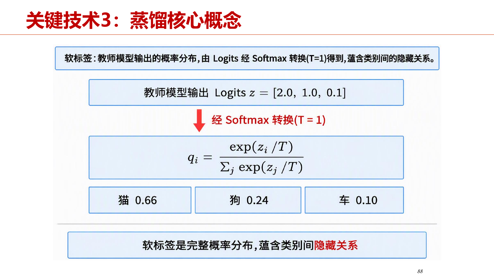

*第四章 PPT 第 87—88 页。硬标签只给真实类别，软标签给各类概率，提供类间相似性信息。*

例如分类为猫、狗、汽车，真实标签为猫：硬标签 [1,0,0]；教师输出可能是 [0.7,0.25,0.05]。学生不仅知道“这是猫”，也知道“更像狗而不是汽车”，后者就是软标签提供的额外结构信息。

**硬标签校正方向，软标签传递教师知识。** 教师可能犯错，所以不能简单认为软标签永远是真实答案。

### 4-R12 温度 T 怎样改变软标签

温度作用于 logits \(z_i\) 的 softmax：

\[
p_i(T)=\frac{e^{z_i/T}}{\sum_j e^{z_j/T}}.
\]

\(T>1\) 时分布更平滑，低概率类别更显眼；\(T\to\infty\) 趋近均匀，区别也可能过度减弱。温度不是训练学习率，也不是设备实际温度。

**补充练习：** logits=[2,1,0]，T=1 时概率约 [0.665,0.245,0.090]；T=2 时约 [0.506,0.307,0.186]。最大类别仍是第一类，但其他类别贡献不再那么小。部署分类通常取 T=1。

### 4-R13 蒸馏损失与知识形式

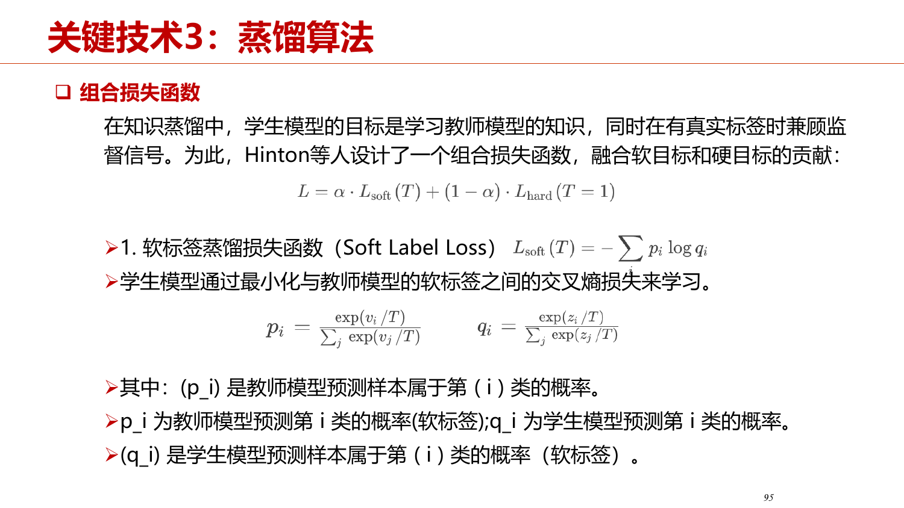

*第四章 PPT 第 95—100 页。软损失让学生模仿教师，硬损失让学生符合真实标签。*

用一种常见约定（\(\alpha\) 是软损失权重）：

\[
L=\alpha T^2L_{\text{soft}}(p^{\text{teacher}}_T,p^{\text{student}}_T)
+(1-\alpha)L_{\text{hard}}(y,p^{\text{student}}_1).
\]

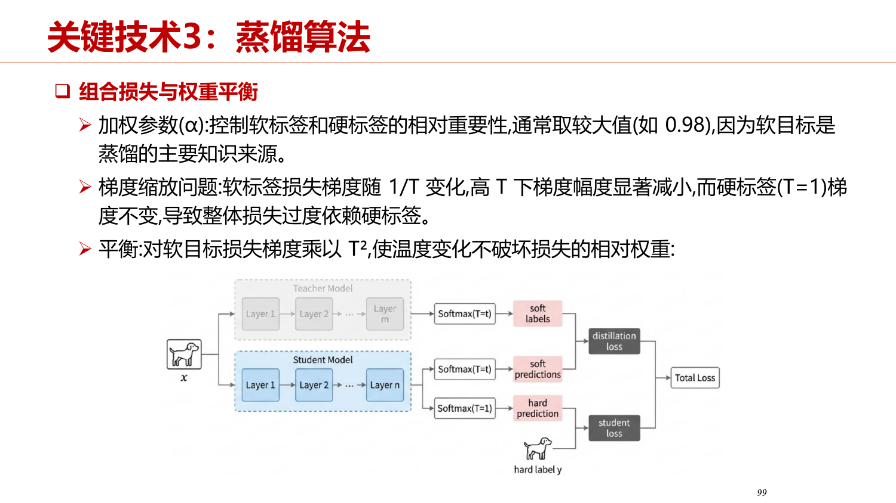

*第四章 PPT 第 99 页。T² 用于平衡高温下软目标梯度的尺度，α 平衡教师知识和真实标签。不同实现可能交换 α 的定义，先看公式。*

训练时通常固定教师，用同一输入得到教师与学生输出，计算组合损失，更新学生。最终部署通常只需学生，不需要每次推理都再跑教师。

| 蒸馏分类（第 90—94 页） | 学什么 |
| --- | --- |
| 响应蒸馏 | 最终输出概率／logits |
| 特征蒸馏 | 中间层表示，必要时用映射对齐维度 |
| 关系蒸馏 | 样本或特征之间的关系 |

**自测：** 量化降低位宽；剪枝删除结构或连接；蒸馏训练学生学习教师。硬标签与软标签的区别、T 的作用、结构化剪枝为什么更易实际加速，应能脱离名词表自己说清楚。

## 第三章：物联网操作系统

**课堂：02:32—02:35；PPT：《第三章-20260927dw.pdf》。** 老师要求了解关键特性和典型 OS 的 overview，特别提到编程模型、调度、I/O 和思考题；案例代码不用抄。

### 3-R1 两条分类轴：程序结构与执行逻辑

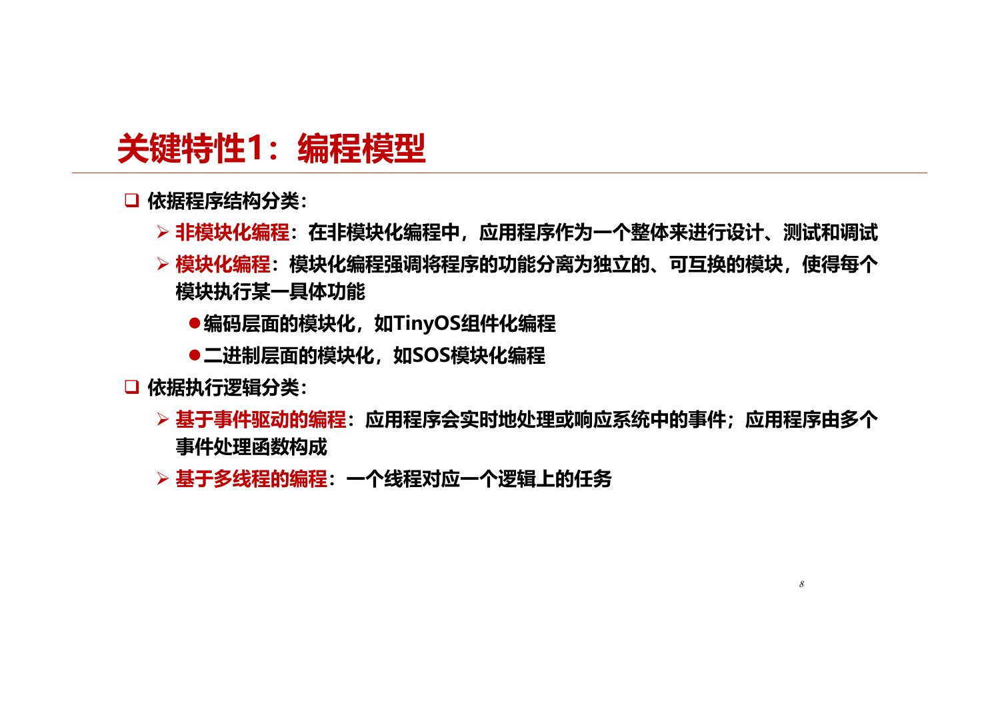

*第三章 PPT 第 8—10 页。模块化与事件驱动不是二选一，它们分别回答“代码怎样组织”和“任务怎样执行”。*

按结构：非模块化把程序作为整体组织；模块化把功能分开，模块可以替换和复用。源码组件化可以在编译时组合，二进制模块化更侧重独立加载和替换。

按执行逻辑：事件驱动把采样、发送等动作放在事件回调里；多线程把一个逻辑任务写成连续流程。事件回调若长时间不返回，仍会阻塞其他事件；线程虽然更直观，却通常需要独立栈和调度资源。

**例子：** 事件驱动写“定时器到期 → 发起采样 → 采样完成 → 发起发送”；线程写“采样 → 发送 → 睡眠 → 循环”。功能相同，组织等待和继续执行的方式不同。

### 3-R2 四种调度方式

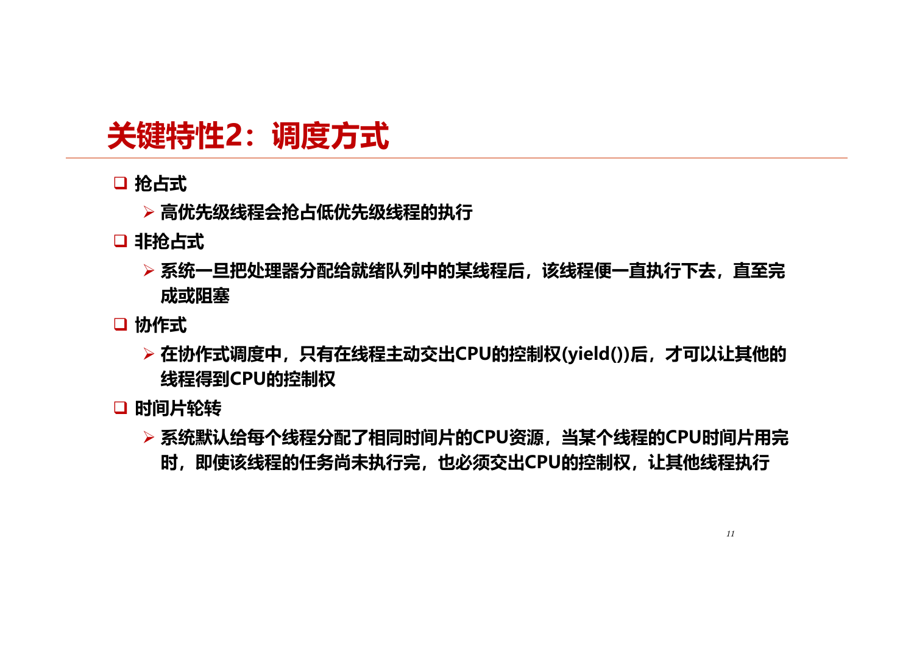

*第三章 PPT 第 11 页。抓住切换条件：优先级、结束／阻塞、主动让出、时间片用完。*

| 方式 | CPU 何时切换 | 适合怎样理解 |
| --- | --- | --- |
| 抢占式 | 高优先级就绪等条件触发抢占 | 紧急任务不用等低优先级任务主动结束 |
| 非抢占式 | 当前任务完成或阻塞 | 当前任务一旦得到 CPU，通常继续跑 |
| 协作式 | 任务主动 yield／阻塞等交出执行权 | 一个任务不合作，可能拖住其他任务 |
| 时间片轮转 | 片长耗尽后轮到下一就绪任务 | 公平轮流，未完成的任务重新入队 |

抢占与共享变量还涉及原子性。例如 `x=x+1` 包含读取、加法、写回，多线程交错可能丢失更新；需要锁、原子操作或适当保护。**非抢占也不意味着中断永远不可能打断。**

### 3-R3 调度计算：剩余执行时间不能算丢

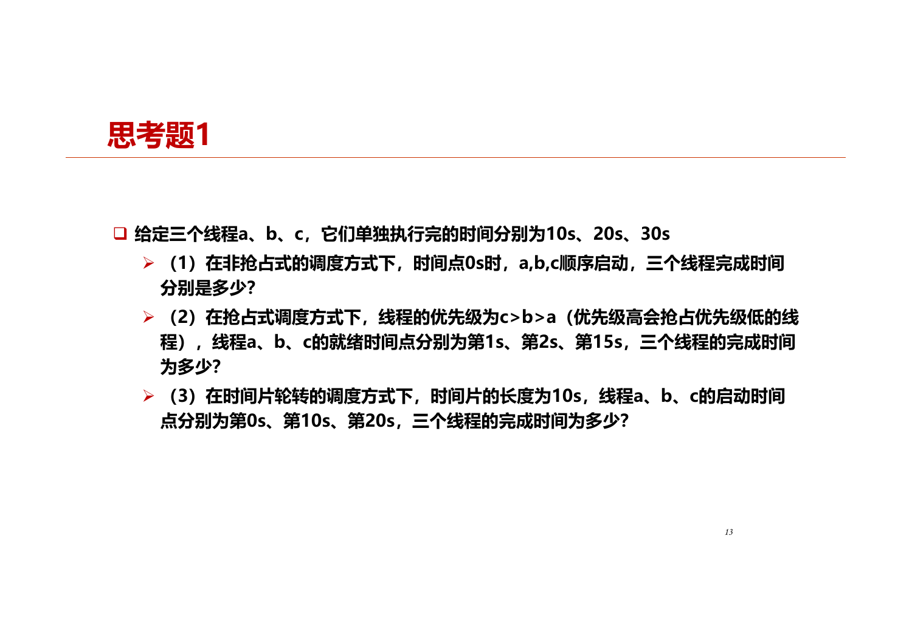

*第三章 PPT 第 13 页。题目给的是 CPU 执行需求与就绪时刻，要画时间线求绝对完成时刻。*

执行需求 A=10s、B=20s、C=30s，忽略切换开销。

**第一问：非抢占，0s 按 A、B、C 顺序就绪。**

| 区间 | 执行任务 | 完成时刻 |
| --- | --- | --- |
| 0—10 | A | A=10s |
| 10—30 | B | B=30s |
| 30—60 | C | C=60s |

**第二问：优先级 C>B>A，就绪时刻 A=1、B=2、C=15。**

| 区间 | 执行谁 | 还有多少没做 |
| --- | --- | --- |
| 0—1 | 空闲 | A 尚未就绪 |
| 1—2 | A | A 做 1s，还剩 9s |
| 2—15 | B | B 做 13s，还剩 7s |
| 15—45 | C | C 做完 30s |
| 45—52 | B | 做完剩余 7s |
| 52—61 | A | 做完剩余 9s |

按 A、B、C 顺序回答：**61s、52s、45s**。别把 A 的完成时间回答成 10s，那只是它所需 CPU 时间。

**第三问：轮转片长 10s，就绪时刻 A=0、B=10、C=20。** 20s 时恰好 B 时间片结束、C 新到达，课件没有指定同刻入队规则。

- 若先把新到 C 入队，再把未完成 B 入队：A 0—10，B 10—20，C 20—30，B 30—40，C 40—60。完成时刻为 **10、40、60s**。
- 若先把 B 重新入队再加入 C：B 可以在 20—30 接着完成，结果为 **10、30、60s**。

做题先说明队列规则。总 CPU 需求都是 60s，同刻规则改变的是谁先完成，不改变总工作量。

### 3-R4 阻塞 I/O 与分阶段 I/O

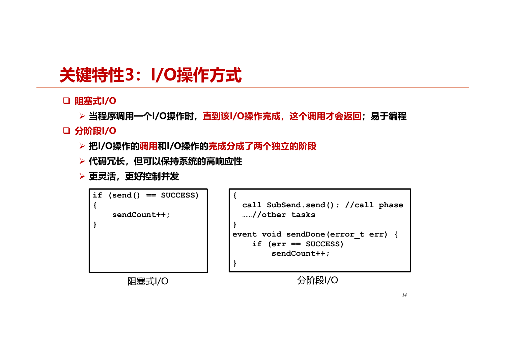

*第三章 PPT 第 14—15 页。分阶段 I/O 的调用成功只代表请求已提交，真正完成由后续事件通知。*

阻塞 I/O 等操作完成才返回，写代码容易；分阶段 I/O 先提交请求，程序可以做别的事，再在完成回调里处理结果，适合保持响应性。

单次采集在需要时读一条；周期采集由定时器定期触发；高频连续采集需要缓冲与吞吐保障。FIFO 暂存短时间到达的数据，DMA 减少 CPU 逐字节搬运负担；它们都不能无限缓存数据，仍需消费速度与容量匹配。

### 3-R5 内存分配、更新与网络抽象

**PPT 第 16—27 页。** 静态分配在构建时确定空间，开销可预测，难按需调整；动态分配在运行时申请和释放，灵活，但会有碎片、失败和误用风险。独立线程栈也会占 RAM。

Bootloader 是上电后早期运行的引导程序，负责初始化、选择／验证镜像、启动系统，也可支持更新。全镜像、模块化、差分更新的区别见[第六章复习](#review-ota)。

网络服务提供应用可使用的连接与协议。抽象层把不同硬件接口适配到共同接口；应用不需要为每一种无线芯片重写全部网络逻辑。抽象不是消除硬件限制，底层仍要正确实现。

**AI 支持**也是课件关键特性：TinyML 将较小模型部署到 MCU 等低功耗设备；OS 提供驱动、任务、内存等基础服务，推理通常还依靠合适的模型和推理库。不能只因为某系统列出 AI 支持，就认为任何大模型都能运行。

### 3-R6 典型系统怎么比较

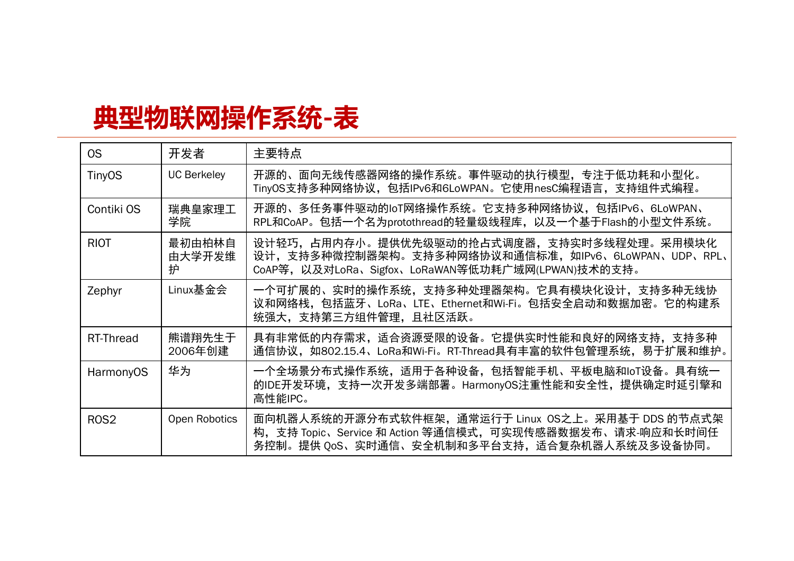

*第三章 PPT 第 31 页及第 33—65 页。先记代表性能力，再看后面的关键特性表，避免只记名称。*

| 系统 | 核心印象 | 要理解的特点 |
| --- | --- | --- |
| TinyOS | 小型无线传感网络、事件驱动、组件化 | 用组件组织应用，节约小节点资源 |
| Contiki | 事件系统＋轻量 protothreads | 以较少栈开销写等待／继续的逻辑 |
| RIOT | 原生多线程、优先级抢占、模块化 | GNRC 网络栈，SAUL 设备抽象 |
| HarmonyOS／LiteOS | 多类设备与分布式能力 | 根据设备资源选择内核，软总线连接跨设备服务 |
| AliOS Things | Rhino 实时内核、连接与云服务 | 静态／动态内存，多种更新方式，uMesh／LwIP |
| Zephyr／RT-Thread | 可裁剪实时系统与丰富驱动生态 | 理解用途和模块化，不背本课未展开的细节 |
| ROS 2 | 机器人分布式软件框架 | 通常在 OS 上运行，Topic／Service／Action 面向不同任务 |

这些表是课程版本下的比较，不能当作所有发行版本和硬件配置均相同。

### 3-R7 Contiki protothreads 与普通线程

**PPT 第 34—37、73 页思考题。** protothreads 用轻量方式保存“执行到哪”，通常不为每个任务保存完整独立调用栈。优点是省 RAM；代价是暂停点和局部变量保存受到限制，等待前后的数据需要合适的持久存储。

传统线程通常各自有栈，函数调用和局部状态容易保留，调度更自然，但每线程增加栈资源。Contiki 的 `mt_thread` 则提供另一种多栈线程机制，不能把它和 protothreads 当成完全相同。

### 3-R8 RIOT 的 GNRC 与 SAUL

**PPT 第 47—48、73 页。**

| 名称 | 解决什么 | 思考题答案 |
| --- | --- | --- |
| `gnrc_netdev` | 对接底层网络设备／链路接口 | GNRC 靠这一层适配不同链路 |
| `saul_reg_t` | 描述一个注册的外设 | 外设以该结构组织，含设备、名称、驱动等 |
| `saul_driver_t` | 统一 read／write 等驱动接口 | 上层用相同方式读取或控制 |
| `phydat_t` | 承载读写的物理数据 | 保存传感结果或执行器参数 |

GNRC 的协议处理借助多线程。课件强调底层网络线程通常优先于较上层线程，以及时处理输入；具体优先级数值仍按系统约定解释。

### 3-R9 AliOS、HarmonyOS 与 ROS 2 的概念

**PPT 第 51—65、73 页思考题。**

- **Rhino**：AliOS Things 的实时内核，强调小占用、低功耗、多任务；支持优先级抢占和轮转等调度。
- **uMesh**：自组织、自修复、多跳的本地网络连接能力。
- **LwIP**：轻量 TCP/IP 协议栈。它与 uMesh 的用途不同。
- **LiteOS-A**：课件用于较强标准设备，可支持 MMU；**LiteOS-M** 用于资源更小、没有 MMU 的微／迷你设备。参考内存条件是课件示例，不是所有设备的唯一划分标准。
- **分布式软总线**：用发现、连接、通信等机制，把多设备服务联起来，支持资源共享和跨设备调用；不是实际插了一条物理总线。
- **ROS 2 Topic**：连续数据流的发布订阅；**Service**：较短请求响应；**Action**：长任务，带反馈和取消。它是机器人软件框架，不应简单当作 MCU 内核。

### 3-R10 思考题核对

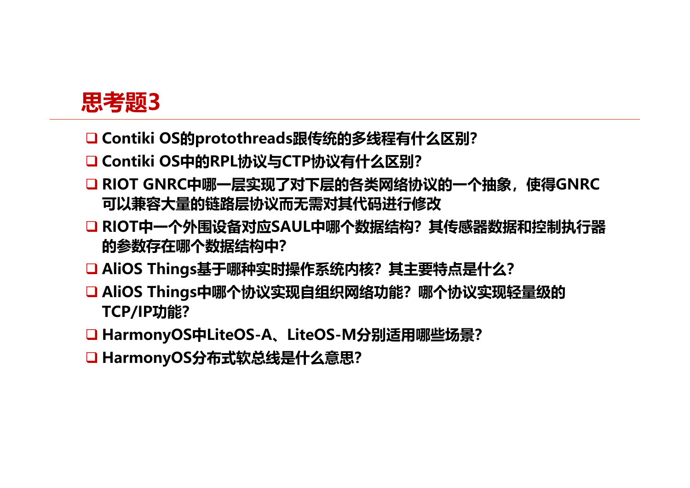

*第三章 PPT 第 73 页。可先遮住下面的答案，检查自己能否把这些概念之间的关系说清楚。*

| 第 73 页问题 | 应当能够回答 |
| --- | --- |
| protothreads 与普通线程 | 栈资源、状态保留、编程限制的区别 |
| RPL 与 CTP | IPv6 低功耗路由与收集树用途，见第五章 |
| GNRC 哪层适配链路 | `gnrc_netdev` |
| SAUL 的外设与数据结构 | `saul_reg_t`、`phydat_t`，驱动由 `saul_driver_t` 描述 |
| AliOS 内核 | Rhino，实时、低功耗、多任务 |
| 自组织网与 TCP/IP | uMesh 与 LwIP |
| LiteOS-A／M | MMU、设备资源及内核定位 |
| 分布式软总线 | 跨设备发现、组网、通信与服务协同 |

## 第二章：硬件、UART、能耗与平台特点

**课堂：02:35—02:39；PPT：《第二章_169_20260923.pdf》。** 老师重点点到 RAM／Flash、接口、UART 计算、功耗计算、Things／Smart Things 和各平台有辨识度的特点。

### 2-R1 主频、RAM、Flash

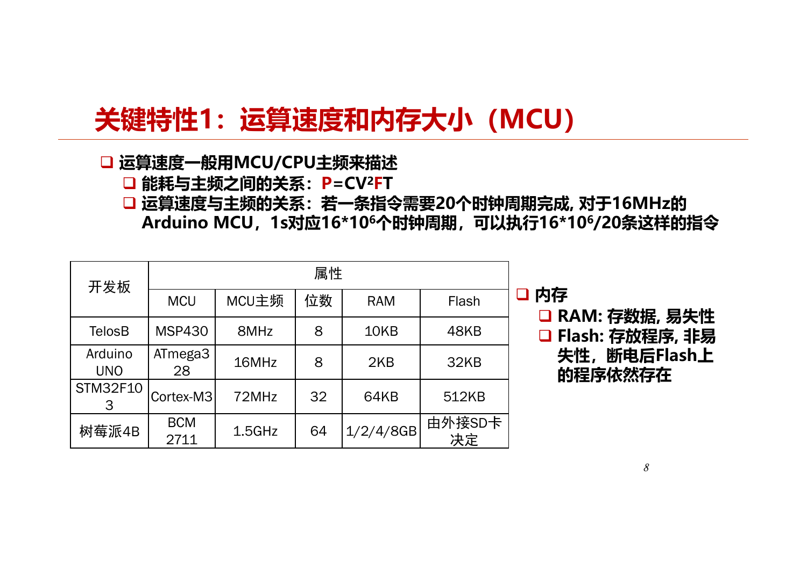

*第二章 PPT 第 8 页。主频、位数、RAM、Flash 是不同属性，不能只看其中一项选板子。*

主频是每秒时钟周期数，不等于每秒完整程序运行次数。若一条指令需 20 周期，16MHz 处理器理想每秒可执行 \(16\times10^6/20=800000\) 条这类指令。不同架构、访存、指令会改变实际结果。

RAM 易失，保存运行时变量、缓冲、堆栈；Flash 非易失，保存固件和持久内容。Flash 大不能直接补偿 RAM 小。程序数组 10KB 放不下 8KB RAM，仅凭“大 Flash”也解决不了。

### 2-R2 常见接口与其他关键特性

**PPT 第 10、13—16 页。**

| 接口 | 一句话理解 | 例子 |
| --- | --- | --- |
| 模拟输入／ADC | 把连续电压转成数值 | 光照模拟输出 |
| GPIO 数字 I/O | 读取或设置离散电平 | 按键、开关信号 |
| PWM | 改变高电平占空比 | LED 调光、电机控制 |
| UART | 无共同传输时钟的串行通信 | 串口日志，TX／RX 收发 |
| I²C | 带时钟的共享串行总线 | 多个带地址传感器 |
| SPI | 带时钟、高速、通常全双工的串行接口 | Flash、显示模块 |

还需考虑传感器类别／精度、无线协议、尺寸和成本。**支持某协议与能同时满速运行多个协议不同。** 例如 ESP32 共用射频资源时 Wi-Fi／蓝牙依靠共存机制调度，不代表两套无线完全互不影响。

### 2-R3 UART 缓冲区计算：先算每帧的有效数据

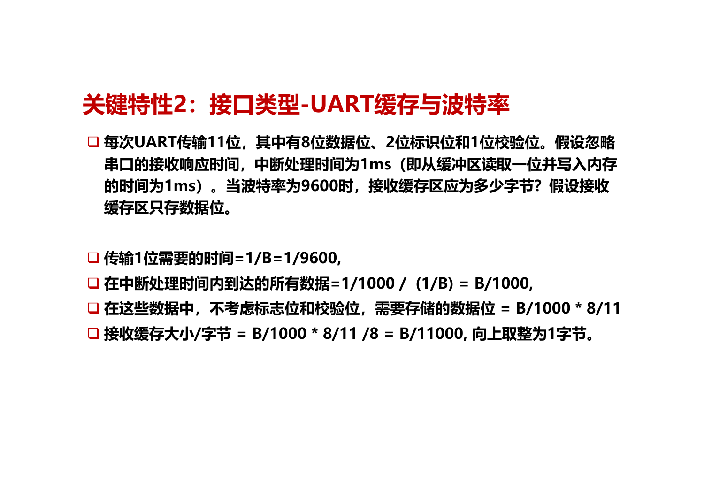

*第二章 PPT 第 11—12 页；字幕 02:35—02:36。课程假设每帧 11 位，8 位为数据，缓存只存数据字节。不能把 11 个线上 bit 都当成有效数据。*

波特率 \(B\) bit/s，处理延迟 \(t\) 秒，期间到达约 \(Bt\) 个线上 bit；每 11bit 对应一个有效字节：

\[
N_{\text{buffer}}=\left\lceil\frac{Bt}{11}\right\rceil\text{ Byte}.
\]

**课件例题：** B=9600，t=1ms：\(9600\times0.001/11\approx0.873\)B，向上取整为 **1B**。

**第 12 页思考题：** t=2ms：\(9600\times0.002/11\approx1.745\)B，至少 **2B**。

**补充变式：** B=115200，t=2ms：\(230.4/11\approx20.945\)，至少 **21B**。如果题目改为每帧 10bit，要把分母改为 10；若缓存还存校验等信息，也要重算。

这里是课程理想最低容量。实际系统还需考虑到达相位、处理抖动和持续吞吐：消费长期慢于到达，再大的有限缓存也会溢出。

### 2-R4 功率、能量与占空比

**PPT 第 17—18 页。** 电压恒定时 \(P=VI\)，能量 \(E=Pt\)；多种状态分别求能量后相加：

\[
E=\sum_iP_it_i,\qquad\bar P=E/T.
\]

**课件原题：** Arduino Uno 按题给条件工作在 5V，1 秒内工作和休眠各 0.5 秒；工作电流 0.2mA，休眠 0.1μA。这里是课件简化值，不能当作整块开发板的通用实测功耗。

\[
P_a=5\times0.0002=0.001\text{ W},\qquad
P_s=5\times10^{-7}=5\times10^{-7}\text{ W}.
\]

\[
E=0.5\times0.001+0.5\times5\times10^{-7}
=0.00050025\text{ J}=0.50025\text{ mJ}.
\]

平均功率 \(0.50025\)mW。板上有通信、传感器等其他模块时，各模块能量还要继续累加。

### 2-R5 MCU 选型：先看能否放下，再比较能耗

*第二章 PPT 第 19 页。工作电流单位是 mA，睡眠电流单位是 μA；统一后再加权。*

| MCU | RAM | 工作电流 | 睡眠电流 |
| --- | --- | --- | --- |
| MSP430F2618 | 8KB | 0.5mA＝500μA | 1.1μA |
| MSP430F5437 | 16KB | 0.28mA＝280μA | 1.7μA |

`char buf[10240]` 需要 10240B＝10KiB。8KB 的 F2618 不够；F5437 容量更合适，但仍要给 OS、其他变量和栈留空间，不能只按这个数组刚好卡上限。

**能耗部分按课件两个芯片都运行 10s、电压恒定 3V 单独比较，不把前面数组再强加给这一问。**

\[
\bar I_A=500d+1.1(1-d),\qquad
\bar I_B=280d+1.7(1-d)\quad(\text{μA}).
\]

| 占空比 | A 平均电流 | B 平均电流 | 3V、10s 的能量比较 |
| --- | --- | --- | --- |
| 80% | 400.22μA | 224.34μA | A=12.0066mJ，B=6.7302mJ，B 更省 |
| 0.1% | 1.5989μA | 1.9783μA | A=47.967μJ，B=59.349μJ，A 更省 |

原因：工作时间多时，较低工作电流更重要；几乎都睡眠时，睡眠电流主导。**不能只比较工作电流就宣布某芯片总是更省电。**

补充求临界点：\(500d+1.1(1-d)=280d+1.7(1-d)\)，得到 \(d=0.6/220.6\approx0.27199\%\)。在本题条件下，超过该占空比 B 更省，低于它 A 更省。

### 2-R6 Things 与 Smart Things

*第二章 PPT 第 21 页；字幕 02:36。分类按本课程平台能力描述，不意味着微控制器绝对不能运行任何 AI。*

传感节点、STM32、ESP32、Arduino 在课件中归入 **Things**；树莓派、Jetson 归入 **Smart Things**。后者能运行较完整 OS、拥有较强计算和存储能力，更适合复杂边缘处理。小 MCU 也能做 TinyML，不能把分类理解成“只有 Smart Things 才能做任何推理”。

### 2-R7 每个平台有辨识度的特点

| 平台 | 本次应记的核心特征 | 不必拿来死记的内容 |
| --- | --- | --- |
| STM32 | Cortex-M 微控制器家族；低功耗与丰富外设 | 每种开发板恰好几个引脚 |
| ESP32 | 集成 2.4GHz Wi-Fi 与蓝牙，注意共存 | 特定板子接口数量 |
| Arduino／ATmega | 开发生态、盾板；课件 AVR／ATmega 为哈佛结构 | 所有型号参数表 |
| 树莓派 | 可运行完整 OS 的单板计算机 | 泛泛宣传词与每个接口数字 |
| Jetson | NVIDIA GPU、CUDA 等 AI／并行计算能力 | 不同型号完整参数 |

*第二章 PPT 第 44 页；字幕 02:38。程序与数据有分离的寻址空间，这是体系结构上的区别，不是单纯“Flash 比 RAM 大”。*

**哈佛结构**分别组织程序和数据存储／地址空间；对照统一地址空间的冯·诺依曼模型来理解。课件的 ATmega 例子属于 AVR RISC，不应推广成所有 Arduino 板都只用同一种 MCU。

### 2-R8 低功耗模式与思考题

**PPT 第 34、41、60 页；字幕 02:37。**

以 STM32F103 为例：Sleep 停 CPU 而保留相应外设工作，Stop 停更多时钟，Standby 关闭更多供电域，通常功耗更低但恢复代价更大。不是睡得越深就适合所有任务，若需迅速处理外设中断，应考虑唤醒时延与状态保留。

ESP32 的课件正文列出 Active、Modem-sleep、Light-sleep、Deep-sleep、Hibernation 等状态：从关闭无线部分到关闭大部分 CPU／外设，保留状态和唤醒条件逐渐变化。课堂口述说“六个等级”，本地 PPT 的展开列表与口述不完全一致，**不据此凑出一个不存在的状态名**。

| 第 60 页思考题 | 解答思路 |
| --- | --- |
| 4100B 数组能否放入 micaZ | 常见该节点 RAM 4KiB＝4096B，仅数组已超容量，不能；还需其他内存 |
| RAM 与 Flash | 易失运行数据与非易失固件／持久内容 |
| ATmega 架构 | 课件 AVR，RISC，哈佛结构 |
| STM32 哪种低功耗更低 | 本课 STM32F103 三类中 Standby，代价是更少状态保留与恢复开销 |
| 盾板的作用 | 给 Arduino 等兼容平台扩展传感、通信等能力 |
| ESP32 无线与共存 | Wi-Fi／蓝牙，共享资源要调度，不等于双协议各自独立满速 |
| Jetson 适用场景 | 图像处理、深度学习、机器人等需要较强并行算力的场景 |
| 1.3TFLOPS | 每秒约 \(1.3\times10^{12}\) 次浮点运算的性能口径，需知道采用的精度与统计条件 |

## 第一章：整体架构与课程基本问题

**课堂：02:39—02:40；PPT：《第一章_169_20260825.pdf》。** 这一段很短，老师主要点到架构、平台／软件分类及思考题，典型应用用于了解。

### 1-R1 设备、网关、云平台、客户端

*第一章 PPT 第 13 页。沿数据从设备到用户的方向看一次，再沿控制从用户回设备的方向看一次。*

| 部分 | 主要工作 | 温度监控例子 |
| --- | --- | --- |
| 设备 | 感知物理世界或执行控制 | 温度传感器和风机 |
| 网关 | 汇聚、协议转换、局部处理与转发 | 把本地无线节点连接到外部网络 |
| 云平台 | 接入、存储、规则与业务 | 保存历史温度，触发告警 |
| 客户端 | 展示、交互、发请求 | 手机看曲线、调整阈值 |

有些设备可直接联网，不要求每个系统都必须有独立网关。架构中的职责需要存在，但可以合并在同一硬件或服务中。

### 1-R2 常见平台与软件分类

*第一章 PPT 第 14 页。复习时先判断属于哪一层，再解释它发挥什么作用。*

开发板负责运行端侧程序；无线网络设备负责连接和转发；ThingsBoard 等属于 IoT 平台软件，提供接入、管理或看板能力。不要把“平台”一词看到就全归到云服务器，也不要把 MQTT 当硬件。

### 1-R3 物联网开发与 PC 程序有什么不同

**PPT 第 15—18 页思考题。**

1. **连接物理世界**：传感器输入有噪声，执行器会改变现实状态，不能只验证屏幕输出。
2. **设备异构且资源有限**：驱动、存储、算力、电池预算不同。
3. **跨设备、网关、云与应用**：要协调消息格式、连接与权限。
4. **网络与供电不稳定**：设备可能断网、休眠，状态同步与更新要考虑失败。
5. **规模和维护周期长**：部署后要远程更新、追踪、撤销身份；无法假设用户随时手动重装。

回答时把特点接到影响，例如“设备可能休眠，所以直接即时控制会失败，需要设备影子或命令队列”，比只列“资源受限、异构”更清楚。

### 1-R4 电池寿命与自放电（PPT 计算补充）

**PPT 第 52—53 页；本次没有重新推导，依据“PPT 计算题要过”补全。**

电池容量 \(C\) mAh，平均电流 \(\bar I\) mA，理想寿命：\(T=C/\bar I\) 小时。

课件原题：C=2800mAh，工作 20mA、休眠 0.5mA，占空比 1%：

\[
\bar I=20\times0.01+0.5\times0.99=0.695\text{ mA},
\qquad T=2800/0.695\approx4028.78\text{ h}.
\]

题目进一步规定：每天自放电是**初始容量的 0.5%**。每天损失 \(2800\times0.005=14\)mAh，相当于 \(14/24\approx0.583333\)mA 的额外消耗：

\[
T=\frac{2800}{0.695+0.583333}\approx2190.35\text{ h}\approx91.26\text{ 天}.
\]

如果题目改成“每天损失剩余容量的 0.5%”，就不是这个恒定损耗模型。实际电池还受可用容量、放电曲线和温度影响，先按题设完成计算。

### 1-R5 典型项目思考题：按概念理解

**PPT 第 48 页。** 本次老师说案例与研究基本不出现，所以这里保留项目题中的基础概念，不展开论文实现和案例开发代码。

- **GIoTTO 的安全**：HTTPS 保护传输，令牌机制用于认证与授权，访问控制限制哪些用户能读哪些数据；不能只回答“把数据加密”。
- **机器学习层／虚拟传感器**：把物理传感器原始信号转成可用状态，例如从座椅加速度判断有没有人，减少应用直接写阈值和适配安装差异的负担。
- **PM2.5 光学测量**：由颗粒对光的散射等响应推断颗粒浓度，读数还受粒径、成分和环境条件影响，不是直接数出所有颗粒质量。
- **一元线性校准的限制**：只用一个输入的线性映射，难覆盖温湿度、传感器差异等多因素及非线性变化，模型需要按实际环境验证。

## 计算题最后核对：用什么状态、哪些单位

| 题型 | 要记住的核心 | 常见错误 |
| --- | --- | --- |
| UART 缓存 | 线上 bit → 有效字节 → 向上取整 | 忘记帧开销、ms 没换 s |
| 平均功耗／电流 | 各状态按时间比例加权 | 0.1% 当 0.1，μA 与 mA 直接相加 |
| 电池寿命 | mAh ÷ mA 得小时 | 自放电模型没看清 |
| 链路距离 | 发射＋增益−损耗 ≥ 灵敏度 | dB／dBm 混用，灵敏度大小方向弄反 |
| 有效数据率 | 只计载荷，分母计全部传输时间 | 用标称速率当应用吞吐 |
| LoRa | \(T_s=2^{SF}/BW\) | Hz／kHz、bit／chip 混淆 |
| 量化 | 先算 S、Z，再舍入、截断、反量化 | 忘记零点，认为可以无损恢复 |
| 剪枝 | 明确单权重还是整通道的分数 | 置零就宣称实际加速 |
| 滑动均值 | S＋退出值的窗口缓存 | 只记总和，无从知道退出值 |
| 滑动方差 | S＋Q＋窗口 | 总体方差误除 k−1 |
| 滑动最大 | 单调队列＋下标 | 旧最大过期后没有其他候选 |
| MQTT 吞吐 | 在途数量／确认 RTT | 毫秒未换秒，忽略带宽限制 |
| 存储容量 | 点数 × 整条记录字节数 | 字段压缩率当整体压缩率 |
| 函数冷启动 | 热调用＋冷比例 × 额外准备 | 平均时延当最大时延 |
| 云边卸载 | 上传＋网络＋计算，统一单位 | 只比 CPU，MB 当 Mbit |
| 调度 | 到达时刻、优先级、剩余时间、队列规则 | 被抢占后从头重新算任务 |

## 本次字幕与 PPT 的对应位置

| 部分 | 回放时间 | 使用的本地 PPT |
| --- | --- | --- |
| 第八章新课 | 00:04—01:50，中间含休息与考试问答 | 第八章-1024.pdf；课堂新增内容另注明 |
| 第八章复习 | 01:50—01:53 | 第八章第 6—38 页为主要基础概念 |
| 第七章复习 | 01:54—02:01 | 第七章第 7—14、15—30、32—43、62—81 页 |
| 第六章复习 | 02:02—02:13 | 第六章第 16—27、35—56、72—99、119—129、145—147 页 |
| 范围与题型补充 | 01:41、02:14—02:16、02:34 | 以本次字幕为依据 |
| 第五章复习 | 02:16—02:29 | 第五章第 15—32、58—63、90—112、175—201 页；MAC／ETX 为课件补充 |
| 第四章复习 | 02:29—02:32 | 第四章第 10—25、27—60、62—82、84—100 页 |
| 第三章复习 | 02:32—02:35 | 第三章第 8—24、31—65、73 页 |
| 第二章复习 | 02:35—02:39 | 第二章第 8—19、21、34—44、60 页 |
| 第一章复习 | 02:39—02:40 | 第一章第 13—18 页；第 48、52—53 页为思考题／计算补充 |

字幕源文件为本地下载的 `物联网技术基础与应用开发-11.04/raw/transcript_by_minute.txt`，逐段版为同目录的 `transcript.txt`。所有图片来自上表列出的课程 PPT，图下标明物理页码。章节完整背景继续见[课程目录](index.md)，本页用于把这次老师点到的范围集中复习。
