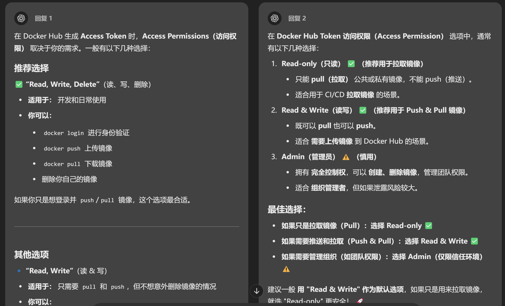
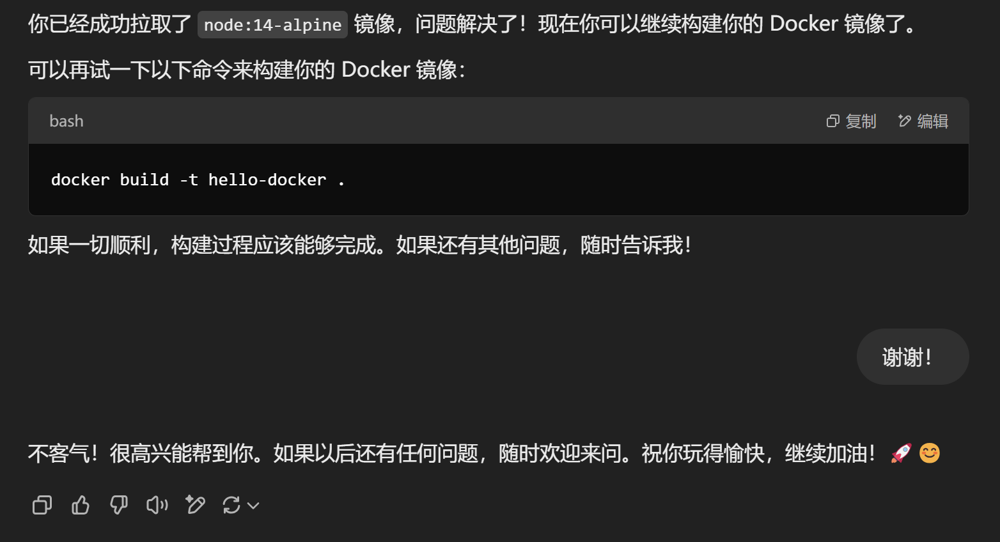

# Docker

## 基础知识

先分清几件事：Linux 是操作系统，VMware 是虚拟机软件，WSL 是 Windows 的 Linux 子系统。

- WSL 1：转换系统调用。
- WSL 2：用轻量虚拟机跑真正的 Linux 内核。所以“WSL 完全不是虚拟机”这句话太绝对。
- Linux 上的 Docker 容器共用宿主机内核，主要隔离进程、网络和文件系统；不是每个容器都装一个内核。
- Windows / macOS 上跑 Linux 容器，Docker Desktop 通常还需要一层 Linux 虚拟化环境。

### 镜像 image

可以把镜像想成模板，容器是按模板启动出来的实例。一个镜像可以启动多个容器。

Dockerfile 是构建说明，不是镜像本身。顺序是：

```text
Dockerfile -- docker build --> 镜像 -- docker run --> 容器
```

要给别人运行，可以发 Dockerfile 和构建需要的文件，让他 build；也可以把构建好的镜像推到镜像仓库，让他 pull。

## docker 的下载与使用

### 下载

Windows / macOS 可以装 [Docker Desktop](https://docs.docker.com/get-started/get-docker/)；Windows 常用 WSL 2 后端。

Ubuntu 里单独装 Docker Engine，看[对应安装步骤](https://docs.docker.com/engine/install/ubuntu/)。不要把“WSL 里自己装 Engine”和“WSL 接 Docker Desktop”两套步骤混着做。

装好先确认客户端能连接引擎：

```shell
docker version
docker run --rm hello-world
```

`docker version` 只有 Client、没有 Server，通常是引擎没启动或连接位置不对，不是镜像没下载。

### 拉取镜像

#### 具体操作

手动拉取, 例如

```shell
docker pull node:14-alpine
```

构建镜像
```shell
docker build -t hello-docker .
```


#### 遇到的问题1

依然是网络连接问题~

#### 解决方案1

步骤一: 在WSL打开v2rayA

- 操作方法见[Linux备忘录中相关内容](linux/wsl-record.md#v2raya)

!!! info "关于直接使用主机代理"

    - 理论依据: WSL 2 的网络模式影响连接方式；代理要能从 WSL 里访问到，不能默认 WSL 的 127.0.0.1 就是 Windows 主机。 方法是: clash里面打开 "系统代理"和"局域网连接" (主要是第二个, 决定了能否与虚拟机共用)即可
    - 实际操作中遇到的问题: `curl -I http://www.google.com` 命令无法正确输出, 说明失败了, 故未使用

步骤二: 手动设置 Docker 代理

!!! warning 

    这一步是核心


1. 在 WSL 终端中，创建或编辑 Docker 配置文件：
    ```sh
    sudo mkdir -p /etc/systemd/system/docker.service.d
    sudo nano /etc/systemd/system/docker.service.d/http-proxy.conf
    ```

```
(添加以下内容)
[Service]
Environment="HTTP_PROXY=http://127.0.0.1:20171"
Environment="HTTPS_PROXY=http://127.0.0.1:20171"
```

2. 重启 Docker

    ```sh
    sudo systemctl daemon-reload
    sudo systemctl restart docker
    ```

#### 遇到的问题2

用户名密码的问题

在 `docker login -u CosHub` 时输入密码提示密码错误❌

#### 解决方案2

配置token, 使用personal access token 登录

[官网入口](https://app.docker.com/settings/personal-access-tokens/copy?description=first&scope=repo%3Awrite&expiration=)放在这里

!!! warning "token权限"

    

    这个是一个read&write的

#### 遇到的问题3

运行`docker build -t hello-docker .`之后没有自动拉取镜像


??? info "出现该问题的原因"

    据下面的回答, 应该是权限问题~
    
    **`docker build -t hello-docker .`**

    这条命令用于 **构建 Docker 镜像**。具体来说，它做了以下几件事：

    1. **`docker build`**：这是 Docker 用来根据一个 `Dockerfile` 文件构建镜像的命令。
    2. **`-t hello-docker`**：这个选项是用来指定你构建的镜像的标签（tag）。在这种情况下，镜像会被命名为 `hello-docker`。你可以使用这个标签来引用或运行构建出来的镜像。
    3. **`.`**：这是构建上下文的路径，指明了 `Dockerfile` 和其他需要的文件所在的位置。在这种情况下，`.` 表示当前目录。

    简单来说，这条命令通过读取当前目录中的 `Dockerfile` 来构建一个新的 Docker 镜像。

    **为什么需要手动拉取镜像？**

    在你的 `Dockerfile` 中，可能有类似如下的内容：

    ```dockerfile
    FROM node:14-alpine
    ```

    这表示你构建的镜像是基于 `node:14-alpine` 镜像的。所以 Docker 会尝试从 Docker Hub 或者配置的镜像仓库拉取这个基础镜像。如果你的机器上没有这个镜像，Docker 会自动尝试拉取它。

    不过，在某些情况下，Docker 没有权限或由于网络问题无法直接拉取镜像。例如，你可能遇到权限问题或者需要登录才能访问某些镜像库，或者某些镜像可能被标记为私有的，需要手动拉取。

    手动运行 `docker pull node:14-alpine` 命令，可以确保该镜像已经存在本地，避免 `docker build` 时出现权限或者网络问题。

    **直接构建为什么不能成功？**

    `docker build` 其实是可以在没有手动拉取镜像的情况下构建的。通常情况下，Docker 会在构建过程中自动拉取所需的基础镜像。但如果遇到网络、权限、或其他配置问题，可能会导致构建失败。通过手动拉取镜像，我们确保镜像已经存在本地，避免这些潜在的错误。


#### 解决方案3

手动拉取

```shell
docker pull <需要的镜像>
```


