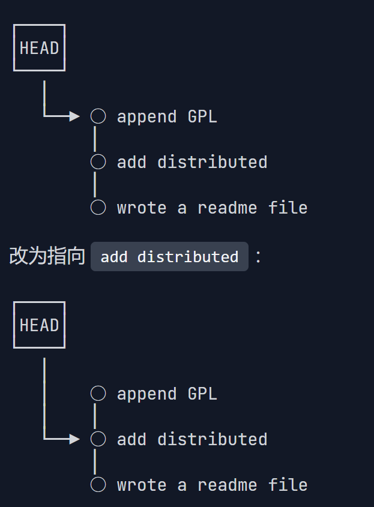
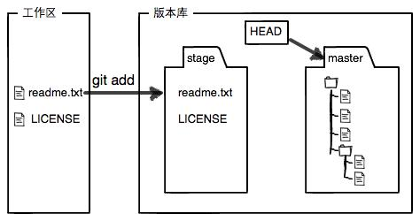
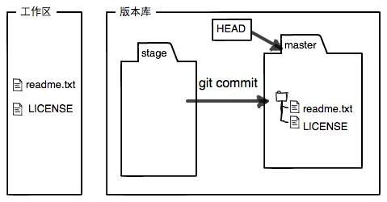
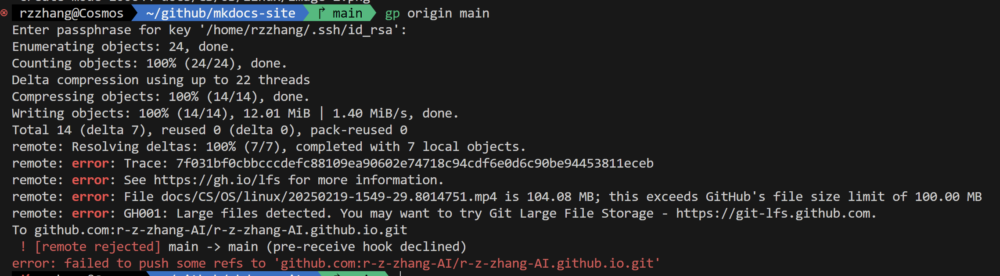
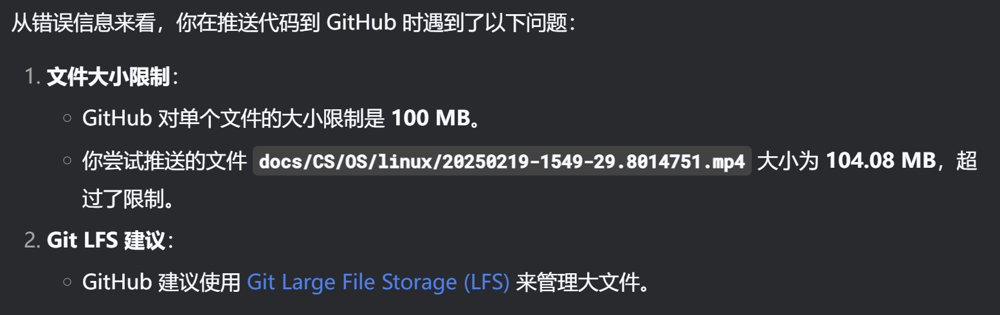
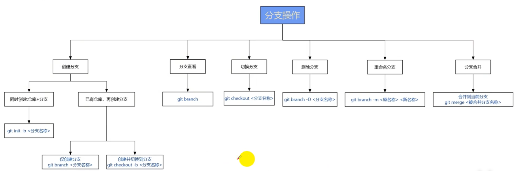

# Git 常用命令速查

Git 用于记录文件版本和协作开发。下面按实际操作分类，可把示例里的路径、分支名和提交号替换为自己的值。`<file>`、`<branch>` 等表示占位参数，不包含尖括号。

## 创建仓库与配置身份

| 用途 | 命令 | 说明 |
| --- | --- | --- |
| 创建本地仓库 | <code>git init</code> | 在当前目录建立版本库 |
| 克隆远程仓库 | <code>git clone &lt;url&gt; &lt;directory&gt;</code> | 目录参数可以省略 |
| 设置提交姓名 | <code>git config --global user.name &quot;Your Name&quot;</code> | 用于记录提交作者 |
| 设置提交邮箱 | <code>git config --global user.email &quot;you@example.com&quot;</code> | 项目级配置可去掉 --global |
| 查看配置及来源 | <code>git config --list --show-origin</code> | 区分系统、用户和仓库配置 |
| 查看命令帮助 | <code>git help &lt;command&gt;</code> | 例如 git help restore |

## 查看状态与差异

| 用途 | 命令 | 说明 |
| --- | --- | --- |
| 查看分支和修改 | <code>git status -sb</code> | 同时显示暂存、未暂存及未跟踪文件 |
| 看未暂存内容 | <code>git diff</code> | 比较工作区与暂存区 |
| 看已暂存内容 | <code>git diff --staged</code> | 比较暂存区与 HEAD |
| 看全部已跟踪修改 | <code>git diff HEAD</code> | 同时看暂存和未暂存修改，不包含未跟踪文件 |
| 比较两次提交 | <code>git diff &lt;old&gt; &lt;new&gt; -- &lt;file&gt;</code> | 文件参数可省略 |
| 只看变更文件和行数 | <code>git diff --stat</code> | 适合先了解改动规模 |
| 检查空白问题 | <code>git diff --check</code> | 找行尾空格等格式问题 |

## 暂存与提交

| 用途 | 命令 | 说明 |
| --- | --- | --- |
| 暂存指定路径 | <code>git add -- &lt;file&gt;</code> | -- 把选项与路径分开 |
| 暂存所有修改 | <code>git add -A</code> | 包含新增、修改和删除 |
| 交互选择改动 | <code>git add -p</code> | 按 diff 分块选择暂存 |
| 取消暂存 | <code>git restore --staged -- &lt;file&gt;</code> | 保留工作区修改 |
| 提交暂存内容 | <code>git commit -m &quot;说明&quot;</code> | 只有暂存区中的内容会被提交 |
| 追加到最近一次提交 | <code>git commit --amend --no-edit</code> | 修改最近提交，提交号会变化 |
| 修改最近提交说明 | <code>git commit --amend</code> | 打开编辑器；也可使用 -m |

最常用的提交顺序：

```sh
git status -sb
git diff
git add -- notes.md
git diff --staged
git commit -m "docs: update notes"
```

## 分支

| 用途 | 命令 | 说明 |
| --- | --- | --- |
| 查看本地分支 | <code>git branch</code> | 当前分支带星号 |
| 查看全部分支 | <code>git branch -a</code> | 包含远程跟踪分支 |
| 创建并切换 | <code>git switch -c feature/search</code> | 从当前提交建立新分支 |
| 切换分支 | <code>git switch main</code> | 保留修改可能导致切换失败，先核对状态 |
| 切回上一个分支 | <code>git switch -</code> | 适合在两个分支之间切换 |
| 重命名当前分支 | <code>git branch -m &lt;new-name&gt;</code> | 修改本地分支名 |
| 删除已合并分支 | <code>git branch -d &lt;branch&gt;</code> | 未合并时拒绝删除 |
| 查看分支上游 | <code>git branch -vv</code> | 显示跟踪分支和最近提交 |

## 远程同步

| 用途 | 命令 | 说明 |
| --- | --- | --- |
| 查看远程地址 | <code>git remote -v</code> | 分别显示获取和推送地址 |
| 添加远程仓库 | <code>git remote add origin &lt;url&gt;</code> | origin 是常见远程名称 |
| 更换远程地址 | <code>git remote set-url origin &lt;url&gt;</code> | 适合仓库迁移或 HTTPS/SSH 切换 |
| 获取更新并清理旧引用 | <code>git fetch --prune origin</code> | 更新远程跟踪分支，不直接改工作区 |
| 只做快进更新 | <code>git pull --ff-only</code> | 本地与远程分叉时失败，需要另选合并策略 |
| 推送并设置上游 | <code>git push -u origin &lt;branch&gt;</code> | 适用于新分支第一次推送 |
| 推送到上游 | <code>git push</code> | 已有上游时使用 |
| 删除远程分支 | <code>git push origin --delete &lt;branch&gt;</code> | 同时影响其他协作者可见的分支 |

## 合并、变基与冲突

| 用途 | 命令 | 说明 |
| --- | --- | --- |
| 合并指定分支 | <code>git merge &lt;branch&gt;</code> | 把指定分支合入当前分支 |
| 变基到另一分支 | <code>git rebase &lt;branch&gt;</code> | 重新应用当前分支的提交，会改写提交号 |
| 挑选一个提交 | <code>git cherry-pick &lt;commit&gt;</code> | 把指定提交应用到当前分支 |
| 合并冲突后继续 | <code>git add -- &lt;file&gt; &amp;&amp; git merge --continue</code> | 先编辑冲突文件并确认结果 |
| 变基冲突后继续 | <code>git add -- &lt;file&gt; &amp;&amp; git rebase --continue</code> | 逐个解决冲突提交 |
| 中止合并 | <code>git merge --abort</code> | 返回合并开始前的状态，仍需核对工作区 |
| 中止变基 | <code>git rebase --abort</code> | 放弃此次变基 |
| 中止挑选提交 | <code>git cherry-pick --abort</code> | 放弃此次 cherry-pick |

变基、修改最近提交和重置都会改变历史。已共享的分支通常用合并或 `git revert`，避免让协作者重新对齐提交。

## 查找历史与定位问题

| 用途 | 命令 | 说明 |
| --- | --- | --- |
| 查看提交图 | <code>git log --oneline --graph --decorate -20</code> | 最近 20 次提交 |
| 查看提交内容 | <code>git show &lt;commit&gt;</code> | 显示提交说明和修改 |
| 跟踪文件历史 | <code>git log --follow -- &lt;file&gt;</code> | 单文件场景下跟踪重命名 |
| 按说明搜索 | <code>git log --all --grep=&quot;keyword&quot;</code> | 在提交说明中查关键词 |
| 查文本增删历史 | <code>git log -S &quot;text&quot; -- &lt;file&gt;</code> | 找某段文本出现次数变化的提交 |
| 查行的来源 | <code>git blame -L 10,30 -- &lt;file&gt;</code> | 显示第 10—30 行最后修改来源 |
| 查看本地引用移动 | <code>git reflog</code> | 查切换、重置、变基之前的提交 |
| 二分定位问题 | <code>git bisect start</code> | 随后标记 git bisect bad / good；结束用 git bisect reset |

## 撤销与恢复

| 用途 | 命令 | 说明 |
| --- | --- | --- |
| 丢弃未暂存修改 | <code>git restore -- &lt;file&gt;</code> | 覆盖该文件的工作区修改；先检查 diff |
| 从提交恢复文件 | <code>git restore --source=&lt;commit&gt; -- &lt;file&gt;</code> | 恢复到工作区，之后可按需要暂存 |
| 反向撤销提交 | <code>git revert &lt;commit&gt;</code> | 创建新提交，保留历史 |
| 移动 HEAD，保留暂存 | <code>git reset --soft &lt;commit&gt;</code> | 回到目标提交，后续修改保留在暂存区 |
| 移动 HEAD，取消暂存 | <code>git reset --mixed &lt;commit&gt;</code> | 保留工作区内容，这是 reset 的默认模式 |
| 回到指定提交内容 | <code>git reset --hard &lt;commit&gt;</code> | 丢弃已跟踪修改，也可能覆盖挡路的未跟踪文件 |
| 预览未跟踪文件清理 | <code>git clean -nd</code> | 只预览，不删除 |
| 清理未跟踪文件和目录 | <code>git clean -fd</code> | 按预览确认后使用；不会默认删除被忽略文件 |

`HEAD~3` 表示沿第一父链向前找三次；`HEAD^2` 表示第二父提交，常用于合并提交。清理和硬重置之前先确认没有要保留的修改。

## 临时保存、标签与文件管理

| 用途 | 命令 | 说明 |
| --- | --- | --- |
| 临时保存修改 | <code>git stash push -u -m &quot;work in progress&quot;</code> | 包含未跟踪文件，不包含忽略文件 |
| 查看临时保存 | <code>git stash list</code> | 显示保存记录 |
| 应用但保留记录 | <code>git stash apply</code> | 可能出现冲突 |
| 应用并移除记录 | <code>git stash pop</code> | 应用成功才移除该条记录 |
| 查看临时保存差异 | <code>git stash show -p stash@{0}</code> | 指定一条记录 |
| 创建带说明的标签 | <code>git tag -a v1.0.0 -m &quot;release 1.0.0&quot;</code> | 标记当前提交 |
| 推送单个标签 | <code>git push origin v1.0.0</code> | 推送指定标签 |
| 停止跟踪文件 | <code>git rm --cached -- &lt;file&gt;</code> | 保留本地文件，必要时再写入 .gitignore |
| 删除文件并暂存 | <code>git rm -- &lt;file&gt;</code> | 删除工作区文件并暂存删除 |
| 移动文件并暂存 | <code>git mv &lt;old-path&gt; &lt;new-path&gt;</code> | Git 仍根据内容判断重命名关系 |

`.gitignore` 只控制未跟踪文件的忽略规则，不能自动停止跟踪已经提交的文件。

## GitHub CLI（可选）

| 用途 | 命令 | 说明 |
| --- | --- | --- |
| 登录 GitHub | <code>gh auth login</code> | 与 Git 提交作者配置是两回事 |
| 查看认证状态 | <code>gh auth status</code> | 确认账号与权限 |
| 创建 PR | <code>gh pr create</code> | 基于当前分支提出合并请求 |
| 查看 PR 检查 | <code>gh pr checks &lt;number&gt;</code> | 查看 CI 状态 |
| 查看 Issue | <code>gh issue view &lt;number&gt;</code> | 阅读问题描述与状态 |
| 查看 Actions 运行 | <code>gh run list</code> | 从运行记录继续查日志 |

参考：[Git 命令参考](https://git-scm.com/docs)、[GitHub CLI 手册](https://cli.github.com/manual/)。


---

<details id="original-notes" markdown="1">
<summary>原始文档（点击展开）</summary>

# Git & GitHub

## 基本概念

### 分布式/集中式版本管理

版本管理：顾名思义，用于个人/团队级别代码管理，**主要是记录更改**

关键概念：仓库（Repository）、提交（Commit）、分支（Branch）、合并（Merge）、冲突（Conflict）、标签（Tag）

github：理解成云端（== 百度云），通过git上传，上传内容主要是代码

## 版本退回

[廖雪峰教程](https://liaoxuefeng.com/books/git/time-travel/reset/index.html)

原理：指针操作



```shell
git log
git log --pretty=oneline
```

```shell
git reset --hard <id>
git reset --hard HEAD^n  # n是退几步
```

```shell
git reflog
```

## 工作区/暂存区

工作（目录）有一个隐藏目录.git，这个不算工作区，而是Git的版本库。

- 其中包含暂存区、分支（默认有一个main）

把文件往Git版本库里添加

- 第一步是用 `git add` 把文件添加进去，是把文件修改添加到暂存区；

- 第二步是用 `git commit` 提交更改，是把**暂存区**的所有内容提交到当前分支。




```shell
git checkout -- file
```

两种情况：

- 一种是readme.txt自修改后还没有被放到暂存区，现在，撤销修改就回到和版本库一模一样的状态；

- 一种是readme.txt已经添加到暂存区后，又作了修改，现在，撤销修改就回到添加到暂存区后的状态。

!!! success ""

   就是让这个文件回到最近一次git commit或git add时的状态。

## 删除文件

```shell
git rm notes.txt
git commit -m "Remove notes.txt"
```

`git rm`：工作区也删，删除记录放进暂存区。只是在文件管理器里删，还要 `git add -u` 才把删除暂存。

如果只是想让 Git 别再跟踪，本地文件还要用：

```shell
git rm --cached notes.txt
```

再按需要写进 `.gitignore`，不然下次 `git add` 又可能加回来。`.gitignore` 只忽略未跟踪文件，不会自动取消已有跟踪。

## 远程仓库

使用https除了速度慢以外，还有个最大的麻烦是每次推送都必须输入口令，但是在某些只开放http端口的公司内部就无法使用ssh协议而只能用https。

## 分支管理

### 多人协作

1. 首先，可以尝试用 `git push origin <branch-name>` 推送自己的修改；
2. 如果推送失败，则因为远程分支比你的本地更新，需要先用git pull试图合并；
3. 如果合并有冲突，则解决冲突，并在本地提交；
4. 没有冲突或者解决掉冲突后，再用 `git push origin <branch-name>` 推送就能成功！

GitHub CLI 的命令放下面，省得每次翻。

---

## GitHub CLI (`gh`) 常用命令速查表

### 1. 认证和账户

| 命令               | 说明              | 示例                                 |
| ---------------- | --------------- | ---------------------------------- |
| `gh auth login`  | 登录 GitHub       | `gh auth login`                    |
| `gh auth logout` | 登出 GitHub       | `gh auth logout`                   |
| `gh auth status` | 查看当前认证状态        | `gh auth status`                   |
| `gh api`         | 直接调用 GitHub API | `gh api repos/octocat/hello-world` |

---

### 2. 仓库管理

| 命令                     | 说明         | 示例                                  |
| ---------------------- | ---------- | ----------------------------------- |
| `gh repo clone <repo>` | 克隆仓库       | `gh repo clone octocat/hello-world` |
| `gh repo create`       | 创建新仓库（交互式） | `gh repo create`                    |
| `gh repo view`         | 查看仓库详情     | `gh repo view`                      |
| `gh repo fork`         | Fork 一个仓库  | `gh repo fork owner/repo`           |

---

### 3. Pull Request（PR）管理

| 命令                        | 说明         | 示例                   |
| ------------------------- | ---------- | -------------------- |
| `gh pr create`            | 创建 PR      | `gh pr create`       |
| `gh pr status`            | 查看 PR 状态   | `gh pr status`       |
| `gh pr list`              | 列出 PR      | `gh pr list`         |
| `gh pr view <number>`     | 查看指定 PR 详情 | `gh pr view 123`     |
| `gh pr checkout <number>` | 切换到 PR 分支  | `gh pr checkout 123` |
| `gh pr merge <number>`    | 合并 PR      | `gh pr merge 123`    |
| `gh pr close <number>`    | 关闭 PR      | `gh pr close 123`    |

---

### 4. Issue 管理

| 命令                        | 说明            | 示例                   |
| ------------------------- | ------------- | -------------------- |
| `gh issue create`         | 创建 Issue      | `gh issue create`    |
| `gh issue list`           | 列出 Issue      | `gh issue list`      |
| `gh issue view <number>`  | 查看指定 Issue 详情 | `gh issue view 456`  |
| `gh issue close <number>` | 关闭 Issue      | `gh issue close 456` |

---

### 5. GitHub Actions 工作流

| 命令                     | 说明        | 示例                          |
| ---------------------- | --------- | --------------------------- |
| `gh run list`          | 查看工作流运行历史 | `gh run list`               |
| `gh run view <run_id>` | 查看指定运行日志  | `gh run view 12345678`      |
| `gh workflow list`     | 查看工作流定义   | `gh workflow list`          |
| `gh workflow run <id>` | 触发指定工作流   | `gh workflow run build.yml` |

---

### 6. 其他实用命令

| 命令                      | 说明      | 示例                            |
| ----------------------- | ------- | ----------------------------- |
| `gh gist create <file>` | 创建 Gist | `gh gist create snippet.js`   |
| `gh alias set`          | 设置命令别名  | `gh alias set co pr checkout` |
| `gh help`               | 查看帮助    | `gh help`                     |

---

## 小提示

* 交互模式：很多命令（如 `gh pr create`）会自动进入交互式填写模式，非常方便。
* 支持自动补全：在终端中输入 `gh` 后按 Tab 键，自动补全命令和参数。
* `gh --version`：查看当前 CLI 版本。

---

如果你需要，我还能帮你写一个用 `gh` 快速创建 PR 或 Issue 的示范脚本！你想要吗？


## 杂项

### 文件大小限制







### 提交哈希值


在 Git 中，**版本 ID**（即提交哈希值）由 SHA-1 算法生成，表现为一个 40 位的十六进制字符串（例如 `a1b2c3d4e5f6...`）。

### SHA-1算法流程

1. **预处理**  
   - 将输入数据填充至长度满足 `512位倍数 - 64位`。  
   - 附加原始数据长度的二进制表示（64位）。

2. **分块处理**  
   - 将填充后的数据分割为512位的块（Block）。

3. **初始化哈希值**  
   - 设置5个32位的初始变量（H0-H4）：  
     ```
     H0 = 0x67452301  
     H1 = 0xEFCDAB89  
     H2 = 0x98BADCFE  
     H3 = 0x10325476  
     H4 = 0xC3D2E1F0
     ```

4. **循环压缩函数**  
   - 对每个512位块进行80轮运算，更新中间哈希值。  
   - 每轮使用非线性函数（如AND、OR、XOR）和常量值。

5. **最终哈希**  
   - 合并所有块的中间结果，生成最终的160位哈希值。


示例

  ```bash
  # Linux/macOS
  printf %s hello | openssl sha1   # 输出：aaf4c61ddcc5e8a2dabede0f3b482cd9aea9434d

  # Windows PowerShell
  Get-FileHash -Algorithm SHA1 file.txt
  ```

SHA-256 算法原理与 SHA-1 的区别是位数多了


### **SHA-256 应用**

1. **数据完整性验证**  

   - 文件下载后校验哈希值，确保未被篡改。  
   ```bash
   # Linux/macOS
   sha256sum file.iso
   # Windows PowerShell
   Get-FileHash -Algorithm SHA256 file.iso
   ```

2. **数字签名**  
   - 用私钥对数据的SHA-256哈希值签名，公钥验证签名合法性。

3. **区块链**  
   - 比特币使用SHA-256计算区块哈希和交易验证。

4. **密码学协议**  
   - TLS 1.2/1.3、SSH、IPSec等协议依赖SHA-256保证通信安全。

---

### **使用SHA-256**
#### **1. 命令行工具**
- **Linux/macOS**：  
  ```bash
  echo "hello" | sha256sum          # 计算字符串哈希
  sha256sum file.txt               # 计算文件哈希
  ```
- **Windows PowerShell**：  
  ```powershell
  Get-FileHash -Path C:\file.txt -Algorithm SHA256
  ```

#### **2. 编程示例（Python）**
```python
import hashlib

# 计算字符串的SHA-256哈希
text = "hello"
hash_object = hashlib.sha256(text.encode())
hex_dig = hash_object.hexdigest()
print(hex_dig)  # 输出：2cf24dba5fb0a30e26e83b2ac5b9e29e1b161e5c1fa7425e73043362938b9824

# 计算文件的SHA-256哈希
def hash_file(filepath):
    sha256 = hashlib.sha256()
    with open(filepath, "rb") as f:
        while chunk := f.read(4096):
            sha256.update(chunk)
    return sha256.hexdigest()

print(hash_file("data.txt"))
```

#### **3. 在线工具**
- [SHA-256 Online Generator](https://emn178.github.io/online-tools/sha256.html)  
- [CyberChef](https://gchq.github.io/CyberChef/)（多功能加密工具）


</details>
